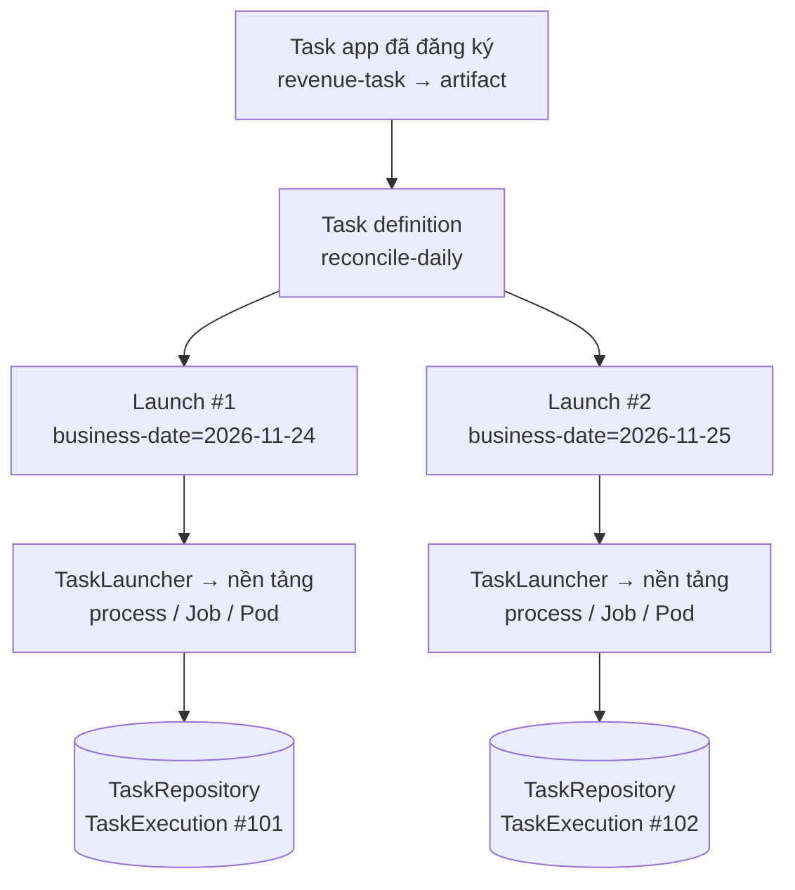

# Phân biệt Task definition, TaskExecution và trạng thái nền tảng

Trong **Spring Cloud Data Flow (SCDF)**, một ứng dụng **Spring Cloud Task** có thể được đăng ký, tạo thành định nghĩa tác vụ, khởi chạy theo yêu cầu hoặc theo lịch, rồi được quan sát sau khi kết thúc. Vì Task là ứng dụng có **thời gian chạy hữu hạn**, người vận hành thường quan tâm ba câu hỏi khác nhau:

1. **Đã khai báo công việc gì, dựa trên ứng dụng nào?** → Xem **Task definition** trong Data Flow.
2. **Một lần chạy cụ thể đã thực sự xử lý thế nào?** → Xem **`TaskExecution`** do Spring Cloud Task ghi vào database.
3. **Tiến trình hoặc container hiện đang ở đâu, còn chạy hay đã chết?** → Xem **trạng thái nền tảng** từ TaskLauncher, Kubernetes, Cloud Foundry hoặc hệ điều hành.

Ba lớp này có liên hệ, nhưng **không phải một trạng thái duy nhất**. Ví dụ, Data Flow có thể chấp nhận yêu cầu launch nhưng container không khởi động được; hoặc nghiệp vụ đã commit kết quả và JVM bị kill trước khi kịp ghi `END_TIME`. Nếu chỉ nhìn một màn hình hoặc một cột trạng thái, bạn dễ quyết định retry sai và gây xử lý trùng dữ liệu.

Sau bài học thuộc chương **Data Flow**, bạn sẽ biết cách phân biệt từng đối tượng, đọc đúng ID/trạng thái, dùng Data Flow Shell để tạo và theo dõi tác vụ, phân tích các trạng thái không khớp và đưa ra quyết định vận hành an toàn khi chạy theo lịch, theo yêu cầu hoặc khi tích hợp Spring Batch.

## 1. Bốn bước trong vòng đời của một tác vụ

Trong SCDF, quy trình phổ biến gồm:

1. **Register task application:** đăng ký tên logic và URI artifact (JAR hoặc image phù hợp) mà Data Flow có thể triển khai.
2. **Create Task definition:** tạo một cấu hình có tên, tham chiếu đến ứng dụng đã đăng ký và các thuộc tính mặc định cần thiết.
3. **Launch Task definition:** yêu cầu SCDF gọi một **`TaskLauncher`** phù hợp với nền tảng; mỗi lần launch có thể tạo một tiến trình hoặc Job/container mới.
4. **Review Task executions:** ứng dụng Spring Cloud Task lưu metadata cho từng lần chạy; SCDF hiển thị lịch sử, ID và trạng thái. Hệ thống điều phối vẫn cần tham chiếu nền tảng để biết tiến trình/container thực tế.



Trong sơ đồ, **một definition** có thể được launch nhiều lần. Mỗi lần khởi động đủ xa để ghi metadata có một `TaskExecution` riêng. Nhưng **yêu cầu launch được chấp nhận không tự chứng minh container đã chạy thành công**; nếu khởi động thất bại sớm, dữ liệu trong repository có thể chưa đầy đủ.

## 2. Task application khác Task definition như thế nào?

**Task application** là phần mềm thực thi: executable JAR Spring Boot có Spring Cloud Task, bean `ApplicationRunner`/`CommandLineRunner` và logic nghiệp vụ. SCDF quản lý đăng ký application bằng tên, loại ứng dụng (`task`) và URI artifact; tùy phiên bản còn hỗ trợ đăng ký nhiều version.

**Task definition** là một **bản khai báo do SCDF lưu** để biết cần chạy ứng dụng nào, với tên task và các thuộc tính cấu hình có thể áp dụng. Định nghĩa giống một *khuôn mẫu khởi chạy*, không phải một tiến trình sống.

| Đối tượng | Ví dụ | Khi nào được tạo? | Có phải một lần chạy? |
| --- | --- | --- | --- |
| **Registered task app** | `revenue-task` → `maven://com.example:revenue-task:1.0.0` | Khi register app trong SCDF | **Không**. Chỉ khai báo artifact khả dụng. |
| **Task definition** | `reconcile-daily` → DSL `revenue-task` | Khi dùng `task create` hoặc Dashboard | **Không**. Có thể launch nhiều lần. |
| **Launch request** | Chạy `reconcile-daily` cho ngày 2026-11-24 | Khi API, người dùng hoặc scheduler yêu cầu | Là **yêu cầu tạo lần chạy**, chưa phải kết quả đã hoàn thành. |
| **TaskExecution** | `TASK_EXECUTION_ID = 101` | Khi Spring Cloud Task/SCDF ghi nhận một lần thực thi | **Có**. Chứa metadata của một lần chạy cụ thể. |
| **Platform runtime object** | Kubernetes Job/Pod, Cloud Foundry task hoặc local process | Khi launcher tạo tài nguyên trên hạ tầng | **Có** ở cấp nền tảng; quản lý vòng đời container/process. |

### Xóa definition không đồng nghĩa xóa lịch sử

Khi chạy `task destroy reconcile-daily`, SCDF xóa **Task definition**. Theo hành vi mặc định trong hướng dẫn SCDF, việc này **không tự xóa** các bản ghi `TaskExecution` đã có và không có nghĩa mọi tiến trình đang chạy sẽ dừng ngay.

SCDF có cơ chế **cleanup** riêng cho execution và tài nguyên triển khai; một số phiên bản hỗ trợ tùy chọn `--cleanup` khi destroy hoặc hành động cleanup qua Dashboard/API. Các thao tác cleanup có thể xóa log/tài nguyên nền tảng hoặc metadata lịch sử tùy hành động cụ thể, vì thế phải kiểm tra phạm vi ảnh hưởng và chính sách retention trước khi dùng ở production.

> **Quy tắc:** Task definition trả lời **“có thể chạy cái gì?”**; TaskExecution trả lời **“lần chạy nào đã xảy ra và kết quả ghi nhận ra sao?”**.

## 3. `TaskExecution` lưu dữ liệu nào?

Trong ứng dụng Spring Cloud Task, **`TaskRepository`** ghi thông tin về mỗi lần chạy; **`TaskExplorer`** hỗ trợ truy vấn. Các trường thường gặp:

| Trường | Vai trò | Lưu ý |
| --- | --- | --- |
| `executionId` / `TASK_EXECUTION_ID` | Định danh **lần chạy**, do kho metadata quản lý | Không thay bằng tên definition hoặc ID Pod. |
| `taskName` / `TASK_NAME` | Tên logic của tác vụ | Nhiều lần chạy có thể trùng tên. |
| `startTime` | Thời điểm bắt đầu được ghi nhận | Có thể chưa có nếu ứng dụng không khởi động đủ xa. |
| `endTime` | Thời điểm kết thúc được ghi nhận | Có thể `NULL` khi tiến trình bị kill/crash. |
| `exitCode` | Kết quả kết thúc do ứng dụng/framework ghi nhận | Thường `0` là thành công; khác `0` là lỗi. |
| `exitMessage` | Thông điệp kết thúc/lỗi phục vụ chẩn đoán | Không thay thế log đầy đủ; cần tránh lộ secret. |
| `arguments` / tham số | Tham số của lần chạy | Có thể thay đổi ở mỗi lần launch cùng definition. |
| `externalExecutionId` | ID tài nguyên thực thi ngoài repository, do hạ tầng/launcher cung cấp khi hỗ trợ | Không đồng nghĩa `executionId`. |
| `parentExecutionId` | ID TaskExecution cha nếu là task con | Dùng liên kết cây thực thi; không phải JobExecution ID. |

Trong database JDBC, bảng thường có tên **`TASK_EXECUTION`**; các bảng tham số và metadata liên quan tùy schema Spring Cloud Task. Để có lịch sử bền vững, ứng dụng phải có datasource đến database metadata phù hợp. Nếu SCDF và task dùng **hai database khác nhau** mà không có cơ chế kết nối/truy xuất tương ứng, Dashboard của SCDF có thể không nhìn thấy kết quả thực thi vừa tạo.

### Một definition, ba lần chạy

Giả sử definition `reconcile-daily` đã được launch ba lần:

| ID thực thi | Tham số nghiệp vụ | Bắt đầu | Kết thúc | Mã thoát | Cách đọc |
| ---: | --- | --- | --- | ---: | --- |
| 101 | `business-date=2026-11-24` | 08:00 | 08:04 | 0 | Metadata ghi nhận hoàn tất thành công. |
| 102 | `business-date=2026-11-25` | 09:00 | 09:01 | 12 | Lần chạy khác kết thúc với mã lỗi. |
| 103 | `business-date=2026-11-26` | 10:00 | `NULL` | `NULL` | Chưa thấy kết thúc: có thể còn chạy hoặc mất cập nhật. |

Ba bản ghi không bị gom làm một chỉ vì cùng definition. Nếu retry ngày 2026-11-25, lần chạy lại thường có **execution ID mới**; idempotency nghiệp vụ phải dựa trên khóa như `business-date` và phiên bản dữ liệu, **không phải** execution ID.

## 4. “Trạng thái Task” trong Data Flow không phải raw field của repository

SCDF cung cấp trạng thái hiển thị ở lớp REST/Dashboard, chẳng hạn enum **`TaskExecutionStatus`** trong các phiên bản được tài liệu hóa:

| Trạng thái SCDF | Ý nghĩa ở lớp hiển thị | Cách xác minh |
| --- | --- | --- |
| **`COMPLETE`** | Lần thực thi được xem là hoàn thành thành công | Đối chiếu `END_TIME` và `EXIT_CODE`, sau đó kiểm tra nghiệp vụ. |
| **`ERROR`** | Lần thực thi không hoàn thành thành công | Xem mã thoát, thông điệp lỗi, log và trạng thái hạ tầng. |
| **`RUNNING`** | SCDF xem lần chạy còn đang thực thi | Kiểm tra tiến trình/Pod thật, đặc biệt khi `END_TIME` trống quá lâu. |
| **`UNKNOWN`** | Thông tin thực thi chưa đủ hoặc lần thực thi chưa thật sự bắt đầu theo cơ chế hiển thị | Kiểm tra yêu cầu launch, deployment, kết nối metadata. |

**Đây là trạng thái suy diễn ở lớp Data Flow**, không phải cột bắt buộc tên `TASK_STATUS` trong `TASK_EXECUTION`. Điều kiện suy diễn và các trường bổ sung có thể thay đổi theo version, nên không tự viết một công thức `if/else` rồi coi đó là logic chính thức cho mọi release.

Ví dụ, `END_TIME IS NULL` không đủ để khẳng định worker còn chạy. Nếu Kubernetes đã đánh dấu Job/Pod thất bại mà metadata chưa cập nhật, giao diện có thể hiển thị trạng thái thiếu nhất quán cho đến khi có cơ chế đối soát.

### Cần phân biệt với `BatchStatus`

Nếu ứng dụng còn chạy **Spring Batch Job**, bạn có thêm `JobExecution`/`StepExecution` với các trạng thái như `STARTING`, `STARTED`, `COMPLETED`, `FAILED`, `STOPPED`. Chúng thuộc **`JobRepository` của Spring Batch**, không phải enum `TaskExecutionStatus` và cũng không phải trạng thái Kubernetes Job.

Một `TaskExecution` có thể chứa **nhiều `JobExecution`**. Khi một Job/Step thất bại, ứng dụng cần ánh xạ kết quả đó ra mã thoát task phù hợp; đừng giả định mọi trạng thái Batch tự đồng bộ với mã thoát của JVM.

## 5. Trạng thái nền tảng: tiến trình, Pod và Job

**Trạng thái nền tảng** mô tả điều đã xảy ra với tài nguyên do `TaskLauncher` tạo. Đó có thể là:

- **Local deployer:** tiến trình Java được khởi chạy, PID, trạng thái còn sống/đã thoát và mã OS nếu launcher quan sát được.
- **Kubernetes:** Job/Pod, giai đoạn `Pending`/`Running`, kết quả `Succeeded`/`Failed`, số lần restart, lý do `OOMKilled`/image pull error, sự kiện và logs tùy retention.
- **Cloud Foundry hoặc nền tảng khác:** tài nguyên task, trạng thái triển khai/chạy/kết thúc và mã lỗi theo API của nền tảng.

Tên trạng thái cụ thể **không dùng chung giữa mọi nền tảng**. Ví dụ `Succeeded` là giá trị của Kubernetes Pod/Job; `COMPLETE` là trạng thái hiển thị của SCDF. Dù gần nghĩa, chúng có nguồn dữ liệu và thời điểm cập nhật khác nhau.

| Câu hỏi | Nguồn dữ liệu đáng xem nhất |
| --- | --- |
| Definition có tồn tại, trỏ artifact nào? | SCDF Task Definitions / App Registry. |
| SCDF đã chấp nhận lệnh launch chưa? | Phản hồi REST/Shell, log Data Flow Server. |
| JVM/container đã được tạo chưa? | `TaskLauncher` và API platform. |
| Container có đang chạy, bị kill hoặc thiếu tài nguyên không? | Events/Job/Pod/process và log hạ tầng. |
| Spring Cloud Task đã ghi kết thúc với mã bao nhiêu? | `TaskRepository` qua SCDF Executions hoặc `TaskExplorer`. |
| Batch Step nào xử lý chưa xong? | Spring Batch `JobRepository`/`JobExplorer`. |
| Kết quả doanh thu thật đã được commit chưa? | Database/file/API nghiệp vụ và khóa idempotency. |

**Không xem Pod `Succeeded` là chứng minh tuyệt đối mọi dữ liệu nghiệp vụ đúng.** Container có thể trả `0` dù code đã nuốt ngoại lệ. Ngược lại, Pod `Failed` không tự chứng minh chưa có thay đổi nghiệp vụ; transaction đã commit trước lúc lỗi vẫn có thể tồn tại.

## 6. Từ lệnh Shell đến execution: ví dụ thực hành

Các lệnh dưới đây minh họa **Spring Cloud Data Flow Shell** của một bản SCDF có các chức năng register/create/launch/list. Cú pháp và URI artifact cần được điều chỉnh theo phiên bản SCDF, loại repository và nền tảng đã kết nối. Không yêu cầu cài đặt shell nếu môi trường chỉ có Dashboard hoặc REST API: các chức năng tương đương vẫn có thể thực hiện qua giao diện/API.

### 6.1. Đăng ký task application

Giả sử bạn đã build một executable JAR Spring Boot / Spring Cloud Task và publish artifact có thể tải từ môi trường Data Flow:

```text
dataflow:>app register --name revenue-task --type task --uri maven://com.example:revenue-task:1.0.0
```

Giải thích:

- `revenue-task` là **tên app đã đăng ký** trong SCDF, không phải ID lần chạy.
- `maven://com.example:revenue-task:1.0.0` là URI artifact **minh họa**; phải thay bằng tọa độ Maven/artifact thực tế được SCDF và deployer hỗ trợ.
- Chỉ đăng ký ứng dụng **chưa tạo `TaskExecution`**, chưa tạo Pod và chưa bắt đầu xử lý.

### 6.2. Tạo Task definition

```text
dataflow:>task create reconcile-daily --definition "revenue-task"
dataflow:>task list
```

`reconcile-daily` là **tên definition**, còn DSL `revenue-task` tham chiếu app đã đăng ký. Definition có thể hiển thị trạng thái liên quan đến các execution trong một số giao diện, nhưng **việc tồn tại definition không đồng nghĩa có tiến trình đang chạy**.

### 6.3. Launch với tham số nghiệp vụ

```text
dataflow:>task launch reconcile-daily --arguments "--business-date=2026-11-24"
```

Đây là **yêu cầu khởi chạy**. Trong một số phiên bản, Data Flow cấp/phản hồi execution ID hoặc external ID ngay khi launch được chấp nhận, thậm chí trước khi JVM bắt đầu ghi metadata. Bởi vậy, cần tiếp tục kiểm tra cả lịch sử execution và hạ tầng; dòng `Launched task ...` không phải bằng chứng đối soát doanh thu đã thành công.

Tham số `--business-date` là option của **ứng dụng do bạn định nghĩa**. Muốn Data Flow chuyển được ngày này thành hành vi nghiệp vụ, code `ApplicationRunner` phải đọc và kiểm tra nó.

### 6.4. Xem lịch sử và một lần chạy cụ thể

```text
dataflow:>task execution list
dataflow:>task execution list --name reconcile-daily
dataflow:>task execution status --id 101
```

Thay `101` bằng **execution ID thật** được SCDF báo cáo. Các lệnh cung cấp góc nhìn về thời điểm, mã thoát và trạng thái của `TaskExecution`; nếu cần xác minh container, sử dụng phần Logs/Execution Detail của Dashboard và công cụ hạ tầng.

Nếu chạy lại cùng definition với `--business-date=2026-11-25`, bạn sẽ thấy **một lần chạy mới**, không phải một trạng thái mới duy nhất của definition.

### 6.5. Tùy biến application/deployer properties

Ví dụ:

```text
dataflow:>task launch reconcile-daily --properties "app.revenue-task.myapp.mode=report,deployer.revenue-task.memory=1024m" --arguments "--business-date=2026-11-24"
```

Đây là mẫu phân biệt **application property** (`app.<app-name>.*`) và **deployer property** (`deployer.<app-name>.*`). Tên, tính hợp lệ và ý nghĩa của `memory` phụ thuộc **deployer và phiên bản**; không phải mọi nền tảng đều chấp nhận đúng property trong ví dụ. Khi dùng Kubernetes, nên tham khảo property chính thức của Kubernetes task deployer thay vì đoán.

**Điểm cần nhớ:** Một application property ảnh hưởng cấu hình/logic của tiến trình; một deployer property ảnh hưởng cách nền tảng tạo tài nguyên. Cả hai có thể được thay đổi theo từng lần launch của cùng Task definition.

## 7. Cấu hình chia sẻ database và truy vấn kết quả

Để SCDF hiển thị lịch sử chính xác, ứng dụng Task và hạ tầng Data Flow cần có quyền truy cập metadata Spring Cloud Task nhất quán, theo **schema/datasource được Data Flow dùng để tra cứu**. Cấu hình ví dụ bên dưới thuộc **ứng dụng Task**, không phải toàn bộ cấu hình của Data Flow Server:

```yaml
spring:
  application:
    name: revenue-task
  main:
    web-application-type: none
  datasource:
    url: jdbc:postgresql://metadata-db.internal:5432/dataflow_metadata
    username: task_runtime
    password: ${TASK_METADATA_DB_PASSWORD}
  cloud:
    task:
      name: reconcileDaily
      initialize-enabled: false
```

Lưu ý tên `spring.cloud.task.name` và tên Task definition của SCDF: Data Flow thường truyền các thuộc tính cần thiết để nhận diện lần chạy; **không tự ép tên khác một cách vô ý** trong cấu hình Task, nếu điều đó làm metadata xuất hiện dưới tên ngoài dự kiến. Trong bài thực hành, có thể bỏ dòng `spring.cloud.task.name` và để SCDF quản lý tên task khi launch; ở đây dòng này minh họa rằng ứng dụng cũng có thuộc tính tên logic.

Với `initialize-enabled: false`, cần có schema Task metadata đúng phiên bản, tạo bởi migration được quản lý trước. Khi production có nhiều phiên bản ứng dụng, kiểm tra tương thích schema/driver của Spring Cloud Task và SCDF. Database URL chỉ là ví dụ; không đưa mật khẩu thật vào source, CLI hoặc log.

### Truy vấn trực tiếp vào `TASK_EXECUTION`

```sql
SELECT
    TASK_EXECUTION_ID,
    TASK_NAME,
    START_TIME,
    END_TIME,
    EXIT_CODE,
    EXIT_MESSAGE,
    EXTERNAL_EXECUTION_ID
FROM TASK_EXECUTION
ORDER BY TASK_EXECUTION_ID DESC;
```

Tên cột và schema có thể thay đổi theo phiên bản hoặc custom prefix. Chỉ dùng SQL để **đọc và chẩn đoán**; không `UPDATE` mã thoát/`END_TIME` thủ công để làm giao diện “xanh”. Hãy tìm nguyên nhân thật khiến lần chạy chưa kết thúc hoặc dữ liệu thiếu.

Nếu truy vấn thấy `EXIT_CODE = 0` nhưng người dùng báo không có file báo cáo, cần kiểm tra **kết quả nghiệp vụ**, không chỉ Task metadata. Nếu truy vấn không có bản ghi nhưng Kubernetes đã có Pod lỗi, kiểm tra **khởi động ứng dụng, DataSource, quyền database, schema và log container**.

## 8. Các tình huống trạng thái không khớp

Đây là phần quan trọng nhất khi vận hành:

| Tình huống | Task definition | TaskExecution/SCDF | Nền tảng | Cách xử lý |
| --- | --- | --- | --- | --- |
| Đã tạo definition, chưa launch | **Có** | Chưa có lần chạy tương ứng | Không có Pod/process của lần chạy | Chỉ mới đăng ký cấu hình, không báo thành công hay thất bại nghiệp vụ. |
| Launch được chấp nhận nhưng image pull lỗi | **Có** | Có thể có bản ghi khởi tạo, `UNKNOWN` hoặc metadata chưa đủ | Job/Pod lỗi `ImagePullBackOff` hoặc tương tự | Kiểm tra URI/image, credential, mạng, deployment events. |
| JVM khởi động và đang xử lý | **Có** | Thường thấy `RUNNING`; `START_TIME` có, `END_TIME` trống | Process/Pod `Running` | Theo dõi tiến độ và giới hạn thời gian. |
| Nghiệp vụ lỗi và JVM trả khác `0` | **Có** | Có thể `ERROR`, exitCode khác `0` nếu metadata cập nhật được | Pod/Job thường `Failed` | Xem exception, Batch metadata, dữ liệu đã commit. |
| Nghiệp vụ hoàn tất, cập nhật metadata thành công | **Có** | Có thể `COMPLETE`, exitCode `0` | Pod/Job thường kết thúc thành công | Đối chiếu kết quả nghiệp vụ, tránh suy ra từ màu trạng thái một mình. |
| Container bị `SIGKILL`/OOM sau khi đã commit nghiệp vụ | **Có** | Có thể còn `RUNNING` hoặc thiếu `END_TIME` | Pod `Failed`, `OOMKilled` hoặc bị dừng | Kiểm tra idempotency và commit trước khi retry. |
| Job/Pod đã bị dọn bởi TTL | Có hoặc đã xóa definition | `TaskExecution` lịch sử có thể còn nguyên | Không còn Pod để xem log trực tiếp | Dùng log tập trung, metadata và retention phù hợp. |
| Definition bị destroy không cleanup | **Không** | Lịch sử cũ thường vẫn tồn tại | Tài nguyên cũ có thể còn tùy nền tảng | Không nhầm việc xóa định nghĩa với dừng/chấm dứt execution. |

Các trạng thái trong bảng là **tình huống minh họa**; SCDF có thể hiển thị khác do timing, cấu hình precreate execution và phiên bản. Một trường hợp **“TaskExecution RUNNING nhưng Kubernetes Job đã Failed”** là tín hiệu phải đối soát hai nguồn, không phải lý do sửa tay `EXIT_CODE`.

### Một trạng thái nền tảng thành công không đủ kết luận nghiệp vụ thành công

Ví dụ runner bắt exception rồi chỉ in lỗi:

```java
try {
    reconcileRevenue();
} catch (Exception e) {
    log.error("Loi doi soat", e);
    // Khong throw lai va khong cap nhat exit code.
}
```

Đoạn này minh họa cách làm **sai** nếu quy trình phải thất bại khi đối soát lỗi: JVM có thể thoát với `0` và Task metadata có thể trông thành công. Để điều phối đáng tin cậy, cần cho lỗi lan truyền hoặc ánh xạ mã thoát bằng cơ chế được Spring Boot hỗ trợ, đồng thời ghi dữ liệu kết quả nghiệp vụ độc lập.

## 9. Phân biệt execution ID, external ID và tên Job/Pod

Trong SCDF, ít nhất bốn định danh thường xuất hiện:

| ID/tên | Nằm ở đâu? | Công dụng |
| --- | --- | --- |
| **Task definition name** | SCDF Definitions | Khai báo để người dùng launch lại nhiều lần. |
| **`TaskExecution.executionId`** | TaskRepository / SCDF Executions | Định danh một lần chạy trong metadata Task. |
| **`externalExecutionId`** | Metadata task nếu launcher/hạ tầng cung cấp | Liên hệ lần chạy với tài nguyên deployer/hạ tầng. |
| **Kubernetes Job/Pod name**, Cloud Foundry task ID hoặc PID | Nền tảng | Xem logs, sự kiện, trạng thái runtime, chi phí và tài nguyên. |
| **Business request ID** | Dữ liệu nghiệp vụ hoặc correlation logging | Nhận biết cùng một công việc logic qua nhiều lần retry. |

**Không dùng `TaskExecution.executionId` làm khóa idempotency nghiệp vụ**; một retry thường có ID mới. Cũng không thể suy ra execution ID bằng cách lấy số cuối của tên Pod. Trong một hệ thống nhiều account/nền tảng, cần lưu thêm **platform name/account, môi trường và correlation ID** để tránh nhầm tài nguyên.

### Cùng definition chạy đồng thời

Nếu hai nhân viên cùng launch `reconcile-daily` cho ngày 2026-11-24, SCDF có thể tạo **hai lần execution** và **hai tài nguyên nền tảng**. Giới hạn số lần launch đồng thời của Data Flow có thể giúp bảo vệ hạ tầng, nhưng **không thay thế khóa nghiệp vụ**. Service đối soát nên có unique constraint/idempotency key hoặc cơ chế lock/lease theo `tenant + businessDate + version`.

## 10. Trạng thái lịch chạy và trạng thái một lần chạy là hai thứ khác nhau

SCDF có chức năng **Scheduling** cho Task. Một lịch có thể định nghĩa quy tắc kích hoạt tương lai (cron/expression và deployment properties tùy nền tảng). Cần phân biệt:

- **Schedule definition:** quy tắc *khi nào* yêu cầu khởi chạy; có thể tồn tại dù chưa đến thời điểm kích hoạt.
- **Task definition:** *chạy ứng dụng gì* khi có yêu cầu.
- **TaskExecution:** *một lần chạy cụ thể* đã ghi nhận trong kho.
- **Platform runtime status:** tài nguyên thực tế của *lần khởi chạy đó* đang ở trạng thái nào.

Ví dụ một schedule 02:00 hằng ngày có thể tạo nhiều TaskExecution theo thời gian. Xóa schedule **không mặc nhiên xóa lịch sử các lần chạy trước**. Nếu một lần chạy thất bại, lịch của ngày kế tiếp có thể vẫn kích hoạt; hệ thống cần chính sách tránh hai kỳ dữ liệu chồng lấn, retry và giới hạn đồng thời.

### “Relaunch” khác “restart một Spring Batch Job”

- **Relaunch task:** tạo một lần thực thi ứng dụng mới, có `TaskExecution` mới; các tác động nghiệp vụ có thể diễn ra lại.
- **Restart Batch Job:** sử dụng `JobRepository` và `JobParameters` để tiếp tục `JobInstance` được phép restart, thường có `JobExecution` mới thuộc JobInstance cũ.
- **Retry deployment:** khởi động lại container/Pod có thể liên quan hành vi launcher và Kubernetes; không được mặc định coi đó là một TaskExecution mới hay một Batch restart an toàn.

Khi Task chứa Batch Job, phải đối chiếu cả **TaskExecution, Batch JobExecution/StepExecution và trạng thái hạ tầng**.

## 11. Quy trình chẩn đoán khi Task “kẹt RUNNING”

Khi SCDF Dashboard vẫn hiển thị một task `RUNNING` quá lâu, tránh bấm launch lại ngay. Một quy trình kiểm tra an toàn:

1. **Ghi lại bộ định danh:** tên definition, `TASK_EXECUTION_ID`, `externalExecutionId`, platform/account, tham số và correlation ID.
2. **Kiểm tra SCDF Execution Detail:** `START_TIME`, `END_TIME`, `EXIT_CODE`, thông điệp lỗi và log nếu còn truy cập được.
3. **Kiểm tra nền tảng:** Pod/Job/process có tồn tại không, trạng thái `Running`/`Failed`, image pull, OOM, liveness, TTL và log của container.
4. **Đối chiếu database:** `TASK_EXECUTION` có bản ghi chưa kết thúc không? Nếu là Batch, `BATCH_JOB_EXECUTION` có Step đang `STARTED` hoặc lỗi không?
5. **Xác nhận hiệu ứng nghiệp vụ:** file báo cáo, bảng đối soát hoặc outbound event đã commit chưa? Có dấu idempotency không?
6. **Ra quyết định:** chờ, dừng theo cơ chế được hỗ trợ, sửa lỗi cấu hình, đối soát metadata hay retry với khóa nghiệp vụ ổn định. Đặt timeout/backoff và giới hạn concurrency.
7. **Ghi nhận sự cố:** cập nhật runbook, cảnh báo khi metadata và hạ tầng không khớp, không chỉnh tay các bảng framework để che dấu lỗi.

**Lưu ý về stop:** Gửi yêu cầu dừng qua SCDF là **một yêu cầu tới nền tảng**, không đảm bảo tiến trình đã dừng tức thì. Với Spring Batch, một Job/Step có thể còn metadata `STARTED` nếu process bị ngắt không kịp cập nhật. Chỉ retry sau khi xác minh tài nguyên cũ và tác động nghiệp vụ.

## 12. Giám sát, cleanup và an toàn vận hành

**Tách ba loại cảnh báo:** (1) **lỗi launch/deployment** trước khi chạy, (2) **lỗi nghiệp vụ/task exit** sau khi chạy, (3) **metadata không cập nhật dù hạ tầng đã kết thúc**. Cùng một dashboard xanh/đỏ không mô tả hết ba loại này.

**Giữ log lâu hơn Pod khi cần:** Kubernetes TTL hoặc chính sách cleanup có thể xóa Job/Pod trước lúc vận hành điều tra. Dùng log tập trung và correlation ID; `TaskExecution` có metadata nhưng không thay thế toàn bộ stack trace.

**Bảo vệ database metadata:** SCDF và ứng dụng Task phải kết nối đúng database/schema/driver được hỗ trợ. Dùng migration, quyền tối thiểu, secret manager và cấu hình tương thích giữa các bản ứng dụng. Không hardcode mật khẩu trong `--arguments` hoặc deployment properties dễ bị ghi log.

**Không xóa execution một cách tùy tiện:** Cleanup metadata có thể làm mất dấu vết lịch sử hoặc liên kết với Batch Job. Thiết kế retention, archive, backup và kiểm tra loại cleanup (chỉ tài nguyên nền tảng hay cả dữ liệu).

**Bảo vệ khi retry:** Mỗi lần launch lại có thể tạo một `TaskExecution` mới nhưng vẫn xử lý cùng ngày nghiệp vụ. Dùng khóa idempotency, transaction ngắn, giới hạn retry và xác minh tiến trình cũ đã kết thúc để tránh ghi trùng.

**Cân bằng tần suất theo lịch và tài nguyên:** Scheduler có thể kích hoạt Task mới khi Task cũ còn chạy. SCDF có giới hạn concurrent task launches theo platform account trong các phiên bản có hỗ trợ; đó là cơ chế bảo vệ tài nguyên, **không phải** đảm bảo một ngày chỉ chạy một lần.

## 13. Bài thực hành tự kiểm tra

Thực hiện trên **SCDF và database môi trường thử nghiệm**:

1. Đăng ký một executable JAR Spring Cloud Task bằng `app register`, tạo `Task definition` với tên khác tên app. Kiểm tra rằng chưa có `TaskExecution` mới chỉ vì tạo definition.
2. Launch definition với `--business-date=2026-11-24`. Ghi lại execution ID, platform name và external execution ID nếu có.
3. Quan sát Kubernetes Job/Pod hoặc local process của lần chạy. Phân biệt tên resource trên platform với `TASK_EXECUTION_ID`.
4. Truy vấn `TASK_EXECUTION`, đối chiếu `START_TIME`, `END_TIME`, `EXIT_CODE` với Shell `task execution status --id`.
5. Launch lại definition với ngày khác. Giải thích vì sao chỉ có **một definition** nhưng có **hai lần execution**.
6. Cố ý cấu hình sai URI image hoặc làm cho container không kết nối được database metadata trên môi trường thử nghiệm. Quan sát trường hợp **nền tảng báo lỗi nhưng metadata còn thiếu**.
7. Cho tác vụ ghi kết quả nghiệp vụ rồi mô phỏng lỗi trước khi Task kết thúc. Thiết kế cách retry không nhân đôi kết quả.
8. Nếu Task chạy Spring Batch Job, truy vấn `JobRepository` và xác định JobExecution ID khác TaskExecution ID thế nào.
9. Dùng cơ chế destroy definition **không cleanup**; kiểm tra lịch sử execution còn tồn tại theo hành vi phiên bản. Không làm bước xóa metadata hàng loạt nếu chưa có backup.
10. Mô tả quy trình xử lý khi Dashboard vẫn `RUNNING` nhưng Kubernetes Job đã `Failed` và Pod đã bị dọn bằng TTL.

**Câu hỏi ôn tập:**

- Tại sao một `Task definition` không phải là một `TaskExecution`?
- Nếu SCDF Shell báo đã “launch” thành công, có thể kết luận nghiệp vụ thành công chưa? Vì sao?
- `TaskExecutionStatus.COMPLETE` và Kubernetes Pod `Succeeded` có cùng nguồn dữ liệu không?
- `END_TIME IS NULL` có đủ để xác nhận JVM vẫn đang chạy không?
- Vì sao xóa Task definition không nên được hiểu là xóa lịch sử các lần chạy?
- Khi restart một Spring Batch Job bên trong Task, những ID nào được tạo mới và repository nào theo dõi Step?
- Nếu definition chạy hai lần cho cùng ngày, cơ chế nào ngăn dữ liệu doanh thu bị tính trùng?

**Ghi nhớ:** **Task definition** là cấu hình khai báo để **launch nhiều lần**; **TaskExecution** là hồ sơ của **từng lần thực thi hữu hạn** trong database; còn **trạng thái nền tảng** mô tả tiến trình/container thực tế. Khi ba nguồn khác nhau, hãy xác minh **launch → runtime → metadata → dữ liệu nghiệp vụ** trước khi dừng, cleanup hoặc retry.

**Tài liệu tham khảo:**

- [Spring Cloud Data Flow — Tasks: Lifecycle, Definitions, Executions](https://docs.spring.io/spring-cloud-dataflow/docs/current/reference/htmlsingle/#tasks).
- [Spring Cloud Data Flow — TaskExecutionStatus API](https://docs.spring.io/spring-cloud-dataflow/docs/current/api/org/springframework/cloud/dataflow/rest/resource/TaskExecutionStatus.html).
- [Spring Cloud Data Flow — Frequently Asked Questions](https://dataflow.spring.io/docs/resources/faq/): lý do Data Flow và các task application cần chia sẻ database metadata.
- [Spring Cloud Task — Reference](https://docs.spring.io/spring-cloud-task/reference/): `TaskExecution`, `TaskRepository`, tham số và vòng đời tác vụ.
