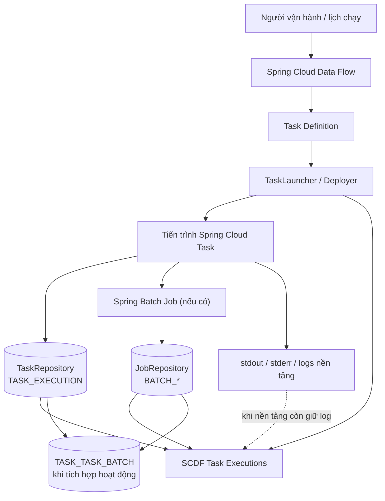
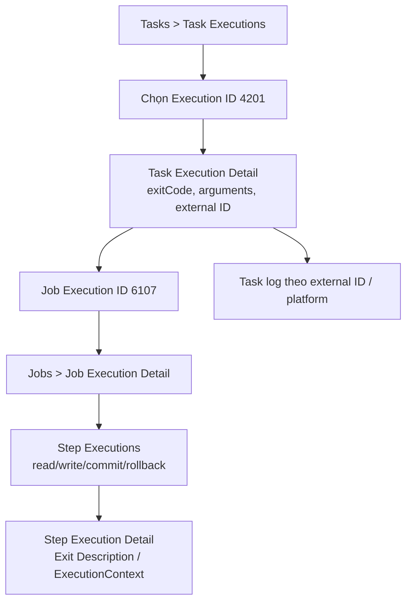
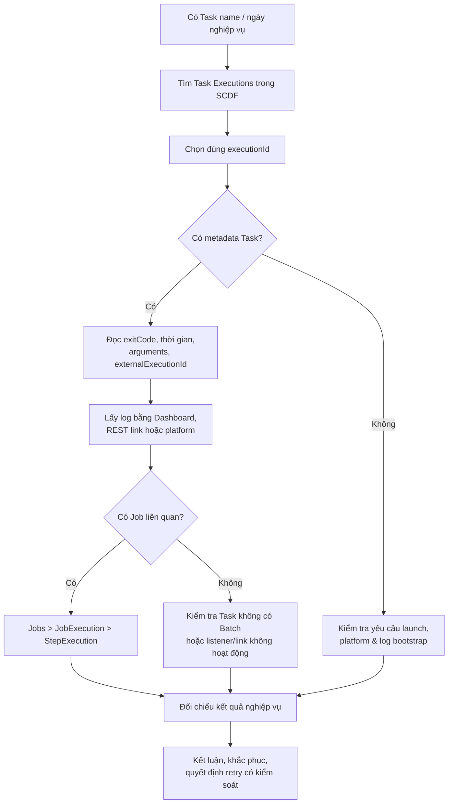

# Tra cứu lịch sử, nhật ký và Job liên quan

## Mục tiêu học tập

Sau bài này, bạn có thể:

- Dùng **Spring Cloud Data Flow (SCDF)** để xem lịch sử chạy một ứng dụng **Spring Cloud Task** hữu hạn, không nhầm *Task Definition* với *Task Execution*.
- Từ một `TaskExecution.executionId`, xem thời gian, kết quả, tham số, định danh bên ngoài và **log của đúng lượt chạy**.
- Chuyển từ Task Execution sang các **Spring Batch JobExecution/StepExecution liên quan**, đọc trạng thái, số bản ghi, lỗi và khả năng restart.
- Tra cứu bằng ba cách: **Data Flow Dashboard**, **Data Flow Shell** và **REST API**; biết thời điểm phải dùng log nền tảng như Kubernetes.
- Giải thích vai trò các bảng `TASK_EXECUTION`, `TASK_TASK_BATCH`, `BATCH_JOB_EXECUTION`, phân biệt ID Task/Job/Pod.
- Xử lý các tình huống không có log, không có Job liên kết, metadata thiếu thời điểm kết thúc hoặc Task báo thành công nhưng Batch Job thất bại.
- Đề xuất checklist bảo mật, lưu trữ lịch sử, đối soát và điều tra sự cố khi Task được chạy theo lịch hay theo yêu cầu.

> **Ngữ cảnh:** Bài thuộc chương **Data Flow** của module **SPRING_CLOUD_TASK**. Spring Cloud Task giúp ứng dụng Spring Boot chạy trong thời gian hữu hạn và ghi kết quả từng lần thực thi vào cơ sở dữ liệu qua `TaskRepository`. Spring Cloud Data Flow là lớp điều phối/quan sát giúp đăng ký, chạy, xem lịch sử, log và Spring Batch Job liên quan khi ứng dụng được triển khai trong hạ tầng được hỗ trợ. Hai sản phẩm có vai trò khác nhau; Data Flow **không thay thế** TaskRepository hay JobRepository.

## 1. Ví dụ vận hành: vì sao cần tìm đúng một lần chạy?

Hệ thống có Task `daily-reconciliation` chạy lúc 02:00 mỗi ngày và có thể được vận hành chạy lại nếu lỗi:

```text
Task Definition: daily-reconciliation

Ngày 2026-11-24
  Lượt A: TaskExecution 4201
    02:00:02 -> 02:01:35, exitCode=1
    Batch JobExecution 6107: FAILED

  Lượt B: TaskExecution 4202
    02:10:01 -> 02:11:52, exitCode=0
    Batch JobExecution 6108: COMPLETED
```

Các ID và thời điểm trên là **dữ liệu minh họa**, không phải dữ liệu từ một SCDF server đang chạy. Cả hai lượt có thể dùng chung `--business-date=2026-11-24` nhưng sinh ra **hai TaskExecution ID** và có thể hai JobExecution ID khác nhau.

Người vận hành thường phải trả lời một chuỗi câu hỏi:

1. Có bao nhiêu lần Task được khởi chạy cho ngày xử lý đó?
2. Lần nào thành công, lần nào thất bại? Có tiến trình nào còn chạy không?
3. Log của lượt `4201` chứa exception gì?
4. Batch Job nào chạy **bên trong lượt 4201**? Step nào thất bại?
5. Đã có bản ghi nghiệp vụ nào được commit trước khi Job lỗi?
6. Khi chạy lại lượt `4202`, hệ thống có tránh xử lý trùng dữ liệu không?

Chỉ tìm theo `taskName` chưa đủ. Cần **định danh lần chạy** và đường nối giữa metadata Task, log hạ tầng, metadata Spring Batch và trạng thái nghiệp vụ.

## 2. Phân biệt các tầng của Spring Cloud Task và Data Flow

| Khái niệm | Nơi quản lý | Ý nghĩa |
| --- | --- | --- |
| **Task Definition** | Spring Cloud Data Flow | Cấu hình logic/ứng dụng Task đã đăng ký, ví dụ tên `daily-reconciliation` và artifact. |
| **Task Execution** | Spring Cloud Task + `TaskRepository`; SCDF hiển thị/tra cứu | **Một lần chạy** ứng dụng, có `executionId`, thời điểm, mã thoát, tham số. |
| **External Execution ID** | TaskLauncher/Deployer của nền tảng | Định danh ngoài dùng tìm tiến trình/container hoặc log; khác `executionId` của repository. |
| **Job Instance** | Spring Batch `JobRepository` | Job logic theo tên và tập identifying `JobParameters`. |
| **Job Execution** | Spring Batch `JobRepository` | Một lần thử thực thi Job; có `JOB_EXECUTION_ID`, `BatchStatus`, `ExitStatus`. |
| **Step Execution** | Spring Batch `JobRepository` | Thực thi một Step cụ thể trong Job, có read/write/commit/rollback counts và lỗi. |
| **Pod/container/process** | Kubernetes, Cloud Foundry hoặc môi trường chạy khác | Tài nguyên runtime; có log và exit code hệ điều hành, có thể đã bị dọn dẹp. |

**Task Definition không phải lịch sử chạy.** Khi bạn nhấn *Launch*, Data Flow yêu cầu một TaskLauncher tạo tiến trình; ứng dụng Spring Cloud Task ghi một `TaskExecution` vào repository sau khi hạ tầng của nó khởi tạo được. Nếu lỗi xảy ra quá sớm, có thể có yêu cầu launch/container lỗi nhưng **chưa có bản ghi TaskExecution**.



SCDF có thể lưu cấu hình định nghĩa, dữ liệu điều phối và đọc metadata Task/Batch qua repository phù hợp. SCDF **không tạo ra mọi thông tin Job/Step** nếu ứng dụng không dùng Spring Batch hoặc không ghi metadata Batch.

### Điều kiện tiên quyết về cơ sở dữ liệu

Để hiển thị lịch sử đáng tin cậy:

- Ứng dụng Task dùng `spring-cloud-starter-task`, có JDBC `DataSource` và **schema Task đúng phiên bản**.
- SCDF được cấu hình để truy cập đúng metadata Task/Batch theo hạ tầng và **schema target** hỗ trợ của release.
- Nếu có Spring Batch, ứng dụng dùng `JobRepository` bền vững với bảng `BATCH_*` và cấu hình tích hợp Task–Batch khi cần liên kết Job về Task.
- Giữ version Spring Boot/Spring Cloud Task/Spring Batch/SCDF tương thích; các màn hình, API response, cơ chế bảng và tham số có thể khác theo release.

**Phạm vi ví dụ:** Giao diện, Shell và REST trong bài dựa trên tài liệu **Spring Cloud Data Flow 2.11.x**. Nếu dùng một release khác, hãy kiểm tra API root, cơ chế đăng nhập, phân quyền, cấu hình platform và các tính năng đang có trước khi sao chép lệnh.

## 3. Định danh nào dùng cho thao tác nào?

Một lần Task minh họa:

```text
taskName:           daily-reconciliation
executionId:        4201
externalExecutionId: daily-reconciliation-e8c0c7ad
platformName:        default
jobExecutionIds:     [6107]
businessDate:        2026-11-24
```

| Cần làm gì? | Nên dùng gì? | Không nên nhầm với |
| --- | --- | --- |
| Xem chi tiết một lượt Task trong Dashboard/API | `executionId=4201`. | Tên Task. |
| Tìm log runtime qua Data Flow REST | `externalExecutionId` và `platformName`, hoặc theo liên kết `tasks/logs` trả về trong response. | `executionId` dạng số. |
| Xem chi tiết một Batch Job | `jobExecutionId=6107`. | `taskExecutionId=4201`. |
| Chống chạy trùng ngày nghiệp vụ | `businessDate` kết hợp khóa nghiệp vụ khác. | `executionId`: retry thường có ID mới. |
| Điều tra Kubernetes Pod | Tên/UID Pod, labels, thời gian và external ID nếu có. | Tên Task có thể trùng qua nhiều lượt. |
| Tổng hợp log nhiều môi trường | Environment + repository + TaskExecution ID + trace/correlation ID. | ID đơn lẻ không duy nhất giữa các database. |

Trong REST response của SCDF, trường `jobExecutionIds` có thể chứa nhiều JobExecution ID; **không mặc định mỗi Task chỉ chạy đúng một Batch Job**. Trường `externalExecutionId` có thể trống khi Task không được khởi chạy qua nền tảng cung cấp ID ngoài.

## 4. Xem lịch sử trong SCDF Dashboard

### 4.1. Mở màn hình Task Executions

Với giao diện SCDF hỗ trợ trong dòng tài liệu 2.11.x:

1. Đăng nhập vào **Spring Cloud Data Flow Dashboard** bằng tài khoản có quyền xem Task.
2. Mở mục **Tasks**.
3. Chuyển đến tab **Task Executions** hoặc **Executions**.
4. Lọc theo tên Task, thời gian hoặc tiêu chí được phiên bản UI hỗ trợ.
5. Chọn hàng cần xem dựa trên `Task Name`, `Execution ID`, `Start Time`, `End Time` và `Exit Code`.
6. Nhấn vào **Execution ID** của lượt chạy cần điều tra.

**Không chọn lượt chạy chỉ bằng tên định nghĩa** nếu Task đã được chạy nhiều lần. Trong ví dụ, `4201` và `4202` đều là `daily-reconciliation` nhưng một lượt thất bại và một lượt thành công.

### 4.2. Các trường có thể thấy trên trang chi tiết

Tài liệu SCDF 2.11.x mô tả trang *Task Execution Detail* hiển thị những dữ liệu như:

| Thông tin | Cách sử dụng |
| --- | --- |
| `executionId` và `taskName` | Xác định đúng lượt chạy và loại ứng dụng. |
| `startTime`, `endTime`, duration | Đo thời gian Task được ghi nhận hoạt động; phát hiện lượt chạy bất thường. |
| `exitCode`, `exitMessage` | Đánh giá kết quả tiến trình theo repository; kết hợp log/điều kiện nghiệp vụ. |
| Arguments | Xem các tham số được lưu; tránh làm lộ secret khi chia sẻ ảnh/log. |
| `externalExecutionId` | Liên hệ Task với tài nguyên mà Deployer đã tạo. |
| Batch job indicator | Cho biết Task có metadata Job được liên kết hay không. |
| **Job Execution IDs** | Liên kết đến các trang Job Execution tương ứng nếu có. |
| Logging output | Log Task mà platform có thể cung cấp tại thời điểm truy vấn. |

Giao diện có thể có các thao tác *Relaunch*, *Stop* hoặc *Cleanup*. **Không dùng chúng như các nút chỉ để xem thông tin**: relaunch tạo một lần chạy mới, stop có thể ngắt công việc, cleanup có thể dọn tài nguyên hoặc dữ liệu tùy lựa chọn.

### 4.3. Lọc đúng lượt theo tham số nghiệp vụ

Nếu hai lượt cùng `--business-date=2026-11-24`, nên:

- Liệt kê Task Executions theo `taskName` và sắp xếp/tham chiếu theo thời gian.
- Mở **Arguments** từng lượt hoặc dùng công cụ đọc repository để đối chiếu ngày.
- Kiểm tra `executionId` trong log, nếu ứng dụng đã ghi qua `TaskExecutionListener`.
- Xác định retry có được kích hoạt bởi scheduler, người vận hành hay tự động chạy lại.
- Ghi lại bảng đối chiếu giữa `executionId`, JobExecution ID và khóa nghiệp vụ trong ticket điều tra.

Không tạo phép suy luận “ID lớn nhất là lượt đã xử lý thành công” nếu chưa xem kết quả và dữ liệu nghiệp vụ.

## 5. Từ Task Execution sang Spring Batch Job liên quan

Khi Task chứa Spring Batch Job, mở **Job Execution IDs** từ Task Execution Detail, hoặc vào mục **Jobs** của Dashboard.

Đường đi được mô tả trong tài liệu SCDF:



### 5.1. Các cấp metadata

| Cấp | ID minh họa | Trường hữu ích |
| --- | ---: | --- |
| TaskExecution | `4201` | Task name, start/end, exit code, arguments. |
| JobInstance | `3050` | Job name và identifying JobParameters. |
| JobExecution | `6107` | `BatchStatus`, `ExitStatus`, thời gian, JobParameters. |
| StepExecution | `8101` | `StepName`, status, readCount, writeCount, commitCount, rollbackCount, exit message. |

Một TaskExecution có thể liên kết nhiều JobExecution; một JobInstance có thể có nhiều JobExecution khi restart. Mỗi JobExecution có thể có nhiều StepExecution.

### 5.2. Xác định Step thất bại

Ở **Job Execution Detail**, chọn Step có `Status=FAILED` hoặc kết quả bất thường. Trong **Step Execution Detail**, đọc:

- `START_TIME` và `END_TIME`.
- `READ_COUNT`, `WRITE_COUNT`, `COMMIT_COUNT`, `ROLLBACK_COUNT` và các chỉ số skip nếu có.
- `EXIT_CODE` và `EXIT_MESSAGE` của Step.
- `ExecutionContext` của Step nếu giao diện hiển thị.
- Log application/worker tương ứng tại thời điểm lỗi.

**Cảnh báo:** Exit description trong bảng Batch có giới hạn độ dài theo schema. Stack trace dài có thể bị cắt; khi thiếu phần nguyên nhân hãy đối chiếu log nền tảng thay vì kết luận không có lỗi.

### 5.3. Trường hợp không thấy Job liên quan

Có thể do:

1. Task là ứng dụng thông thường, không chạy Batch Job.
2. Spring Batch Job không thực sự được khởi chạy (cấu hình auto-run bị tắt, launcher không được gọi).
3. `TaskBatchExecutionListener` chưa được kích hoạt hoặc Job nằm ngoài phạm vi listener.
4. `spring-cloud-task-batch`/dependency tích hợp không được đưa vào runtime.
5. TaskRepository và JobRepository không được SCDF nhận diện qua cấu hình/schema đang dùng.
6. Bảng `TASK_TASK_BATCH` thiếu hoặc không ghi được liên kết.
7. Lượt chạy quá sớm đã thất bại trước khi Job tạo metadata.
8. Metadata Batch hoặc Task đã bị dọn/xóa theo retention.

**Không lấy “Job Execution IDs trống” để chứng minh Task không chạy Batch.** Kiểm tra trực tiếp `BATCH_JOB_EXECUTION`, log của Task và cấu hình listener trước khi kết luận.

## 6. Xem log: bắt đầu từ Task Execution Detail

Ở trang chi tiết, SCDF có thể cung cấp **logging output** và thao tác xem log (tên nút phụ thuộc release/UI). Tuy nhiên, log không được đảm bảo tồn tại mãi:

- Trên **Kubernetes**, log thường gắn với Pod/container và bị ảnh hưởng bởi chính sách retention, Pod deletion, node rotation hoặc log collection.
- Trên **local deployer**, tiến trình con có thể đã kết thúc và tài nguyên log được lưu theo cơ chế triển khai.
- Trên **Cloud Foundry**, cách lưu và truy vấn log phụ thuộc runtime/logging service.
- Trong **hệ thống logging tập trung**, có thể giữ lịch sử lâu hơn Pod; cần gắn ID để tìm đúng lượt chạy.

### 6.1. Định danh dành cho log REST

SCDF REST document 2.11.x mô tả:

```http
GET /tasks/logs/{externalTaskExecutionId}?platformName={platformName}
```

Do đó, truy vấn log dùng **external execution ID**, không phải cứ thay `4201` vào đường dẫn. Cách an toàn là mở `GET /tasks/executions/4201` và dùng **`_links["tasks/logs"].href`** nếu được trả về. Liên kết đã mang external ID/platform (và có thể schema target) đúng với lượt thực thi.

Nếu `externalExecutionId` không có, platform đã xóa tài nguyên, hoặc môi trường không hỗ trợ truy xuất log, Dashboard có thể không hiển thị được. Khi đó chuyển sang log tập trung và dữ liệu hạ tầng.

### 6.2. Kiểm tra log trên Kubernetes

Trong deployment SCDF trên Kubernetes, tài liệu tham khảo dùng label `task-name` để tìm Pod của Task:

```bash
# Thay task-name và namespace bằng giá trị thật.
kubectl -n batch-tasks get pods -l task-name=daily-reconciliation

# Chọn đúng Pod của execution đang điều tra.
kubectl -n batch-tasks logs <task-pod-name>

# Quan sát tình trạng Pod, nguyên nhân termination.
kubectl -n batch-tasks describe pod <task-pod-name>
```

**Không giả định label `task-name` chỉ có một Pod.** Nhiều lượt retry, schedule hoặc composed Task có thể tạo nhiều Pod cùng nhãn. Đối chiếu thêm creation timestamp, external execution ID, labels/annotations thực tế và log `executionId`.

Nếu Pod có nhiều container, phải chọn đúng container bằng `-c <container-name>`. Nếu Pod đã bị xóa và không có logging tập trung, `kubectl logs` có thể không còn dữ liệu. `kubectl logs --previous` chỉ giúp trong một số trường hợp container restart và còn bản log trước đó, không khôi phục mọi Pod đã bị dọn.

### 6.3. Log nào nên được ứng dụng ghi?

Để điều tra hiệu quả, một Task nên log ít nhất:

- `taskName` và `executionId` ngay sau khi Spring Cloud Task đăng ký lần chạy.
- `externalExecutionId`/correlation ID nếu ứng dụng truy cập được và cần tương quan với platform.
- `businessDate` hoặc khóa nghiệp vụ **không nhạy cảm**.
- Khi có Batch: `jobExecutionId`, `stepExecutionId`, tên Job/Step.
- Thời điểm bắt đầu/kết thúc, số bản ghi xử lý và kết quả.
- Exception kèm stack trace ở điểm xử lý lỗi có ý nghĩa.
- Không log password, token, dữ liệu cá nhân hoặc toàn bộ `ExecutionContext` thiếu kiểm soát.

Ví dụ `TaskExecutionListener` cho log vòng đời:

```java
package com.example.reconciliation;

import org.slf4j.Logger;
import org.slf4j.LoggerFactory;
import org.springframework.cloud.task.listener.TaskExecutionListener;
import org.springframework.cloud.task.repository.TaskExecution;
import org.springframework.stereotype.Component;

@Component
public class TaskAuditListener implements TaskExecutionListener {

    private static final Logger log =
            LoggerFactory.getLogger(TaskAuditListener.class);

    @Override
    public void onTaskStartup(TaskExecution taskExecution) {
        log.info("Task started executionId={}, name={}",
                taskExecution.getExecutionId(),
                taskExecution.getTaskName());
    }

    @Override
    public void onTaskEnd(TaskExecution taskExecution) {
        log.info("Task ended executionId={}, exitCode={}",
                taskExecution.getExecutionId(),
                taskExecution.getExitCode());
    }

    @Override
    public void onTaskFailed(TaskExecution taskExecution, Throwable cause) {
        log.error("Task failed executionId={}",
                taskExecution.getExecutionId(), cause);
    }
}
```

`TaskExecutionListener` ghi log phục vụ tương quan, không thay cơ chế lưu log bền vững. Nếu Task lỗi trước khi listener được gọi, phải xem log bootstrap/container. Nếu runner bắt exception rồi chỉ log và trả về bình thường, callback thất bại không nhất thiết được kích hoạt.

## 7. Tra cứu bằng Spring Cloud Data Flow Shell

Ngoài Dashboard, SCDF Shell hỗ trợ truy vấn lịch sử Task. Sau khi kết nối Shell đến SCDF server và đăng nhập theo cấu hình bảo mật đang áp dụng:

```text
dataflow:>task execution list
dataflow:>task execution list --name daily-reconciliation
dataflow:>task execution status --id 4201
```

Giải thích:

| Lệnh | Kết quả |
| --- | --- |
| `task execution list` | Liệt kê các lượt Task gần đây mà SCDF quản lý/nhận diện. |
| `task execution list --name daily-reconciliation` | Lọc lượt chạy theo tên Task. |
| `task execution status --id 4201` | Xem chi tiết trạng thái của một lần thực thi. |

Đây là các lệnh được tài liệu SCDF 2.11.x mô tả. Nếu Shell release khác dùng option hay định dạng khác, xem `help`/tài liệu Shell của phiên bản đang chạy.

**Shell trả dữ liệu metadata, không phải toàn bộ log**. Với stack trace đầy đủ, cần Dashboard log/REST `tasks/logs` hoặc platform logging. Một lần Task hoàn tất không mặc định tạo lệnh Shell để đọc mọi dòng stdout lịch sử nếu Deployer đã dọn tài nguyên.

### Phân biệt xem lịch sử và thực thi tác vụ

Các thao tác quản trị như `task launch`, `task execution relaunch`, `task execution stop` hoặc `task execution cleanup` có thể tạo, ngắt hay dọn tài nguyên. Không sử dụng trong quy trình **read-only điều tra** khi chưa xác định tác động và quyền hạn.

Cụ thể, **Relaunch** tạo một TaskExecution mới và có thể chạy lại cùng tham số. Nếu tác vụ ghi tiền, gửi email hay phát message, cần kiểm tra idempotency trước khi relaunch.

## 8. Tra cứu bằng REST API của SCDF

Các ví dụ sau theo tài liệu REST SCDF 2.11.x, giả định server nội bộ ở `http://localhost:9393`. Đây là **địa chỉ ví dụ**, không phải endpoint production. Trong hệ thống thực, dùng HTTPS, xác thực, phân quyền và base URL do đơn vị vận hành cung cấp.

### 8.1. Liệt kê các lần chạy theo tên

```http
GET /tasks/executions?name=daily-reconciliation&page=0&size=10
```

Ví dụ `curl` cho môi trường local đã cho phép truy cập:

```bash
curl -sS \
  'http://localhost:9393/tasks/executions?name=daily-reconciliation&page=0&size=10'
```

Thông thường response dạng HAL/JSON có `_embedded.taskExecutionResourceList` và metadata phân trang. Nội dung thực tế có thể chứa `taskName`, `executionId`, `exitCode`, `arguments`, `jobExecutionIds`, `externalExecutionId`, `platformName` và những liên kết tương ứng.

**Lưu ý:** `page` bắt đầu từ `0` trong API theo tài liệu; cần phân trang khi lịch sử có hàng nghìn lần chạy. Không tải toàn bộ lịch sử vào bộ nhớ chỉ để tìm vài lượt lỗi.

### 8.2. Chi tiết một Task Execution

```http
GET /tasks/executions/4201
```

```bash
curl -sS 'http://localhost:9393/tasks/executions/4201'
```

Response minh họa **rút gọn**:

```json
{
  "executionId": 4201,
  "taskName": "daily-reconciliation",
  "startTime": "2026-11-24T02:00:02Z",
  "endTime": "2026-11-24T02:01:35Z",
  "exitCode": 1,
  "arguments": ["--business-date=2026-11-24"],
  "jobExecutionIds": [6107],
  "externalExecutionId": "daily-reconciliation-e8c0c7ad",
  "platformName": "default",
  "_links": {
    "self": {
      "href": "http://localhost:9393/tasks/executions/4201"
    },
    "tasks/logs": {
      "href": "http://localhost:9393/tasks/logs/daily-reconciliation-e8c0c7ad?platformName=default"
    }
  }
}
```

Đây là **mẫu để hiểu cấu trúc**, không phải response thực từ server. `schemaTarget` hoặc trường khác có thể được thêm vào trong môi trường quản lý nhiều schema Boot; kiểu dữ liệu ngày và các link tùy release.

### 8.3. Đọc log theo external ID

```http
GET /tasks/logs/daily-reconciliation-e8c0c7ad?platformName=default
```

Ví dụ:

```bash
curl -sS \
  'http://localhost:9393/tasks/logs/daily-reconciliation-e8c0c7ad?platformName=default'
```

Nếu response của `GET /tasks/executions/4201` đã chứa `_links["tasks/logs"].href`, **ưu tiên sử dụng URL được server cung cấp**. Nó có thể chứa tham số `schemaTarget`/platform và đường dẫn triển khai phù hợp; không tự suy diễn link nếu SCDF instance có base path khác.

Có log không có nghĩa đã xử lý thành công; phải xem exit code Task, Job status và dữ liệu nghiệp vụ. Ngược lại, endpoint log không trả dữ liệu có thể do tài nguyên đã bị cleanup, log retention hết hạn hoặc platform không hỗ trợ truy xuất, không chứng minh Task chưa chạy.

### 8.4. Liệt kê Batch Job theo Task Execution ID

Theo SCDF REST 2.11.x:

```http
GET /jobs/thinexecutions?page=0&size=10&taskExecutionId=4201
```

```bash
curl -sS \
  'http://localhost:9393/jobs/thinexecutions?page=0&size=10&taskExecutionId=4201'
```

`thinexecutions` trả phiên bản gọn của JobExecution, thuận tiện khi cần liệt kê liên kết mà chưa tải chi tiết mọi Step. Với mỗi `JobExecution ID` lấy được, mở link `self` ở response Job hoặc:

```http
GET /jobs/executions/6107
```

```bash
curl -sS 'http://localhost:9393/jobs/executions/6107'
```

Các endpoint dành cho Step cũng được SCDF công bố trong REST root/HAL links; khi cần chi tiết Step, ưu tiên **đi theo `_links`** của Job Execution thay vì đoán template URL từ một version khác.

### 8.5. Vì sao REST dùng HAL links?

Đối với một số API Spring HATEOAS, response có `_links` dẫn tới thao tác liên quan. Việc đi theo link giúp tránh:

- Ghép sai URL khi server có base path hoặc API gateway.
- Thiếu `platformName`/`schemaTarget` khi xem log/Job.
- Nhầm Task execution ID với Job execution ID.
- Viết cứng đường dẫn khi nâng cấp release.

Trong production, tự động hóa tra cứu nên xử lý lỗi HTTP `401/403`, `404`, `5xx`, timeout và phân trang; tránh in access token hoặc toàn bộ arguments chứa secret vào log pipeline.

## 9. SQL read-only: xem Task/Job khi Dashboard thiếu dữ liệu

Nếu có quyền đọc database metadata hoặc đang điều tra chính hệ thống repository, SQL hỗ trợ xác minh độc lập với UI. Các truy vấn sau dùng tên bảng mặc định thường gặp; kiểm tra **schema prefix và database dialect** thực tế trước khi chạy.

### 9.1. Tìm lượt Task mới nhất

```sql
SELECT
    TASK_EXECUTION_ID,
    TASK_NAME,
    START_TIME,
    END_TIME,
    EXIT_CODE,
    EXIT_MESSAGE,
    ERROR_MESSAGE
FROM TASK_EXECUTION
WHERE TASK_NAME = 'daily-reconciliation'
ORDER BY START_TIME DESC, TASK_EXECUTION_ID DESC;
```

Thêm phân trang/giới hạn theo database đang dùng. Kết quả SQL chỉ cho biết trạng thái được ghi trong repository; `END_TIME IS NULL` có thể là Task đang chạy **hoặc** Pod đã bị kill/mất kết nối DB trước khi ghi kết thúc.

### 9.2. Xem tham số của lượt chạy

```sql
SELECT TASK_EXECUTION_ID, TASK_PARAM
FROM TASK_EXECUTION_PARAMS
WHERE TASK_EXECUTION_ID = 4201;
```

Dữ liệu tham số có thể chứa thông tin nhạy cảm nếu ứng dụng sai lầm đưa secret qua CLI. Phải hạn chế quyền xem và che trước khi đưa vào ticket/ảnh chụp.

### 9.3. Nối Task và Spring Batch Job qua bảng liên kết

Khi integration Task–Batch được kích hoạt và có bảng `TASK_TASK_BATCH`:

```sql
SELECT
    t.TASK_EXECUTION_ID,
    t.TASK_NAME,
    t.EXIT_CODE AS TASK_EXIT_CODE,
    x.JOB_EXECUTION_ID,
    i.JOB_NAME,
    j.STATUS AS JOB_STATUS,
    j.EXIT_CODE AS JOB_EXIT_CODE,
    j.START_TIME AS JOB_START,
    j.END_TIME AS JOB_END
FROM TASK_EXECUTION t
LEFT JOIN TASK_TASK_BATCH x
  ON x.TASK_EXECUTION_ID = t.TASK_EXECUTION_ID
LEFT JOIN BATCH_JOB_EXECUTION j
  ON j.JOB_EXECUTION_ID = x.JOB_EXECUTION_ID
LEFT JOIN BATCH_JOB_INSTANCE i
  ON i.JOB_INSTANCE_ID = j.JOB_INSTANCE_ID
WHERE t.TASK_EXECUTION_ID = 4201
ORDER BY x.JOB_EXECUTION_ID;
```

`TASK_TASK_BATCH` là bảng **liên kết khóa**, không tự chứng minh mọi Job thành công. Một Task có thể liên kết **nhiều JobExecution**, nên kết quả join có thể nhiều hàng. `LEFT JOIN` cho phép Task vẫn xuất hiện khi không có Job liên kết.

Không nối `TASK_EXECUTION_ID = JOB_EXECUTION_ID` trực tiếp: hai loại ID được cấp độc lập. Nếu TaskRepository và JobRepository thực sự nằm ở **hai database khác nhau**, câu JOIN SQL thông thường không tự chạy xuyên nguồn; cần ứng dụng có quyền/khả năng truy vấn liên nguồn hoặc đối chiếu ở tầng dịch vụ.

### 9.4. Tìm Step bị lỗi

```sql
SELECT
    STEP_EXECUTION_ID,
    JOB_EXECUTION_ID,
    STEP_NAME,
    STATUS,
    READ_COUNT,
    WRITE_COUNT,
    COMMIT_COUNT,
    ROLLBACK_COUNT,
    EXIT_CODE,
    EXIT_MESSAGE
FROM BATCH_STEP_EXECUTION
WHERE JOB_EXECUTION_ID = 6107
ORDER BY STEP_EXECUTION_ID;
```

Đọc `EXIT_MESSAGE` để tìm exception ở cấp Step; với stack trace dài, log nền tảng là nguồn bổ sung quan trọng. Step báo `COMPLETED` cũng không tự khẳng định logic nghiệp vụ đúng nếu code xử lý lỗi sai.

## 10. Dùng log, Task và Job theo thứ tự điều tra

Có thể áp dụng quy trình **từ ngoài vào trong**:



### Ví dụ suy luận

Quan sát:

- `TaskExecution 4201` có `EXIT_CODE = 1`.
- Log của Pod chứa lỗi timeout tại service nạp dữ liệu.
- `JobExecution 6107` có `STATUS = FAILED`.
- `StepExecution importPayments` có `WRITE_COUNT = 12000` và `ROLLBACK_COUNT = 1`.

Từ đây **chưa thể kết luận tất cả 12.000 bản ghi đã commit**: `WRITE_COUNT`/chunk và transaction boundaries cần được hiểu theo Spring Batch; một số bản ghi có thể rollback. Phải kiểm tra bảng nghiệp vụ, checkpoint và kết quả hệ thống ngoài.

Để chạy lại, không chỉ nhấn `Relaunch`. Cần kiểm tra identifying JobParameters, trạng thái JobInstance, cơ chế restart, transaction, business idempotency key và hiệu ứng bên ngoài trước.

## 11. Phân biệt ba kiểu “không tìm thấy dữ liệu”

| Triệu chứng | Những điều cần kiểm tra | Không nên kết luận ngay |
| --- | --- | --- |
| Không thấy Task Execution | SCDF có kết nối đúng repository/schema target không? Task lỗi trước khi ghi metadata? Có quyền xem? Đã cleanup dữ liệu? | “Task chưa bao giờ được khởi chạy.” |
| Có Task Execution nhưng không xem được log | External ID/platform đúng không? Pod còn không? Logging service có giữ không? REST link có trả lỗi? | “Ứng dụng không phát log” hoặc “Task đã thành công.” |
| Có Task Execution nhưng không có Job link | Task có chạy Batch? Listener/bảng `TASK_TASK_BATCH` có hoạt động? JobRepository có dữ liệu không? | “Không có Batch Job nào thực thi.” |

**Repository metadata có thể tồn tại lâu hơn log runtime**, và log runtime đôi khi có thông tin lỗi dù TaskRepository chưa tạo row. Bởi vậy phải giữ nhiều nguồn quan sát độc lập.

### Trạng thái `UNKNOWN` và `END_TIME IS NULL`

SCDF có thể hiện trạng thái runtime như `UNKNOWN` khi chưa xác định được tình trạng Task trên nền tảng. `END_TIME IS NULL` trong database chỉ phản ánh chưa có cập nhật kết thúc. Hai dữ kiện này không tự chứng minh process còn hoạt động hay đã thất bại: đối chiếu trạng thái Pod/container, thời gian và log.

### Mã thoát Task khác trạng thái Batch Job

Nếu một Batch Job có `FAILED` mà Task lại `EXIT_CODE=0`, kiểm tra:

- Runner có bắt exception rồi return không?
- Mã ứng dụng có kiểm tra `JobExecution.getStatus()` khi dùng `JobLauncher` tùy biến không?
- Tích hợp `spring-cloud-task-batch` có được bật và có cấu hình phản ánh Job failure lên Task không?
- `SpringApplication.exit(context)` và `System.exit(code)` có truyền mã ra hệ điều hành không?
- SCDF có đang hiển thị một TaskExecution và JobExecution **cùng lượt chạy** không?

Không sửa trực tiếp `TASK_EXECUTION.EXIT_CODE` hoặc `BATCH_JOB_EXECUTION.STATUS` để làm cho Dashboard có vẻ khớp; cần bảo toàn lịch sử phục vụ điều tra.

## 12. Chạy theo lịch, chạy theo yêu cầu và lịch sử retry

SCDF cho phép định nghĩa/khởi chạy Task theo yêu cầu và có chức năng schedule theo nền tảng được hỗ trợ. Mỗi lần khởi chạy thường tạo một lượt Task mới; Batch có thể tạo JobExecution mới tùy cách thiết lập JobParameters và chính sách restart.

Ví dụ:

| Kích hoạt | Task Execution | JobExecution | Ngày xử lý |
| --- | ---: | ---: | --- |
| Lịch 02:00 | `4201` | `6107` FAILED | 2026-11-24 |
| Người vận hành chạy lại | `4202` | `6108` COMPLETED | 2026-11-24 |
| Lịch ngày hôm sau | `4203` | `6109` COMPLETED | 2026-11-25 |

**TaskExecution ID mới không đồng nghĩa dữ liệu cần xử lý là dữ liệu mới.** Trước khi relaunch, phải biết Task/Batch đã xử lý và commit tới đâu, có API ngoài đã được gọi chưa và có idempotency key cho tác động lặp không.

Với CronJob hoặc scheduler ngoài SCDF, SCDF có thể không có đủ thông tin launch/Pod để truy log, dù database Task chứa metadata nếu được kết nối đúng. Phạm vi khả năng quản lý phụ thuộc nền tảng và cách Task được khởi chạy/đăng ký.

## 13. Cleanup tài nguyên khác xóa lịch sử metadata

Đây là điểm đặc biệt quan trọng khi cần điều tra lỗi sau vài ngày.

Tài liệu SCDF mô tả các thao tác với Task Execution có thể:

- **`CLEANUP`:** dọn tài nguyên triển khai như Pod/process đã hoàn tất, tùy platform.
- **`REMOVE_DATA`:** xóa dữ liệu Task Execution trong kho metadata và có thể xóa metadata Batch liên quan.
- **`Relaunch`:** tạo yêu cầu chạy lại, sinh thêm lịch sử và có thể tái thực thi nghiệp vụ.

Trước khi dùng bất kỳ thao tác cleanup/remove nào:

1. Xác định Task Execution ID, Pod ID và JobExecution ID cần giữ.
2. Kiểm tra chính sách retention/log collection và khả năng cần điều tra lại.
3. Xuất hoặc lưu những dữ liệu cần cho kiểm toán qua cơ chế đã được phê duyệt.
4. Hiểu tùy chọn **chỉ dọn hạ tầng** so với **xóa dữ liệu repository**.
5. Với composed Task, lưu ý thao tác có thể tác động cả Task con; theo tài liệu, xóa metadata có giới hạn ở parent Task.
6. Xác minh thao tác cleanup không làm gián đoạn tiến trình hoặc worker ngoài dự kiến.

**Không chạy DELETE SQL thủ công** vào `TASK_EXECUTION`/`TASK_TASK_BATCH`/`BATCH_*` để “dọn sạch lịch sử”. Các ràng buộc quan hệ và quy tắc restart có thể bị phá vỡ.

### Khi Pod đã bị dọn

Nếu Pod hoàn tất bị xóa mà chưa có central logging, Dashboard/REST có thể không còn lấy được stdout/stderr, **dù hàng `TASK_EXECUTION` vẫn tồn tại**. Do đó, với yêu cầu điều tra lâu dài, phải thiết kế log tập trung/retention độc lập với Pod lifecycle.

## 14. Bảo mật khi xem lịch sử và log

Lịch sử thực thi là dữ liệu vận hành, có thể chứa:

- Tham số CLI, bao gồm cả giá trị người dùng truyền khi launch.
- Log lỗi chứa URL nội bộ, tên khách hàng, truy vấn SQL hoặc token nếu ứng dụng log sai.
- `ExitMessage`/`ErrorMessage` và `ExecutionContext` Batch có thể phản ánh dữ liệu nhạy cảm.
- Tên artifact và deployment properties của Task.

Vì vậy:

- Dùng HTTPS và cơ chế xác thực/quyền xem (`view/read`) cho Dashboard, Shell và REST.
- Phân quyền người có thể **Relaunch, Stop, Cleanup, Remove Data**, tách khỏi quyền xem.
- Không đưa mật khẩu, access token hay secret vào command-line arguments; dùng Secret manager/credential mechanism của platform.
- Không copy toàn bộ response REST chứa `arguments` hay `appProperties` sang ticket công khai.
- Che dữ liệu nhạy cảm trong log, áp retention và giám sát hoạt động truy cập.
- Chỉ cấp tài khoản kiểm tra SQL **quyền SELECT** cần thiết; không cấp DDL/DML chỉ để chẩn đoán.

Một số SCDF release có cấu hình bảo mật khác nhau; không giả định mọi môi trường đều cho truy cập anonymous vào `localhost:9393` như ví dụ học tập.

## 15. Hướng dẫn thực hành có thể kiểm chứng

### Chuẩn bị

Giả định có một môi trường SCDF dev/test với:

- Một ứng dụng Spring Cloud Task tên `daily-reconciliation`.
- Database Task/Batch được khởi tạo schema phù hợp và SCDF kết nối đúng repository.
- Một Spring Batch Job tên `reconcileJob` với hai Step: `loadStep` và `reconcileStep`.
- Quyền đọc Task Executions, Jobs, log hạ tầng hoặc Kibana/Loki/Cloud Logging tùy nền tảng.

**Ví dụ không yêu cầu tạo môi trường production mới**, và không khuyến khích chạy mã phá dữ liệu; dùng bộ dữ liệu không nhạy cảm trên dev/test.

### 15.1. Kịch bản thành công

1. Khởi chạy Task với `--business-date=2026-11-24` qua SCDF.
2. Trong **Tasks → Task Executions**, ghi lại `executionId`.
3. Mở Task Execution Detail, kiểm tra arguments, start/end time, exit code `0` và external ID.
4. Đọc log bằng UI hoặc `_links["tasks/logs"].href`; tìm dòng `Task started` và `Task ended`.
5. Nếu có Job link, mở `JobExecution` và từng `StepExecution` để xác nhận `COMPLETED`.
6. Đối chiếu dữ liệu đã ghi vào database nghiệp vụ, không chỉ dựa vào `EXIT_CODE=0`.

### 15.2. Kịch bản Job thất bại

1. Trên môi trường test, gây lỗi có kiểm soát trong `reconcileStep`.
2. Chạy lại với dữ liệu phù hợp, ghi Task Execution ID mới.
3. Vào **Jobs**, tìm JobExecution liên quan và xác nhận Step `FAILED`/`EXIT_MESSAGE`.
4. Kiểm tra Task exit code và mã Pod; nếu vẫn bằng `0`, điều tra việc lan truyền lỗi.
5. Đọc log Pod theo external execution ID hoặc central logging để tìm stack trace đầy đủ.
6. Kiểm tra trạng thái nghiệp vụ đã commit và tiêu chí retry trước khi thực hiện lại.

### 15.3. Kịch bản thiếu log

1. Chạy Task ngắn trên test, ghi `executionId` và `externalExecutionId`.
2. Dọn Pod **chỉ khi được phép** và đã giữ log ở hệ thống logging tập trung.
3. Quan sát log ở Dashboard/REST có thể không còn, trong khi `TASK_EXECUTION` vẫn còn.
4. Tìm log qua hệ thống tập trung bằng execution ID/correlation ID.
5. Ghi nhận sự khác biệt và đề xuất retention phù hợp.

### Bảng kết quả nên lập sau thực hành

| Trường | Task thành công | Task có Batch lỗi | Task mất log runtime |
| --- | --- | --- | --- |
| Task executionId | ID thực tế | ID thực tế | ID thực tế |
| Task exitCode | Theo DB | Theo DB | Theo DB |
| externalExecutionId | Có/không | Có/không | Có/không |
| JobExecution ID | Theo DB | Theo DB | Theo DB |
| Batch status | Theo DB | FAILED hoặc trạng thái thực | Theo DB |
| Log Dashboard/REST | Có/không | Có/không | Có thể không |
| Log tập trung | Có/không | Có/không | Có/không |
| Kết quả nghiệp vụ | Đã đối chiếu | Cần khôi phục | Đã đối chiếu |

## 16. Các sai sót thường gặp

| Triệu chứng | Nguyên nhân có thể | Cách kiểm tra |
| --- | --- | --- |
| Không thấy Task trong Dashboard | Task lỗi trước khi tạo metadata; SCDF sai repository/schema target; thiếu quyền. | Kiểm tra log launch, SCDF platform, TaskRepository JDBC và database thực tế. |
| Hai lần chạy cùng tên khiến chọn nhầm | Chỉ lọc theo Task Definition, không phân biệt `executionId`. | Dùng Task Execution ID và thời gian/arguments. |
| REST `/tasks/logs/4201` không có dữ liệu | Endpoint log dùng **external execution ID** chứ không phải ID số. | Theo `_links["tasks/logs"].href` và `platformName`. |
| Dashboard hiện Job IDs rỗng | Job chưa chạy, thiếu listener/liên kết, repository sai hoặc metadata đã cleanup. | Truy vấn `BATCH_JOB_EXECUTION` và `TASK_TASK_BATCH`. |
| Task `EXIT_CODE=0` nhưng Job `FAILED` | Exception bị nuốt hoặc Job status không được lan truyền. | Đối chiếu `JobExecution`, runner, exit code JVM/container. |
| `END_TIME IS NULL` sau khi Pod chết | Crash/kill trước cập nhật repository. | Đối chiếu Pod status, log và timestamp, không gắn nhãn RUNNING chỉ từ SQL. |
| Log bị cắt | Giới hạn exit message hoặc log retention/aggregation. | Xem logging tập trung và stack trace đầy đủ. |
| Đã cleanup Pod nên không còn log | Runtime artifacts đã bị dọn, không có log tập trung. | Thiết kế retention; giữ dữ liệu cần điều tra trước cleanup. |
| Bấm Relaunch rồi dữ liệu trùng | Task chạy lại cùng khóa nghiệp vụ, thiếu idempotency. | Kiểm tra JobParameters, business key và hiệu ứng đã commit. |
| Đếm số Task qua SQL JOIN bị nhiều hơn | Một Task có nhiều JobExecution hoặc tham số. | Dùng `COUNT(DISTINCT TASK_EXECUTION_ID)` khi cần đếm Task. |
| API hoạt động cục bộ nhưng production báo `403` | Môi trường có RBAC/auth khác. | Cấp quyền xem phù hợp; không chia sẻ token. |

## 17. Checklist điều tra một sự cố thực tế

- [ ] Xác định Task Definition và **Task Execution ID** của lượt cần điều tra.
- [ ] Ghi start/end time, exit code, arguments được phép xem, external execution ID, platform.
- [ ] Tìm log bằng Dashboard/REST `tasks/logs` hoặc hệ thống log của platform.
- [ ] Nếu log trống, kiểm tra Pod/container có còn, retention và logging tập trung.
- [ ] Nếu Task chứa Batch, tìm **JobExecution ID** liên quan và mở StepExecution thất bại.
- [ ] Đối chiếu `TASK_EXECUTION`, `TASK_TASK_BATCH`, `BATCH_JOB_EXECUTION` nếu UI thiếu liên kết.
- [ ] Xác minh kết quả nghiệp vụ và tác động bên ngoài; không suy luận chỉ từ exit code.
- [ ] Kiểm tra retry/JobParameters/idempotency trước khi relaunch.
- [ ] Chỉ dọn tài nguyên hoặc dữ liệu metadata theo chính sách đã được phê duyệt.
- [ ] Lưu báo cáo với ID, thời điểm, môi trường, nguyên nhân, hành động và bằng chứng không chứa secret.

## 18. Câu hỏi luyện tập

**Bài tập 1 — Định danh:** Một Task `report-task` chạy ba lần, có TaskExecution ID `101`, `102`, `103` nhưng cùng `--date`. Hãy nêu vì sao không được dùng tên Task hoặc ID lớn nhất làm bằng chứng hoàn tất nghiệp vụ.

**Bài tập 2 — Dashboard:** Mô tả đường đi từ **Tasks → Task Executions → Execution Detail → Job Execution Detail → Step Execution Detail**. Ở mỗi bước ghi ba thông tin bạn sẽ kiểm tra để tìm nguyên nhân lỗi.

**Bài tập 3 — Shell/REST:** Dùng `task execution list --name report-task`, `task execution status --id 101` và REST `/tasks/executions/101`. Chỉ ra sự khác nhau giữa `executionId` và `externalExecutionId` khi gọi endpoint log.

**Bài tập 4 — SQL:** Viết truy vấn liệt kê tất cả Batch JobExecution thuộc TaskExecution `101` qua `TASK_TASK_BATCH`, kèm Job name và status; giải thích vì sao không thể nối trực tiếp Task ID với Job ID.

**Bài tập 5 — Thiếu log:** Giả lập một Pod hoàn tất rồi bị cleanup trên dev/test. Xác định các nguồn còn có thể chứng minh thời gian và kết quả Task; đề xuất logging tập trung và retention.

**Bài tập 6 — Retry:** Một Task có Batch Job `FAILED` nhưng Task exit code `0`. Hãy mô tả cách phát hiện, nguyên nhân có thể, cách sửa lan truyền lỗi và những kiểm tra idempotency bắt buộc trước khi chạy lại.

## Ghi nhớ

- **SCDF Task Definition** là cấu hình; **TaskExecution** là **một lần chạy** có ID, thời gian, tham số và kết quả trong `TaskRepository`.
- Trên SCDF 2.11.x, vào **Tasks → Task Executions**, mở **Execution ID** để xem chi tiết, log và **Job Execution IDs** khi có liên kết.
- `executionId`, `externalExecutionId` và `JobExecutionId` phục vụ ba mục đích khác nhau. REST log thường dùng **external ID + platform**, nên ưu tiên theo `_links` trả về.
- **Jobs → JobExecution → StepExecution** giúp xác định Job/Step lỗi và số liệu xử lý, nhưng vẫn cần đối chiếu log và dữ liệu nghiệp vụ.
- Log runtime có thể biến mất sau cleanup/retention; metadata repository cũng có thể thiếu hoặc cũ sau crash. Không dựa vào một nguồn để kết luận.
- **Relaunch, Stop và Cleanup** là thao tác tác động lên hệ thống, không phải nút xem đơn thuần; kiểm tra quyền, dữ liệu và idempotency trước khi dùng.

## Tài liệu tham khảo

- [Spring Cloud Data Flow 2.11.x — Reference Guide](https://docs.spring.io/spring-cloud-dataflow/docs/2.11.4/reference/htmlsingle/)
- [Spring Cloud Data Flow — Task Developer Guide](https://dataflow.spring.io/docs/batch-developer-guides/getting-started/task/)
- [Spring Cloud Task — Features và TaskRepository](https://docs.spring.io/spring-cloud-task/reference/features.html)
- [Spring Cloud Task — Spring Batch Integration](https://docs.spring.io/spring-cloud-task/reference/batch.html)
- [Spring Batch — Metadata Schema](https://docs.spring.io/spring-batch/reference/schema-appendix.html)
- [Kubernetes — Logging Architecture](https://kubernetes.io/docs/concepts/cluster-administration/logging/)
