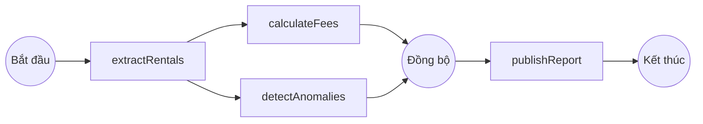
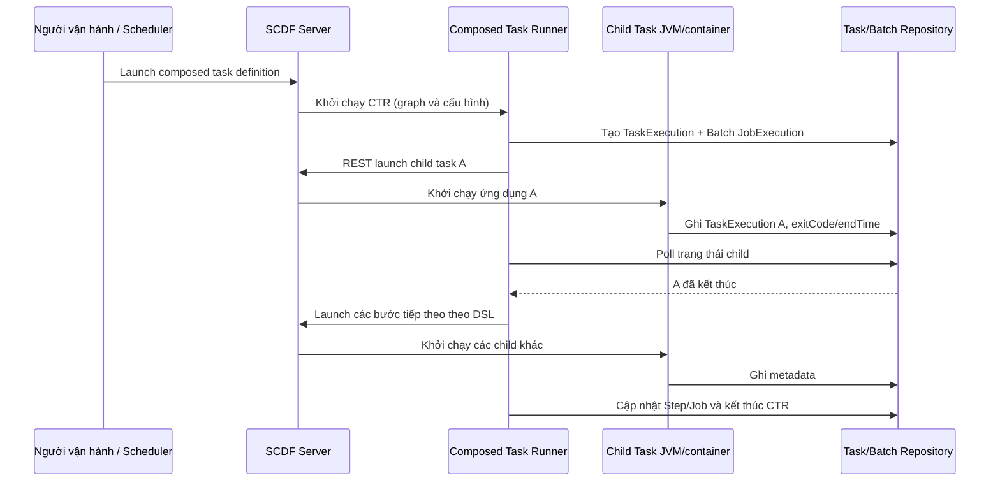
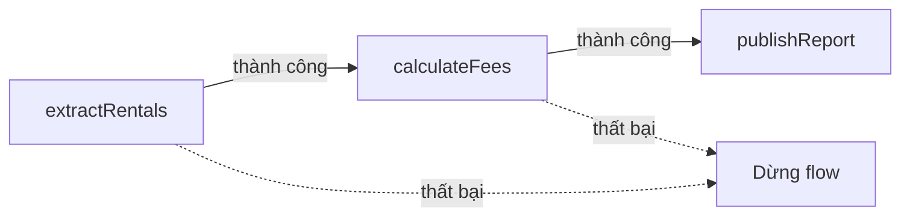
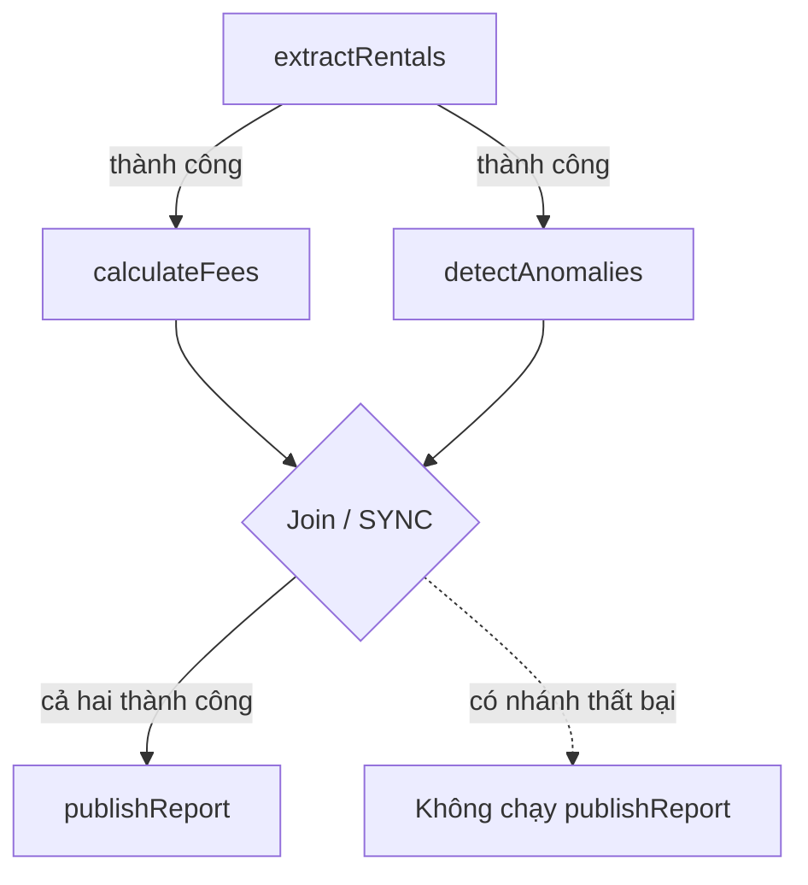
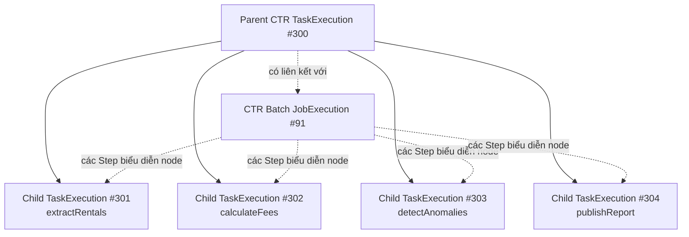

# Composed Task Runner: chạy tuần tự và song song

## Mục tiêu bài học

Trong chương **Data Flow** của mô-đun **Spring Cloud Task**, bài này hướng dẫn dùng **Composed Task Runner (CTR)** để điều phối nhiều ứng dụng Spring Cloud Task chạy hữu hạn theo một đồ thị công việc. Ta sẽ lần lượt thiết kế luồng **tuần tự**, **song song**, kết hợp cả hai, xử lý thất bại và kiểm chứng trạng thái thực thi.

Sau bài học, bạn có thể:

- Phân biệt nhiệm vụ của **Spring Cloud Task**, **Spring Cloud Data Flow (SCDF)**, **Composed Task Runner** và **Spring Batch** bên trong CTR.
- Viết đúng Task DSL: `A && B` (tuần tự), `<A || B>` (song song), `A && <B || C> && D` (kết hợp), và các nhánh chuyển tiếp dựa trên `ExitStatus`.
- Đăng ký các **task application**, tạo **task definition** và chạy một **composed task** qua Spring Cloud Data Flow Shell hoặc giao diện.
- Hiểu cách CTR gọi SCDF REST API, chờ trạng thái child TaskExecution, tạo JobExecution/StepExecution cho đồ thị và liên kết parent–child.
- Chọn số luồng, chu kỳ polling, giới hạn chờ, tham số, tài nguyên deployer và chính sách restart phù hợp.
- Đọc lỗi đúng cấp; không nhầm `ExitMessage` với `ExitCode` hay `TaskExecution` của ứng dụng con với trạng thái của toàn đồ thị.
- Triển khai an toàn: chia sẻ kho metadata, đảm bảo idempotency, không chạy trùng, kiểm soát secrets, giám sát từng tiến trình và dữ liệu nghiệp vụ.

## 1. Bài toán: kết toán ngày theo một luồng có phụ thuộc

Giả sử hệ thống quản lý cho thuê phải kết toán ngày `2026-11-23`:

1. `extractRentals` đọc giao dịch cho thuê đã đóng sổ trong ngày và tạo snapshot ổn định.
2. `calculateFees` tính phí/phụ thu từ snapshot.
3. `detectAnomalies` kiểm tra giao dịch bất thường từ **cùng snapshot**, độc lập với bước tính phí.
4. `publishReport` tổng hợp hai đầu ra rồi công bố báo cáo.

`calculateFees` và `detectAnomalies` có thể chạy **song song** vì chúng cùng đọc một snapshot và ghi vào hai khu vực kết quả riêng. Nhưng `publishReport` chỉ được chạy sau khi **cả hai nhánh** hoàn tất thành công.



Đồ thị này có thể viết bằng **Composed Task DSL**:

```text
extractRentals && <calculateFees || detectAnomalies> && publishReport
```

**Composed Task Runner không thay thế logic nghiệp vụ.** Mỗi tên trong đồ thị tương ứng một **task definition** đã được đăng ký trong SCDF; ứng dụng phía sau tên đó là Spring Boot/Spring Cloud Task thực sự tính toán, lưu dữ liệu và trả kết quả. CTR chỉ quyết định khi nào khởi chạy bước nào và khi nào đồ thị được xem là hoàn thành/thất bại.

## 2. Vai trò của từng thành phần

| Thành phần | Nhiệm vụ | Phạm vi vòng đời |
| --- | --- | --- |
| **Spring Cloud Task** | Ghi thời điểm, tên, ID, mã thoát và lỗi của một lần chạy ứng dụng hữu hạn vào `TaskRepository` | Một tiến trình con hoặc CTR |
| **Spring Cloud Data Flow Server** | Lưu đăng ký ứng dụng/định nghĩa Task, cung cấp API, chọn nền tảng chạy và nhận lệnh launch | Dịch vụ điều phối |
| **Composed Task Runner** | Đọc đồ thị DSL; gọi **SCDF REST API** để chạy từng Task; poll metadata để biết Task hoàn thành rồi chuyển bước | Một tiến trình điều phối hữu hạn |
| **Spring Batch bên trong CTR** | Biểu diễn đồ thị bằng Job/Step/flow, theo dõi trạng thái và hỗ trợ restart đồ thị | `JobExecution`/`StepExecution` của CTR |
| **Child Task application** | Chạy nghiệp vụ như trích xuất, tính phí, kiểm tra bất thường hoặc công bố báo cáo | Một lần chạy JVM/container riêng |
| **TaskRepository và Batch JobRepository** | Lưu metadata của parent Task, child Tasks và Job/Steps của CTR | Cơ sở dữ liệu bền vững, dùng cho tra cứu/restart |
| **Task platform/deployer** | Tạo JVM, process hoặc Kubernetes Job/container; áp quota, tài nguyên và chính sách chạy | Hạ tầng triển khai |



**Lưu ý:** Đồ thị là **đồ thị điều khiển**, không mặc định là đường truyền trực tiếp dữ liệu. CTR không tự chuyển một `Map`/`Object` trong bộ nhớ của `extractRentals` sang `calculateFees`. Các ứng dụng là **tiến trình độc lập**; truyền dữ liệu qua database, object storage, file được chia sẻ, message broker, hoặc hợp đồng input/output được thiết kế trước.

### 2.1. Vì sao CTR không đơn giản là gọi các phương thức Java?

Một lệnh gọi Java tuần tự trong cùng JVM không cần SCDF. CTR có ý nghĩa khi mỗi phần là **Task có thể triển khai độc lập**: có image/JAR riêng, tài nguyên CPU/RAM riêng, runtime độc lập, log riêng và trạng thái `TaskExecution` để điều phối.

Đổi lại, CTR phụ thuộc vào **SCDF Server**, **kết nối API** và **metadata repository**. Nếu chỉ cần chạy hai phương thức trong một transaction nhỏ, CTR có thể gây phức tạp không cần thiết.

### 2.2. Parent Task và các Child Task

Khi SCDF khởi chạy một composed task:

- **Parent** là một lượt chạy của **CTR**, thường mang tên composed task.
- **Child** là các lượt chạy ứng dụng do CTR yêu cầu SCDF khởi chạy.
- Các child có `TaskExecutionId` riêng, có thể được liên kết với parent bằng `parentExecutionId`/`PARENT_TASK_EXECUTION_ID`.
- Đồ thị của CTR đồng thời có **Spring Batch JobExecution** và những StepExecution phục vụ orchestration.

Không nhầm `JobExecution` của CTR với JobExecution **bên trong một child** nếu child cũng sử dụng Spring Batch. Chúng là những Job khác nhau, mặc dù có thể sử dụng cùng hạ tầng metadata.

## 3. DSL chạy tuần tự: toán tử `&&`

Ký hiệu `&&` biểu diễn **conditional sequence**: chỉ khởi chạy bước tiếp theo nếu bước trước được CTR đánh giá là hoàn thành thành công.

```text
extractRentals && calculateFees && publishReport
```

Thứ tự chạy:

1. `extractRentals` khởi chạy và kết thúc thành công.
2. CTR mới khởi chạy `calculateFees`; đợi kết thúc thành công.
3. CTR mới khởi chạy `publishReport`.
4. Khi bước cuối hoàn thành, Job điều phối có thể trở thành `COMPLETED`.



Nếu `calculateFees` thất bại và DSL không có transition xử lý, `publishReport` **không được khởi chạy**. Bản thân `extractRentals` đã hoàn tất **không bị tự động rollback**. Khi thiết kế retry, phải biết bước nào đã ghi dữ liệu và có thể chạy lại an toàn hay không.

**Chạy tuần tự không có nghĩa cùng transaction.** Mỗi child có thể commit một phần dữ liệu ở DB riêng trước khi bước sau thất bại. CTR không cung cấp distributed transaction/rollback toàn đồ thị.

### 3.1. Chạy cùng một task definition nhiều lần

DSL có thể chứa cùng tên nhiều lần:

```text
extractRentals && extractRentals && publishReport
```

Mỗi node là một lần yêu cầu launch, nhưng nếu không có mục đích rõ ràng và phân biệt tham số, hai lần chạy `extractRentals` dễ ghi trùng. Nên đặt tên logic và tham số/khóa nghiệp vụ khác nhau khi thật sự cần lặp nhiều lượt.

## 4. DSL chạy song song: toán tử `<... || ...>`

Hai dấu `||` trong cặp dấu góc biểu diễn **split**: yêu cầu CTR khởi chạy các nhánh độc lập song song.

```text
<calculateFees || detectAnomalies>
```

Đây **không phải** toán tử OR logic của shell hay điều kiện “nếu bước trái lỗi thì chạy bước phải”. Trong **Composed Task DSL**, `||` phân tách các nhánh chạy đồng thời **bên trong split**. Khi viết câu lệnh Shell để tạo đồ thị, đặt nguyên DSL trong dấu ngoặc kép như tài liệu hướng dẫn.

### 4.1. Split kết hợp với join

```text
extractRentals && <calculateFees || detectAnomalies> && publishReport
```



Theo tài liệu Spring Cloud Data Flow, **tất cả nhánh của split phải hoàn tất thành công** trước khi bước sau split được chạy. Nếu `calculateFees` đã thành công còn `detectAnomalies` thất bại, `publishReport` không chạy. Tuy nhiên, phần dữ liệu do `calculateFees` đã ghi **vẫn tồn tại**; khi restart, phải tránh nhân đôi kết quả.

### 4.2. Nhiều nhóm song song nối tiếp

```text
<extractRentals || extractPayments || extractRefunds>
    && <validateRentals || validatePayments>
    && publishReport
```

Nhóm thứ hai chỉ được chạy sau khi **cả ba** tác vụ ở nhóm thứ nhất hoàn tất thành công. `publishReport` chỉ được chạy sau khi cả hai tác vụ ở nhóm thứ hai hoàn thành.

### 4.3. Sequence bên trong một nhánh split

```text
<extractRentals && calculateFees || detectAnomalies> && publishReport
```

Trong ví dụ trên, `extractRentals` và `detectAnomalies` có thể bắt đầu song song; `calculateFees` chỉ chạy sau `extractRentals`, còn `publishReport` đợi toàn bộ nhánh trong split. **Chỉ dùng sơ đồ này nếu `detectAnomalies` không phụ thuộc output mới được tạo bởi `extractRentals`**, nếu không sẽ xảy ra race condition.

### 4.4. Tính song song thực tế phụ thuộc số luồng và platform

DSL `<A || B || C>` yêu cầu song song, nhưng không bảo đảm ba container/JVM bắt đầu **chính xác cùng thời điểm**. Khả năng thực tế phụ thuộc:

- `split-thread-core-pool-size` và executor của CTR.
- Giới hạn số Task chạy đồng thời của Spring Cloud Data Flow platform.
- CPU/RAM, số node/pod có thể schedule, image pull, quota và kết nối database.
- Thời gian khởi động, readiness và tài nguyên riêng của các child.

Ví dụ, nếu split lớn nhất có ba child, tài liệu SCDF gợi ý `split-thread-core-pool-size=3`. Nếu chỉ cấp hai thread, child thứ ba có thể phải chờ nhánh trước giải phóng thread. **Thread của CTR không phải thread thực hiện nghiệp vụ**; nghiệp vụ vẫn chạy ở các child process/container riêng.

## 5. Bảng cú pháp Composed Task DSL

| DSL | Loại đồ thị | Ý nghĩa |
| --- | --- | --- |
| `A && B` | Tuần tự | B chạy nếu A thành công |
| `A && B && C` | Tuần tự ba bước | C chỉ chạy nếu A và B thành công |
| `<A || B>` | Split | Yêu cầu A và B chạy song song |
| `A && <B || C> && D` | Split sau bước chuẩn bị | D chờ A, B, C theo điều kiện join |
| `<A || B || C> && <D || E>` | Hai split nối tiếp | Split thứ hai chờ split thứ nhất thành công |
| `<A && B || C>` | Sequence trong split | A và C chạy song song; B chờ A |
| `A 'FAILED' -> B` | Transition | Nếu `ExitStatus` của A là `FAILED` thì chạy B |
| `A 'COMPLETED' -> B` | Transition | Nếu `ExitStatus` của A là `COMPLETED` thì chạy B |

**Quan trọng:** `&&` không có nghĩa “tiếp tục trong mọi tình huống”, và `||` không phải “chỉ chạy B khi A lỗi”. Khi cần rẽ nhánh theo kết quả, dùng **transition** dựa trên `ExitStatus`.

### 5.1. Transition có điều kiện

```text
extractRentals 'FAILED' -> notifyFailure 'COMPLETED' -> calculateFees
```

Đây là ví dụ minh họa **các transition xuất phát từ kết quả của `extractRentals`**: đường lỗi sang `notifyFailure`, đường hoàn thành sang `calculateFees`. Không đọc biểu thức trên như sequence `extractRentals -> notifyFailure -> calculateFees`. Tài liệu còn hỗ trợ wildcard `'*'` cho các `ExitStatus` khác.

Nếu nhu cầu là **chỉ tiếp tục khi tất cả nhánh đều thành công**, hãy dùng sequence/split theo mục 3–4, không sử dụng transition để che lỗi.

### 5.2. `ExitCode`, `ExitMessage` và `ExitStatus`

CTR dùng metadata của child để quyết định trạng thái Step điều phối. Tài liệu **Composed Task Runner App Starters** mô tả quy tắc:

1. Nếu child `TaskExecution` có `ExitMessage`, giá trị này có thể được dùng làm `ExitStatus` của Step CTR.
2. Nếu **không có ExitMessage** và `exitCode=0`, Step CTR thường được xem là `COMPLETED`.
3. Nếu **không có ExitMessage** và `exitCode=1`, Step CTR thường được xem là `FAILED`.
4. Với các mã khác hoặc logic custom, **phải kiểm chứng mapping của phiên bản CTR đang dùng**, không mặc định cứ khác 0 thì có transition tên `'FAILED'`.

```text
Child TaskExecution
  exitCode = 0
  exitMessage = "REQUIRES_REVIEW"

CTR Step ExitStatus
  "REQUIRES_REVIEW"  (tùy mapping phiên bản)
```

Điểm dễ sai khi chạy song song: tài liệu SCDF cảnh báo **không nên đặt `ExitMessage` tùy chỉnh cho child trong split**. Với split, một ExitMessage khác `COMPLETED` có thể khiến toàn split bị đánh dấu `FAILED` ngay cả khi exitCode là `0`. Nếu bắt buộc giữ ExitMessage để ghi lý do nghiệp vụ, tài liệu mô tả thuộc tính `ignoreExitMessage=true` cho từng app trong split; **chỉ bật sau khi xác minh nó phù hợp chính sách điều phối**.

Với hệ thống mới, nên thống nhất:

- `exitCode=0` chỉ khi nghiệp vụ được xác nhận hoàn tất.
- `exitCode != 0` cho lỗi cần dừng hoặc xử lý retry.
- `ExitMessage` ngắn, không chứa dữ liệu nhạy cảm, chỉ dùng cho transition nếu thật sự chủ động thiết kế.

## 6. Chuẩn bị môi trường Spring Cloud Data Flow

Ví dụ được viết theo dòng tài liệu **Spring Cloud Data Flow 2.x và Composed Task Runner tương ứng**. SCDF, CTR, các child Task và database phải là **những phiên bản tương thích**. Không trộn một image CTR rất cũ với Spring Boot/Spring Cloud Task mới mà chưa kiểm tra ma trận hỗ trợ và DDL metadata.

Trước khi tạo đồ thị, cần có:

1. **SCDF Server đang chạy**, có endpoint truy cập được từ cả người vận hành và từ **tiến trình CTR**.
2. **Task platform** đã cấu hình: local, Cloud Foundry hoặc Kubernetes theo phiên bản SCDF.
3. **Kho metadata bền vững**, có schema phù hợp cho SCDF, Spring Cloud Task và Spring Batch; các child cần ghi metadata mà CTR/SCDF đọc được.
4. **Ứng dụng Task đã đóng gói** thành Maven artifact/JAR hoặc Docker image có thể được platform tải về.
5. **CTR artifact/image** đã cấu hình trên SCDF; tài liệu mô tả `spring.cloud.dataflow.task.composedtaskrunner.uri`.
6. **Quyền gọi API và database**, network/DNS, TLS, ServiceAccount/secrets khi dùng Kubernetes.

### 6.1. Vì sao phải dùng chung metadata?

CTR khởi chạy child thông qua **REST API của SCDF**, rồi **poll database** để kiểm tra child TaskExecution đã có `endTime`/mã kết quả. Nếu child dùng H2 in-memory riêng, còn SCDF/CTR xem database khác, có thể xảy ra:

- Child thực sự đã chạy xong nhưng CTR **không tìm thấy metadata kết thúc**.
- CTR đợi đến timeout hoặc treo vô hạn nếu `max-wait-time=0`.
- Trang lịch sử Task của SCDF không phản ánh đúng trạng thái.

Vì vậy, **không dùng H2 in-memory riêng cho từng child container trong môi trường điều phối nhiều tiến trình**. Dùng datasource bền vững có thể truy cập từ SCDF và các Task, và xác nhận schema phù hợp. Có thể chia nhiều schema/data source theo kiến trúc nâng cao nhưng phải bảo đảm cơ chế truy vấn metadata của CTR nhìn thấy đúng lượt child.

### 6.2. Phân biệt tên artifact, tên definition và tên execution

| Tên | Ví dụ | Vai trò |
| --- | --- | --- |
| Tên ứng dụng đăng ký | `rental-import` | Trỏ tới JAR/image được SCDF biết |
| Task definition | `extractRentals` | Tên node xuất hiện trong DSL |
| Composed task definition | `nightlyClose` | Tên toàn bộ đồ thị |
| CTR runtime | Composed Task Runner | Ứng dụng điều phối được SCDF deploy |
| TaskExecution | ID `302` cho `nightlyClose-extractRentals` | Một **lượt chạy** của child |

Tên TaskExecution có thể được SCDF/CTR thêm prefix của composed task hoặc nhãn node; đừng hardcode tên này trong logic nghiệp vụ. Nên dùng `executionId`, `parentExecutionId` và một **business key** như `businessDate` để đối chiếu.

## 7. Thực hành: tạo và chạy đồ thị qua Spring Cloud Data Flow Shell

Giả sử đã build/publish **bốn Spring Cloud Task applications thật**: một để trích xuất, hai tính toán độc lập và một để xuất báo cáo. Các Maven URI trong ví dụ là **giả định**; phải thay bằng artifact đã build và được SCDF platform của bạn phân giải.

### 7.1. Đăng ký ứng dụng

Các lệnh bên dưới chạy **trong Spring Cloud Data Flow Shell** (dấu `dataflow:>` là prompt minh họa, không phải ký tự gõ vào lệnh):

```text
dataflow:> app register --name rental-import --type task --uri maven://com.example:rental-import-task:1.0.0
dataflow:> app register --name fee-calc --type task --uri maven://com.example:fee-calculation-task:1.0.0
dataflow:> app register --name anomaly-check --type task --uri maven://com.example:anomaly-check-task:1.0.0
dataflow:> app register --name rental-report --type task --uri maven://com.example:rental-report-task:1.0.0
```

Với Kubernetes, SCDF thường dùng Docker/OCI image được khai báo theo dạng `docker:registry.example.com/path/image:tag` thay vì Maven artifact, tùy platform. Không suy ra URI Maven trong ví dụ là chạy được trên mọi cluster.

### 7.2. Tạo bốn task definition

Một **task definition** liên kết tên node DSL tới một app đã đăng ký. Ví dụ:

```text
dataflow:> task create extractRentals --definition "rental-import"
dataflow:> task create calculateFees --definition "fee-calc"
dataflow:> task create detectAnomalies --definition "anomaly-check"
dataflow:> task create publishReport --definition "rental-report"
```

Chưa có tiến trình nào chạy ở bước này. `app register` chỉ đăng ký artifact; `task create` lưu một định nghĩa; **`task launch`** mới yêu cầu nền tảng chạy.

### 7.3. Đồ thị tuần tự đầu tiên

```text
dataflow:> task create nightlyCloseSeq --definition "extractRentals && calculateFees && publishReport"
dataflow:> task launch nightlyCloseSeq
```

Quan sát `Task Definitions`, `Task Executions` và `Job Executions` trong dashboard:

- CTR được khởi chạy cho `nightlyCloseSeq`.
- Sau khi `extractRentals` thành công, `calculateFees` mới bắt đầu.
- Sau khi `calculateFees` thành công, `publishReport` được yêu cầu chạy.
- Nếu một child thất bại, các node chưa đến lượt **không khởi chạy** theo sequence mặc định.

### 7.4. Đồ thị có hai nhánh song song

```text
dataflow:> task create nightlyCloseParallel --definition "extractRentals && <calculateFees || detectAnomalies> && publishReport"
dataflow:> task launch nightlyCloseParallel
```

Sau `extractRentals`, CTR yêu cầu chạy `calculateFees` và `detectAnomalies`. `publishReport` phải chờ cả hai kết thúc thành công.

**Chú ý khi tái sử dụng dữ liệu thử nghiệm:** các child trong ví dụ phải được thiết kế idempotent và dùng snapshot/businessDate rõ ràng. Nếu bạn vừa chạy `nightlyCloseSeq` rồi `nightlyCloseParallel` cho cùng ngày, `extractRentals` có thể được gọi hai lần. CTR không tự đảm bảo bảng kết quả không bị nhân đôi.

### 7.5. Cấu hình thuộc tính cho child

Spring Cloud Data Flow cho phép khai báo properties của app ngay trong task DSL:

```text
dataflow:> task create nightlyCloseWithDate --definition "extractRentals --businessDate=2026-11-23 && <calculateFees --businessDate=2026-11-23 || detectAnomalies --businessDate=2026-11-23> && publishReport --businessDate=2026-11-23"
```

Trong DSL trên, các `--businessDate=...` là **application properties được gắn với node**, khác với property riêng của CTR. Nếu child dùng Spring Batch, phải phân biệt **Boot Environment property** với **Spring Batch identifying JobParameters**; nhiều launcher Batch tự động chỉ chuyển **non-option arguments** thành JobParameters. Đừng giả định mọi `--businessDate` tự tạo JobInstance của Batch.

Khi mỗi đợt có ngày khác, thường phù hợp hơn là truyền tham số/properties **lúc launch** qua Data Flow UI/REST với tên app/node, thay vì tạo một task definition mới mỗi ngày. Cấu trúc khóa `app`/`deployer` cho từng node tùy phiên bản và cách đặt label; kiểm tra trang Launch/Properties của SCDF trước khi dùng automation.

### 7.6. Chạy bằng giao diện thay vì Shell

Trên SCDF Dashboard:

1. Đăng ký artifacts ở mục **Applications**.
2. Tạo các task definition hoặc dùng giao diện thiết kế ở mục **Tasks / Create Task**.
3. Nhập DSL `extractRentals && <calculateFees || detectAnomalies> && publishReport` hoặc dùng các nút đồ thị.
4. Xem trước các nút **START → Task → Split → SYNC → Task → END** trước khi tạo.
5. Chọn composed task và nhấn **Launch**, cấu hình CTR/child properties, sau đó quan sát executions.

Tên menu và cách hiển thị có thể khác giữa các bản SCDF; mục tiêu không đổi là **tạo definition**, **launch**, **theo dõi Job/Task executions**.

## 8. Cấu hình CTR để chạy song song thực sự

Các thuộc tính sau thuộc **Composed Task Runner**. Khi dùng Data Flow UI, chúng nằm ở phần CTR properties; khi chạy CTR JAR độc lập, chúng là các options của CTR. Đừng lẫn với properties của child.

| Option CTR | Đơn vị | Ý nghĩa |
| --- | --- | --- |
| `dataflow-server-uri` | URL | SCDF REST API mà CTR gọi để launch child |
| `interval-time-between-checks` | Millisecond | Khoảng CTR poll metadata child, bản hướng dẫn mô tả mặc định khoảng `10000` |
| `max-start-wait-time` | Millisecond | Thời gian tối đa chờ child có mốc bắt đầu; `0` thường là không giới hạn |
| `max-wait-time` | Millisecond | Thời gian tối đa chờ một child hoàn tất; `0` thường là không giới hạn |
| `split-thread-core-pool-size` | Số thread | Số luồng lõi cho executor xử lý split |
| `split-thread-max-pool-size` | Số thread | Giới hạn thread tối đa theo cấu hình executor |
| `split-thread-queue-capacity` | Số phần tử | Sức chứa hàng đợi các nhánh chưa có thread xử lý |
| `split-thread-keep-alive-seconds` | Giây | Thời gian giữ thread dư khi rảnh |
| `increment-instance-enabled` | Boolean | Tạo tham số định danh tăng dần để chạy instance mới khi cần |
| `uuid-instance-enabled` | Boolean | Thêm định danh UUID cho composed task instance mới ở các nhánh hỗ trợ |

**Giá trị mặc định có thay đổi giữa tài liệu CTR App Starters đời cũ và SCDF 2.x.** Ví dụ một tài liệu cũ nêu `split-thread-core-pool-size` mặc định `4` và `increment-instance-enabled` mặc định `false`; reference SCDF 2.x nêu lần lượt `1` và `true`. Không lấy default ở blog cũ để cấu hình production: cần xem metadata/version thực tế của CTR image/JAR được SCDF deploy.

### 8.1. Ví dụ cấu hình launch

Để chạy hai nhánh song song, trong phần **CTR Properties** của trang Launch có thể đặt:

```properties
split-thread-core-pool-size=2
split-thread-max-pool-size=4
interval-time-between-checks=2000
max-start-wait-time=120000
max-wait-time=900000
spring.cloud.task.closecontext-enabled=true
spring.cloud.task.batch.fail-on-job-failure=true
```

Đây là **giá trị học tập**, không phải một file properties dùng nguyên xi cho mọi bản SCDF. Trong một số giao diện, thuộc tính application phải có prefix `app.<CTR-app-name>.` khi truyền qua SCDF; UI thường tạo tên/prefix tương ứng. Hãy kiểm tra vị trí chỉnh sửa thuộc tính và logs startup của CTR.

- `split-thread-core-pool-size=2` cho hai nhánh là mức lõi phù hợp; nếu đồ thị có nhánh tối đa ba child, cân nhắc ít nhất ba thread.
- `interval-time-between-checks=2000` giúp cập nhật nhanh hơn nhưng tạo nhiều truy vấn database; không nên đặt quá thấp khi số Task lớn.
- `max-start-wait-time=120000` chỉ giới hạn thời gian chờ child bắt đầu; điều chỉnh theo tốc độ kéo image và khởi động JVM.
- `max-wait-time=900000` giới hạn thời gian chờ một child hoàn tất; nếu Task dài hơn phải tăng sau khi đo thời lượng thật.
- `spring.cloud.task.closecontext-enabled=true` đặc biệt quan trọng với split trong tài liệu CTR để tiến trình điều phối đóng context sau khi các thread hoàn tất.
- `spring.cloud.task.batch.fail-on-job-failure=true` giúp **Job CTR thất bại** được phản ánh thành kết quả tiến trình, thay vì Job `FAILED` nhưng CTR JVM vẫn trả `0` theo đường mặc định của một số nhánh.

**Timeout CTR không phải cơ chế “kill child và rollback dữ liệu”**. Khi vượt thời gian chờ, CTR có thể đánh dấu Job điều phối lỗi trong khi child vẫn chạy hoặc cần được dừng bằng thao tác riêng của platform. Phải đối chiếu trạng thái child thực tế và thiết kế tiến trình xử lý lỗi quá hạn.

### 8.2. Giới hạn đồng thời của SCDF platform

SCDF còn có giới hạn số Task đang chạy trên một platform account, ví dụ `maximumConcurrentTasks` trong cấu hình deployer. Nếu platform chỉ cho tối đa hai Task nhưng CTR cũng là một Task và đồ thị cần hai child cùng lúc, giới hạn này có thể khiến yêu cầu launch bị từ chối. **Không chỉ đếm các thread trong CTR**: tính cả các child và những Task khác đang sử dụng cùng platform.

Trên Kubernetes, cũng cần kiểm tra quota, resource requests/limits, cấu hình image pull, node affinity và service accounts. Một split logic ba nhánh không mặc định có đủ tài nguyên để tạo ba Pod đồng thời.

## 9. Kết quả, lỗi và đường xử lý thất bại

### 9.1. Trường hợp tuyến tính

Đồ thị:

```text
extractRentals && calculateFees && publishReport
```

Giả sử `calculateFees` trả exit code `1`, không có `ExitMessage` đặc biệt và CTR ánh xạ thành `FAILED`:

| Thành phần | Kết quả |
| --- | --- |
| `extractRentals` | Đã chạy `COMPLETED` |
| `calculateFees` | `FAILED`; có `TaskExecution` của child |
| `publishReport` | **Chưa khởi chạy** |
| CTR Spring Batch Job | Có thể `FAILED` ở Step điều phối tương ứng |
| CTR `TaskExecution` và mã JVM | Phải kiểm chứng `fail-on-job-failure`; không mặc định đồng nhất với status Job |

Đừng đánh đồng “một Job CTR thất bại” với việc tất cả child đã rollback. Những child chạy trước vẫn có thể đã ghi dữ liệu bền vững.

### 9.2. Trường hợp split

Đồ thị:

```text
extractRentals && <calculateFees || detectAnomalies> && publishReport
```

Nếu `calculateFees` thất bại trong khi `detectAnomalies` đã hoàn thành:

- CTR sẽ không đi tới `publishReport` trong đường split mặc định.
- `detectAnomalies` **không bị hoàn tác** chỉ vì nhánh kia lỗi.
- Khi sửa lỗi và restart, CTR/Spring Batch có thể bỏ qua các Step đã hoàn tất và chạy lại phần thất bại theo restart semantics; **phải kiểm tra phiên bản và metadata**, không đoán rằng mọi child sẽ tự chạy lại từ đầu.

### 9.3. Lỗi trước khi child có metadata

Có các trường hợp CTR không nhận `TaskExecution` hoàn chỉnh:

- Docker image/JAR không tải được hoặc lệnh launch bị platform từ chối.
- Child crash trước khi Spring Context khởi tạo `TaskRepository`.
- Child ghi metadata vào database/schema khác với nơi CTR poll.
- Mất kết nối API, database, token xác thực hoặc thiếu quyền đọc.
- Child bị `SIGKILL`/OOM, bản ghi còn `END_TIME = NULL`.

Khi đó `max-start-wait-time`, `max-wait-time`, platform logs và cảnh báo về Task quá hạn là quan trọng. Không tự sửa `EXIT_CODE=0` trong DB để ép đồ thị tiếp tục.

## 10. Restart composed task sau lỗi

CTR được xây dựng dựa trên **Spring Batch**. Khi Job điều phối thất bại, SCDF cho phép **restart JobExecution thất bại** qua giao diện **Jobs / Job Executions** hoặc API/CLI mà phiên bản hỗ trợ.

Ví dụ:

```text
Lần 1:
extractRentals (COMPLETED)
  -> calculateFees (FAILED)
  -> publishReport (CHƯA CHẠY)

Restart Job CTR:
calculateFees (CHẠY LẠI, COMPLETED)
  -> publishReport (COMPLETED)
```

Tài liệu SCDF mô tả khả năng tiếp tục từ phần thất bại khi restart một composed task, thay vì chạy lại tất cả task đã thành công. Đây là **restart Spring Batch Job của CTR**, không đồng nghĩa việc bấm `task launch` tạo một lượt composed task mới với identity khác. Hãy phân biệt:

| Thao tác | Ý nghĩa |
| --- | --- |
| **Restart failed CTR Job** | Tiếp tục công việc logic đã thất bại theo metadata Batch; bỏ qua Step đã hoàn tất khi cơ chế restart cho phép |
| **Launch composed task lại với instance mới** | Tạo một lượt chạy điều phối mới; có thể thực thi lại toàn đồ thị |
| **Restart Batch Job trong child** | Khôi phục một Job/Step **bên trong child**, theo JobRepository riêng; độc lập với mức restart của CTR |

### 10.1. Hai tầng restart khi child cũng là Batch Job

Giả sử `calculateFees` chứa một Job đọc 1 triệu giao dịch, đã commit 800.000 dòng trước khi thất bại. Khi CTR restart child:

1. **CTR** quyết định cần launch lại node `calculateFees`.
2. **Child Spring Batch** xác định có restart **cùng JobInstance** hay tạo JobInstance mới dựa vào identifying JobParameters và JobRepository.
3. Nếu JobInstance/ExecutionContext cũ được giữ và reader/writer hỗ trợ restart, child có thể tiếp tục từ checkpoint.
4. Nếu metadata mất hoặc identifying parameters đổi (ví dụ thêm `run.id` mới), child có thể đọc lại từ đầu.

Không gán hết trách nhiệm “không trùng dữ liệu” cho CTR. Cần **idempotency ở từng child**, nhất là khi ghi API bên ngoài, message broker hoặc database nghiệp vụ đã commit.

### 10.2. Định danh cho mỗi đợt xử lý

Nên đặt một **business key** như `businessDate=2026-11-23` xuyên suốt các child và kết quả:

```text
nightlyClose / businessDate=2026-11-23
  extractRentals     -> snapshot/rentals/2026-11-23
  calculateFees      -> fee_results(business_date=2026-11-23)
  detectAnomalies    -> anomaly_results(business_date=2026-11-23)
  publishReport      -> reports/2026-11-23/final.json
```

Các đường dẫn là **minh họa về hợp đồng dữ liệu**, không phải file đã được tạo. Mỗi child nên dùng khóa nghiệp vụ duy nhất, `MERGE/UPSERT` hoặc atomic publish phù hợp. Đừng xuất báo cáo cuối trước khi xác nhận cả hai kết quả của split thuộc **cùng một snapshot/cùng businessDate**.

## 11. Truy vết trạng thái và đối chiếu metadata

SCDF có các mục **Tasks / Executions** và **Jobs / Executions**. Khi điều tra, đọc ít nhất ba cấp:

1. **Parent CTR TaskExecution:** lượt điều phối nào đang chạy, đã kết thúc và trả exit code gì?
2. **Child TaskExecutions:** child nào đã được launch, `exitCode`, thời gian, `parentExecutionId` và log?
3. **CTR Batch JobExecution/StepExecutions:** đồ thị dừng ở node nào, trạng thái `FAILED`/`COMPLETED`, có thể restart không?



Các ID là minh họa, không phải các bản ghi thực. Ở lần thất bại trước `publishReport`, **không có Child TaskExecution của `publishReport`**; sơ đồ chỉ thể hiện quan hệ khi mọi node đã được khởi chạy thành công.

### 11.1. SQL kiểm tra parent và child

Với **schema Spring Cloud Task mặc định** có cột `PARENT_TASK_EXECUTION_ID`:

```sql
SELECT
    TASK_EXECUTION_ID,
    TASK_NAME,
    PARENT_TASK_EXECUTION_ID,
    START_TIME,
    END_TIME,
    EXIT_CODE,
    EXIT_MESSAGE
FROM TASK_EXECUTION
WHERE TASK_EXECUTION_ID = 300
   OR PARENT_TASK_EXECUTION_ID = 300
ORDER BY START_TIME, TASK_EXECUTION_ID;
```

Thay `300` bằng ID của parent CTR. Nếu `PARENT_TASK_EXECUTION_ID` không được cấp cho child trong cấu hình thực tế, kiểm tra version, các arguments `spring.cloud.task.parent-execution-id` và liên kết của SCDF thay vì tự tạo quan hệ bằng tên.

### 11.2. SQL tra Job của CTR

Khi tích hợp Task/Batch đã ghi bảng liên kết `TASK_TASK_BATCH`, có thể kiểm tra:

```sql
SELECT
    t.TASK_EXECUTION_ID,
    t.TASK_NAME,
    t.EXIT_CODE AS TASK_EXIT_CODE,
    j.JOB_EXEC_ID,
    j.STATUS AS JOB_STATUS,
    j.EXIT_CODE AS JOB_EXIT_STATUS
FROM TASK_EXECUTION AS t
JOIN TASK_TASK_BATCH AS l
    ON l.TASK_EXECUTION_ID = t.TASK_EXECUTION_ID
JOIN BATCH_JOB_EXECUTION AS j
    ON j.JOB_EXEC_ID = l.JOB_EXECUTION_ID
WHERE t.TASK_EXECUTION_ID = 300;
```

`EXIT_CODE` của Spring Batch Job là **chuỗi `ExitStatus`** như `FAILED`, còn `TASK_EXECUTION.EXIT_CODE` là **số nguyên**. Một Job CTR `FAILED` không tự đảm bảo tiến trình CTR trả mã khác `0` nếu không bật đường chuyển trạng thái phù hợp. Đo cả hai lớp và mã thoát của container.

## 12. Những lỗi thiết kế thường gặp

| Triệu chứng | Nguyên nhân khả dĩ | Hướng xử lý |
| --- | --- | --- |
| `task create` báo không tìm thấy tên node | Chưa tạo task definition `extractRentals` hoặc sai chính tả | Đăng ký artifact, tạo Task definition đúng tên trước khi tạo đồ thị |
| CTR không launch được child | URI SCDF từ CTR không truy cập được, token/quyền hoặc platform lỗi | Kiểm tra `dataflow-server-uri`, DNS/TLS và log CTR/SCDF |
| Child chạy xong nhưng CTR vẫn chờ | Child ghi metadata vào DB khác, thiếu `END_TIME` hoặc CTR không poll được | Đối chiếu datasource/schema và `TaskExecutionId` |
| `<A || B>` không thực sự song song | Executor chỉ có một thread hoặc platform thiếu quota | Kiểm tra `split-thread-core-pool-size` và `maximumConcurrentTasks` |
| Split chạy mãi sau khi children xong | Context không đóng hoặc thread pool còn sống | Kiểm tra `spring.cloud.task.closecontext-enabled` trong CTR |
| B thất bại nhưng C vẫn chạy khi định dùng sequence | DSL là transition/split khác dự định | Xem lại cú pháp `&&`, `||` và sơ đồ đã tạo |
| `publishReport` không chạy dù hai child trả `0` | Child có `ExitMessage` tùy chỉnh khiến split không được `COMPLETED` | Kiểm tra `ExitStatus` trong CTR, cân nhắc `ignoreExitMessage` theo phiên bản |
| Job CTR `FAILED`, container CTR lại exit `0` | Spring Batch failure không được ánh xạ ra process | Kiểm tra `spring.cloud.task.batch.fail-on-job-failure=true` và đo thực tế |
| Restart tạo lại toàn bộ dữ liệu | Đã tạo composed task instance mới thay vì restart Job; child không idempotent | Phân biệt restart và launch mới; dùng khóa nghiệp vụ |
| Child còn chạy sau timeout CTR | Timeout điều phối không bảo đảm kill child | Kiểm tra Pod/process; áp policy dừng và cleanup |
| Trùng bản ghi khi chạy song song | Hai child cùng ghi lên một bảng/khóa mà không kiểm soát | Chia vùng ghi, unique constraint, isolation hoặc orchestration phù hợp |
| Dữ liệu dùng khác `businessDate` | Truyền args khác nhau cho mỗi node hoặc dùng dữ liệu live chưa snapshot | Dùng manifest/snapshot ID thống nhất xuyên suốt đồ thị |
| CTR không restart được | JobRepository mất dữ liệu hoặc identifying parameters bị thay đổi | Dùng DB bền vững, xác định đúng CTR JobInstance |
| Không thấy child log/Job trong UI | Sai platform account hoặc truy cập UI thiếu quyền | Kiểm tra platform, logs, job/task metadata và quyền |

## 13. Bảo mật, giới hạn và vận hành an toàn

**Quyền API và mạng.** CTR phải gọi SCDF Server để launch các child. Trên Kubernetes/Cloud Foundry, `localhost:9393` của CTR **không phải** máy chạy SCDF. Cấu hình `dataflow-server-uri` trỏ tới địa chỉ thật mà CTR truy cập được và dùng TLS/xác thực; tránh đưa mật khẩu trực tiếp vào graph hoặc arguments dễ bị lưu trong metadata/log.

**Quota song song.** Kiểm soát CPU, RAM, connections và concurrency. Hai child cùng query một bảng lớn có thể làm database quá tải dù CTR chỉ sử dụng hai thread điều phối. Giới hạn số luồng CTR, số Task của platform và connection pool của từng child theo năng lực thực tế.

**Trạng thái thật của dữ liệu.** Không coi `TaskExecution.exitCode=0` là xác nhận đã xử lý hết công việc. Ví dụ `extractRentals` trả `0` nhưng thiếu 10% dữ liệu nguồn, đồ thị vẫn có thể đi tiếp. Cần kiểm tra snapshot, row count, checksum và định danh báo cáo trước khi công bố.

**Idempotency và retry.** Mọi child có thể chạy lại do restart CTR, restart Job con, lỗi scheduler hoặc thao tác vận hành. Thiết kế business key, upsert/unique constraint, outbox hoặc cơ chế ghi kết quả tạm rồi atomic publish. Đặc biệt với split, không để hai nhánh sửa cùng một hàng mà không có chính sách đồng thời.

**Giới hạn thời gian.** Đặt `max-start-wait-time`, `max-wait-time` và cảnh báo ở scheduler. Phân biệt **thời gian CTR đợi** với **giới hạn thực tế của child** do Kubernetes Job `activeDeadlineSeconds`, CPU/timeouts ứng dụng và deployer quản lý.

**Metadata bền vững.** Cần DB production, migration tương thích phiên bản và chính sách retention. Xóa thiếu kiểm soát các bảng `TASK_`/`BATCH_` có thể làm mất khả năng restart hoặc truy vết parent–child.

**Không có transaction xuyên đồ thị.** CTR không tự bù trừ những bước trước đã commit. Với nghiệp vụ yêu cầu tất cả hoặc không có gì, cần thiết kế Saga/compensation hay cách công bố kết quả theo đợt, không mặc định CTR rollback được dữ liệu các child.

## 14. Checklist kiểm chứng trước khi chạy thật

1. **DSL hợp lệ:** xác định rõ nhánh nào tuần tự, nhánh nào chạy song song và join ở đâu; không nhầm `||` với phép OR của shell.
2. **Từng Task chạy riêng được:** mỗi child có `@EnableTask`/TaskRepository, exit code có ý nghĩa, kết thúc đúng hạn.
3. **Dependency đúng:** nếu B/C đọc dữ liệu A tạo, A phải hoàn tất và snapshot được commit trước khi split bắt đầu.
4. **Schema chung:** SCDF và child ghi/đọc metadata cùng nơi mà CTR có thể poll; kiểm tra thời điểm và ID.
5. **CTR options:** thread pool đủ cho split lớn nhất; timeout khác `0` khi cần SLA; context đóng khi hoàn tất.
6. **Đường lỗi:** cố ý cho một child trong sequence/split thất bại rồi xác nhận node sau không chạy.
7. **ExitStatus:** kiểm tra child `ExitMessage`/`ExitCode` và CTR Step status, nhất là split có custom ExitMessage.
8. **Restart:** thử restart CTR Job thất bại và quan sát child nào chạy lại; đảm bảo dữ liệu không nhân đôi.
9. **Container/platform:** kiểm tra số Pod, quota, logs, CPU/RAM, image pull và network/ServiceAccount.
10. **Đối chiếu báo cáo:** cùng businessDate, đúng snapshot, đủ dữ liệu, không có kết quả bị ghi đè từ lượt chạy khác.

## 15. Bài tập tự kiểm tra

**Câu 1.** Đồ thị `A && B && C` chạy ra sao nếu `B` thất bại?

> `A` đã chạy thành công; `B` thất bại; `C` không được khởi chạy nếu DSL không có transition xử lý lỗi.

**Câu 2.** `<A || B || C> && D` có đảm bảo `A`, `B`, `C` bắt đầu cùng mili giây không?

> Không. CTR cố gắng chạy song song nhưng phụ thuộc `split-thread-core-pool-size`, quota platform và thời gian khởi động riêng của từng child.

**Câu 3.** Nếu `B` thất bại còn `A`, `C` thành công trong split, `D` có chạy không?

> Theo split mặc định, không; tất cả nhánh phải hoàn thành thành công trước khi chuyển tới `D`.

**Câu 4.** Vì sao có thể thấy child `exitCode=0` nhưng split vẫn `FAILED`?

> Có thể child đặt `ExitMessage` tùy chỉnh khác `COMPLETED`; CTR dùng thông điệp để tạo `ExitStatus`. Kiểm tra mapping của đúng phiên bản và xem có nên dùng `ignoreExitMessage`.

**Câu 5.** Có hai thread CTR thì một split gồm ba child có thực sự chạy ba bước cùng lúc?

> Không chắc. Theo cách sizing trong tài liệu SCDF, child thứ ba có thể chờ khi pool lõi chỉ có hai thread; cần cấu hình executor và giới hạn platform phù hợp.

**Câu 6.** Vì sao tạo `nightlyCloseParallel` xong chưa có TaskExecution nào?

> `task create` chỉ lưu định nghĩa. Phải `task launch` hoặc kích hoạt qua UI/API/scheduler để có lượt chạy.

**Câu 7.** Restart Job CTR thất bại có đồng nghĩa restart Job Batch bên trong child từ checkpoint không?

> Không. CTR quyết định node nào cần chạy lại; Batch bên trong child chỉ dùng checkpoint nếu chạy lại cùng JobInstance, metadata tồn tại và reader/writer hỗ trợ restart.

**Câu 8.** CTR đã timeout, có thể coi child đã dừng và rollback không?

> Không. Cần kiểm tra tiến trình/Pod và dữ liệu đích. Timeout điều phối không tự bảo đảm kill process hay rollback những transaction đã commit.

## Ghi nhớ

- **`&&` biểu diễn tuần tự có điều kiện thành công**; **`<A || B>` là split song song**, còn các bước sau split đợi mọi nhánh thành công.
- **CTR là một Task điều phối dựa trên Spring Batch**, gọi SCDF API để launch child Task và poll TaskRepository.
- **Dữ liệu nghiệp vụ không được CTR tự truyền qua các JVM**: phải thiết kế snapshot, storage và hợp đồng dữ liệu giữa child.
- **Song song thực tế cần đủ thread/quota/tài nguyên**, không chỉ đúng ký hiệu DSL.
- **`ExitMessage` có thể ảnh hưởng `ExitStatus`**, nhất là trong split; phải kiểm tra mapping và mã thoát của từng child.
- **Restart CTR không đồng nghĩa restart Job bên trong child**, và không tự cung cấp exactly-once hay rollback toàn đồ thị.
- **Vận hành an toàn** cần metadata bền vững, timeout, exit code đúng, idempotency, secrets, giám sát child/parent và kết quả nghiệp vụ.

## Tài liệu tham khảo

1. [Spring Cloud Data Flow — Composed Tasks: hướng dẫn feature chính thức](https://dataflow.spring.io/docs/feature-guides/batch/composed-task/)
2. [Spring Cloud Data Flow Reference — Composed Tasks và Composed Task Runner](https://docs.spring.io/spring-cloud-dataflow/docs/2.11.3/reference/htmlsingle/#_composed_tasks)
3. [Spring Cloud Data Flow Reference — Composed Tasks DSL, sequence, transition, split](https://docs.spring.io/spring-cloud-dataflow/docs/2.11.3/reference/htmlsingle/#_composed_tasks_dsl)
4. [Composed Task Runner App Starter — Graph DSL và các options](https://docs.spring.io/spring-cloud-task-app-starters/docs/current/reference/html/_composed_task_runner.html)
5. [Spring Cloud Data Flow — Task Lifecycle: đăng ký và chạy Task](https://docs.spring.io/spring-cloud-dataflow/docs/2.11.3/reference/htmlsingle/#_the_lifecycle_of_a_task)
6. [Spring Cloud Task — Features: TaskExecution và TaskRepository](https://docs.spring.io/spring-cloud-task/reference/features.html)
7. [Spring Cloud Task — Batch integration, mã thoát Job](https://docs.spring.io/spring-cloud-task/reference/batch.html)
8. [Spring Cloud Data Flow — FAQ về CTR, restart và điều phối](https://dataflow.spring.io/docs/resources/faq/)
