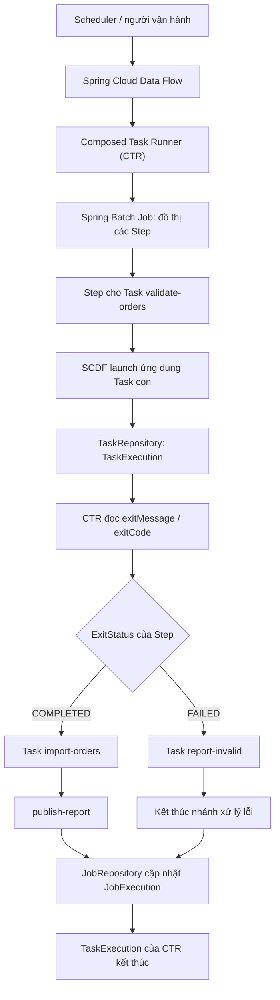
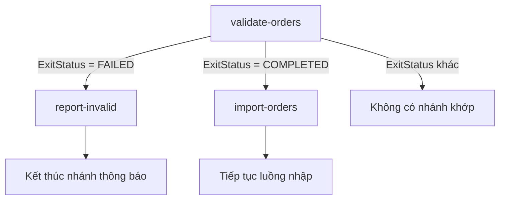
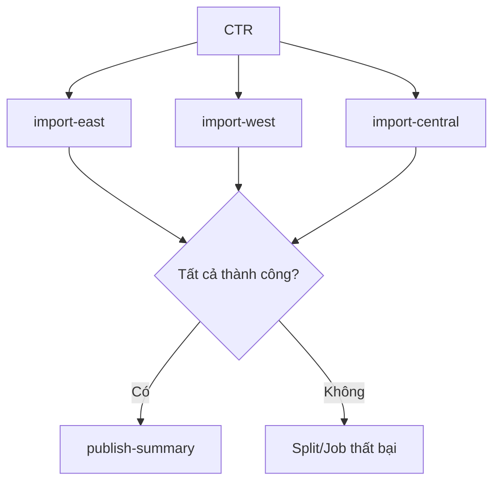

# Điều kiện chuyển nhánh, lỗi thành phần và chạy lại trong Spring Cloud Data Flow

## 1. Bài toán: Điều phối nhiều Spring Cloud Task theo kết quả

Một **Spring Cloud Task** là ứng dụng Spring Boot có thời gian chạy hữu hạn: khởi động, xử lý nghiệp vụ, ghi kết quả thực thi rồi kết thúc. **TaskRepository** lưu `TaskExecution` để tra cứu tên Task, thời gian, `exitCode` và thông điệp kết thúc. Khi hệ thống có nhiều tác vụ phụ thuộc nhau, chỉ lập lịch từng Task riêng lẻ sẽ khó diễn đạt các điều kiện như “chỉ xuất báo cáo nếu nhập dữ liệu thành công” hoặc “kiểm tra lại dữ liệu nếu bước xác thực thất bại”.

**Spring Cloud Data Flow (SCDF)** cung cấp **composed task**: một đồ thị các Task được điều phối bởi **Composed Task Runner (CTR)**. CTR dùng **Spring Batch** để theo dõi các nút trong đồ thị như các Step. Mỗi Step có thể khởi chạy một ứng dụng Spring Cloud Task độc lập; khi Task con kết thúc, CTR đọc kết quả rồi quyết định đi theo cạnh nào.

Ví dụ quy trình cuối ngày:

1. `validate-orders` xác thực file đơn hàng.
2. Nếu hợp lệ, chạy `import-orders` rồi `publish-report`.
3. Nếu không hợp lệ, chạy `report-invalid` để thông báo dữ liệu bị từ chối.
4. Nếu một thành phần gặp lỗi hạ tầng, đội vận hành cần biết phải **restart** từ đâu mà không nhập dữ liệu hai lần.

Bài thuộc chương **Data Flow** và tập trung vào ba kỹ năng:

- **Điều kiện chuyển nhánh:** đọc đúng `ExitStatus` mà CTR dùng, viết DSL cho tuần tự, nhánh có điều kiện, wildcard và split.
- **Lỗi thành phần:** phân biệt lỗi của Task con, lỗi khởi chạy/timeout, lỗi trong Batch Job và kết quả của CTR.
- **Chạy lại:** phân biệt **restart composed task job** với **launch một lần chạy mới**, phối hợp JobRepository/TaskRepository và bảo đảm idempotency.

> Phạm vi: “Data Flow” ở đây là **Spring Cloud Data Flow điều phối composed task**, không phải các câu lệnh `if/else` bên trong một `ApplicationRunner` hay luồng nhánh của một Batch Job được lập trình thuần Java. Cần kiểm tra cú pháp và các thuộc tính CTR theo **phiên bản SCDF đang triển khai**.

## 2. Kiến trúc: Ai quyết định nhánh tiếp theo?



Có **hai tầng metadata** rất dễ nhầm:

| Tầng | Kho dữ liệu / đối tượng | Dùng để làm gì? |
| --- | --- | --- |
| **Task con** | `TaskRepository` / `TaskExecution` | Ghi từng lần chạy thực tế của `validate-orders`, `import-orders`, ... |
| **CTR dưới dạng Batch Job** | `JobRepository` / `JobExecution` và `StepExecution` | Ghi thứ tự các nút, Step thành công/thất bại/dừng và thông tin restart |
| **CTR dưới dạng một Task** | `TaskRepository` / một `TaskExecution` riêng | Theo dõi bản thân tiến trình điều phối |
| **SCDF / nền tảng triển khai** | Định nghĩa Task, bản ghi launch, log của container/Job | Khởi chạy, dừng, giám sát và truy vết lần thực thi |

Khi khai báo một composed task, SCDF có thể sinh các **Task Definition con** mang tên gồm tên composed task và tên ứng dụng. Mỗi lần chạy còn có **ID thực thi riêng**; ID của CTR, Task con và Batch Job **không phải một ID chung**. Khi truy vết, phải đi qua quan hệ đã lưu và các ID mà hệ điều phối cung cấp.

### CTR không truyền “thành công” theo phỏng đoán

CTR khởi chạy một Task con qua SCDF rồi kiểm tra `TaskExecution` tương ứng. Khi Task kết thúc, CTR thiết lập **`ExitStatus` cho Batch Step** đại diện Task đó. Sau đó Batch flow đánh giá điều kiện trong DSL.

Vì vậy, trước khi viết nhánh, phải hiểu **CTR chuyển dữ liệu Task thành ExitStatus như thế nào**, chứ không chỉ nhìn một thông báo trong log.

## 3. Quy tắc quan trọng nhất: exitMessage ưu tiên hơn exitCode

Theo hướng dẫn Composed Task Runner và tài liệu tham khảo SCDF, khi tạo `ExitStatus` cho Step đại diện Task con, CTR áp dụng quy tắc:

1. Nếu `TaskExecution.exitMessage` **có giá trị**, CTR dùng giá trị đó làm **mã `ExitStatus` của Step**.
2. Nếu không có `exitMessage` và `TaskExecution.exitCode = 0`, Step có `ExitStatus` **`COMPLETED`**.
3. Nếu không có `exitMessage` và `exitCode` là **một số khác 0**, Step có `ExitStatus` **`FAILED`**.

| `TaskExecution.exitCode` | `TaskExecution.exitMessage` | Mã `ExitStatus` CTR dùng để chuyển nhánh | Ý nghĩa |
| ---: | --- | --- | --- |
| `0` | `null` | `COMPLETED` | Thành công mặc định |
| `1` | `null` | `FAILED` | Thất bại mặc định |
| `2` | `null` | `FAILED` | Mã lỗi riêng nhưng không có nhãn nhánh |
| `0` | `NO_DATA` | `NO_DATA` | Hoàn tất theo một nhánh nghiệp vụ khác |
| `1` | `RETRYABLE_ERROR` | `RETRYABLE_ERROR` | Thất bại kỹ thuật, nhưng có mã chuyển nhánh tường minh |
| `1` | `COMPLETED` | `COMPLETED` | **Nguy hiểm:** thông điệp có thể làm đồ thị chọn nhánh thành công dù mã thoát khác 0 |

Các giá trị `NO_DATA`, `RETRYABLE_ERROR` là **quy ước ví dụ của ứng dụng**. CTR không tự sinh những nhãn đó.

**Cảnh báo thiết kế:** trong Spring Cloud Task thông thường, `exitMessage` là một chuỗi mô tả ngắn. Nhưng khi dùng **composed task**, giá trị này đồng thời có thể trở thành **điều kiện rẽ nhánh**. Nếu listener vô tình đặt `exitMessage="IMPORT_FINISHED; rows=100"`, DSL chỉ chờ `COMPLETED` sẽ không khớp theo cách bạn dự tính. Nếu listener đặt `"COMPLETED"` ngay cả khi `exitCode=1`, nó có thể **che lỗi ở cấp đồ thị**.

Để an toàn, hãy quy định rõ:

- **Mã trạng thái chuyển nhánh** được chuẩn hóa, ví dụ `COMPLETED`, `FAILED`, `NO_DATA` hoặc `RETRYABLE_ERROR`.
- **Thông tin chi tiết** như số bản ghi, file báo cáo, trace ID phải nằm ở log, metrics, metadata nghiệp vụ hoặc cơ chế quan sát riêng, **không nhồi vào `exitMessage`** khi nó được dùng làm mã nhánh.
- **`exitCode` vẫn là tín hiệu kỹ thuật** cho Task con và scheduler; chỉ việc đặt `exitMessage` không tự đổi exit code của tiến trình.
- Kiểm thử cả `TaskExecution` **và** `StepExecution` của CTR trước khi đưa vào production.

### ExitStatus của CTR không phải BatchStatus của Task con

`BatchStatus` là enum mô tả trạng thái vòng đời của một `JobExecution` hoặc `StepExecution`: `STARTED`, `COMPLETED`, `FAILED`, `STOPPED`, ... Trong khi đó `ExitStatus` có mã **chuỗi** có thể tùy chỉnh. Điều kiện `'FAILED' ->` của DSL dựa trên **ExitStatus của Step trong CTR**, không phải một phép so sánh trực tiếp với `TaskExecution.exitCode` hay `BatchStatus` của Batch Job bên trong Task con.

## 4. Viết DSL: tuần tự, chuyển nhánh và song song

DSL của composed task là biểu diễn **đồ thị có hướng**, khác với shell script. Các tên `validate-orders`, `import-orders`, ... trong ví dụ là **Task Definition phải được đăng ký trên SCDF trước khi tạo composed task**.

### 4.1. Chạy tuần tự bằng &&

```text
validate-orders && import-orders && publish-report
```

Đồ thị chạy `validate-orders` trước. Nếu Step của nó kết thúc thành công theo luồng, CTR mới khởi chạy `import-orders`; sau khi nhập thành công thì mới chạy `publish-report`. Nếu `import-orders` trả `FAILED` không được xử lý, `publish-report` **không chạy**.

Ví dụ shell SCDF (các artifact giả định đã đăng ký):

```text
dataflow:> task create nightly-orders --definition "validate-orders && import-orders && publish-report"
dataflow:> task launch nightly-orders
```

Đây là các lệnh ở **Spring Cloud Data Flow Shell**, không phải lệnh terminal để chạy trực tiếp Spring Boot JAR.

**Không hiểu nhầm** `&&` ở đây là toán tử shell. SCDF đọc cả chuỗi trong dấu ngoặc kép thành DSL của composed task.

### 4.2. Chuyển nhánh theo ExitStatus

```text
validate-orders 'FAILED' -> report-invalid 'COMPLETED' -> import-orders
```

Ý nghĩa của cú pháp chuyển nhánh trên:

- Nếu **`validate-orders`** trả `ExitStatus = FAILED`, CTR đi tới `report-invalid`.
- Nếu **`validate-orders`** trả `ExitStatus = COMPLETED`, CTR đi tới `import-orders`.
- Hai nhãn `'FAILED'` và `'COMPLETED'` **đều gắn với kết quả của `validate-orders`**, không phải điều kiện trên `report-invalid`.



Đây là một **nhánh điều phối**, không phải “nếu lỗi thì tự retry validate”. Nếu `report-invalid` thành công thì luồng đã xử lý nhánh lỗi theo DSL, nhưng điều đó **không đồng nghĩa dữ liệu đầu vào đã hợp lệ**. Để không làm dashboard của nghiệp vụ hiển thị xanh sai, cần định nghĩa riêng kết quả tổng thể và cảnh báo.

### 4.3. Wildcard cho kết quả khác

```text
validate-orders 'FAILED' -> report-invalid 'COMPLETED' -> import-orders '*' -> investigate-status
```

`'*'` là nhánh dự phòng cho các mã `ExitStatus` của **cùng nút nguồn** không khớp các điều kiện cụ thể. Ví dụ `NO_DATA`, `RETRYABLE_ERROR` hoặc một mã mới chưa được khai báo có thể đi tới `investigate-status` thay vì im lặng dừng đồ thị.

Khi đã khai báo wildcard, cần **kiểm tra cú pháp bằng parser/designer của phiên bản SCDF**, đặc biệt nếu muốn nối tiếp thêm `&&` sau một transition. Tài liệu SCDF lưu ý kết hợp wildcard và chuỗi tuần tự có các ràng buộc cấu trúc; đừng tự ghép tùy tiện những biểu thức dài rồi giả định parser nhận tất cả.

**Wildcard không nên nuốt mọi lỗi rồi trả thành công**. Nhánh `investigate-status` phải ghi nhận trạng thái chưa được phân loại và phát tín hiệu cho vận hành nếu kết quả là lỗi.

### 4.4. Tách nhánh song song bằng <... || ...>

```text
<import-east || import-west || import-central> && publish-summary
```

Ba Task được khởi chạy song song. Trong ví dụ sequence sau split, `publish-summary` chỉ được khởi chạy **sau khi các thành phần cần thiết trong split hoàn tất thành công**. Nếu `import-west` thất bại và không được xử lý theo thiết kế, bước tổng hợp sau split **không chạy**; điều đó không tự có nghĩa `import-east` và `import-central` chưa ghi dữ liệu.



Các dấu `<`, `>` và `||` là **cú pháp của DSL composed task**. Để chạy split, phải chuẩn bị thread pool của CTR, giới hạn concurrent child tasks và tài nguyên của hạ tầng. Các thuộc tính CTR như `split-thread-core-pool-size` ảnh hưởng khả năng điều phối song song; tăng thread pool không tự làm database chịu được nhiều kết nối hay tự bảo đảm không ghi dữ liệu chồng lấn.

### 4.5. Kết hợp có điều kiện: tránh đồ thị quá khó kiểm chứng

Tài liệu SCDF hỗ trợ một transition gắn với sequence, ví dụ:

```text
validate-orders 'FAILED' -> report-invalid 'UNKNOWN' -> investigate-status && import-orders
```

Kết hợp này có ngữ nghĩa đồ thị riêng theo parser của CTR. Trong tài liệu đào tạo và hệ thống vận hành, nếu điều kiện bắt đầu phức tạp, nên **vẽ flow**, chạy thử với từng ExitStatus và xem chính xác ứng dụng nào được gọi, thay vì chỉ đọc biểu thức như mã Java.

Đối với luồng nhiều hơn vài nhánh hoặc cần loop/compensation phức tạp, cân nhắc tách thành các composed task nhỏ hoặc điều phối nghiệp vụ chuyên biệt. Composed task DSL cơ bản không phải một ngôn ngữ workflow tổng quát có transaction phân tán.

## 5. Ví dụ đăng ký, tạo và khởi chạy một composed task

Giả sử ba JAR đã được build/publish trong một artifact registry nội bộ và được thiết kế tương thích với Spring Boot/Spring Cloud Task theo BOM:

```text
dataflow:> app register --name validate-orders --type task --uri maven://com.example.tasks:validate-orders:1.0.0
dataflow:> app register --name import-orders --type task --uri maven://com.example.tasks:import-orders:1.0.0
dataflow:> app register --name publish-report --type task --uri maven://com.example.tasks:publish-report:1.0.0

dataflow:> task create nightly-orders --definition "validate-orders && import-orders && publish-report"
dataflow:> task list
dataflow:> task launch nightly-orders
dataflow:> task execution list
```

Các URI `maven://com.example.tasks:...` **chỉ là placeholder minh họa**, không đại diện package có thật. Đổi thành artifact của dự án; điều kiện cần gồm registry SCDF truy cập được, cùng cấu hình datasource metadata, platform deployer và quyền truy cập ứng dụng.

### Tham số vào Task con và CTR là hai luồng khác nhau

Với composed task, có thể gắn tham số ngay trong DSL:

```text
dataflow:> task create nightly-orders \
  --definition "validate-orders --business-date=2026-11-24 && import-orders --business-date=2026-11-24"
```

Hoặc khi launch, sử dụng properties được định tuyến tới ứng dụng con theo tên, ví dụ:

```text
dataflow:> task launch nightly-orders \
  --properties "app.validate-orders.task.business-date=2026-11-24,app.import-orders.task.business-date=2026-11-24"
```

Lệnh ở ví dụ dùng ký tự `\` để trình bày xuống dòng; hãy ghép thành một dòng trong shell SCDF nếu môi trường không hỗ trợ continuation tương ứng. Thuộc tính `app.<child-name>.<property>` áp dụng cho **child task app**; thuộc tính của **Composed Task Runner** có prefix riêng hoặc được truyền qua `--arguments`, tùy cú pháp/phiên bản SCDF. Không đưa credential vào DSL, CLI hoặc TaskExecution arguments.

**Lưu ý quan trọng:** tham số có tính **định danh JobInstance** của CTR cần được quản lý nhất quán khi **restart**. Nếu người vận hành sửa ngày nghiệp vụ hoặc tự bật tham số tăng ID giữa một lần restart, có thể tạo ra **lần chạy mới** thay vì tiếp tục Job cũ.

## 6. Tạo kết quả để chuyển nhánh: thành công, thất bại, mã riêng

### 6.1. Trường hợp mặc định: chỉ cần mã thoát

Ứng dụng Java 17+ dưới đây minh họa một Task xác thực file. Có thể dùng Spring Cloud Task starter, DataSource/TaskRepository và Spring Boot phù hợp:

```java
package com.example.tasks;

import java.util.List;

import org.springframework.boot.ApplicationArguments;
import org.springframework.boot.ApplicationRunner;
import org.springframework.boot.SpringApplication;
import org.springframework.boot.autoconfigure.SpringBootApplication;
import org.springframework.cloud.task.configuration.EnableTask;
import org.springframework.context.annotation.Bean;

@SpringBootApplication
@EnableTask
public class ValidateOrdersApplication {

    public static void main(String[] args) {
        SpringApplication.run(ValidateOrdersApplication.class, args);
    }

    @Bean
    ApplicationRunner validateOrders() {
        return args -> {
            List<String> flags = List.of(args.getSourceArgs());

            if (flags.contains("--demo.invalid=true")) {
                throw new IllegalArgumentException(
                    "File đơn hàng không hợp lệ"
                );
            }

            System.out.println("File đơn hàng đạt kiểm tra");
        };
    }
}
```

Khi runner kết thúc bình thường, `TaskExecution.exitCode` thường là `0`; khi ngoại lệ không được xử lý, thường nhận một mã khác `0` (mặc định là `1`). Nếu `exitMessage` **không được đặt**, CTR sẽ thấy Step `COMPLETED` hoặc `FAILED` theo quy tắc phần 3. Cách này phù hợp DSL chỉ có hai kết quả chính.

Ví dụ này dùng cờ `--demo.invalid=true` để mô phỏng, không phải trình xác thực file hoàn chỉnh. Trong code sản phẩm, phải parse và xác thực tham số, không dựa vào sự hiện diện của chuỗi tùy ý, đồng thời bảo đảm giao dịch và rollback thích hợp.

### 6.2. Khi muốn nhánh nghiệp vụ khác COMPLETED/FAILED

Ví dụ một Task kiểm tra dữ liệu nhưng không có bản ghi mới cần nhập. Ta có thể đặt `exitMessage` là một **mã nhánh** như `NO_DATA`:

```java
import org.springframework.cloud.task.listener.TaskExecutionListener;
import org.springframework.cloud.task.repository.TaskExecution;
import org.springframework.stereotype.Component;

@Component
public class NoDataResultListener implements TaskExecutionListener {
    private final ImportResult result;

    public NoDataResultListener(ImportResult result) {
        this.result = result;
    }

    @Override
    public void onTaskStartup(TaskExecution task) {
    }

    @Override
    public void onTaskFailed(TaskExecution task, Throwable error) {
        // Không đặt NO_DATA nếu Task đang thật sự thất bại.
    }

    @Override
    public void onTaskEnd(TaskExecution task) {
        if (Integer.valueOf(0).equals(task.getExitCode())
                && task.getErrorMessage() == null
                && result.hasNoData()) {
            task.setExitMessage("NO_DATA");
        }
    }
}
```

`ImportResult` và `hasNoData()` trong ví dụ là **dịch vụ nghiệp vụ do dự án tự cài đặt**. Không nên dùng singleton chứa kết quả chung nếu một JVM có thể chạy nhiều tác vụ đồng thời; phải giới hạn trạng thái đúng phạm vi lần chạy. Nếu không có dữ liệu, listener đặt mã `NO_DATA`; còn các lần thành công khác **không đặt exitMessage** để CTR suy ra `COMPLETED`.

Với trạng thái đó, DSL minh họa:

```text
check-input 'NO_DATA' -> skip-import 'COMPLETED' -> import-orders
```

Nếu một listener lại đặt `"IMPORT_SUCCESS; rows=1200"`, biểu thức chỉ chờ `'COMPLETED'` sẽ không tự khớp. Hãy dùng metrics/bảng nghiệp vụ cho số bản ghi và một **bảng từ điển mã nhánh** ổn định cho `exitMessage`.

### 6.3. Mã lỗi riêng phải được xử lý có chủ đích

Giả sử API đầu vào không trả lời, Task con có `exitCode=3` và `exitMessage=RETRYABLE_ERROR`. CTR có thể chọn:

```text
fetch-orders 'RETRYABLE_ERROR' -> alert-retry 'FAILED' -> report-failure 'COMPLETED' -> transform-orders
```

**Đây là biểu thức minh họa phân nhánh; nó không tự retry `fetch-orders`.** Một composed task cơ bản là đồ thị có hướng, không phải vòng lặp chạy lại cùng nút vô hạn. Việc retry phải được thiết kế bằng cơ chế scheduler, chính sách thử lại ở ứng dụng, hoặc công đoạn phục hồi có giới hạn, có khả năng idempotent. Nhánh alert cũng phải phản ánh rõ liệu sự cố đã được khắc phục hay chỉ được ghi nhận.

## 7. Lỗi thành phần: không phải lỗi nào cũng giống nhau

Một composed task có thể thất bại ở nhiều lớp khác nhau. Trước khi quyết định chạy lại, phải phân loại đúng nguồn lỗi:

| Lỗi | Triệu chứng | Bước xác minh | Hướng xử lý |
| --- | --- | --- | --- |
| **Task con lỗi nghiệp vụ** | `exitCode` khác 0; CTR Step thường `FAILED` nếu không có mã nhánh riêng | Log Task con, `TASK_EXECUTION`, dữ liệu input | Sửa input/code, restart có kiểm soát |
| **Task con hoàn tất nhưng exitMessage không khớp** | Không đi theo nhánh dự kiến | Đọc `exitMessage` và Step `ExitStatus` CTR | Chuẩn hóa mã nhánh, thêm fallback |
| **Task con gọi Batch Job thất bại** | Batch `FAILED` nhưng Task `exitCode=0` | `BATCH_JOB_EXECUTION` và cấu hình Task | Bật cầu nối lỗi Batch hoặc phát tín hiệu thất bại |
| **Không khởi chạy được Task con** | CTR không thấy TaskExecution bắt đầu hoặc nền tảng trả lỗi | SCDF server, deployer, registry, image/JAR, RBAC | Khôi phục hạ tầng, không sửa dữ liệu nghiệp vụ vội |
| **Task con bị kill/mất kết nối** | `endTime` có thể null; CTR đợi quá lâu | Scheduler, pod/process, TaskRepository | Timeout, reconcile, kiểm tra ghi dở |
| **CTR bị dừng hoặc crash** | JobExecution `STOPPED`/`FAILED`/chưa hoàn tất | JobRepository, log CTR | Restart Job với metadata đúng |
| **Lỗi trong split** | Một nhánh `FAILED`, nhánh khác có thể đã thành công | Xem từng TaskExecution/StepExecution | Không tự xóa kết quả các nhánh đã commit |
| **Thông điệp lỗi/exit code sai** | Dashboard sai dù nghiệp vụ thất bại | Listener, exit-code mapping, Batch bridge | Sửa signal và test đường lỗi |

### 7.1. Child Task lỗi chưa được xử lý

Với chuỗi:

```text
validate-orders && import-orders && publish-report
```

nếu `import-orders` ném ngoại lệ và `TaskExecution.exitMessage` rỗng, CTR thấy `FAILED`. `publish-report` không chạy. Nếu không có transition xử lý lỗi này, **composed Batch Job** có thể chuyển sang `FAILED` và trở thành ứng viên restart.

Không có bảo đảm rằng các side effect đã xảy ra trước ngoại lệ đều được rollback. Ví dụ `import-orders` đã commit 400/1.000 bản ghi trước khi thất bại; retry không có idempotency sẽ có thể ghi trùng 400 bản ghi đó.

### 7.2. Child có Spring Batch Job FAILED nhưng process báo thành công

Một Batch Job có `BatchStatus.FAILED` không đồng nghĩa `TaskExecution.exitCode` tự động khác 0. Nếu ứng dụng/auto-run Batch không phát lỗi ra tầng Task, CTR có thể suy ra `COMPLETED` và đi tiếp.

Tùy tổ hợp phiên bản, Spring Cloud Task cung cấp:

```yaml
spring:
  cloud:
    task:
      batch:
        fail-on-job-failure: true
```

Thuộc tính `spring.cloud.task.batch.fail-on-job-failure` giúp đánh dấu Task thất bại khi Batch Job được theo dõi có `BatchStatus.FAILED`. Cần có tích hợp Batch/Task phù hợp và **kiểm chứng trên Task con**, không chỉ đặt thuộc tính lên CTR.

Đồng thời, **CTR bản thân là một Batch Job**, nên mã thoát của **tiến trình CTR** cũng có thể khác trạng thái Job. Nếu hệ điều phối ngoài SCDF cần nhận mã khác 0 khi composed Job thất bại, cấu hình cơ chế fail-on-job-failure cho **CTR** và kiểm chứng `process exit code` riêng. Đừng gộp nhầm “Batch Job của child” và “Batch Job của CTR” thành một cấu hình duy nhất.

### 7.3. Không lấy một bảng trạng thái làm nguồn sự thật duy nhất

Một Task bị kill có thể không kịp cập nhật `END_TIME`. Ngược lại, TaskExecution của child có thể báo `0` khi một Batch Job đã lỗi nhưng bị ứng dụng nuốt mất tín hiệu. Khi điều tra, đối chiếu:

- `TaskExecution` của CTR và từng child: `taskName`, thời gian, `exitCode`, `exitMessage`.
- `JobExecution`, `StepExecution` của **composed Batch Job**: status và ExitStatus để xác định Step nào đang/đã xử lý.
- `JobExecution` của **Batch Job bên trong child** nếu child dùng Spring Batch.
- Log của CTR, nền tảng deployer, broker/scheduler, dữ liệu nghiệp vụ cuối cùng.

## 8. Timeout, chu kỳ kiểm tra và trạng thái dừng

CTR có những cấu hình quan trọng cho lúc một thành phần không khởi chạy/không kết thúc:

| Thuộc tính CTR | Ý nghĩa | Mặc định trong tài liệu SCDF được tham chiếu |
| --- | --- | --- |
| `interval-time-between-checks` | Khoảng cách giữa các lần CTR hỏi database về trạng thái Task con | `10000` ms |
| `max-start-wait-time` | Thời gian chờ tối đa để Task con có `startTime` | `0` = không timeout |
| `max-wait-time` | Thời gian chạy tối đa CTR chờ một child Step | `0` = không timeout |
| `split-thread-core-pool-size` | Số thread nền cho các nhánh split của CTR | `1` |
| `increment-instance-enabled` | Cho phép tạo JobInstance mới khi chạy lại định nghĩa (dựa trên `run.id`) | `true` trong tài liệu SCDF được tham chiếu |
| `uuid-instance-enabled` | Dùng UUID làm tham số định danh lượt chạy CTR | `false` |

**Các mặc định có thể khác giữa bản CTR độc lập, các thế hệ SCDF và cấu hình triển khai.** Dùng bảng làm ví dụ đối chiếu, không copy mặc định một cách mù quáng; xác nhận trên release thực tế.

Để cấu hình CTR qua SCDF Shell, tài liệu hướng dẫn có thể truyền `--arguments`:

```text
dataflow:> task launch nightly-orders \
  --arguments "--interval-time-between-checks=1000 --max-start-wait-time=120000 --max-wait-time=900000"
```

Đây là **tham số của CTR**, không phải tham số của từng child. `max-wait-time=900000` là 15 phút, dùng để giám sát child; nó không phải cam kết kill sạch JVM/container ngay tại hạn. Khi timeout, phải kiểm tra **child thực tế còn chạy hay không** trước khi cho chạy lại, tránh hai instance ghi chồng dữ liệu.

### Stop khác Failed

Theo tài liệu SCDF, khi người vận hành **Stop** một composed task qua Dashboard/REST, việc dừng có thể có hiệu lực sau khi **child hiện tại hoàn tất**; Step liên quan và JobExecution của composed task được ghi trạng thái `STOPPED`. Điều này khác với một child ném ngoại lệ và JobExecution `FAILED`.

Khi restart composed job đã `STOPPED`, tài liệu nêu child ở vị trí dừng có thể được khởi chạy lại, sau đó các child chưa chạy sẽ tiếp tục theo DSL. Vì vậy không coi nút Stop là thao tác hủy ngay lập tức mọi tiến trình con hoặc rollback các giao dịch đã commit.

## 9. Chạy lại: restart một Job khác với launch lượt mới

### 9.1. Restart khi composed task FAILED

CTR chạy đồ thị dưới dạng **Spring Batch Job**. Khi một child thất bại và composed Job được đánh dấu `FAILED`, SCDF có thể **restart** Job từ đoạn thất bại dựa trên metadata của Batch:

```text
Đồ thị: task-a && task-b && task-c

Lần đầu:
task-a -> COMPLETED
task-b -> FAILED
task-c -> chưa được khởi chạy

Sau khi sửa nguyên nhân và restart Job:
task-a -> dùng trạng thái đã hoàn tất
task-b -> chạy lại
task-c -> chạy nếu task-b thành công
```

Tài liệu SCDF mô tả thao tác từ Dashboard: vào **Jobs**, tìm JobExecution của composed task `FAILED`, chọn **Restart**. Có thể sử dụng REST API tương ứng. Một số tài liệu còn nêu thao tác shell chạy lại với cùng tham số, nhưng **phải phân biệt nó với fresh launch** khi các thuộc tính tăng ID/UUID đang bật.

**Không tự hiểu `task launch nightly-orders` luôn là “resume” của lần thất bại trước**: nếu CTR tạo JobInstance mới, các bước từ đầu có thể chạy lại. Muốn resume đúng JobInstance, ưu tiên **Restart JobExecution được xác định rõ** và xác minh kết quả trên Jobs/Executions.

### 9.2. Launch mới

Launch một composed task mới dành cho **một chu kỳ nghiệp vụ khác**, ví dụ ngày báo cáo mới. Khi `increment-instance-enabled`/`uuid-instance-enabled` tạo định danh Batch JobInstance mới, các Step có thể được thực thi từ đầu dù một lần trước đã thành công.

Trong một số trường hợp, restart đúng JobInstance đòi hỏi giữ nguyên **identifying JobParameters**, còn launch mới cần tham số định danh mới có chủ đích. Đừng thêm UUID ngẫu nhiên chỉ để bỏ qua lỗi `JobInstanceAlreadyCompleteException` nếu mục tiêu là resume công việc cũ.

| Tình huống | Thao tác thích hợp | Cần tránh |
| --- | --- | --- |
| `task-b` thất bại, `task-a` đã thành công | Restart composed **JobExecution FAILED** sau khi xử lý lỗi | Launch fresh khiến `task-a` nhập dữ liệu lại |
| Quy trình bị Stop có kiểm soát | Restart từ trạng thái dừng theo tài liệu/phiên bản | Giả định child đang chạy đã bị kill ngay |
| Chạy báo cáo cho ngày mới | Launch composed task mới với business key mới | Dùng lại JobParameters gây lỗi đã hoàn tất |
| Sai cấu trúc DSL từ lần trước | Sửa định nghĩa và tạo **quy trình mới có kiểm soát**, xem xét dữ liệu cũ | Tưởng restart sẽ tự chuyển metadata cũ sang đồ thị mới |
| Child chết nhưng còn ghi dữ liệu | Xác minh owner/scheduler, transaction và tác động nghiệp vụ | Retry song song với process chưa dừng |

### 9.3. Vì sao idempotency quan trọng hơn “thử lại”

Giả sử `import-orders` ghi 400 bản ghi rồi gặp lỗi mạng. Một restart có thể chạy lại bước này với cùng input. Thiết kế an toàn cần:

- Dùng **business key** ổn định (ví dụ `(tenant_id, order_id, business_date)`) và unique constraint/upsert phù hợp.
- Tách các commit theo transaction/chunk có khả năng restart nếu dùng Spring Batch.
- Ghi nhận `jobExecutionId`, `taskExecutionId`, run ID và watermark theo phạm vi; không gộp hai lần chạy thành một.
- Với notification hoặc giao tiếp bên ngoài, dùng outbox/idempotency key để tránh gửi trùng.
- Nếu child có output file, ghi vào file tạm rồi hoàn tất theo bước atomic/manifest, tránh xuất bản file một phần.

**Restart của Batch Job không tự biến side effect ngoài giao dịch thành exactly-once.** CTR biết Step nào đã hoàn tất, nhưng không thể tự hoàn tác những thay đổi đã được child ghi vào hệ thống khác.

## 10. Quan sát và truy vết lỗi trong database

Với cấu hình JDBC và schema chuẩn, bắt đầu bằng TaskRepository:

```sql
SELECT
    TASK_EXECUTION_ID,
    TASK_NAME,
    PARENT_TASK_EXECUTION_ID,
    START_TIME,
    END_TIME,
    EXIT_CODE,
    EXIT_MESSAGE
FROM TASK_EXECUTION
WHERE TASK_NAME LIKE :taskNamePrefix
ORDER BY TASK_EXECUTION_ID DESC;
```

Ví dụ tham số `:taskNamePrefix` có thể là `nightly-orders%`, nhưng phải bind tham số qua JDBC/ORM, không ghép chuỗi đầu vào trực tiếp. Không chắc mọi tên child đều được chuẩn hóa theo cùng một tiền tố nếu ứng dụng đã tùy chỉnh naming.

Nếu CTR tạo Batch Job metadata trong cùng hệ thống repository:

```sql
SELECT
    j.JOB_EXECUTION_ID,
    j.STATUS AS CTR_JOB_STATUS,
    j.EXIT_CODE AS CTR_JOB_EXIT_STATUS,
    s.STEP_EXECUTION_ID,
    s.STEP_NAME,
    s.STATUS AS CTR_STEP_STATUS,
    s.EXIT_CODE AS CTR_STEP_EXIT_STATUS
FROM BATCH_JOB_EXECUTION j
JOIN BATCH_STEP_EXECUTION s
  ON s.JOB_EXECUTION_ID = j.JOB_EXECUTION_ID
WHERE j.JOB_EXECUTION_ID = :ctrJobExecutionId
ORDER BY s.STEP_EXECUTION_ID;
```

**Cột `BATCH_* .EXIT_CODE` là chuỗi `ExitStatus`; cột `TASK_EXECUTION.EXIT_CODE` là số nguyên.** Đừng gắn nhãn cả hai là “mã exit 0/1”. Bản ghi Batch Job riêng của child có thể cần truy vấn khác; liên kết `TASK_TASK_BATCH` có thể tồn tại nếu tích hợp Spring Cloud Task Batch được bật.

Để đối chiếu metadata Task/Batch với SCDF, nên ghi lại:

| Thông tin | Lý do cần |
| --- | --- |
| Tên composed task và TaskExecutionId của CTR | Tìm đúng lần điều phối |
| JobExecutionId của CTR | Xác định Job cần restart |
| Tên Step lỗi và StepExecutionId | Nhận diện nút DSL nào thất bại |
| TaskExecutionId của child | Đọc exit code, exit message, log chi tiết |
| Business date, tenant, run/correlation ID | Kiểm soát phạm vi dữ liệu, chống retry trùng |
| ID pod/container/deployer | Phân biệt lỗi ứng dụng với kill/out-of-memory/network |

`END_TIME IS NULL` không chứng minh tiến trình còn chạy. Một child có thể bị kill trước khi TaskRepository cập nhật; phải đối chiếu platform và timeout. Mặt khác, `EXIT_CODE=0` không tự chứng minh mọi Batch Job bên trong child đã thành công.

## 11. Chính sách vận hành khi lỗi

Nên định nghĩa rõ hành động theo **loại lỗi**, không chỉ theo mọi lỗi cùng trả một mã `FAILED`:

| Loại lỗi | Có retry tự động? | Điều kiện |
| --- | --- | --- |
| Input sai schema/tham số | Thường **không** | Sửa dữ liệu hoặc yêu cầu |
| Lỗi kết nối DB/broker tạm thời | Có thể | Backoff, giới hạn số lần và kiểm tra side effect |
| CTR không launch được child do artifact/RBAC | Không retry ngay vô hạn | Sửa artifact, credentials, quota hoặc deployer |
| Child timeout nhưng chưa chắc đã dừng | **Chưa** | Xác minh/cưỡng chế kết thúc owner trước |
| Step Batch FAILED sau khi đã commit một phần | Có thể restart | JobRepository/transaction/uniqueness bảo vệ dữ liệu |
| Một nhánh split thất bại sau khi nhánh khác thành công | Có kiểm soát | Giữ kết quả đã hoàn tất, chỉ chạy phần cần thiết |
| ExitMessage mới chưa có nhánh | Không tự coi thành công | Wildcard tới nhánh điều tra hoặc cảnh báo |
| Lỗi dữ liệu không thể phục hồi | Không | Ghi nhận, dừng và yêu cầu xử lý thủ công |

### Những thông số CTR nên theo dõi

- Thời gian chờ một child bắt đầu và kết thúc, tương ứng `max-start-wait-time` và `max-wait-time`.
- Độ trễ truy vấn TaskRepository do `interval-time-between-checks`.
- Số lượng child cùng chạy khi dùng split và giới hạn thread/connection pool.
- Số lần restart của Job, số TaskExecution con mới phát sinh, các Step bị chạy lại.
- Các TaskExecution không có `endTime`, child JobExecution ở trạng thái `STARTED` quá lâu.
- Tỷ lệ nhánh `FAILED`, `RETRYABLE_ERROR`, `NO_DATA` và nhánh wildcard chưa được phân loại.

**Giữ cho các mã nhánh ổn định qua phiên bản.** Nếu producer đổi `exitMessage` từ `NO_DATA` sang `EMPTY_INPUT` mà DSL vẫn kiểm `NO_DATA`, luồng sẽ không đi như trước. Coi danh sách ExitStatus dùng trong composed task là **hợp đồng giao tiếp** giữa ứng dụng child và CTR, có kiểm thử tương thích khi nâng cấp.

## 12. Ma trận kiểm thử đồ thị và chạy lại

Trước khi chạy production, dùng dữ liệu giả và ít nhất các trường hợp:

| Ca | Giả lập | Kết quả cần xác nhận |
| --- | --- | --- |
| A — thành công | Mọi child `exitCode=0` và không đặt `exitMessage` tùy chỉnh | Chuỗi `&&` chạy đủ các nút |
| B — lỗi child | `import-orders` ném ngoại lệ | `publish-report` không chạy; CTR Job ghi `FAILED` |
| C — nhánh lỗi | `validate-orders` trả `FAILED` | Chỉ chạy `report-invalid`, không chạy `import-orders` |
| D — nhánh mới | `validate-orders` trả `NO_DATA` | Chạy đúng nhánh tùy chỉnh hoặc fallback; không coi nhầm thành công mặc định |
| E — exit message che lỗi | `exitCode=1` nhưng `exitMessage=COMPLETED` | Phát hiện rủi ro graph chọn nhầm nhánh, sửa listener |
| F — split thất bại | Một trong ba Task split lỗi | Bước phía sau split bị chặn; hai Task còn lại có thể đã ghi dữ liệu |
| G — child bị kill | Kill một tiến trình con | CTR timeout/phát hiện sự cố theo cấu hình; không retry trùng owner |
| H — restart | `task-a` COMPLETED, `task-b` FAILED | Restart từ `task-b` theo Job metadata; `task-a` không bị chạy lại không cần thiết |
| I — launch fresh | Đổi business date hoặc JobInstance có chủ đích | Tạo lượt chạy mới, không giả định resume |
| J — child Batch lỗi | Batch Job `FAILED` nhưng runner bình thường | Bật/cấu hình cầu nối lỗi để CTR không nhận nhầm `COMPLETED` |
| K — STOPPED | Người vận hành Stop composed task | Phân biệt dừng có kiểm soát với thất bại và kiểm chứng restart |

### Bài tập thực hành

**Bài 1 — Vẽ nhánh:** Với DSL `validate-orders 'FAILED' -> report-invalid 'COMPLETED' -> import-orders`, hãy vẽ các cạnh từ `validate-orders` và ghi Step nào chạy khi kết quả là `FAILED`, `COMPLETED` hoặc `NO_DATA`.

**Bài 2 — ExitMessage tùy chỉnh:** Viết listener chỉ đặt `exitMessage="NO_DATA"` khi Task thành công nhưng không có bản ghi mới. Dùng DSL có nhánh `NO_DATA` và `COMPLETED`. Giải thích tại sao không đưa số bản ghi vào exitMessage khi nó là mã chuyển nhánh.

**Bài 3 — Lỗi giữa chuỗi:** Cho `task-b` thất bại trong `task-a && task-b && task-c`. Sau khi đã sửa lỗi, restart JobExecution thất bại và so sánh các TaskExecution trước/sau. Nếu chạy fresh launch, Task nào có nguy cơ chạy lại?

**Bài 4 — Split và ghi dữ liệu:** Cho hai trong ba nhánh split thành công và một nhánh thất bại. Hãy đề xuất thiết kế idempotency bảo vệ kết quả khi restart. Kiểm tra cả cơ chế khóa nghiệp vụ và unique constraint.

**Bài 5 — Timeout:** Một child có timeout 15 phút nhưng container vẫn còn chạy sau 20 phút. Hãy viết runbook để xác minh tiến trình, giao dịch, dữ liệu đã commit và thời điểm cho phép retry.

**Bài 6 — Truy vết:** Từ một Batch JobExecutionId của CTR, tìm StepExecution thất bại, TaskExecution tương ứng và log container, sau đó giải thích tại sao ID này không giống ID của Batch Job bên trong Task con.

### Câu hỏi tự đánh giá

1. Vì sao `&&` trong composed task không phải toán tử Java hoặc shell?
2. Khi `exitCode=2` và `exitMessage=null`, CTR chọn mã `ExitStatus` nào?
3. Vì sao `exitCode=1` nhưng `exitMessage=COMPLETED` đặc biệt nguy hiểm?
4. `'FAILED' ->` kiểm tra `BatchStatus` hay mã `ExitStatus` của Step trong CTR?
5. Một Task con dùng Batch có `BatchStatus.FAILED` nhưng Task exit code 0 thì CTR có thể đi nhánh nào?
6. Vì sao việc dừng composed task không chứng minh các container child đã dừng ngay?
7. Sự khác nhau giữa **Restart JobExecution cũ** và **Launch một lần chạy mới** là gì?
8. Khi một nhánh split đã commit dữ liệu, điều gì ngăn ghi trùng lúc chạy lại?

**Tiêu chí hoàn thành:** Bạn đọc được đồ thị composed task, dự đoán nhánh theo `ExitStatus`, phát hiện nguy cơ exitMessage che lỗi, phân loại lỗi ứng dụng và hạ tầng, sử dụng metadata của CTR để restart đúng chỗ, đồng thời bảo vệ dữ liệu trước mọi lần retry/launch lại.

## Tài liệu tham khảo chính thức

- [Spring Cloud Data Flow — Composed Tasks và DSL](https://docs.spring.io/spring-cloud-dataflow/docs/current/reference/htmlsingle/#composed-tasks): vòng đời composed task, điều kiện `&&`, transition, wildcard, split, dừng và restart.
- [Spring Cloud Data Flow — Feature Guide: Composed Task](https://dataflow.spring.io/docs/feature-guides/batch/composed-task/): ví dụ chuyển nhánh, child lỗi và restart từ bước thất bại.
- [Composed Task Runner — Reference](https://docs.spring.io/spring-cloud-task-app-starters/docs/current/reference/html/_composed_task_runner.html): quy tắc chuyển `exitMessage`/`exitCode` thành `ExitStatus`, các tùy chọn và timeout.
- [Spring Cloud Task — TaskExecution và Lifecycle](https://docs.spring.io/spring-cloud-task/reference/features.html): mã thoát, thông điệp và repository.
- [Spring Cloud Task — Batch Integration](https://docs.spring.io/spring-cloud-task/reference/batch.html): `fail-on-job-failure` và quan hệ với Batch.
- [Spring Batch — Controlling Step Flow](https://docs.spring.io/spring-batch/reference/step/controlling-flow.html): `BatchStatus`, `ExitStatus`, chuyển nhánh và restart.
