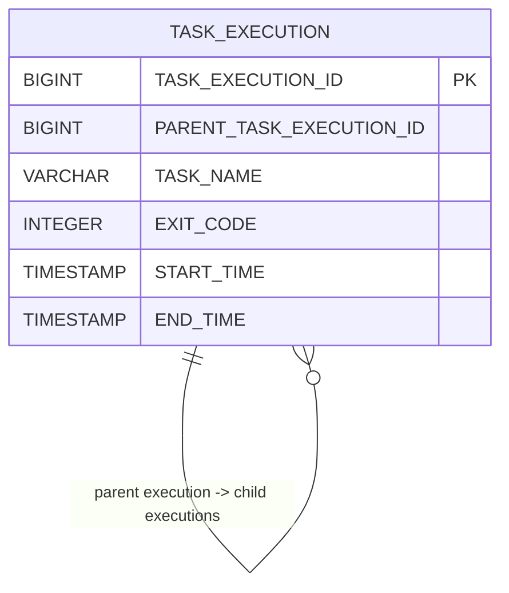
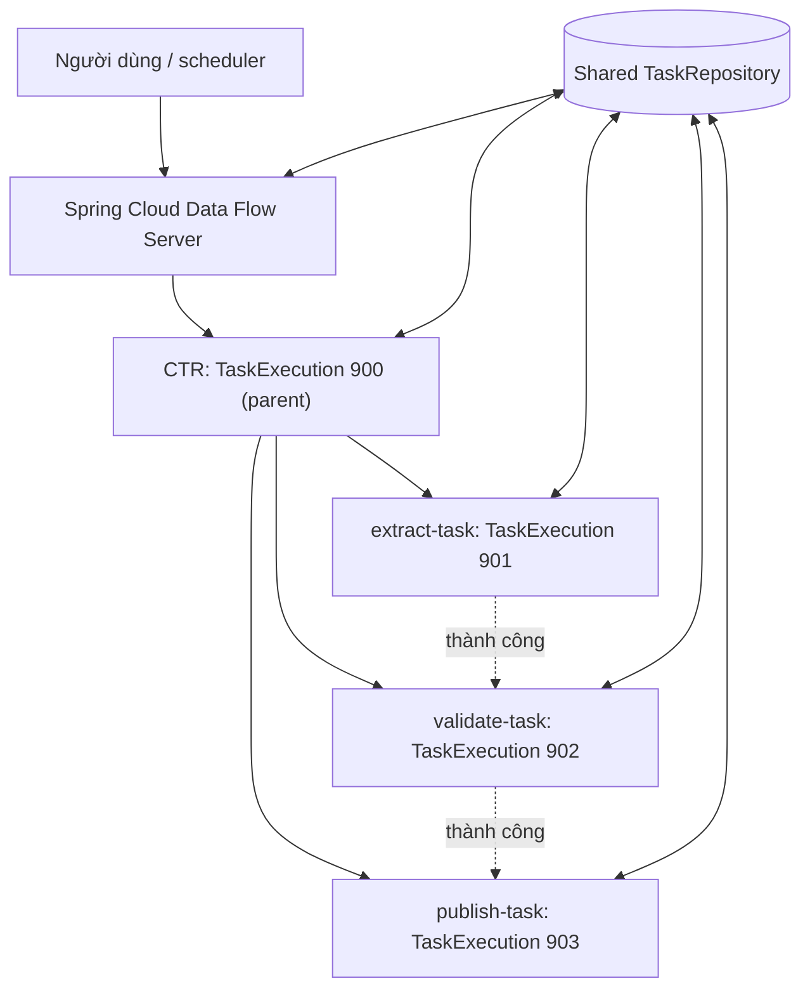
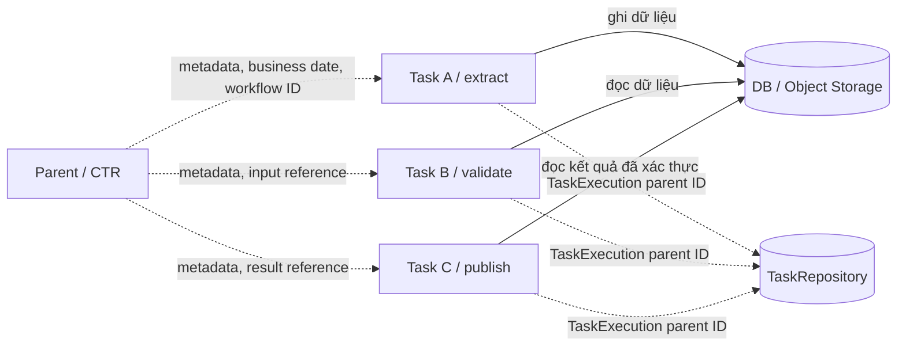
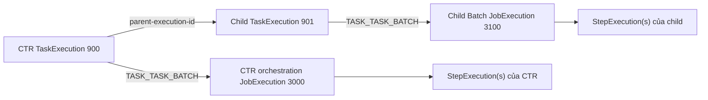

# Quan hệ thực thi cha con trong luồng tác vụ

## Mục tiêu và tình huống thực tế

Một ứng dụng **Spring Cloud Task** chạy trong thời gian hữu hạn, ghi thời điểm bắt đầu, kết thúc và mã thoát vào `TaskRepository`. Khi bài toán lớn gồm nhiều ứng dụng con, ví dụ **trích xuất → kiểm tra → tổng hợp → xuất báo cáo**, một lần chạy tổng thể cần liên kết được với **đúng những lần thực thi con** đã được khởi động trong luồng đó.

Trong chương **Data Flow**, “quan hệ thực thi cha con” (*parent–child task execution*) trả lời: **lần thực thi Task nào đã khởi chạy hoặc điều phối lần thực thi Task nào?** Đây là thông tin dòng dõi của các lần chạy, không phải một quan hệ đối tượng trong dữ liệu nghiệp vụ.

Sau bài học, bạn có thể:

- Phân biệt **Task definition**, **TaskExecution**, **parent execution ID**, **external execution ID** và **JobExecution** của Spring Batch.
- Thiết lập `spring.cloud.task.parent-execution-id` **trên task con** và hiểu cách metadata được lưu vào `TASK_EXECUTION`.
- Hiểu cách **Spring Cloud Data Flow (SCDF)** cùng **Composed Task Runner (CTR)** điều phối một đồ thị tác vụ.
- Truy vấn cha–con bằng SQL và `TaskExplorer`, bao gồm các trường hợp child lỗi, thiếu bản ghi hoặc retry.
- Thiết kế truyền dữ liệu, idempotency, bảo mật và monitoring cho luồng tác vụ có nhiều tiến trình.

**Nguồn phiên bản:** Ví dụ schema bên dưới dựa trên [Spring Cloud Task 5.1 – Task Repository Schema](https://docs.spring.io/spring-cloud-task/reference/appendix-task-repository-schema.html). Cú pháp Composed Task minh họa theo [hướng dẫn Spring Cloud Data Flow 2.10.x](https://dataflow.spring.io/docs/feature-guides/batch/composed-task/). Cần đối chiếu bộ phiên bản SCDF, CTR, Spring Boot, Spring Cloud Task đang triển khai vì các sản phẩm này có chu kỳ phát hành riêng.

## 1. Bốn loại định danh không được nhầm lẫn

| Khái niệm | Định danh / trường | Ý nghĩa |
| --- | --- | --- |
| **Task definition** | Tên định nghĩa như `settlement-flow`, `extract-task` | *Công việc nào có thể khởi chạy?* Một definition có thể chạy nhiều lần |
| **Task execution** | `TaskExecution.executionId` / `TASK_EXECUTION_ID` (`long`) | *Đúng lần chạy vật lý nào?* Mỗi lần chạy có một ID riêng |
| **Parent task execution** | `parentExecutionId` / `PARENT_TASK_EXECUTION_ID` (`Long`, có thể `null`) | *Lần chạy Task nào là cha trực tiếp của lần chạy này?* |
| **External execution ID** | `externalExecutionId` / `EXTERNAL_EXECUTION_ID` (`String`) | Mã tham chiếu do nền tảng/deployer bên ngoài cung cấp, **không phải ID cha** |
| **Spring Batch Job execution** | `JobExecution.id` / `BATCH_JOB_EXECUTION.JOB_EXECUTION_ID` | Một lần thực thi Batch Job, có thể liên kết với TaskExecution qua `TASK_TASK_BATCH` |

Ví dụ một đồ thị chốt sổ:

```text
Task definition:  settlement-flow
Lần chạy #1:      TaskExecution 900
                  ├─ TaskExecution 901: extract-task
                  ├─ TaskExecution 902: validate-task
                  └─ TaskExecution 903: report-task

Lần chạy #2:      TaskExecution 950
                  ├─ TaskExecution 951: extract-task
                  ├─ TaskExecution 952: validate-task
                  └─ TaskExecution 953: report-task
```

Trong bảng metadata giả định, task con `901` có `parentExecutionId=900`; task con `952` có `parentExecutionId=950`. Hai lần chạy có thể cùng gọi một **task name**, nhưng quan hệ phải được phân biệt theo **execution ID**, không phải chỉ theo tên hay giờ bắt đầu.

> **Không lấy ID của JobExecution làm parentExecutionId của Task.** ID này phải là **`TASK_EXECUTION_ID` của task cha**, và phải thuộc cùng không gian metadata TaskRepository mà task con sử dụng.

## 2. Metadata quan hệ cha–con trong Spring Cloud Task

Spring Cloud Task cho phép gắn ID của lần thực thi cha lên mỗi lần thực thi con bằng thuộc tính:

```properties
spring.cloud.task.parent-execution-id=<parentTaskExecutionId>
```

Ví dụ thực tế, khi cha có `executionId=900` thì **task con** được khởi động với:

```bash
java -jar target/validate-task.jar \
  --spring.cloud.task.parent-execution-id=900 \
  --business-date=2026-11-23
```

Theo [Spring Cloud Task – Parent Task Id](https://docs.spring.io/spring-cloud-task/reference/features.html#parent-task-id), framework sử dụng giá trị property để lưu liên kết cha trong `TaskExecution` của con. Đây là **cơ chế metadata**: việc thêm property này **không tự chạy task cha**, **không đợi task cha hoàn tất** và **không truyền payload nghiệp vụ từ cha sang con**.

### 2.1. Các trường liên quan trong `TASK_EXECUTION`

Schema **Spring Cloud Task 5.1** định nghĩa:

| Cột | Kiểu / nullable | Công dụng |
| --- | --- | --- |
| `TASK_EXECUTION_ID` | `BIGINT`, bắt buộc | Định danh lần chạy này |
| `TASK_NAME` | `VARCHAR` | Tên ứng dụng Task |
| `PARENT_TASK_EXECUTION_ID` | `BIGINT`, **có thể NULL** | ID lần thực thi cha |
| `EXTERNAL_EXECUTION_ID` | `VARCHAR`, có thể NULL | Mã tham chiếu tới nền tảng bên ngoài |
| `START_TIME`, `END_TIME` | Timestamp, `END_TIME` có thể NULL | Vòng đời thực thi |
| `EXIT_CODE` | Integer, **có thể NULL** | Kết quả khi framework chốt; NULL khi chưa có kết quả cuối |
| `EXIT_MESSAGE`, `ERROR_MESSAGE` | Text, có thể NULL | Thông điệp kết thúc/lỗi |
| `LAST_UPDATED` | Timestamp | Thời điểm cập nhật metadata |

Tên **`PARENT_TASK_EXECUTION_ID`** đúng theo schema 5.1; **một số DDL/tài liệu cũ dùng `PARENT_EXECUTION_ID`**, vì vậy trước khi viết SQL hoặc migration hãy kiểm tra DDL của phiên bản ứng dụng thực tế. Tương tự, nếu dự án đổi `spring.cloud.task.tablePrefix`, tên bảng không nhất thiết còn là `TASK_EXECUTION`. Không suy rằng mọi database đã có foreign key tự bảo vệ cột cha: xác minh ràng buộc từ DDL thật.

Cấu trúc quan hệ có thể được hình dung như một self-reference:



Hình trên là **sơ đồ logic**; ký hiệu quan hệ không khẳng định schema mặc định đã tạo foreign key giữa hai cột. Root TaskExecution thường có `PARENT_TASK_EXECUTION_ID = NULL`; một cha có thể có **nhiều con trực tiếp**. Nếu một con tiếp tục khởi chạy cháu, có thể tạo cây nhiều cấp bằng cách truyền `executionId` của con làm `parent-execution-id` cho cháu.

### 2.2. Ai tạo bản ghi và liên kết?

Spring Cloud Task tạo metadata khi `ApplicationContext` của mỗi ứng dụng khởi động thành công đến giai đoạn Task lifecycle. Parent Task và từng child Task là **các tiến trình/lần chạy riêng**, mỗi bên tự có bản ghi. `PARENT_TASK_EXECUTION_ID` được ghi ở bản ghi **con**, không phải danh sách con trong một cột của cha.

Những bước logic:

1. Một parent Task bắt đầu và có `TaskExecutionId`, ví dụ `900`.
2. Bộ điều phối biết ID `900` và khởi chạy child, cấp property `spring.cloud.task.parent-execution-id=900`.
3. Child khởi tạo Spring Cloud Task với `DataSource` chứa TaskRepository phù hợp; framework tạo/cập nhật bản ghi con, ví dụ `901`, với `PARENT_TASK_EXECUTION_ID=900`.
4. Child chạy `ApplicationRunner` hoặc Batch Job của riêng nó; kết quả và exit code được ghi vào **bản ghi của child**.
5. Bộ điều phối theo dõi các child, quyết định bước tiếp theo hoặc đánh dấu luồng tổng thể thất bại/thành công theo **quy tắc điều phối**.

**Giới hạn:** nếu child fail quá sớm khiến `ApplicationContext` chưa sẵn sàng, có thể **không có bản ghi TaskExecution con**, dù launcher thấy process thất bại. Nếu child bị kill trong lúc xử lý, bản ghi có thể còn `EXIT_CODE=NULL`. Đừng dùng sự tồn tại/vắng mặt của một dòng DB làm nguồn theo dõi duy nhất.

## 3. Data Flow điều phối các child như thế nào?

Trong [Spring Cloud Data Flow](https://dataflow.spring.io/docs/feature-guides/batch/composed-task/), một **composed task** là đồ thị có hướng, mỗi node là một task application. **Composed Task Runner (CTR)** được chạy như một ứng dụng Task riêng để điều phối đồ thị, gọi API của SCDF cho từng child và theo dõi kết quả trước khi quyết định node tiếp theo.



Đường nối từ **parent CTR** đến các child thể hiện **cùng parentExecutionId**, còn đường đứt nét giữa các child thể hiện **thứ tự phụ thuộc nghiệp vụ** trong đồ thị. Hai loại quan hệ này **khác nhau**:

- **Quan hệ cha–con**: `901`, `902` và `903` đều liên kết trực tiếp đến `900`.
- **Quan hệ thứ tự**: `902` chỉ chạy sau khi `901` đạt điều kiện, `903` chỉ chạy sau `902` theo DSL. **`902` không phải cha của `903`** chỉ vì nó chạy trước.

### 3.1. Tạo composed task theo DSL

Giả sử quản trị viên đã đăng ký ba ứng dụng task là `extract-task`, `validate-task`, `publish-task` trong SCDF và nền tảng đã có Composed Task Runner phù hợp. Các lệnh dưới đây dành cho **SCDF Shell**, không phải terminal Bash thông thường:

```text
dataflow:> task create settlement-flow --definition "extract-task && validate-task && publish-task"
dataflow:> task launch settlement-flow
```

Toán tử `&&` có nghĩa là **node trước phải hoàn tất thành công** thì node sau mới được khởi chạy. Đây là quy tắc của composed task, không phải cách Spring Cloud Task tự hiểu parent ID. Trong sơ đồ nhiều nhánh, SCDF còn có cách biểu đạt split/transition và restart theo tài liệu phiên bản cụ thể.

Trong ví dụ, CTR có TaskExecution cha và các app trong đồ thị có TaskExecution con. Theo [Spring Cloud Data Flow – Composed Task](https://dataflow.spring.io/docs/feature-guides/batch/composed-task/), CTR sử dụng các API của SCDF để khởi chạy các app, rồi quyết định bước tiếp theo từ trạng thái thực thi từng node. Đây là **một triển khai orchestration**, không phải bắt buộc phải có SCDF mới dùng được `parent-execution-id`; bạn cũng có thể xây một launcher riêng.

### 3.2. Điều kiện quan trọng: kho metadata dùng chung

SCDF, CTR và các child **cần chia sẻ database metadata phù hợp** để Data Flow có thể hiển thị đầy đủ lịch sử parent–child. Tài liệu [SCDF FAQ](https://dataflow.spring.io/docs/resources/faq/) nhấn mạnh phải kết nối SCDF, CTR và batch/task app tới **shared database** cho mục đích này. Database **nghiệp vụ** có thể tách biệt khỏi database metadata, nhưng TaskRepository phải được cấu hình nhất quán.

Ví dụ các ứng dụng Spring Cloud Task trỏ cùng metadata DB đã tạo schema:

```yaml
spring:
  application:
    name: validate-task
  main:
    web-application-type: none
  datasource:
    url: ${TASK_METADATA_DB_URL}
    username: ${TASK_METADATA_DB_USER}
    password: ${TASK_METADATA_DB_PASSWORD}
  cloud:
    task:
      initialize-enabled: false
      closecontext-enabled: true
```

Đoạn này giả định chỉ một `DataSource` cho Task và bạn đã cung cấp JDBC driver phù hợp. Nếu ứng dụng có nhiều `DataSource` (metadata và business), phải cấu hình `TaskConfigurer` hoặc bean hạ tầng tương ứng để TaskRepository dùng đúng metadata DB. Không tự tin rằng một `spring.datasource.url` luôn điều khiển đúng repository nếu dự án đã tùy biến.

**Không đưa secret vào CLI** hoặc vào bảng Task arguments. Dùng secret manager/volume/biến môi trường được quản lý và quyền DB tối thiểu.

### 3.3. CTR còn sử dụng Spring Batch ở cấp điều phối

CTR có thể dùng một **Spring Batch Job** để thực hiện đồ thị workflow. Vì vậy đôi khi trên dashboard bạn sẽ thấy:

- TaskExecution cha cho **CTR**.
- Một JobExecution (và các StepExecution) của **workflow điều phối**.
- Nhiều TaskExecution con cho các ứng dụng node.
- Nếu một node con tự chạy Batch Job, **chính node đó** lại có các JobExecution riêng.

Đừng gộp tất cả vào một JobExecution duy nhất, và đừng dùng `JobExecutionId` làm `parent-execution-id` của các child. Chi tiết liên kết Batch–Task có ở mục sau.

## 4. Tự truyền ID cha khi không sử dụng CTR

Với một hệ thống tự viết launcher, ý tưởng vẫn là:

```text
Parent Task:
  parentExecutionId = ID thực sự đã được TaskRepository cấp

Launcher:
  launch(childApp, [
      "--spring.cloud.task.parent-execution-id=" + parentExecutionId,
      "--business-date=2026-11-23",
      "--tenant-id=shop-42"
  ])

Child Task:
  đọc parent-execution-id ở Environment;
  Spring Cloud Task ghi parent ID vào TaskExecution con.
```

Đây là **pseudocode giao diện launcher**, không phải phương thức Java có sẵn tên `launch` của Spring Cloud Task. Tùy môi trường, launcher có thể là SCDF API, Kubernetes Job, Cloud Foundry Task hoặc một `ProcessBuilder` do ứng dụng quản lý. Dùng **danh sách argument** chứ không nối đầu vào người dùng thành shell command, để tránh injection.

Ba điểm phải đúng:

1. `parentExecutionId` là ID của **lần chạy cha hiện tại**, không phải ID của task definition, tên task hay ID của lần chạy cha trước.
2. Parent ID phải được đưa vào **cấu hình lúc child khởi động**. Thiết lập nó sau khi child đã ghi metadata sẽ không tự sửa bản ghi đó.
3. Parent và child phải dùng **cùng nơi lưu TaskExecution** nếu muốn đọc liên kết bằng `TaskExplorer`/SQL; nếu lưu riêng, một số `PARENT_TASK_EXECUTION_ID` có thể trỏ tới ID không tồn tại ở database đang tra.

### 4.1. `parent-execution-id` khác `executionid` và `external-execution-id`

Đây là ba property khác nhau:

| Property | Ý nghĩa | Được đặt trên |
| --- | --- | --- |
| `spring.cloud.task.parent-execution-id=900` | Gắn quan hệ tới **lần chạy cha 900** | Child |
| `spring.cloud.task.executionid=901` | Dùng **ID TaskExecution đã được tạo trước** để task cập nhật bản ghi của *chính nó*; chỉ dùng khi launcher/repository hỗ trợ precreate | Chính task đang chạy |
| `spring.cloud.task.external-execution-id=platform-job-xyz` | Lưu mã deployment/execution bên ngoài để correlation | Chính task đang chạy |

Ví dụ cách ghi property ngay trong child:

```bash
java -jar target/validate-task.jar \
  --spring.cloud.task.parent-execution-id=900 \
  --business-date=2026-11-23
```

Chỉ dùng lệnh đó khi ID cha `900` đã tồn tại **trong TaskRepository của child**, và child thực sự được phép làm một bước thuộc luồng cha. Trong SCDF, CTR/deployer thường truyền các thông tin cần thiết; **không nên ghi đè thủ công ID cha** qua một API public không được kiểm soát, vì nó có thể tạo liên kết giả mạo.

### 4.2. Đọc và kiểm tra parent ID trong ứng dụng con

`TaskExecution.getParentExecutionId()` trả về `Long` (nullable). `TaskExplorer.getTaskExecution(long)` tìm bản ghi theo ID và có thể trả về `null` khi không tìm thấy. Ví dụ một component phụ trợ đọc thuộc tính từ `Environment` và tra cha:

```java
package com.example.task;

import org.springframework.boot.ApplicationArguments;
import org.springframework.boot.ApplicationRunner;
import org.springframework.cloud.task.repository.TaskExecution;
import org.springframework.cloud.task.repository.TaskExplorer;
import org.springframework.core.env.Environment;
import org.springframework.stereotype.Component;

@Component
public class ParentExecutionCheck implements ApplicationRunner {

    private final TaskExplorer taskExplorer;
    private final Environment environment;

    public ParentExecutionCheck(
            TaskExplorer taskExplorer, Environment environment) {
        this.taskExplorer = taskExplorer;
        this.environment = environment;
    }

    @Override
    public void run(ApplicationArguments arguments) {
        String rawId = environment.getProperty(
                "spring.cloud.task.parent-execution-id");

        if (rawId == null || rawId.isBlank()) {
            System.out.println("Standalone task: không có parent execution");
            return;
        }

        long parentId;
        try {
            parentId = Long.parseLong(rawId);
        } catch (NumberFormatException ex) {
            throw new IllegalArgumentException(
                    "parent-execution-id phải là số nguyên", ex);
        }
        if (parentId <= 0) {
            throw new IllegalArgumentException("parent ID phải > 0");
        }

        TaskExecution parent = taskExplorer.getTaskExecution(parentId);
        if (parent == null) {
            throw new IllegalStateException(
                    "Không tìm thấy parent execution ID: " + parentId);
        }

        System.out.printf(
                "Child thuộc parent id=%d, taskName=%s%n",
                parent.getExecutionId(), parent.getTaskName());
        // Tiếp tục xác thực tenant/workflow bằng cơ chế phân quyền thực sự.
    }
}
```

Đây là **kiểm tra tham chiếu phục vụ vận hành**, không phải xác thực quyền. Bản ghi cha tồn tại **không** có nghĩa caller được phép tạo child theo tên người khác hoặc dùng dữ liệu cùng tenant. Nếu yêu cầu truy cập dữ liệu nhạy cảm, cần kiểm tra principal/tenant và workflow contract ở tầng orchestration và nghiệp vụ.

### 4.3. Làm sao parent có ID của chính nó?

Trong một hệ điều phối như SCDF, nền tảng biết `TaskExecutionId` khi tạo/khởi chạy parent và truyền cho child. Nếu viết launcher riêng, phải lấy ID từ **repository của lần chạy hiện tại** thông qua lifecycle/API phù hợp, không đoán từ `getLatestTaskExecutionForTaskName` vì **hai lần chạy cùng tên có thể trùng thời điểm hoặc chạy song song**.

## 5. Truy vấn cha, con và toàn bộ nhánh thực thi bằng SQL

Giả sử tất cả Task dùng **PostgreSQL** có bảng `TASK_EXECUTION` đúng với schema 5.1, chưa đổi table prefix và quyền truy vấn chỉ đọc. Các ID bên dưới **chỉ là ví dụ**:

| `TASK_EXECUTION_ID` | `TASK_NAME` | `PARENT_TASK_EXECUTION_ID` | `EXIT_CODE` | Vai trò |
| ---: | --- | ---: | ---: | --- |
| 900 | `settlement-flow` | `NULL` | `0` | Parent / CTR |
| 901 | `extract-task` | 900 | `0` | Child 1 |
| 902 | `validate-task` | 900 | `0` | Child 2 |
| 903 | `publish-task` | 900 | `0` | Child 3 |
| 950 | `settlement-flow` | `NULL` | `NULL` | Lần chạy workflow khác, chưa chốt |
| 951 | `extract-task` | 950 | `0` | Child thuộc lần chạy 950 |

Không bao giờ nhóm `901` và `951` vào cùng một workflow chỉ vì tên `extract-task` giống nhau.

### 5.1. Tìm parent của một child

```sql
SELECT
    child.TASK_EXECUTION_ID AS child_id,
    child.TASK_NAME AS child_name,
    child.PARENT_TASK_EXECUTION_ID AS parent_id,
    parent.TASK_NAME AS parent_name,
    parent.EXIT_CODE AS parent_exit_code
FROM TASK_EXECUTION child
LEFT JOIN TASK_EXECUTION parent
       ON parent.TASK_EXECUTION_ID = child.PARENT_TASK_EXECUTION_ID
WHERE child.TASK_EXECUTION_ID = 902;
```

Sử dụng `LEFT JOIN` vì có thể child không có parent (`NULL`) hoặc tham chiếu tới một ID cha đã bị xóa/không có trong database đang tra. Nếu `parent_id` có giá trị nhưng `parent_name` bằng `NULL`, đó là **liên kết không tra được**, cần kiểm tra DB, migration, retention hoặc lỗi truyền ID. Không khẳng định root chỉ vì thao tác join không tìm được bản ghi.

### 5.2. Liệt kê các child trực tiếp của một lần chạy cha

```sql
SELECT
    TASK_EXECUTION_ID,
    TASK_NAME,
    START_TIME,
    END_TIME,
    EXIT_CODE,
    EXIT_MESSAGE
FROM TASK_EXECUTION
WHERE PARENT_TASK_EXECUTION_ID = 900
ORDER BY START_TIME, TASK_EXECUTION_ID;
```

Đây là truy vấn **quan hệ trực tiếp**. Nó không thể hiện chính xác thứ tự phụ thuộc của đồ thị, vì nhiều child có thể cùng được gắn vào một parent nhưng chạy song song, hoặc chạy sau nhau theo DSL. Muốn biết node nào theo sau node nào, phải xem **composed task definition/đồ thị** và metadata Job/Step của CTR.

### 5.3. Tìm cả cháu/chắt trong cấu trúc nhiều cấp

Nếu một child có thể trở thành launcher cho child khác, dùng `WITH RECURSIVE` của PostgreSQL:

```sql
WITH RECURSIVE task_tree AS (
    SELECT
        TASK_EXECUTION_ID,
        PARENT_TASK_EXECUTION_ID,
        TASK_NAME,
        START_TIME,
        END_TIME,
        EXIT_CODE,
        0 AS depth,
        ARRAY[TASK_EXECUTION_ID] AS visited_ids
    FROM TASK_EXECUTION
    WHERE TASK_EXECUTION_ID = 900

    UNION ALL

    SELECT
        child.TASK_EXECUTION_ID,
        child.PARENT_TASK_EXECUTION_ID,
        child.TASK_NAME,
        child.START_TIME,
        child.END_TIME,
        child.EXIT_CODE,
        parent.depth + 1,
        parent.visited_ids || child.TASK_EXECUTION_ID
    FROM TASK_EXECUTION child
    JOIN task_tree parent
      ON child.PARENT_TASK_EXECUTION_ID = parent.TASK_EXECUTION_ID
    WHERE parent.depth < 20
      AND NOT child.TASK_EXECUTION_ID = ANY(parent.visited_ids)
)
SELECT
    TASK_EXECUTION_ID,
    PARENT_TASK_EXECUTION_ID,
    TASK_NAME,
    depth,
    START_TIME,
    END_TIME,
    EXIT_CODE
FROM task_tree
ORDER BY depth, START_TIME, TASK_EXECUTION_ID;
```

`depth=0` là chính parent `900`; `depth=1` là con trực tiếp, `depth=2` là cháu. Điều kiện độ sâu và mảng `visited_ids` giúp giảm nguy cơ vòng lặp vô hạn nếu metadata bị đặt sai thành chu trình. Đây là **truy vấn giám sát**, không thay cho ràng buộc kiểm tra chu trình khi tạo workflow.

Nếu toàn bộ composed task chỉ có một cấp parent–child, truy vấn `WHERE PARENT_TASK_EXECUTION_ID = ?` ở mục 5.2 đơn giản, dễ dùng index và thường đủ.

### 5.4. Phát hiện tham chiếu cha không tồn tại

```sql
SELECT
    child.TASK_EXECUTION_ID AS child_id,
    child.TASK_NAME,
    child.PARENT_TASK_EXECUTION_ID AS missing_parent_id
FROM TASK_EXECUTION child
LEFT JOIN TASK_EXECUTION parent
  ON parent.TASK_EXECUTION_ID = child.PARENT_TASK_EXECUTION_ID
WHERE child.PARENT_TASK_EXECUTION_ID IS NOT NULL
  AND parent.TASK_EXECUTION_ID IS NULL;
```

Những nguyên nhân cần điều tra: launcher truyền sai ID, SCDF/CTR/child dùng **khác DB**, dữ liệu cha đã bị xóa theo retention mà không tính tới child, hoặc schema cũ được migrate thiếu. **Không sửa cột cha hàng loạt** để che cảnh báo khi chưa tìm nguyên nhân.

### 5.5. Tổng hợp trạng thái child để phát hiện dấu hiệu bất thường

Ví dụ tổng hợp trên PostgreSQL:

```sql
SELECT
    PARENT_TASK_EXECUTION_ID AS parent_id,
    COUNT(*) AS total_child_executions,
    COUNT(*) FILTER (
        WHERE EXIT_CODE = 0 AND END_TIME IS NOT NULL
    ) AS finalized_success,
    COUNT(*) FILTER (
        WHERE EXIT_CODE <> 0 AND END_TIME IS NOT NULL
    ) AS finalized_failure,
    COUNT(*) FILTER (
        WHERE EXIT_CODE IS NULL OR END_TIME IS NULL
    ) AS not_finalized
FROM TASK_EXECUTION
WHERE PARENT_TASK_EXECUTION_ID = 900
GROUP BY PARENT_TASK_EXECUTION_ID;
```

Điểm cần nhớ: `not_finalized` **không** đồng nghĩa **đang chạy**. Một tiến trình có thể bị kill trước khi metadata được chốt; `TaskExecution` của một app fail quá sớm cũng có thể **không xuất hiện**. Và một query cho biết “3 child đã thành công” không chứng minh composed graph đã hoàn tất: đồ thị có thể còn một child **chưa được khởi chạy** vì điều kiện/đường đi.

## 6. Đọc quan hệ qua Java `TaskExplorer`

`TaskExplorer` là API **đọc** TaskRepository. Nó cung cấp `getTaskExecution(long id)` và các phương thức tìm execution theo tên/pagination. Theo tài liệu API, `getTaskExecution` có thể trả về `null` nếu ID không tồn tại.

Ví dụ một service trả parent của child:

```java
package com.example.task;

import java.util.Optional;

import org.springframework.cloud.task.repository.TaskExecution;
import org.springframework.cloud.task.repository.TaskExplorer;
import org.springframework.stereotype.Service;

@Service
public class TaskLineageReader {

    private final TaskExplorer taskExplorer;

    public TaskLineageReader(TaskExplorer taskExplorer) {
        this.taskExplorer = taskExplorer;
    }

    public Optional<TaskExecution> findParent(long childExecutionId) {
        TaskExecution child = taskExplorer.getTaskExecution(childExecutionId);
        if (child == null) {
            return Optional.empty();
        }

        Long parentId = child.getParentExecutionId();
        if (parentId == null) {
            return Optional.empty(); // Child không khai báo parent.
        }

        return Optional.ofNullable(
                taskExplorer.getTaskExecution(parentId));
    }

    public String explain(long executionId) {
        TaskExecution execution = taskExplorer.getTaskExecution(executionId);
        if (execution == null) {
            return "NOT_FOUND";
        }

        Long parentId = execution.getParentExecutionId();
        String parentText =
                parentId == null ? "none" : parentId.toString();

        Integer exitCode = execution.getExitCode();
        String status = exitCode == null ? "NOT_FINALIZED"
                : exitCode == 0 ? "SUCCESS" : "FAILED";

        return "executionId=" + execution.getExecutionId()
                + ", parentId=" + parentText
                + ", taskName=" + execution.getTaskName()
                + ", state=" + status;
    }
}
```

Hai điểm cần cải thiện nếu đưa code vào dịch vụ production:

- Trường hợp `Optional.empty()` có thể do **child không tồn tại**, **child không có parent** hoặc **parent ID không tra thấy**. API thực tế nên trả kết quả phân biệt các lý do này thay vì gom làm một để tránh che lỗi liên kết.
- `TaskExplorer` không tự cung cấp cơ chế “lấy cả đồ thị workflow hoàn chỉnh”. Trong một dashboard lớn, có thể dùng SQL repository query (có index phù hợp) hoặc API của SCDF để liệt kê children, thay vì tự tìm `getLatestTaskExecutionForTaskName` rồi suy đoán. `TaskExplorer` vẫn hữu ích để xác minh một ID cụ thể.

**Chú ý nullable:** `getParentExecutionId()` trả `Long`; `getExitCode()` trả `Integer`. Không tự unbox trước khi kiểm tra `null`.

## 7. Quan hệ cha–con không đồng nghĩa với dữ liệu đi qua giữa các Task

Cột `PARENT_TASK_EXECUTION_ID` là **metadata theo dõi điều phối**, không phải một cơ chế truyền `List<Invoice>`, DTO hay `ExecutionContext` từ tiến trình cha sang tiến trình con. Các ứng dụng có `ApplicationContext`, heap và transaction **độc lập**.



Một hợp đồng truyền dữ liệu an toàn thường gồm:

1. **Business request key**: ví dụ `(tenantId, businessDate, workflowRunKey)` để tất cả child biết **phạm vi dữ liệu**.
2. **Tham chiếu dữ liệu**: đường dẫn object store, tên bảng + partition key, hoặc ID của một batch dataset. Truyền **tham chiếu**, không đưa hàng nghìn bản ghi vào command-line arguments.
3. **Cơ chế “đã sẵn sàng”**: Task A chỉ báo thành công sau khi dữ liệu A ghi đã commit hoặc được publish an toàn; Task B không nên đọc file/bảng đang viết dở.
4. **Xác thực và quyền**: child phải có quyền đọc dữ liệu đúng tenant, và kiểm tra input reference; `parentExecutionId` không phải token xác thực.
5. **Tính lặp an toàn**: retry child không tạo thêm hóa đơn/chuyển tiền; database có `PRIMARY KEY/UNIQUE` và publisher có dedup/outbox khi có side effect ngoài DB.

### 7.1. Một bảng giao nhận dữ liệu giữa các bước

Ví dụ cấu trúc bảng ứng dụng **tách biệt** khỏi `TASK_EXECUTION`:

```sql
CREATE TABLE workflow_artifact (
    workflow_run_key VARCHAR(100) NOT NULL,
    step_name        VARCHAR(80) NOT NULL,
    artifact_uri     VARCHAR(500) NOT NULL,
    checksum_sha256  VARCHAR(64),
    status           VARCHAR(20) NOT NULL
                     CHECK (status IN ('WRITING','READY','FAILED')),
    created_at       TIMESTAMPTZ NOT NULL DEFAULT CURRENT_TIMESTAMP,
    PRIMARY KEY (workflow_run_key, step_name)
);
```

Task A ghi dữ liệu vào nơi bền vững, xác minh checksum, rồi cập nhật `status='READY'`. Task B chỉ đọc khi A đã `READY`, đối chiếu `workflow_run_key` do hệ điều phối truyền và xác minh artifact URI nằm trong phạm vi cho phép. Bảng này giúp định nghĩa **dữ liệu nào** đã được tạo; `TaskExecution` giúp định nghĩa **lần chạy nào** đã thực hiện việc tạo đó.

**Không nhất thiết dùng `TaskExecutionId` làm `workflow_run_key`.** Nếu cần retry toàn workflow nhưng vẫn nhận diện **cùng một ý định nghiệp vụ**, nên có key nghiệp vụ ổn định qua retry và một ID **mỗi attempt** riêng để tra log. Khi chạy lại có chủ ý để tạo phiên bản khác, dùng version/generation theo hợp đồng nghiệp vụ.

## 8. Thành công/thất bại: child và parent có vòng đời riêng

| Trường hợp | Child TaskExecution | Parent / CTR | Điều cần giám sát |
| --- | --- | --- | --- |
| Child thành công | `EXIT_CODE=0` sau khi chốt | CTR có thể tiếp tục node phụ thuộc | Parent còn node nào chưa chạy? |
| Child lỗi | `EXIT_CODE<>0` hoặc failure metadata | Với DSL `A && B`, B không khởi chạy nếu A thất bại | Xem errorMessage, log và quy tắc nhánh |
| Child chưa chốt | `EXIT_CODE=NULL`, thường `END_TIME=NULL` | Parent đang chờ hoặc gặp tình trạng treo | Kiểm tra process/container, timeout, launcher |
| Child lỗi trước khi bootstrap Task | **Có thể không có bản ghi** | Deployer/CTR vẫn có thể nhận lỗi khởi chạy | Đối chiếu runtime platform và log |
| Parent chết, child vẫn chạy | Child có thể còn hoạt động | Parent chưa chốt / đã lỗi | Có chính sách stop/cleanup/reconcile child |
| Child retry | Có thể có **TaskExecutionId mới** | CTR có logic restart theo workflow | Phân biệt attempt mới và tác động nghiệp vụ |

Quan hệ `parentExecutionId` **không tự gộp kết quả**, cũng không tự roll back những child đã commit trước khi child sau thất bại. Từ chối một bước tiếp theo khi bước trước thất bại là hành vi của **bộ điều phối và đồ thị**, không phải logic ngầm của trường metadata cha.

### 8.1. Ví dụ `extract && validate && publish`

Giả sử `extract-task` ghi ra file/bảng và kết thúc `0`; `validate-task` phát hiện dữ liệu không hợp lệ và kết thúc `12`; `publish-task` **chưa được chạy**. Khi đó:

- Parent workflow có **hai child executions** đã khởi động; không nhất thiết có hàng `publish-task`.
- `validate-task` có mã khác `0`; theo `&&`, bước `publish-task` không được khởi chạy.
- Parent/CTR phải ghi nhận kết quả **workflow** thất bại theo cơ chế SCDF/CTR.
- File/bảng do `extract-task` đã commit **không tự biến mất** vì validate thất bại. Nếu yêu cầu rollback liên bước, cần phương án bù, staging, hoặc bước publish chỉ khi toàn bộ đã xác thực.

### 8.2. Exit code của CTR và kết quả Spring Batch

Tài liệu SCDF giải thích CTR sử dụng một Spring Batch Job để điều phối graph. Có thể xảy ra trường hợp **Job của CTR thất bại** nhưng process/Task exit code vẫn là `0` theo hành vi Boot/Batch mặc định. Nếu muốn failure của Batch Job làm Task báo mã thất bại, cấu hình trên CTR:

```yaml
spring:
  cloud:
    task:
      batch:
        fail-on-job-failure: true
```

Cấu hình này áp dụng với bộ tích hợp Task/Batch phù hợp. Đừng mặc định `EXIT_CODE=0` của parent chứng minh tất cả child thành công nếu chưa kiểm tra policy và log. Tham khảo [SCDF – Restarting composed tasks when task app fails](https://dataflow.spring.io/docs/feature-guides/batch/composed-task/) và [Spring Cloud Task – Batch](https://docs.spring.io/spring-cloud-task/reference/batch.html).

## 9. Restart, retry và nhiều lần thực thi của cùng một workflow

Khi workflow gặp lỗi, một **lần khởi động mới** có thể tạo thêm parent/child `TaskExecution`; việc CTR tiếp tục từ bước thất bại, dùng lại một workflow/job instance hay tạo attempt mới phụ thuộc **cơ chế restart và JobParameters** của phiên bản SCDF/CTR đang dùng.

Không suy rằng:

- `parentExecutionId` **luôn giữ nguyên** cho mọi retry của cùng một yêu cầu nghiệp vụ.
- Cùng `TASK_NAME` và `businessDate` thì bắt buộc là cùng TaskExecution.
- Child có `EXIT_CODE=0` nghĩa là nó đã được thực thi **đúng một lần**.
- Parent đã `END_TIME` có nghĩa không còn process con nào do một launcher tùy biến khởi động bất đồng bộ.

Ví dụ một workflow được chạy lại sau lỗi:

```text
Workflow business key: shop-42/2026-11-23

Attempt 1 (parent executionId 900)
  901 extract       0
  902 validate     12   <- thất bại
  publish          --   <- chưa chạy

Attempt 2 (parent executionId 950, nếu launcher tạo run mới)
  951 validate      0
  952 publish       0
```

Các ID trong ví dụ **minh họa một chiến lược launcher tạo lần chạy mới**, không phải cam kết cách SCDF/CTR sẽ luôn gán ID khi restart. Quy trình restart cụ thể của SCDF có thể tiếp tục các node cần chạy lại thay vì khởi động mọi node từ đầu; phải tra JobExecution/StepExecution tương ứng và execution history.

### 9.1. Idempotency và tác động bên ngoài

Đặt một **idempotency key nghiệp vụ** trên hệ thống lưu kết quả, ví dụ `(tenantId, businessDate, reportVersion)`. Khi task `publish` được thử lại, không xuất hai báo cáo cùng version hoặc gửi hai yêu cầu thanh toán vì nó có `TaskExecutionId` mới. Dùng:

- `UNIQUE`/`PRIMARY KEY` trong database, ghi có điều kiện hoặc transaction phù hợp.
- Checkpoint, restart semantics và identifying `JobParameters` nếu child chạy Spring Batch.
- Key dedup ở Kafka/RabbitMQ consumer hoặc idempotency key ở API nhận khi có sự kiện/sản phẩm bên ngoài.
- Correlation ID của workflow + child execution ID để phân biệt lần thử lại trong log.

Không sử dụng `PARENT_TASK_EXECUTION_ID` làm khóa duy nhất để ngăn cùng một nghiệp vụ lặp lại: hai attempt khác parent ID vẫn có thể xử lý **cùng dữ liệu**.

## 10. Phân biệt quan hệ cha–con Task với quan hệ Task–Batch

Schema Spring Cloud Task có bảng `TASK_TASK_BATCH` dùng để nối `TASK_EXECUTION_ID` và `JOB_EXECUTION_ID`. Đây là **quan hệ một TaskExecution chứa/thực thi một JobExecution**, khác với quan hệ một TaskExecution cha khởi chạy TaskExecution con.



Quan hệ này giúp phân tích nhiều cấp:

- `PARENT_TASK_EXECUTION_ID` trên TaskExecution của child: **ai điều phối tôi?**
- `TASK_TASK_BATCH`: **Batch Job nào chạy bên trong lần Task này?**
- `BATCH_JOB_EXECUTION` / `BATCH_STEP_EXECUTION`: **Job và từng Step xử lý dữ liệu ra sao?**

Truy vấn liên kết Task ↔ Batch (nếu thư viện tích hợp đã ghi bảng liên kết):

```sql
SELECT
    t.TASK_EXECUTION_ID,
    t.TASK_NAME,
    t.PARENT_TASK_EXECUTION_ID,
    link.JOB_EXECUTION_ID
FROM TASK_EXECUTION t
LEFT JOIN TASK_TASK_BATCH link
  ON link.TASK_EXECUTION_ID = t.TASK_EXECUTION_ID
WHERE t.TASK_EXECUTION_ID IN (900, 901)
ORDER BY t.TASK_EXECUTION_ID, link.JOB_EXECUTION_ID;
```

Kết quả có thể có **nhiều JobExecution** cho một TaskExecution tùy ứng dụng; đừng viết `JOIN` một-một khi chưa hiểu workflow. Và nếu không dùng Spring Batch hoặc chưa có `TaskBatchExecutionListener`/tích hợp cần thiết, bảng nối có thể không có hàng nào — điều đó **không** tự nói child Task thất bại.

## 11. Theo dõi vận hành và quyền truy cập

Trong sản phẩm, dashboard nên hiển thị:

| Chiều quan sát | Nội dung tối thiểu | Cảnh báo nên có |
| --- | --- | --- |
| Workflow/parent | Parent ID, tên Task, thời điểm bắt đầu/kết thúc, process exit | Parent treo quá SLA, CTR không còn sống |
| Child | Child ID, parent ID, tên, exit code, end time, lỗi | Child thất bại hoặc không chốt quá hạn |
| Đồ thị | Definition DSL, các node/nhánh đã chạy/chưa chạy, quan hệ phụ thuộc | Node quan trọng chưa chạy dù predecessor thành công |
| Metadata | Schema/prefix, DataSource, external execution ID | Child không tìm thấy parent, dữ liệu bị chia DB |
| Nghiệp vụ | Tenant, ngày, business key, artifact/report ID | Replay tạo kết quả trùng, dữ liệu đầu vào sai |
| Batch (nếu dùng) | JobExecution, StepExecution, read/write/skip counts | Child Batch Job FAILED dù Task báo thành công |

Cột `EXIT_CODE=NULL` trên child chỉ cho biết **chưa có mã cuối**, không đủ để phân biệt **đang chạy** với **đã crash**. Cần đối chiếu Kubernetes Job/Pod, Cloud Foundry Task, scheduler, process exit code và log.

Spring Cloud Task 5.1 còn có [Observability](https://docs.spring.io/spring-cloud-task/reference/observability.html), mô tả các tag như `spring.cloud.task.execution.id` và `spring.cloud.task.parent.execution.id` trong observations/spans. Các ID có **cardinality rất cao**, nên ưu tiên dùng chúng trong trace/log và áp dụng chiến lược metric phù hợp; không biến mỗi execution ID thành một nhãn metric thời gian dài không kiểm soát.

### 11.1. Bảo mật và tính toàn vẹn liên kết

- Không nhận `--spring.cloud.task.parent-execution-id=...` từ người dùng không được xác thực/ủy quyền. Một con số ID không phải bằng chứng người gọi có quyền tham gia workflow.
- Đối chiếu quyền tenant, workflow definition, dữ liệu đầu vào và nguồn launcher khi xác thực child.
- Không gửi mật khẩu JDBC, API token hoặc PII nhạy cảm qua CLI: TaskRepository có thể lưu **arguments** vào `TASK_EXECUTION_PARAMS`, ngoài rủi ro process listing và log.
- Tách quyền ghi metadata của Task với quyền đọc dữ liệu nghiệp vụ; hạn chế API tìm TaskExecution theo ID tùy ý có thể làm lộ thông tin các tenant khác.
- Có chính sách retention **theo cây quan hệ**: xóa parent trước có thể để child mồ côi, khiến dashboard mất dấu dòng dõi.

## 12. Các lỗi thường gặp và cách điều tra

| Triệu chứng | Nguyên nhân thường gặp | Cách kiểm tra |
| --- | --- | --- |
| Child không có `PARENT_TASK_EXECUTION_ID` | Launcher không truyền property, sai tên, truyền sau khi child đã khởi động | Kiểm tra arguments tại launcher; tên `spring.cloud.task.parent-execution-id` |
| `parentExecutionId` có nhưng không tìm được parent | DB khác nhau, ID sai, parent đã bị xóa | Kiểm tra datasource/schema/prefix và truy vấn `LEFT JOIN` ở mục 5 |
| Cả cha và con đều có `parentExecutionId=NULL` | Child bị chạy standalone hoặc mất property | Xác nhận ai khởi chạy và cấu hình deployer |
| Child có cùng tên nhưng thuộc workflow khác | Nhiều lần thực thi definition | Dùng `TASK_EXECUTION_ID`, không group theo `TASK_NAME` |
| Parent `exitCode=0` nhưng có child lỗi | Launcher tự viết không tổng hợp lỗi hoặc CTR Job failure chưa propagate | Kiểm tra DSL/JobExecution, `fail-on-job-failure` và log |
| Có child fail nhưng child kế tiếp không xuất hiện | Với `&&`, node sau không chạy khi node trước thất bại; cũng có thể deploy fail | Kiểm tra đồ thị và trạng thái nền tảng |
| Parent đã kết thúc nhưng child còn chạy | Launcher tự viết chạy bất đồng bộ, không đợi child | Thiết kế join/wait/timeout hoặc dùng CTR |
| Child có `exitCode=NULL` kéo dài | Tiến trình đang chạy hoặc bị kill, không cập nhật được TaskRepository | Đối chiếu runtime, log và network DB |
| `TASK_TASK_BATCH` có Job ID nhưng không thấy liên kết cha | Hai kiểu quan hệ khác nhau | Dùng `PARENT_TASK_EXECUTION_ID` để truy vết parent Task |
| Retry tạo báo cáo trùng | Dùng execution ID thay business idempotency key | Thêm unique key theo phạm vi nghiệp vụ và giao nhận output an toàn |
| Truy vấn báo “column not found” | Schema cũ dùng tên cột khác, table prefix/schema tùy chỉnh | Kiểm tra DDL phiên bản cụ thể, migration và tên cột |

## 13. Bài tập tự thực hành

**Tình huống A.** Có các dòng `(900, NULL)`, `(901, 900)`, `(902, 900)` trong hai cột `(TASK_EXECUTION_ID, PARENT_TASK_EXECUTION_ID)`. Task nào là parent, và `902` có phải con của `901` không?

**Trả lời:** `900` là root; `901` và `902` đều là **con trực tiếp của 900**. `902` không phải con của `901`, kể cả khi `901` chạy trước `902`.

**Tình huống B.** `PARENT_TASK_EXECUTION_ID=900` nhưng SQL trong database child không có `TASK_EXECUTION_ID=900`. Có thể tự đặt `EXIT_CODE=0` hoặc sửa `PARENT_TASK_EXECUTION_ID=NULL` để bỏ cảnh báo không?

**Trả lời:** Không. Cần xác minh ID do launcher truyền, datasource/schema/prefix của CTR và child, cũng như retention. Sửa metadata không có chứng cứ sẽ làm sai lịch sử.

**Tình huống C.** Composed task `A && B && C` chạy A thành công, B lỗi. Vì sao không có dòng TaskExecution của C?

**Trả lời:** Theo `&&`, C chỉ được khởi chạy khi B thành công. Tuy nhiên cần đối chiếu logs/deployer để phân biệt “không được khởi chạy theo điều kiện” và “đã yêu cầu nhưng lỗi bootstrap trước khi ghi TaskExecution”.

**Tình huống D.** Parent `TaskExecutionId=900`, bên trong CTR có `JobExecutionId=3000`. Child `task-A` cần `--spring.cloud.task.parent-execution-id` bằng bao nhiêu?

**Trả lời:** **900**, vì property nhận **TaskExecution ID của cha**, không phải JobExecution ID `3000`.

**Tình huống E.** Workflow được retry, lần chạy mới có parent ID mới nhưng vẫn xử lý tenant/ngày cũ. Có nên dùng parent ID mới để quyết định ghi thêm báo cáo không?

**Trả lời:** Không. Parent ID xác định attempt/lần thực thi. Để không ghi trùng phải dùng **business key ổn định** như `(tenantId, businessDate, reportVersion)`.

**Tình huống F.** Child báo `EXIT_CODE=0`, nhưng file đầu ra chưa được commit/publish và Task B đã chạy. Cần sửa khâu nào?

**Trả lời:** Task A phải báo thành công **sau khi dữ liệu sẵn sàng và bền vững**; dùng staging + atomic publish hoặc DB transaction và trạng thái `READY`. Quan hệ cha–con không truyền dữ liệu hoặc bảo đảm commit.

## 14. Checklist triển khai

- [ ] Mỗi launcher/CTR truyền **đúng parent TaskExecution ID** cho từng child; không nhầm `executionid` hay `external-execution-id`.
- [ ] SCDF, CTR và child chia sẻ **metadata TaskRepository** theo yêu cầu hệ thống; có migration/schema/prefix nhất quán.
- [ ] Không dùng `getLatestTaskExecutionForTaskName` hay `MAX(TASK_EXECUTION_ID)` để tìm cha của lần chạy hiện tại khi hệ thống đồng thời.
- [ ] Truy vấn SQL kiểm tra `PARENT_TASK_EXECUTION_ID`, phân biệt root, child, cháu và parent không tìm thấy.
- [ ] Lưu composed task definition/DSL và log launcher để phân biệt **thứ tự node** với **parent–child lineage**.
- [ ] Theo dõi cả child `EXIT_CODE=NULL`/chưa có record và trạng thái process/container, không dựa riêng vào TaskRepository.
- [ ] Có quy tắc tổng hợp child failures vào parent/workflow; với CTR/Batch kiểm tra `fail-on-job-failure`.
- [ ] Truyền **tham chiếu dữ liệu + business key**, không nhét payload lớn hoặc secrets trong arguments.
- [ ] Có ràng buộc idempotency, transaction/outbox, retry/restart có kiểm soát và phương án khôi phục sau crash.
- [ ] Nếu child chạy Spring Batch, dùng `TASK_TASK_BATCH` để liên kết JobExecution, không coi đó là cột parent.
- [ ] Giới hạn quyền truy cập TaskExecution theo tenant/workflow và có chính sách retention bảo toàn cây quan hệ.
- [ ] Kiểm thử: workflow bình thường, hai lần chạy cùng definition, child fail, child không bootstrap, parent crash, retry và child bị phân tán metadata DB.

## 15. Tài liệu tham khảo chính thức

1. [Spring Cloud Task 5.1 – Parent Task Id](https://docs.spring.io/spring-cloud-task/reference/features.html#parent-task-id): định nghĩa `spring.cloud.task.parent-execution-id` và quan hệ task cha–con.
2. [Spring Cloud Task 5.1 – Task Repository Schema](https://docs.spring.io/spring-cloud-task/reference/appendix-task-repository-schema.html): `PARENT_TASK_EXECUTION_ID`, `EXTERNAL_EXECUTION_ID`, `TASK_TASK_BATCH` và các bảng metadata.
3. [Spring Cloud Task – `TaskExecution` API](https://docs.spring.io/spring-cloud-task/docs/current/apidocs/org/springframework/cloud/task/repository/TaskExecution.html): `getExecutionId()`, `getParentExecutionId()`, `getExternalExecutionId()`.
4. [Spring Cloud Task – `TaskExplorer` API](https://docs.spring.io/spring-cloud-task/docs/current/apidocs/org/springframework/cloud/task/repository/TaskExplorer.html): tra một lần thực thi và các lần chạy có tên cho trước.
5. [Spring Cloud Data Flow – Composed Tasks](https://dataflow.spring.io/docs/feature-guides/batch/composed-task/): đồ thị Task, CTR, `&&`, theo dõi các child và xử lý retry/restart.
6. [Spring Cloud Data Flow – FAQ](https://dataflow.spring.io/docs/resources/faq/): yêu cầu database metadata dùng chung giữa SCDF, CTR và Task applications.
7. [Spring Cloud Task – Batch integration](https://docs.spring.io/spring-cloud-task/reference/batch.html): quan hệ TaskExecution–JobExecution và truyền kết quả lỗi của Batch lên Task.
8. [Spring Cloud Task – Observability](https://docs.spring.io/spring-cloud-task/reference/observability.html): correlation/observation gồm `spring.cloud.task.parent.execution.id`.

**Nguyên tắc ghi nhớ:** **`PARENT_TASK_EXECUTION_ID` trả lời “lần chạy nào sinh ra lần chạy này?”; đồ thị SCDF/CTR trả lời “bước nào phụ thuộc bước nào?”; dữ liệu nghiệp vụ và business idempotency key trả lời “đang xử lý cái gì và đã xử lý trùng chưa?”** Ba câu hỏi khác nhau, phải được thiết kế và giám sát cùng nhau để một luồng Spring Cloud Task nhiều bước có thể truy vết, chạy lại và vận hành an toàn.
