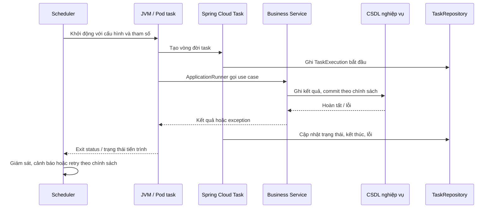
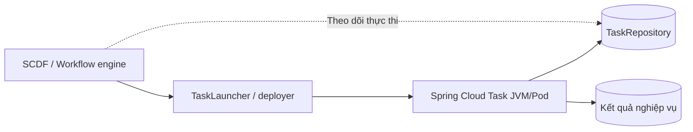

# Phân biệt thư viện Task và hệ thống lập lịch bên ngoài

## 1. Spring Cloud Task không phải bộ lập lịch

**Spring Cloud Task** là thư viện để xây dựng ứng dụng Spring Boot có **thời gian chạy hữu hạn**: ứng dụng khởi động, nhận tham số, thực thi một công việc rồi kết thúc. Khi cấu hình cơ sở dữ liệu và `TaskRepository`, framework lưu metadata của **mỗi lần thực thi** (`TaskExecution`): tên tác vụ, thời điểm bắt đầu/kết thúc, mã thoát và thông tin lỗi.

Ngược lại, **hệ thống lập lịch (scheduler)** quyết định **khi nào và bằng cách nào** cần khởi động một lần thực thi: ví dụ lúc 02:00 mỗi ngày, vào ngày làm việc đầu tiên của tháng, hoặc sau khi một pipeline hoàn thành. Scheduler có thể là cron trên máy chủ, Kubernetes CronJob, một workflow engine, Spring Cloud Data Flow hoặc một công cụ điều phối khác.

> **Phân biệt cốt lõi:** Spring Cloud Task quản lý **vòng đời một lần chạy**; scheduler quản lý **thời điểm khởi động và chính sách kích hoạt nhiều lần chạy**. Không cần cài Spring Cloud Data Flow, Quartz hay cron để viết và chạy một ứng dụng Spring Cloud Task bằng tay. Ngược lại, chỉ thêm dependency Spring Cloud Task **không tự tạo lịch chạy**.

Hãy xét tác vụ `daily-report`: mỗi ngày tạo một báo cáo số đơn đang chờ xử lý. Có ít nhất ba câu hỏi độc lập:

| Câu hỏi | Thành phần chịu trách nhiệm | Dữ liệu nên kiểm tra |
| --- | --- | --- |
| Khi nào và bao nhiêu lần cần tạo báo cáo? | Cron/CronJob/scheduler hoặc người dùng yêu cầu | Lịch, event kích hoạt, trạng thái Job/pod |
| Lần chạy số 125 bắt đầu và kết thúc thế nào? | Spring Cloud Task và `TaskRepository` | `TASK_EXECUTION`, log, exit status |
| Báo cáo cho ngày 2026-11-23 đã có, đúng và đủ chưa? | Business service, database và quy tắc đối soát | Bảng kết quả, `requestId`, checksum/quy tắc nghiệp vụ |

Không nên suy ra câu trả lời thứ ba chỉ từ `EXIT_CODE = 0`: tiến trình có thể kết thúc trước khi hệ thống ngoài xác nhận kết quả, hoặc code đã nuốt lỗi. Cũng không nên tự động cho rằng lần chạy có `END_TIME` rỗng vẫn đang hoạt động; tiến trình có thể đã bị tắt cưỡng bức.

## 2. Luồng trách nhiệm khi chạy theo lịch



Sơ đồ là mô hình khái niệm: chi tiết thời điểm listener, việc ghi metadata, mã lỗi và transaction phụ thuộc phiên bản/configuration. Nếu JVM lỗi quá sớm trước khi framework tạo được context, **có thể chưa có hàng `TASK_EXECUTION`**. Vì vậy, scheduler cần lưu cả tín hiệu **khởi tạo/triển khai tiến trình** chứ không chỉ dựa vào bảng metadata.

Mỗi lần scheduler tạo một tiến trình Spring Cloud Task mới, ứng dụng thông thường tạo một `TaskExecution` mới trong **cùng kho metadata**. Nhưng nhiều lần thử chạy cùng một yêu cầu có thể dùng **cùng `requestId` nghiệp vụ**. Đây là lý do cần phân biệt ID framework và khóa chống trùng nghiệp vụ.

### Phân biệt với Spring Batch

Khi một Spring Cloud Task gọi một Spring Batch Job:

- `TaskExecution` theo dõi **lần chạy ứng dụng task**.
- `JobExecution` và `StepExecution` của Spring Batch theo dõi **job/step**, dữ liệu checkpoint và các lần restart.
- Scheduler quyết định **khi nào** cần khởi động ứng dụng hoặc workflow.

Các cấp có thể liên hệ với nhau nhưng **không chung một ID**. Lập lịch không tự biến một lần chạy thất bại thành Spring Batch restart đúng checkpoint; điều đó cần tên Job, identifying `JobParameters`, `JobRepository` bền vững và logic idempotency phù hợp.

## 3. Những lựa chọn lập lịch phổ biến

| Cách kích hoạt | Cách vận hành | Khi nào phù hợp | Điều cần tự thiết kế |
| --- | --- | --- | --- |
| **Chạy thủ công / API** | Người dùng hoặc hệ thống gọi `java -jar`/container Job | Bài lab, tác vụ theo yêu cầu, backfill | Phân quyền, tham số, log, timeout và truy vết |
| **cron / systemd timer** | Máy chủ khởi tạo tiến trình theo lịch | Một vài tác vụ trên VM ổn định | Máy chủ sẵn sàng, khóa chồng lịch, log, cảnh báo, retry |
| **Kubernetes CronJob** | Controller tạo Kubernetes Job/Pod theo cron | Hệ thống chạy container trên Kubernetes | Múi giờ, concurrency, deadline, quota, Secret, retry |
| **Workflow engine (Argo/Airflow/Temporal...)** | Điều phối nhiều bước, điều kiện và phụ thuộc | Pipeline phức tạp nhiều dịch vụ | Adapter chạy task, trạng thái ngoài DB, dữ liệu tương quan |
| **Spring Cloud Data Flow** | Đăng ký task, tạo definition, launch/schedule và xem lịch sử | Cần quản lý tập trung nhiều ứng dụng task | Server, TaskLauncher, metadata DB, platform, bảo mật |
| **Quartz / Spring `@Scheduled`** | Scheduler chạy trong một process ứng dụng Java | Ứng dụng quản lý lịch nội bộ hoặc cần Quartz | Phải thiết kế cách **khởi một task hữu hạn riêng** nếu muốn mỗi lần lịch là một JVM/TaskExecution |

Không có lựa chọn nào mặc định tốt nhất. Nếu chỉ muốn chạy một JAR mỗi đêm, cron hoặc Kubernetes CronJob có thể đủ. Nếu có nhiều luồng công việc, tài nguyên chia sẻ, nhiều lịch và yêu cầu quan sát tập trung, workflow engine hoặc SCDF có thể phù hợp hơn.

### Những điều Spring Cloud Task không tự làm

Spring Cloud Task **không tự cung cấp** một thuộc tính kiểu `spring.cloud.task.cron=...` để tạo lịch. Nó cũng không tự tạo Kubernetes CronJob, không tự bảo đảm pod được đặt lên node, không tự hủy process bị treo và không tự thử lại sau mỗi lỗi hạ tầng. Các việc đó thuộc scheduler/orchestrator và cơ chế vận hành bạn chọn.

`spring.cloud.task.single-instance-enabled=true` (khi đã cấu hình dependency Spring Integration và kho khóa chung) chỉ là cơ chế **giới hạn đồng thời theo tên task**, **không phải bộ lập lịch**. Nó không tính toán lần chạy tiếp theo và không tự đưa một lần bị chặn vào hàng đợi để chạy sau.

## 4. Vì sao `@Scheduled` khác một Spring Cloud Task chạy hữu hạn?

Spring Framework có annotation `@Scheduled` dành cho method chạy định kỳ **trong một ApplicationContext đang sống**. Ví dụ:

```java
@EnableScheduling
@Configuration
class InternalScheduleConfiguration {

    @Scheduled(cron = "0 0 2 * * *", zone = "Asia/Ho_Chi_Minh")
    void trigger() {
        // Method này chạy trong JVM của ứng dụng đang sống.
    }
}
```

Đoạn trên là **minh họa scheduler nội bộ**, không phải mã cần thêm vào ví dụ task hữu hạn ở phần sau. Nếu ứng dụng dùng `@Scheduled` để chạy mãi nhiều lần trong một JVM thì mô hình đó **khác** với việc scheduler bên ngoài tạo **một tiến trình Spring Cloud Task mới cho mỗi lịch**. Một `TaskExecution` không tự được sinh thêm cho mỗi lần method `@Scheduled` chạy trong cùng context.

Đặc biệt:

- Spring `@Scheduled(cron = ...)` thường dùng biểu thức **sáu trường** có trường *giây* ở đầu (`0 0 2 * * *`), trong khi Linux cron và Kubernetes CronJob thường dùng **năm trường** (`0 2 * * *`). Không sao chép nguyên cron expression giữa các hệ thống mà không kiểm tra cú pháp.
- `spring.task.scheduling.*` của Spring Boot dùng cấu hình thread pool/scheduler của **Spring Framework**, không thay `spring.cloud.task.*` và không thể giới hạn mọi JVM đang chạy.
- Một tiến trình chứa scheduler nội bộ phải được giữ sống đúng cách. Với Spring Cloud Task, mục tiêu phổ biến là **thoát sau một công việc**, do đó đưa lịch ra bên ngoài thường rõ ràng và dễ vận hành hơn.
- Nếu muốn Quartz hoặc `@Scheduled` kích hoạt các Spring Cloud Task độc lập, hãy để nó gọi **process launcher, Kubernetes API hoặc hệ điều phối**, thay vì chỉ gọi trực tiếp một method service rồi mặc định đã có `TaskExecution` mới.

## 5. Ví dụ Spring Cloud Task độc lập với bất kỳ scheduler nào

Thiết kế ví dụ: mỗi lần task chạy, nó tạo **báo cáo số đơn `PENDING` cho một ngày nghiệp vụ**. Có thể truyền ngày rõ ràng qua `--business.date=YYYY-MM-DD` hoặc, trong lịch demo, không truyền ngày để task lấy **ngày hôm trước theo một múi giờ được cấu hình**. Mỗi ngày có một `requestId` ổn định, giúp không ghi trùng khi retry.

### 5.1. Dependency Maven và cấu hình

Với dự án Spring Boot đã quản lý phiên bản Spring Cloud bằng BOM **tương thích**, các dependency chính là:

```xml
<dependencies>
    <dependency>
        <groupId>org.springframework.cloud</groupId>
        <artifactId>spring-cloud-starter-task</artifactId>
    </dependency>
    <dependency>
        <groupId>org.springframework.boot</groupId>
        <artifactId>spring-boot-starter-jdbc</artifactId>
    </dependency>
    <dependency>
        <groupId>org.postgresql</groupId>
        <artifactId>postgresql</artifactId>
        <scope>runtime</scope>
    </dependency>
</dependencies>
```

Không cần dependency cron, Quartz hoặc Spring Cloud Data Flow để mã task chạy độc lập. Ví dụ sử dụng Java 17 trở lên và PostgreSQL làm kho metadata bền vững có thể dùng chung giữa các tiến trình.

`src/main/resources/application.yml`:

```yaml
spring:
  application:
    name: daily-report-app
  main:
    web-application-type: none
  datasource:
    url: ${TASK_DB_URL}
    username: ${TASK_DB_USER}
    password: ${TASK_DB_PASSWORD}
  cloud:
    task:
      name: daily-report-task
      initialize-enabled: false

app:
  business-zone: Asia/Ho_Chi_Minh
```

`web-application-type: none` giúp process không phải khởi web server. `initialize-enabled: false` **giả định schema Spring Cloud Task đã được migration đúng phiên bản**. Task và scheduler có thể dùng các thành phần database khác nhau, nhưng muốn xem chung lịch sử chạy thì các tiến trình task phải kết nối kho metadata phù hợp.

`app.business-zone` là cấu hình **tự định nghĩa trong ví dụ**, không phải thuộc tính riêng của Spring Cloud Task. Định nghĩa rõ múi giờ giúp tránh khác nhau giữa máy dev, container và scheduler. Múi giờ **của lịch** và múi giờ **xác định ngày nghiệp vụ** cần được quy định và kiểm tra đồng bộ.

### 5.2. Bảng dữ liệu nghiệp vụ

Tạo hai bảng bằng migration PostgreSQL riêng của ứng dụng (không thay schema `TASK_*`):

```sql
CREATE TABLE business_orders (
    order_id BIGINT PRIMARY KEY,
    order_date DATE NOT NULL,
    status VARCHAR(20) NOT NULL
);

CREATE TABLE daily_reports (
    request_key VARCHAR(80) PRIMARY KEY,
    business_date DATE NOT NULL,
    pending_count BIGINT NOT NULL,
    created_at TIMESTAMPTZ NOT NULL DEFAULT CURRENT_TIMESTAMP
);
```

Khóa chính `request_key` giúp ngăn hai lần chạy ghi hai báo cáo độc lập cho **cùng một mã yêu cầu**. Trong hệ thống thực tế còn cần khóa nghiệp vụ/ràng buộc để bảo đảm scheduler không cấp hai `requestId` khác nhau cho cùng báo cáo nếu điều đó không được phép, đồng thời xử lý nguồn dữ liệu thay đổi trong thời gian chạy.

### 5.3. Business service: idempotency ở lớp dữ liệu

Tạo `DailyReportService.java` trong package `com.example.report`:

```java
package com.example.report;

import java.sql.Date;
import java.time.LocalDate;

import org.springframework.jdbc.core.JdbcTemplate;
import org.springframework.stereotype.Service;
import org.springframework.transaction.annotation.Transactional;

@Service
public class DailyReportService {

    private final JdbcTemplate jdbc;

    public DailyReportService(JdbcTemplate jdbc) {
        this.jdbc = jdbc;
    }

    @Transactional
    public ReportResult ensureReport(String requestKey, LocalDate date) {
        if (requestKey.isBlank() || requestKey.length() > 80) {
            throw new IllegalArgumentException("requestKey phải có 1-80 ký tự");
        }

        Long count = jdbc.queryForObject(
                "SELECT COUNT(*) FROM business_orders " +
                "WHERE order_date = ? AND status = 'PENDING'",
                Long.class, Date.valueOf(date));

        jdbc.update("""
                INSERT INTO daily_reports (request_key, business_date, pending_count)
                VALUES (?, ?, ?)
                ON CONFLICT (request_key) DO NOTHING
                """, requestKey, Date.valueOf(date), count);

        return jdbc.queryForObject("""
                SELECT business_date, pending_count
                FROM daily_reports
                WHERE request_key = ?
                """, (rs, rowNum) -> {
                    LocalDate savedDate = rs.getDate("business_date").toLocalDate();
                    if (!date.equals(savedDate)) {
                        throw new IllegalStateException(
                                "requestKey đã được sử dụng cho ngày khác");
                    }
                    return new ReportResult(requestKey, savedDate,
                            rs.getLong("pending_count"));
                }, requestKey);
    }
}
```

`ReportResult.java`:

```java
package com.example.report;

import java.time.LocalDate;

public record ReportResult(
        String requestKey, LocalDate businessDate, long pendingCount) {
}
```

`ON CONFLICT (request_key) DO NOTHING` là cú pháp **PostgreSQL**: lần retry cùng khóa không tự ghi bản sao; service đọc kết quả đã lưu và từ chối nếu cùng khóa nhưng ngày khác. Đây là mô hình idempotency **tối thiểu cho bài học**, không phải bảo đảm mọi nguồn dữ liệu bất biến. Nếu dữ liệu nguồn có thể thay đổi, cần lưu thêm `source_version`/checksum, xác định quy tắc cập nhật báo cáo và đối soát đầu ra. Unique constraint cũng giúp chống hai JVM cùng cố chèn một khóa, nhưng giao dịch, lock và trạng thái dữ liệu vẫn phải được kiểm thử đồng thời.

### 5.4. ApplicationRunner: cùng mã, nhiều cách kích hoạt

Tạo `DailyReportTaskApplication.java`:

```java
package com.example.report;

import java.time.LocalDate;
import java.time.ZoneId;
import java.util.List;

import org.springframework.beans.factory.annotation.Value;
import org.springframework.boot.ApplicationArguments;
import org.springframework.boot.ApplicationRunner;
import org.springframework.boot.SpringApplication;
import org.springframework.boot.autoconfigure.SpringBootApplication;
import org.springframework.cloud.task.configuration.EnableTask;
import org.springframework.context.annotation.Bean;

@EnableTask
@SpringBootApplication
public class DailyReportTaskApplication {

    public static void main(String[] args) {
        SpringApplication.run(DailyReportTaskApplication.class, args);
    }

    @Bean
    ApplicationRunner runOnce(DailyReportService service,
            @Value("${app.business-zone:UTC}") String zoneName) {
        return args -> {
            String dateOption = optionalOne(args, "business.date");
            LocalDate date = dateOption == null
                    ? LocalDate.now(ZoneId.of(zoneName)).minusDays(1)
                    : LocalDate.parse(dateOption);

            String key = optionalOne(args, "request.id");
            if (key == null) {
                key = "daily-pending-" + date;
            }

            ReportResult result = service.ensureReport(key, date);
            System.out.printf("request=%s date=%s pending=%d%n",
                    result.requestKey(), result.businessDate(),
                    result.pendingCount());
        };
    }

    private static String optionalOne(ApplicationArguments args, String name) {
        if (!args.containsOption(name)) {
            return null;
        }
        List<String> values = args.getOptionValues(name);
        if (values == null || values.size() != 1 ||
                values.get(0) == null || values.get(0).isBlank()) {
            throw new IllegalArgumentException(
                    "Cần đúng một giá trị cho --" + name);
        }
        return values.get(0);
    }
}
```

Lệnh chạy **thủ công**, minh họa ngày nghiệp vụ rõ ràng:

```bash
java -jar target/daily-report-task.jar \
  --business.date=2026-11-23 \
  --request.id=daily-pending-2026-11-23
```

Nếu **không truyền hai tham số** cho lần chạy theo lịch, ví dụ chọn ngày hôm trước trong `app.business-zone` và tạo `requestId` theo ngày đó. Đây chỉ là mặc định thuận tiện khi lịch thường chạy vào đầu ngày. **Khi chạy bù hoặc retry trễ sang ngày khác, hãy truyền ngày và `request.id` gốc tường minh**; không tính lại `yesterday` rồi vô tình xử lý một yêu cầu khác.

Nếu runner ném exception, không nên bắt rồi chỉ in lỗi mà trả về bình thường. Hệ điều phối cần nhận tín hiệu thất bại qua mã thoát/log và `TaskRepository`. Mã thoát cụ thể phụ thuộc việc framework ánh xạ exception; hãy kiểm tra hành vi trên phiên bản ứng dụng thực tế.

## 6. Lựa chọn A: chạy theo lịch bằng cron trên Linux

Với một VM đơn giản, cron có thể gọi đúng executable JAR đã chạy thủ công:

```cron
# Đặt dòng này vào user crontab (ví dụ mở bằng crontab -e):
0 2 * * * /usr/local/bin/run-daily-report.sh >> /var/log/daily-report.log 2>&1
```

Lưu ý: **crontab của user** có năm trường thời gian; file `/etc/cron.d/*` thường có thêm trường **user** trước command. Hai định dạng này không thể thay thế nguyên trạng. Dòng minh họa trên nên được đặt trong **user crontab** của tài khoản vận hành; nếu dùng `/etc/cron.d`, thêm tên user đúng vị trí theo tài liệu distro. Bảo đảm tài khoản có quyền đọc artifact, biến kết nối DB và ghi log.

Tạo wrapper script `/usr/local/bin/run-daily-report.sh` theo quy trình triển khai của hệ thống:

```bash
#!/usr/bin/env bash
set -euo pipefail

cd /opt/daily-report

# Vì task có mặc định ngày hôm trước theo app.business-zone,
# cron không cần tự tính ngày để chạy đúng lịch minh họa.
exec /usr/bin/java -jar /opt/daily-report/daily-report-task.jar
```

Đây là **mã ví dụ**, không phải yêu cầu ghi script vào repo bài học. Cần cấp quyền executable cho script và cung cấp biến `TASK_DB_URL`, `TASK_DB_USER`, `TASK_DB_PASSWORD` một cách an toàn trong môi trường chạy (cron thường không tải profile shell tương tác). Cron không tự có dashboard cho trạng thái dữ liệu nghiệp vụ; kết hợp log, metrics, thông báo lỗi và truy vấn `TASK_EXECUTION`.

### Điểm mạnh và giới hạn của cron

- Đơn giản, ít thành phần, phù hợp số task nhỏ trên một máy chủ có giám sát.
- Phụ thuộc việc máy chủ còn hoạt động vào giờ lịch; thường không tự replay mọi lần bị bỏ lỡ.
- **Có thể khởi động chồng** nếu lần trước chưa kết thúc; cần cơ chế khóa, idempotency hoặc scheduler policy.
- Retry/backoff không được Spring Cloud Task tự cung cấp chỉ vì lịch bắt nguồn từ cron.
- Múi giờ do cron/host quyết định; `CRON_TZ` không có hành vi đồng nhất ở mọi cron implementation. Đặt lịch theo múi giờ đã chuẩn hóa và kiểm tra với phiên bản triển khai.

## 7. Lựa chọn B: Kubernetes CronJob tạo process task mới

Trên Kubernetes, CronJob là bộ điều khiển tạo **Job** theo lịch; Job tạo **Pod/container** chạy ứng dụng. Mỗi pod có thể chạy một JVM Spring Cloud Task, kết thúc và trả trạng thái cho Kubernetes.

Ví dụ manifest (giả định cluster hỗ trợ trường `spec.timeZone`, image và Secret đã tồn tại):

```yaml
apiVersion: batch/v1
kind: CronJob
metadata:
  name: daily-report
spec:
  schedule: "0 2 * * *"
  timeZone: "Asia/Ho_Chi_Minh"
  concurrencyPolicy: Forbid
  startingDeadlineSeconds: 600
  successfulJobsHistoryLimit: 3
  failedJobsHistoryLimit: 5
  jobTemplate:
    spec:
      backoffLimit: 1
      activeDeadlineSeconds: 1800
      template:
        spec:
          restartPolicy: Never
          containers:
            - name: task
              image: registry.example.com/team/daily-report-task:1.0.0
              env:
                - name: TASK_DB_URL
                  valueFrom:
                    secretKeyRef:
                      name: daily-report-db
                      key: url
                - name: TASK_DB_USER
                  valueFrom:
                    secretKeyRef:
                      name: daily-report-db
                      key: username
                - name: TASK_DB_PASSWORD
                  valueFrom:
                    secretKeyRef:
                      name: daily-report-db
                      key: password
                - name: APP_BUSINESS_ZONE
                  value: Asia/Ho_Chi_Minh
```

Image `registry.example.com/...` và Secret `daily-report-db` là **placeholder**. Image phải có Java entrypoint thực thi task; mẫu trên không ghi `command`/`args` vì ứng dụng demo đã có quy tắc chọn ngày hôm trước. Với image khác, phải khai báo command/args phù hợp với container thực tế. Thực hiện quản lý Secret, image pull permissions, namespace, resource requests/limits và cấu hình DB theo chính sách tổ chức.

### Những thuộc tính dễ nhầm

| Thuộc tính | Phạm vi | Ý nghĩa |
| --- | --- | --- |
| `schedule: "0 2 * * *"` | Kubernetes CronJob | Lịch theo **5 trường**: phút, giờ, ngày-tháng, tháng, ngày-tuần |
| `timeZone` | CronJob controller | Múi giờ giải thích lịch khi cluster/API hỗ trợ |
| `concurrencyPolicy: Forbid` | **Chính CronJob này** | Không tạo Job mới đang chồng với Job hoạt động do chính CronJob đó quản lý |
| `concurrencyPolicy: Replace` | Chính CronJob | Có thể thay thế Job trước bằng Job mới; không an toàn nếu xử lý cũ đã commit một phần |
| `startingDeadlineSeconds` | CronJob | Giới hạn thời gian sau lịch mà controller còn được phép bắt kịp lần kích hoạt bị lỡ |
| `backoffLimit` | Kubernetes Job | Chính sách thử lại Pod thất bại; **không bảo đảm idempotency** của nghiệp vụ |
| `activeDeadlineSeconds` | Kubernetes Job | Deadline thời gian chạy của Job; đến hạn có thể bị Kubernetes chấm dứt |
| `successfulJobsHistoryLimit` / `failedJobsHistoryLimit` | CronJob | Số tài nguyên Job cũ được giữ lại; không thay chính sách retention của `TASK_EXECUTION` |

`Forbid` **không khóa mọi tiến trình cùng tên task trong hệ thống**. Người vận hành có thể tạo một Kubernetes Job thủ công, một CronJob khác có thể chạy cùng image, hoặc hệ thống khác có thể khởi động JAR ngoài cluster. Muốn bảo vệ nghiệp vụ cần ràng buộc dữ liệu, `requestId` ổn định và khi phù hợp dùng cơ chế **single instance theo task name** với kho khóa chung.

CronJob controller có thể tạo thêm hoặc bỏ lỡ Job trong các tình huống hạ tầng; vì vậy ứng dụng task phải **chịu được việc chạy lại**. `backoffLimit` có thể sinh pod mới trong cùng Kubernetes Job, dẫn tới **TaskExecution mới**. Với ví dụ tự tính ngày, cần lưu ý retry qua ranh giới ngày có thể đổi ngày nghiệp vụ; hệ thống production nên cấp **business date cố định cho từng lịch** qua một nguồn tham số/manifest bền vững.

## 8. Lựa chọn C: hệ điều phối hoặc Spring Cloud Data Flow

Nếu nhu cầu không chỉ là một lịch đơn giản, bạn có thể dùng workflow engine (ví dụ Argo Workflows, Airflow) hoặc **Spring Cloud Data Flow (SCDF)** để quản lý việc khởi chạy. SCDF là tùy chọn và có thể cung cấp task app registration, task definition, launch theo yêu cầu, schedule trên platform được hỗ trợ, lịch sử thực thi và composed task.



Ví dụ luồng nhiều bước:

```text
02:00: chuẩn bị dữ liệu
  -> kiểm tra đầu vào
  -> chạy Spring Cloud Task nhập đơn
  -> chạy đối soát kết quả
  -> gửi cảnh báo nếu sai khác
```

SCDF **không thay Business Service**, `TaskRepository` hay các ràng buộc idempotency. Việc SCDF yêu cầu `TaskLauncher` tạo một Pod vẫn là hoạt động khởi tạo tiến trình như những cách khác. Không cần thêm SCDF Server vào dependencies của executable JAR để có thể sử dụng nó như một task app được SCDF deploy.

Nếu dùng scheduler ứng dụng như Quartz, cần hiểu Quartz có thể quản lý trigger bền vững và cluster tùy cấu hình, nhưng method Quartz chạy trong JVM lưu trú **không tự biến thành một lần Spring Cloud Task độc lập**. Khi yêu cầu mỗi lịch tạo `TaskExecution` mới và quy trình kết thúc hẳn, hãy xây dựng thành phần launcher đúng vòng đời hoặc đặt lịch ở cấp process/container.

## 9. Lỗi, retry, chạy chồng và bảo vệ dữ liệu

### 9.1. Retry có thể tạo nhiều lần thực thi cho một yêu cầu

Ví dụ lịch ngày 24/11 xử lý dữ liệu ngày 23/11:

| Attempt | `requestId` | `TaskExecution` ID (minh họa) | Kết quả |
| --- | --- | --- | --- |
| Lần đầu | `daily-pending-2026-11-23` | 2001 | Lỗi sau khi ghi dữ liệu |
| Retry | `daily-pending-2026-11-23` | 2002 | Thành công hoặc phát hiện kết quả đã tồn tại |

Hai bản ghi thực thi đều có giá trị cho **truy vết**, nhưng dữ liệu nghiệp vụ chỉ nên có một kết quả hợp lệ cho `requestId` trên. Vì vậy, **đừng dùng `TASK_EXECUTION_ID` làm idempotency key**: ID đó thay đổi trong mỗi attempt. Cũng đừng tự thêm `run.id` ngẫu nhiên vào Spring Batch chỉ để vượt lỗi Job instance đã hoàn tất.

### 9.2. Một khóa theo tên task không giải quyết mọi xung đột

`spring.cloud.task.single-instance-enabled` giới hạn đồng thời theo **task name** khi các instance cùng bật cờ, có Spring Integration và kho khóa phù hợp. Nhưng một task `orders-import` và một task `orders-reconcile` vẫn có thể đồng thời cập nhật **cùng bảng**. Khi đó cần khóa/transaction ở nghiệp vụ, khóa duy nhất, checkpoint hoặc chính sách điều phối theo tài nguyên.

Đối với task đọc dữ liệu từ nguồn ngoài hoặc gọi API thanh toán/email, transaction JDBC không tự rollback side effect bên ngoài. Nếu scheduler retry sau timeout, phải dùng idempotency key được nhà cung cấp hỗ trợ, outbox và/hoặc cơ chế truy vấn receipt trước khi gửi lại.

### 9.3. Ma trận xử lý lỗi theo tầng

| Triệu chứng | Tầng điều tra đầu tiên | Cách phản ứng |
| --- | --- | --- |
| Scheduler không tạo Job đúng giờ | Cron/CronJob/controller/SCDF | Kiểm tra timezone, missed schedule, quyền, tài nguyên và trạng thái controller |
| Job được tạo nhưng không có Pod/JVM | Deployer, image, quota, quyền | Xem log nền tảng trước khi kết luận task đã thực thi |
| JVM lỗi lúc khởi động, không có `TASK_EXECUTION` | Spring Boot config/schema/network | Đọc log bootstrap, JDBC URL, Secret, dependency, schema |
| `EXIT_CODE` khác 0, dữ liệu mới ghi một phần | Runner/service/DB/TaskRepository | Xác minh các commit đã xảy ra; retry theo checkpoint/idempotency |
| `END_TIME` rỗng sau khi Pod đã bị dừng | TaskRepository và quá trình chấm dứt JVM | Đối soát với trạng thái Pod, log và kết quả nghiệp vụ |
| Scheduler báo thành công nhưng dữ liệu thiếu | Service/đối soát nghiệp vụ | Kiểm tra điều kiện hoàn thành, không dựa mỗi exit status |
| Hai lịch chạy cùng lúc | Scheduler policy, tên Task, lock và DB | Kiểm tra overlap, unique constraint, requestId và phạm vi khóa |
| Retry qua ngày mới xử lý sai ngày | Tầng tạo tham số | Truyền lại ngày nghiệp vụ và khóa tương quan **gốc** thay vì tính lại ngày hiện tại |

## 10. Theo dõi lịch sử và kết quả sau khi chạy

Sau khi đã chuẩn bị schema Task phù hợp phiên bản, có thể truy vấn bảng metadata mặc định:

```sql
SELECT TASK_EXECUTION_ID,
       TASK_NAME,
       START_TIME,
       END_TIME,
       EXIT_CODE,
       EXIT_MESSAGE,
       ERROR_MESSAGE
FROM TASK_EXECUTION
WHERE TASK_NAME = 'daily-report-task'
ORDER BY START_TIME DESC, TASK_EXECUTION_ID DESC;
```

Và truy vấn bảng kết quả nghiệp vụ:

```sql
SELECT request_key, business_date, pending_count, created_at
FROM daily_reports
ORDER BY business_date DESC;
```

Hai bảng trả lời câu hỏi khác nhau. Ví dụ, hai `TASK_EXECUTION_ID` có thể tương ứng **một** bản ghi `daily_reports` nếu task đã retry cùng request key; khi cần tương quan chính xác, nên ghi `requestId` trong log có kiểm soát, bảng liên kết execution–request hoặc dùng cơ chế tham số metadata phù hợp. **Không join chỉ bằng thời điểm gần nhau** khi nhiều tác vụ chạy đồng thời.

Nếu ứng dụng chạy Spring Batch, xem thêm `BATCH_JOB_EXECUTION`, `BATCH_STEP_EXECUTION` và checkpoint. `TaskRepository` và `JobRepository` có thể cùng database vật lý nhưng là hai bộ metadata có trách nhiệm khác nhau; không thay một loại bằng loại còn lại.

### Những tín hiệu nên đưa vào dashboard

- **Lịch dự kiến so với lần kích hoạt thực tế:** phát hiện missed schedule, sai múi giờ, chạy bù.
- **Tổng số attempt, mã thoát và thời gian chạy:** phân biệt lỗi hạ tầng với xử lý nghiệp vụ.
- **Task đang chạy quá lâu hoặc metadata chưa có `END_TIME`:** đối chiếu pod/JVM còn sống trước khi cho retry.
- **Độ trễ kết quả nghiệp vụ:** báo cáo cho ngày nào đã hoàn tất, có đủ bản ghi/đúng checksum hay chưa.
- **Số lượng lần retry/chạy chồng:** xem policy scheduler và idempotency theo request key.
- **Sử dụng tài nguyên/giới hạn DB:** số kết nối, lock wait, deadlock, CPU/RAM, thời gian truy vấn.

Không ghi token, password hoặc payload nhạy cảm vào CLI/task parameters/log; scheduler/SCDF có thể lưu tham số để người vận hành truy vết. Cần quản lý Secret, RBAC, retention và quyền xem log phù hợp.

## 11. Cách lựa chọn và triển khai an toàn

Trước khi chọn cron, CronJob, SCDF hoặc scheduler nội bộ, dùng checklist:

1. **Xác định loại workload:** có cần tạo một tiến trình hữu hạn cho mỗi lần chạy hay cần một dịch vụ sống liên tục? Nếu là task hữu hạn, tạo process/container riêng thường dễ quản lý vòng đời hơn.
2. **Xác định múi giờ và quy tắc ngày nghiệp vụ:** thống nhất giữa scheduler, ứng dụng và DB; chú ý chuyển giờ mùa hè (*DST*) ở những múi giờ có DST. Một lịch 02:00 có thể bị bỏ qua hoặc chạy khác dự kiến trong ngày đổi giờ.
3. **Xác định hành vi khi bỏ lỡ lịch:** bỏ qua, chạy bù từng ngày, gộp kỳ hay báo người vận hành? Không tự động coi mọi missed run là có thể retry an toàn.
4. **Đặt timeout, backoff và giới hạn đồng thời:** biết rõ ai có quyền dừng process cũ, ai quyết định phát lại và số lần retry tối đa.
5. **Cấp tham số nghiệp vụ ổn định:** giữ `requestId`, khoảng dữ liệu/manifest và source version qua retry; không phụ thuộc mù quáng vào thời điểm retry.
6. **Dùng database bền vững và migration chuẩn:** schema `TASK_*`, `BATCH_*` nếu có, quyền truy cập đúng; H2 `mem:` của mỗi Pod không cho phép truy vết lịch sử tập trung.
7. **Thiết kế idempotency:** unique business key, checkpoint/outbox hoặc upsert có kiểm chứng; bảo vệ trường hợp hai JVM chồng nhau.
8. **Đối soát kết quả:** sau khi tiến trình báo thành công vẫn cần kiểm tra dữ liệu đã commit và side effect ngoài hệ thống nếu có.
9. **Giám sát cả hai nơi:** log và trạng thái của scheduler/orchestrator, `TaskRepository`/`JobRepository` và kết quả nghiệp vụ.

## 12. Bài thực hành tự kiểm tra

1. Dùng ví dụ `DailyReportTaskApplication`, chạy thủ công với `--business.date=2026-11-23 --request.id=daily-pending-2026-11-23`. Chỉ ra ai cấp lịch, ai ghi metadata Task và ai quyết định số đơn đang chờ.
2. Chạy lại cùng lệnh trên database giữ lịch sử. Vì sao có thể có hai bản ghi `TASK_EXECUTION` nhưng chỉ một kết quả trong `daily_reports`?
3. Viết cron Linux chạy mỗi ngày lúc 02:00 và so sánh với cron expression của Spring `@Scheduled`. Vì sao không dùng nguyên chuỗi `0 0 2 * * *` cho Kubernetes CronJob?
4. Với Kubernetes CronJob, giải thích vai trò của `concurrencyPolicy: Forbid`, `backoffLimit`, `startingDeadlineSeconds` và `activeDeadlineSeconds`. Tại sao chúng không tự bảo đảm exactly-once?
5. Giả sử một task chạy 40 phút, nhưng lịch kích hoạt 30 phút một lần. Nêu ít nhất hai cách tránh chạy chồng và rủi ro của việc hủy task cũ khi nó đã commit một phần dữ liệu.
6. Một lần chạy vào 02:00 ngày 24/11 thất bại và được retry sau 00:00 ngày 25/11. Nếu ứng dụng luôn lấy “hôm qua”, yêu cầu có thể bị đổi thành ngày nào? Hãy thiết kế cơ chế cấp lại tham số gốc.
7. Một Pod hoàn tất mã 0 nhưng không có `TASK_EXECUTION`. Liệt kê các nguyên nhân có thể và thứ tự kiểm tra (DataSource, schema, cấu hình Task, log, profile, thời điểm lỗi).
8. So sánh kiến trúc **cron + JAR**, **Kubernetes CronJob + container** và **SCDF + TaskLauncher** cho 30 task, nhiều nhóm vận hành, cần lịch sử tập trung. Khi nào nên thêm SCDF và chi phí vận hành nào đi kèm?
9. Nếu task gọi Spring Batch Job với chunk/checkpoint, giải thích khác nhau giữa scheduler retry một process mới và restart đúng Batch Job instance.
10. Thiết kế ma trận giám sát cho một lịch chạy mỗi đêm: lịch dự kiến, thời điểm start/finish, exit code, `requestId`, kết quả nghiệp vụ, retry count và thời gian trễ.

Khi hoàn thành bài, bạn cần phân biệt được **scheduler quyết định khi nào khởi động**, **Spring Cloud Task ghi nhận lần chạy**, và **business service xác minh kết quả**. Bạn cũng cần biết khi nào dùng cron/CronJob/SCDF, cách tránh chạy chồng, xử lý retry và ngày nghiệp vụ, và cách phối hợp Spring Batch khi công việc lớn cần checkpoint/restart.

## 13. Tài liệu tham khảo

- [Spring Cloud Task Reference Guide](https://docs.spring.io/spring-cloud-task/reference/): mô hình ứng dụng hữu hạn, `TaskExecution`, `TaskRepository`, cấu hình và lịch sử thực thi.
- [Spring Framework — Annotation Support for Scheduling](https://docs.spring.io/spring-framework/reference/integration/scheduling.html): `@Scheduled`, cron expression và scheduler trong ứng dụng.
- [Kubernetes — CronJob](https://kubernetes.io/docs/concepts/workloads/controllers/cron-jobs/): schedule, concurrency policy, timezone và missed schedule.
- [Kubernetes — Job](https://kubernetes.io/docs/concepts/workloads/controllers/job/): Pod retry, `backoffLimit` và giới hạn thời gian Job.
- [Spring Cloud Data Flow — Scheduling Tasks](https://dataflow.spring.io/docs/feature-guides/batch/scheduling/): SCDF là lựa chọn điều phối, scheduling theo nền tảng.
- [Spring Batch Reference Guide](https://docs.spring.io/spring-batch/reference/): JobRepository, JobExecution, StepExecution và restart.

Các ví dụ lịch, manifest, SQL và Java ở trên được cung cấp cho mục đích học tập. Trước khi triển khai production, hãy xác nhận cú pháp và mức hỗ trợ của **đúng phiên bản Spring Boot, Spring Cloud Task, scheduler, Kubernetes và database** đang sử dụng; thử nghiệm các tình huống bỏ lỡ lịch, retry trễ, crash và chạy chồng trên môi trường an toàn.
