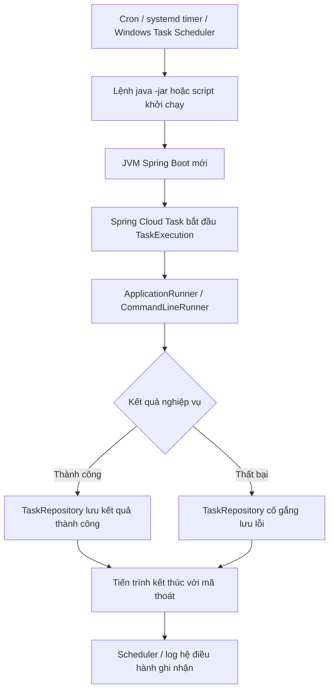
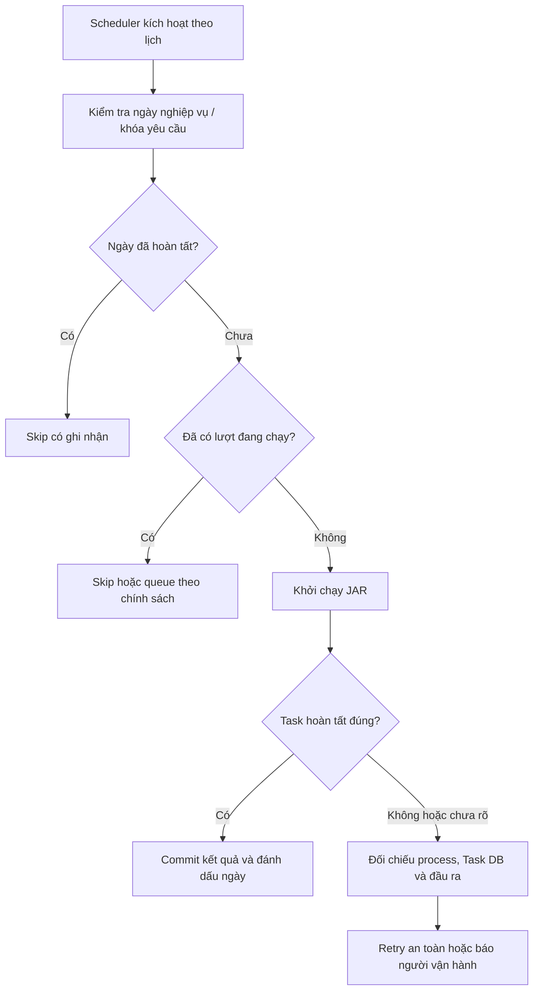

# Khởi chạy JAR bằng cron hoặc bộ lập lịch hệ điều hành

## Mục tiêu bài học

Trong **SPRING_CLOUD_TASK (Spring Cloud Task)**, một ứng dụng Spring Boot có thể thực hiện công việc **hữu hạn** rồi kết thúc: tạo báo cáo theo ngày, xử lý file nhập liệu, đồng bộ đối tác hoặc chạy một Spring Batch Job. Framework tạo và cập nhật `TaskExecution` qua `TaskRepository` để ghi thời gian bắt đầu, kết thúc, mã thoát và thông tin lỗi. Tuy nhiên, Spring Cloud Task **không tự quyết định** ngày nào hoặc giờ nào ứng dụng phải khởi chạy.

Trong chương **Lịch chạy**, bài này hướng dẫn đưa JAR Task vào **cron trên Linux**, **systemd timer** hoặc **Windows Task Scheduler**. Trọng tâm là cách lên lịch đúng, khởi chạy một JVM độc lập cho mỗi lượt, xử lý môi trường, mã thoát, log và tránh xử lý nghiệp vụ trùng khi hệ điều hành hoặc người vận hành chạy lại.

Sau bài học, bạn có thể:

- Phân biệt bộ lập lịch hệ điều hành với `@Scheduled` trong một ứng dụng chạy liên tục.
- Đóng gói và thử chạy Spring Cloud Task JAR theo lệnh `java -jar` trước khi đặt lịch.
- Viết script khởi chạy an toàn, dùng đường dẫn tuyệt đối, quyền riêng và biến môi trường.
- Thiết lập cron và systemd timer trên Linux; cấu hình tác vụ theo lịch trên Windows.
- Giải thích chuyện gì xảy ra khi máy tắt, lệch múi giờ, công việc kéo dài qua mốc tiếp theo hoặc tiến trình bị hủy.
- Dùng mã thoát, nhật ký hệ điều hành, `TaskRepository` và kết quả nghiệp vụ để xác định một lượt chạy thật sự thành công.
- Thiết kế chống chạy chồng, retry, idempotency và restart Spring Batch phù hợp vận hành.

## 1. Kiến trúc: scheduler tạo tiến trình, Task ghi kết quả

Một bộ lập lịch hệ điều hành phát lệnh vào các mốc đã cấu hình. Lệnh thường chạy **JAR như một chương trình độc lập**, thay vì giữ ứng dụng Java chạy mãi và tự hẹn giờ.



Trong hình có hai nguồn quan sát riêng:

| Nguồn | Cung cấp | Không bảo đảm |
| --- | --- | --- |
| Cron/systemd/Task Scheduler | Mốc dự định chạy, lệnh đã gọi, trạng thái tiến trình và log nếu được cấu hình. | Không hiểu một báo cáo đã tạo đúng hay chưa. |
| `TaskRepository` | `TaskExecution.executionId`, `startTime`, `endTime`, `exitCode`, thông báo lỗi khi ghi được. | Không tự biết tiến trình chết trước khi `ApplicationContext` khởi tạo. |
| Spring Batch `JobRepository` (nếu có) | `JobInstance`, `JobExecution`, `StepExecution`, checkpoint/restart. | Không quyết định cron có chạy bù hay không. |
| Dữ liệu nghiệp vụ | Báo cáo, số record thực sự được lưu, các thông điệp đã phát. | Không tự phản ánh toàn bộ trạng thái scheduler. |

**Ví dụ:** cron gọi Task lúc 02:00 nhưng PostgreSQL không truy cập được. JVM có thể kết thúc lỗi trước khi tạo `TaskExecution`; nếu chỉ xem database Task, bạn có thể tưởng hôm đó không có lệnh chạy. Vì vậy hệ thống production phải theo dõi thêm log và trạng thái của **bộ lập lịch**.

## 2. Tại sao không chỉ dùng @Scheduled?

Spring Boot có `@Scheduled`, nhưng lựa chọn đó phù hợp nhất khi ứng dụng được giữ sống để chạy công việc **nhiều lần trong cùng JVM**. Trong Spring Cloud Task, một lượt chạy thường chỉ tồn tại đủ lâu để hoàn tất một lần và kết thúc.

| Tiêu chí | Cron/systemd/Windows Scheduler + JAR | `@Scheduled` trong ứng dụng Java |
| --- | --- | --- |
| Vòng đời | Mỗi lượt gọi tạo một tiến trình/`ApplicationContext` mới. | Một ứng dụng sống liên tục và phát nhiều callback. |
| Metadata Spring Cloud Task | Một `TaskExecution` cho một lần chạy tiến trình bình thường. | Không mặc nhiên tạo một `TaskExecution` mới cho **mỗi lần callback**. |
| Lỗi nặng của JVM | Thường ảnh hưởng riêng lượt đang chạy. | Có thể ảnh hưởng dịch vụ lịch chạy lâu dài. |
| Triển khai | Dùng scheduler ngoài JVM; sửa lịch không nhất thiết đóng gói lại JAR. | Lịch có thể ở code/config của ứng dụng sống lâu. |
| Mở rộng | Có thể dùng nhiều host nhưng phải điều phối chống chạy trùng. | Nhiều replica đều có thể thực hiện callback nếu không khóa phân tán. |
| Theo dõi | Cần kết hợp trạng thái scheduler và TaskRepository. | Cần tự thiết kế theo dõi từng lần callback. |

**Kết luận thiết kế:** với một JAR Spring Cloud Task dự kiến chạy hữu hạn, nên để cron hoặc scheduler tạo **một tiến trình cho một lượt**. Đừng chỉ thêm `@Scheduled` vào JAR rồi để tiến trình chờ vô hạn, bởi vậy có thể làm sai giả định “Task có điểm kết thúc”.

## 3. Chuẩn bị JAR có thể khởi chạy độc lập

Trước khi lên lịch, ứng dụng phải hoạt động đúng với một lệnh `java -jar` chạy thủ công.

Ví dụ ứng dụng Spring Cloud Task có một runner yêu cầu ngày nghiệp vụ:

```java
package com.example.reports;

import java.time.LocalDate;
import java.util.List;
import org.slf4j.Logger;
import org.slf4j.LoggerFactory;
import org.springframework.boot.ApplicationRunner;
import org.springframework.boot.SpringApplication;
import org.springframework.boot.autoconfigure.SpringBootApplication;
import org.springframework.cloud.task.configuration.EnableTask;
import org.springframework.context.annotation.Bean;

@SpringBootApplication
@EnableTask
public class DailyReportTaskApplication {

    private static final Logger log =
            LoggerFactory.getLogger(DailyReportTaskApplication.class);

    public static void main(String[] args) {
        SpringApplication.run(DailyReportTaskApplication.class, args);
    }

    @Bean
    ApplicationRunner reportRunner() {
        return args -> {
            List<String> dates = args.getOptionValues("businessDate");
            if (dates == null || dates.size() != 1) {
                throw new IllegalArgumentException(
                        "Yêu cầu --businessDate=yyyy-MM-dd");
            }

            LocalDate businessDate = LocalDate.parse(dates.get(0));
            log.info("Bắt đầu báo cáo ngày {}", businessDate);

            // Trong dự án thật: gọi ReportService.generate(businessDate).
            // Service phải có validation, transaction/idempotency phù hợp.
            log.info("Hoàn tất ví dụ ngày {}", businessDate);
        };
    }
}
```

Ví dụ cố tình không tạo file hay cập nhật database nghiệp vụ: hai dòng log chỉ minh họa vòng đời runner. Khi đưa vào dự án, logic báo cáo phải nằm trong service riêng và ném ngoại lệ nếu công việc thất bại thực sự. Đừng nuốt lỗi rồi để JVM kết thúc bình thường.

Đảm bảo dự án đã có Spring Cloud Task starter, version Spring Boot/Spring Cloud tương thích, JDBC driver và schema metadata phù hợp khi dùng `TaskRepository` bền vững. Có thể khai báo cấu hình production như sau:

```yaml
# application-prod.yml
spring:
  application:
    name: daily-report-task
  main:
    web-application-type: none
  datasource:
    url: ${TASK_DB_URL}
    username: ${TASK_DB_USER}
    password: ${TASK_DB_PASSWORD}
  cloud:
    task:
      name: daily-report-task
      initialize-enabled: false
      closecontextEnabled: true
```

Ở đây `initialize-enabled: false` giả định schema Task đã được migration trước; `closecontextEnabled: true` yêu cầu đóng `ApplicationContext` sau vòng đời Task theo cơ chế được Spring Cloud Task tài liệu hóa. Dùng biến môi trường/secret manager thay vì ghi mật khẩu trong YAML hay command-line arguments, vì arguments của Task có thể được lưu trong metadata.

Chạy thủ công trước khi đặt lịch:

```bash
/usr/bin/java -version
/usr/bin/java -jar /opt/report-task/daily-report-task.jar \
  --spring.profiles.active=prod \
  --businessDate=2026-11-23
echo "exit=$?"
```

Đây là ví dụ Linux; đường dẫn Java và JAR phải được xác nhận trên máy thực tế. Nếu lỗi ngay tại bước này, hãy xử lý dependency, schema, biến môi trường và runner **trước** khi debug cron.

## 4. Dùng script khởi chạy thay vì nhồi logic vào crontab

Một script nhỏ giúp kiểm soát đường dẫn, môi trường, tham số và mã thoát trong cả cron lẫn systemd.

Ví dụ nội dung `/opt/report-task/run-report.sh` trên Linux:

```sh
#!/bin/sh
set -eu
umask 077

# Chỉ source file cấu hình do quản trị viên kiểm soát,
# không nhận đường dẫn từ người dùng chưa xác thực.
set -a
. /etc/report-task/report.env
set +a

# GNU date trên Linux: ngày lịch trước đó theo timezone của máy.
BUSINESS_DATE=$(/usr/bin/date -d 'yesterday' +%F)

# exec thay shell bằng JVM để giữ nguyên exit code và tín hiệu dừng.
exec /usr/bin/java -jar /opt/report-task/daily-report-task.jar \
    --spring.profiles.active=prod \
    "--businessDate=$BUSINESS_DATE"
```

Một file cấu hình môi trường `/etc/report-task/report.env` có thể chứa:

```sh
TASK_DB_URL='jdbc:postgresql://db.internal:5432/taskmeta'
TASK_DB_USER='report_task'
TASK_DB_PASSWORD='read-from-your-secret-store'
```

Các giá trị trên là **minh họa**, đặc biệt password không phải mật khẩu thật. Trong production, ưu tiên secret manager phù hợp; nếu bắt buộc dùng file, cấp quyền đọc tối thiểu cho tài khoản chạy Task và không ghi nội dung file vào log. Không đưa file bí mật vào Git hoặc bản sao lưu không mã hóa.

Các bước chuẩn bị do quản trị viên thực hiện trên máy đích: tạo user chuyên biệt, thư mục, phân quyền, tạo file môi trường và cho script quyền thực thi. Ví dụ xác minh:

```bash
ls -l /opt/report-task/run-report.sh
ls -l /etc/report-task/report.env
test -r /etc/report-task/report.env
/opt/report-task/run-report.sh
```

Không dùng `chmod 777` hoặc chạy mọi Task bằng `root` chỉ để tránh lỗi quyền. Nếu script không chạy được vì `Permission denied`, hãy kiểm tra owner, group, mode và directory traversal. Một script cần quyền đọc JAR, quyền kết nối DB, và quyền ghi đúng thư mục nghiệp vụ.

### Mã thoát được truyền ra sao?

Vì dòng cuối dùng `exec /usr/bin/java ...`, hệ điều hành nhận **mã thoát của tiến trình Java**, chứ không phải một mã thành công giả do shell trả về sau lệnh log cuối. Nếu bỏ `exec` và viết thêm `echo "done"` sau Java, shell có thể trả mã thoát của `echo` là `0` ngay cả khi Java đã lỗi.

Lưu ý nếu lỗi trong script trước khi gọi Java (ví dụ thiếu file env), có thể **không có bản ghi `TaskExecution`**. Cần phân biệt lỗi launcher script, lỗi khởi tạo JVM và lỗi nghiệp vụ.

### Chọn ngày nghiệp vụ khi chạy bù

`date -d 'yesterday'` chỉ là lựa chọn đơn giản cho Job chạy đúng lịch hằng ngày. Nếu máy tắt 3 ngày rồi scheduler chạy bù **một lần**, script sẽ lấy “hôm qua theo ngày chạy bù”, không phải tự động xử lý mọi ngày bị bỏ lỡ.

Nếu cần backfill chính xác, phải có một **hàng đợi các ngày chưa xử lý** hoặc một bảng trạng thái lịch sử: mỗi lượt nhận `--businessDate` tường minh, đánh dấu ngày nào đã hoàn tất và chỉ xếp thêm ngày chưa có kết quả. Trường hợp lịch chạy xuyên múi giờ, hãy dùng một `ZoneId` nghiệp vụ đã thống nhất thay vì phụ thuộc hoàn toàn vào timezone mặc định của máy.

## 5. Lịch chạy bằng cron trên Linux

`cron` kiểm tra lịch định kỳ và thực thi command đã đăng ký. Với **user crontab** chỉnh bằng `crontab -e`, mỗi dòng thông thường có **5 trường thời gian** rồi tới command:

```text
phút  giờ  ngày-trong-tháng  tháng  ngày-trong-tuần  command
  0     2         *           *          *        /opt/report-task/run-report.sh
```

Một số lịch thường gặp:

| Biểu thức cron | Ý nghĩa |
| --- | --- |
| `0 2 * * *` | 02:00 mỗi ngày, theo timezone của cron daemon. |
| `*/15 * * * *` | Mỗi 15 phút. |
| `30 1 * * 1-5` | 01:30 từ thứ Hai đến thứ Sáu. |
| `0 3 1 * *` | 03:00 ngày đầu tiên mỗi tháng. |

**Quan trọng:** đây là cú pháp **cron hệ điều hành với 5 trường**. Spring `@Scheduled(cron = "...")` thường dùng cú pháp có giây (6 trường). Không sao chép trực tiếp cron expression giữa hai hệ thống mà không kiểm tra parser.

Một user crontab minh họa:

```cron
SHELL=/bin/sh
PATH=/usr/bin:/bin
MAILTO=""

# Mỗi ngày 02:00; file và thư mục log phải có quyền ghi.
0 2 * * * /opt/report-task/run-report.sh >> /var/log/report-task/daily.log 2>&1
```

- `>> ... 2>&1` chuyển cả stdout và stderr vào log. Cần tạo thư mục log, cấp quyền và cấu hình log rotation để không đầy ổ.
- `MAILTO=""` thường ngăn cron tự gửi email từ output. Nếu muốn nhận thông báo lỗi qua mail, phải cấu hình MTA và chính sách cảnh báo riêng; đừng chỉ dựa vào email cron.
- `crontab -e` sửa **user crontab** nên **không có cột username**. Ngược lại, `/etc/crontab` và các file trong `/etc/cron.d/` trên nhiều hệ Linux có thêm cột tên user.
- Cron có môi trường hạn chế, không tự tải `.bashrc` của terminal đăng nhập; dùng đường dẫn tuyệt đối và file môi trường riêng.
- Trên các cron phổ biến, ký tự `%` trong command crontab có ý nghĩa đặc biệt và cần escape; đặt biểu thức `date +%F` **trong script** như ví dụ thay vì viết trực tiếp vào crontab.

Kiểm tra lịch đã cài:

```bash
crontab -l
date
timedatectl status
```

Vị trí log của cron service tùy bản phân phối. Dùng `journalctl -u cron` hoặc `journalctl -u crond` nếu dịch vụ có log qua systemd, hoặc xem syslog tương ứng. Đừng cho rằng chỉ nhìn dòng output của JAR trong file log là biết cron có thực sự kích hoạt ở thời điểm đã định.

## 6. Chống chạy chồng bằng flock (một máy)

Cron **không tự bảo đảm** rằng lần chạy lúc 02:00 đã kết thúc trước lần chạy tiếp theo. Nếu một Task đôi khi chạy lâu hơn chu kỳ, hai JVM có thể cùng sửa bảng hoặc file.

Trên **một máy Linux**, tiện ích `flock` có thể dùng khóa file để từ chối lượt chạy chồng:

```cron
0 2 * * * /usr/bin/flock -n -E 75 /var/lib/report-task/locks/daily-report.lock /opt/report-task/run-report.sh >> /var/log/report-task/daily.log 2>&1
```

Ở đây:

- `-n`: **không chờ** nếu một tiến trình khác đang giữ khóa, phù hợp chính sách *skip*.
- `-E 75`: với bản `flock` hỗ trợ tùy chọn này (ví dụ util-linux), trả mã `75` khi tranh chấp khóa để phân biệt với mã lỗi nghiệp vụ. Kiểm tra `flock --help` trên máy thực tế.
- File khóa phải nằm ở thư mục mà tài khoản chạy có thể tạo/đọc/ghi. Thư mục `/var/lib/report-task/locks` cần được chuẩn bị và phân quyền đúng.
- `flock` giữ khóa cho tới khi command kết thúc theo cơ chế của tiện ích; không cần xóa file khóa sau mỗi lần.

**Giới hạn cốt lõi:** khóa file ở máy A **không ngăn** cron trên máy B chạy cùng Task, trừ khi dùng một cơ chế khóa chia sẻ được thiết kế đúng. Nếu triển khai nhiều host/replica, dùng scheduler có một leader, khóa phân tán bền vững hoặc tính năng Spring Cloud Task `spring.cloud.task.single-instance-enabled=true` cùng kho khóa JDBC được cấu hình phù hợp. Dù dùng khóa nào, kết quả nghiệp vụ vẫn cần **idempotency**, vì một lượt chạy sau crash có thể ghi lại dữ liệu đã hoàn tất trước đó.

Nếu `flock` từ chối trước khi Java được khởi động, **không có `TaskExecution` mới** cho lượt bị bỏ qua. Do đó phải ghi nhận và cảnh báo lượt bị skip ở scheduler/log ngoài TaskRepository.

## 7. Dùng systemd timer thay cron trên Linux

Trên máy Linux có `systemd`, một `.service` cho biết **chạy gì**, còn một `.timer` cho biết **khi nào chạy**. Cách này thuận tiện để đọc nhật ký `journald`, xem trạng thái service, hạn chế thời gian thực thi và bật lịch khi khởi động máy.

### 7.1. Tệp service chạy một lần

Ví dụ `/etc/systemd/system/daily-report.service`:

```ini
[Unit]
Description=Daily Spring Cloud Task report
After=network-online.target
Wants=network-online.target

[Service]
Type=oneshot
User=reporttask
Group=reporttask
WorkingDirectory=/opt/report-task
ExecStart=/opt/report-task/run-report.sh
TimeoutStartSec=45min
StandardOutput=journal
StandardError=journal
NoNewPrivileges=true
```

`Type=oneshot` nghĩa là service hoàn thành khi command kết thúc. `ExecStart` gọi script đã chuẩn bị, và script dùng `exec java -jar` để truyền mã thoát. Một lần chạy thành công thường làm unit trở về trạng thái không hoạt động; đây là điều **bình thường** với tác vụ hữu hạn. Đừng đặt `RemainAfterExit=yes` nếu bạn muốn timer có thể kích hoạt lại service ở ngày tiếp theo theo cách thông thường.

`TimeoutStartSec=45min` là giới hạn minh họa: chọn dựa trên thời lượng tối đa hợp lý. Nếu systemd dừng tiến trình vì timeout, dữ liệu Task/Batch có thể chưa được cập nhật cuối, cần đối chiếu kết quả nghiệp vụ trước khi retry.

### 7.2. Tệp timer

Ví dụ `/etc/systemd/system/daily-report.timer`:

```ini
[Unit]
Description=Run daily report at 02:00

[Timer]
OnCalendar=*-*-* 02:00:00
Persistent=true
AccuracySec=1min
Unit=daily-report.service

[Install]
WantedBy=timers.target
```

`OnCalendar` dùng cú pháp lịch của systemd (khác biểu thức cron năm trường). `Persistent=true` lưu mốc kích hoạt và có thể chạy **bù một lần** khi timer được bật lại sau thời gian máy tắt, nếu có ít nhất một lịch đã bị lỡ. Nó **không** tạo từng lượt riêng cho mọi ngày bị bỏ lỡ; xử lý đầy đủ các ngày còn thiếu cần logic nghiệp vụ hoặc hệ điều phối riêng.

`AccuracySec=1min` cho phép một khoảng linh hoạt quanh mốc hẹn. Nếu yêu cầu độ chính xác cao hơn, hãy cân nhắc điều chỉnh và đo thật thay vì khẳng định service luôn chạy đúng từng giây. `Persistent` áp dụng cho lịch `OnCalendar`, không phải mọi kiểu timer.

Các lệnh quản trị cơ bản:

```bash
sudo systemctl daemon-reload
sudo systemctl enable --now daily-report.timer
systemctl list-timers --all
systemctl status daily-report.timer
systemd-analyze calendar '*-*-* 02:00:00'

# Chạy service một lần để smoke test, không đợi tới 02:00:
sudo systemctl start daily-report.service
systemctl status daily-report.service
journalctl -u daily-report.service --since today
```

Các lệnh trên chỉ được **trình bày để học**, chưa thực thi trên hệ thống của người đọc. Cần quyền quản trị để tạo unit và bật timer. Trên một số máy, `systemd-analyze` không có phiên bản/hành vi y hệt ví dụ; hãy kiểm tra phiên bản systemd.

### 7.3. Nếu service cũ vẫn đang chạy thì sao?

Với một `.timer` trỏ đến **cùng một `.service`** đang active, systemd thường không tạo thêm một instance thứ hai của chính unit đó. Tuy nhiên, điều này **chỉ bảo vệ unit trên host đó**: một lệnh khác dùng tên service khác hoặc máy khác vẫn có thể chạy JAR song song. Nếu muốn nhiều instance có định danh riêng qua template `@.service`, phải tự kiểm soát concurrency và tham số từng instance.

Một service có thể bị lỗi và được khởi chạy lại theo cấu hình `Restart=`; đừng bật retry tự động nếu chưa kiểm chứng idempotency và hậu quả của chạy lại. Với `Type=oneshot`, các giá trị `Restart=always` và `Restart=on-success` không phù hợp; cấu hình retry phải tương thích với systemd hiện có.

## 8. Windows Task Scheduler

Nếu ứng dụng chạy trên Windows Server hoặc máy trạm, có thể dùng **Task Scheduler** để lên lịch gọi `java.exe -jar` hoặc một script PowerShell. Các nguyên tắc giống Linux: chạy dưới tài khoản dịch vụ, xác định thư mục làm việc, cung cấp biến môi trường và ghi nhận mã thoát.

Ví dụ PowerShell `C:\Apps\ReportTask\run-report.ps1`:

```powershell
$ErrorActionPreference = "Stop"

$java = "C:\Program Files\Java\jdk-21\bin\java.exe"
$jar  = "C:\Apps\ReportTask\daily-report-task.jar"
$day  = (Get-Date).Date.AddDays(-1).ToString("yyyy-MM-dd")

& $java -jar $jar "--spring.profiles.active=prod" "--businessDate=$day"
exit $LASTEXITCODE
```

`$LASTEXITCODE` là mã thoát từ chương trình native `java.exe`; `exit` giúp Task Scheduler quan sát đúng mã đó. Đối với lỗi PowerShell trước khi gọi Java (như không tồn tại file), cần bao quanh script bằng xử lý exception và thoát mã khác `0`; không chỉ dựa vào `$LASTEXITCODE` cũ. Đường dẫn Java, file JAR và tham số được minh họa, cần chỉnh theo máy thật.

Trong giao diện Task Scheduler:

1. **Create Task** (không chỉ Basic Task nếu cần nhiều settings). Đặt tên `DailyReportTask`, chọn tài khoản dịch vụ có quyền tối thiểu.
2. **Triggers:** hằng ngày lúc 02:00, theo múi giờ và chính sách nguồn điện của máy.
3. **Actions:** Start a program = `powershell.exe`; Arguments = `-NoProfile -NonInteractive -File "C:\Apps\ReportTask\run-report.ps1"`; Start in = `C:\Apps\ReportTask`.
4. **Conditions:** quyết định máy phải có nguồn điện/mạng hay không và có đánh thức máy được hay không.
5. **Settings:** cấu hình thời gian chạy tối đa, chạy sau lịch bị lỡ và cách xử lý **nếu task đã chạy**.
6. Thử **Run** thủ công, rồi xem `Last Run Result`, `History` và logs của ứng dụng.

Chính sách **If the task is already running** có các lựa chọn được Windows tài liệu hóa:

| Chính sách | Hành vi |
| --- | --- |
| `Do not start a new instance` (IgnoreNew) | Bỏ lần kích hoạt mới nếu task đã chạy. |
| `Run a new instance in parallel` | Cho phép hai lượt chạy đồng thời. |
| `Queue a new instance` | Đợi lượt hiện tại kết thúc rồi mới chạy lượt mới. |
| `Stop the existing instance` | Dừng lượt đang chạy trước khi bắt đầu lượt mới. |

Đây là **quy tắc của một Scheduled Task trên một máy**; nó không ngăn một JAR được khởi chạy độc lập từ PowerShell, một máy khác hoặc một tên scheduled task khác. Chọn “Stop the existing instance” có thể gây mất dữ liệu hoặc làm metadata Task thiếu `END_TIME`, nên phải cân nhắc kỹ.

### Lưu ý về quyền trên Windows

Nếu chạy “whether user is logged on or not”, script không được trông chờ ổ đĩa mạng đã map trong phiên đăng nhập tương tác. Dùng đường dẫn tuyệt đối/UNC có quyền thích hợp và đặt secret ở nguồn bảo mật tương ứng. Đừng đưa password, token hoặc chuỗi kết nối có credential vào command-line vì chúng có thể bị lộ qua lịch sử và metadata Task.

## 9. Múi giờ, DST và lịch chạy bị bỏ lỡ

Lịch “02:00 hằng ngày” chỉ có ý nghĩa khi xác định **02:00 của múi giờ nào**.

| Vấn đề | Hậu quả | Khuyến nghị |
| --- | --- | --- |
| Cron host ở UTC, nghiệp vụ dùng `Asia/Ho_Chi_Minh` | Lượt chạy diễn ra lệch giờ theo giờ Việt Nam. | Chốt timezone của scheduler; kiểm chứng bằng `date` và mốc chạy thực. |
| Múi giờ có DST và 02:00 bị bỏ qua | Một mốc local có thể **không tồn tại**, khiến cron không chạy. | Đánh giá theo khu vực; nếu cần chính xác, dùng lịch UTC và khóa ngày nghiệp vụ. |
| Giờ local lặp khi đồng hồ quay lùi | Cùng mốc có thể kích hoạt **hai lần** theo một số daemon cron. | Dùng idempotency/unique key, không chỉ tin scheduler phát đúng một lần. |
| Máy tắt trong giờ lịch | Lượt chạy bị lỡ. | Dùng `Persistent=true` của systemd hoặc setting missed run của Windows khi phù hợp; vẫn cần backfill. |
| Đồng hồ máy sai hoặc không đồng bộ | Thời điểm và dữ liệu báo cáo bị lệch. | Dùng đồng bộ thời gian, ghi timestamp UTC và timezone nghiệp vụ. |
| Máy chạy bù vào ngày khác | Script tính `yesterday` cho **ngày hiện tại**, không phải ngày hẹn cũ. | Truyền ngày nghiệp vụ tường minh từ queue/bảng lịch sử còn thiếu. |

Một số triển khai `cron` có hỗ trợ `CRON_TZ`, nhưng không phải mọi bản `cron`/`crontab` đều dùng cùng quy tắc. Ví dụ Debian cron có giới hạn timezone theo daemon; không nên chỉ đặt `TZ=Asia/Ho_Chi_Minh` trong crontab rồi mặc định thời điểm trigger sẽ đổi theo nó. Hãy kiểm tra tài liệu cron đang chạy và test một mốc cụ thể.

Nếu báo cáo đóng sổ theo ngày kinh doanh ở Việt Nam, nên lưu `businessDate` độc lập với `Instant`/timestamp của sự kiện; không suy `businessDate` chỉ từ ngày UTC. Với lịch sản xuất, ghi rõ khoảng dữ liệu `[startInclusive, endExclusive)` theo timezone nghiệp vụ để tránh bỏ sót khi đổi giờ.

## 10. Mã thoát, log và metadata: ba nguồn phải đối chiếu

Khi cron hoặc Task Scheduler gọi một tiến trình, chúng nhìn thấy **mã thoát OS**. Spring Cloud Task có thể lưu `TaskExecution.exitCode` nếu framework đã khởi tạo và database còn hoạt động. Hai giá trị thường liên quan nhưng **không luôn đồng nhất** khi lỗi xảy ra quá sớm, bị kill hoặc không ghi được metadata cuối.

| Trường hợp | Mã thoát/nhật ký hệ điều hành | Bản ghi TaskRepository |
| --- | --- | --- |
| Runner thành công | Thường `0` nếu tiến trình kết thúc bình thường. | Có `START_TIME`, `END_TIME` và `EXIT_CODE` phù hợp. |
| Runner ném exception chưa xử lý | Thường khác `0`. | Có thông tin lỗi nếu repository ghi được. |
| Không mở được file JAR | Java/shell báo lỗi. | **Chưa có `TaskExecution`** vì ứng dụng chưa chạy. |
| Sai bean/DB khiến `ApplicationContext` không bootstrap | Startup error, process thất bại. | Có thể **không có `TaskExecution`**. |
| OS kill hoặc timeout | Mã thoát tùy tín hiệu và scheduler. | `END_TIME` có thể còn rỗng. |
| Bị `flock` chặn | Mã tranh chấp khóa, ví dụ `75` nếu cấu hình `-E 75`. | Không sinh bản ghi Task mới vì Java chưa khởi động. |
| Spring Batch Job `FAILED` nhưng runner không chuyển lỗi | Mã thoát Task có thể vẫn `0` tùy cấu hình. | Phải đối chiếu `JobRepository`/`JobExecution` riêng. |

Truy vấn metadata Spring Cloud Task cho schema mặc định:

```sql
SELECT TASK_EXECUTION_ID,
       TASK_NAME,
       START_TIME,
       END_TIME,
       EXIT_CODE,
       EXIT_MESSAGE
FROM TASK_EXECUTION
WHERE TASK_NAME = 'daily-report-task'
ORDER BY TASK_EXECUTION_ID DESC;
```

Tên bảng/cột thay đổi nếu cấu hình schema/table prefix khác. Nếu có Spring Batch, kiểm tra thêm `BATCH_JOB_EXECUTION` và `BATCH_STEP_EXECUTION`; khi cần, sử dụng tích hợp `TaskBatchExecutionListener` để liên kết `TaskExecution` với `JobExecution`.

**Không dùng mỗi `END_TIME IS NULL` để kết luận Task đang chạy.** Nó có thể biểu thị chưa bắt đầu, tiến trình còn chạy, DB không thể cập nhật cuối hoặc tiến trình đã chết. Cần đối chiếu với thông tin process/scheduler.

## 11. Retry, chạy bù và idempotency

Bộ lập lịch không có kiến thức đầy đủ về nghiệp vụ. Nếu Task đã tạo file báo cáo nhưng chết trước khi ghi metadata cuối, một lần retry có thể tạo file lần nữa.

Ba chính sách cần được phân biệt:

- **Skip:** bỏ lần kích hoạt mới khi bản cũ đang chạy hoặc khi ngày nghiệp vụ đã hoàn tất. Cần xác định có chấp nhận mất lượt bị bỏ qua hay không.
- **Queue/backfill:** lưu mốc/ngày cần xử lý và chạy từng lượt tới khi hoàn thành, kể cả sau vài ngày downtime.
- **Retry:** thử lại lượt thất bại với thời gian chờ và giới hạn số lần; phải xác định lỗi tạm thời hay lỗi dữ liệu không thể tự phục hồi.



Ví dụ database nghiệp vụ dùng khóa ngày để không tạo hai báo cáo chính thức:

```sql
CREATE TABLE daily_report (
    business_date DATE PRIMARY KEY,
    report_status VARCHAR(20) NOT NULL,
    output_location VARCHAR(500),
    updated_at TIMESTAMP NOT NULL DEFAULT CURRENT_TIMESTAMP
);

-- Ví dụ PostgreSQL: bước claim; việc xử lý tiếp theo cần
-- transaction và cơ chế timeout/lease nếu có thể bị crash.
INSERT INTO daily_report(business_date, report_status)
VALUES (DATE '2026-11-23', 'PROCESSING')
ON CONFLICT (business_date) DO NOTHING;
```

Một unique key ngăn **hai lần INSERT thành công** cho cùng ngày, nhưng **không tự bảo đảm** cơ chế claim xử lý trường hợp bản ghi bị kẹt ở `PROCESSING` sau khi tiến trình chết. Cần định nghĩa trạng thái, lease/timeout, quyền retry và quy trình chuyển sang `COMPLETED` dựa trên kết quả nghiệp vụ thật.

Nếu Job dùng Spring Batch, còn phải thiết kế `JobParameters` identifying, `JobInstance`, checkpoint và restart. Không coi việc chạy lại cùng ngày luôn là một Batch restart: tham số identifying khác có thể tạo `JobInstance` khác, và output có nguy cơ trùng.

## 12. Khi dùng nhiều máy hoặc container

Cron, systemd timer và Windows Task Scheduler vốn quản lý công việc **trên máy của chúng**. Nếu cùng cấu hình trên hai server, cả hai có thể chạy Task lúc 02:00.

| Bài toán | Phương án |
| --- | --- |
| Một máy Linux nhỏ, một Task mỗi đêm | Cron hoặc systemd timer + script, log và file lock có thể đủ. |
| Nhiều server dự phòng | Chỉ một node điều phối active, hoặc scheduler tập trung/khóa phân tán. |
| Chạy trên Kubernetes | Thường dùng Kubernetes CronJob hoặc nền tảng orchestration phù hợp thay vì cron riêng trong từng Pod. |
| Cần lịch sử, quản trị và launch nhiều nền tảng | Dùng dịch vụ điều phối/Spring Cloud Data Flow khi phù hợp. |
| Nhiều loại báo cáo có phụ thuộc nhau | Workflow engine/queue, không chỉ một chuỗi crontab phụ thuộc giờ. |

Spring Cloud Task có cơ chế `spring.cloud.task.single-instance-enabled=true` để giới hạn một lượt cùng tên Task khi hạ tầng khóa JDBC được cấu hình đúng và chia sẻ giữa các tiến trình. Đây là **lớp bảo vệ bổ sung**, không thay idempotency; đồng thời khóa theo tên Task có thể quá rộng nếu bạn muốn chạy song song những ngày nghiệp vụ khác nhau.

Không đưa cron daemon vào **bên trong** Pod Task dự kiến chạy hữu hạn để giữ Pod hoạt động mãi. Điều này làm phức tạp quản lý lifecycle và đi ngược mục tiêu một lượt Task tương ứng một lần khởi chạy.

## 13. Bảo mật và vận hành production

Một lịch đã chạy thành công trên laptop chưa chắc hoạt động đúng ở server vì khác tài khoản, PATH, quyền file, timezone, mạng và secret.

| Điểm cần kiểm tra | Nguy cơ khi bỏ qua | Cách làm |
| --- | --- | --- |
| Tài khoản chạy | Chạy bằng root/admin hoặc account không đủ quyền. | Tạo user dịch vụ, phân quyền tối thiểu. |
| Java/JAR path | Cron không tìm được `java` hoặc JAR. | Dùng đường dẫn tuyệt đối, kiểm tra executable JAR. |
| Working directory | Ghi file tương đối sai vị trí. | Dùng absolute paths hoặc `WorkingDirectory`/Start in rõ ràng. |
| Secrets | Lộ mật khẩu qua args, log hoặc `TASK_EXECUTION_PARAMS`. | Secret manager hoặc file bảo mật ngoài repository. |
| Database schema | Task không ghi được `TaskExecution`. | Migrate DDL đúng version, quyền JDBC cần thiết. |
| File output | Ghi đè báo cáo, đầy ổ hoặc thiếu quyền. | Dùng thư mục được cấp quyền, atomic publish/rotation. |
| Timeout | Process treo lâu, khóa không nhả hoặc lần mới chồng nhau. | Giới hạn thời gian và cảnh báo; đối chiếu trước retry. |
| Giám sát | Không ai biết job bị bỏ lỡ hoặc bị `flock` skip. | Theo dõi last success, expected schedule và mã thoát. |
| Tính đúng đắn | Exit code `0` nhưng dữ liệu thiếu. | Kiểm tra business invariants, counts/checksum. |

### Chỉ số nên giám sát

- Thời điểm được lên lịch gần nhất và thời điểm **thực sự bắt đầu**.
- `lastSuccessfulBusinessDate`, khác với `lastLaunchTime`.
- Số lần thất bại, skip vì trùng, retry và lượt chờ quá hạn.
- Thời lượng, mã thoát OS, `TaskExecution ID` và `JobExecution ID` nếu dùng Batch.
- Số bản ghi đọc/ghi, vị trí hoặc checksum đầu ra, tình trạng kết nối database.

Nếu chỉ dựa vào mỗi dòng “Task ended” trong log để báo thành công, bạn có thể bỏ sót Job thất bại nhưng exception bị nuốt, hoặc nghiệp vụ mới ghi một nửa. Sử dụng quy tắc xác nhận **kết quả nghiệp vụ** trước khi cập nhật chỉ số “ngày đã hoàn thành”.

## 14. Ma trận kiểm thử trước khi lên lịch

| Kịch bản | Cách thử trong môi trường cô lập | Kết quả mong đợi |
| --- | --- | --- |
| Chạy thủ công | `java -jar` với ngày hợp lệ. | Task xử lý và ghi `TaskExecution`. |
| Mất biến môi trường | Bỏ `TASK_DB_URL` hoặc file config. | Lỗi rõ, mã thoát khác `0`, log scheduler có nguyên nhân. |
| JAR không tồn tại | Đổi path sang JAR sai trong test. | Không có `TaskExecution` mới; shell/OS báo lỗi. |
| Ngày không hợp lệ | `--businessDate=2026-99-99`. | Runner từ chối, không báo thành công giả. |
| Cron chạy đúng lịch | Dùng lịch thử ngắn rồi khôi phục lịch thật. | Một process khởi chạy, đúng timezone, logs có timestamp. |
| Chạy chồng nhau | Làm runner ngủ lâu hơn chu kỳ thử. | Cơ chế `flock`/scheduler chặn hoặc queue theo chính sách. |
| Systemd missed run | Tắt timer trong môi trường thử nghiệm rồi bật lại. | Hiểu `Persistent` chỉ chạy bù theo quy tắc, không replay mọi mốc. |
| Windows trùng instance | Trigger lại task lúc bản cũ đang chạy. | Hành vi đúng `MultipleInstancesPolicy`. |
| OS kill/timeout | Dừng process có kiểm soát. | Metadata có thể thiếu `END_TIME`; công cụ giám sát phát hiện. |
| Chạy lại cùng ngày | Gọi hai lần với cùng `businessDate`. | Không tạo hai báo cáo chính thức; mỗi lượt Task có ID riêng. |
| Spring Batch Step thất bại | Tạo exception giữa chunk. | Đối chiếu JobRepository, TaskRepository và mã thoát OS. |
| Máy chạy sai timezone | Giả lập timezone khác trong test. | Phát hiện mốc giờ và ngày nghiệp vụ bị lệch. |

## 15. Bài thực hành tổng hợp

**Bối cảnh:** hệ thống `daily-report-task` phải tạo báo cáo ngày hôm trước lúc 02:00 hằng ngày. Công ty đang có một máy Linux chạy systemd và một máy Windows dùng để kiểm thử. Báo cáo phải không bị nhân đôi khi người vận hành chạy thủ công hoặc sau downtime.

1. Tạo Spring Cloud Task có `ApplicationRunner` đọc `--businessDate`, trả lỗi khi input sai và gọi service giả lập.
2. Đóng gói executable JAR và chạy thủ công, xác minh mã thoát và dòng `TASK_EXECUTION`.
3. Tạo `run-report.sh` với đường dẫn tuyệt đối và file môi trường do user dịch vụ quản lý; bảo đảm lệnh cuối dùng `exec java -jar`.
4. Đăng ký user crontab chạy hằng ngày 02:00; thử lịch ngắn trên máy test, xem log và loại bỏ lịch test sau khi xác nhận.
5. Thêm `flock -n`; cố ý cho lần A kéo dài để bản sao B bị chặn. Ghi rõ B **không có TaskExecution** vì chưa chạy JVM.
6. Thay cron bằng `daily-report.service` và `daily-report.timer` trên máy Linux test; kiểm tra `systemctl list-timers` và `journalctl`.
7. Thử `Persistent=true` sau khi bỏ lỡ vài mốc; chứng minh không thể dùng nó thay một queue xử lý mọi ngày bị bỏ lỡ.
8. Trên Windows, chạy qua script PowerShell và Task Scheduler; thay đổi `MultipleInstancesPolicy` trong môi trường test để quan sát hành vi.
9. Xác định timezone nghiệp vụ, thiết kế bảng unique theo `business_date` và thử chạy lại cùng ngày sau khi process chết đột ngột.
10. Nếu ứng dụng dùng Spring Batch, cố ý làm Step thất bại và đối chiếu `JobExecution`, `TaskExecution` cùng mã thoát tiến trình.
11. Bổ sung một cơ chế đối chiếu ngày dự kiến với `lastSuccessfulBusinessDate` và cảnh báo nếu quá thời gian.

**Tiêu chí đạt:** một lịch gọi JAR hữu hạn đúng giờ, chạy bằng quyền tối thiểu, mã thoát không bị che, có log và metadata kiểm chứng; không tạo báo cáo trùng khi chạy chồng hoặc retry; biết khôi phục ngày bị lỡ thay vì chỉ dựa vào trạng thái scheduler.

## 16. Tài liệu tham khảo

- [Spring Cloud Task — Reference Guide](https://docs.spring.io/spring-cloud-task/reference/): khái niệm Task hữu hạn, vòng đời và repository metadata.
- [Spring Cloud Task — Features](https://docs.spring.io/spring-cloud-task/reference/features.html): `TaskRepository`, exception/exit code và tùy chọn vòng đời.
- [crontab(5) — Linux manual](https://man7.org/linux/man-pages/man5/crontab.5.html): cú pháp năm trường, shell/environment, timezone và DST.
- [Debian cron crontab(5)](https://manpages.debian.org/trixie/cron/crontab.5.en.html): khác biệt giữa `TZ` và thời điểm trigger trong một triển khai cron cụ thể.
- [systemd.timer(5)](https://www.freedesktop.org/software/systemd/man/latest/systemd.timer.html): `OnCalendar`, `Persistent`, `AccuracySec` và quy tắc kích hoạt service.
- [systemd.service(5)](https://www.freedesktop.org/software/systemd/man/latest/systemd.service.html): `Type=oneshot`, `ExecStart`, timeout và mã thoát.
- [Windows Task Scheduler — MultipleInstances](https://learn.microsoft.com/en-us/windows/win32/taskschd/tasksettings-multipleinstances): bốn chính sách khi một instance đang chạy.
- [Spring Batch — Reference](https://docs.spring.io/spring-batch/reference/): Job/Step execution, JobParameters và restart.

Các ví dụ là mẫu triển khai để học; cần kiểm tra bản hệ điều hành, daemon cron, systemd/Windows, Java runtime và Spring Cloud Task của hệ thống trước khi đưa vào production.

## Ghi nhớ

- Với Spring Cloud Task hữu hạn, **cron/systemd/Windows Scheduler tạo một tiến trình `java -jar` cho mỗi lượt**, còn framework lưu `TaskExecution` khi context khởi tạo đủ để ghi metadata.
- Dùng **đường dẫn tuyệt đối, quyền tối thiểu, biến môi trường/secret an toàn và mã thoát được truyền đúng**. Một lệnh chạy được trong terminal chưa chắc chạy được dưới scheduler.
- Cron có cú pháp **5 trường**, không giống trực tiếp với cron expression `@Scheduled` của Spring. Kiểm tra timezone và DST.
- `flock` chỉ chống chạy chồng **trên cùng máy**; nhiều host cần điều phối/khóa phân tán. Mọi trường hợp vẫn cần idempotency nghiệp vụ.
- `Persistent=true` của systemd giúp kích hoạt chạy bù nhưng **không tự phát lại đủ mọi lịch bị lỡ**; cần backfill theo ngày nghiệp vụ.
- **Mã thoát OS, metadata `TaskRepository` và kết quả nghiệp vụ là ba góc nhìn khác nhau**. Khi Task không khởi động hoặc bị kill, metadata có thể thiếu.
- Không retry mù khi lượt trước chưa rõ kết quả. Đối chiếu scheduler, log, database Task/Batch và đầu ra trước khi chạy lại.
