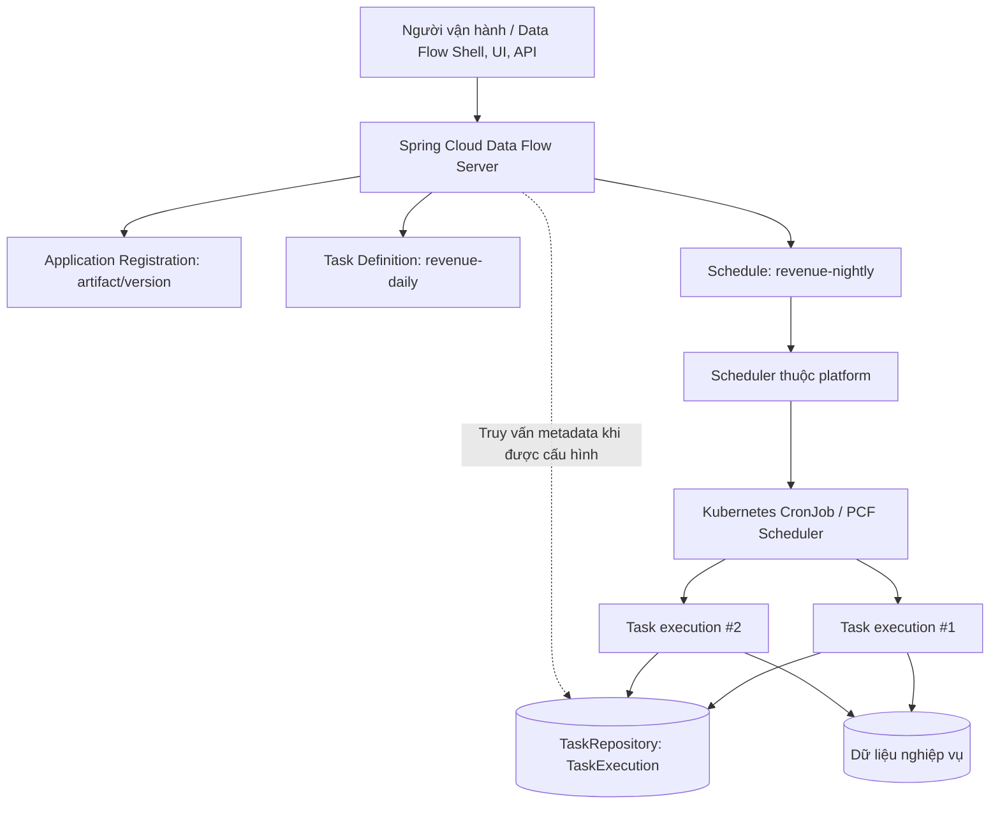
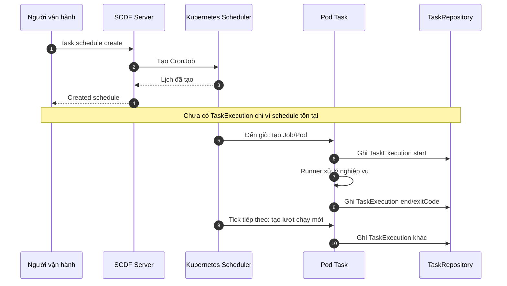

# Tích hợp bộ lập lịch qua Data Flow khi nền tảng hỗ trợ

## 1. Bài toán: chạy Spring Cloud Task theo lịch nhưng vẫn theo dõi từng lần thực thi

Spring Cloud Task phù hợp với những ứng dụng **có thời gian chạy hữu hạn**: đối soát giao dịch, nhập tệp, kết xuất báo cáo, xóa dữ liệu hết hạn hoặc thực hiện một bước Spring Batch. Ứng dụng bắt đầu, xử lý và kết thúc; `TaskRepository` lưu `TaskExecution` để đội vận hành xem thời điểm bắt đầu, kết thúc, mã thoát và thông tin lỗi.

Nhưng **Spring Cloud Task không phải bộ lập lịch**. Một `ApplicationRunner` không tự biết phải chạy vào 02:00 mỗi ngày. Để chạy theo lịch, cần một thành phần bên ngoài tạo **lần khởi chạy mới** của ứng dụng.

**Spring Cloud Data Flow (SCDF)** là một lựa chọn khi nền tảng triển khai và phiên bản Data Flow **có hỗ trợ scheduling**. SCDF cho phép đăng ký ứng dụng task, định nghĩa công việc, tạo lịch theo cron, quản lý các lịch đã tạo và xem lịch sử những lần chạy. Việc kích hoạt thực tế thường được giao cho **scheduler của nền tảng**: chẳng hạn Kubernetes `CronJob` hoặc dịch vụ scheduler được cấu hình trên Cloud Foundry.

Bài học thuộc chương **Lịch chạy** tập trung vào **tích hợp bộ lập lịch qua Data Flow khi nền tảng hỗ trợ**, không coi scheduling là khả năng luôn sẵn có của mọi bản triển khai SCDF.

Sau bài này, bạn có thể:

- Phân biệt **ứng dụng task**, **định nghĩa task**, **lịch chạy** và **mỗi `TaskExecution`**.
- Kiểm tra điều kiện để SCDF có thể lập lịch trên platform.
- Tạo một lịch chạy với SCDF Shell/UI bằng cron phù hợp môi trường.
- Hiểu cách truyền cấu hình, tham số, timezone và secrets tới các lượt chạy.
- Quan sát tiến trình thực, metadata Task, lỗi scheduler và chính sách retry.
- Chọn phương án thay thế như Kubernetes CronJob trực tiếp hoặc một bộ lập lịch bên ngoài khi SCDF không hỗ trợ.

## 2. SCDF đứng ở đâu giữa Task và platform scheduler?

Trong thiết kế điển hình có **ba ranh giới trách nhiệm**:

1. **Spring Cloud Task application:** logic nghiệp vụ; tự ghi metadata vòng đời vào `TaskRepository` khi thực sự khởi động.
2. **Spring Cloud Data Flow:** lưu application registration/task definition, nhận yêu cầu tạo/xóa/xem lịch, cung cấp API/UI/Shell và giao tiếp với task platform.
3. **Scheduler/deployer của platform:** duy trì lịch và tạo process/Pod/task instance mỗi khi đến thời điểm.



**Tạo schedule không có nghĩa Task đã chạy.** SCDF có thể tạo lịch trên platform hôm nay, còn thời điểm cron tiếp theo mới khởi chạy ứng dụng. Sau khi lịch được tạo, platform scheduler đảm nhiệm việc kích hoạt định kỳ; việc SCDF ghi nhận lịch không tự bảo đảm từng Pod kéo image, bootstrap Spring Boot hoặc ghi thành công `TaskExecution`.

Ví dụ, bạn tạo lịch chạy `revenue-nightly` lúc 02:00. Nếu image không tồn tại hoặc thiếu secret, Kubernetes vẫn có thể tạo một Job thất bại, trong khi `TASK_EXECUTION` có thể **không có bản ghi mới** vì JVM chưa khởi tạo được Spring context.

## 3. Bốn đối tượng không được nhầm với nhau

| Đối tượng | Ví dụ | Ý nghĩa |
| --- | --- | --- |
| **Application registration** | `revenue-app` trỏ tới artifact `revenue-report:1.0.0` | SCDF biết ứng dụng nào và artifact nào có thể chạy |
| **Task definition** | `revenue-daily` | Định nghĩa một công việc dựa trên ứng dụng task đã đăng ký |
| **Schedule** | `revenue-nightly`, cron `0 2 * * *` | Quy tắc **khi nào** platform khởi chạy task definition |
| **Task execution** | `executionId=731` | **Một lần chạy thực tế** được Spring Cloud Task ghi nhận trong repository |

Một task definition có thể có **nhiều lịch**, ví dụ lịch chạy hằng ngày và lịch chạy thử nghiệm. Một lịch tạo **nhiều lượt thực thi** theo thời gian. Mỗi lần Spring Cloud Task khởi chạy bình thường tạo một `TaskExecution` có ID riêng, nhưng tên nghiệp vụ ổn định.

### 3.1. Không phải cứ có Spring Cloud Task là có SCDF

Một JAR được đánh dấu `@EnableTask` vẫn có thể chạy bằng `java -jar`, Kubernetes Job hoặc hệ thống điều phối khác mà **không dùng SCDF**. SCDF chỉ cung cấp lớp quản lý và tích hợp platform phía ngoài.

Ngược lại, việc SCDF tạo một task definition **không biến chương trình chạy lâu dài thành tác vụ hữu hạn**. Ứng dụng được đăng ký phải thực sự xử lý xong và thoát. Nếu vẫn bật web server, thread nền hoặc scheduler nội bộ không cần thiết, Pod có thể tiếp tục chạy và không phản ánh kết quả như mong muốn.

## 4. Trước khi tạo lịch: xác nhận platform thật sự hỗ trợ

Tài liệu SCDF theo các dòng 2.x mô tả lập lịch qua **scheduler agent** của platform. Không phải mọi phương án triển khai đều có sẵn scheduler tích hợp.

| Nền tảng | Cách scheduling được mô tả trong tài liệu SCDF | Điều kiện cần xác nhận |
| --- | --- | --- |
| **Kubernetes** | SCDF tạo `CronJob`; Kubernetes controller tạo `Job`/Pod theo lịch | SCDF/K8s deployer tương thích; RBAC tạo và quản lý CronJob/Job; namespace, image, secret hợp lệ |
| **Cloud Foundry** | Tích hợp dịch vụ scheduler của platform, như PCF Scheduler trong hệ thống hỗ trợ | Scheduler service có sẵn, được provision/bind đúng; quyền và endpoint cấu hình |
| **Local deployer** | **Không có out-of-the-box scheduling** trong hướng dẫn SCDF | Dùng scheduler bên ngoài hoặc giải pháp tùy chỉnh; không giả định lệnh schedule sẽ hoạt động |

**Điều kiện “khi nền tảng hỗ trợ” là bắt buộc.** Tên dịch vụ, tính sẵn có và cách cấu hình phụ thuộc phiên bản SCDF, deployer, chính sách của cụm và dịch vụ do đơn vị vận hành cung cấp. Trước khi triển khai, kiểm tra tài liệu của **đúng phiên bản** thay vì sao chép nguyên cấu hình của một platform khác.

### 4.1. Bật các tính năng SCDF cần thiết

Theo tài liệu SCDF 2.x, hai property của **Data Flow Server** dùng để cho phép quản lý task/schedule là:

```yaml
spring:
  cloud:
    dataflow:
      features:
        tasks-enabled: true
        schedules-enabled: true
```

Chúng thuộc **cấu hình SCDF Server**, **không phải `application.yml` của Task**. Trong các phiên bản được tài liệu mô tả, tính năng schedule có thể bị tắt mặc định.

Bật property chỉ là bước đầu: cần deployer hỗ trợ scheduling và quyền truy cập platform. Nếu SCDF chạy local mà không có scheduler tương ứng, chỉ bật `schedules-enabled` không tự tạo một cron service.

### 4.2. Checklist hạ tầng trước khi học thực hành

- SCDF Server, dashboard/Shell hoặc REST API đã truy cập được với quyền phù hợp.
- Có platform account tương ứng, ví dụ `default` trên Kubernetes, được đăng ký với SCDF.
- Platform scheduler hỗ trợ tạo, liệt kê và xóa lịch; RBAC/service account có quyền liên quan.
- Task artifact đã build và **platform có thể tải/chạy**.
- Spring Cloud Task và database metadata đã được chuẩn bị đúng schema; mọi lượt chạy cần tra cứu chung dùng một kho bền vững.
- Secret, URL database, network policy, quota và tài nguyên cần thiết được cấp cho **các Pod/process được schedule**, không chỉ cho SCDF Server.
- Đã quyết định timezone, chính sách lịch chạy chồng lấn, retry và giới hạn thời gian.

## 5. Chuẩn bị một Spring Cloud Task hữu hạn để SCDF khởi chạy

Ta dùng ví dụ `daily-revenue-report` để tạo báo cáo doanh thu. Ứng dụng đọc ngày nghiệp vụ, gọi service tạo báo cáo rồi kết thúc. Bài dùng Java 17+ và API `ApplicationRunner` quen thuộc của Spring Boot; cần dependency Spring Cloud Task tương thích.

### 5.1. Ứng dụng Task

```java
import java.time.Clock;
import java.time.LocalDate;
import java.time.ZoneId;
import java.util.List;

import org.springframework.boot.ApplicationRunner;
import org.springframework.boot.SpringApplication;
import org.springframework.boot.autoconfigure.SpringBootApplication;
import org.springframework.cloud.task.configuration.EnableTask;
import org.springframework.context.annotation.Bean;

@SpringBootApplication
@EnableTask
public class RevenueReportTaskApplication {

    public static void main(String[] args) {
        SpringApplication.run(RevenueReportTaskApplication.class, args);
    }

    @Bean
    Clock businessClock() {
        return Clock.system(ZoneId.of("Asia/Ho_Chi_Minh"));
    }

    @Bean
    ApplicationRunner revenueRunner(Clock businessClock) {
        return args -> {
            List<String> dates = args.getOptionValues("businessDate");

            LocalDate businessDate;
            if (dates == null) {
                // Cách đơn giản: hôm qua theo múi giờ nghiệp vụ.
                businessDate = LocalDate.now(businessClock).minusDays(1);
            } else if (dates.size() == 1) {
                businessDate = LocalDate.parse(dates.get(0));
            } else {
                throw new IllegalArgumentException(
                    "Chỉ được có một --businessDate=yyyy-MM-dd");
            }

            System.out.println("Báo cáo doanh thu ngày " + businessDate);

            // TODO: đọc nguồn dữ liệu, đối soát và lưu báo cáo thực tế.
            // Chờ xử lý xong; ném lỗi nếu công việc không đạt yêu cầu.
        };
    }
}
```

**Lưu ý nghiệp vụ:** mặc định “hôm qua” chỉ là cách minh họa cho một lịch đều đặn. Khi job chạy bù, bị trễ, hoặc phải chạy lại lịch cũ, `LocalDate.now().minusDays(1)` **không nhất thiết là ngày cần xử lý**. Trong sản xuất, nên có **work ledger** theo kỳ báo cáo hoặc truyền ngày đã được xác định bởi điều phối, và bảo đảm có thể xử lý các kỳ bị lỡ.

Nếu `--businessDate` được truyền thì ngày đó là đầu vào tường minh, thích hợp cho chạy thủ công/đối soát. Không lấy `TaskExecution.executionId` làm khóa nghiệp vụ để quyết định một kỳ báo cáo đã hoàn tất hay chưa.

### 5.2. `application.yml` của Task

```yaml
spring:
  application:
    name: revenue-report-worker
  main:
    web-application-type: none
  cloud:
    task:
      name: daily-revenue-report
  datasource:
    url: ${TASK_DB_URL}
    username: ${TASK_DB_USER}
    password: ${TASK_DB_PASSWORD}
```

Ứng dụng cần `spring-cloud-starter-task`, JDBC driver và bảng metadata Spring Cloud Task phù hợp với version/database. `TaskRepository` lưu các lần thực thi sau khi JVM đóng. Tên `daily-revenue-report` giúp truy vấn lịch sử theo **loại tác vụ**, không phải theo mỗi lần scheduler phát lệnh.

**Trên Kubernetes:** nếu container Task không lấy được các biến `TASK_DB_URL`/`TASK_DB_USER`/`TASK_DB_PASSWORD` từ Secret/ConfigMap, ứng dụng có thể không ghi được metadata. Không truyền mật khẩu trực tiếp qua đối số dòng lệnh hoặc lưu trong nội dung schedule.

## 6. Đăng ký ứng dụng và tạo task definition trong Data Flow

SCDF cần biết **artifact ứng dụng** trước khi có thể tạo lịch. Trong SCDF Shell, quy trình thường gồm:

1. Đăng ký một ứng dụng có `type=task`.
2. Tạo một task definition tham chiếu ứng dụng đã đăng ký.
3. Thử khởi chạy thủ công trước khi tạo schedule.

### 6.1. Đăng ký artifact

Ví dụ trên platform hỗ trợ Docker image:

```text
dataflow:> app register --name revenue-app --type task --uri docker://registry.example.internal/team/revenue-report:1.0.0
```

Image URI chỉ là **ví dụ**, không phải artifact thực. Registry phải có image hợp lệ, tương thích kiến trúc chạy, và platform cần quyền pull image. Tên application registration (`revenue-app`) là tên mà **SCDF** dùng để tham chiếu artifact, có thể khác `spring.cloud.task.name` bên trong chương trình.

### 6.2. Tạo task definition

```text
dataflow:> task create --name revenue-daily --definition "revenue-app"
```

`revenue-daily` là **tên định nghĩa công việc trong SCDF**. Nó không tự tạo một `TaskExecution`; đó là cấu hình để những lệnh launch/schedule sau này biết phải chạy artifact nào.

### 6.3. Thử launch thủ công

```text
dataflow:> task launch revenue-daily --arguments "--businessDate=2026-11-23"
dataflow:> task execution list
```

Lệnh `task launch` tạo một lượt chạy theo yêu cầu của bạn; `task execution list` giúp kiểm tra metadata nếu các repository được cấu hình đúng.

**Không lập lịch ngay khi chưa kiểm thử launch thủ công.** Nếu artifact không thể tải, container không có biến môi trường, schema database sai hoặc ứng dụng không kết thúc, tạo cron sẽ biến lỗi một lần thành lỗi lặp vô hạn.

## 7. Tạo schedule bằng SCDF Shell trên Kubernetes

Ví dụ: tạo lịch chạy lúc **02:00 mỗi ngày theo timezone của platform scheduler** với cron năm trường của Kubernetes. Giả sử SCDF đã có platform tên `default` thực sự trỏ tới cụm và namespace phù hợp.

```text
dataflow:> task schedule create --name revenue-nightly --definitionName revenue-daily --expression "0 2 * * *" --platform default
```

Ý nghĩa các tham số:

| Tùy chọn | Giá trị ví dụ | Diễn giải |
| --- | --- | --- |
| `--name` | `revenue-nightly` | Tên schedule, dùng để quản lý/xóa lịch |
| `--definitionName` | `revenue-daily` | Task definition đã có trên SCDF |
| `--expression` | `0 2 * * *` | Cron theo định dạng scheduler của platform, ở đây là Kubernetes |
| `--platform` | `default` | Account/target platform được cấu hình trong SCDF |

Khi tạo thành công, SCDF yêu cầu scheduler platform thiết lập lịch; trên Kubernetes thường là một `CronJob`. **Tạo lịch không chạy ngay một lần để kiểm thử**. Đợi đến tick kế tiếp hoặc chạy `task launch` để xác thực trước.

### 7.1. Xem và xóa lịch

```text
dataflow:> task schedule list --platform default
dataflow:> task execution list
```

Khi không cần lịch nữa:

```text
dataflow:> task schedule destroy --name revenue-nightly --platform default
```

Lệnh destroy xóa **lịch cho các lượt tương lai**, **không bảo đảm hủy những tiến trình đang chạy** hoặc xóa lịch sử `TaskExecution`. Các phiên bản SCDF khác nhau có thể có tham số và UI khác nhau; hãy kiểm tra lệnh help của Shell đúng phiên bản.

### 7.2. Cung cấp arguments và properties theo lịch

Trong các phiên bản SCDF hỗ trợ, lệnh schedule có thể nhận `--arguments` và `--properties`, ví dụ:

```text
dataflow:> task schedule create --name revenue-nightly --definitionName revenue-daily --expression "0 2 * * *" --platform default --arguments "--reportType=revenue"
```

`--reportType=revenue` là **tham số tĩnh** được chuyển tới ứng dụng Task. Đây chỉ là ví dụ khi runner thực sự có xử lý `reportType`; trong đoạn Java ở mục 5 tham số đó chưa được dùng.

Đối với thuộc tính triển khai, SCDF có các convention như `app.<app-name>.<property>` và `deployer.<app-name>.<property>` ở các dòng phiên bản phù hợp. **Tên property thực tế phải khớp deployer**, và Secret/resource mapping nên được kiểm chứng trên Pod/Job được tạo. Tránh sao chép một khóa Kubernetes-specific sang Cloud Foundry rồi nghĩ rằng có tác dụng tương tự.

## 8. Cron và timezone: nơi phát sinh lỗi khó phát hiện

**Cron của scheduler platform không nhất thiết có cú pháp giống `@Scheduled` của Spring.**

| Môi trường | Cú pháp cần kiểm tra | Cách hiểu |
| --- | --- | --- |
| Kubernetes `CronJob` | Thường **5 trường**: phút, giờ, ngày tháng, tháng, thứ | `0 2 * * *` là 02:00 theo timezone được CronJob/controller dùng |
| Scheduler của Cloud Foundry | Tùy dịch vụ/phiên bản, tài liệu SCDF có ví dụ theo cú pháp tương tự Quartz | Không sao chép nguyên cron Kubernetes nếu scheduler dùng cách diễn giải khác |
| Spring `@Scheduled` | Spring hỗ trợ định dạng riêng, thường **6 trường** (gồm giây) và thuộc tính `zone` | Lệnh này kích hoạt **method trong JVM đang sống**, không phải schedule SCDF |
| Cron trên máy chủ | Tùy hệ điều hành/daemon | Kiểm tra timezone máy và chính sách chạy khi host tắt |

### 8.1. Ví dụ lịch 02:00 ở Việt Nam

Nếu scheduler Kubernetes diễn giải `0 2 * * *` theo UTC, lịch sẽ chạy vào **09:00 sáng giờ Việt Nam** chứ không phải 02:00. Ngược lại, để chạy 02:00 ở `Asia/Ho_Chi_Minh`, cron theo UTC không đổi mùa là `0 19 * * *` của **ngày UTC trước**.

Giải pháp tốt hơn, nếu phiên bản Kubernetes/deployer cho phép, là cấu hình **timezone của CronJob** một cách tường minh và kiểm tra manifest được tạo. Kubernetes hiện đại có trường `spec.timeZone`; khả năng SCDF chuyển cấu hình này tới CronJob **phụ thuộc phiên bản và platform adapter**. Không giả định chỉ ghi `Asia/Ho_Chi_Minh` trong `application.yml` của ứng dụng sẽ làm thay đổi múi giờ CronJob.

Khi dùng vùng có DST, giờ chuyển mùa có thể khiến một tick không xảy ra hoặc xảy ra với cách diễn giải khác mong đợi. Thiết kế theo **kỳ nghiệp vụ**, không chỉ theo đồng hồ thực tế của mỗi Pod.

### 8.2. “Đúng 02:00” không có nghĩa process bắt đầu chính xác lúc đó

Scheduler kích hoạt yêu cầu vào mốc tính toán; Job/Pod còn mất thời gian đợi quota, pull image và bootstrap JVM. Do đó `TaskExecution.startTime` có thể **muộn hơn thời điểm cron**. Muốn xác định kỳ nghiệp vụ, không nên suy luận chỉ từ phút/giây `startTime`.

## 9. Vòng đời schedule khác vòng đời Task



Một điểm vận hành quan trọng được SCDF mô tả: **lịch đã tạo không tự cập nhật theo mô hình continuous deployment** chỉ vì bạn đổi version/properties của task definition. Lịch đang được platform quản lý với cấu hình tại thời điểm tạo.

Nếu bạn đổi image của `revenue-app` từ `1.0.0` sang `1.1.0`, **không mặc định CronJob hiện tại sẽ lấy version mới**. Cần xem schedule đang tham chiếu artifact/properties nào, rồi có kế hoạch cập nhật hoặc **xóa và tạo lại schedule** với giá trị đã kiểm thử. Thay đổi trong production nên có kiểm soát để tránh chạy trùng hoặc bỏ lỡ một lượt.

## 10. Theo dõi kết quả ở ba nơi

Một schedule có thể **đã tồn tại** mà không có lượt chạy, hoặc platform đã **tạo Job** nhưng ứng dụng chưa ghi được `TaskExecution`. Vì vậy cần ba tầng quan sát.

### 10.1. Data Flow: task definitions, schedules, executions

Trong SCDF Shell:

```text
dataflow:> task schedule list --platform default
dataflow:> task execution list
```

UI thường có phần Tasks, Schedules và Task Executions tương ứng, nhưng tên/đường dẫn màn hình tùy phiên bản. Với những hệ thống cấu hình repository chia sẻ đúng, Task Executions hiển thị các lần chạy mà ứng dụng đã ghi vào metadata.

### 10.2. Kubernetes: CronJob, Job và Pod

Ví dụ các lệnh để kiểm tra namespace được triển khai:

```bash
kubectl get cronjobs -n task-workloads
kubectl get jobs -n task-workloads
kubectl get pods -n task-workloads
kubectl describe cronjob revenue-nightly -n task-workloads
```

Tên resource thực tế có thể được deployer chuẩn hóa hoặc thêm hậu tố. Những lệnh trên chỉ minh họa; nếu SCDF platform account `default` sử dụng namespace khác, phải kiểm tra **namespace thật**.

Khi nghi ngờ lịch không chạy, xem các sự kiện CronJob, trạng thái Job, lý do Pod chưa start (`ImagePullBackOff`, `CreateContainerConfigError`, thiếu quota/RBAC), log container, exit code và restart count.

### 10.3. TaskRepository: kết quả Spring Cloud Task

Trong schema JDBC Spring Cloud Task thông dụng:

```sql
SELECT TASK_EXECUTION_ID,
       TASK_NAME,
       START_TIME,
       END_TIME,
       EXIT_CODE,
       EXIT_MESSAGE,
       ERROR_MESSAGE
FROM TASK_EXECUTION
WHERE TASK_NAME = 'daily-revenue-report'
ORDER BY TASK_EXECUTION_ID DESC;
```

Tên bảng/cột phải đối chiếu schema/version thực tế. `TaskExplorer` cũng hỗ trợ truy vấn bằng Java API. Nếu `TASK_EXECUTION` không có bản ghi mới:

- Chưa chắc CronJob không chạy; có thể chưa tới giờ.
- Platform có thể đã tạo Job nhưng Pod lỗi trước khi Spring Boot tạo context.
- Ứng dụng có thể trỏ **sai datasource** hoặc thiếu schema Task.
- SCDF và Task có thể đang quan sát **hai repository khác nhau**.

**`TaskExecution.exitCode=0` không tự chứng minh số liệu báo cáo chính xác.** Cần kiểm tra dữ liệu đã ghi vào kho nghiệp vụ và cơ chế đối soát riêng.

## 11. Retry, lỗi và cơ chế khôi phục giữa các lớp

Có ít nhất ba nguồn retry cần phân biệt:

| Nơi xử lý | Ví dụ | Hệ quả |
| --- | --- | --- |
| Bên trong runner | HTTP client/Spring Retry gọi lại API | Nhiều **attempt**, thường vẫn **một `TaskExecution`** |
| Platform Job | Kubernetes Job backoff tạo Pod mới khi thất bại | Có thể tạo **một `TaskExecution` mới mỗi lượt process** nếu bootstrap thành công |
| Tick schedule kế tiếp | CronJob chạy vào ngày sau | Một kỳ lịch khác, thường có TaskExecution riêng |

Đừng thiết lập retry vô hạn ở cả ba tầng. Nếu API client thử `4` lần và platform thử tạo Pod `3` lần, một kỳ có thể dẫn đến `12` lần gọi dịch vụ, chưa kể các lần tick khác.

**Phân loại lỗi:** dữ liệu đầu vào sai định dạng thường không đáng retry nguyên trạng; `503`/timeout có thể retry có giới hạn nếu idempotent; lỗi quyền truy cập cần sửa secret/role, không gọi lại liên tục.

Nếu task chạy Spring Batch job, `JobRepository` theo dõi `JobExecution`/`StepExecution` và checkpoint riêng. Có thể bật cấu hình tích hợp để `BatchStatus.FAILED` lan sang kết quả Spring Cloud Task; nếu Batch job thất bại mà runner vẫn trả bình thường, platform có thể thấy mã thành công. Cần kiểm thử trạng thái của cả Batch, Task và process.

### 11.1. Mất kết nối repository khi kết thúc

Một task có thể **đã tạo báo cáo** nhưng không cập nhật được `END_TIME` do database mất kết nối. Nếu scheduler retry dựa trên mã process, có rủi ro tạo báo cáo hai lần. Dùng **idempotency key** ổn định, ví dụ `(reportType, businessDate)`, unique constraint/upsert và quy trình đối soát trạng thái.

## 12. Tránh chạy chồng lấn và xử lý lịch bị lỡ

Một lịch chạy 02:00 có thể gặp công việc kéo dài hơn 24 giờ, node mất nguồn, scheduler downtime hoặc phải chạy bù.

### 12.1. Chính sách đồng thời

Trong Kubernetes CronJob, các lựa chọn thường gặp của `concurrencyPolicy`:

| Policy | Ý nghĩa | Điểm cần cân nhắc |
| --- | --- | --- |
| `Allow` | Cho phép nhiều Job từ các tick cùng chạy | Cần bảo vệ dữ liệu chống chạy trùng và giới hạn tải |
| `Forbid` | Không khởi chạy thêm nếu Job trước còn đang chạy | Có thể bỏ qua tick; phải có cơ chế phát hiện kỳ chưa xử lý |
| `Replace` | Thay thế Job đang chạy bằng Job mới | Nguy hiểm với công việc có tác dụng phụ, cần shutdown/recovery an toàn |

Chính sách này thuộc **CronJob platform**, không phải `spring.cloud.task.name`. Nếu SCDF không cho cấu hình trường này qua scheduler properties ở phiên bản đang dùng, cần cách triển khai/điều chỉnh được nền tảng hỗ trợ; **không bịa property `spring.cloud.task.*`** để mong nó điều khiển CronJob.

### 12.2. Kỳ bị lỡ, lịch chạy bù và giới hạn thời gian

Kubernetes có các lựa chọn như `startingDeadlineSeconds` và `activeDeadlineSeconds` ở các cấp tài nguyên khác nhau; cần xác định chính sách khi tick bị lỡ hoặc khi một Job chạy quá lâu. Đừng nhầm **thời gian chờ để bắt đầu một lịch** với **thời gian tối đa cho một lần Job xử lý**.

Đối với báo cáo ngày:

1. Lưu `businessDate` và trạng thái kỳ báo cáo ở một bảng nghiệp vụ.
2. Chỉ đánh dấu `COMPLETED` khi dữ liệu đầu ra đã được kiểm tra.
3. Trước khi tạo kết quả, kiểm tra kỳ đã hoàn tất hay đang được xử lý.
4. Có đường chạy bù cho các ngày bị lỡ, truyền ngày xử lý **tường minh**.
5. Dùng khóa/unique constraint chống hai Pod cùng ghi một kỳ.

Không để mọi lần chạy lúc 09:00 sau sự cố tự động xử lý `LocalDate.now().minusDays(1)` nếu thực tế đang thiếu **nhiều ngày**. Scheduler quyết định **khi nào khởi chạy**, còn ledger quyết định **kỳ dữ liệu nào cần hoàn tất**.

## 13. Tham số, properties, bí mật và artifact version

### 13.1. Arguments tĩnh của schedule

SCDF cho phép cấu hình arguments tại thời điểm tạo lịch. Chúng thường được truyền lại vào mỗi lần khởi chạy. Ví dụ `--reportType=revenue` có thể cố định ở mọi tick, nhưng `--businessDate=2026-11-23` **không nên bị gắn cố định** trong một lịch chạy hằng ngày.

Nếu cần tính ngày ở runtime, có thể dùng `Clock` theo múi giờ nghiệp vụ như ví dụ, nhưng phải thiết kế riêng đường chạy bù. Một lựa chọn vững hơn là schedule chỉ kích hoạt worker, worker lấy **kỳ chưa xử lý** từ database/work ledger và khóa kỳ đó theo transaction.

### 13.2. App properties và deployment properties

Ở các phiên bản SCDF có convention tương ứng:

- `app.<application-name>.<key>`: property chuyển đến ứng dụng.
- `deployer.<application-name>.<key>`: property dành cho platform deployer.
- Các scheduler properties dùng namespace của scheduler, ví dụ `spring.cloud.scheduler.cron.expression` trong API nội bộ.

Tên khóa cụ thể phụ thuộc **API, Shell, platform account và phiên bản**. Shell `--expression` thuận tiện hơn việc tự truyền key cron trong nhiều ví dụ. Đừng áp một tên secret/volume/RBAC được viết cho Kubernetes sang Cloud Foundry.

### 13.3. Không đưa bí mật vào schedule

Mật khẩu và token có thể lọt vào SCDF task properties, shell history, log, process args hoặc `TASK_EXECUTION_PARAMS`. Dùng Kubernetes Secret, service binding hoặc cơ chế secrets của platform; chỉ cấp quyền tối thiểu cho Task. Đảm bảo secret có trên **mỗi process/Pod được schedule**, không chỉ trên máy chủ SCDF.

### 13.4. Cập nhật artifact/version an toàn

Lịch đã tạo có thể tiếp tục sử dụng cấu hình artifact và properties cũ. Trước khi triển khai bản mới:

1. Đăng ký và thử chạy artifact mới **thủ công**.
2. Kiểm tra version thực tế mà schedule dùng và khả năng cập nhật của scheduler.
3. Chọn thời điểm thay đổi để không tạo hai lịch cùng chạy một kỳ.
4. Cập nhật hoặc tạo lại schedule theo phương pháp được platform hỗ trợ.
5. Quan sát ít nhất một lượt chạy mới và so sánh log/version.

Không thay đổi hoặc xóa schedule một cách mù quáng vào đúng lúc scheduler đang tạo Job.

## 14. Khi SCDF không hỗ trợ scheduling: những phương án khác

SCDF **không bắt buộc** để vận hành Spring Cloud Task. Nếu môi trường local hoặc platform/deployer không có scheduler tích hợp, có thể dùng một công cụ bên ngoài để **launch Task** theo lịch.

### 14.1. Kubernetes CronJob trực tiếp

Nếu ứng dụng đã được container hóa và đang chạy trên Kubernetes, có thể quản lý CronJob bằng manifest/IaC thay vì đi qua SCDF.

Ví dụ **minh họa**, yêu cầu Kubernetes hỗ trợ trường timezone và Secret tương ứng đã tồn tại:

```yaml
apiVersion: batch/v1
kind: CronJob
metadata:
  name: revenue-report-nightly
spec:
  schedule: "0 2 * * *"
  timeZone: "Asia/Ho_Chi_Minh"
  concurrencyPolicy: Forbid
  successfulJobsHistoryLimit: 3
  failedJobsHistoryLimit: 3
  jobTemplate:
    spec:
      backoffLimit: 1
      activeDeadlineSeconds: 3600
      template:
        spec:
          restartPolicy: Never
          containers:
            - name: revenue-report
              image: registry.example.internal/team/revenue-report:1.0.0
              envFrom:
                - secretRef:
                    name: revenue-task-db
```

Cần kiểm tra image pull secret, service account, namespace, quota, security context và schema database trong môi trường thực. Kubernetes `timeZone` phụ thuộc version/feature support; **không giả định mọi cluster đều hỗ trợ**.

Manifest là **phương án thay thế**, không có nghĩa Data Flow sẽ tự biết CronJob do bạn tạo bên ngoài. Muốn xem metadata Task trong SCDF/UI phải bảo đảm nguồn dữ liệu và cách đăng ký/quan sát tương ứng, nếu không dùng dashboard của Kubernetes và query `TaskRepository` trực tiếp.

### 14.2. Hệ thống điều phối ngoài Kubernetes

- **Cron trên Linux:** chạy `java -jar` hoặc script/container CLI, cần tự quản lý secrets, log, locks và retry.
- **Quartz hoặc một ứng dụng scheduler riêng:** tạo yêu cầu gọi SCDF REST API `task launch`, hoặc gọi `TaskLauncher` tương ứng nếu platform hỗ trợ.
- **Bộ điều phối workflow khác:** tạo Task process qua API/job runner, theo dõi kết quả và ràng buộc thứ tự các bước.

Không dùng riêng `@Scheduled` bên trong **một ứng dụng Spring Cloud Task hữu hạn** để mong nó tự sống mãi chờ lịch. Nếu ứng dụng phải chạy liên tục để chờ cron, nó không còn phù hợp với mục đích một lượt Task ngắn hạn theo nghĩa thông thường.

## 15. Phân tích sự cố theo từng lớp

| Biểu hiện | Nguồn cần kiểm tra trước | Cách khoanh vùng |
| --- | --- | --- |
| Không thấy lệnh `task schedule create` hoặc bị từ chối | SCDF version, feature flags, quyền API và scheduler support | Xác nhận `tasks-enabled`/`schedules-enabled`, platform account |
| Schedule tạo thất bại trên Kubernetes | Deployer, namespace, RBAC, CronJob API | Xem lỗi SCDF Server và quyền service account |
| Lịch tồn tại nhưng không có Job | CronJob status, cron expression, timezone, suspend/deadline | Xem `kubectl describe cronjob` và controller events |
| Job tồn tại nhưng không có Pod chạy | Quota, image/secret, service account, scheduling | Kiểm tra `kubectl get/describe jobs,pods` |
| Pod khởi động rồi lỗi trước runner | Spring config, datasource, schema, classpath | Xem container log; TaskExecution có thể chưa tồn tại |
| TaskRepository không có bản ghi mới | Sai database, bootstrap lỗi, scheduler chưa kích hoạt | Đối chiếu platform Job/Pod và URL repository |
| Có `TaskExecution.exitCode=0` nhưng báo cáo thiếu | Lỗi logic, skip, exception bị bắt rồi bỏ qua | Kiểm tra dữ liệu đầu ra và Batch JobExecution |
| Có hai lượt cho cùng `businessDate` | Retry Pod, lịch chồng lấn, chạy thủ công song song | Dùng khóa nghiệp vụ/idempotency, giới hạn concurrency |
| Lịch vẫn chạy image cũ | Schedule không tự cập nhật khi definition thay đổi | Kiểm tra manifest/version rồi cập nhật/tạo lại lịch |
| Task bị kill khi xử lý | Deadline, OOM, node eviction hoặc hủy Job | Kiểm tra trạng thái Pod/Job và phục hồi nghiệp vụ |
| Chạy lúc 09:00 thay vì 02:00 giờ Việt Nam | Cron được diễn giải theo UTC | Xác minh timezone scheduler/platform |

Đừng suy luận từ một tầng duy nhất. Một bản ghi trong SCDF **Schedules** cho biết lịch đã được khai báo; một `CronJob` tồn tại cho biết platform có lịch; một `Job`/Pod cho biết có lượt chạy; một `TaskExecution` có `END_TIME` cho biết framework ghi được kết quả; và dữ liệu nghiệp vụ mới chứng minh công việc thực sự đạt mục tiêu.

## 16. Tình huống triển khai: báo cáo 02:00 hằng ngày

Giả sử yêu cầu là: tính doanh thu của **ngày trước**, chạy lúc **02:00 giờ Việt Nam**, tối đa một tác vụ cùng lúc và cho phép xử lý bù những ngày bị lỡ.

### Thiết kế

- **Artifact Task:** `revenue-report:1.0.0` chứa runner đồng bộ, kết thúc sau khi ghi báo cáo.
- **Task definition SCDF:** `revenue-daily` dùng application registration `revenue-app`.
- **Schedule SCDF:** `revenue-nightly` gắn cron/namespace/timezone đúng platform.
- **TaskRepository:** PostgreSQL bền vững, chung cho các lượt chạy cần quan sát.
- **Dữ liệu nghiệp vụ:** bảng ledger theo `businessDate` có unique constraint và trạng thái, để chạy lại không sinh báo cáo trùng.
- **Giới hạn:** timeout, retry có giới hạn, concurrency policy phù hợp; alert khi kỳ báo cáo bị thiếu hoặc thất bại.

### Các bước thử nghiệm

1. Xác nhận SCDF có scheduler cho platform đang triển khai và bật quyền scheduling.
2. Build và đăng ký artifact Task; thử `task launch revenue-daily` với `--businessDate` cụ thể.
3. Kiểm tra Job/Pod, log, `TaskExecution` và báo cáo đã tạo.
4. Tạo schedule với cron thích hợp; kiểm tra **timezone thật** trong cấu hình platform.
5. Sau tick đầu tiên, đối chiếu một Job/Pod với một `TaskExecution` và trạng thái kỳ báo cáo.
6. Gây lỗi giả lập ở lần thử nghiệm, xác nhận retry/alert không chạy mãi.
7. Giả lập lịch bị lỡ, dùng đường **backfill** để xử lý đúng ngày bị thiếu.
8. Thử hai lượt song song cùng ngày, xác nhận unique constraint/lock ngăn dữ liệu trùng.
9. Thử nâng cấp artifact, kiểm tra lịch đang trỏ version nào và cách cập nhật đúng.
10. Xóa lịch thử nghiệm; xác nhận **không có tick tương lai**, nhưng dữ liệu lịch sử vẫn phục vụ audit.

## 17. Checklist trước khi đưa schedule vào production

- [ ] Nền tảng SCDF/deployer **thực sự hỗ trợ scheduling**; không giả định local deployer có cron.
- [ ] Đã bật đúng feature flags trên **SCDF Server** và cấu hình platform account, RBAC.
- [ ] Artifact Task có vòng đời hữu hạn, không giữ HTTP server/worker thread vô ích.
- [ ] Ứng dụng Task có `TaskRepository` bền vững, schema metadata đúng phiên bản.
- [ ] Đã launch thủ công và kiểm tra kết quả trước khi tạo schedule.
- [ ] Cron và timezone đã được đối chiếu trên **platform** chứ không chỉ trong ứng dụng.
- [ ] Các arguments của schedule không vô tình cố định ngày nghiệp vụ cho mọi tick.
- [ ] Có chính sách backfill cho kỳ bị lỡ hoặc chạy trễ.
- [ ] Secrets, imagePullSecrets, network access và quyền DB có trên Pod/worker thực.
- [ ] Có concurrency policy, deadline và ngân sách retry.
- [ ] Các thao tác nghiệp vụ có idempotency key theo kỳ, không theo `executionId`.
- [ ] Theo dõi được SCDF Schedules, platform Jobs/Pods và `TaskExecution`.
- [ ] Có cảnh báo cho lỗi bootstrap, lỗi Batch, Task chạy lâu, dữ liệu đầu ra sai hoặc lịch không phát tick.
- [ ] Khi đổi artifact/version, đã cập nhật/tạo lại schedule theo quy trình có kiểm soát.

## 18. Câu hỏi tự kiểm tra

**Câu 1.** Vì sao bật dependency `spring-cloud-starter-task` không khiến ứng dụng tự chạy lúc 02:00 mỗi ngày?

**Câu 2.** Hãy phân biệt application registration, task definition, schedule và `TaskExecution` bằng ví dụ `revenue-daily`.

**Câu 3.** Vì sao lệnh `task schedule create` thành công chưa đủ để khẳng định đã có một bản ghi trong `TASK_EXECUTION`?

**Câu 4.** Trên platform Kubernetes dùng UTC, cron `0 2 * * *` tương ứng mấy giờ ở Việt Nam? Cần làm gì để đáp ứng lịch 02:00 giờ Việt Nam?

**Câu 5.** Một lịch vẫn launch image cũ sau khi thay version của task definition. Nguyên nhân có thể là gì?

**Câu 6.** `concurrencyPolicy: Forbid` có đủ bảo đảm tất cả các ngày báo cáo đều được xử lý không? Vì sao?

**Câu 7.** Nếu CronJob tạo Pod nhưng không thấy TaskExecution, cần kiểm tra những nguồn nào?

**Câu 8.** Trong hệ thống có Spring Batch, vì sao `BatchStatus.FAILED` có thể cần được truyền sang mã thoát của Task?

**Gợi ý trả lời:** (1) Task theo dõi vòng đời, cần scheduler khác khởi chạy; (2) artifact đăng ký → công việc định nghĩa → lịch kích hoạt → một lần chạy cụ thể; (3) lịch có thể chưa tới tick hoặc Pod lỗi trước bootstrap; (4) 09:00 giờ Việt Nam nếu cron theo UTC, cần đặt timezone hỗ trợ hoặc đổi lịch có kiểm chứng; (5) schedule cũ không tự cập nhật artifact/properties; (6) có thể bỏ qua tick khi Job trước chưa xong, cần ledger/backfill; (7) SCDF, CronJob/Job/Pod, log, database URL/schema; (8) để scheduler không coi job Batch thất bại là Task thành công.

## 19. Tổng kết

**Spring Cloud Data Flow chỉ tích hợp scheduling khi platform scheduler và phiên bản triển khai hỗ trợ.** Trong mô hình được tài liệu SCDF mô tả, Kubernetes dùng `CronJob`, Cloud Foundry cần dịch vụ scheduler tương ứng, còn local deployer không có scheduling tích hợp sẵn. SCDF quản lý task definition và schedule; platform kích hoạt những lượt chạy; Spring Cloud Task ghi metadata của **mỗi ứng dụng thực sự chạy** vào `TaskRepository`.

Một giải pháp lịch chạy an toàn không chỉ là một cron expression. Cần xác minh **artifact, timezone, quyền platform, secrets, datasource, concurrency, timeout, retry và idempotency**, phân biệt lỗi scheduler với lỗi bootstrap và lỗi nghiệp vụ, đồng thời có đường backfill để không bỏ sót kỳ dữ liệu. Nếu SCDF không đáp ứng, có thể dùng Kubernetes CronJob trực tiếp hoặc một bộ điều phối khác mà vẫn giữ nguyên mô hình Spring Cloud Task hữu hạn.

**Tài liệu tham khảo chính thức (đối chiếu theo phiên bản sử dụng):**

- [Spring Cloud Data Flow — Batch Job Scheduling](https://dataflow.spring.io/docs/feature-guides/batch/scheduling/)
- [Spring Cloud Data Flow — Multi-Platform Task Scheduling](https://dataflow.spring.io/docs/recipes/multi-platform-deployment/multi-platform-task/)
- [Spring Cloud Data Flow — Architecture, Short-Lived Applications](https://dataflow.spring.io/docs/concepts/architecture/)
- [Spring Cloud Data Flow — Reference Guide, Scheduling Tasks](https://docs.spring.io/spring-cloud-dataflow/docs/2.11.3/reference/htmlsingle/)
- [Spring Cloud Task — Task lifecycle and TaskRepository](https://docs.spring.io/spring-cloud-task/reference/features.html)
- [Kubernetes — CronJob concept](https://kubernetes.io/docs/concepts/workloads/controllers/cron-jobs/)
