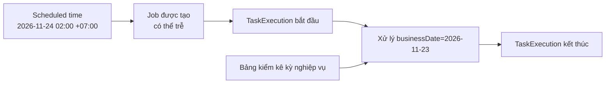

# Múi giờ, lịch bị lỡ và chính sách chạy bù

## 1. Vì sao lập lịch không đơn giản là đặt một biểu thức cron?

**Spring Cloud Task** giúp tạo ứng dụng Spring Boot có thời gian chạy hữu hạn: khởi động, nhận tham số, xử lý công việc, ghi lại `TaskExecution` qua `TaskRepository` rồi kết thúc. Task có thể chạy theo lịch, khi có yêu cầu hoặc do hệ thống khác điều phối. **Spring Cloud Task không tự cung cấp một bộ lập lịch phân tán đầy đủ**: việc tạo lần chạy đúng thời điểm thường do cron, Kubernetes CronJob, Spring Cloud Data Flow hoặc một scheduler riêng đảm nhiệm.

Ví dụ, hệ thống mỗi ngày lúc **02:00 theo giờ Việt Nam** phải đối soát dữ liệu của **ngày hôm trước**. Nếu đúng 02:00 Kubernetes controller gặp sự cố và đến 04:20 mới khôi phục, các câu hỏi quan trọng là:

- Có tạo Job muộn cho lịch 02:00 không?
- Nếu chạy lúc 04:20, Task phải xử lý dữ liệu **ngày nào**?
- Nếu bỏ lỡ ba ngày liên tiếp, có chạy bù cả ba ngày hay chỉ ngày mới nhất?
- Nếu lần chạy hôm trước chưa kết thúc, liệu lần chạy mới có được tạo?
- Làm thế nào để tránh chạy trùng hoặc phát sinh dữ liệu sai khi chạy bù?

Một biểu thức cron không tự giải quyết những vấn đề này. Cần thiết kế đồng thời **múi giờ**, **quy ước kỳ dữ liệu**, **giới hạn chạy muộn**, **chính sách chạy bù**, **điều phối đồng thời** và **idempotency**.

Sau bài học, bạn sẽ có thể:

1. Phân biệt thời điểm lịch dự kiến, thời điểm Job được tạo, thời điểm Task bắt đầu và ngày/khoảng dữ liệu cần xử lý.
2. Cấu hình timezone rõ ràng cho Kubernetes CronJob và Spring `@Scheduled`.
3. Hiểu tác động của DST, cron năm trường/sáu trường và đồng hồ hệ thống.
4. Phân tích `startingDeadlineSeconds`, `concurrencyPolicy`, `suspend` và giới hạn của CronJob.
5. Lựa chọn chính sách **skip**, **latest-only**, **bounded catch-up**, **backfill tuần tự** hoặc **manual reconciliation**.
6. Xây dựng dấu vết kỳ xử lý bằng database, sử dụng khóa nghiệp vụ, lease và cơ chế chạy lại an toàn.
7. Điều tra các lịch bị lỡ dù `TaskRepository` chưa hề có bản ghi lần chạy.

## 2. Bốn thời điểm và một định danh nghiệp vụ

### 2.1. Đừng trộn các khái niệm thời gian

| Khái niệm | Ví dụ | Dùng để làm gì? |
| --- | --- | --- |
| **Scheduled time** | 02:00 ngày 24/11 theo `Asia/Ho_Chi_Minh` | Thời điểm lẽ ra lịch được kích hoạt |
| **Job creation time** | 02:01 ngày 24/11 | Khi scheduler/deployer thực sự tạo Job |
| **Task start time** | 02:03 ngày 24/11 | Khi tiến trình Spring Cloud Task bắt đầu được ghi nhận |
| **Completion time** | 02:09 ngày 24/11 | Khi Task kết thúc hoặc lưu kết quả cuối |
| **Business date/window** | Ngày `2026-11-23` | Miền dữ liệu mà Task phải xử lý |

Một lịch được kích hoạt ngày `2026-11-24` lúc 02:00 **không nhất thiết xử lý dữ liệu ngày 24/11**. Nếu nghiệp vụ yêu cầu xử lý ngày hôm trước, target là `2026-11-23`.

Một cách nghĩ chính xác:



Thời điểm **Job được tạo** không phải lúc tiến trình bắt đầu, và `START_TIME` trong `TASK_EXECUTION` cũng không phải lịch dự kiến. Nếu scheduler **không tạo Job**, có thể không có `TaskExecution` nào để tra cứu. Vì vậy hệ thống cần nguồn thông tin bổ sung về **những kỳ lẽ ra phải chạy**.

### 2.2. Dùng UTC để lưu dấu thời điểm, IANA timezone để diễn giải lịch

Với event timestamp/log, nên lưu hoặc trao đổi dưới dạng `Instant`/UTC kèm offset khi cần. Với lịch theo giờ địa phương, dùng tên timezone **IANA** như:

- `Asia/Ho_Chi_Minh` cho lịch theo giờ Việt Nam.
- `Etc/UTC` cho lịch UTC tuyệt đối.
- `Europe/Berlin` cho lịch theo giờ Berlin, nơi có chuyển đổi DST.
- `America/New_York` cho lịch New York, nơi có chuyển đổi DST.

Không nhầm `+07:00` với `Asia/Ho_Chi_Minh`: offset là độ lệch ở một thời điểm, còn `ZoneId` biểu diễn các quy tắc thời gian của vùng. Một số vùng thay đổi offset trong năm hoặc qua lịch sử. Dùng tên `ZoneId` giúp thể hiện rõ quy tắc lịch.

**Ba cấu hình độc lập** có thể cùng tồn tại:

1. Múi giờ **scheduler dùng để diễn giải cron**.
2. Múi giờ **JVM/process** dùng cho một số API giờ địa phương và log.
3. Múi giờ **nghiệp vụ** dùng để xác định ngày/khoảng dữ liệu.

Đặt `timeZone` của CronJob **không tự đặt** timezone JVM; đặt `TZ` cho container **không tự chỉnh** timezone scheduler của Kubernetes. Cần quy định rõ từng lớp.

## 3. Cron không có một cú pháp chung cho mọi nền tảng

| Nền tảng | Định dạng thường dùng | Ví dụ chạy 02:00 hằng ngày | Cách xác định timezone |
| --- | --- | --- | --- |
| Linux `cron` phổ biến | 5 trường: phút, giờ, ngày, tháng, thứ | `0 2 * * *` | Theo cấu hình daemon/`CRON_TZ` nếu hệ thống hỗ trợ |
| Kubernetes CronJob | 5 trường | `0 2 * * *` | `spec.timeZone` |
| Spring `@Scheduled(cron=...)` | 6 trường, **có giây** | `0 0 2 * * *` | Thuộc tính `zone` |
| Quartz / một số platform | Cú pháp cron riêng, có giây và `?` | Cần kiểm tra tài liệu của backend | Theo scheduler/plugin cụ thể |

Ví dụ cùng ý nghĩa, nhưng **khác cú pháp**:

```yaml
# Kubernetes CronJob: 5 trường
schedule: "0 2 * * *"
timeZone: "Asia/Ho_Chi_Minh"
```

```java
// Spring Framework @Scheduled: 6 trường
@Scheduled(cron = "0 0 2 * * *", zone = "Asia/Ho_Chi_Minh")
public void triggerDaily() {
    // Logic kích hoạt, không phải Task hữu hạn tự lập lịch.
}
```

Đừng copy `0 2 * * *` từ Kubernetes vào `@Scheduled` rồi hy vọng Spring hiểu cùng ý nghĩa. Cũng không đưa `CRON_TZ=...` hoặc `TZ=...` vào chính chuỗi `spec.schedule` của Kubernetes: tài liệu Kubernetes nói cú pháp này **không được hỗ trợ**; hãy sử dụng trường `spec.timeZone`.

## 4. Múi giờ và DST: một ngày không luôn có 24 giờ

### 4.1. Lịch theo giờ tường (wall-clock) khác chu kỳ cố định

Xét hai yêu cầu:

- **“Chạy lúc 02:30 mỗi ngày theo giờ địa phương.”** Đây là lịch theo *wall-clock*. Nếu timezone có DST, thời điểm 02:30 có thể không tồn tại hoặc xuất hiện hai lần vào ngày chuyển đổi.
- **“Chạy chính xác sau mỗi 24 giờ.”** Đây là chu kỳ theo *elapsed duration*, không nhất thiết rơi vào cùng giờ địa phương sau DST.

Với lịch nghiệp vụ theo ngày, đa số trường hợp muốn mốc **ngày địa phương**: dữ liệu ngày nào kết thúc khi đồng hồ địa phương sang ngày tiếp theo. Khi đó đừng dùng cách tính `start.plus(Duration.ofHours(24))` cho tất cả timezone.

### 4.2. Ví dụ DST tại châu Âu

`Europe/Berlin` có lịch đổi giờ mùa hè/mùa đông. Trong năm 2026:

- Rạng sáng **29/03/2026**, mốc `02:30` địa phương **không tồn tại** trong bước nhảy giờ mùa hè.
- Rạng sáng **25/10/2026**, mốc `02:30` địa phương **có hai offset hợp lệ** trong lúc đổi lại giờ mùa đông.

Khi scheduler diễn giải cron có thời điểm bị khuyết hoặc bị lặp, hành vi cụ thể cần **kiểm tra trên phiên bản scheduler và timezone database đang dùng**. Không giả định mọi công cụ tự dịch 02:30 thành 03:30 hay đảm bảo “mỗi ngày đúng một lần” xuyên DST.

Java có thể kiểm tra quy tắc thời gian bằng `ZoneRules`:

```java
import java.time.LocalDateTime;
import java.time.ZoneId;

ZoneId berlin = ZoneId.of("Europe/Berlin");

LocalDateTime springGap =
        LocalDateTime.of(2026, 3, 29, 2, 30);
LocalDateTime autumnOverlap =
        LocalDateTime.of(2026, 10, 25, 2, 30);

System.out.println(
        berlin.getRules().getValidOffsets(springGap).size()); // 0
System.out.println(
        berlin.getRules().getValidOffsets(autumnOverlap).size()); // 2
```

Số lượng offset bằng `0`: giờ địa phương không tồn tại; bằng `1`: giờ bình thường; bằng `2`: giờ lặp lại. Đây là cách **phát hiện sự mơ hồ**, không phải hàm mô phỏng mọi scheduler.

`Asia/Ho_Chi_Minh` hiện không chuyển đổi DST, nên lịch 02:00 hằng ngày ít gặp vấn đề này. Tuy nhiên, khi ứng dụng hỗ trợ nhiều quốc gia hoặc dữ liệu quốc tế, bắt buộc kiểm tra DST tại **timezone của khách hàng**.

### 4.3. Tính khoảng dữ liệu bằng mốc ngày địa phương

Khi xử lý dữ liệu theo `businessDate`, xác định khoảng **nửa mở** `[start, end)` rồi đổi ra `Instant`:

```java
import java.time.Instant;
import java.time.LocalDate;
import java.time.ZoneId;

record TimeWindow(Instant startInclusive, Instant endExclusive) {
    static TimeWindow forBusinessDate(
            LocalDate date, ZoneId businessZone) {
        Instant start =
                date.atStartOfDay(businessZone).toInstant();
        Instant end =
                date.plusDays(1).atStartOfDay(businessZone).toInstant();
        return new TimeWindow(start, end);
    }
}
```

Ví dụ SQL:

```sql
SELECT *
FROM orders
WHERE created_at >= :startInclusive
  AND created_at < :endExclusive;
```

`:startInclusive` và `:endExclusive` là named parameters cần bind thành timestamp/timestamptz theo driver. Cách dùng khoảng nửa mở tránh xử lý một bản ghi đúng biên hai lần. Với DST, độ dài giữa hai `Instant` có thể là **23 hoặc 25 giờ**; đó là đúng nếu nghiệp vụ định nghĩa theo **ngày địa phương**.

## 5. Ai lập lịch cho một Spring Cloud Task?

### 5.1. Task hữu hạn và scheduler dài hạn

`ApplicationRunner` của Spring Cloud Task thực hiện công việc rồi trả về. Nó không nên vừa kết thúc vừa kỳ vọng `@Scheduled` vẫn đánh thức cùng process vào ngày tiếp theo. `@Scheduled` cần một **ứng dụng scheduler còn sống**.

Các cách triển khai:

| Cách | Điểm mạnh | Giới hạn cần quản lý |
| --- | --- | --- |
| Cron hệ điều hành | Đơn giản trên một máy | Lỗi host, timezone daemon, failover và lịch bị lỡ |
| Kubernetes CronJob | Tạo Job/Pod theo cron, có timezone, deadline, concurrency policy | Không bảo đảm mỗi kỳ đúng một lần; không có backfill nghiệp vụ đầy đủ |
| Spring Cloud Data Flow Scheduler | Quản lý lịch gắn với Task definition/API; dựa vào scheduler của platform | Cú pháp và hành vi khác nhau theo Kubernetes/Cloud Foundry; cần kiểm tra release |
| Spring `@Scheduled` trong service lâu dài | Dễ viết với Java, hỗ trợ `zone` | Nhiều replicas có thể kích hoạt trùng; việc bị lỡ khi service dừng cần cơ chế riêng |
| Workflow scheduler chuyên biệt | Có thể theo dõi kỳ dữ liệu, retry/backfill/phụ thuộc | Thêm hạ tầng và quy trình vận hành |

**Nguyên tắc:** Scheduler có trách nhiệm *yêu cầu chạy*, Spring Cloud Task có trách nhiệm *thực thi và ghi lại lần chạy*. Hai phạm vi được nối qua `TaskLauncher`, Kubernetes Job, Data Flow hoặc lệnh JAR.

### 5.2. Ví dụ Spring @Scheduled cho ứng dụng launcher

Nếu dùng một **service chạy lâu dài** để tạo Task theo lịch, không đưa `@Scheduled` vào chính Task hữu hạn:

```java
import java.time.LocalDate;
import java.time.ZoneId;
import org.springframework.scheduling.annotation.EnableScheduling;
import org.springframework.scheduling.annotation.Scheduled;
import org.springframework.stereotype.Component;

@Component
public class DailyTaskTrigger {
    private static final ZoneId BUSINESS_ZONE =
            ZoneId.of("Asia/Ho_Chi_Minh");

    private final DailyLaunchService launchService;

    public DailyTaskTrigger(DailyLaunchService launchService) {
        this.launchService = launchService;
    }

    @Scheduled(cron = "0 0 2 * * *", zone = "Asia/Ho_Chi_Minh")
    public void trigger() {
        LocalDate businessDate =
                LocalDate.now(BUSINESS_ZONE).minusDays(1);
        launchService.requestIfAbsent("orders", businessDate);
    }
}

// Đặt @EnableScheduling trong cấu hình của ứng dụng LAUNCHER.
```

`DailyLaunchService` là service **do ứng dụng tự xây** để kiểm tra lịch, lưu kỳ xử lý và gọi launcher. Mẫu trên chỉ tính `businessDate` đúng cho **lần kích hoạt kịp giờ**; nếu launcher bị dừng hai ngày, `@Scheduled` không tự phát lại các lần gọi đã mất. Cần một quy trình hòa giải kỳ dữ liệu (`reconciliation`) riêng. Nếu có nhiều replica launcher, dùng leader election/khóa hoặc claim trên database để tránh cả hai cùng launch.

## 6. Kubernetes CronJob: ba cấu hình quyết định lịch bị lỡ

### 6.1. Manifest minh họa

Ví dụ một Task chạy lúc 02:00 hằng ngày theo giờ Việt Nam:

```yaml
apiVersion: batch/v1
kind: CronJob
metadata:
  name: orders-reconcile-daily
  namespace: batch-jobs
spec:
  schedule: "0 2 * * *"
  timeZone: "Asia/Ho_Chi_Minh"
  startingDeadlineSeconds: 1800
  concurrencyPolicy: Forbid
  suspend: false
  successfulJobsHistoryLimit: 3
  failedJobsHistoryLimit: 3
  jobTemplate:
    spec:
      backoffLimit: 0
      activeDeadlineSeconds: 5400
      template:
        spec:
          restartPolicy: Never
          serviceAccountName: orders-task-runner
          containers:
            - name: orders-task
              image: registry.example.com/platform/orders-task:1.4.2
              args:
                - "--source=orders"
              env:
                - name: BUSINESS_ZONE
                  value: "Asia/Ho_Chi_Minh"
                - name: TASK_DB_PASSWORD
                  valueFrom:
                    secretKeyRef:
                      name: orders-task-db
                      key: password
              resources:
                requests:
                  cpu: "250m"
                  memory: "256Mi"
                limits:
                  memory: "768Mi"
```

Đây là mẫu **chưa hoàn chỉnh cho production**: cần cung cấp JDBC URL/user, quyền truy cập, namespace, Secret, registry và các hạn mức phù hợp. Image phải có entrypoint chuyển tiếp `args` cho ứng dụng. CronJob `spec.timeZone` được Kubernetes hỗ trợ ổn định từ **v1.27**; kiểm tra version cluster thực tế trước khi áp dụng.

**Cảnh báo nghiệp vụ:** Manifest chỉ truyền `--source=orders`, chưa truyền ngày dữ liệu. Nếu Task tự tính “hôm qua” dựa trên **lúc Pod thực sự chạy**, lịch bị trễ qua ranh giới ngày có thể xử lý **sai kỳ**. Với backfill, phải truyền `--business-date` tường minh hoặc lấy **scheduled timestamp đáng tin cậy** qua một lớp launch có kiểm soát.

### 6.2. startingDeadlineSeconds là thời hạn khởi tạo muộn

`spec.startingDeadlineSeconds` là số **giây** tối đa tính từ lúc một lịch lẽ ra phải được kích hoạt đến lúc controller được phép **tạo Job** tương ứng.

Với `startingDeadlineSeconds: 1800`:

- Lịch dự kiến lúc 02:00, controller hoạt động lại lúc 02:10: việc tạo Job **còn nằm trong thời hạn** 30 phút, tùy trạng thái thực tế và quy tắc controller.
- Controller hoạt động lại lúc 03:00: lịch 02:00 **đã quá thời hạn**, không được tự tạo muộn chỉ nhờ thuộc tính này.
- Nếu không đặt property: không có deadline khởi tạo tương ứng; controller vẫn có giới hạn/semantics riêng về lịch bị lỡ.

`startingDeadlineSeconds` **không** giới hạn thời gian **chạy** của Pod. Đó là vai trò của `activeDeadlineSeconds` ở `Job`. Nó cũng không tự yêu cầu Task xử lý tất cả ngày nghiệp vụ bỏ lỡ.

Tài liệu Kubernetes cảnh báo `startingDeadlineSeconds` quá ngắn (ví dụ **dưới 10 giây**) có thể khiến Job không được tạo do nhịp kiểm tra của CronJob controller. Đừng cấu hình giá trị cực thấp để đạt “đúng giờ tuyệt đối”.

### 6.3. concurrencyPolicy: Allow, Forbid và Replace

| Policy | Nếu lịch mới tới khi Job cũ còn chạy | Rủi ro và ý nghĩa |
| --- | --- | --- |
| `Allow` (mặc định) | Có thể chạy chồng | Cần dữ liệu độc lập hoặc idempotency/khóa |
| `Forbid` | Lịch mới bị bỏ qua ở thời điểm đó; quy tắc deadline có thể dẫn tới tạo muộn khi Job trước kết thúc | Tránh chồng chéo trong **cùng CronJob**, nhưng có thể tạo kỳ bị lỡ |
| `Replace` | Thay Job cũ bằng Job mới | Có thể dừng công việc đã commit một phần; phải có checkpoint/restart an toàn |

`Forbid` **chỉ điều phối các Job của cùng một CronJob**. Job được chạy thủ công hoặc bởi CronJob khác vẫn có thể tác động cùng dữ liệu. `Replace` không bảo đảm lời gọi HTTP hay transaction đã commit của Job cũ được hoàn tác.

Ví dụ: Job ngày 23 chạy đến 02:20 ngày 24, nhưng lịch ngày 24 cần được tạo lúc 02:00. `Forbid` khiến mốc 02:00 không được khởi chạy đúng giờ. Nếu `startingDeadlineSeconds` còn đủ khi Job cũ kết thúc, controller **có thể** tạo Job trễ; nếu không, kỳ bị bỏ qua. Với dữ liệu không được phép mất kỳ, cần bộ phát hiện/backfill bên ngoài.

### 6.4. suspend và khôi phục lịch

`spec.suspend: true` dừng tạo **Job mới**, không hủy những Job đã bắt đầu. Những thời điểm đến hạn trong khi suspend vẫn được xem là lịch bị lỡ.

Theo tài liệu Kubernetes hiện hành, khi đổi `suspend: true` sang `false` mà không có `startingDeadlineSeconds`, controller có thể tạo **một Job cho lịch bị lỡ gần nhất**, chứ **không** tự tạo Job cho mọi kỳ trong thời gian suspend. Với deadline được đặt, cần kiểm tra từng lần theo cửa sổ khởi chạy hợp lệ.

**Đừng bật lại một CronJob sau bảo trì dài rồi mặc định toàn bộ kỳ lịch đã được chạy bù.** Đối chiếu ledger kỳ dữ liệu và chủ động lập kế hoạch backfill.

### 6.5. Hơn 100 thời điểm bị lỡ không có nghĩa backfill đầy đủ

Kubernetes có logic theo dõi nhiều thời điểm lịch bị lỡ, với ngưỡng **hơn 100** được đề cập trong tài liệu. Hướng dẫn hiện hành của Kubernetes mô tả warning `TooManyMissedTimes` và có thể chỉ tạo **một Job cho lần dự kiến gần nhất**; các lần cũ không tự được tạo lại. Một số tài liệu snapshot phiên bản cũ mô tả việc không tạo Job khi vượt ngưỡng, nên cần đối chiếu controller của **version cluster thực tế**.

Đặt `startingDeadlineSeconds` làm thay đổi khoảng thời gian controller dùng để đếm những lịch bị lỡ, nhưng **không biến CronJob thành công cụ backfill nhiều kỳ dữ liệu có bảo đảm**.

### 6.6. Scheduled timestamp trong Kubernetes v1.32+

Từ Kubernetes **v1.32**, Job do CronJob tạo có annotation:

```text
batch.kubernetes.io/cronjob-scheduled-timestamp
```

Giá trị là timestamp **dự kiến** theo RFC3339. Điều này giúp phân biệt lúc lẽ ra Job được tạo với lúc controller thực sự tạo Job. Tuy nhiên, annotation **không tự trở thành `ApplicationArguments` của Spring Boot**; nếu Task cần nó, một thành phần launcher/wrapper hoặc cơ chế truyền cấu hình được kiểm soát phải đọc và đưa giá trị đúng cách.

Không giả định Pod có sẵn biến môi trường `SCHEDULED_AT` nếu bạn chưa tự thiết kế đường truyền đó.

## 7. Lịch bị lỡ: phải biết chính xác “bị lỡ” ở tầng nào

| Tình huống | Có Job/Pod? | Có TaskExecution? | Có ảnh hưởng dữ liệu? | Nên kiểm tra |
| --- | --- | --- | --- | --- |
| CronJob controller không tạo Job | Thường không | Không | Chưa có từ lần bị lỡ | CronJob events, lịch dự kiến, ledger |
| `Forbid` ngăn tạo Job vì Job cũ | Không cho kỳ đó lúc đến hạn | Không | Công việc cũ có thể vẫn chạy | `concurrencyPolicy`, Job active, deadline |
| CronJob đang `suspend=true` | Không tạo Job mới | Không | Chưa có | `spec.suspend`, lịch đã tạm dừng |
| Job được tạo nhưng Pod Pending | Có Job; Pod có thể Pending | Thường chưa | Chưa chạy nghiệp vụ | quota, node scheduling, PVC, image pull |
| Pod khởi động nhưng app lỗi sớm | Có | Có thể chưa | Thường chưa, không bảo đảm | logs, datasource/schema |
| Runner lỗi sau một số commit | Có | Thường có nếu repository hoạt động | Có thể đã commit một phần | `TaskExecution`, business DB, log |
| Pod bị kill trước khi ghi kết quả | Có | Có thể thiếu `END_TIME` | Có thể đã commit | Job/Pod exit, checkpoints, DB |
| Task báo thành công nhưng xử lý sai ngày | Có | Có thể ghi success | **Có** | argv, business window, dữ liệu thực tế |

Một lần không có Job và một lần có Job nhưng thất bại **không phải cùng loại vấn đề**. Hệ thống phải phân biệt **schedule gap** (kỳ lẽ ra có Job nhưng không được khởi tạo) với **execution failure** (đã có lần thực thi nhưng công việc thất bại).

### 7.1. Khoảng trễ nào cần đo?

```text
scheduled_at  -> job_created_at -> task_started_at -> completed_at
                |                 |                   |
           launch lag         startup lag         runtime
```

- **Launch lag** = `job_created_at - scheduled_at`.
- **Startup lag** = `task_started_at - job_created_at`.
- **Runtime** = `completed_at - task_started_at`.
- **Business backlog age** = thời gian hiện tại trừ thời điểm kỳ dữ liệu cũ nhất chưa hoàn tất đáng lẽ phải xong.

Một Job bắt đầu đúng giờ nhưng xử lý sai ngày không phải thành công; ngược lại, Task hoàn tất dữ liệu đúng nhưng có launch lag lớn vẫn có thể vi phạm SLA về thời điểm dữ liệu sẵn sàng.

## 8. Các chính sách chạy bù và khi nào chọn

| Chính sách | Cách xử lý khi lỡ ba kỳ | Phù hợp | Rủi ro |
| --- | --- | --- | --- |
| **Skip** | Bỏ qua cả ba, chờ lần lịch kế tiếp | Cache tạm thời, báo cáo không cần lịch sử | Mất dữ liệu/khoảng trống |
| **Latest only** | Chỉ chạy kỳ mới nhất còn giá trị | Snapshot trạng thái hiện tại, làm mới cache | Không có dữ liệu các kỳ cũ |
| **Bounded catch-up** | Bù những kỳ trong cửa sổ, ví dụ 48 giờ | Dữ liệu cần gần đầy đủ nhưng có giới hạn trễ | Kỳ cũ hơn phải xử lý thủ công |
| **Sequential backfill** | Bù từng kỳ từ cũ đến mới | Số dư, báo cáo lũy kế, dữ liệu phụ thuộc kỳ trước | Mất thời gian nếu backlog dài |
| **Bounded parallel backfill** | Bù nhiều kỳ độc lập với giới hạn worker | Báo cáo phân vùng độc lập | Tranh chấp DB/API, vượt quota |
| **Manual approval** | Tạo danh sách kỳ thiếu, chờ phê duyệt | Tài chính hoặc hoạt động có rủi ro cao | Chậm phục hồi |

**Không có policy mặc định nào của Spring Cloud Task thay bạn lựa chọn những phương án này.** Đây là quyết định nghiệp vụ và thiết kế vận hành.

### 8.1. Ví dụ chính sách theo loại Task

- **Làm mới cache mỗi 5 phút:** nếu bỏ lỡ 12 lần, có thể chỉ cần chạy một lần mới nhất và không replay 12 snapshot cũ.
- **Đối soát thu chi theo ngày:** mỗi `businessDate` phải có kết quả riêng; nên backfill theo thứ tự hoặc theo ràng buộc nghiệp vụ, không bỏ qua ngày.
- **Xuất báo cáo tồn kho cuối ngày:** nếu có snapshot cuối ngày đáng tin cậy, cần một báo cáo cho mỗi ngày, kể cả khi job chạy bù muộn.
- **Gửi thông báo marketing:** chạy bù nhiều ngày một lúc có thể spam người nhận; có thể đặt giới hạn thời gian và yêu cầu duyệt thủ công.

### 8.2. Backfill không đơn giản là “chạy lại cùng câu lệnh”

```bash
# Không đủ an toàn cho bù ngày cũ nếu code luôn tính LocalDate.now().minusDays(1)
java -jar orders-task.jar --source=orders

# Đầu vào tường minh, có thể kiểm soát và đối soát
java -jar orders-task.jar --source=orders --business-date=2026-11-22
java -jar orders-task.jar --source=orders --business-date=2026-11-23
```

Trong mô hình có backfill, **businessDate phải là tham số nghiệp vụ bền vững** được truyền xuống Task. Khi chạy lại cùng ngày, ghi nhận một **lần TaskExecution mới** nhưng vẫn xử lý **cùng khóa nghiệp vụ** và tránh ghi trùng.

## 9. Định nghĩa một business window rõ ràng trong Task

### 9.1. Parse businessDate thay vì tự suy từ giờ chạy

`ApplicationArguments` giúp Spring Boot đọc `--business-date`:

```java
import java.time.LocalDate;
import java.time.ZoneId;
import java.util.List;
import org.springframework.boot.ApplicationArguments;
import org.springframework.boot.ApplicationRunner;
import org.springframework.context.annotation.Bean;
import org.springframework.context.annotation.Configuration;

@Configuration
public class DailyOrdersTaskConfiguration {
    private static final ZoneId BUSINESS_ZONE =
            ZoneId.of("Asia/Ho_Chi_Minh");

    @Bean
    ApplicationRunner dailyOrdersRunner(
            DailyOrdersService service) {
        return args -> {
            String source = single(args, "source");
            LocalDate date = LocalDate.parse(
                    single(args, "business-date"));

            TimeWindow window =
                    TimeWindow.forBusinessDate(date, BUSINESS_ZONE);
            service.processDate(source, date,
                    window.startInclusive(), window.endExclusive());
        };
    }

    private static String single(
            ApplicationArguments args, String name) {
        List<String> values = args.getOptionValues(name);
        if (values == null || values.size() != 1
                || values.get(0).isBlank()) {
            throw new IllegalArgumentException(
                    "Cần đúng một --" + name + "=<giá trị>");
        }
        return values.get(0);
    }
}
```

`DailyOrdersService` là bean nghiệp vụ do dự án xây dựng; `TimeWindow` là record ở phần 4.3. Đoạn code giả định `LocalDate.parse` nhận định dạng ISO `yyyy-MM-dd` và sẽ ném lỗi nếu ngày không hợp lệ. Trong production nên bổ sung ràng buộc miền ngày (không quá xa quá khứ/tương lai), quyền của caller và khả năng bù dữ liệu đã đóng sổ.

**Điểm quan trọng:** Không dùng `LocalDate.now()` trong Task để suy lại target khi đã có `--business-date`. Nó có thể khiến Task chạy muộn hoặc retry vào ngày sau xử lý một kỳ khác với yêu cầu ban đầu.

### 9.2. Khi nào mới được dùng giá trị mặc định “hôm qua”?

Có thể cho Task chạy thủ công **chỉ trong bài học** và dùng `LocalDate.now(BUSINESS_ZONE).minusDays(1)` khi caller không cung cấp date. Nhưng với lịch production có khả năng chạy bù, cách này tiềm ẩn nguy cơ sai kỳ nếu tiến trình bắt đầu sau nửa đêm hoặc scheduler dừng dài ngày.

Phương án tốt hơn: **scheduler hoặc coordinator** quyết định businessDate ở lúc lên kế hoạch, lưu vào request/ledger rồi truyền nguyên giá trị đó cho mọi lần retry của cùng một kỳ.

## 10. Cần một sổ theo dõi kỳ dự kiến để phát hiện ngày chưa chạy

### 10.1. Vì sao TaskRepository chưa đủ?

`TaskRepository` tạo metadata cho **những lần Task thực sự bắt đầu**. Nếu lịch 02:00 bị lỡ hoàn toàn và không có Pod nào được tạo, thường **không có TaskExecution** cho lịch đó.

Do đó, muốn phát hiện mọi ngày chưa xử lý, cần một nguồn riêng thể hiện **kỳ nào phải có kết quả**. Có thể là:

- Bảng **schedule ledger** của ứng dụng.
- Bảng yêu cầu xử lý có khóa nghiệp vụ, ví dụ `(source, business_date)`.
- Metadata/dataset ledger của hệ thống điều phối.
- Kết hợp danh sách kỳ dự kiến và bảng kết quả nghiệp vụ để tìm khoảng thiếu.

Một ledger nhỏ có thể bổ sung khả năng kiểm toán và chạy bù chính xác.

### 10.2. Schema PostgreSQL minh họa

```sql
CREATE TABLE scheduled_work (
    task_name VARCHAR(100) NOT NULL,
    source_name VARCHAR(80) NOT NULL,
    business_date DATE NOT NULL,
    status VARCHAR(16) NOT NULL DEFAULT 'PENDING',
    attempts INTEGER NOT NULL DEFAULT 0,
    owner_version BIGINT NOT NULL DEFAULT 0,
    claimed_by VARCHAR(100),
    lease_until TIMESTAMPTZ,
    finished_at TIMESTAMPTZ,
    last_error VARCHAR(500),
    updated_at TIMESTAMPTZ NOT NULL DEFAULT CURRENT_TIMESTAMP,
    CONSTRAINT pk_scheduled_work
        PRIMARY KEY (task_name, source_name, business_date),
    CONSTRAINT chk_scheduled_work_status
        CHECK (status IN ('PENDING', 'RUNNING',
                         'FAILED', 'COMPLETED'))
);
```

Khóa chính bảo đảm chỉ có **một dòng ledger cho một kỳ dữ liệu**, không đồng nghĩa chỉ có một `TaskExecution`: có thể có nhiều lần thử chạy cùng kỳ. `owner_version` và lease giúp minh họa cách kiểm soát quyền nhận việc; chúng **không được Spring Cloud Task tự tạo**.

Nếu nghiệp vụ có nhiều tenant, vùng hoặc loại báo cáo, phải đưa các chiều **định danh công việc thực sự** vào khóa; không dùng một `business_date` duy nhất cho toàn bộ hệ thống nếu nhiều nguồn cần xử lý riêng.

### 10.3. Ghi nhận kỳ dự kiến trước khi launch

Ví dụ:

```sql
INSERT INTO scheduled_work (
    task_name, source_name, business_date
)
VALUES ('orders-daily', 'marketplace', DATE '2026-11-23')
ON CONFLICT (task_name, source_name, business_date)
DO NOTHING;
```

Khi API/scheduler nhận trùng yêu cầu, ràng buộc unique tránh tạo hai dòng kỳ xử lý. Nhưng **hai process vẫn có thể cùng cố claim**; phần kế tiếp cần cập nhật trạng thái có điều kiện và bảo vệ tác động nghiệp vụ.

## 11. Claim, lease và fencing khi chạy bù

### 11.1. Lấy quyền xử lý một kỳ bằng cập nhật nguyên tử

Ví dụ SQL PostgreSQL với named parameters, dùng `NamedParameterJdbcTemplate` hoặc API tương ứng:

```sql
UPDATE scheduled_work
SET status = 'RUNNING',
    claimed_by = :workerId,
    owner_version = owner_version + 1,
    lease_until = CURRENT_TIMESTAMP + INTERVAL '30 minutes',
    attempts = attempts + 1,
    updated_at = CURRENT_TIMESTAMP
WHERE task_name = :taskName
  AND source_name = :source
  AND business_date = :businessDate
  AND (
      status IN ('PENDING', 'FAILED')
      OR (status = 'RUNNING'
          AND lease_until < CURRENT_TIMESTAMP)
  )
RETURNING owner_version;
```

Nếu không có dòng trả về, caller **không được** tự ý chạy nghiệp vụ như đã nhận quyền. Phải kiểm tra xem kỳ đó đã `COMPLETED` hay có worker khác còn giữ quyền.

**Không coi 30 phút là TTL phù hợp cho mọi Task.** Nếu Task có thể chạy lâu hơn, phải có chiến lược gia hạn lease và dừng hiệu ứng nghiệp vụ khi mất quyền. Một lease hết hạn **không tự dừng** worker cũ; worker mới có thể takeover khi worker cũ vẫn chạy.

### 11.2. Kết thúc chỉ khi còn đúng phiên sở hữu

```sql
UPDATE scheduled_work
SET status = 'COMPLETED',
    finished_at = CURRENT_TIMESTAMP,
    lease_until = NULL,
    updated_at = CURRENT_TIMESTAMP
WHERE task_name = :taskName
  AND source_name = :source
  AND business_date = :businessDate
  AND claimed_by = :workerId
  AND owner_version = :ownerVersion
  AND status = 'RUNNING';
```

Nếu `UPDATE` ảnh hưởng `0` dòng, đừng tự ghi log “thành công” ở cấp ledger: worker có thể đã mất quyền hoặc bản ghi đã đổi trạng thái. Cần xác minh nguyên nhân.

**Quan trọng:** Hai câu SQL chỉ bảo vệ **trạng thái ledger**. Để thực sự chống một worker cũ ghi dữ liệu sau khi lease hết hạn, những thao tác ghi nghiệp vụ nhạy cảm cũng phải kiểm tra `owner_version`/fencing token trong cùng giao dịch thích hợp, hoặc dùng khóa/idempotency ở tài nguyên đích. Một worker đã gửi HTTP hoặc email không được tự rollback chỉ nhờ thay owner.

### 11.3. Đừng bỏ qua trạng thái không chắc chắn

Nếu worker biến mất nhưng `status='RUNNING'`, phải đối soát:

1. Worker cũ còn sống ở Pod/host nào?
2. Phần việc nào đã commit, phần nào chưa hoàn tất?
3. Lease có hết hạn chưa, có thể takeover an toàn không?
4. Việc ghi lại có dùng khóa idempotency và checkpoint không?
5. Có hệ thống ngoài nào đã nhận thông điệp/biên lai mà DB chưa ghi nhận?

Không cập nhật trực tiếp `RUNNING → COMPLETED` chỉ vì muốn xóa cảnh báo. Việc sửa ledger phải phản ánh kết quả **đã được kiểm chứng**, không phải trạng thái mong muốn.

## 12. Liệt kê các ngày chưa có kết quả và thực hiện backfill

### 12.1. Tạo danh sách ngày cần xử lý

Giả sử sau một đợt bảo trì bạn cần kiểm tra ngày 20–23/11/2026. Với PostgreSQL:

```sql
SELECT d::date AS business_date,
       sw.status
FROM generate_series(
        DATE '2026-11-20',
        DATE '2026-11-23',
        INTERVAL '1 day'
     ) AS d
LEFT JOIN scheduled_work AS sw
       ON sw.task_name = 'orders-daily'
      AND sw.source_name = 'marketplace'
      AND sw.business_date = d::date
WHERE sw.business_date IS NULL
   OR sw.status <> 'COMPLETED'
ORDER BY business_date;
```

Kết quả liệt kê cả **ngày chưa có dòng** và những ngày có dòng nhưng chưa hoàn tất. Tuy nhiên, `RUNNING` không tự có nghĩa đã lỗi; phải xác minh worker còn sống trước khi đưa vào hàng đợi backfill.

Với dữ liệu có quy tắc ngày nghỉ, lịch giao dịch hoặc những kỳ không cần chạy, hãy tạo danh sách **ngày hợp lệ** từ lịch nghiệp vụ riêng thay vì dùng mọi ngày dương lịch.

### 12.2. Backfill theo thứ tự khi ngày trước ảnh hưởng ngày sau

Ví dụ phải xử lý **ngày 21, 22 rồi 23/11**:

```bash
java -jar orders-task.jar --source=marketplace --business-date=2026-11-21
java -jar orders-task.jar --source=marketplace --business-date=2026-11-22
java -jar orders-task.jar --source=marketplace --business-date=2026-11-23
```

Các lệnh trên minh họa thứ tự, **không có cơ chế tự chờ** nếu bạn đưa chúng vào các process chạy song song hoặc `TaskLauncher` bất đồng bộ. Coordinator thật phải chờ xác nhận nghiệp vụ `COMPLETED` cho từng ngày trước khi tạo ngày tiếp theo nếu có phụ thuộc.

Backfill có thể chạy song song khi từng kỳ độc lập, nhưng cần giới hạn số Job cùng lúc, connection pool, I/O và tốc độ gọi API ngoài; ưu tiên lịch đang phục vụ người dùng nếu backlog lớn.

### 12.3. Giới hạn chạy bù

Ví dụ policy:

```text
Schedule: 02:00 Asia/Ho_Chi_Minh mỗi ngày
Target: ngày địa phương trước thời điểm scheduled
Max catch-up age: 7 ngày
Max parallel backfills: 2
Retry per businessDate: tối đa 3 lần, có backoff
Sau 7 ngày: chuyển sang hàng đợi xét duyệt thủ công
Mỗi kỳ phải có checksum/số bản ghi và trạng thái COMPLETED
```

Đây là **quy ước nghiệp vụ do đội vận hành đặt**, không phải thuộc tính có sẵn của Spring Cloud Task/Kubernetes. Nó cần được hiện thực bằng scheduler/coordinator, ledger và logic Task.

### 12.4. Nếu chỉ muốn “latest only”

Chính sách latest-only thường chỉ phù hợp khi tác vụ tạo **snapshot hiện tại**; những kỳ cũ không cần được phục dựng. Ví dụ làm mới cache sản phẩm sau khi hệ thống dừng 3 giờ, chỉ lấy một snapshot mới nhất, không chạy 36 snapshot của các lần lịch 5 phút bị lỡ.

Nhưng một job **tính chênh lệch** từ kỳ trước sang kỳ sau không thể tự bỏ qua mọi kỳ giữa nếu không có cách tính lại đầy đủ từ snapshot nguồn.

## 13. Spring Cloud Data Flow Scheduler và timezone

Tài liệu Spring Cloud Data Flow mô tả cách gắn lịch cho Task definition. Scheduler được thực hiện bởi **nền tảng**: trên Kubernetes là CronJob, còn trên Cloud Foundry dùng scheduler tương ứng.

Trong **Spring Cloud Data Flow Shell**, ví dụ:

```text
dataflow:> task schedule create --definitionName ordersDaily --name ordersDaily2AM --expression '0 2 * * *'
```

Biểu thức trên minh họa kiểu cron **Kubernetes năm trường**. Với Cloud Foundry/Quartz, cú pháp có thể khác; không copy nguyên giữa platform. Tài liệu SCDF cũng lưu ý scheduling phải được bật và **schedule đã tạo không nhất thiết tự cập nhật artifact/properties** khi Task definition thay đổi về sau.

### 13.1. Kiểm tra timezone tại scheduler thực tế

Nếu SCDF dùng Kubernetes:

- Kiểm tra **CronJob resource được tạo** có `spec.timeZone` đúng hay không.
- Nếu bản SCDF/deployer chưa chuyển tiếp timezone như mong muốn, cấu hình/patch phải được quản lý qua quy trình triển khai tương thích; không dựa vào chỉnh tay tạm thời rồi mất sau lần cập nhật.
- Không giả định timezone server SCDF, timezone JVM của Task và timezone CronJob luôn giống nhau.

Nếu dùng Cloud Foundry hoặc scheduler khác, cần xem **tài liệu timezone của chính scheduler đó**. Spring Cloud Task vẫn chỉ nhận một lần khởi chạy; chính sách missed/catch-up do platform và thiết kế ứng dụng quyết định.

### 13.2. Lịch và Job có thể chạy version khác sau thay đổi

Một lịch đã tạo có thể tiếp tục sử dụng version/deployment properties ban đầu, tùy cách platform tạo schedule. Khi nâng cấp Task có thay đổi cách xử lý ngày dữ liệu, phải **review lịch đã tồn tại**, test lại và tái tạo/cập nhật chúng theo quy trình, thay vì chỉ sửa Task definition rồi kết luận lịch tương lai đã được cập nhật.

## 14. Spring Batch: chạy bù không được phá quy tắc restart

Khi một Spring Cloud Task chứa Spring Batch Job, có thêm hai lớp trạng thái:

| Lớp | Định danh | Khi chạy lại |
| --- | --- | --- |
| Spring Cloud Task | `TaskExecutionId` | Mỗi lần chạy JAR có thể tạo ID mới |
| Spring Batch | `JobInstance` theo Job name + identifying `JobParameters` | Giữ nguyên ID nghiệp vụ để **restart cùng JobInstance** nếu lần trước lỗi |
| Nghiệp vụ | `(source, businessDate)` hoặc khóa khác | Phải chống ghi trùng, kể cả Task/Job được thử lại |

Ví dụ, Job `dailyOrdersJob` với identifying parameters:

```text
source=marketplace
businessDate=2026-11-23
```

Nếu Job ngày 23 `FAILED` và cần **restart**, nên giữ nguyên identifying parameters theo quy tắc Spring Batch. Đừng gắn timestamp mới làm identifying parameter chỉ để vượt lỗi “Job đã tồn tại”; hành động đó có thể tạo **JobInstance mới**, chạy lại từ đầu và phát sinh trùng.

Nếu nghiệp vụ chủ đích cho phép **tính lại** một ngày đã `COMPLETED`, cần định nghĩa revision/backfill version, quy tắc ghi đè hoặc tính bù rõ ràng. “Restart Job lỗi” và “recompute kỳ đã hoàn tất” là hai thao tác khác nhau.

`TaskRepository` và `JobRepository` không có trách nhiệm dự đoán những ngày chưa từng được scheduler gọi; bảng ledger kỳ dữ liệu hoặc workflow controller vẫn cần thiết nếu muốn bảo đảm không mất ngày.

## 15. Quan sát lịch và chẩn đoán khi thiếu dữ liệu

### 15.1. Đọc CronJob và Job/Pod

Trong cluster mà bạn có quyền:

```bash
kubectl -n batch-jobs get cronjob orders-reconcile-daily
kubectl -n batch-jobs describe cronjob orders-reconcile-daily
kubectl -n batch-jobs get jobs
kubectl -n batch-jobs get pods
kubectl -n batch-jobs get events --sort-by=.lastTimestamp
```

Tìm các trường `LAST SCHEDULE`, `ACTIVE`, `SUSPEND`, Job status và event về missed schedule/không tạo được Pod. Không suy ra thiếu dữ liệu chỉ bằng `LAST SCHEDULE`: Job có thể được tạo nhưng chạy lỗi hoặc xử lý sai businessDate.

Trên Kubernetes v1.32+, có thể kiểm tra annotation của Job do CronJob tạo:

```bash
kubectl -n batch-jobs get job <job-name> -o yaml
```

Thay `<job-name>` bằng tên thật. Tìm `batch.kubernetes.io/cronjob-scheduled-timestamp` để đối chiếu kỳ **dự kiến** với `metadata.creationTimestamp`. Annotation không có trên các version cũ, Job được tạo thủ công hoặc các controller không hỗ trợ; không coi thiếu annotation là bằng chứng lỗi.

### 15.2. Truy vấn TaskRepository

```sql
SELECT TASK_EXECUTION_ID,
       TASK_NAME,
       START_TIME,
       END_TIME,
       EXIT_CODE,
       ERROR_MESSAGE
FROM TASK_EXECUTION
WHERE TASK_NAME = 'orders-daily'
ORDER BY TASK_EXECUTION_ID DESC
LIMIT 30;
```

Câu truy vấn PostgreSQL minh họa schema mặc định; thay tên Task/schema thực tế. Dữ liệu `TASK_EXECUTION` chỉ chứng minh **những lần Task đã được ghi nhận**. Không dựa vào nó làm danh sách đầy đủ những thời điểm lẽ ra phải khởi chạy.

### 15.3. Truy vấn ledger kỳ dữ liệu

```sql
SELECT source_name,
       business_date,
       status,
       attempts,
       claimed_by,
       lease_until,
       finished_at
FROM scheduled_work
WHERE task_name = 'orders-daily'
ORDER BY business_date DESC;
```

Chỉ công bố ngày đã hoàn tất khi `status='COMPLETED'` đi kèm điều kiện nghiệp vụ được kiểm tra. Nếu ledger có `COMPLETED` nhưng số bản ghi không khớp, cần quy trình sửa và tính lại có kiểm soát; không tin trạng thái ứng dụng một cách mù quáng.

### 15.4. Metric và cảnh báo

| Metric | Định nghĩa gợi ý | Vì sao cần? |
| --- | --- | --- |
| `schedule_expected_total` | Số kỳ lẽ ra phải có | Phát hiện mất lịch |
| `schedule_created_total` | Số Job thực sự được tạo | Nhận biết controller/deployer gap |
| `schedule_launch_lag_seconds` | Độ trễ tạo Job so với giờ dự kiến | Phát hiện lịch khởi tạo muộn |
| `task_start_lag_seconds` | Độ trễ từ Job tạo đến Task bắt đầu | Phát hiện Pending/image pull |
| `business_period_backlog` | Số kỳ chưa `COMPLETED` | Đo tồn đọng |
| `oldest_unfinished_period_age` | Tuổi kỳ cũ nhất còn thiếu | Phát hiện vi phạm SLA |
| `task_execution_failed_total` | Số lần thực thi lỗi theo loại | Phân biệt lỗi runtime với missing schedule |
| `backfill_attempt_total` | Số lượt chạy bù/retry | Phát hiện backfill lặp vô hạn |

Đây là **metric ứng dụng đề xuất**, không phải tên metric mặc định do Spring Cloud Task/Kubernetes xuất sẵn. Có thể kết hợp event/metric Kubernetes, Spring Boot Actuator/Micrometer, DB ledger và log scheduler để xây dashboard phù hợp.

## 16. Runbook: xử lý lịch bị lỡ sau sự cố

**Bước 1 — Xác định lịch dự kiến.** Ghi rõ tên Task, schedule expression, IANA timezone, thời gian bắt đầu–kết thúc sự cố, các ngày nghiệp vụ có nghĩa vụ xử lý và hạn hoàn tất.

**Bước 2 — Đối chiếu từng tầng.** Kiểm tra CronJob/Scheduler events, Job/Pod, TaskRepository, JobRepository (nếu dùng Batch) và bảng dữ liệu nghiệp vụ. Phân loại:

- Chưa có Job cho kỳ.
- Có Job nhưng không khởi động được Pod.
- Task đã chạy và thất bại.
- Task ghi thành công nhưng dữ liệu sai hoặc thiếu.
- Task/Job vẫn còn chạy hoặc chưa rõ kết quả.

**Bước 3 — Dừng retry mù quáng.** Nếu vẫn có process cũ, không tạo Job mới cho cùng khóa nghiệp vụ trước khi xác minh quyền sở hữu và phần đã commit.

**Bước 4 — Lập danh sách kỳ thiếu.** Dùng ledger và lịch nghiệp vụ; tính `businessDate` từ **kỳ dự kiến**, không phải giờ hiện tại của operator.

**Bước 5 — Chọn policy.** Skip/latest-only/bounded catch-up/sequential/manual theo quy định, ghi nhận lý do và người phê duyệt nếu cần.

**Bước 6 — Chuẩn bị nguồn lực.** Đặt giới hạn `maxConcurrent`, database pool, API quotas, retry/backoff và timeout phù hợp để backfill không làm nghẽn luồng online.

**Bước 7 — Launch có định danh.** Mỗi Job phải nhận `--business-date=...` tường minh; lưu source, date, artifact version, launch ID và kết quả TaskExecution.

**Bước 8 — Đối soát đầu ra.** Kiểm tra số bản ghi, checksum/tổng đối soát và các hiệu ứng ở hệ thống ngoài; chỉ đánh dấu `COMPLETED` khi đạt tiêu chí nghiệp vụ.

**Bước 9 — Khôi phục lịch bình thường.** Bật lại CronJob/scheduler sau khi rõ backlog; kiểm tra không có Job backfill và Job định kỳ cùng tranh chấp một khóa xử lý.

**Bước 10 — Ngăn sự cố lặp lại.** Thêm cảnh báo kỳ bị lỡ, quản lý timezone, ledger và runbook, test việc suspend/resume/timeout trước lần deploy tiếp theo.

## 17. Những lỗi phổ biến

| Triệu chứng | Nguyên nhân thường gặp | Cách xử lý |
| --- | --- | --- |
| CronJob chạy sai giờ | Không đặt `timeZone`, controller timezone khác mong đợi | Đặt IANA zone tường minh, kiểm tra cluster version |
| Spring `@Scheduled` không kích hoạt | Ứng dụng Task đã kết thúc, thiếu `@EnableScheduling` hoặc service dừng | Tách scheduler lâu dài khỏi Task hữu hạn |
| Cron chạy theo UTC thay vì giờ Việt Nam | Nhầm timezone của controller với JVM | Dùng `spec.timeZone` và business zone độc lập |
| Job bị lỡ nhưng không có TaskExecution | Controller không tạo Job/`suspend`/`Forbid` | Kiểm tra events và kỳ dự kiến, không chỉ TaskRepository |
| Bật lại CronJob nhưng thiếu nhiều ngày | Controller chỉ khôi phục lịch gần nhất theo policy | Tạo backfill bằng ledger, không trông đợi CronJob replay mọi kỳ |
| Task chạy bù xử lý sai ngày | Sử dụng `LocalDate.now().minusDays(1)` lúc chạy muộn | Truyền `--business-date` từ kỳ dự kiến |
| Mỗi ngày có hai Job | Lịch trùng, controller behavior, manual launch | Idempotency, claim/lease, hạn chế concurrency |
| `Forbid` làm mất kỳ ngày hôm sau | Job cũ chạy quá lịch mới | Ledger phát hiện và backfill có kiểm soát |
| `Replace` làm mất kết quả dở dang | Job cũ bị dừng giữa transaction/side effect | Thiết kế checkpoint, tránh Replace với công việc không thể bù |
| Backfill quá tải DB | Tạo hàng trăm Job cùng lúc | Giới hạn worker, backoff và ưu tiên xử lý |
| DST làm mốc 02:30 không tồn tại | Vùng timezone đổi giờ mùa hè | Test DST, chọn giờ an toàn hoặc thiết kế quy tắc bù |
| Spring Batch chạy lại từ đầu | Thêm JobParameters định danh mới mỗi retry | Restart cùng JobInstance và metadata phù hợp |
| Metadata Task thành công nhưng số liệu sai | Runner không kiểm tra ngày/điều kiện nghiệp vụ | Đối soát businessDate, lượng dữ liệu và summary |

## 18. Kế hoạch kiểm thử

| Thí nghiệm | Cách thử trong môi trường riêng | Điều cần chứng minh |
| --- | --- | --- |
| Cron và timezone | Chạy `0 2 * * *` ở `Asia/Ho_Chi_Minh` | Kỳ dự kiến đúng 02:00 theo business zone |
| Cron năm/sáu trường | So Kubernetes với Spring `@Scheduled` | Không copy sai cú pháp |
| Controller chậm | Mô phỏng tạo Job trễ trong giới hạn deadline | Job được tạo muộn đúng policy |
| Trễ quá deadline | Trễ lâu hơn `startingDeadlineSeconds` | Có gap được phát hiện bằng ledger |
| `Forbid` | Cho Job A chạy xuyên lịch Job B | B bị bỏ qua/khởi tạo muộn theo deadline, không tự mất dấu kỳ |
| `suspend` rồi resume | Tạm dừng nhiều kỳ lịch | Không giả định mọi kỳ tự replay |
| Worker crash | Dừng process sau một số commit | Ledger/TaskRepository phản ánh trạng thái chưa rõ; retry không trùng |
| DST gap/overlap | Dùng `Europe/Berlin` các ngày đổi giờ | Có chính sách thời điểm không tồn tại/lặp |
| Backfill ba ngày | Tạo ba `businessDate` bị thiếu | Chạy đủ theo policy, dữ liệu đúng cửa sổ |
| Backfill song song | Chạy hai coordinator cùng kỳ | Khóa/claim không cho cùng kỳ được xử lý bừa bãi |
| Giới hạn retry | Làm lỗi tạm thời và lỗi đầu vào | Lỗi tạm thời retry có giới hạn, lỗi đầu vào dừng |
| Spring Batch restart | Cho một Job lỗi giữa chunk | Giữ identifying JobParameters và checkpoint |

Không làm hỏng lịch thật, kill Pod production hoặc sửa trực tiếp bảng metadata để tạo kịch bản. Các bài thử sự cố cần **database/namespace riêng** và khả năng khôi phục độc lập.

## 19. Bài tập vận dụng

**Bài tập 1 — Phân biệt mốc thời gian.** Một CronJob dự kiến chạy lúc 02:00 ngày 24/11/2026 theo giờ Việt Nam nhưng Pod bắt đầu lúc 04:20. Hãy nêu scheduled time, startup lag và `businessDate` nếu cần xử lý ngày hôm trước. Giải thích vì sao không dùng `LocalDate.now()` ở Task.

**Bài tập 2 — So sánh cron.** Viết biểu thức chạy mỗi ngày lúc 02:00 cho Kubernetes CronJob và Spring `@Scheduled`. Chỉ ra cách đặt `Asia/Ho_Chi_Minh` và vì sao hai biểu thức có số trường khác nhau.

**Bài tập 3 — Missed schedule.** Controller dừng 90 phút, `startingDeadlineSeconds=1800`. Xác định việc khởi tạo muộn theo chính sách và đề xuất cách tạo ledger để vẫn phát hiện các kỳ đã bỏ lỡ.

**Bài tập 4 — Forbid và Replace.** Một báo cáo mất 3 giờ nhưng lịch chạy mỗi giờ. So sánh `Allow`, `Forbid` và `Replace`; chọn policy cho hệ thống phải lưu đủ báo cáo của từng giờ.

**Bài tập 5 — DST.** Với `Europe/Berlin` và lịch 02:30 hằng ngày, phân tích ngày 29/03/2026 và 25/10/2026. Đề xuất cách đảm bảo báo cáo **mỗi businessDate đúng một lần** bất chấp thời điểm cron mơ hồ.

**Bài tập 6 — Ledger.** Tạo bảng có khóa `(source_name, business_date)` và viết SQL upsert không tạo hai kỳ giống nhau. Mở rộng bằng owner_version để ngăn một worker cũ ghi trạng thái `COMPLETED` sau khi đã mất quyền.

**Bài tập 7 — Backfill.** Sau sự cố, các ngày 21–23/11 thiếu kết quả. Thiết kế chính sách chạy bù tuần tự và một chính sách parallel=2, giải thích điều kiện cho phép song song.

**Bài tập 8 — Spring Batch.** Job `dailyOrdersJob` lỗi giữa chunk của ngày 22/11. Phân biệt restart cùng `JobInstance` với tạo `JobInstance` mới. Nêu rủi ro khi thêm `run.id` ngẫu nhiên trong lúc retry.

**Bài tập 9 — Runbook.** Dashboard không thấy TaskExecution cho ngày 23/11. Liệt kê theo thứ tự các nguồn cần kiểm tra để phân biệt missed schedule với Job đã tạo nhưng lỗi trước khi TaskRepository hoạt động.

**Bài tập 10 — Thiết kế SLO.** Định nghĩa chỉ số dữ liệu sẵn sàng trước 06:00 giờ Việt Nam, ngưỡng backlog và cảnh báo khi kỳ dữ liệu quá hạn. Giải thích lý do chỉ số “CronJob tạo Job đúng giờ” không đủ.

## 20. Những nguyên tắc cần nhớ

1. **Spring Cloud Task thực thi công việc hữu hạn; scheduler bên ngoài quyết định khi nào khởi chạy.**
2. **Lịch dự kiến, giờ Job được tạo, giờ Task bắt đầu và businessDate là các khái niệm khác nhau.**
3. **Đặt IANA timezone tường minh** ở scheduler và định nghĩa riêng timezone nghiệp vụ; không giả định timezone container và CronJob giống nhau.
4. **DST có thể làm một giờ địa phương không tồn tại hoặc xuất hiện hai lần**; phải có quy tắc nghiệp vụ và kiểm thử.
5. **`startingDeadlineSeconds` là giới hạn tạo Job muộn, không phải cơ chế backfill mọi kỳ** hay timeout chạy Task.
6. **`concurrencyPolicy: Forbid` có thể tạo lịch bị lỡ**, còn `Replace` có thể dừng tác vụ đã xử lý một phần; cả hai cần được xem cùng idempotency.
7. **Không có TaskExecution cho lịch chưa từng tạo process.** Muốn phát hiện mọi ngày thiếu, cần ledger kỳ dự kiến hoặc nguồn kiểm kê tương đương.
8. **Backfill cần truyền `businessDate` tường minh**, kiểm soát retry, giới hạn concurrency và đối soát kết quả.
9. **TaskRepository, JobRepository, scheduler và database nghiệp vụ** có trách nhiệm khác nhau; phải dùng kết hợp khi điều tra.
10. **Một kỳ chỉ được coi hoàn tất sau khi đáp ứng hợp đồng nghiệp vụ**, không chỉ khi process có exit code `0`.

## Tài liệu tham khảo

- [Kubernetes — CronJob](https://kubernetes.io/docs/concepts/workloads/controllers/cron-jobs/): `timeZone`, `startingDeadlineSeconds`, `concurrencyPolicy`, `suspend`, missed schedules và giới hạn lập lịch.
- [Kubernetes — CronJob API](https://kubernetes.io/docs/reference/kubernetes-api/batch/cron-job-v1/): định nghĩa chính xác các trường `spec` và kiểu dữ liệu.
- [Kubernetes — Well-Known Labels and Annotations](https://kubernetes.io/docs/reference/labels-annotations-taints/): `batch.kubernetes.io/cronjob-scheduled-timestamp` để truy vết giờ dự kiến.
- [Kubernetes — Job](https://kubernetes.io/docs/concepts/workloads/controllers/job/): `backoffLimit`, `activeDeadlineSeconds` và trạng thái Job/Pod.
- [Spring Framework — Task Execution and Scheduling](https://docs.spring.io/spring-framework/reference/integration/scheduling.html): `@Scheduled`, `@EnableScheduling`, cron sáu trường và `zone`.
- [Spring Cloud Data Flow — Scheduling Tasks](https://docs.spring.io/spring-cloud-dataflow/docs/current/reference/htmlsingle/#_scheduling_tasks): tạo schedule cho Task definition và khác biệt backend.
- [Spring Cloud Task — Reference](https://docs.spring.io/spring-cloud-task/reference/): `TaskRepository`, `TaskExecution`, vòng đời task hữu hạn.
- [Spring Batch — Job](https://docs.spring.io/spring-batch/reference/job.html): `JobInstance`, `JobParameters` và restart.
- [Java SE — ZoneId](https://docs.oracle.com/en/java/javase/21/docs/api/java.base/java/time/ZoneId.html): các vùng giờ IANA.
- [Java SE — LocalDate](https://docs.oracle.com/en/java/javase/21/docs/api/java.base/java/time/LocalDate.html): biểu diễn ngày nghiệp vụ độc lập với timestamp.
