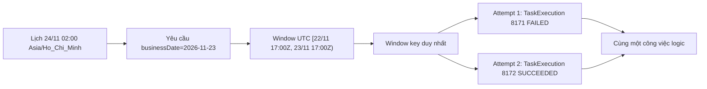
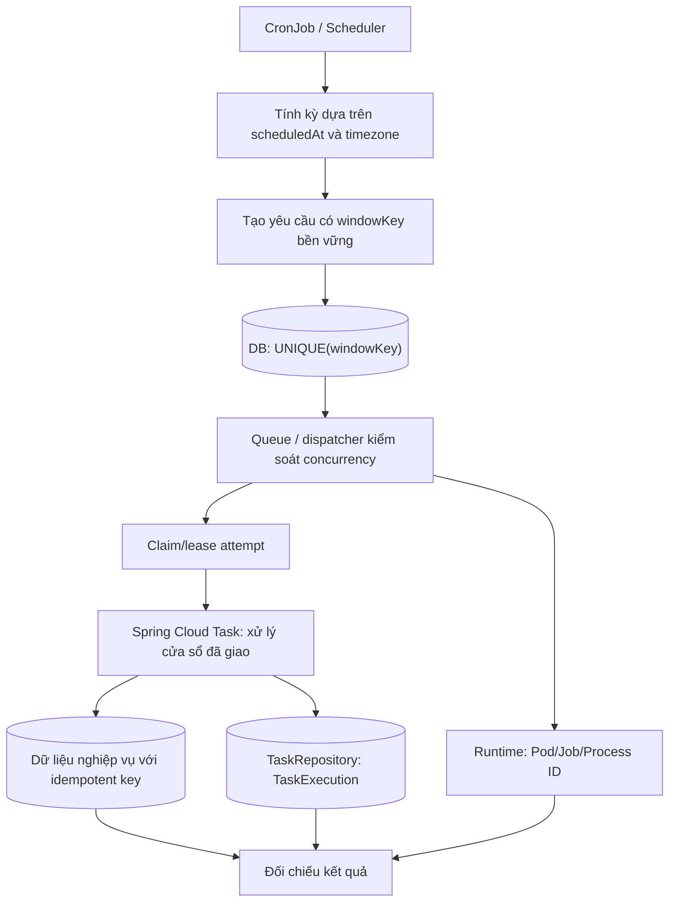
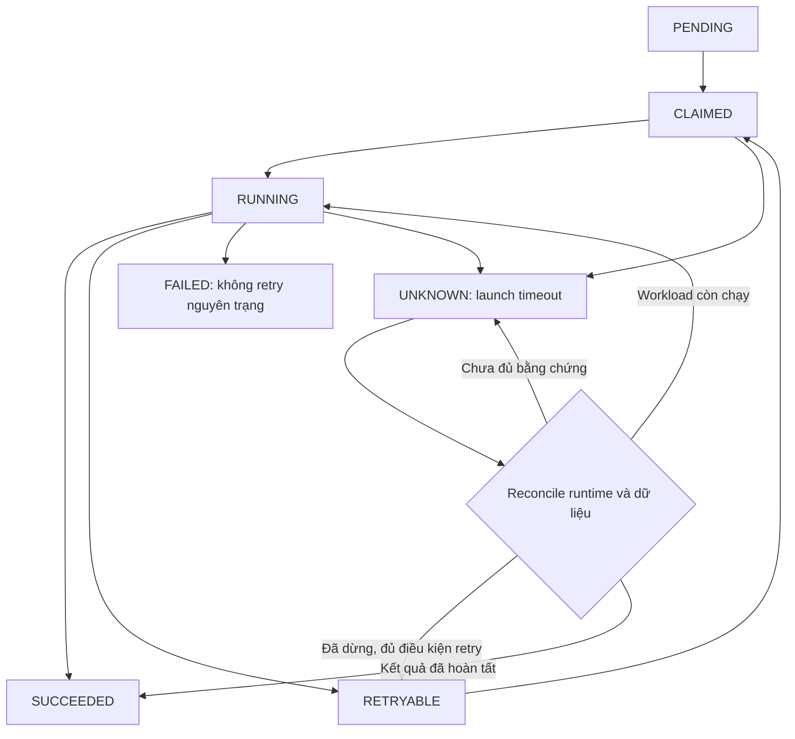

# Định danh cửa sổ dữ liệu và tránh xử lý trùng theo lịch

## 1. Bài toán: lịch chạy đúng giờ chưa đủ để xử lý đúng dữ liệu

Trong chương **Lịch chạy** của **Spring Cloud Task**, chúng ta xây dựng một ứng dụng Spring Boot có thời gian chạy hữu hạn, được scheduler hoặc API khởi chạy để xử lý dữ liệu theo ngày, giờ hay kỳ đối soát. Spring Cloud Task giúp ghi lại **lần chạy ứng dụng** trong `TaskRepository`, nhưng lịch chạy không tự trả lời được: “Lần chạy này xử lý **chính xác tập dữ liệu nào**?” hoặc “Nếu cùng thời điểm có hai yêu cầu thì có ghi dữ liệu hai lần không?”.

Ví dụ công việc `daily-settlement` chạy mỗi ngày lúc 02:00 để đối soát **ngày nghiệp vụ trước đó**. Ngày 24/11/2026, hệ thống dự kiến xử lý dữ liệu ngày 23/11. Tuy nhiên:

- Scheduler gửi lại trigger vì không nhận được ACK.
- Container khởi động chậm và chạy lúc 02:15 thay vì 02:00.
- Người vận hành bấm **Run now** trong lúc task cũ chưa kết thúc.
- Lần chạy thất bại ở nửa cuối, scheduler retry sau vài giờ hoặc sang ngày hôm sau.
- Sau sự cố hạ tầng, nhóm vận hành muốn chạy bù nhiều ngày đã bỏ lỡ.

Nếu code chỉ lấy `LocalDate.now().minusDays(1)` mỗi khi tiến trình bắt đầu, một lần retry qua ranh giới ngày có thể xử lý **ngày dữ liệu khác**. Nếu không có khóa chống trùng, hai lần chạy của cùng ngày có thể cùng tạo báo cáo, gửi tiền, ghi đơn hàng hoặc phát thông báo trùng lặp.

**Giải pháp trọng tâm:** tách bạch **thời điểm scheduler kích hoạt**, **cửa sổ dữ liệu được giao**, **yêu cầu nghiệp vụ duy nhất**, **mỗi lần thử chạy Task** và **điều kiện chấp nhận kết quả**.

Sau bài học, bạn sẽ có thể:

1. Xác định cửa sổ dữ liệu dạng nửa mở `[startInclusive, endExclusive)` và tính đúng theo múi giờ nghiệp vụ.
2. Tạo khóa công việc ổn định để retry cùng kỳ không biến thành công việc khác.
3. Dùng unique constraint, claim/lease có điều kiện và idempotent writer để chống chạy trùng.
4. Phân biệt khóa cửa sổ dữ liệu với `TaskExecutionId`, `externalExecutionId` và `JobInstance` của Spring Batch.
5. Thiết kế scheduler, backfill, xử lý dữ liệu đến muộn, timeout và kiểm tra tiến trình treo.
6. Đối chiếu kết quả nghiệp vụ, metadata Task và trạng thái scheduler khi quyết định retry.

> **Nguyên tắc:** Spring Cloud Task lưu **metadata của lần thực thi**, không tự đảm bảo “một ngày chỉ được xử lý một lần”. Cơ chế chống trùng phải được thiết kế ở lớp yêu cầu/điều phối và lớp ghi dữ liệu nghiệp vụ.

## 2. Năm loại thời điểm và định danh cần giữ riêng

| Khái niệm | Ý nghĩa | Ví dụ |
| --- | --- | --- |
| `scheduledAt` | Thời điểm lịch **dự kiến** chạy | 2026-11-24 02:00 giờ Việt Nam |
| `startedAt` | Thời điểm tiến trình thật sự bắt đầu | 2026-11-24 02:15 giờ Việt Nam |
| `businessDate` | Nhãn kỳ nghiệp vụ sẽ xử lý | `2026-11-23` |
| `windowStart` / `windowEnd` | Hai mốc thời gian xác định **tập dữ liệu** | `[2026-11-22T17:00:00Z, 2026-11-23T17:00:00Z)` |
| `attemptId` / `TaskExecutionId` | Định danh **một lần thử chạy** | `attempt-2` / `TASK_EXECUTION_ID=8172` |

Với múi giờ `Asia/Ho_Chi_Minh` (UTC+07), ngày nghiệp vụ 23/11/2026 là khoảng UTC từ **22/11 lúc 17:00Z đến 23/11 lúc 17:00Z**. Lần chạy lúc 02:00 hay 02:15 ngày hôm sau đều phải xử lý **cùng khoảng** khi được giao cùng `businessDate`.



**Retry không tạo cửa sổ nghiệp vụ mới.** Nó tạo *attempt* mới cho **cùng yêu cầu và cùng tập dữ liệu**. Nếu doanh nghiệp chủ động xử lý lại dữ liệu đã thay đổi, cần chính sách reprocess với phiên bản nguồn hoặc revision riêng, không âm thầm đổi cửa sổ.

## 3. Cửa sổ nửa mở `[start, end)` và ranh giới không trùng

Một cửa sổ nửa mở gồm:

- **Bao gồm** mọi sự kiện có timestamp `>= startInclusive`.
- **Không bao gồm** sự kiện có timestamp `>= endExclusive`.

Với hai cửa sổ liền kề:

```text
W1 = [2026-11-22T17:00Z, 2026-11-23T17:00Z)
W2 = [2026-11-23T17:00Z, 2026-11-24T17:00Z)
```

Sự kiện tại đúng `2026-11-23T17:00Z` **chỉ thuộc W2**. Không cần mẹo `23:59:59.999`, vốn dễ sai khi cột DB có độ chính xác microsecond/nanosecond.

Ví dụ SQL PostgreSQL, giả định `occurred_at` là thời điểm nghiệp vụ thuộc loại `TIMESTAMPTZ`:

```sql
SELECT event_id, tenant_id, occurred_at, amount
FROM payment_event
WHERE tenant_id = :tenantId
  AND occurred_at >= :windowStartUtc
  AND occurred_at < :windowEndUtc
ORDER BY occurred_at, event_id;
```

`:tenantId`, `:windowStartUtc` và `:windowEndUtc` là named parameters được bind bằng JDBC abstraction, không phải dữ liệu nối chuỗi vào SQL. Chỉ dùng các mốc **UTC đã chuẩn hóa**, không để database tự diễn giải chuỗi timestamp theo timezone của session ngoài ý muốn.

### Những lựa chọn dễ sai

| Cách làm | Rủi ro | Thay bằng |
| --- | --- | --- |
| `BETWEEN start AND end` | `BETWEEN` thường bao gồm cả hai đầu; sự kiện ở ranh giới bị xử lý hai lần | `>= start AND < end` |
| `end = 23:59:59.999` | Bỏ sót timestamp có độ chính xác cao hơn | `endExclusive = đầu ngày sau` |
| Lấy giờ hiện tại trong mỗi worker | Worker trễ hoặc retry sang ngày khác sẽ tính cửa sổ khác | Truyền cửa sổ đã được xác định từ yêu cầu |
| Dùng riêng ngày UTC cho nghiệp vụ theo giờ địa phương | Phân loại sai sự kiện gần nửa đêm | Xác định `ZoneId` nghiệp vụ rồi chuyển mốc sang `Instant` |
| Chia theo timestamp nhưng nguồn thay đổi trong khi đọc | Có bản ghi đến muộn hoặc update làm thay đổi tập dữ liệu | Snapshot/input version và chính sách late arrivals |

## 4. Tính cửa sổ ngày nghiệp vụ bằng `java.time`

Đừng mặc định **một ngày lịch = 24 giờ tuyệt đối** ở mọi múi giờ. Các khu vực có daylight saving time (DST) có ngày 23 hoặc 25 giờ. Java cung cấp `LocalDate`, `ZoneId`, `ZonedDateTime` và `Instant` để tính ranh giới theo quy tắc lịch.

Ví dụ Java 17:

```java
import java.time.Instant;
import java.time.LocalDate;
import java.time.ZoneId;

public record DailyWindow(
        LocalDate businessDate,
        String zoneId,
        Instant startInclusive,
        Instant endExclusive) {

    public static DailyWindow of(
            LocalDate businessDate, ZoneId zone) {
        Instant start = businessDate.atStartOfDay(zone).toInstant();
        Instant end = businessDate.plusDays(1)
                .atStartOfDay(zone)
                .toInstant();
        return new DailyWindow(
                businessDate, zone.getId(), start, end);
    }
}
```

Sử dụng:

```java
DailyWindow window = DailyWindow.of(
        LocalDate.parse("2026-11-23"),
        ZoneId.of("Asia/Ho_Chi_Minh"));

System.out.println(window.startInclusive());
// 2026-11-22T17:00:00Z

System.out.println(window.endExclusive());
// 2026-11-23T17:00:00Z
```

`Instant` là mốc tuyệt đối, phù hợp để lưu vào `TIMESTAMPTZ` và làm tham số truy vấn dữ liệu sự kiện. Giữ `businessDate` và `zoneId` trong audit để giải thích **vì sao** hai mốc UTC được chọn.

### Múi giờ và DST

Với `Europe/Paris`, ngày `2026-03-29` chuyển sang giờ mùa hè và khoảng từ đầu ngày đó đến đầu ngày kế tiếp dài **23 giờ**, không phải 24 giờ. Nếu lấy `start.plus(Duration.ofHours(24))` sẽ cắt nhầm một giờ của ngày lịch tiếp theo. Với `2026-10-25`, ngày đổi lại có thể dài **25 giờ**.

| Cách xác định kỳ | Phù hợp cho | Cần chú ý |
| --- | --- | --- |
| `LocalDate` + `ZoneId` → đầu ngày và đầu ngày kế | Ngày nghiệp vụ theo lịch địa phương | DST và chính sách timezone nhất quán |
| Hai `Instant` cố định | Window event-time/UTC hoặc ca vận hành | Lưu cặp ranh giới chính xác |
| `Duration.ofHours(24)` | Cửa sổ *rolling 24 giờ* thật sự | **Không** thay thế ngày lịch khi DST |
| `LocalDateTime` không timezone | Nhãn giờ tường địa phương | Không đủ để xác định một `Instant` trong giờ lặp DST |

Đối với ứng dụng phục vụ nhiều tenant, múi giờ của tenant phải đến từ cấu hình đáng tin cậy hoặc domain model, không để client tùy ý thay đổi `zoneId` của một yêu cầu cũ trong lúc retry. Nếu quy tắc lịch của tenant đổi trong tương lai, hãy lưu lại **cửa sổ UTC đã quyết định** cùng yêu cầu, không chỉ lưu tên timezone.

## 5. Khóa công việc (window key) phải ổn định qua mọi attempt

Một **khóa công việc logic** nên có đủ thông tin phân biệt những tập dữ liệu hợp lệ:

```text
windowKey = (
    tenantId,
    taskKey,
    windowStartUtc,
    windowEndUtc,
    inputVersion
)
```

Trong đó:

- `tenantId` phân tách đối tượng được xử lý.
- `taskKey` phân biệt loại nghiệp vụ, ví dụ `daily-settlement` và `daily-report`.
- Cặp `windowStartUtc`/`windowEndUtc` xác định khoảng sự kiện.
- `inputVersion` (hoặc snapshot ID) chỉ được đưa vào nếu có ý nghĩa nghiệp vụ: phiên bản nguồn khác có thể tạo công việc *reprocess* được cho phép.

Không đưa những giá trị dưới đây vào **khóa công việc** nếu chúng thay đổi qua retry:

- `TASK_EXECUTION_ID` do Spring Cloud Task cấp.
- `JobExecutionId` của Spring Batch, Pod UID hoặc container ID.
- Thời điểm JVM bắt đầu chạy, random UUID của attempt.
- Số lần retry hoặc tên deployment được tạo ngẫu nhiên.

Những giá trị ấy cần được lưu trong **bảng attempt/audit**, không thay thế khóa ổn định.

### Phân biệt retry với reprocess

| Yêu cầu | Khóa cửa sổ | Hành vi mong đợi |
| --- | --- | --- |
| Scheduler gửi trigger hai lần cho cùng ngày/version | **Giống nhau** | Chỉ một yêu cầu logic, không tạo công việc nghiệp vụ mới |
| Retry một task bị timeout | **Giống nhau** | Chỉ bắt đầu attempt khác sau khi xác nhận attempt trước không còn gây tác động |
| Chạy bù ngày chưa xử lý | **Khác** vì `windowStart`/`windowEnd` khác | Tạo một yêu cầu logic cho mỗi cửa sổ bị thiếu |
| Xử lý lại ngày cũ vì nguồn có bản sửa `snapshot-v2` | **Khác** nếu `inputVersion` thuộc khóa | Chủ động tạo revision/reprocess có audit |
| Người dùng cố gửi lại cùng ngày với một payload khác nhưng giữ key | **Mâu thuẫn** | Báo conflict/đòi xác nhận quy trình reprocess |

**Không có một khóa phù hợp cho mọi doanh nghiệp.** Nếu yêu cầu chỉ cho phép đúng một kết quả cho mỗi tenant/ngày dù có bao nhiêu input version, unique key nên bỏ `inputVersion` và tổ chức revision ở bảng phụ. Hãy xác định điều kiện “cùng một việc” trước khi viết constraint.

## 6. Kiến trúc từ lịch tới một công việc được giao



**Scheduler chỉ nên giao việc**, không nên quyết định “đã xử lý” bằng một ACK của API launch. Khi request đã được lưu bền vững, scheduler nhận `requestId` và có thể tra cứu về sau. Tiến trình Java được khởi chạy với **cửa sổ cụ thể** hoặc một `requestId` để đọc lại cửa sổ từ database.

### Thời điểm đặt cửa sổ quan trọng hơn thời điểm khởi động

Một scheduler lý tưởng tính yêu cầu từ **thời điểm lịch dự kiến `scheduledAt`**:

```text
scheduledAt (local): 2026-11-24 02:00
businessDate:         2026-11-23
window:               [2026-11-22T17:00Z, 2026-11-23T17:00Z)
```

Sau đó lưu cặp mốc UTC vào request. Nếu container bắt đầu trễ hoặc retry ngày hôm sau, nó vẫn đọc lại cặp mốc này.

Đối với CronJob gọi trực tiếp JAR mà không có lớp điều phối, phải thiết kế rõ **cách suy ra scheduledAt**; đừng ngầm dùng đồng hồ hiện tại của Pod khi yêu cầu cần tái lập chính xác. Một wrapper hoặc dịch vụ lịch có thể tạo window request trước khi chạy task; còn chạy thủ công/backfill phải truyền tham số kỳ cụ thể.

## 7. Database chống yêu cầu cùng cửa sổ được đăng ký hai lần

Để chống race giữa nhiều scheduler hoặc nhiều API instance, dùng **ràng buộc duy nhất của database**, không chỉ kiểm tra trước bằng `SELECT`.

Ví dụ PostgreSQL **do ứng dụng tự quản lý**, không phải schema chuẩn của Spring Cloud Task:

```sql
CREATE TABLE scheduled_window_run (
    run_id UUID PRIMARY KEY,
    tenant_id VARCHAR(80) NOT NULL,
    task_key VARCHAR(100) NOT NULL,
    window_start_utc TIMESTAMPTZ NOT NULL,
    window_end_utc TIMESTAMPTZ NOT NULL,
    input_version VARCHAR(100) NOT NULL,
    business_date DATE NOT NULL,
    timezone_id VARCHAR(80) NOT NULL,
    state VARCHAR(24) NOT NULL
        CHECK (state IN (
            'PENDING', 'CLAIMED', 'RUNNING',
            'RETRYABLE', 'SUCCEEDED', 'FAILED', 'UNKNOWN'
        )),
    attempt_count INTEGER NOT NULL DEFAULT 0
        CHECK (attempt_count >= 0),
    lease_token UUID,
    lease_until TIMESTAMPTZ,
    task_execution_id BIGINT,
    platform_execution_id VARCHAR(240),
    created_at TIMESTAMPTZ NOT NULL DEFAULT now(),
    updated_at TIMESTAMPTZ NOT NULL DEFAULT now(),
    completed_at TIMESTAMPTZ,
    CHECK (window_start_utc < window_end_utc),
    CONSTRAINT uq_scheduled_window
        UNIQUE (
            tenant_id, task_key, window_start_utc,
            window_end_utc, input_version
        )
);
```

Các cột `task_execution_id` và `platform_execution_id` giúp đối chiếu **attempt gần nhất** nếu ứng dụng có dữ liệu đó; trong thực tế nên có **bảng attempt riêng** để không làm mất lịch sử nhiều lần retry. Không tự tạo foreign key tới `TASK_EXECUTION` nếu Task Repository nằm ở database khác.

### Insert một công việc, kể cả khi có hai trigger cùng lúc

```sql
INSERT INTO scheduled_window_run (
    run_id, tenant_id, task_key,
    window_start_utc, window_end_utc, input_version,
    business_date, timezone_id, state
) VALUES (
    :runId, :tenantId, :taskKey,
    :windowStartUtc, :windowEndUtc, :inputVersion,
    :businessDate, :timezoneId, 'PENDING'
)
ON CONFLICT (
    tenant_id, task_key, window_start_utc,
    window_end_utc, input_version
) DO NOTHING;
```

Khi một scheduler gửi cùng khóa lần thứ hai, DB **không thêm hàng mới**. Sau lệnh, ứng dụng tra cứu hàng đã tồn tại và xác nhận các trường quan trọng khác (payload/scope) có khớp hay không; nếu key cũ được dùng cho yêu cầu không tương đương, phải **báo conflict** thay vì âm thầm bỏ qua.

Mọi giá trị `:parameter` phải được bind bằng thư viện JDBC hỗ trợ named parameters. Constraint của database là **điểm phân xử race**, còn client/scheduler phải xử lý kết quả insert trùng bằng cách trả lại request ID hiện có.

**Không gọi launcher trước khi lưu khóa:** hai tiến trình có thể đã được tạo trước khi database phát hiện bản sao. Hãy đăng ký cửa sổ trong giao dịch ngắn, sau đó để dispatcher có quyền sở hữu request thực hiện bước launch.

## 8. Claim công việc có điều kiện, lease và trạng thái không chắc chắn

Ngay cả khi bảng request chỉ có một hàng, **hai dispatcher vẫn có thể cùng chọn hàng đó để xử lý** nếu cả hai đọc trạng thái `PENDING` rồi gọi launch. Cần thao tác claim nguyên tử:

```sql
UPDATE scheduled_window_run
SET state = 'CLAIMED',
    lease_token = :leaseToken,
    lease_until = now() + INTERVAL '15 minutes',
    attempt_count = attempt_count + 1,
    updated_at = now()
WHERE run_id = :runId
  AND state IN ('PENDING', 'RETRYABLE')
RETURNING run_id, attempt_count, lease_token;
```

Trong PostgreSQL, chỉ một dispatcher thắng chuyển trạng thái của cùng một hàng ở một thời điểm theo mức cô lập/giao dịch phù hợp. Dispatcher không nhận dòng `RETURNING` thì **không được launch**. Những công việc `FAILED` vĩnh viễn hoặc `SUCCEEDED` không tự mở lại; muốn reprocess phải tuân thủ policy riêng.

### Lease không phải bằng chứng worker đã dừng

Nếu `lease_until` hết hạn, dispatcher có thể đã crash, nhưng **worker mà nó khởi chạy vẫn có thể đang chạy**. Không đơn giản thực hiện `WHERE lease_until < now()` rồi launch bản sao ngay. Phải:

1. Đưa trạng thái không rõ ràng về `UNKNOWN`/cần reconcile theo chính sách.
2. Kiểm tra runtime bằng correlation ID, Pod UID hoặc platform execution ID.
3. Đối chiếu `TaskRepository`, kết quả nghiệp vụ và thời gian heartbeat.
4. Chỉ mở `RETRYABLE` khi đã đủ bằng chứng worker cũ không thể tiếp tục hoặc writer có bảo vệ chống trùng đủ mạnh.

`lease_token` là một cách hạn chế **stale dispatcher** cập nhật trạng thái: các thao tác cuối phải mang đúng token đã cấp. Tuy nhiên token chỉ bảo vệ hàng metadata nếu được kiểm tra đúng; nó **không ngăn worker cũ tiếp tục gọi một API ngoài**. Muốn kiểm soát side effect phải áp dụng fencing/idempotency ở hệ thống đích.

### State machine minh họa



Đây là **mô hình trạng thái do ứng dụng thiết kế**, không phải enum mặc định của Spring Cloud Task. Những chuyển trạng thái phải được bảo vệ bởi transaction, quyền, điều kiện state/lease và quy tắc retry. Nếu `TaskRepository` hoặc broker lỗi, không tuyên bố `SUCCEEDED` chỉ dựa vào một message/ACK.

## 9. Ví dụ Spring Cloud Task nhận cửa sổ cụ thể

Ứng dụng dưới đây nhận `business-date`, `tenant-id` và `input-version` từ một bộ điều phối đã xác thực. Nó **không tự suy ra ngày từ `LocalDate.now()`**. Ví dụ Java 17:

```java
package com.example.scheduling;

import java.time.LocalDate;
import java.time.ZoneId;
import java.util.List;
import org.slf4j.Logger;
import org.slf4j.LoggerFactory;
import org.springframework.boot.ApplicationRunner;
import org.springframework.boot.SpringApplication;
import org.springframework.boot.autoconfigure.SpringBootApplication;
import org.springframework.cloud.task.configuration.EnableTask;
import org.springframework.context.annotation.Bean;

@SpringBootApplication
@EnableTask
public class WindowedTaskApplication {
    private static final Logger log =
            LoggerFactory.getLogger(WindowedTaskApplication.class);

    public static void main(String[] args) {
        SpringApplication.run(WindowedTaskApplication.class, args);
    }

    @Bean
    ApplicationRunner runWindow(WindowProcessor processor) {
        return args -> {
            String dateString = required(args.getOptionValues("business-date"));
            String tenant = required(args.getOptionValues("tenant-id"));
            String version = required(args.getOptionValues("input-version"));

            LocalDate date = LocalDate.parse(dateString);
            DailyWindow window = DailyWindow.of(
                    date, ZoneId.of("Asia/Ho_Chi_Minh"));

            log.info("tenant={}, businessDate={}, start={}, end={}, version={}",
                    tenant, date, window.startInclusive(),
                    window.endExclusive(), version);

            processor.process(
                    tenant, version,
                    window.startInclusive(), window.endExclusive());
        };
    }

    private static String required(List<String> values) {
        if (values == null || values.size() != 1
                || values.get(0).isBlank()) {
            throw new IllegalArgumentException(
                    "Thiếu tham số hoặc tham số không hợp lệ");
        }
        return values.get(0);
    }
}
```

`DailyWindow` là record đã trình bày ở mục 4. `WindowProcessor` là **service nghiệp vụ cần triển khai**; đoạn này là khung ứng dụng, chưa có connection pool, schema, transaction, khâu claim hay xử lý output thật. Có thể định nghĩa giao diện dịch vụ:

```java
import java.time.Instant;

public interface WindowProcessor {
    void process(
            String tenantId, String inputVersion,
            Instant startInclusive, Instant endExclusive);
}
```

Phần triển khai `WindowProcessor` phải kiểm tra **idempotency của từng đơn vị ghi**, đồng thời có thể kiểm tra khóa/lease trước khi xử lý nếu mô hình deployment yêu cầu. **Không đặt tin cậy vào CLI** nếu tiến trình được gọi trực tiếp từ môi trường không kiểm soát; hệ thống cần xác thực tenant/scope ở lớp điều phối và DB.

Ví dụ khởi chạy **cùng một kỳ** cho lần thử đầu và lần retry:

```bash
java -jar windowed-task.jar \
  --tenant-id=tenant-a \
  --business-date=2026-11-23 \
  --input-version=snapshot-v1

# Sau khi điều phối xác nhận được phép retry:
java -jar windowed-task.jar \
  --tenant-id=tenant-a \
  --business-date=2026-11-23 \
  --input-version=snapshot-v1
```

Hai lần khởi động có thể tạo **hai `TaskExecution` khác nhau**, nhưng **cùng cửa sổ và khóa nghiệp vụ**. Những lần chạy trực tiếp bằng `java -jar` không đi qua bộ điều phối/claim mẫu sẽ **không tự được chống trùng**; đây là lý do khóa UNIQUE ở request store và idempotent writer vẫn cần.

## 10. Mã `TaskExecution` và `externalExecutionId` không phải khóa cửa sổ

Spring Cloud Task tạo metadata `TaskExecution` khi JVM chạy. Mỗi lần retry có thể có một ID nội bộ mới, ví dụ:

| Cửa sổ | Request ID | Attempt | `TASK_EXECUTION_ID` | Kết quả |
| --- | --- | --- | --- | --- |
| Ngày 23/11, snapshot-v1 | `req-481` | 1 | `8171` | Lỗi timeout |
| Ngày 23/11, snapshot-v1 | `req-481` | 2 | `8172` | Hoàn thành |

`TASK_EXECUTION_ID` giúp truy vết **lần chạy Task cụ thể**. `spring.cloud.task.external-execution-id` có thể lưu ID do scheduler hoặc platform cấp, như Pod UID. Chúng có thể thay đổi theo attempt và **không nên dùng làm business-window key**.

Trong hệ thống cần audit chi tiết, tạo một bảng `scheduled_window_attempt` lưu `run_id`, `attempt_no`, `task_execution_id`, `external_execution_id`, `started_at`, `ended_at`, `exit_code`. Cần đảm bảo correlation ID được truyền qua launcher và log để có thể liên kết khi một phía chưa có metadata.

### Không suy từ metadata rằng lần chạy còn sống

`START_TIME` có giá trị nhưng `END_TIME IS NULL` có thể nghĩa là JVM đang chạy, **hoặc đã bị kill** trước lúc repository ghi kết thúc. `EXIT_CODE=0` cũng không tự chứng minh đủ dữ liệu nghiệp vụ đã được ghi. Trước khi cấp lại cùng window, hãy đối chiếu cả runtime, log và bảng kết quả.

## 11. Tránh trùng ở đầu ra: idempotent writer và transaction

Unique constraint ở bảng cửa sổ ngăn **đăng ký yêu cầu trùng**, nhưng không tự ngăn tác dụng phụ trùng nếu worker retry sau khi commit một phần.

Ví dụ bảng tổng hợp theo tenant/ngày/version:

```sql
CREATE TABLE daily_settlement (
    tenant_id VARCHAR(80) NOT NULL,
    business_date DATE NOT NULL,
    input_version VARCHAR(100) NOT NULL,
    total_amount NUMERIC(20, 2) NOT NULL,
    event_count BIGINT NOT NULL,
    PRIMARY KEY (tenant_id, business_date, input_version)
);
```

Khi đủ dữ liệu của cửa sổ và có transaction phù hợp, writer có thể ghi kết quả theo khóa duy nhất:

```sql
INSERT INTO daily_settlement (
    tenant_id, business_date, input_version,
    total_amount, event_count
) VALUES (
    :tenantId, :businessDate, :inputVersion,
    :totalAmount, :eventCount
)
ON CONFLICT (tenant_id, business_date, input_version)
DO UPDATE SET
    total_amount = EXCLUDED.total_amount,
    event_count = EXCLUDED.event_count;
```

**Cảnh báo:** Upsert chỉ an toàn nếu cùng khóa luôn có cùng định nghĩa kết quả (hoặc có chính sách version/revision minh bạch). Nếu hai attempt đang chạy đồng thời với dữ liệu nguồn khác nhau, **last writer wins** có thể che mất sai lệch. Hãy dùng input snapshot bất biến, fencing/version check hoặc transaction/lock phù hợp; ghi lại checksum nếu cần điều tra.

### Tránh tăng cộng dồn không kiểm soát

Giả sử retry cùng cửa sổ mà code thực hiện:

```sql
UPDATE daily_ledger
SET total_amount = total_amount + :windowAmount
WHERE tenant_id = :tenantId;
```

Mỗi retry có thể **cộng số tiền lần nữa**. Thay vào đó, dùng kết quả cố định theo window key rồi áp dụng vào sổ cái bằng một giao dịch có **unique operation key**/bảng bút toán; chỉ tăng tổng khi bút toán chưa được áp dụng. Không dựa vào việc `TaskExecution.EXIT_CODE=0` để suy ra bút toán chỉ xuất hiện một lần.

### Side effect ra hệ thống ngoài

Nếu task gửi email, chuyển tiền hoặc publish message, transaction của `TaskRepository` không bao phủ toàn bộ hệ thống ngoài. Worker có thể gửi thành công rồi mất kết nối database trước lúc ghi trạng thái. Lần retry sẽ có nguy cơ gửi lại.

Các giải pháp thường dùng:

- **Idempotency key** tại API bên nhận, ổn định theo `tenant + operation + windowKey`.
- **Transactional outbox:** ghi sự kiện đầu ra vào DB cùng transaction với kết quả nghiệp vụ; producer phát riêng và consumer chống trùng.
- **Inbox/deduplication:** bên nhận ghi khóa xử lý duy nhất và từ chối message lặp.
- **Compensation:** bù trừ khi side effect không thể rollback.

Không hứa hẹn exactly-once trên nhiều dịch vụ chỉ bằng transaction của Spring Cloud Task hoặc vì scheduler gọi đúng một lần.

## 12. Khi xử lý bằng Spring Batch: giữ `JobInstance` cho cùng cửa sổ

Nếu ứng dụng Spring Cloud Task gọi Spring Batch, cần một nguyên tắc bổ sung:

```text
JobInstance = jobName + identifying JobParameters
```

Ví dụ mỗi window được định danh bằng tenant, hai mốc UTC và input version:

```java
JobParameters params = new JobParametersBuilder()
        .addString("tenantId", tenantId, true)
        .addString("windowStartUtc", window.startInclusive().toString(), true)
        .addString("windowEndUtc", window.endExclusive().toString(), true)
        .addString("inputVersion", inputVersion, true)
        .toJobParameters();
```

Đây là phần xây tham số theo API Spring Batch 5.x phổ biến; giả định các biến đã được xác định ở tầng điều phối và mã đã import `JobParameters`/`JobParametersBuilder`. Khi thay phiên bản Batch, đối chiếu API với dependency thực tế.

Trong lần retry hợp lệ:

- Spring Cloud Task có thể tạo **`TaskExecution` mới**.
- Spring Batch nhận **cùng JobParameters định danh** và tìm lại **`JobInstance` cũ**.
- Nếu lần trước `FAILED`/`STOPPED` và job restartable, Batch có thể tạo **`JobExecution` mới** cho cùng instance rồi tiếp tục phần được cấu hình restart.
- Nếu JobInstance đã `COMPLETED`, Batch thường từ chối chạy lại cùng instance; cần kiểm tra kết quả trước khi xem đó là lỗi hệ thống.

**Không thêm `run.id=timestamp` hoặc `taskExecutionId` làm identifying parameter mỗi lần retry**, vì điều này tạo JobInstance mới và có thể làm mất checkpoint/restart của instance trước. Nếu thực sự xử lý lại snapshot phiên bản khác, hãy tạo một yêu cầu reprocess có chủ đích và đánh giá dữ liệu đã ghi.

Để xác nhận job hoàn tất, cần `JobRepository`/`JobExplorer` và trạng thái `BatchStatus`; `TaskRepository` chỉ ghi **lần chạy ứng dụng**. Với launcher bất đồng bộ, đừng cho Task kết thúc thành công trước khi job thật sự đạt trạng thái cuối theo hợp đồng.

## 13. Scheduler và Kubernetes CronJob: lịch không thay thế idempotency

Spring Cloud Task **không tự lập lịch cron**. Ứng dụng được gọi bởi scheduler ngoài như Kubernetes CronJob, Spring Scheduler, hệ thống hàng đợi hoặc dịch vụ orchestration.

Một CronJob có thể được cấu hình theo giờ Việt Nam:

```yaml
apiVersion: batch/v1
kind: CronJob
metadata:
  name: daily-settlement
spec:
  schedule: "0 2 * * *"
  timeZone: "Asia/Ho_Chi_Minh"
  concurrencyPolicy: Forbid
  startingDeadlineSeconds: 3600
  jobTemplate:
    spec:
      template:
        spec:
          restartPolicy: Never
          containers:
            - name: settlement
              image: registry.example.com/settlement-task:1.4.2
```

Đây là **manifest minh họa cơ chế lịch và concurrency**, chưa có argument cửa sổ, secret, resource requests/limits, RBAC, image digest hay kết nối database. `timeZone` yêu cầu phiên bản Kubernetes có hỗ trợ trường này. Hãy kiểm tra chính sách hạ tầng và múi giờ cụm thật trước khi áp dụng.

### `concurrencyPolicy: Forbid` bảo vệ được những gì?

Nó ngăn các Job được tạo bởi **cùng CronJob** chạy chồng lên nhau theo phạm vi Kubernetes hỗ trợ. Nó **không**:

- Ngăn một API hoặc CronJob khác khởi chạy cùng nghiệp vụ.
- Chứng minh dữ liệu của cùng window đã được xử lý đúng một lần.
- Ngăn tiến trình chạy trùng khi controller/network có sự cố hoặc người vận hành chạy thủ công.
- Thay thế unique key ở bảng công việc và idempotent writer.

`startingDeadlineSeconds` liên quan đến lần chạy lịch bị lỡ, không phải một khóa chống trùng. Với các hệ thống mà window bị lỡ cần xử lý bù, phải có **reconciliation/backfill** độc lập, thay vì suy rằng CronJob sẽ tự chạy lại đầy đủ mọi kỳ đã trễ.

**Đặc biệt:** cấu hình CronJob mẫu không tự động truyền `businessDate` tương ứng với `scheduledAt` vào JAR. Một wrapper/dịch vụ điều phối phải tạo yêu cầu window cố định từ lịch dự kiến, hoặc cách tính ngày của ứng dụng phải được thiết kế chặt chẽ để chịu được việc start trễ và retry. Nếu hard-code `--business-date=2026-11-23` trong template dùng hàng ngày, mọi lần chạy tiếp theo sẽ tiếp tục xử lý **một ngày đó**.

### `@Scheduled` trong Spring Boot?

`@Scheduled` là cơ chế **gọi phương thức lặp lại trong một ứng dụng còn sống**; trong khi một Spring Cloud Task hữu hạn thường khởi động, chạy rồi thoát. Nếu giữ một JVM sống để cron nội bộ gọi lặp lại, đó là mô hình dịch vụ scheduler dài hạn, không giống một Task process hữu hạn cho từng lượt. Đừng đánh đồng hai mô hình khi cấu hình lifecycle và TaskRepository.

## 14. Dữ liệu đến muộn, watermark và chạy bù

Một cửa sổ theo **event time** có thể nhận dữ liệu đến sau `endExclusive` vì network, queue lag hoặc nguồn ngoài chậm. Cần xác định khi nào một kỳ được xem là đủ dữ liệu để “đóng”.

Ví dụ:

- Cửa sổ ngày 23/11 theo `Asia/Ho_Chi_Minh` kết thúc lúc 24/11 00:00 giờ địa phương.
- Scheduler chỉ chạy đối soát lúc 24/11 02:00, tạo **độ trễ chờ 2 giờ**.
- Một số sự kiện vẫn có thể đến sau 02:00; hệ thống phải quyết định bỏ qua, ghi nhận điều chỉnh, mở lại kỳ hay tạo reprocess revision.

| Chính sách | Ưu điểm | Rủi ro/cách kiểm soát |
| --- | --- | --- |
| Chờ cố định 2 giờ | Dễ hiểu, dễ vận hành | Không đảm bảo mọi nguồn đều đến kịp |
| Dùng watermark nguồn | Phản ánh tiến độ nguồn dữ liệu | Cần monitor watermark, xử lý nguồn bị treo |
| Snapshot bất biến theo kỳ | Retry đọc đúng một tập dữ liệu | Phải quản lý phiên bản và retention snapshot |
| Reprocess theo revision | Cho phép sửa dữ liệu đến muộn | Cần khóa revision, audit và chính sách ghi đè/bút toán điều chỉnh |

**Late arrival không đồng nghĩa duplicate.** Một sự kiện có `occurred_at` nằm trong window cũ nhưng đến hệ thống sau lúc báo cáo hoàn tất là vấn đề **độ đầy đủ**. Trong khi cùng một yêu cầu window được chạy hai lần là vấn đề **xử lý trùng**. Hai vấn đề cần thiết kế chung nhưng có các giải pháp khác nhau.

### Backfill sau sự cố

Giả sử hệ thống ngừng hoạt động ba ngày. Dịch vụ reconciliation có thể:

1. Liệt kê các kỳ **dự kiến phải tồn tại** theo lịch và timezone nghiệp vụ.
2. So sánh với bảng `scheduled_window_run` theo window key.
3. Tạo những hàng `PENDING` còn thiếu bằng `INSERT ... ON CONFLICT DO NOTHING`.
4. Chọn thứ tự chạy bù (cũ trước mới, hoặc theo tenant/priority).
5. Dùng chung queue, quota và cơ chế claim; không đẩy tất cả backfill vào platform cùng lúc.
6. Kiểm tra số liệu nghiệp vụ/metadata Task, rồi chỉ đánh dấu các window đã đủ điều kiện `SUCCEEDED`.

Khi backfill tạo hàng mới, phải giữ đúng timezone/window theo **quy tắc áp dụng ở kỳ đó**, không tùy tiện dùng quy tắc hiện tại nếu tenant đã thay đổi timezone hoặc ngày kết toán.

## 15. Xử lý các tình huống lỗi và chạy trùng

| Tình huống | Nguy cơ | Hành động đề xuất |
| --- | --- | --- |
| Scheduler gửi cùng trigger hai lần | Hai Task xử lý cùng window | Unique window key; cùng request ID, chỉ một dispatcher claim |
| Client/API retry sau timeout | Không biết lệnh launch trước đã thành công | Giữ `UNKNOWN`, tìm workload theo correlation ID trước khi launch lại |
| Task crash sau khi commit dữ liệu | Retry tạo tác dụng phụ trùng | Idempotent writer, outbox, đối chiếu nghiệp vụ |
| JVM bị kill, `END_TIME` trống | Tưởng worker vẫn chạy hoặc tưởng chưa làm việc | Kiểm tra Pod/process, JobRepository và dữ liệu thực tế |
| Lease hết hạn nhưng worker còn chạy | Hai worker cùng ghi | Reconcile runtime; fencing token/idempotency ở hệ thống đích |
| Một Batch JobInstance đã `COMPLETED` | Retry với cùng params có thể bị từ chối | Xác minh kết quả đã hoàn tất và không ép tạo instance mới |
| Thay input snapshot giữa các attempt | Kết quả cùng key không tái lập | Input version bất biến, checksum/manifest |
| Hai tenant khác nhau cùng kỳ | Khóa quá rộng khiến một tenant bị chặn | Đưa tenant vào business key và policy concurrency |
| Một tenant gửi hai ngày khác nhau cùng lúc | Tranh chấp business state có thứ tự | Khóa theo tenant/toàn chuỗi nếu nghiệp vụ yêu cầu |
| Timestamp lưu sai timezone | Bỏ sót hoặc tính lặp sự kiện ở biên | Lưu mốc UTC, giữ zone ID, kiểm thử DST |
| Nhiều kỳ backfill cùng lúc | Quá tải DB/broker | Giới hạn concurrency, rate, pool và retry budget |
| Task `EXIT_CODE=0` nhưng báo cáo thiếu dữ liệu | “Thành công” giả | Kiểm tra tiêu chí nghiệp vụ và watermark, không dựa chỉ vào mã thoát |

### `single-instance-enabled` có giải quyết hết không?

Spring Cloud Task có tính năng `spring.cloud.task.single-instance-enabled` để hạn chế **các instance cùng tên task chạy đồng thời** khi lock/repository cần thiết được cấu hình. Nhưng tính năng này **không ngăn chạy lại tuần tự cùng business window**, cũng không biểu diễn khóa `tenant + window`.

Nếu task tên `daily-settlement` phục vụ nhiều tenant độc lập, khóa toàn bộ theo tên còn có thể làm giảm concurrency không cần thiết. Dùng chính sách từ yêu cầu nghiệp vụ: unique window key, lock theo tenant/period, và giới hạn tài nguyên ở scheduler/deployer.

## 16. Quan sát và đối chiếu bằng SQL

### 16.1. Danh sách cửa sổ chưa hoàn tất

```sql
SELECT tenant_id, task_key, business_date, timezone_id,
       window_start_utc, window_end_utc,
       input_version, state, attempt_count, lease_until
FROM scheduled_window_run
WHERE state <> 'SUCCEEDED'
ORDER BY business_date, tenant_id;
```

Cột `state` ở đây do **hệ thống điều phối tự định nghĩa**, không phải trạng thái chính thức của Spring Cloud Task. Những hàng `UNKNOWN`/lease quá hạn cần được đối chiếu trước khi retry.

### 16.2. Lịch sử TaskExecution

```sql
SELECT TASK_EXECUTION_ID, TASK_NAME, START_TIME, END_TIME,
       EXIT_CODE, EXTERNAL_EXECUTION_ID
FROM TASK_EXECUTION
WHERE TASK_NAME = 'daily-settlement'
ORDER BY TASK_EXECUTION_ID DESC
LIMIT 50;
```

Không tự join bằng `business_date` nếu Task Repository không lưu trường đó trong schema chuẩn. Hãy lưu correlation từ `run_id`/`attempt_no` đến `task_execution_id` hoặc `external_execution_id` trong bảng audit/attempt, rồi dùng đúng ID để tra cứu. Nếu chạy Spring Batch, kiểm tra thêm `JobExecution`/`StepExecution` trong `JobRepository`.

### 16.3. Dashboard cần những thông tin nào?

| Cấp | Nguồn dữ liệu | Chỉ số cần xem |
| --- | --- | --- |
| Lịch | Scheduler | `scheduledAt`, trễ trigger, số kỳ bị lỡ |
| Window | `scheduled_window_run` | Kỳ nào `SUCCEEDED`, `RETRYABLE`, `UNKNOWN`, số attempt |
| Task | `TaskRepository` | `TASK_EXECUTION_ID`, start/end, exit code, lỗi |
| Batch (nếu có) | `JobRepository` | JobInstance, JobExecution, checkpoint/StepStatus |
| Runtime | Kubernetes/Deployer | Pod/Job ID, CPU/RAM, OOM/kill, timeouts |
| Nghiệp vụ | Domain DB / hệ thống ngoài | Số sự kiện, tổng giá trị, kiểm soát trùng/thiếu |

Dashboard không nên chỉ hiển thị “thành công” khi thấy `TaskExecution.EXIT_CODE=0`. Kết quả nghiệp vụ có thể không đầy đủ nếu worker nuốt lỗi, dữ liệu nguồn đến muộn hoặc xử lý bất đồng bộ chưa hoàn tất.

## 17. Quy trình kiểm thử từ một lịch đến nhiều lần retry

Hãy thực hành trên môi trường test có PostgreSQL metadata và scheduler giả lập:

1. **Kiểm tra biên cửa sổ:** cho hai sự kiện có timestamp ngay trước và đúng `endExclusive`; xác nhận không có sự kiện thuộc cả hai ngày.
2. **Đặt timezone:** tạo window ngày `2026-11-23` theo `Asia/Ho_Chi_Minh` và so sánh mốc UTC mong đợi.
3. **Thử DST:** tính window `2026-03-29` theo `Europe/Paris`; xác minh khoảng dài 23 giờ.
4. **Gửi trigger trùng:** hai client/dispatcher đăng ký cùng khóa đồng thời; kiểm tra chỉ có một hàng `scheduled_window_run`.
5. **Thử race claim:** hai dispatcher cập nhật cùng `run_id`; xác nhận chỉ một bên nhận `RETURNING` và được phép launch.
6. **Kill worker sau commit:** cho phép một phần dữ liệu đã ghi, sau đó dừng tiến trình; xác minh retry không nhân đôi bản ghi/bút toán.
7. **Timeout không rõ kết quả:** giả lập platform tạo Pod nhưng phản hồi bị mất; dispatcher phải reconcile trước khi tạo attempt mới.
8. **Backfill:** bỏ qua ba ngày rồi chạy đối chiếu lịch; xác nhận tạo ba window khác nhau, không thêm bản sao của window đã có.
9. **Đến muộn:** đưa một sự kiện cũ vào sau khi window `SUCCEEDED`; thử policy snapshot/reprocess revision và đối chiếu audit.
10. **Spring Batch:** thử JobExecution `FAILED`, restart cùng identifying JobParameters và đối chiếu với TaskExecution mới.

### Câu hỏi tự kiểm tra

1. Nếu một task chạy lúc 02:00 ngày 24/11 nhưng bắt đầu thực tế lúc 03:30, kỳ nghiệp vụ nên được xác định từ thời điểm nào?
2. Vì sao `[start,end)` tốt hơn `BETWEEN` hoặc `23:59:59.999`?
3. Tại sao `LocalDate.atStartOfDay(zone)` phù hợp hơn `start.plus(24 hours)` cho ngày lịch có DST?
4. Một window retry có `TASK_EXECUTION_ID` mới. Vì sao nó vẫn phải dùng **cùng window key**?
5. Unique constraint ngăn hai request giống nhau nhưng đã đủ để ngăn hai dispatcher cùng gọi launch chưa?
6. Lease hết hạn có chứng minh worker đã dừng không? Cần kiểm tra thêm gì?
7. Nếu writer cộng dồn vào sổ cái ở mỗi retry, một window được chạy hai lần sẽ gây hậu quả gì?
8. `single-instance-enabled` giải quyết bài toán nào, và vì sao nó không thay thế idempotency theo tenant/ngày?
9. Nếu Spring Batch restart, identifying JobParameters nên giữ hay đổi?
10. Khi dữ liệu nguồn đến muộn sau khi báo cáo hoàn tất, cần phân biệt **late arrival** với **duplicate launch** như thế nào?
11. Vì sao không nên tính `businessDate` từ `LocalDate.now()` trong worker khi hệ thống có retry muộn?
12. Khi TaskRepository không có `END_TIME`, vì sao chưa thể quyết định mở một attempt mới?

## 18. Tài liệu tham khảo

- [Spring Cloud Task — Features và Task Repository](https://docs.spring.io/spring-cloud-task/reference/features.html).
- [Spring Cloud Task — Batch integration](https://docs.spring.io/spring-cloud-task/reference/batch.html).
- [Spring Batch — Configuring a Job và restartability](https://docs.spring.io/spring-batch/reference/job/configuring-job.html).
- [Spring Batch — Chunk-oriented processing và restart](https://docs.spring.io/spring-batch/reference/step/chunk-oriented-processing/restart.html).
- [Kubernetes — CronJob, concurrency policy và lịch chạy](https://kubernetes.io/docs/concepts/workloads/controllers/cron-jobs/).
- [Java API — LocalDate](https://docs.oracle.com/en/java/javase/17/docs/api/java.base/java/time/LocalDate.html), [ZoneId](https://docs.oracle.com/en/java/javase/17/docs/api/java.base/java/time/ZoneId.html), [Instant](https://docs.oracle.com/en/java/javase/17/docs/api/java.base/java/time/Instant.html).

**Ghi nhớ:** Để xử lý theo lịch **không thiếu và không trùng dữ liệu**, hãy xác định một cửa sổ `[startInclusive,endExclusive)` theo múi giờ nghiệp vụ, lưu cặp UTC và **window key ổn định** vào request store có unique constraint. Retry có thể tạo `TaskExecution` mới nhưng không đổi công việc logic. Đồng thời cần claim nguyên tử, reconcile khi launch không rõ kết quả, idempotent writer và đối chiếu `TaskRepository`/`JobRepository` với dữ liệu nghiệp vụ. **Lịch chạy là tín hiệu bắt đầu; khóa cửa sổ và hợp đồng xử lý mới quyết định tính đúng đắn.**
