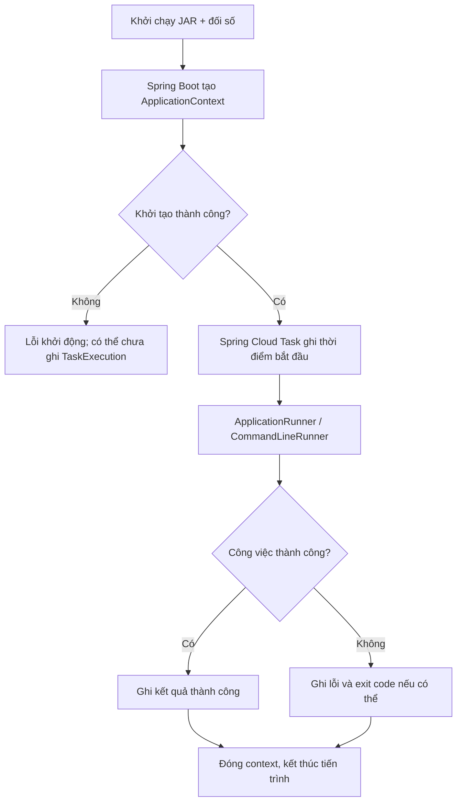

# Kiến thức nền về Spring Boot, JDBC và giao dịch

## 1. Vì sao cần ba nền tảng này khi học Spring Cloud Task?

**Spring Cloud Task** giúp xây dựng ứng dụng Spring Boot có **thời gian chạy hữu hạn**: khởi động, thực hiện một công việc, ghi nhận kết quả rồi kết thúc. Ví dụ: đồng bộ đơn hàng hằng đêm, xuất báo cáo theo yêu cầu, kiểm tra dữ liệu trước khi nhập kho hoặc chạy một bước xử lý trong quy trình lớn.

Để viết và vận hành loại ứng dụng này, cần hiểu ba thành phần có vai trò khác nhau:

| Thành phần | Trách nhiệm | Ý nghĩa đối với Spring Cloud Task |
| --- | --- | --- |
| **Spring Boot** | Tạo và cấu hình ứng dụng, quản lý bean, nhận tham số dòng lệnh, điều khiển vòng đời tiến trình | Là nền tảng chạy công việc hữu hạn |
| **JDBC / Spring JDBC** | Mở kết nối, gửi câu lệnh SQL và đọc dữ liệu từ cơ sở dữ liệu quan hệ | Thực hiện truy vấn nghiệp vụ và cho phép lưu metadata tác vụ |
| **Quản lý giao dịch** | Xác định ranh giới commit/rollback của nhiều thao tác dữ liệu | Giữ dữ liệu nhất quán khi công việc thành công, lỗi hoặc chạy lại |
| **Spring Cloud Task** | Theo dõi một lần thực thi qua `TaskRepository` và `TaskExecution` | Ghi thời điểm bắt đầu/kết thúc, trạng thái, mã thoát và thông tin lỗi |

**Kết quả cần đạt:** Sau bài học, bạn có thể giải thích vòng đời một ứng dụng Spring Boot chạy một lần; cấu hình `DataSource`; dùng `JdbcTemplate` với tham số an toàn; đặt `@Transactional` đúng chỗ; và phân biệt giao dịch nghiệp vụ với bản ghi thực thi của Spring Cloud Task.

## 2. Spring Boot: từ ứng dụng web liên tục sang tiến trình hữu hạn

### 2.1. Các khái niệm Spring Boot thiết yếu

- **`@SpringBootApplication`** kết hợp cấu hình Spring, tự cấu hình và quét thành phần theo package. Đặt lớp khởi động ở package cha của các service để chúng được phát hiện.
- **IoC container / `ApplicationContext`** tạo và quản lý các đối tượng (bean) của ứng dụng.
- **Dependency injection** truyền bean cần thiết vào constructor, giúp tách logic công việc khỏi việc tự khởi tạo kết nối hay service.
- **Auto-configuration** cấu hình các thành phần phổ biến (ví dụ `DataSource`, `JdbcTemplate`) dựa trên thư viện và thuộc tính hiện có. Cần có driver, dependency và cấu hình phù hợp.
- **Externalized configuration** đọc thiết lập từ `application.yml`, biến môi trường, tham số khi khởi động... để một bản build có thể chạy ở nhiều môi trường.

Trong ứng dụng web, tiến trình thường tiếp tục hoạt động để nhận yêu cầu HTTP. Với tác vụ chạy một lần, phần thực thi nghiệp vụ thường nằm trong `ApplicationRunner` hoặc `CommandLineRunner` và tiến trình cần có cách kết thúc sau khi chạy xong.

### 2.2. Thực thi công việc bằng Runner

`ApplicationRunner` nhận `ApplicationArguments`, giúp phân biệt tùy chọn `--key=value` với đối số thông thường. `CommandLineRunner` nhận `String... args` và phù hợp khi chỉ cần mảng chuỗi nguyên bản.

```java
import org.springframework.boot.ApplicationArguments;
import org.springframework.boot.ApplicationRunner;
import org.springframework.boot.SpringApplication;
import org.springframework.boot.autoconfigure.SpringBootApplication;
import org.springframework.cloud.task.configuration.EnableTask;
import org.springframework.context.annotation.Bean;

@SpringBootApplication
@EnableTask
public class TaskApplication {

    public static void main(String[] args) {
        SpringApplication.run(TaskApplication.class, args);
    }

    @Bean
    ApplicationRunner showArguments() {
        return args -> {
            String mode = args.containsOption("mode")
                    ? args.getOptionValues("mode").get(0)
                    : "preview";
            System.out.println("Chế độ chạy: " + mode);
        };
    }
}
```

Chạy chương trình với `--mode=import` sẽ in `Chế độ chạy: import`. Ví dụ minh họa giá trị mặc định; với tham số bắt buộc hoặc có thể bị truyền trống, cần kiểm tra danh sách giá trị trước khi truy cập phần tử đầu tiên (phần 6 sẽ thực hiện).

Khi dùng Spring Cloud Task, `@EnableTask` hoặc cơ chế tự cấu hình của starter thiết lập hạ tầng tác vụ theo phiên bản đang dùng. Về vòng đời, sau khi `ApplicationContext` khởi động thành công, Spring Cloud Task ghi sự kiện bắt đầu **trước** khi các Runner chạy; sau khi chúng hoàn tất hoặc có lỗi khởi động được bắt, nó cập nhật kết quả thực thi. Nếu bối cảnh Spring chưa khởi tạo được thì có thể **chưa có** `TaskExecution` để quan sát lỗi.



**Lưu ý:** Runner chạy xong không mặc nhiên bảo đảm JVM dừng nếu vẫn còn luồng không phải daemon hoặc thành phần giữ tiến trình sống. Với ứng dụng tác vụ, thường cấu hình `spring.main.web-application-type=none` và `spring.cloud.task.closecontextEnabled=true` để đóng context sau khi hoàn tất. Đơn vị điều phối như cron hay Kubernetes Job có trách nhiệm khởi chạy lại khi đến lịch; một lần chạy Spring Cloud Task tự nó không phải là bộ lập lịch.

## 3. JDBC và cách Spring Boot kết nối cơ sở dữ liệu

### 3.1. Từ JDBC thuần đến `JdbcTemplate`

**JDBC** là API Java để lấy `Connection`, chuẩn bị `PreparedStatement`, thực thi SQL và đọc `ResultSet`. Nếu tự thao tác JDBC thuần, lập trình viên cần đóng tài nguyên, chuyển đổi dữ liệu và xử lý ngoại lệ cẩn thận.

Spring JDBC cung cấp `JdbcTemplate` và `NamedParameterJdbcTemplate` để loại bỏ phần lớn công việc lặp lại. Các đối tượng này lấy kết nối qua `DataSource`; khi có giao dịch Spring đang hoạt động, thao tác JDBC tham gia vào giao dịch tương ứng.

Ví dụ:

```java
import java.util.List;
import org.springframework.jdbc.core.JdbcTemplate;
import org.springframework.stereotype.Repository;

@Repository
public class OrderReader {
    private final JdbcTemplate jdbc;

    public OrderReader(JdbcTemplate jdbc) {
        this.jdbc = jdbc;
    }

    public List<Long> findPendingIds() {
        return jdbc.query(
            "SELECT id FROM orders WHERE state = ? ORDER BY id",
            (rs, rowNum) -> rs.getLong("id"),
            "PENDING"
        );
    }
}
```

Dấu `?` là tham số được bind bằng cơ chế prepared statement. **Không nối chuỗi từ đầu vào người dùng vào SQL** vì dễ gây SQL injection và lỗi escaping. Với truy vấn nhiều tham số có tên, có thể dùng `NamedParameterJdbcTemplate` và `:orderId`.

Một số thao tác cần biết:

| API | Cách sử dụng |
| --- | --- |
| `update(sql, args...)` | `INSERT`, `UPDATE`, `DELETE`; trả về số dòng bị tác động |
| `query(sql, rowMapper, args...)` | Đọc nhiều dòng và ánh xạ sang đối tượng |
| `queryForObject(...)` | Mong đợi đúng một dòng; cần xử lý tình huống không có dòng hoặc nhiều dòng |
| `batchUpdate(...)` | Gửi một nhóm thao tác có tham số; có ích khi xử lý nhiều bản ghi |

`JdbcTemplate` chuyển các lỗi truy cập dữ liệu thành hệ ngoại lệ `DataAccessException` của Spring, thuận tiện cho xử lý và rollback nhất quán.

### 3.2. `DataSource`, driver và connection pool

`DataSource` là nguồn cấp kết nối JDBC. Trong ứng dụng Spring Boot, cấu hình `spring.datasource.*` cùng driver phù hợp cho phép hệ thống tự tạo `DataSource`; `spring-boot-starter-jdbc` thường đưa HikariCP vào classpath để quản lý connection pool.

Ví dụ cấu hình cơ sở dữ liệu **PostgreSQL lưu bền vững**:

```yaml
spring:
  application:
    name: order-processor-task
  main:
    web-application-type: none
  datasource:
    url: ${TASK_DB_URL:jdbc:postgresql://localhost:5432/taskdb}
    username: ${TASK_DB_USER:task_user}
    password: ${TASK_DB_PASSWORD}
    hikari:
      maximum-pool-size: 5
  cloud:
    task:
      closecontextEnabled: true
      initialize-enabled: false
```

Ở đây `TASK_DB_PASSWORD` phải được cung cấp từ môi trường hoặc hệ thống quản lý bí mật. Giá trị `initialize-enabled: false` là **lựa chọn cho môi trường đã được tạo sẵn bảng metadata của Spring Cloud Task** bằng DDL/migration đúng phiên bản. Nếu chưa tạo các bảng `TASK_*`, cấu hình này sẽ dẫn tới lỗi khi tác vụ cố ghi kết quả.

Để dùng ví dụ PostgreSQL, dự án Maven đã quản lý phiên bản Spring Boot và Spring Cloud tương thích cần có các dependency tương ứng (không tự chọn phiên bản Cloud độc lập với Boot):

```xml
<dependencies>
    <dependency>
        <groupId>org.springframework.cloud</groupId>
        <artifactId>spring-cloud-starter-task</artifactId>
    </dependency>
    <dependency>
        <groupId>org.springframework.boot</groupId>
        <artifactId>spring-boot-starter-jdbc</artifactId>
    </dependency>
    <dependency>
        <groupId>org.postgresql</groupId>
        <artifactId>postgresql</artifactId>
        <scope>runtime</scope>
    </dependency>
</dependencies>
```

Khi mới thử nghiệm, H2 in-memory giúp chạy nhanh nhưng dữ liệu trong bộ nhớ **mất khi tiến trình kết thúc**. Không nên dùng cơ sở dữ liệu in-memory để lưu lịch sử chạy lâu dài. Với production, cần chuẩn bị database, tài khoản có quyền tối thiểu, chính sách migration schema và khả năng kết nối ổn định.

### 3.3. Hai loại dữ liệu trong một ứng dụng Task

Một ứng dụng có thể ghi cả:

1. **Dữ liệu nghiệp vụ**, ví dụ trạng thái đơn hàng và lịch sử xử lý, do chính câu lệnh SQL của ứng dụng quản lý.
2. **Metadata thực thi**, ví dụ `TASK_EXECUTION` và `TASK_EXECUTION_PARAMS`, do `TaskRepository` của Spring Cloud Task quản lý.

Với **một** `DataSource`, Spring Cloud Task có thể dùng chính nguồn kết nối đó cho metadata. Nếu có nhiều `DataSource`, cần chỉ rõ nguồn dữ liệu và transaction manager dành cho task repository thông qua cơ chế cấu hình như `TaskConfigurer`, đồng thời chọn đúng transaction manager cho nghiệp vụ.

Việc hai loại dữ liệu cùng nằm trong một database **không có nghĩa** toàn bộ vòng đời tác vụ được bao bởi một giao dịch duy nhất: metadata bắt đầu thường được ghi trước Runner, còn giao dịch nghiệp vụ nằm ở các service được gọi trong Runner.

## 4. Giao dịch: bảo vệ tính đúng đắn khi công việc thất bại

### 4.1. Commit, rollback và ACID

Một **transaction** gom các thao tác dữ liệu cần thành công cùng nhau thành một đơn vị. Nếu toàn bộ hợp lệ, hệ thống **commit** để lưu thay đổi; nếu xảy ra lỗi theo quy tắc rollback, hệ thống **rollback** các thay đổi chưa commit.

| Thuộc tính ACID | Ý nghĩa trực tiếp |
| --- | --- |
| **Atomicity** | Hoặc lưu toàn bộ thay đổi trong giao dịch, hoặc không lưu phần nào |
| **Consistency** | Mỗi giao dịch hợp lệ giữ các ràng buộc dữ liệu, ví dụ khóa ngoại và unique |
| **Isolation** | Các giao dịch đồng thời nhìn thấy thay đổi của nhau theo mức cô lập đã chọn |
| **Durability** | Sau khi commit, dữ liệu được hệ quản trị đảm bảo lưu bền vững theo cơ chế của nó |

Giả sử khi chuyển đơn hàng sang `PROCESSED`, chương trình đồng thời ghi sự kiện `ORDER_PROCESSED`. Nếu cập nhật đơn hàng thành công nhưng chèn sự kiện lỗi, không dùng giao dịch có thể để lại dữ liệu không nhất quán.

### 4.2. `@Transactional` và transaction manager

Spring quản lý giao dịch JDBC thông qua một `PlatformTransactionManager` phù hợp với `DataSource` (chẳng hạn `JdbcTransactionManager`). Với cấu hình JDBC thông thường, Spring Boot có thể tự cấu hình hạ tầng transaction cần thiết.

`@Transactional` đánh dấu phương thức cần một ranh giới giao dịch. Theo cấu hình mặc định phổ biến:

- `Propagation.REQUIRED`: tham gia giao dịch hiện có; nếu chưa có thì tạo mới.
- Isolation dùng giá trị mặc định của hệ quản trị dữ liệu, trừ khi được khai báo khác.
- Khi `RuntimeException` hoặc `Error` thoát ra khỏi phương thức, Spring rollback; **checked exception** không tự động rollback theo cấu hình mặc định, trừ khi chọn `rollbackFor` hoặc cấu hình quy tắc toàn cục phù hợp.
- Khi phương thức kết thúc bình thường và không bị đánh dấu rollback-only, transaction manager commit.

```java
import org.springframework.stereotype.Service;
import org.springframework.transaction.annotation.Transactional;

@Service
public class OrderProcessingService {
    private final org.springframework.jdbc.core.JdbcTemplate jdbc;

    public OrderProcessingService(
            org.springframework.jdbc.core.JdbcTemplate jdbc) {
        this.jdbc = jdbc;
    }

    @Transactional
    public boolean process(long orderId) {
        int changed = jdbc.update(
            "UPDATE orders SET state = ? WHERE id = ? AND state = ?",
            "PROCESSED", orderId, "PENDING"
        );
        if (changed == 0) {
            return false; // Đã xử lý hoặc không tìm thấy đơn hàng
        }

        jdbc.update(
            "INSERT INTO order_events (order_id, event_type) VALUES (?, ?)",
            orderId, "ORDER_PROCESSED"
        );
        return true;
    }
}
```

Nếu lệnh `INSERT` ném ngoại lệ runtime (ví dụ vi phạm ràng buộc dữ liệu), lệnh `UPDATE` trước đó cũng được rollback. Nếu `UPDATE` trả về 0, giao dịch kết thúc bình thường nhưng không thay đổi nghiệp vụ; ứng dụng phải tự quyết định đó là **bỏ qua hợp lệ** hay **lỗi cần báo**.

**Điểm dễ sai:** Cơ chế `@Transactional` mặc định dựa trên proxy. Khi một phương thức trong cùng bean tự gọi `this.process(...)`, lời gọi có thể đi vòng qua proxy và không áp dụng transaction như mong đợi. Hãy đặt logic xử lý trong một `@Service` được Runner hoặc bean khác inject và gọi qua bean đó. Tránh nuốt ngoại lệ rồi trả về bình thường nếu muốn rollback; nếu cần xử lý ngoại lệ có kiểm soát, phải chủ động đánh dấu rollback hoặc ném tiếp ngoại lệ thích hợp.

### 4.3. Chọn phạm vi giao dịch vừa đủ

| Phạm vi | Hệ quả | Khi nên dùng |
| --- | --- | --- |
| Một đơn hàng / một đơn vị công việc | Mỗi đơn vị commit hoặc rollback độc lập | Nhiều tác vụ nhỏ, muốn tiếp tục sau lỗi một đơn vị |
| Cả danh sách hàng nghìn đơn hàng | Transaction giữ khóa và kết nối lâu, rollback lớn khi lỗi cuối danh sách | Chỉ khi thực sự bắt buộc phải all-or-nothing và kích thước nhỏ |
| `Propagation.REQUIRES_NEW` | Tạm ngưng giao dịch hiện tại và mở giao dịch riêng, cần đủ kết nối | Trường hợp có yêu cầu commit độc lập rõ ràng; không lạm dụng |

Với tác vụ xử lý nhiều dòng, thường đặt `@Transactional` trên phương thức **xử lý một đơn vị** và gọi lặp từ Runner. Nếu cần ranh giới giao dịch được kiểm soát ngay trong luồng lệnh, có thể dùng `TransactionTemplate`. Giao dịch cơ sở dữ liệu không tự bao gồm việc gửi HTTP, email hay thông điệp qua hệ thống bên ngoài; cần thiết kế idempotency/outbox khi liên quan đến các hiệu ứng đó.

## 5. Ví dụ hoàn chỉnh: xử lý đơn hàng bằng Spring Cloud Task

Ta xây dựng task nhận một `orderId`, chuyển đơn hàng đang chờ sang trạng thái đã xử lý và ghi một sự kiện. Ví dụ dùng **PostgreSQL**, Spring JDBC và transaction theo từng đơn hàng. Mục tiêu là thấy rõ các lớp phối hợp, không phụ thuộc vào Spring Batch.

### 5.1. Chuẩn bị bảng nghiệp vụ

Chạy SQL sau trên database `taskdb` đã cấu hình:

```sql
CREATE TABLE orders (
    id BIGINT PRIMARY KEY,
    state VARCHAR(20) NOT NULL
);

CREATE TABLE order_events (
    id BIGINT GENERATED ALWAYS AS IDENTITY PRIMARY KEY,
    order_id BIGINT NOT NULL REFERENCES orders(id),
    event_type VARCHAR(40) NOT NULL,
    created_at TIMESTAMPTZ NOT NULL DEFAULT CURRENT_TIMESTAMP,
    CONSTRAINT uq_order_event UNIQUE (order_id, event_type)
);

INSERT INTO orders (id, state) VALUES (101, 'PENDING');
```

Ràng buộc unique trên `(order_id, event_type)` giúp ngăn ghi trùng sự kiện theo cùng khóa nghiệp vụ. Trong hệ thống thực tế, cần chọn khóa idempotency theo ý nghĩa của từng loại tác vụ; không phải sự kiện nào cũng chỉ xuất hiện một lần cho mỗi đơn hàng.

Ngoài hai bảng này, phải tạo **bộ bảng riêng của Spring Cloud Task** bằng script DDL đúng database và phiên bản Spring Cloud Task trước khi chạy với `initialize-enabled: false`. Không dùng hai lệnh `CREATE TABLE` trên để thay thế các bảng metadata đó.

### 5.2. Nhận đầu vào và gọi service qua Spring

Thay bean Runner minh họa ở phần 2 bằng bean sau trong `TaskApplication`, giữ service `OrderProcessingService` ở phần 4:

```java
import java.util.List;
import org.springframework.boot.ApplicationRunner;
import org.springframework.context.annotation.Bean;

@Bean
ApplicationRunner processOrder(OrderProcessingService service) {
    return args -> {
        List<String> values = args.getOptionValues("orderId");
        if (values == null || values.size() != 1 || values.get(0).isBlank()) {
            throw new IllegalArgumentException(
                "Cần truyền chính xác một --orderId=<số nguyên>"
            );
        }

        long orderId = Long.parseLong(values.get(0));
        boolean changed = service.process(orderId);
        System.out.printf("orderId=%d, processed=%s%n", orderId, changed);
    };
}
```

Đây là **phương thức khai báo bean** nằm bên trong lớp `TaskApplication` (không phải một file Java độc lập). Chỉ giữ một Runner nghiệp vụ cho ví dụ này để tránh chạy hai công việc trong cùng lần thực thi. Nếu cố tình có nhiều Runner, cần kiểm soát thứ tự và ảnh hưởng qua lại; mỗi lần chạy Spring Cloud Task không tự tạo một `TaskExecution` riêng cho mỗi Runner.

### 5.3. Khởi chạy và kiểm tra

Sau khi build JAR, đặt các biến môi trường kết nối database và chạy:

```bash
java -jar target/order-processor-task.jar --orderId=101
```

Tên JAR ở đây là **ví dụ**; dùng tên thực tế của file build. Cú pháp `--orderId=101` là tùy chọn Spring Boot chuyển cho `ApplicationArguments`.

Kết quả kỳ vọng trong database:

```sql
SELECT id, state FROM orders WHERE id = 101;
SELECT order_id, event_type, created_at
FROM order_events WHERE order_id = 101;

-- Metadata Spring Cloud Task (tên cột theo schema tương ứng):
SELECT TASK_EXECUTION_ID, TASK_NAME, START_TIME, END_TIME, EXIT_CODE
FROM TASK_EXECUTION
ORDER BY TASK_EXECUTION_ID DESC;
```

Lần đầu, đơn hàng chuyển `PENDING → PROCESSED` và có một sự kiện. Khi chạy lại với `--orderId=101`, điều kiện `state = 'PENDING'` khiến `UPDATE` trả về 0 và không chèn sự kiện lần hai. **Mỗi lần khởi chạy vẫn là một lần thực thi Task riêng**, có bản ghi metadata riêng nếu vòng đời được ghi thành công.

Thử nghiệm rollback: cố ý tạo tình huống lệnh ghi sự kiện vi phạm unique constraint trong cùng một transaction hoặc làm lệnh `INSERT` ném `DataAccessException`, sau đó xác minh trạng thái đơn hàng không bị cập nhật nửa chừng. Cần dùng dữ liệu kiểm thử tách biệt và khôi phục trước khi chạy lại.

## 6. Hiểu đúng kết quả Task và kết quả giao dịch

`TaskRepository` lưu **metadata vòng đời**; `TaskExecution` biểu diễn **một lần chạy**, thường gồm mã thực thi, tên task, thời điểm bắt đầu/kết thúc, mã thoát, tham số và thông tin lỗi. Đây không phải nơi tự động lưu toàn bộ dữ liệu kết quả nghiệp vụ của bạn.

| Tình huống | Dữ liệu nghiệp vụ | Metadata Task |
| --- | --- | --- |
| Runner chạy xong, transaction commit | Thay đổi đã lưu | Thường ghi kết thúc thành công, exit code 0 |
| Exception runtime thoát khỏi `@Transactional` và Runner | Giao dịch đang xử lý rollback | Framework cố cập nhật kết quả lỗi, mã thoát và thông tin lỗi |
| Phương thức trả về `false` nhưng không ném lỗi | Có thể không có thay đổi | Runner vẫn được coi là hoàn tất bình thường nếu không khai báo thất bại |
| Context lỗi trước khi khởi tạo xong | Có thể chưa thực thi nghiệp vụ | Có thể chưa tạo bản ghi Task |
| Tiến trình bị kill đột ngột hoặc mất kết nối database | Giao dịch chưa commit thường bị DB rollback; thao tác đã commit trước đó vẫn còn | Có thể còn bản ghi chưa có thời gian kết thúc hoặc không ghi được kết quả |

Từ đó rút ra ba nguyên tắc:

1. **Transaction quyết định tính nguyên tử của thay đổi nghiệp vụ**, không quyết định cách hệ điều phối nhìn nhận toàn bộ task.
2. **Exception và exit code** phải phản ánh đúng kết quả công việc: nếu lỗi nghiêm trọng bị bắt rồi chỉ log, Runner có thể kết thúc bình thường và Task bị ghi là thành công.
3. **Idempotency** phải được thiết kế ở cấp nghiệp vụ: vì một task có thể được chạy lại sau timeout, lỗi mạng hoặc retry của lịch chạy. Một transaction đơn lẻ không ngăn bản ghi bị tạo trùng giữa các lần thực thi đã commit.

Trong production, dữ liệu metadata còn phục vụ việc tra cứu, giám sát và đối soát. Không truyền mật khẩu, token hoặc dữ liệu nhạy cảm qua đối số dòng lệnh vì danh sách tham số có thể được ghi vào repository; dùng secret manager hoặc biến môi trường phù hợp.

## 7. Các lỗi cấu hình thường gặp

| Biểu hiện | Nguyên nhân có thể | Hướng kiểm tra |
| --- | --- | --- |
| Không tạo được `DataSource` | Thiếu JDBC driver, URL sai, biến môi trường thiếu | Kiểm tra dependency, `spring.datasource.url`, tài khoản và kết nối |
| Lỗi không tìm thấy bảng `TASK_EXECUTION` / `TASK_SEQ` | Chưa khởi tạo bảng Spring Cloud Task | Áp dụng DDL metadata đúng phiên bản/DB; rà soát `initialize-enabled` |
| Metadata biến mất sau khi tiến trình dừng | Đang dùng H2 in-memory | Dùng PostgreSQL hoặc DB bền vững cho lịch sử thực thi |
| `@Transactional` không rollback | Lời gọi nội bộ cùng bean, ngoại lệ bị nuốt hoặc checked exception | Gọi qua service được inject, kiểm tra exception và `rollbackFor` |
| Task báo thành công dù công việc lỗi | Bắt lỗi nhưng không ném lại, hoặc quy ước nghiệp vụ chưa ánh xạ thành thất bại | Quy định rõ lỗi nghiêm trọng; bảo toàn tín hiệu lỗi cho Runner |
| Task bị kẹt hoặc xử lý chậm | Transaction quá dài, khóa bảng/dòng, pool cạn | Chia nhỏ đơn vị công việc, xem lock/timeout và cỡ pool |
| Dùng nhiều `DataSource`, metadata ghi nhầm DB | Chưa cấu hình rõ task repository và transaction manager | Rà soát `TaskConfigurer`, bean `DataSource` và transaction manager |

## 8. Bài luyện tập và tiêu chí tự đánh giá

**Bài tập A — Vòng đời:** Mô tả thứ tự khởi tạo `ApplicationContext`, ghi bắt đầu `TaskExecution`, thực thi Runner, ghi kết quả và đóng context. Giải thích vì sao một lỗi cấu hình xảy ra rất sớm có thể chưa xuất hiện trong `TASK_EXECUTION`.

**Bài tập B — JDBC:** Viết truy vấn trả về danh sách đơn hàng `PENDING`, có bind tham số thay vì nối chuỗi SQL; giải thích cách `JdbcTemplate` nhận kết nối từ `DataSource`.

**Bài tập C — Rollback:** Cố tình gây lỗi lúc chèn `order_events` và xác minh `orders.state` vẫn giữ `PENDING`. Sau đó bỏ `@Transactional` trong môi trường thử nghiệm và so sánh dữ liệu để hiểu vì sao phải có giao dịch.

**Bài tập D — Chạy lại:** Chạy cùng `--orderId=101` hai lần, chứng minh số sự kiện nghiệp vụ không tăng ở lần hai nhưng repository có thêm một `TaskExecution` mới cho lần chạy thành công.

Bạn nắm vững phần nền tảng khi có thể phân biệt rõ: **một tiến trình Boot**, **một lần thực thi Spring Cloud Task**, **một hoặc nhiều transaction nghiệp vụ**, và **một hoặc nhiều lần chạy lại công việc**. Bốn phạm vi này có quan hệ với nhau nhưng không đồng nhất.

## Tài liệu tham khảo

- [Spring Cloud Task — Getting Started](https://docs.spring.io/spring-cloud-task/reference/getting-started.html): xây dựng ứng dụng Task đầu tiên, Runner và auto-configuration.
- [Spring Cloud Task — Features](https://docs.spring.io/spring-cloud-task/reference/features.html): vòng đời, `TaskRepository`, `TaskExecution` và cấu hình `DataSource`.
- [Spring Boot — SQL Databases](https://docs.spring.io/spring-boot/reference/data/sql.html): `DataSource`, connection pool, `JdbcTemplate`.
- [Spring Framework — Using @Transactional](https://docs.spring.io/spring-framework/reference/data-access/transaction/declarative/annotations.html): proxy, propagation và rollback mặc định.
- [Spring Framework — Programmatic Transaction Management](https://docs.spring.io/spring-framework/reference/data-access/transaction/programmatic.html): sử dụng `TransactionTemplate`.
