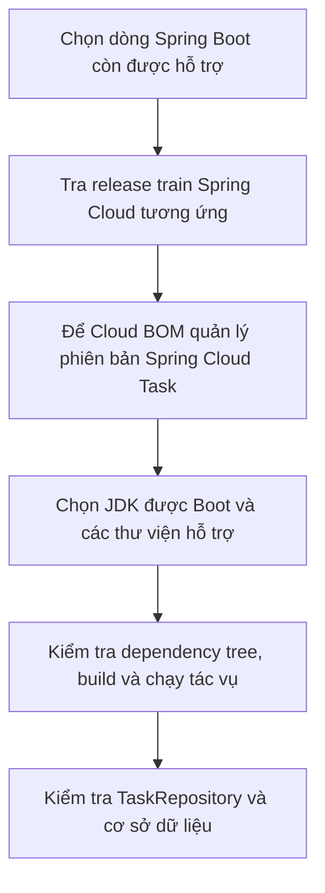

# Chọn phiên bản Java, Spring Boot và Spring Cloud tương thích

## Mục tiêu của bài học

Một ứng dụng **Spring Cloud Task** thường chỉ chạy trong một khoảng thời gian hữu hạn: nhận yêu cầu, xử lý dữ liệu, ghi lại kết quả rồi kết thúc tiến trình. Chẳng hạn, hệ thống kế toán có thể khởi chạy một tác vụ đối soát hóa đơn mỗi đêm. Spring Cloud Task quản lý vòng đời và lưu thông tin thực thi qua `TaskRepository`, giúp biết tác vụ nào đã chạy, bắt đầu và kết thúc lúc nào, cũng như thành công hay thất bại.

Để có hành vi đó ổn định, không thể chọn riêng lẻ phiên bản Java, Spring Boot và Spring Cloud. Sau bài này, bạn có thể:

- Phân biệt phiên bản **JDK**, **Spring Boot**, **Spring Cloud release train** và **Spring Cloud Task**.
- Chọn một tổ hợp tương thích từ tài liệu phát hành chính thức, đồng thời cân nhắc trạng thái hỗ trợ.
- Cấu hình Maven bằng Spring Boot parent và Spring Cloud BOM để tránh lệch phiên bản thư viện.
- Kiểm tra cấu hình thực tế, nhận biết lỗi tương thích và chuẩn bị nâng cấp an toàn.

## 1. Bốn lớp phiên bản cần kiểm tra

| Thành phần | Vai trò trong ứng dụng Task | Cách xác định phiên bản |
| --- | --- | --- |
| **Java/JDK** | Biên dịch và chạy tiến trình JVM ngắn hạn | `java -version`, `mvn -version`, `java.version` hoặc Java toolchain |
| **Spring Boot** | Khởi tạo ứng dụng, cấu hình `DataSource`, vòng đời `ApplicationRunner`/`CommandLineRunner`, đóng gói JAR | Spring Boot parent/BOM hoặc plugin build |
| **Spring Cloud release train** | Bộ phiên bản đã được phối hợp cho các dự án Spring Cloud | BOM `org.springframework.cloud:spring-cloud-dependencies` |
| **Spring Cloud Task** | Cung cấp `TaskRepository`, theo dõi `TaskExecution` và tích hợp với vòng đời tiến trình | Thư viện do Spring Cloud BOM quản lý, thường thêm qua `spring-cloud-starter-task` |

**Spring Cloud release train** là một bộ phát hành, ví dụ `2026.0.0`. Nó **không** có nghĩa phiên bản thư viện Spring Cloud Task cũng là `2026.0.0`: trong release train này, Task có phiên bản `5.1.0`. Tương tự, Spring Boot `4.2.0` là phiên bản riêng của Boot, còn Java `21` là phiên bản ngôn ngữ/runtime. Không dùng các con số này thay thế cho nhau.

Có thể hình dung thứ tự lựa chọn:



Mối quan hệ này quan trọng với Task vì ứng dụng có thể **biên dịch được** nhưng khi chạy mới gặp `NoSuchMethodError`, thiếu class hoặc lỗi tự động cấu hình. Trong môi trường chạy theo lịch, lỗi xuất hiện lúc nửa đêm có thể làm bỏ lỡ kỳ xử lý dữ liệu.

## 2. Bảng tương thích tham chiếu

**Mốc tham chiếu: ngày 24/11/2026.** Các bản vá và trạng thái hỗ trợ thay đổi theo thời gian; khi tạo dự án hoặc nâng cấp, kiểm tra lại [bảng Spring Cloud chính thức](https://spring.io/projects/spring-cloud), [thông báo phát hành](https://spring.io/blog) và [yêu cầu hệ thống Spring Boot](https://docs.spring.io/spring-boot/system-requirements.html).

| Spring Boot | Spring Cloud release train | Spring Cloud Task do train quản lý | Đánh giá sử dụng |
| --- | --- | --- | --- |
| **4.2.0** | **2026.0.0** (Paddington) | **5.1.0** | Tổ hợp GA mới, phù hợp để bắt đầu dự án và kiểm thử tích hợp |
| **4.1.x** | **2025.1.x** (Oakwood), từ `2025.1.2` trở lên | Dòng **5.0.x** | Lựa chọn cho dự án đang dùng Boot 4.1; chọn bản service release phù hợp, tại mốc này có `2025.1.5` |
| **4.0.x** | **2025.1.x** (Oakwood) | Dòng **5.0.x** | Tương thích; nên dùng bản service release mới trong train, ví dụ `2025.1.5` |
| **3.5.x** | **2025.0.x** (Northfields) | Dòng **3.3.x** | Hệ thống cũ; train này đã hết hỗ trợ OSS theo trang Spring Cloud |
| **3.4.x** | **2024.0.x** (Moorgate) | Dòng **3.2.x** | Tham khảo khi bảo trì/nâng cấp hệ thống cũ; đã hết hỗ trợ OSS |

Những điều cần đọc đúng từ bảng:

1. **Boot 4.2.0 đi cùng Cloud 2026.0.0** theo thông báo GA ngày 20/11/2026. Không suy luận rằng Cloud `2025.1.x` cũng hỗ trợ Boot 4.2 chỉ vì cùng major version `4`.
2. **Boot 4.1.x đi cùng Cloud 2025.1.2 trở lên**, vì hỗ trợ Boot 4.1 được bổ sung trong bản `2025.1.2`; bản `2025.1.5` được công bố ngày 20/11/2026 hỗ trợ cả Boot 4.0.x và 4.1.x.
3. **Boot 3.5.x không tự động tương thích với Cloud 2025.1.x**. Việc Cloud 2025.1 hỗ trợ Boot 4 không có nghĩa nó cũng hỗ trợ Boot 3.
4. Phiên bản Task trong bảng mô tả **dòng thư viện** do BOM lựa chọn. Đừng tự gắn `5.0.0`, `5.1.0` hoặc một bản vá bất kỳ nếu BOM của dự án đã quyết định phiên bản khác.

### Chọn Java bao nhiêu?

Tài liệu Spring Boot **4.2.0** yêu cầu **Java 17 trở lên**, đồng thời công bố tương thích đến **Java 27**. Tài liệu Spring Cloud Task cũng nêu ngưỡng tối thiểu Java 17. Đây là **điều kiện tối thiểu của framework**, không phải cam kết rằng mọi JDBC driver, thư viện, plugin build và image container của ứng dụng đều hỗ trợ toàn bộ dải Java đó.

Với bài thực hành, **Java 21 (LTS)** là lựa chọn dễ thống nhất giữa máy phát triển, CI và môi trường chạy. **Java 25 (LTS)** cũng là lựa chọn có thể xem xét nếu toàn bộ công cụ và phụ thuộc đã được kiểm chứng. Chọn Java 17 khi có ràng buộc môi trường hoặc thư viện cụ thể; đừng nâng JDK chỉ vì thấy số phiên bản mới hơn mà bỏ qua kiểm thử.

Kiểm tra hai thông tin thường bị nhầm:

```bash
java -version      # Java mà lệnh java hiện tại sử dụng
mvn -version       # Java mà Maven thực sự đang sử dụng
```

Ví dụ, máy cài JDK 21 nhưng Maven vẫn chạy bằng JDK 17 do `JAVA_HOME` trỏ sai; biên dịch bằng một JDK rồi triển khai trên runtime cũ hơn có thể gây `UnsupportedClassVersionError`. Nếu dùng Maven Toolchains, cấu hình thêm JDK phù hợp cho bước biên dịch; phải kiểm tra cả JDK trong image container và môi trường tác vụ chạy theo lịch.

## 3. Quy trình chọn phiên bản cho một dự án

**Tình huống:** nhóm cần xây tác vụ tổng hợp giao dịch theo yêu cầu và chạy mỗi đêm, lưu lịch sử vào PostgreSQL để vận hành có thể điều tra các lần thất bại.

1. **Xác định dòng Boot:** với dự án mới tại mốc tài liệu, có thể bắt đầu từ Boot `4.2.0`; nếu sản phẩm đã dùng Boot `4.1.x`, giữ dòng này trong lần bổ sung Task để thu hẹp phạm vi thay đổi.
2. **Tra Spring Cloud đi cùng:** Boot `4.2.0` → Cloud `2026.0.0`; Boot `4.1.x` → Cloud `2025.1.x` từ `2025.1.2` (ví dụ `2025.1.5`). Đọc tài liệu chính thức trước khi cố định số phiên bản.
3. **Chọn JDK:** dùng Java 21 cho ví dụ; đối chiếu yêu cầu của Boot, driver PostgreSQL, plugin build và image triển khai.
4. **Để BOM quản lý Task:** khai báo `spring-cloud-starter-task` mà **không đặt trực tiếp `<version>`**. Boot parent quản lý thư viện nền tảng, Cloud BOM quản lý các thư viện Cloud.
5. **Xác minh bằng ứng dụng thật:** đóng gói JAR, thực thi thành công và cố tình gây lỗi; kiểm tra tiến trình thoát đúng cách và metadata `TaskExecution` được lưu bền vững.

Khi yêu cầu vận hành ưu tiên tính ổn định, nhóm có thể chọn Boot `4.1.x` với Cloud `2025.1.5` để giữ hệ sinh thái hiện hữu, sau đó lên kế hoạch chuyển sang Boot `4.2.x`/Cloud `2026.0.x`. Đó là quyết định dựa trên khả năng tương thích của dự án, không có quy tắc mọi hệ thống phải dùng bản GA mới nhất ngay ngày phát hành.

## 4. Cấu hình Maven đúng bộ phiên bản

Ví dụ sau dùng **Java 21 + Spring Boot 4.2.0 + Spring Cloud 2026.0.0**. H2 chỉ nhằm chạy thử vòng đời Task trên máy cá nhân.

```xml
<?xml version="1.0" encoding="UTF-8"?>
<project xmlns="http://maven.apache.org/POM/4.0.0"
         xmlns:xsi="http://www.w3.org/2001/XMLSchema-instance"
         xsi:schemaLocation="http://maven.apache.org/POM/4.0.0
                             https://maven.apache.org/xsd/maven-4.0.0.xsd">
    <modelVersion>4.0.0</modelVersion>

    <parent>
        <groupId>org.springframework.boot</groupId>
        <artifactId>spring-boot-starter-parent</artifactId>
        <version>4.2.0</version>
        <relativePath/>
    </parent>

    <groupId>com.example</groupId>
    <artifactId>reconciliation-task</artifactId>
    <version>0.0.1-SNAPSHOT</version>

    <properties>
        <java.version>21</java.version>
        <spring-cloud.version>2026.0.0</spring-cloud.version>
    </properties>

    <dependencyManagement>
        <dependencies>
            <dependency>
                <groupId>org.springframework.cloud</groupId>
                <artifactId>spring-cloud-dependencies</artifactId>
                <version>${spring-cloud.version}</version>
                <type>pom</type>
                <scope>import</scope>
            </dependency>
        </dependencies>
    </dependencyManagement>

    <dependencies>
        <dependency>
            <groupId>org.springframework.cloud</groupId>
            <artifactId>spring-cloud-starter-task</artifactId>
        </dependency>
        <dependency>
            <groupId>com.h2database</groupId>
            <artifactId>h2</artifactId>
            <scope>runtime</scope>
        </dependency>
    </dependencies>

    <build>
        <plugins>
            <plugin>
                <groupId>org.springframework.boot</groupId>
                <artifactId>spring-boot-maven-plugin</artifactId>
            </plugin>
        </plugins>
    </build>
</project>
```

Vai trò của ba dòng phiên bản:

- `<version>4.2.0</version>` ở **Boot parent** chọn nền tảng Spring Boot, quản lý plugin và các phiên bản dependency thuộc Boot.
- `<spring-cloud.version>2026.0.0</spring-cloud.version>` chọn **BOM release train**, không phải phiên bản của từng thư viện Cloud.
- `<java.version>21</java.version>` chọn mức bytecode/biên dịch được cấu hình bởi Boot parent; runtime thực tế cũng phải chạy được bytecode đó.

Nếu dùng **Gradle (Groovy DSL)**, nguyên tắc vẫn là một phiên bản Boot, một Cloud BOM tương ứng và không tự cố định phiên bản starter Task:

```groovy
plugins {
    id 'java'
    id 'org.springframework.boot' version '4.2.0'
    id 'io.spring.dependency-management' version '1.1.7'
}

repositories { mavenCentral() }

java {
    toolchain { languageVersion = JavaLanguageVersion.of(21) }
}

dependencyManagement {
    imports {
        mavenBom 'org.springframework.cloud:spring-cloud-dependencies:2026.0.0'
    }
}

dependencies {
    implementation 'org.springframework.cloud:spring-cloud-starter-task'
    runtimeOnly 'com.h2database:h2'
}
```

Theo yêu cầu hệ thống của Boot 4.2.0, dùng Maven **từ 3.6.3** hoặc Gradle **8.14+ trong dòng 8.x / dòng 9.x**. Với dự án thực tế, dùng Maven Wrapper (`mvnw`) hoặc Gradle Wrapper (`gradlew`) để nhóm và CI dùng thống nhất phiên bản build tool đã được kiểm thử.

## 5. Chạy thử một Task ngắn hạn

Trong `src/main/java/com/example/ReconciliationTaskApplication.java`, tạo một ứng dụng tối giản:

```java
package com.example;

import java.time.LocalDate;
import org.springframework.boot.ApplicationRunner;
import org.springframework.boot.SpringApplication;
import org.springframework.boot.autoconfigure.SpringBootApplication;
import org.springframework.context.annotation.Bean;

@SpringBootApplication
public class ReconciliationTaskApplication {
    public static void main(String[] args) {
        SpringApplication.run(ReconciliationTaskApplication.class, args);
    }

    @Bean
    ApplicationRunner reconcile() {
        return args -> {
            var values = args.getOptionValues("date");
            if (values == null || values.size() != 1) {
                throw new IllegalArgumentException("Cần tham số --date=YYYY-MM-DD");
            }
            LocalDate date = LocalDate.parse(values.get(0));
            System.out.println("Đã đối soát dữ liệu ngày " + date);
        };
    }
}
```

Spring Cloud Task starter tự cấu hình hạ tầng theo dõi Task, trong đó có `TaskRepository` và lifecycle listener. `ApplicationRunner` chứa công việc có điểm bắt đầu và kết thúc rõ ràng. Việc thêm starter không biến ứng dụng thành một HTTP server; chủ động tắt chế độ web để tiến trình kết thúc sau khi runner chạy xong.

File `src/main/resources/application.yml` để thử nghiệm:

```yaml
spring:
  application:
    name: reconciliation-task
  main:
    web-application-type: none
  datasource:
    url: jdbc:h2:mem:taskdb;DB_CLOSE_DELAY=-1
    username: sa
    password: ""
logging:
  level:
    org.springframework.cloud.task: DEBUG
```

Chạy sau khi đã cài đúng JDK và Maven:

```bash
./mvnw -version
./mvnw clean package
java -jar target/reconciliation-task-0.0.1-SNAPSHOT.jar --date=2026-11-23
```

Trên Windows, dùng `mvnw.cmd` thay cho `./mvnw`. Khi thành công, runner in ngày đã xử lý; log ở mức `DEBUG` có thể cho thấy tác vụ được tạo và cập nhật `TaskExecution` với trạng thái hoàn tất. Thử truyền `--date=khong-hop-le` để quan sát đường lỗi và mã thoát khác 0, rồi kiểm tra cách hệ thống gọi tác vụ báo thất bại.

**Giới hạn của ví dụ H2:** cơ sở dữ liệu `jdbc:h2:mem:...` nằm trong bộ nhớ tiến trình. Khi JVM kết thúc, lịch sử tác vụ không còn để truy vấn ở lần chạy tiếp theo. Trong môi trường thật, dùng PostgreSQL/MySQL hoặc một cơ sở dữ liệu quan hệ được Spring Cloud Task hỗ trợ, cấu hình `DataSource` đến database tồn tại độc lập với tác vụ và quản lý schema bằng quy trình migration. Không ghi thông tin đăng nhập trực tiếp vào mã nguồn; dùng secret của môi trường triển khai. Ví dụ trên minh họa **tính tương thích và cơ chế ghi nhận Task**; bài cấu hình `TaskRepository` sẽ đào sâu cách lưu bền vững.

## 6. Kiểm tra và chẩn đoán khi nâng cấp

### Kiểm tra cấu hình đang dùng

Trước khi đưa task vào CI hoặc lịch chạy, đối chiếu **bốn nguồn**: phiên bản trong file build, cây dependency đã resolve, JDK thực chạy và phiên bản framework thể hiện ở log khởi động.

```bash
java -version
./mvnw -version
./mvnw dependency:tree -Dincludes=org.springframework.cloud
./mvnw help:effective-pom
```

Đầu ra cần cho thấy một dòng Boot đã chọn, Spring Cloud Task do **Cloud BOM tương ứng** quản lý và không có thư viện Cloud cũ bị phụ thuộc khác kéo vào ngoài ý muốn. Với `help:effective-pom`, kiểm tra `dependencyManagement` đã được nhập như mong đợi. Khi kiểm thử, kích hoạt cơ chế kiểm tra tương thích của Spring Cloud Commons nếu phiên bản đang dùng hỗ trợ:

```yaml
spring:
  cloud:
    compatibility-verifier:
      enabled: true
```

**Lưu ý:** thuộc tính này là một phép kiểm tra bổ sung cho cặp Boot/Cloud; **không** thay thế bảng hỗ trợ chính thức hoặc kiểm thử tích hợp. Không tắt verifier hay tự chỉnh `compatible-boot-versions` chỉ để vượt lỗi không tương thích.

### Bảng triệu chứng và cách xử lý

| Triệu chứng | Nguyên nhân thường gặp | Cách kiểm tra và xử lý |
| --- | --- | --- |
| `UnsupportedClassVersionError` khi chạy JAR | Java ở môi trường chạy cũ hơn mức bytecode ứng dụng đã biên dịch | So sánh `java -version` tại runtime với `java.version`/toolchain; đồng bộ JDK hoặc biên dịch về mức được hỗ trợ |
| `NoSuchMethodError`, `ClassNotFoundException`, lỗi khởi tạo bean sau khi nâng Boot | Thư viện Spring/Cloud/Task lệch dòng hoặc có dependency override | Xem `dependency:tree`, bỏ pin phiên bản Task/Cloud riêng lẻ, chọn BOM đúng với Boot |
| Ứng dụng báo Spring Boot không tương thích với release train | Cặp Boot/Cloud không thuộc ma trận hỗ trợ | Đổi sang cặp phát hành được hỗ trợ; không dùng tắt kiểm tra làm giải pháp |
| Lỗi kết nối database hoặc thiếu bảng `TASK_EXECUTION` | Sai `DataSource`, chưa khởi tạo schema, quyền DB không đủ | Kiểm tra JDBC URL, quyền, driver và migration schema Task đúng phiên bản |
| Chạy xong nhưng không có lịch sử cho lần sau | H2 in-memory hoặc DB tạm bị xóa theo container | Dùng DB bền vững độc lập với JVM; xác minh bằng truy vấn sau khi tiến trình thoát |
| Container tiếp tục chạy sau khi xử lý xong | Có web server, thread nền hoặc tài nguyên chưa giải phóng | Đặt `spring.main.web-application-type=none`, xem thread và lifecycle của ứng dụng |

### Checklist trước khi cập nhật production

- [ ] Tra đúng ma trận Boot ↔ Cloud của phiên bản muốn triển khai và kiểm tra vòng đời hỗ trợ.
- [ ] Xác minh phiên bản Java trên máy build, CI, image container và môi trường chạy tác vụ.
- [ ] Dùng Boot dependency management cùng Cloud BOM; rà soát các chỗ ghi đè version.
- [ ] Kiểm thử một lần chạy thành công, một lần thất bại và mã thoát của tiến trình.
- [ ] Xác minh bản ghi `TaskExecution` được lưu vào DB bền vững, đọc lại được sau khi task kết thúc.
- [ ] Khi kết hợp Spring Batch, kiểm tra cả phiên bản Batch do Boot quản lý và metadata schema của Job/Step; nâng cấp schema theo tài liệu của từng dự án.
- [ ] Thử lịch chạy hoặc cơ chế kích hoạt thực tế, quyền kết nối DB, xử lý timeout và retry trước khi chuyển production.

## 7. Bài tập tình huống

**Tình huống A.** Dự án mới dùng Java 21 và Spring Boot 4.2.0, nhóm định khai báo Cloud `2025.1.5` vì đó là bản service release có số bản vá lớn hơn `2026.0.0`. Có hợp lý không?

**Gợi ý trả lời:** Không. Số patch của các release train khác nhau không dùng để so độ tương thích. Cloud `2025.1.5` công bố hỗ trợ Boot 4.0.x/4.1.x, trong khi Boot 4.2.0 đi cùng Cloud `2026.0.0`. Hãy chọn theo ma trận phát hành thay vì số bản vá.

**Tình huống B.** Một tác vụ có Boot 4.1.x, Cloud 2025.1.5, JDK 21 và H2 in-memory; chạy thành công nhưng dashboard hôm sau không thấy lịch sử. Vấn đề thuộc lớp tương thích hay lưu trữ?

**Gợi ý trả lời:** Đầu tiên kiểm tra lưu trữ: H2 in-memory mất dữ liệu khi JVM thoát, nên không thể dùng làm kho lịch sử task lâu dài. Dùng một RDBMS bền vững và thiết lập schema Task đúng cách; không cần thay đổi cặp Boot/Cloud chỉ vì triệu chứng này.

**Tình huống C.** Khi nâng từ Boot 3.5/Cloud 2025.0 sang Boot 4.2/Cloud 2026.0, bạn cần kiểm tra điều gì ngoài việc sửa hai con số trong POM?

**Gợi ý trả lời:** Kiểm tra JDK/runtime, thay đổi API giữa các major version, thư viện tương thích với Boot 4, Spring Batch nếu có, JDBC driver, schema Task/Batch, dependency tree, mã thoát khi tác vụ lỗi và khả năng đọc lịch sử thực thi. Thực hiện nâng cấp theo từng bước có kiểm thử hồi quy.

## Tài liệu chính thức

Các nguồn dưới đây giúp kiểm tra lại số phiên bản khi hệ sinh thái phát hành bản mới:

1. [Spring Cloud – Release Train / Boot Compatibility](https://spring.io/projects/spring-cloud) — bảng tương thích và trạng thái hỗ trợ.
2. [Spring Cloud 2026.0.0 (Paddington), ngày 20/11/2026](https://spring.io/blog/2026/11/20/spring-cloud-2026-0-0-has-been-released/) — xác nhận Boot 4.2.0 và Spring Cloud Task 5.1.0 trong train.
3. [Spring Cloud 2025.1.5 (Oakwood), ngày 20/11/2026](https://spring.io/blog/2026/11/20/spring-cloud-2025-1-5-has-been-released/) — xác nhận hỗ trợ Boot 4.0.x/4.1.x.
4. [Spring Boot – System Requirements](https://docs.spring.io/spring-boot/system-requirements.html) — yêu cầu Java và build tool theo dòng Boot.
5. [Spring Cloud Task – Getting Started](https://docs.spring.io/spring-cloud-task/reference/getting-started.html) — `ApplicationRunner`, `TaskRepository` và cơ sở dữ liệu tác vụ.
6. [Spring Cloud Commons – Compatibility Verification](https://docs.spring.io/spring-cloud-commons/reference/spring-cloud-commons/common-abstractions.html) — cách bật cơ chế kiểm tra cặp Boot/Cloud.

**Nguyên tắc ghi nhớ:** chọn **Spring Boot trước**, tra **Spring Cloud release train tương thích**, để **BOM quản lý Spring Cloud Task**, rồi xác nhận **JDK và hệ sinh thái phụ thuộc** bằng một lần chạy thực tế có lưu kết quả.
