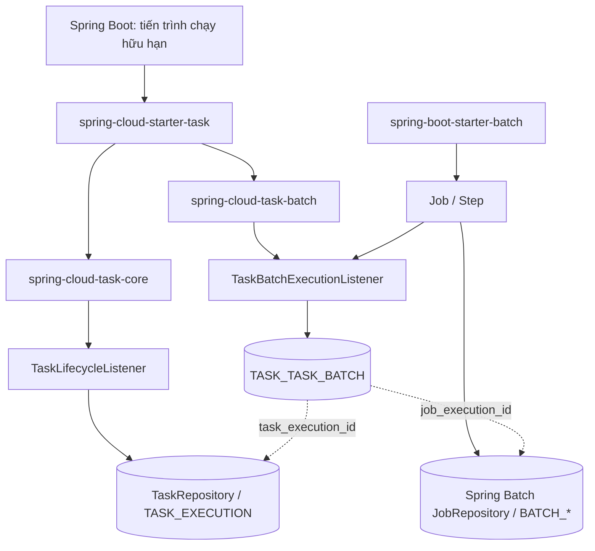

# Các thành phần `spring-cloud-starter-task` và `spring-cloud-task-batch`

## Mục tiêu học tập

Sau bài này, bạn có thể:

- Phân biệt **Spring Cloud Task** (theo dõi một lần chạy ứng dụng hữu hạn) với **Spring Batch** (tổ chức và vận hành một `Job` gồm nhiều `Step`).
- Giải thích `spring-cloud-starter-task` khởi tạo những hạ tầng nào và `spring-cloud-task-batch` bổ sung khả năng gì.
- Chọn dependency phù hợp cho tác vụ thông thường hoặc tác vụ chạy Spring Batch; tránh khai báo trùng không cần thiết.
- Cấu hình cơ sở dữ liệu để lưu lịch sử Task, Batch và mối liên hệ giữa hai loại lần chạy.
- Chẩn đoán trường hợp Batch Job thất bại nhưng tiến trình Task vẫn báo exit code bằng `0`.

> **Phạm vi:** Bài viết thuộc chương **Môi trường** của module **SPRING_CLOUD_TASK**. Spring Cloud Task hỗ trợ xây dựng ứng dụng Spring Boot chạy trong thời gian hữu hạn, lưu trạng thái thực thi và kết quả tác vụ vào cơ sở dữ liệu. Cần xem các thành phần dưới đây như hạ tầng để ứng dụng chạy theo yêu cầu hoặc do bộ lập lịch bên ngoài kích hoạt, đồng thời có thể phối hợp với Spring Batch.

## 1. Vì sao cần hai thành phần?

Hãy xét ứng dụng đối soát thanh toán mỗi đêm:

1. Kubernetes CronJob hoặc hệ thống điều phối khởi chạy một tiến trình Java.
2. Ứng dụng đọc dữ liệu, đối soát và kết thúc.
3. Nhóm vận hành cần biết **lần chạy nào**, **bắt đầu/kết thúc khi nào**, **exit code là gì** và **có lỗi gì**.
4. Nếu đối soát gồm nhiều bước hoặc xử lý hàng triệu bản ghi, nhóm vận hành còn cần biết **Job nào**, **Step nào** thất bại và trạng thái có thể chạy lại.

Spring Cloud Task giải quyết nhu cầu ở bước 3 bằng đối tượng `TaskExecution` và `TaskRepository`. Spring Batch giải quyết nhu cầu ở bước 4 bằng `Job`, `Step`, `JobExecution`, `StepExecution` và `JobRepository`. Thư viện `spring-cloud-task-batch` là cầu nối giúp truy vết `JobExecution` về đúng `TaskExecution` đã chạy nó.

**Một Task không nhất thiết có Spring Batch Job.** Chẳng hạn, một `ApplicationRunner` gọi API rồi thoát có thể được theo dõi chỉ bằng Spring Cloud Task. Ngược lại, một Spring Batch Job có thể chạy mà không cần Spring Cloud Task, nhưng khi đó không có liên kết metadata ở cấp vòng đời tiến trình Task do Spring Cloud Task cung cấp.

## 2. Bản đồ các thành phần

| Thành phần | Vai trò chính | Khi nào cần? |
| --- | --- | --- |
| `spring-cloud-starter-task` | Starter tập hợp các thư viện và cơ chế auto-configuration cần thiết cho một Spring Cloud Task trong ứng dụng Spring Boot. | Điểm bắt đầu thông thường của ứng dụng Task. |
| `spring-cloud-task-core` | Cung cấp `TaskExecution`, `TaskRepository`, `TaskExplorer`, listener vòng đời và cấu hình Task. | Thành phần nền tảng mà starter đưa vào. |
| `spring-cloud-task-batch` | Tích hợp metadata của Task với các Spring Batch Job, nổi bật là `TaskBatchExecutionListener`. | Khi ứng dụng Task chứa và chạy Spring Batch `Job`. |
| `spring-boot-starter-batch` | Đưa Spring Batch và tích hợp Spring Boot cho Batch vào ứng dụng, bao gồm cơ chế khởi chạy Job phù hợp. | Khi thực sự cần `Job`, `Step`, reader, processor, writer, retry/restart. |
| JDBC driver và `DataSource` | Kết nối nơi lưu lịch sử thực thi lâu dài. | Cần cho môi trường thực tế, đặc biệt để giữ lịch sử qua các lần tiến trình kết thúc. |
| `TaskRepository` / `TaskExplorer` | Ghi và tra cứu lịch sử chạy Task. | Do phần Task quản lý. |
| Spring Batch `JobRepository` | Ghi và tra cứu trạng thái Job/Step, tham số Job và metadata phục vụ restart. | Do Spring Batch quản lý; mục đích khác với `TaskRepository`. |

### Quan hệ giữa các thư viện

`spring-cloud-starter-task` thường đã khai báo dependency tới `spring-cloud-task-core` **và** `spring-cloud-task-batch` (chẳng hạn trong POM của dòng Spring Cloud Task 5.0.x). Vì vậy khi dùng starter, **không nhất thiết phải khai báo `spring-cloud-task-batch` lần thứ hai**. Hãy kiểm tra dependency tree thực tế của release đang dùng, vì tập phụ thuộc có thể thay đổi giữa các phiên bản.

Điều kiện có `spring-cloud-task-batch` trên classpath **không tự tạo một Batch Job**. Muốn chạy xử lý Batch, ứng dụng vẫn cần thư viện Spring Batch và một bean `Job` được cấu hình. Tương tự, sự hiện diện của các thư viện Stream trong cây phụ thuộc không đồng nghĩa ứng dụng tự động phát sự kiện ra broker; tính năng đó cần cấu hình và các thành phần tương ứng.



Sơ đồ thể hiện **mối quan hệ logic**: phần Task ghi một lần chạy ứng dụng, phần Batch ghi các lần chạy Job/Step, listener tích hợp ghi quan hệ giữa hai bên. Nó không có nghĩa `spring-cloud-task-batch` là bộ máy tự xử lý từng Step.

## 3. Chọn dependency phù hợp

| Nhu cầu | Dependency chính | Giải thích |
| --- | --- | --- |
| Xử lý một tác vụ bằng `ApplicationRunner` hoặc `CommandLineRunner` | `spring-cloud-starter-task` và driver cơ sở dữ liệu thích hợp | Không bắt buộc có `Job` Spring Batch. |
| Xử lý nhiều bước, cần restart/retry/checkpoint của Spring Batch | `spring-cloud-starter-task` + `spring-boot-starter-batch` + driver | Starter Task thường đã mang `spring-cloud-task-batch` vào classpath; cần `Job` thực tế để kích hoạt liên kết. |
| Không dùng starter, tự quản lý các module | `spring-cloud-task-core`, bổ sung `spring-cloud-task-batch` nếu có Batch | Cần tự kiểm soát toàn bộ dependency, auto-configuration và tương thích phiên bản. |
| Chỉ cần Spring Batch, không cần vòng đời Task | `spring-boot-starter-batch` | Không có metadata `TASK_EXECUTION` do Spring Cloud Task quản lý. |

### Ví dụ Maven cho ứng dụng Task chạy Batch

Thêm các dependency sau vào `pom.xml` của dự án Spring Boot:

```xml
<dependencies>
    <dependency>
        <groupId>org.springframework.cloud</groupId>
        <artifactId>spring-cloud-starter-task</artifactId>
    </dependency>

    <dependency>
        <groupId>org.springframework.boot</groupId>
        <artifactId>spring-boot-starter-batch</artifactId>
    </dependency>

    <dependency>
        <groupId>org.postgresql</groupId>
        <artifactId>postgresql</artifactId>
        <scope>runtime</scope>
    </dependency>
</dependencies>
```

Ví dụ giả định dự án đã có Spring Boot parent/BOM và **Spring Cloud release-train BOM tương thích**; các dependency được quản lý phiên bản nên không tự gắn số phiên bản riêng trong đoạn trên. Nếu dùng Maven mà chưa khai báo Spring Cloud BOM, phần `dependencyManagement` cần có dạng:

```xml
<dependencyManagement>
    <dependencies>
        <dependency>
            <groupId>org.springframework.cloud</groupId>
            <artifactId>spring-cloud-dependencies</artifactId>
            <version>${spring-cloud.version}</version>
            <type>pom</type>
            <scope>import</scope>
        </dependency>
    </dependencies>
</dependencyManagement>
```

Giá trị `spring-cloud.version` phải được khai báo theo release train **phù hợp** với Spring Boot mà dự án sử dụng (có thể chọn qua Spring Initializr hoặc bảng tương thích chính thức). Đừng chọn độc lập một bản `spring-cloud-task-batch` chỉ vì nó mới nhất.

Dùng một trong hai lệnh để xác minh `spring-cloud-task-batch` có thật trên classpath:

```bash
./mvnw dependency:tree -Dincludes=org.springframework.cloud
```

```bash
./gradlew dependencies --configuration runtimeClasspath
```

Nếu cây phụ thuộc đã chứa `spring-cloud-task-batch` qua `spring-cloud-starter-task`, thêm trực tiếp cùng artifact thường chỉ làm POM dư thừa; Maven sẽ hòa giải về một phiên bản theo dependency management.

## 4. Vòng đời Task và nơi lưu metadata

Với một ứng dụng Task khởi tạo Spring context thành công, trình tự điển hình là:

1. Spring Boot khởi tạo `ApplicationContext`, `DataSource` và các bean Task.
2. Hạ tầng Spring Cloud Task khởi tạo một `TaskExecution`, ghi thời điểm bắt đầu trong `TaskRepository`.
3. Spring Boot chạy các `ApplicationRunner`/`CommandLineRunner`, hoặc cơ chế khởi chạy Batch Job của ứng dụng.
4. Khi các runner kết thúc, Task cập nhật kết quả, thời điểm kết thúc và thông tin lỗi vào repository.
5. Tiến trình đóng context và thoát khi ứng dụng không còn thành phần giữ tiến trình hoạt động.

Lưu ý: **Nếu Spring context thất bại trước khi Task được khởi tạo**, có thể không tồn tại dòng `TASK_EXECUTION` nào. Vì thế, truy vấn repository không thay thế được log khởi động và giám sát trạng thái tiến trình.

Một số bảng quan trọng:

| Bảng | Nội dung |
| --- | --- |
| `TASK_EXECUTION` | Mỗi lần thực thi Task: mã lần chạy, tên Task, thời gian, exit code, thông tin lỗi. |
| `TASK_EXECUTION_PARAMS` | Các tham số gắn với lần thực thi Task. |
| `TASK_TASK_BATCH` | Khóa `TASK_EXECUTION_ID` và `JOB_EXECUTION_ID` để liên kết Task với Batch Job execution. |
| `BATCH_JOB_INSTANCE`, `BATCH_JOB_EXECUTION` | Danh tính logic của Job và từng lần chạy Job trong Spring Batch. |
| `BATCH_STEP_EXECUTION` và các bảng Batch khác | Thống kê Step, trạng thái/metadata phục vụ xử lý hoặc chạy lại. |

Mặc định các bảng Task thường mang tiền tố `TASK_`, các bảng Batch thường mang tiền tố `BATCH_`. Nếu tùy biến prefix, các truy vấn SQL minh họa bên dưới cần thay tương ứng.

**Hai repository có trách nhiệm khác nhau.** `TaskRepository` ghi lịch sử tiến trình Task; `JobRepository` quản lý metadata và semantics của Batch Job. `TASK_TASK_BATCH` chỉ liên kết hai lần chạy, **không gộp hai repository** và không tự bảo đảm giao dịch nghiệp vụ của Task hay Job là exactly-once.

## 5. Ví dụ A: Task đơn giản, chưa cần Spring Batch

Đây là ứng dụng một lần chạy: nhận tham số ngày và in thông tin tác vụ. Trong thực tế, thay phần in bằng xử lý có idempotency và logging phù hợp.

```java
import org.springframework.boot.ApplicationArguments;
import org.springframework.boot.ApplicationRunner;
import org.springframework.boot.SpringApplication;
import org.springframework.boot.autoconfigure.SpringBootApplication;
import org.springframework.cloud.task.configuration.EnableTask;
import org.springframework.context.annotation.Bean;

@SpringBootApplication
@EnableTask
public class DailyCleanupTaskApplication {

    public static void main(String[] args) {
        SpringApplication.run(DailyCleanupTaskApplication.class, args);
    }

    @Bean
    ApplicationRunner cleanupRunner() {
        return (ApplicationArguments args) -> {
            String day = args.containsOption("day")
                    ? args.getOptionValues("day").get(0)
                    : "today";
            System.out.println("Cleaning data for " + day);
            // Gọi service nghiệp vụ; ném exception khi xử lý thất bại.
        };
    }
}
```

Chạy:

```bash
java -jar daily-cleanup.jar --day=2026-11-24
```

Nếu Task có `DataSource` JDBC đã cấu hình, Spring Cloud Task ghi nhận lần chạy trong cơ sở dữ liệu. Nếu chỉ có kho lưu trong bộ nhớ của tiến trình phát triển, metadata không còn sau khi tiến trình dừng; do đó không dùng kho in-memory làm lịch sử vận hành.

Điểm mấu chốt: **`spring-cloud-task-batch` không làm ví dụ này trở thành Spring Batch Job**. Không có bean `Job`, không có `JobExecution` tương ứng để liên kết.

## 6. Ví dụ B: Task có Spring Batch Job

Từ ứng dụng Task ở trên, thêm `spring-boot-starter-batch` và định nghĩa một Job có Step dạng Tasklet. Có thể dùng một ứng dụng riêng để chạy ví dụ này; không đưa thêm `ApplicationRunner` xử lý cùng nghiệp vụ nếu không muốn chạy trùng.

```java
import org.springframework.boot.SpringApplication;
import org.springframework.boot.autoconfigure.SpringBootApplication;
import org.springframework.cloud.task.configuration.EnableTask;

@SpringBootApplication
@EnableTask
public class DailyBillingApplication {
    public static void main(String[] args) {
        SpringApplication.run(DailyBillingApplication.class, args);
    }
}
```

```java
import org.springframework.batch.core.Job;
import org.springframework.batch.core.Step;
import org.springframework.batch.core.job.builder.JobBuilder;
import org.springframework.batch.core.repository.JobRepository;
import org.springframework.batch.core.step.builder.StepBuilder;
import org.springframework.batch.repeat.RepeatStatus;
import org.springframework.context.annotation.Bean;
import org.springframework.context.annotation.Configuration;
import org.springframework.transaction.PlatformTransactionManager;

@Configuration
public class DailyBillingJobConfig {

    @Bean
    Step billingStep(JobRepository jobRepository,
                     PlatformTransactionManager transactionManager) {
        return new StepBuilder("billingStep", jobRepository)
                .tasklet((contribution, chunkContext) -> {
                    System.out.println("Closing daily billing...");
                    // Xử lý thực tế có thể gọi service, reader/writer, v.v.
                    return RepeatStatus.FINISHED;
                }, transactionManager)
                .build();
    }

    @Bean
    Job dailyBillingJob(JobRepository jobRepository, Step billingStep) {
        return new JobBuilder("dailyBillingJob", jobRepository)
                .start(billingStep)
                .build();
    }
}
```

API `JobBuilder`/`StepBuilder` như trên phù hợp với phong cách cấu hình Spring Batch 5/6; hãy kiểm tra tính tương thích của bản Spring Boot/Spring Batch đang dùng. Với Spring Boot auto-configuration, một bean `Job` thường được khởi chạy lúc ứng dụng bắt đầu; nếu ứng dụng có nhiều Job, chọn rõ bằng `spring.batch.job.name`. Trong ví dụ này **không thêm `@EnableBatchProcessing`** vì annotation đó có thể khiến Spring Boot ngừng một phần auto-configuration Batch mà ta đang dùng.

Khi chạy thành công:

1. `TaskLifecycleListener` ghi `TaskExecution` cho tiến trình `DailyBillingApplication`.
2. Spring Batch chạy `dailyBillingJob` và ghi `JobExecution`/`StepExecution`.
3. Nếu `spring-cloud-task-batch` có trên classpath và listener tích hợp được kích hoạt, `TaskBatchExecutionListener` liên kết `JobExecution` với `TaskExecution`.
4. Bảng `TASK_TASK_BATCH` chứa cặp khóa dẫn từ lần chạy Task đến lần chạy Job.

Với một Task chạy **nhiều Batch Job**, một `TaskExecution` có thể liên kết với nhiều `JobExecution`. Đây là quan hệ về lịch sử thực thi, không có nghĩa tất cả Job bắt buộc cùng trạng thái thành công/thất bại.

## 7. Cấu hình cơ sở dữ liệu và schema

Ví dụ `application.yml` dưới đây mô tả cấu hình triển khai trên PostgreSQL **sau khi đã tạo schema** bằng migration:

```yaml
spring:
  application:
    name: daily-billing-task
  main:
    web-application-type: none
  datasource:
    url: jdbc:postgresql://localhost:5432/taskdb
    username: ${DB_USER}
    password: ${DB_PASSWORD}
  cloud:
    task:
      initialize-enabled: false
      closecontext-enabled: true
      batch:
        fail-on-job-failure: true
  batch:
    job:
      name: dailyBillingJob
      enabled: true
    jdbc:
      initialize-schema: never
```

Các giá trị cần chú ý:

- `spring.application.name` đặt tên ứng dụng và thường được dùng làm tên Task trong metadata.
- `spring.datasource.*` xác định `DataSource` dùng lưu metadata. Ví dụ dùng **một** PostgreSQL DataSource cho Task và Batch; nếu ứng dụng có nhiều DataSource, cấu hình riêng cho repository bằng cơ chế hỗ trợ của từng thành phần (ví dụ `TaskConfigurer`).
- `spring.cloud.task.initialize-enabled=false` yêu cầu không tự khởi tạo bảng Task lúc start vì database schema đã do migration quản lý. Trong môi trường học tập có thể bật tự khởi tạo tùy khả năng và quyền database.
- `spring.batch.jdbc.initialize-schema=never` ngăn Spring Boot tự khởi tạo bảng metadata Batch; nếu đang thử nghiệm với database nhúng, chế độ khởi tạo có thể khác.
- `spring.cloud.task.closecontext-enabled=true` hữu ích để đóng context sau khi runners kết thúc, nhất là khi còn thành phần giữ ứng dụng chạy.
- `spring.cloud.task.batch.fail-on-job-failure=true` giúp phản ánh Batch Job failure vào kết quả Task/exit code để bên ngoài nhận biết thất bại.

Trong production, tạo và nâng cấp **cả schema Task lẫn schema Batch** bằng migration theo phiên bản thư viện, cấp quyền SQL tối thiểu và giữ bảng metadata trên database bền vững. Không dùng H2 in-memory nếu cần xem lịch sử của các tiến trình đã thoát.

### Truy vấn từ Task đến Batch Job

Với tiền tố bảng mặc định:

```sql
SELECT
    t.TASK_EXECUTION_ID,
    t.TASK_NAME,
    t.START_TIME,
    t.END_TIME,
    t.EXIT_CODE,
    x.JOB_EXECUTION_ID,
    j.STATUS AS JOB_STATUS,
    j.EXIT_CODE AS JOB_EXIT_CODE
FROM TASK_EXECUTION t
LEFT JOIN TASK_TASK_BATCH x
    ON x.TASK_EXECUTION_ID = t.TASK_EXECUTION_ID
LEFT JOIN BATCH_JOB_EXECUTION j
    ON j.JOB_EXECUTION_ID = x.JOB_EXECUTION_ID
ORDER BY t.TASK_EXECUTION_ID DESC;
```

Kết quả cho thấy một Task có thể không liên kết Job nào (`JOB_EXECUTION_ID` là `NULL`), hoặc có một hay nhiều lần chạy Job. Khi điều tra, tra thêm `BATCH_STEP_EXECUTION` theo `JOB_EXECUTION_ID` để tìm Step lỗi. Tránh kết luận một Job đã chạy chỉ vì có dòng `TASK_EXECUTION`: Task có thể chạy logic khác hoặc lỗi trước lúc Batch Job bắt đầu.

## 8. Tại sao Batch FAILED nhưng Task exit code lại bằng 0?

Trạng thái Batch và mã thoát tiến trình là **hai lớp tín hiệu**:

- `JobExecution.status=FAILED` diễn tả trạng thái Job do Spring Batch ghi.
- `TaskExecution.exitCode` diễn tả kết quả thực thi Task ở cấp ứng dụng Spring Boot.
- Exit code của **tiến trình hệ điều hành/container** là tín hiệu bộ điều phối thường dùng để quyết định thành công, retry hoặc cảnh báo.

Nếu Batch Job không thành công nhưng cơ chế khởi chạy Job hoàn tất mà không ném lỗi ra tầng ứng dụng, Task có thể vẫn ghi mã `0` theo hành vi mặc định. Khi ứng dụng cần bộ điều phối nhận diện thất bại, dùng:

```properties
spring.cloud.task.batch.fail-on-job-failure=true
```

Cấu hình này yêu cầu cơ chế tích hợp Batch kiểm tra thất bại của Job và tạo exit code không bằng `0` cho Task trong trường hợp được hỗ trợ. Đừng chỉ dựa vào dòng log "Job FAILED": hãy xác thực cả `BATCH_JOB_EXECUTION.STATUS`, `TASK_EXECUTION.EXIT_CODE` **và** exit code process thực tế theo phiên bản/framework đang triển khai.

Nếu tự điều khiển Job qua `JobLauncher`, tạo runner riêng, hoặc thiết kế luồng bất đồng bộ, cần tự kiểm tra `JobExecution`, lan truyền lỗi và đảm bảo runner không hoàn tất trước công việc thực tế. Thuộc tính trên không thay thế thiết kế luồng điều khiển và xử lý lỗi.

## 9. Tham số, chạy theo lịch và chạy lại

**Tham số Task** là các đối số tiến trình, ví dụ `--day=2026-11-24`, có thể đọc từ `ApplicationArguments`. **JobParameters** của Spring Batch dùng để xác định `JobInstance` và quyết định Job nào có thể chạy lại; chúng không hoàn toàn đồng nhất với tham số Task. Khi dùng bộ khởi chạy Job tự động, cách chuyển đối số dòng lệnh thành JobParameters phụ thuộc phiên bản Spring Boot/Spring Batch và cấu hình Job launcher; cần kiểm thử với dự án thật.

Với Job đã `COMPLETED`, việc chạy lại cùng tổ hợp *identifying JobParameters* có thể bị Spring Batch từ chối do `JobInstance` đó đã hoàn thành. Hãy xác định rõ business key (ngày đối soát, đợt dữ liệu), semantics retry và khi nào được tạo JobInstance mới. Không thêm tham số ngẫu nhiên chỉ để bỏ qua cơ chế chống chạy trùng của Batch.

Spring Cloud Task theo dõi một ứng dụng **hữu hạn**; nó không tự trở thành một cron scheduler. Các cách chạy phổ biến gồm gọi `java -jar` theo yêu cầu, Kubernetes `Job`/`CronJob`, hệ thống lập lịch doanh nghiệp hoặc platform orchestration. Mỗi lượt kích hoạt nên tạo một tiến trình Task mới, đảm bảo có giới hạn thời gian, mã thoát rõ ràng và chiến lược tránh chạy trùng khi yêu cầu nghiệp vụ đòi hỏi.

Nếu không được phép có hai lượt chạy cùng tên Task đồng thời, có thể nghiên cứu tính năng `spring.cloud.task.single-instance-enabled` cùng các dependency và bảng khóa cần thiết của Spring Cloud Task. Không mặc định cho rằng chỉ dùng `TaskRepository` đã tự chặn mọi lần chạy trùng.

## 10. Lỗi thường gặp và cách kiểm tra

| Triệu chứng | Nguyên nhân cần kiểm tra | Hướng xử lý |
| --- | --- | --- |
| Có `TASK_EXECUTION`, không có `TASK_TASK_BATCH` | Không có `Job` chạy thực sự; thiếu `spring-cloud-task-batch` trên runtime classpath; listener liên kết bị tắt hoặc chưa được cấu hình. | Kiểm tra dependency tree, bean `Job`, log và `spring.cloud.task.batch.listener.enabled`. |
| Có `BATCH_JOB_EXECUTION` nhưng không có `TASK_EXECUTION` | Job chạy ngoài ứng dụng Task hoặc Task chưa boot thành công. | Xác minh `spring-cloud-starter-task`, `@EnableTask`, log khởi động và kết nối TaskRepository. |
| Task khởi chạy lỗi vì thiếu bảng | Cấu hình schema không khớp; tắt auto-init nhưng chưa migration; sai DB/schema/table prefix. | Kiểm tra bảng `TASK_*` và `BATCH_*`, quyền truy cập và migration. |
| Job `FAILED` nhưng scheduler báo thành công | Exit code Task hoặc process vẫn là `0`. | Bật `spring.cloud.task.batch.fail-on-job-failure=true` và thử tình huống Job thất bại có chủ đích. |
| Job không chạy sau khi thêm dependency | Chưa có `Job` bean, `spring.batch.job.enabled=false`, chọn sai Job hoặc custom Batch config ghi đè auto-configuration. | Kiểm tra danh sách bean `Job`, `spring.batch.job.name` và log Batch. |
| Chạy lại Job bị từ chối | Cùng `JobInstance` đã hoàn thành hoặc tham số nhận dạng không đổi. | Thiết kế JobParameters rõ ràng, áp dụng restart/rerun theo nghiệp vụ. |
| Task không kết thúc | Ứng dụng có web server, thread nền, scheduler hoặc runner không trả về. | Dùng `spring.main.web-application-type=none` nếu thích hợp; quản lý thread và đóng context đúng lúc. |
| Metadata biến mất sau khi thoát | Dùng database/bộ lưu trong bộ nhớ hoặc thiếu persistence bền vững. | Cấu hình `DataSource` lâu dài, backup và retention. |

### Checklist trước khi vận hành

1. Tương thích phiên bản: Spring Boot, Spring Batch, Spring Cloud release train, JDBC driver và schema.
2. Đúng dependency: starter Task; Batch starter khi có Job; kiểm tra module tích hợp trên runtime classpath.
3. Đúng khởi tạo: `@EnableTask`, một `Job` được chọn rõ nếu có nhiều Job, không vô tình tắt Batch auto-configuration.
4. Đúng persistence: migration cho bảng `TASK_*`, `BATCH_*`; quyền DB, backup, monitoring và thời gian lưu metadata.
5. Đúng tín hiệu kết quả: test Job success/failure, kiểm tra exit code Task/process và log container.
6. Đúng an toàn vận hành: tham số đầu vào, dữ liệu nhạy cảm trong log/metadata, idempotency, timeout, retry và tránh chạy trùng.

## 11. Bài tập thực hành

**Bài tập 1 — Quan sát Task đơn lẻ:** Tạo `ApplicationRunner` nhận `--day`, chạy hai lần với hai giá trị khác nhau và dùng SQL xem số lượng bản ghi `TASK_EXECUTION`. Giải thích vì sao không xuất hiện liên kết `TASK_TASK_BATCH` khi chưa định nghĩa Job.

**Bài tập 2 — Thêm Batch:** Tạo `dailyBillingJob` với một Step in log; chạy thành công, sau đó xem `TASK_EXECUTION`, `BATCH_JOB_EXECUTION` và `TASK_TASK_BATCH`. Dùng truy vấn mục 7 để chứng minh chính xác Job nào thuộc Task nào.

**Bài tập 3 — Thử lỗi:** Cho Tasklet ném một ngoại lệ, so sánh `JobExecution.status`, `TaskExecution.exitCode` và exit code tiến trình trước/sau khi bật `spring.cloud.task.batch.fail-on-job-failure=true`. Giải thích tác động lên một Kubernetes Job/CronJob sử dụng exit code để xác định thành công.

**Bài tập 4 — Kiểm tra môi trường:** Dùng dependency tree chứng minh `spring-cloud-task-batch` đã có trong starter hay chưa; trình bày lý do nên quản lý phiên bản qua BOM và cách tránh khởi tạo schema tự động ở môi trường production.

## Ghi nhớ

- **`spring-cloud-starter-task`** cung cấp môi trường để một tiến trình Spring Boot chạy hữu hạn được quản lý như Task và ghi metadata về vòng đời.
- **`spring-cloud-task-batch`** cung cấp cầu nối theo dõi Job của Spring Batch chạy bên trong Task, chủ yếu qua `TaskBatchExecutionListener` và bảng liên kết `TASK_TASK_BATCH`.
- **`spring-boot-starter-batch`** mới là dependency thường dùng để đưa Spring Batch vào ứng dụng; thư viện tích hợp Task–Batch không thay thế các năng lực Job/Step/restart.
- Vận hành đúng cần kiểm tra **cả lịch sử Task, lịch sử Batch, database bền vững và exit code tiến trình**.

## Tài liệu tham khảo

- [Spring Cloud Task — Getting started](https://docs.spring.io/spring-cloud-task/reference/getting-started.html)
- [Spring Cloud Task — Features và TaskRepository](https://docs.spring.io/spring-cloud-task/reference/features.html)
- [Spring Cloud Task — Batch integration](https://docs.spring.io/spring-cloud-task/reference/batch.html)
- [Spring Cloud Task — Task repository schema](https://docs.spring.io/spring-cloud-task/docs/current/reference/html/appendix-task-repository-schema.html)
- [Spring Boot — Spring Batch](https://docs.spring.io/spring-boot/reference/io/spring-batch.html)
- [Spring Batch — TaskletStep](https://docs.spring.io/spring-batch/reference/step/tasklet.html)
