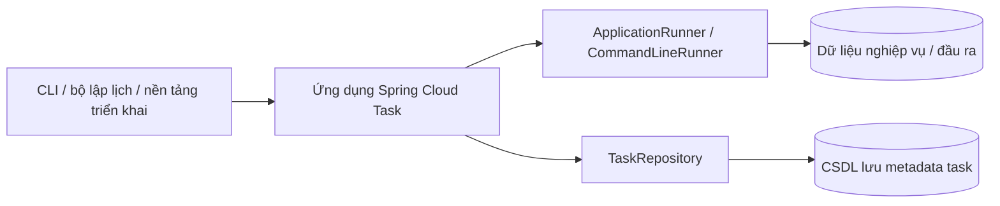

# Chuẩn bị H2 cho học tập và cơ sở dữ liệu bền vững

## 1. Vì sao Spring Cloud Task cần cơ sở dữ liệu?

**Spring Cloud Task** dành cho những ứng dụng Spring Boot có thời gian chạy hữu hạn: nhận yêu cầu hoặc tham số, thực hiện công việc và kết thúc. Ví dụ: nhập dữ liệu mỗi đêm, tạo báo cáo, đồng bộ tệp từ đối tác hoặc chạy một bước xử lý theo lịch. Khác với ứng dụng web chạy liên tục, mỗi lần khởi động một task thường tương ứng với **một lần thực thi** cần được theo dõi.

Spring Cloud Task dùng **`TaskRepository`** để lưu metadata về lần chạy, chẳng hạn tên task, thời điểm bắt đầu/kết thúc, mã thoát và thông báo lỗi. Dữ liệu nghiệp vụ (bản ghi đã nhập, báo cáo đã xuất...) do chính ứng dụng quản lý; `TaskRepository` không tự lưu kết quả nghiệp vụ hay tự bảo đảm một tác vụ chỉ chạy đúng một lần.



Mục tiêu của bài này là chuẩn bị môi trường để **chạy thử nhanh với H2**, kiểm tra được lịch sử thực thi, sau đó hiểu cách chuyển metadata sang **cơ sở dữ liệu bền vững** khi task chạy định kỳ, trên nhiều máy hoặc trong môi trường vận hành thực tế.

## 2. Chọn chế độ lưu trữ phù hợp

H2 là cơ sở dữ liệu quan hệ gọn nhẹ, có thể nhúng trực tiếp vào JVM. Hai chế độ thường dùng trong học tập là **in-memory** và **file-based**.

| Lựa chọn | Ví dụ JDBC URL | Sau khi tiến trình JVM kết thúc | Trường hợp phù hợp |
| --- | --- | --- | --- |
| H2 trong bộ nhớ | `jdbc:h2:mem:task_demo;DB_CLOSE_DELAY=-1` | Mất dữ liệu | Bài thực hành độc lập, kiểm thử nhanh |
| H2 lưu vào tệp | `jdbc:h2:file:./data/task_demo;DB_CLOSE_ON_EXIT=FALSE` | Giữ dữ liệu trong tệp trên ổ đĩa | Học cách xem lịch sử qua nhiều lần chạy trên cùng máy |
| PostgreSQL hoặc RDBMS máy chủ | `jdbc:postgresql://db-host:5432/taskdb` | Giữ dữ liệu trên dịch vụ CSDL | Task chạy định kỳ, nhiều tiến trình, triển khai thực tế |

**Phân biệt quan trọng:** `DB_CLOSE_DELAY=-1` chỉ giữ H2 in-memory tồn tại khi JVM vẫn hoạt động và kết nối cuối cùng đóng; nó **không** giúp dữ liệu tồn tại sau khi thoát JVM. Ngược lại, H2 file-based ghi xuống đĩa, nhưng vẫn phụ thuộc vào cùng đường dẫn, quyền ghi và tính sẵn có của tệp. H2 nhúng cũng không phải lựa chọn tốt để nhiều tiến trình ở nhiều máy cùng ghi metadata vào một kho chung.

## 3. Chuẩn bị dự án Spring Cloud Task

### 3.1. Điều kiện ban đầu

Bạn cần một dự án **Spring Boot** dùng JDK phù hợp với phiên bản Spring Boot đang chọn, Maven (hoặc Gradle), và bộ phiên bản **Spring Cloud tương thích với Spring Boot**. Quản lý phiên bản Spring Cloud qua BOM của dự án; không chọn ngẫu nhiên phiên bản từng thư viện, vì cách khởi tạo schema và thuộc tính có thể khác giữa các dòng phiên bản.

Với Maven, các dependency cốt lõi là:

```xml
<!-- Spring Cloud BOM tương thích với Spring Boot phải được cấu hình trong dự án. -->
<dependencies>
    <dependency>
        <groupId>org.springframework.cloud</groupId>
        <artifactId>spring-cloud-starter-task</artifactId>
    </dependency>
    <dependency>
        <groupId>com.h2database</groupId>
        <artifactId>h2</artifactId>
        <scope>runtime</scope>
    </dependency>
</dependencies>
```

Starter cung cấp tích hợp Spring Cloud Task và cơ chế theo dõi lần thực thi. Driver H2 cho phép `DataSource` kết nối tới H2. Ví dụ dưới đây giả định dự án đã được cấu hình để build thành Spring Boot executable JAR (chẳng hạn `target/demo-task.jar`).

### 3.2. Tạo một task có thời gian chạy hữu hạn

Tạo lớp ứng dụng, ví dụ `DemoTaskApplication.java`:

```java
import org.springframework.boot.ApplicationArguments;
import org.springframework.boot.ApplicationRunner;
import org.springframework.boot.SpringApplication;
import org.springframework.boot.autoconfigure.SpringBootApplication;
import org.springframework.context.annotation.Bean;

import java.util.List;

@SpringBootApplication
public class DemoTaskApplication {

    public static void main(String[] args) {
        SpringApplication.run(DemoTaskApplication.class, args);
    }

    @Bean
    ApplicationRunner processOnce() {
        return args -> {
            List<String> values = args.getOptionValues("source");
            String source = (values == null || values.isEmpty())
                    ? "demo" : values.get(0);

            System.out.println("Bắt đầu xử lý nguồn: " + source);
            // Thay bằng nghiệp vụ thực tế: đọc tệp, nhập dữ liệu, xuất báo cáo...

            if (args.containsOption("simulate-error")) {
                throw new IllegalStateException("Lỗi mô phỏng để kiểm tra TaskRepository");
            }

            System.out.println("Xử lý hoàn tất.");
        };
    }
}
```

`ApplicationRunner` nhận tham số dòng lệnh của ứng dụng. Mỗi lần gọi executable JAR là một lần chạy task độc lập; thêm `--simulate-error` để chủ động xem trường hợp lỗi. Ví dụ này không cần web server hay vòng lặp chạy mãi.

Trong `src/main/resources/application.yml`, khai báo cấu hình dùng chung:

```yaml
spring:
  application:
    name: demo-task
  main:
    web-application-type: none
  cloud:
    task:
      name: demo-task
      initialize-enabled: true
```

`spring.main.web-application-type: none` khiến ví dụ chạy như tiến trình xử lý hữu hạn. `spring.cloud.task.name` cho task một tên ổn định khi xem lịch sử; `initialize-enabled: true` phục vụ khởi tạo bảng metadata trong môi trường thực hành. Việc khởi tạo schema cần được kiểm tra theo phiên bản Spring Cloud Task cụ thể của dự án. Khi dùng CSDL thật, nên chuyển quyền tạo/cập nhật schema sang quy trình migration được kiểm soát.

> **Lưu ý:** Không tự tạo bảng `TASK_EXECUTION` bằng cấu trúc phỏng đoán. Cấu trúc metadata do **đúng phiên bản Spring Cloud Task** quy định; có thể bao gồm các bảng thông tin lần chạy, tham số và liên kết với Spring Batch.

## 4. Cấu hình H2 in-memory để học nhanh

Tạo `src/main/resources/application-h2-memory.yml`:

```yaml
spring:
  datasource:
    driver-class-name: org.h2.Driver
    url: jdbc:h2:mem:task_demo;DB_CLOSE_DELAY=-1
    username: sa
    password: ""
```

Chạy ứng dụng với profile này (đổi tên JAR theo kết quả build):

```bash
java -jar target/demo-task.jar --spring.profiles.active=h2-memory --source=sample.csv
```

Sau khi xử lý xong, Spring Cloud Task ghi metadata hoàn tất, ứng dụng đóng và tiến trình kết thúc. Lần chạy tiếp theo bằng lệnh tương tự khởi tạo **một cơ sở dữ liệu in-memory mới**. Do đó, không thể dùng profile này để kiểm tra lịch sử giữa hai lần gọi `java -jar` riêng biệt.

Chế độ in-memory hữu ích cho bài lab, thử mapping, thử `ApplicationRunner` và các kiểm thử tự động, bởi dữ liệu không kéo dài qua lần chạy khác. Nếu cần quan sát nhiều bản ghi task trong những lần khởi động khác nhau, hãy chuyển sang H2 file-based.

## 5. Cấu hình H2 file-based để giữ lịch sử giữa các lần chạy

Tạo `src/main/resources/application-h2-file.yml`:

```yaml
spring:
  datasource:
    driver-class-name: org.h2.Driver
    url: jdbc:h2:file:./data/task_demo;DB_CLOSE_ON_EXIT=FALSE
    username: sa
    password: ""
```

Tạo thư mục `data` tại **thư mục làm việc nơi chạy lệnh**, rồi chạy hai lần:

```bash
mkdir data
java -jar target/demo-task.jar --spring.profiles.active=h2-file --source=first.csv
java -jar target/demo-task.jar --spring.profiles.active=h2-file --source=second.csv
```

H2 thường tạo tệp dữ liệu dạng `data/task_demo.mv.db`. Hai lần chạy sẽ cùng sử dụng kho metadata nếu giữ nguyên URL, cùng thư mục làm việc và có quyền đọc/ghi. Tham số `DB_CLOSE_ON_EXIT=FALSE` điều chỉnh cơ chế H2 tự đóng database khi JVM thoát; **nó không thay thế việc kết thúc ứng dụng và đóng kết nối đúng cách**.

Một số lưu ý khi làm việc với đường dẫn tương đối:

- `./data/task_demo` được tính từ **working directory của tiến trình**, không phải mặc định từ thư mục chứa JAR. Chạy từ hai thư mục khác nhau có thể tạo hai kho riêng và gây hiểu nhầm rằng lịch sử bị mất.
- Không đổi tên hoặc xóa tệp H2 đang được sử dụng. H2 có cơ chế khóa tệp; mở cùng database từ nhiều tiến trình nhúng cùng lúc có thể phát sinh lỗi khóa.
- Tệp H2 lưu metadata qua lần chạy, nhưng nếu nằm trong container có filesystem tạm thời thì có thể mất sau khi container bị thay thế. Muốn giữ dữ liệu phải dùng vùng lưu trữ bền vững được gắn đúng cách.
- `sa` cùng mật khẩu rỗng chỉ dành cho bài thực hành cục bộ, không áp dụng nguyên trạng cho hệ thống thật.

## 6. Kiểm tra bảng metadata và trạng thái thực thi

Sau khi task dùng H2 file-based **đã kết thúc**, mở database bằng công cụ SQL hỗ trợ H2 (IDE database client hoặc H2 Shell), sử dụng đúng JDBC URL `jdbc:h2:file:./data/task_demo;IFEXISTS=TRUE` và user `sa` tại cùng working directory. `IFEXISTS=TRUE` giúp phát hiện sai đường dẫn thay vì vô tình tạo database rỗng mới. Đóng kết nối từ công cụ SQL trước khi chạy task tiếp nếu xảy ra tranh chấp khóa tệp.

### 6.1. Tìm các bảng do Spring Cloud Task quản lý

```sql
SELECT TABLE_NAME
FROM INFORMATION_SCHEMA.TABLES
WHERE TABLE_SCHEMA = 'PUBLIC'
  AND TABLE_NAME LIKE 'TASK%'
ORDER BY TABLE_NAME;
```

Trong cách cấu hình mặc định, bảng trọng tâm là `TASK_EXECUTION` để lưu từng lần thực thi; `TASK_EXECUTION_PARAMS` lưu thông tin tham số liên quan. Tên hoặc số lượng bảng có thể thay đổi nếu cấu hình prefix khác, dùng Spring Batch hoặc khác phiên bản thư viện.

### 6.2. Xem lịch sử chạy

```sql
SELECT TASK_EXECUTION_ID,
       TASK_NAME,
       START_TIME,
       END_TIME,
       EXIT_CODE,
       EXIT_MESSAGE
FROM TASK_EXECUTION
ORDER BY TASK_EXECUTION_ID DESC;
```

Với lệnh chạy thành công, thông thường `END_TIME` có giá trị và `EXIT_CODE = 0`. Hãy chạy thêm trường hợp lỗi:

```bash
java -jar target/demo-task.jar --spring.profiles.active=h2-file --source=broken.csv --simulate-error
```

Sau đó truy vấn lại `TASK_EXECUTION`; một lần thực thi lỗi được ghi nhận với mã thoát khác 0 và/hoặc thông điệp lỗi theo cơ chế xử lý ngoại lệ của phiên bản ứng dụng. Mã thoát thực tế còn phụ thuộc cách ứng dụng ánh xạ lỗi và cách tiến trình kết thúc, vì vậy cần **đọc giá trị thực tế** thay vì mặc định mọi lỗi đều có một mã cố định.

Có thể xem tham số bằng:

```sql
SELECT TASK_EXECUTION_ID, TASK_PARAM
FROM TASK_EXECUTION_PARAMS
ORDER BY TASK_EXECUTION_ID;
```

**Không đưa mật khẩu, token hay thông tin nhạy cảm vào tham số CLI** nếu chúng có thể được ghi vào metadata hoặc log. Dùng biến môi trường hay hệ thống quản lý bí mật phù hợp với nền tảng triển khai.

### 6.3. Hiểu đúng trạng thái khi tiến trình bị ngắt

`TaskRepository` cập nhật thông tin khi task bắt đầu và khi cơ chế kết thúc của Spring chạy bình thường. Nếu tiến trình bị tắt cưỡng bức (ví dụ `kill -9`, container bị hủy đột ngột, mất điện), việc ghi `END_TIME` hoặc mã thoát cuối cùng có thể **không thực hiện được**. Một bản ghi chưa có `END_TIME` cần được điều tra; nó không chứng minh task vẫn đang chạy, cũng không chứng minh task thành công.

## 7. Chuyển sang cơ sở dữ liệu bền vững cho vận hành

H2 file giúp giữ lịch sử trên một máy để học tập, nhưng môi trường chạy theo lịch hoặc chạy nhiều bản sao cần một **RDBMS đặt trên dịch vụ ổn định** như PostgreSQL. Khi đó, các lần chạy từ nhiều tiến trình có thể dùng chung metadata và quản trị quyền, sao lưu, khôi phục, giám sát một cách tập trung.

Nếu chọn PostgreSQL, thêm driver (vẫn sử dụng BOM/quản lý dependency của dự án):

```xml
<dependency>
    <groupId>org.postgresql</groupId>
    <artifactId>postgresql</artifactId>
    <scope>runtime</scope>
</dependency>
```

Ví dụ `src/main/resources/application-postgres.yml`:

```yaml
spring:
  datasource:
    driver-class-name: org.postgresql.Driver
    url: ${TASK_DB_URL}
    username: ${TASK_DB_USER}
    password: ${TASK_DB_PASSWORD}
  cloud:
    task:
      initialize-enabled: false
```

Ở đây, `TASK_DB_URL`, `TASK_DB_USER`, `TASK_DB_PASSWORD` được cấp từ môi trường chạy hoặc secret manager. `initialize-enabled: false` giả định **các bảng TaskRepository đã được tạo trước** bằng tập lệnh schema chính thức tương ứng với phiên bản Spring Cloud Task, thông qua migration hoặc bước triển khai có kiểm soát. Nếu chưa tạo schema mà tắt khởi tạo, task sẽ lỗi khi ghi metadata.

Một quy trình triển khai đáng tin cậy cần:

1. Tạo database và tài khoản kết nối; chỉ cấp quyền mà task thực sự cần.
2. Áp dụng và kiểm tra migration cho bảng metadata Spring Cloud Task trước khi chạy tiến trình; sử dụng script đúng phiên bản framework.
3. Cung cấp cấu hình kết nối qua biến môi trường/secret manager, đặt giới hạn pool và timeout phù hợp với tác vụ ngắn hạn.
4. Chạy thử thành công và thất bại, truy vấn lại `TASK_EXECUTION` từ một kết nối độc lập, kể cả sau khi tiến trình đã dừng.
5. Thiết lập sao lưu/khôi phục, theo dõi dung lượng, thời gian lưu metadata, cảnh báo task lỗi hoặc không kết thúc, và cơ chế xử lý lần chạy bị gián đoạn.

Nếu lịch chạy có thể kích hoạt lại cùng công việc, hãy thiết kế **nghiệp vụ có khả năng chạy lại an toàn** (ví dụ khóa idempotency hoặc upsert theo khóa nghiệp vụ). Một hàng metadata mới trong `TASK_EXECUTION` không ngăn dữ liệu nghiệp vụ bị ghi trùng khi chạy lại hoặc retry.

### Liên hệ với Spring Batch

Khi task kích hoạt một Spring Batch job, **metadata Spring Cloud Task** (mỗi lần tiến trình task chạy) và **metadata Spring Batch** (job instance, job execution, step execution...) là hai lớp theo dõi khác nhau. Tích hợp hai framework không tự khiến các bảng `BATCH_*` xuất hiện chỉ bằng việc tạo bảng `TASK_*`; cần chuẩn bị schema và cơ chế khởi tạo/migration riêng cho Spring Batch theo phiên bản sử dụng. Trong môi trường thực tế, đảm bảo cả hai bộ metadata dùng kho lưu trữ phù hợp với yêu cầu restart và truy vết.

## 8. Lỗi thường gặp khi thiết lập môi trường

| Triệu chứng | Khả năng thường gặp | Hướng kiểm tra |
| --- | --- | --- |
| `Table "TASK_EXECUTION" not found` hoặc lỗi truy vấn bảng task | Chưa khởi tạo schema, chọn sai database/schema hoặc đổi prefix | Kiểm tra JDBC URL, profile đang active, schema có sẵn và `spring.cloud.task.initialize-enabled`; dùng script đúng phiên bản |
| Chạy lại nhưng không thấy lịch sử cũ | Đang dùng H2 `mem`, đổi working directory hoặc đổi JDBC URL | Dùng H2 `file`, xác định tuyệt đối đường dẫn tệp và kiểm tra `*.mv.db` |
| H2 báo `Database may be already in use` / lỗi khóa tệp | Ứng dụng khác hoặc công cụ SQL đang mở cùng file H2 | Đóng các kết nối khác; nếu cần chạy đồng thời nhiều tiến trình thì chuyển sang RDBMS máy chủ |
| Tệp H2 không tạo được | Chưa có thư mục cha hoặc không có quyền ghi | Tạo `data`, kiểm tra quyền và đường dẫn thực tế |
| Task không thoát sau khi xử lý xong | Ứng dụng còn web server, scheduler, thread hoặc tác vụ chạy nền | Kiểm tra `web-application-type: none`, runner và vòng đời các thread |
| `END_TIME` rỗng hoặc chưa có mã thoát | Tiến trình đang chạy, bị dừng cưỡng bức, hoặc không cập nhật metadata khi kết thúc | Đối chiếu log, trạng thái tiến trình và sự kiện nền tảng chạy trước khi kết luận |
| Chạy ở PostgreSQL thì lỗi schema | Migration chưa chạy hoặc schema không tương thích với thư viện | Kiểm tra phiên bản Spring Cloud Task, quyền database và script schema đã áp dụng |

## 9. Bài thực hành tự kiểm tra

Thực hiện tuần tự để phân biệt các chế độ lưu trữ:

1. Chạy task hai lần với profile `h2-memory`. Giải thích vì sao mỗi lần là một database mới dù có `DB_CLOSE_DELAY=-1`.
2. Chuyển sang `h2-file`, chạy hai lần từ cùng working directory. Mở file database sau khi tiến trình đã kết thúc và xác nhận có lịch sử thực thi của cả hai lần.
3. Chạy thêm với `--simulate-error`, tra cứu mã thoát và thông báo lỗi trong `TASK_EXECUTION`. Kiểm tra tham số đã ghi tại `TASK_EXECUTION_PARAMS`.
4. Chạy thử từ một working directory khác để quan sát ảnh hưởng của đường dẫn tương đối; sau đó quay lại đúng thư mục cũ và xác nhận dữ liệu không thực sự biến mất.
5. Phác thảo quy trình chuyển sang PostgreSQL: kết nối từ biến môi trường, migration schema TaskRepository đúng phiên bản, quyền truy cập, theo dõi lỗi và sao lưu.

Khi hoàn thành, bạn cần giải thích được sự khác nhau giữa **dữ liệu metadata của task** và **kết quả nghiệp vụ**, lý do H2 in-memory không giữ lịch sử giữa các tiến trình, giới hạn của H2 file-based, và các điều kiện cần có để vận hành một Spring Cloud Task dựa trên cơ sở dữ liệu bền vững.
