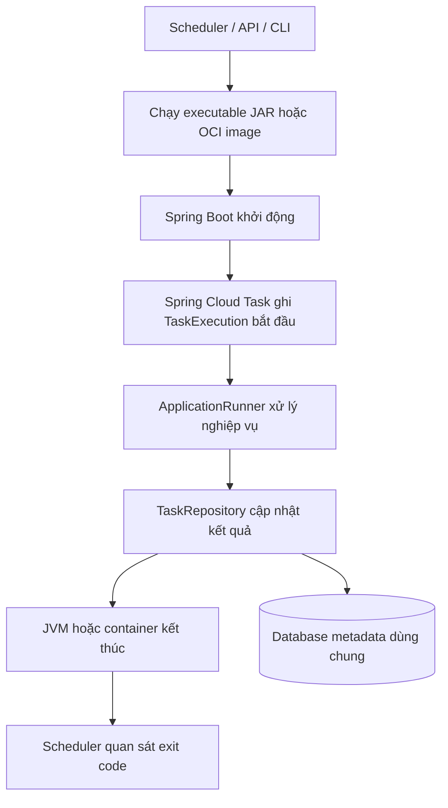
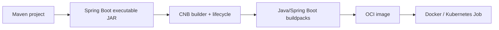

# Đóng gói JAR, Dockerfile và Cloud Native Buildpacks

## 1. Vì sao triển khai Spring Cloud Task khác một web service?

**Spring Cloud Task** phục vụ ứng dụng Spring Boot có thời gian chạy **hữu hạn**: bắt đầu, xử lý một công việc rồi kết thúc. Công việc có thể là tạo báo cáo, đồng bộ dữ liệu, nhận một yêu cầu chạy theo lịch hoặc thực thi Spring Batch Job. Thông tin mỗi lần chạy được ghi vào **`TaskRepository`** dưới dạng `TaskExecution`, gồm tên tác vụ, thời điểm bắt đầu/kết thúc, mã thoát và thông tin lỗi.

Khác web service thông thường, một task không nhất thiết lắng nghe HTTP hay giữ JVM hoạt động sau khi công việc kết thúc. Do vậy, khi đóng gói và triển khai cần quan tâm hai kết quả:

1. **Artifact có thể khởi chạy được:** JAR hoặc OCI image chứa đúng thư viện, entrypoint, Java runtime và cấu hình.
2. **Vòng đời kết thúc đúng:** sau khi xử lý, tiến trình trả mã thoát chính xác, TaskRepository lưu lịch sử, tài nguyên được dọn dẹp và hệ thống điều phối nhận ra thành công/thất bại.

Bài học thuộc chương **Triển khai**, giải thích ba lựa chọn:

- **Executable JAR:** dùng `mvn package` rồi chạy `java -jar`; phù hợp để kiểm thử cục bộ, chạy trên VM hoặc làm đầu vào cho container.
- **Dockerfile:** chủ động chọn base image, user, layer, entrypoint và tập tin được copy vào OCI image.
- **Cloud Native Buildpacks (CNB):** dùng Spring Boot Maven/Gradle plugin tự tạo image từ artifact mà không cần tự viết Dockerfile.

Sau bài học, bạn có thể tự đóng gói và chạy cả ba cách, hiểu trade-off, triển khai thành Kubernetes `Job`/`CronJob` và kiểm tra đúng **container exit code** cùng **`TaskExecution`**.

## 2. Kiến trúc triển khai một task hữu hạn



| Thành phần | Khi chạy JAR | Khi chạy container |
| --- | --- | --- |
| Artifact | `report-task-0.0.1-SNAPSHOT.jar` | OCI image chứa JAR và JRE |
| Java runtime | JRE/JDK cài trên máy | JRE được đóng gói trong image |
| Tham số nghiệp vụ | `java -jar ... --report-date=...` | `docker run image --report-date=...` hoặc Kubernetes `args` |
| Cấu hình datasource | Properties, env, secret manager | Env/Secret được inject vào container |
| `TaskRepository` | Database mà JAR kết nối | **Cùng database bền vững**, truy cập được từ container |
| Theo dõi thành công | Exit code của tiến trình Java | Exit code của container/pod + metadata Task |
| Công cụ lập lịch | cron, systemd timer, scheduler khác | Kubernetes Job/CronJob hoặc platform tương đương |

**Nguyên tắc:** Image chỉ là **cách phân phối ứng dụng**. Đóng gói JAR hay buildpack **không tự tạo một scheduler** và không tự quyết định lịch chạy. `TaskRepository` theo dõi lần thực thi; nó không phải công cụ triển khai container.

## 3. Dự án mẫu `report-task`

Ví dụ sử dụng **JDK 17**, **Spring Boot 3.4.5**, **Spring Cloud 2024.0.2** và Maven. Spring Cloud Task tương thích phải được quản lý bởi release train phù hợp với Spring Boot. H2 file được dùng cho thử nghiệm JAR cục bộ; ở môi trường container sử dụng **PostgreSQL bên ngoài**.

Cấu trúc đề xuất:

```text
report-task/
├── pom.xml
├── Dockerfile
├── Dockerfile.layers
├── .dockerignore
└── src/main/
    ├── java/com/example/report/
    │   ├── ReportTaskApplication.java
    │   └── ReportRunner.java
    └── resources/
        ├── application.yml
        └── application-init.yml
```

### 3.1. Tệp `pom.xml`

```xml
<?xml version="1.0" encoding="UTF-8"?>
<project xmlns="http://maven.apache.org/POM/4.0.0"
         xmlns:xsi="http://www.w3.org/2001/XMLSchema-instance"
         xsi:schemaLocation="http://maven.apache.org/POM/4.0.0 https://maven.apache.org/xsd/maven-4.0.0.xsd">
    <modelVersion>4.0.0</modelVersion>

    <parent>
        <groupId>org.springframework.boot</groupId>
        <artifactId>spring-boot-starter-parent</artifactId>
        <version>3.4.5</version>
        <relativePath/>
    </parent>

    <groupId>com.example</groupId>
    <artifactId>report-task</artifactId>
    <version>0.0.1-SNAPSHOT</version>

    <properties>
        <java.version>17</java.version>
    </properties>

    <dependencyManagement>
        <dependencies>
            <dependency>
                <groupId>org.springframework.cloud</groupId>
                <artifactId>spring-cloud-dependencies</artifactId>
                <version>2024.0.2</version>
                <type>pom</type>
                <scope>import</scope>
            </dependency>
        </dependencies>
    </dependencyManagement>

    <dependencies>
        <dependency>
            <groupId>org.springframework.cloud</groupId>
            <artifactId>spring-cloud-starter-task</artifactId>
        </dependency>
        <dependency>
            <groupId>org.springframework.boot</groupId>
            <artifactId>spring-boot-starter-jdbc</artifactId>
        </dependency>
        <dependency>
            <groupId>com.h2database</groupId>
            <artifactId>h2</artifactId>
            <scope>runtime</scope>
        </dependency>
        <dependency>
            <groupId>org.postgresql</groupId>
            <artifactId>postgresql</artifactId>
            <scope>runtime</scope>
        </dependency>
    </dependencies>

    <build>
        <plugins>
            <plugin>
                <groupId>org.springframework.boot</groupId>
                <artifactId>spring-boot-maven-plugin</artifactId>
            </plugin>
        </plugins>
    </build>
</project>
```

`spring-boot-maven-plugin` thực hiện bước **repackage**, tạo JAR chạy được bằng `java -jar`. `spring-cloud-starter-task` cung cấp hạ tầng TaskRepository/vòng đời, JDBC kết nối metadata với database. PostgreSQL driver được đóng gói trong JAR để image có thể kết nối database server; H2 dành riêng cho thực hành.

### 3.2. Ứng dụng Spring Boot

Tạo `src/main/java/com/example/report/ReportTaskApplication.java`:

```java
package com.example.report;

import org.springframework.boot.SpringApplication;
import org.springframework.boot.autoconfigure.SpringBootApplication;
import org.springframework.cloud.task.configuration.EnableTask;

@SpringBootApplication
@EnableTask
public class ReportTaskApplication {

    public static void main(String[] args) {
        SpringApplication.run(ReportTaskApplication.class, args);
    }
}
```

Tạo `src/main/java/com/example/report/ReportRunner.java`:

```java
package com.example.report;

import java.time.LocalDate;
import java.util.List;

import org.springframework.boot.ApplicationArguments;
import org.springframework.boot.ApplicationRunner;
import org.springframework.stereotype.Component;

@Component
public class ReportRunner implements ApplicationRunner {

    @Override
    public void run(ApplicationArguments args) throws Exception {
        List<String> values = args.getOptionValues("report-date");
        if (values == null || values.size() != 1) {
            throw new IllegalArgumentException(
                    "Cần đúng một tham số --report-date=yyyy-MM-dd");
        }

        LocalDate date = LocalDate.parse(values.get(0));
        System.out.println("[TASK] Bắt đầu báo cáo ngày " + date);

        if (args.containsOption("fail")) {
            throw new IllegalStateException("Giả lập lỗi tạo báo cáo");
        }

        // Thay bằng logic truy vấn, tổng hợp và lưu báo cáo thực tế.
        Thread.sleep(500);
        System.out.println("[TASK] Đã tạo báo cáo ngày " + date);
    }
}
```

Runner xử lý xong rồi trả về. Khi có lỗi, ví dụ dùng `--fail`, ngoại lệ được lan truyền để Spring Boot/Spring Cloud Task có thể ghi nhận thất bại. Với ứng dụng thật, không nên bắt rồi bỏ qua lỗi nghiệp vụ; phải xử lý mã thoát và các tác động dữ liệu theo hợp đồng vận hành.

**Nếu runner tạo công việc bất đồng bộ**, phải chờ các `Future`/`CompletableFuture` bắt buộc hoàn tất trước khi trả về; nếu không, task có thể được ghi là hoàn thành trong khi worker vẫn xử lý.

### 3.3. Cấu hình metadata và đóng context

Tạo `src/main/resources/application.yml`:

```yaml
spring:
  application:
    name: report-task
  main:
    web-application-type: none
  datasource:
    url: ${TASK_DB_URL:jdbc:h2:file:./data/report-db;DB_CLOSE_ON_EXIT=FALSE}
    username: ${TASK_DB_USER:sa}
    password: ${TASK_DB_PASSWORD:}
  cloud:
    task:
      name: report-task
      initialize-enabled: false
      closecontext-enabled: true
```

Giải thích:

- `web-application-type: none` tránh tạo web server giữ process sống.
- `closecontext-enabled: true` yêu cầu Spring Cloud Task đóng application context khi đã hoàn tất vòng đời. Điều này hữu ích nếu hạ tầng còn thread/bean chưa tự đóng, nhưng **không thay thế** việc dừng worker đúng cách.
- `initialize-enabled: false` mặc định yêu cầu **schema TaskRepository đã có sẵn**; phù hợp khi chạy lặp hoặc production.
- Ba biến `TASK_DB_URL`, `TASK_DB_USER` và `TASK_DB_PASSWORD` cho phép đổi datasource bằng cấu hình runtime, **không cần build lại JAR/image**.
- Nếu không truyền biến môi trường, ứng dụng dùng H2 file để thực hành; vì vậy phải tạo thư mục `data` trước khi chạy trên máy.

Tạo `src/main/resources/application-init.yml`:

```yaml
spring:
  cloud:
    task:
      initialize-enabled: true
```

Profile `init` chỉ dành cho database thực hành **mới**, khi muốn Spring Cloud Task chuẩn bị các bảng metadata. Đừng dùng profile này như cơ chế migration trong production: hãy triển khai DDL theo đúng phiên bản Spring Cloud Task bằng Flyway, Liquibase hoặc DBA, rồi để initializer tắt.

## 4. Đóng gói executable JAR

### 4.1. Build

Tại thư mục dự án:

```bash
mvn clean package
```

Sau khi build thành công, Maven tạo một artifact như:

```text
target/report-task-0.0.1-SNAPSHOT.jar
```

Đây là **Spring Boot executable JAR**, chứa các dependency cần thiết và Spring Boot loader. Nó khác một JAR thư viện Java thông thường vốn chỉ chứa class và đòi hỏi tự cấu hình classpath. JAR executable có thể chạy mà không cần cài Maven trên máy đích, nhưng **máy đích phải có Java 17 runtime phù hợp**.

Nếu có artifact phụ dạng `*.jar.original`, đó không phải tệp nên đưa vào Dockerfile để chạy như JAR Spring Boot. Hãy dùng đúng artifact đã được plugin repackage.

### 4.2. Chạy thử thành công và thất bại

```bash
mkdir -p data

# Lần đầu trên H2 file mới: cho phép khởi tạo schema
java -jar target/report-task-0.0.1-SNAPSHOT.jar \
  --spring.profiles.active=init --report-date=2026-11-24

# Những lần sau dùng schema đã có
java -jar target/report-task-0.0.1-SNAPSHOT.jar \
  --report-date=2026-11-25

# Kịch bản lỗi có chủ đích
java -jar target/report-task-0.0.1-SNAPSHOT.jar \
  --report-date=2026-11-26 --fail
```

Trên PowerShell, `mkdir -p` không phải cú pháp thống nhất với Bash; có thể dùng `New-Item -ItemType Directory -Force data`. Các lệnh Java một dòng không cần dấu tiếp nối `\`.

Lần chạy bình thường sẽ in:

```text
[TASK] Bắt đầu báo cáo ngày 2026-11-24
[TASK] Đã tạo báo cáo ngày 2026-11-24
```

Ở kịch bản `--fail`, ứng dụng ném ngoại lệ; kiểm tra **exit code của tiến trình** (Bash: `echo $?`; PowerShell: `$LASTEXITCODE`) và metadata trong `TASK_EXECUTION`. Cần kiểm tra hai nguồn vì mã thoát của hệ điều phối và dữ liệu trong repository phục vụ hai mục đích khác nhau.

### 4.3. Kiểm tra TaskRepository

Sau khi tiến trình đã kết thúc, kết nối H2 bằng JDBC URL `jdbc:h2:file:./data/report-db`, tài khoản `sa` và mật khẩu rỗng (dùng cùng working directory hoặc URL tuyệt đối). Truy vấn:

```sql
SELECT TASK_EXECUTION_ID,
       TASK_NAME,
       START_TIME,
       END_TIME,
       EXIT_CODE,
       ERROR_MESSAGE
FROM TASK_EXECUTION
ORDER BY TASK_EXECUTION_ID DESC;
```

Mỗi lần khởi chạy thành công tới bước ghi repository sẽ có một `TaskExecution` mới. Với một lỗi quá sớm khi khởi tạo `ApplicationContext`, có thể **không có bản ghi**, nên vẫn phải đọc log ứng dụng và log của scheduler.

## 5. Đóng gói bằng Dockerfile đơn giản

### 5.1. Dockerfile chạy JAR

Tạo `Dockerfile` ở thư mục gốc dự án:

```dockerfile
FROM eclipse-temurin:17-jre-jammy

WORKDIR /app

COPY target/report-task-0.0.1-SNAPSHOT.jar /app/app.jar

# UID không phải root; quyền đọc JAR giữ nguyên.
USER 10001

ENTRYPOINT ["java", "-jar", "/app/app.jar"]
```

Dockerfile này cố ý **không có `EXPOSE 8080`** vì task không cung cấp HTTP service. Nó cũng không chứa `RUN java -jar ...`: thực thi công việc khi **build image** sẽ sai thời điểm. `ENTRYPOINT` chạy JAR mỗi khi tạo một container từ image.

| Chỉ thị | Ý nghĩa |
| --- | --- |
| `FROM eclipse-temurin:17-jre-jammy` | Image chứa JRE 17. Chọn một tag/digest đã kiểm thử và cập nhật bảo mật theo quy trình. |
| `WORKDIR /app` | Thiết lập thư mục làm việc cho tiến trình container. |
| `COPY ... /app/app.jar` | Copy đúng executable JAR đã build. |
| `USER 10001` | Chạy bằng UID không phải root, giảm quyền trong container. |
| `ENTRYPOINT [...]` | Khởi động Java khi container bắt đầu; Docker/Kubernetes có thể truyền thêm tham số cho runner. |

Base image thường thay đổi nội dung theo tag. Khi triển khai production, nên **pin image digest**, kiểm tra CVE và rebuild theo bản vá JRE, thay vì mặc định tag 17 giữ nguyên byte mãi mãi.

### 5.2. Giảm build context

Tạo `.dockerignore` để không gửi dữ liệu cục bộ và secret vào Docker daemon:

```dockerignore
.git
.idea
.vscode
data/
input/
output/
*.env
.env
*.log
target/classes/
target/test-classes/
target/surefire-reports/
```

**Không loại bỏ** tệp JAR trong `target/` vì Dockerfile cần copy artifact đó. Với dự án thực tế, cấu hình .dockerignore tùy chiến lược Docker build (copy JAR đã build hay build Maven ngay trong container).

### 5.3. Build OCI image

```bash
mvn clean package
docker build -t report-task:0.0.1 .
docker image ls report-task
```

`docker build` yêu cầu Docker daemon/engine chạy và có quyền tải base image, trừ khi image đã nằm trong cache cục bộ. Nếu đang làm việc trên Windows, nên kiểm tra Docker Desktop hoặc Docker context đã trỏ đúng engine.

## 6. Chạy container với PostgreSQL bên ngoài

**Không nên mặc định H2 file nằm trong image là database production.** Mỗi lần tạo container mới có filesystem riêng; khi xóa container, dữ liệu H2 tạo trong filesystem container có thể mất. Nếu nhiều container cùng chạy, chúng cũng không chia sẻ TaskRepository đúng cách.

Sử dụng **PostgreSQL server bền vững** để các lần chạy nhìn thấy cùng lịch sử. Ví dụ giả định có database `task_metadata`, tài khoản `task_runtime` và schema `TASK_EXECUTION` đã được chuẩn bị trước.

Khi database nằm trong Docker network `task-net` dưới hostname `postgres`, kết nối:

```text
jdbc:postgresql://postgres:5432/task_metadata
```

Nếu PostgreSQL ở ngoài Docker hoặc trong Kubernetes, thay hostname bằng tên dịch vụ thực tế. `localhost` bên trong container là **chính container đó**, không phải localhost của máy chủ Docker.

### 6.1. Cấp cấu hình runtime

Ví dụ một file **cục bộ, không commit** có tên `task.env`:

```dotenv
TASK_DB_URL=jdbc:postgresql://postgres:5432/task_metadata
TASK_DB_USER=task_runtime
TASK_DB_PASSWORD=<replace-with-a-secret>
```

Trong môi trường thật, giá trị mật khẩu nên được cấp bằng secret manager/Kubernetes Secret hoặc secret file, không ghi vào image, Dockerfile, tài liệu được commit hay tham số dòng lệnh. **Env file cũng là dữ liệu nhạy cảm**: hạn chế quyền đọc và bảo đảm nó không bị đưa vào Git hay build context. Giá trị trên là placeholder, không phải credential dùng được.

Chạy container:

```bash
docker run --rm \
  --name report-task-run-001 \
  --network task-net \
  --env-file task.env \
  report-task:0.0.1 \
  --report-date=2026-11-24
```

Các đối số sau tên image được Docker truyền tiếp vào `ENTRYPOINT`. `--rm` xóa container khi kết thúc nhưng **không xóa lịch sử TaskExecution** đã được lưu trên PostgreSQL ngoài container.

Thực hành với PostgreSQL cần chuẩn bị **network và service database từ trước**. Không chạy lệnh này khi database chưa sẵn sàng hoặc `task-net` chưa tồn tại. Sau khi container thoát, kiểm tra mã trả về của Docker CLI và truy vấn `TASK_EXECUTION` để biết kết quả xử lý.

### 6.2. Tham số, thời gian và signal

- Mỗi `docker run` là **một lần chạy mới** và thường tạo `TaskExecution` mới.
- Khi runner kết thúc, Spring Cloud Task cập nhật metadata; Java thoát và container dừng.
- Nếu container bị `SIGKILL`/OOM kill, task có thể không kịp ghi `END_TIME`. `SIGTERM` cho ứng dụng cơ hội xử lý kết thúc nhưng **không bảo đảm** hoàn thành nếu hết thời gian grace period.
- Các tác vụ dài phải có timeout, checkpoint hoặc restart an toàn; không phụ thuộc vào việc Docker sẽ luôn cho đủ thời gian để dọn dẹp.
- Đừng dùng chính sách `restart: always` cho task hữu hạn: một lần chạy thành công có thể bị khởi động lại liên tục và xử lý dữ liệu nhiều lần.

## 7. Dockerfile tối ưu layer cho Spring Boot 3.4

Dockerfile một lớp JAR rất đơn giản, nhưng thay đổi một class trong JAR thường làm toàn bộ `app.jar` bị thay đổi. **Spring Boot 3.4** hỗ trợ **layered JAR** và `spring-boot-jarmode-tools` để tách dependency ổn định khỏi class/resource ứng dụng.

Theo hướng dẫn Dockerfile của Spring Boot 3.4, có thể dùng:

```bash
java -Djarmode=tools -jar \
  target/report-task-0.0.1-SNAPSHOT.jar list-layers
```

Các layer điển hình:

```text
dependencies
spring-boot-loader
snapshot-dependencies
application
```

### 7.1. Multi-stage `Dockerfile.layers`

```dockerfile
# Stage 1: tách JAR theo layer
FROM eclipse-temurin:17-jre-jammy AS extract
WORKDIR /workspace
COPY target/report-task-0.0.1-SNAPSHOT.jar app.jar
RUN java -Djarmode=tools -jar app.jar extract --layers --destination extracted

# Stage 2: image thực thi nhỏ, chỉ có runtime + nội dung đã tách
FROM eclipse-temurin:17-jre-jammy
WORKDIR /application

COPY --from=extract /workspace/extracted/dependencies/ ./
COPY --from=extract /workspace/extracted/spring-boot-loader/ ./
COPY --from=extract /workspace/extracted/snapshot-dependencies/ ./
COPY --from=extract /workspace/extracted/application/ ./

USER 10001
ENTRYPOINT ["java", "-jar", "application.jar"]
```

Lưu ý: trong layout được giải nén bằng `jarmode=tools`, file `application.jar` ở root của tập tin đã tách là **launcher JAR**, không phải bản sao nguyên vẹn của `app.jar` ban đầu. Bốn lệnh `COPY` đưa dependency và bytecode ứng dụng vào các layer riêng để Docker cache hiệu quả.

Build:

```bash
docker build -f Dockerfile.layers -t report-task:0.0.1-layered .
```

**Điều kiện:** JAR phải được đóng gói với layering và công cụ `spring-boot-jarmode-tools` (Spring Boot Maven plugin hỗ trợ cơ chế này). Nếu dự án tắt layers, dùng một archive khác hoặc cấu hình JAR **fully executable** có launch script, chế độ `extract --layers` có thể không hoạt động. Trong trường hợp đó, dùng Dockerfile đơn giản hoặc điều chỉnh cấu hình đóng gói.

Lợi ích của layered Dockerfile không đồng nghĩa image sẽ tự động nhỏ hơn đáng kể: nhiều dependency vẫn có tổng kích thước như cũ. Mục tiêu chính là **tái sử dụng layer** khi chỉ có code ứng dụng thay đổi và tăng tốc chuyển image giữa CI, registry và node.

## 8. Tạo image bằng Cloud Native Buildpacks (CNB)

**Cloud Native Buildpacks** là mô hình chuyển source/artifact thành OCI image qua **builder**, **buildpacks**, **lifecycle** và **run image**. Buildpack phát hiện ứng dụng Java, chọn runtime, đặt launch process, phân lớp thư viện và đóng image. Spring Boot Maven plugin tích hợp trực tiếp CNB để tạo image từ ứng dụng đã đóng gói, **không cần Dockerfile**.



### 8.1. Build image bằng Maven plugin

Khi Docker daemon đang chạy:

```bash
mvn spring-boot:build-image \
  -Dspring-boot.build-image.imageName=report-task:0.0.1-cnb
```

Maven goal `spring-boot:build-image` thực hiện các bước package cần thiết trước khi tạo image. Image được nạp vào Docker daemon hiện tại (trừ khi cấu hình publish ra registry). Xem kết quả:

```bash
docker image ls report-task
docker image inspect report-task:0.0.1-cnb
```

Với Spring Boot Maven plugin, tên image có thể cấu hình bằng `spring-boot.build-image.imageName`; nếu không chỉ định, plugin suy tên từ Maven project. `build-image` cần truy cập Docker daemon và tải **builder/run images** tương thích, nên lần đầu có thể dùng nhiều dữ liệu mạng và dung lượng đĩa.

**Không cần thêm `Dockerfile` cho CNB.** Nếu thư mục dự án có cả Dockerfile và plugin CNB, mỗi công cụ tạo image theo cơ chế riêng; đừng mặc định CNB sẽ đọc Dockerfile của bạn.

### 8.2. Tùy biến builder, Java runtime và image name

Với Paketo Java buildpacks được Spring Boot hỗ trợ, phiên bản Java có thể được suy từ cấu hình compiler của dự án; biến `BP_JVM_VERSION` cũng có thể dùng để điều khiển version Java mà buildpack chọn. Hãy bảo đảm JRE trong image phù hợp bytecode (`Java 17` trong ví dụ).

Nếu muốn cấu hình Maven plugin một cách tường minh:

```xml
<plugin>
    <groupId>org.springframework.boot</groupId>
    <artifactId>spring-boot-maven-plugin</artifactId>
    <configuration>
        <image>
            <name>example/report-task:0.0.1</name>
            <env>
                <BP_JVM_VERSION>17</BP_JVM_VERSION>
            </env>
        </image>
    </configuration>
</plugin>
```

Đây là **đoạn thay thế cấu hình plugin hiện có** trong `pom.xml`, không thêm plugin thứ hai cùng `groupId/artifactId`. Trong CI/CD nên cấp version/image tag từ pipeline và khóa digest của builder/run image theo chính sách thay đổi.

### 8.3. Chạy CNB image

```bash
docker run --rm \
  --network task-net \
  --env-file task.env \
  report-task:0.0.1-cnb \
  --report-date=2026-11-25
```

Container được tạo từ CNB image vẫn chạy **cùng ứng dụng Spring Cloud Task** và dùng **cùng TaskRepository** như image Dockerfile, miễn các biến datasource, artifact và tham số runtime tương đương. So sánh mã thoát và bản ghi `TASK_EXECUTION` giữa hai cách đóng gói.

CNB thường cung cấp một launch process và chạy bằng user không phải root theo thiết kế của Spring Boot integration. Không nên phụ thuộc vào một đường dẫn JAR/entrypoint cụ thể bên trong CNB image; đó là chi tiết do buildpack/lifecycle quyết định và có thể khác Dockerfile tự viết.

### 8.4. Khi nào dùng CNB thay vì Dockerfile?

| Yêu cầu | Dockerfile | CNB |
| --- | --- | --- |
| Muốn tự chọn base image, copy file bổ sung và lệnh hệ thống | Chủ động, trực quan | Phải xem khả năng tùy biến builder/buildpack |
| Chỉ đóng gói Spring Boot JAR thành image chuẩn | Tự duy trì công thức build | **`spring-boot:build-image`** đơn giản |
| Tối ưu cache dependency | Tự viết layered Dockerfile | Buildpacks có khả năng tạo layer dựa trên metadata |
| Quản lý runtime CVE | Tự cập nhật base image | Cập nhật builder/run image, rebase khi được hỗ trợ |
| Phụ thuộc thư viện hệ điều hành đặc biệt | Dockerfile có thể thuận tiện hơn | Cần builder/buildpack tương ứng |
| Cần tái lập build, SBOM và provenance | Tích hợp scanner/quy trình CI | Buildpacks hỗ trợ metadata, nhưng vẫn cần kiểm tra và quản trị |
| Chạy task hữu hạn | Được nếu ENTRYPOINT đúng | Được nếu launch process đúng |

**Không có lựa chọn “luôn tốt hơn”.** Nếu dự án chỉ có Spring Boot JAR và yêu cầu runtime chuẩn, CNB giảm lượng Dockerfile cần bảo trì. Nếu có binary hệ thống hoặc chính sách image rất cụ thể, Dockerfile có thể dễ kiểm soát hơn.

## 9. Đưa image lên Kubernetes Job/CronJob

Khi task cần chạy theo yêu cầu hoặc theo lịch, nên chọn **Kubernetes `Job` hoặc `CronJob`**, thay vì một Deployment được thiết kế để giữ replica luôn chạy. Deployment có thể liên tục khởi động lại container task sau khi process kết thúc, tạo các lần chạy không mong muốn.

Ví dụ manifest `Job` (image phải được push lên registry mà cluster có quyền đọc):

```yaml
apiVersion: batch/v1
kind: Job
metadata:
  name: report-task-20261124
spec:
  backoffLimit: 1
  ttlSecondsAfterFinished: 86400
  template:
    spec:
      restartPolicy: Never
      containers:
        - name: report
          image: registry.example.com/tasks/report-task:0.0.1
          imagePullPolicy: IfNotPresent
          args:
            - "--report-date=2026-11-24"
          env:
            - name: TASK_DB_URL
              valueFrom:
                secretKeyRef:
                  name: task-db
                  key: jdbc-url
            - name: TASK_DB_USER
              valueFrom:
                secretKeyRef:
                  name: task-db
                  key: username
            - name: TASK_DB_PASSWORD
              valueFrom:
                secretKeyRef:
                  name: task-db
                  key: password
          resources:
            requests:
              cpu: "100m"
              memory: "256Mi"
            limits:
              cpu: "1"
              memory: "512Mi"
```

Manifest giả định Kubernetes Secret `task-db` đã được tạo an toàn ở đúng namespace và có ba key nêu trên; **không** tạo secret mẫu chứa mật khẩu thật trong Git. Registry URL là placeholder. Database phải có **schema Spring Cloud Task** trước khi Job chạy, vì runtime dùng `initialize-enabled=false`.

Ý nghĩa cấu hình:

- `restartPolicy: Never`: Pod không tự khởi động lại container sau lỗi; controller Job có thể tạo Pod thử lại tùy `backoffLimit`.
- `backoffLimit: 1`: hạn chế số lần thử lại do controller quản lý; **phải tính đến idempotency** vì mỗi lần thử có thể đã ghi một phần dữ liệu.
- `ttlSecondsAfterFinished`: yêu cầu dọn **đối tượng Job đã hoàn tất** sau thời gian định sẵn; không có nghĩa xóa `TASK_EXECUTION` trong PostgreSQL.
- `args`: truyền tham số cho entrypoint trong OCI image.
- `resources`: tránh task dùng tài nguyên vô hạn. Giá trị là minh họa, cần đo theo workload thực.

Theo dõi:

```bash
kubectl apply -f report-task-job.yml
kubectl get jobs
kubectl get pods -l job-name=report-task-20261124
kubectl logs job/report-task-20261124
kubectl describe job report-task-20261124
```

Các lệnh chỉ mang tính hướng dẫn khi có kubeconfig/context được cấp quyền. Với `CronJob`, cấu hình `concurrencyPolicy: Forbid` có thể ngăn lịch mới tạo Job chồng với Job còn chạy; nhưng cơ chế này **không thay thế** khóa/idempotency nếu vẫn có trigger ngoài scheduler, retry hoặc nhiều CronJob cùng truy cập dữ liệu.

## 10. Trạng thái cuối: JAR, container và TaskRepository

**Đóng gói đúng chưa đủ; phải kiểm tra đúng kết quả.**

| Nguồn trạng thái | Cách quan sát | Chú ý |
| --- | --- | --- |
| `java -jar` | Exit code tiến trình (`echo $?` hoặc `$LASTEXITCODE`) | Scheduler thường dựa vào mã này. |
| Docker | Exit code của container / kết quả `docker run` | `--rm` xóa container ngay sau khi kết thúc; lưu log nếu cần hậu kiểm. |
| Kubernetes Job | `Complete` / `Failed`, trạng thái Pod và container exit code | Có thể có nhiều Pod khi retry; phải đối chiếu đúng lần chạy. |
| Spring Cloud Task | `TASK_EXECUTION.EXIT_CODE`, `START_TIME`, `END_TIME`, `ERROR_MESSAGE` | Repository chỉ có dữ liệu nếu ứng dụng chạy đủ xa để ghi metadata. |
| Spring Batch (nếu tích hợp) | `BATCH_JOB_EXECUTION.STATUS`/`EXIT_CODE` và Step counters | Batch Job thất bại không luôn tự được phản ánh thành mã thoát Task nếu ứng dụng không cấu hình lan truyền kết quả. |

Nếu kết hợp Spring Batch, cần theo dõi **hai cấp độ**. `TaskRepository` lưu vòng đời ứng dụng, còn `JobRepository` lưu Job/Step; với launch Batch bất đồng bộ, phải chờ job xong trước khi task kết thúc và xem cấu hình `spring.cloud.task.batch.fail-on-job-failure` nếu dùng cơ chế tích hợp hỗ trợ.

**Không dùng `END_TIME IS NULL` như kết luận chắc chắn task còn đang chạy.** Container bị OOM kill, node mất điện hay process bị dừng cưỡng bức có thể để lại metadata chưa cập nhật. Hãy đối chiếu database, log, bộ điều phối và trạng thái tiến trình.

## 11. Các sự cố đóng gói và triển khai thường gặp

| Triệu chứng | Nguyên nhân có thể | Cách xử lý |
| --- | --- | --- |
| `no main manifest attribute` khi chạy JAR | Artifact chưa được Spring Boot plugin repackage | Kiểm tra `spring-boot-maven-plugin`, dùng JAR chính từ `target` và build lại. |
| `UnsupportedClassVersionError` | JAR build cho Java mới hơn JRE chạy | Dùng JRE tương thích bytecode và cấu hình `java.version` nhất quán. |
| Docker `COPY failed: file not found` | Chưa `mvn package` hoặc sai tên JAR/`.dockerignore` | Kiểm tra artifact đúng version và build context. |
| `jarmode=tools` không nhận `extract` | Layers/tools không có hoặc JAR fully executable | Kiểm tra Spring Boot version, plugin/layers; dùng Dockerfile đơn giản nếu không cần layer. |
| `spring-boot:build-image` không kết nối được Docker | Docker daemon chưa chạy, sai context hoặc quyền không đủ | Kiểm tra Docker engine/context/permission. |
| CNB báo thiếu Java/builder tương thích | Builder không hỗ trợ Java 17 hoặc nền tảng image mục tiêu | Chọn builder/run image tương thích, cấu hình `BP_JVM_VERSION` và architecture. |
| Container thất bại khi kết nối PostgreSQL | Hostname `localhost` sai bên trong container, DB chưa sẵn sàng hoặc network khác | Dùng hostname service/network đúng, kiểm tra ACL và readiness database. |
| `TASK_EXECUTION` không tồn tại | Schema metadata chưa được khởi tạo | Áp dụng migration đúng version trước khi chạy container. |
| Lịch sử Task biến mất sau `docker run --rm` | Sử dụng H2 file bên trong filesystem tạm của container | Dùng database ngoài hoặc volume bền vững cho môi trường thử nghiệm. |
| Task xử lý xong nhưng container vẫn chạy | Có web server hoặc non-daemon thread giữ JVM | Đặt `web-application-type: none`, đóng context và giải phóng thread đúng cách. |
| Job bị chạy nhiều lần | `restart: always`, Kubernetes Job retries hoặc CronJob chồng lịch | Điều chỉnh policy; thiết kế idempotency/khóa và theo dõi lần chạy. |
| `EXIT_CODE=0` dù dữ liệu Batch lỗi | Trạng thái Job chưa lan truyền lên Task/OS process | Kiểm tra JobExecution và cấu hình kết quả/exception phù hợp. |
| Lỗi permission khi ghi file | Image chạy non-root, thư mục mount không cấp quyền | Mount volume có quyền phù hợp; tránh `chmod 777` tùy tiện. |
| Secret vô tình có trong image | `COPY . .` hoặc build context chứa .env/credential | Sử dụng `.dockerignore`, secret injection runtime và scan image. |

### 11.1. Quy trình chẩn đoán ngắn

1. **Artifact:** `mvn package` có tạo đúng JAR không? `java -jar` chạy được cục bộ không?
2. **Image:** Dockerfile hoặc CNB đã tạo image đúng tag/architecture chưa? Entrypoint có gọi đúng ứng dụng không?
3. **Runtime:** Container nhận đủ tham số, profile, secret và biến datasource chưa?
4. **Database:** Đã truy cập đúng PostgreSQL/schema, có quyền ghi TaskRepository chưa?
5. **Kết thúc:** Runner có thực sự hoàn tất, kết quả được ghi và process trả mã thoát đúng không?
6. **Orchestrator:** Job/CronJob có retry, timeout, kill signal hoặc chính sách đồng thời gây thay đổi kết quả không?

Chẩn đoán theo thứ tự này giúp phân biệt lỗi **build**, lỗi **môi trường container** và lỗi **nghiệp vụ**.

## 12. Checklist triển khai an toàn

- **Artifact và phiên bản:** Pin Spring Boot/Spring Cloud Task/JDK, kiểm thử dependency, tạo SBOM và quét lỗ hổng.
- **Image bất biến:** Dùng tag chứa version/commit và tốt nhất pin digest khi triển khai, không tự thay nội dung của tag đã phát hành.
- **Không root:** Dùng user không phải root, filesystem read-only khi có thể; tạo volume có quyền phù hợp nếu task cần ghi file.
- **Secret:** Không lưu credential trong JAR, Dockerfile, image layer, log hoặc command-line args.
- **Metadata:** `TaskRepository` dùng database bền vững, đã migration, có backup và phân quyền tối thiểu.
- **Tác vụ hữu hạn:** Không mở web server không cần thiết; xử lý timeout, cleanup và chờ các worker bắt buộc.
- **Mã thoát:** Kiểm thử thành công và lỗi ở cấp Java, Docker, Kubernetes **và** trong TaskRepository.
- **Retry:** Sử dụng idempotency key, unique constraint hoặc khóa theo nhu cầu; retry không đồng nghĩa an toàn.
- **Khả năng quan sát:** Log có định danh lần chạy, thời gian, kết quả; xuất metrics nếu có nền tảng giám sát.
- **Phương án rollback:** Phát hành image mới không tự sửa schema cũ; kiểm tra tương thích dữ liệu và migration trước khi rollback.

## 13. Thực hành và tự kiểm tra

### Bài tập 1: Executable JAR

1. Tạo dự án `report-task` và chạy `mvn clean package`.
2. Xác nhận JAR chạy bằng `java -jar` với `--report-date=2026-11-24`.
3. Chạy một lần có `--fail`; kiểm tra exit code và `TASK_EXECUTION`.
4. Giải thích vì sao không cần cấu hình HTTP port cho ứng dụng Task này.

### Bài tập 2: Hai Dockerfile

1. Build image từ Dockerfile đơn giản, chạy với PostgreSQL ngoài.
2. Build image từ `Dockerfile.layers`, quan sát các layer qua `docker image history`.
3. Đổi chỉ một dòng log trong runner, build lại, so sánh những layer Docker có thể sử dụng cache.
4. Kiểm tra UID tiến trình Java trong container và chứng minh task không cần quyền root để chạy.

### Bài tập 3: Cloud Native Buildpacks

1. Chạy `mvn spring-boot:build-image` để tạo OCI image.
2. Kiểm tra image và entrypoint bằng `docker image inspect`.
3. Chạy CNB image với cùng datasource, cùng tham số như Dockerfile image.
4. So sánh kết quả trong `TASK_EXECUTION`; giải thích tại sao packaging không thay đổi logic TaskRepository.

### Bài tập 4: Kubernetes Job

1. Đọc `Job` YAML ví dụ, xác định `args`, env từ Secret, `resources` và `backoffLimit`.
2. Giả lập task ném lỗi, giải thích vì sao Job controller có thể tạo một Pod mới.
3. Đề xuất cách khiến nghiệp vụ tạo báo cáo **không nhân đôi** khi controller thử lại.
4. Giải thích lý do không nên dùng Deployment với `restartPolicy: Always` để chạy một công việc hữu hạn theo lịch.

### Câu hỏi ôn tập

1. Spring Boot executable JAR khác JAR thư viện thông thường ở đâu?
2. Vì sao Dockerfile nên dùng `ENTRYPOINT` thay vì `RUN java -jar` để thực thi task?
3. Tại sao chạy H2 file trong container tạm có thể làm mất lịch sử `TaskExecution`?
4. Spring Boot 3.4 dùng `jarmode=tools` để tách JAR thành những layer nào?
5. `mvn spring-boot:build-image` khác `docker build` ở cách tạo OCI image ra sao?
6. Khi nào chọn Dockerfile, khi nào chọn Cloud Native Buildpacks?
7. Vì sao một Job Kubernetes có thể tạo nhiều Pod cho một yêu cầu chạy?
8. Kết quả `EXIT_CODE` trong `TASK_EXECUTION` và exit code của container có vai trò khác nhau thế nào?
9. `TaskRepository` có tự lập lịch chạy task không?
10. Khi ứng dụng chạy Spring Batch, cần kiểm tra thêm trạng thái nào ngoài `TaskExecution`?

**Ghi nhớ:** Spring Cloud Task có thể được đóng gói thành **executable JAR**, OCI image từ **Dockerfile** hoặc OCI image từ **Cloud Native Buildpacks**. Dù dùng cách nào, ứng dụng vẫn phải kết thúc hữu hạn, lưu metadata vào **TaskRepository bền vững**, báo mã thoát rõ ràng và được điều phối bằng công cụ thích hợp. Image chỉ giúp phân phối/runtime; tính đúng đắn khi retry, chạy song song và xử lý lỗi vẫn nằm ở thiết kế ứng dụng và hệ thống vận hành.

## Tài liệu tham khảo

- [Spring Boot 3.4 — Executable JAR](https://docs.spring.io/spring-boot/3.4/reference/packaging/executable-jar/index.html): cách đóng gói JAR thực thi.
- [Spring Boot 3.4 — Dockerfiles](https://docs.spring.io/spring-boot/3.4/reference/packaging/container-images/dockerfiles.html): layered JAR, `jarmode=tools` và Dockerfile multi-stage.
- [Spring Boot 3.4 — Cloud Native Buildpacks](https://docs.spring.io/spring-boot/3.4/reference/packaging/container-images/cloud-native-buildpacks.html): nguyên lý CNB và buildpack image.
- [Spring Boot 3.4 — Maven Packaging OCI Images](https://docs.spring.io/spring-boot/3.4/maven-plugin/build-image.html): lệnh `spring-boot:build-image` và cấu hình OCI image.
- [Spring Cloud Task 3.2 — Features](https://docs.spring.io/spring-cloud-task/reference/3.2/features.html): vòng đời TaskExecution, đóng application context và database metadata.
- [Kubernetes — Jobs](https://kubernetes.io/docs/concepts/workloads/controllers/job/): chạy tác vụ hữu hạn, retry/backoff và trạng thái Job.
- [Kubernetes — CronJob](https://kubernetes.io/docs/concepts/workloads/controllers/cron-jobs/): lập lịch, `concurrencyPolicy` và Job theo thời gian.
