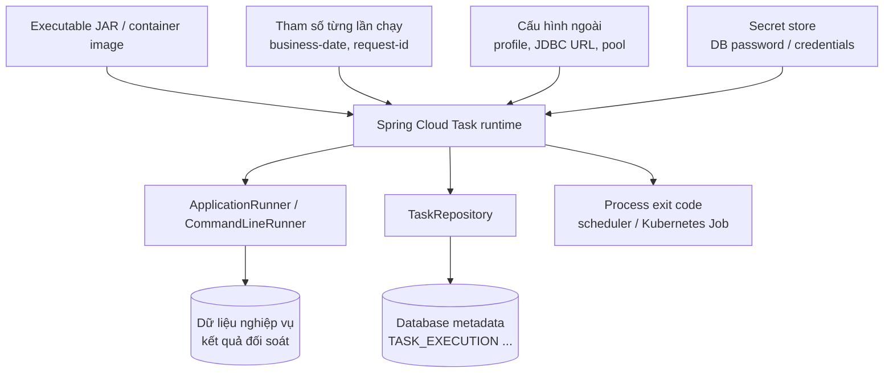

# Truyền cấu hình, tham số và thông tin kết nối cơ sở dữ liệu

Một ứng dụng **Spring Cloud Task** thường được đóng gói thành JAR hoặc container để chạy **một công việc hữu hạn**: lấy dữ liệu theo ngày, đối soát, xuất báo cáo, ghi nhận trạng thái vào database rồi kết thúc. Khác với service web chạy liên tục, mỗi lần scheduler, người vận hành hoặc API khởi chạy task thường tạo **một tiến trình riêng**. Vì thế, cấu hình triển khai phải giúp mỗi tiến trình nhận **đúng dữ liệu đầu vào**, kết nối **đúng kho `TaskRepository`** và xử lý lỗi mà không làm lộ thông tin nhạy cảm.

Ví dụ xuyên suốt: task `daily-reconcile` nhận `--business-date=2026-11-24` và `--request-id=...`, truy cập PostgreSQL để ghi metadata `TaskExecution` và tạo kết quả đối soát. Cùng một JAR được sử dụng ở máy phát triển, máy chủ và Kubernetes; **khác biệt môi trường được cấp từ bên ngoài**, không phải sửa mã Java rồi build lại.

Sau bài học thuộc chương **Triển khai**, bạn có thể:

- Phân biệt **cấu hình Spring Boot**, **tham số nghiệp vụ**, **biến môi trường** và **bí mật kết nối**.
- Truyền đúng `--business-date`, profile, URL JDBC và thông tin xác thực khi chạy `java -jar`.
- Dùng `application.yml`, file cấu hình ngoài JAR, OS environment và Spring Boot command-line overrides có chủ đích.
- Triển khai bằng **Kubernetes Job** với ConfigMap cho cấu hình thường và Secret cho credentials.
- Đảm bảo `TaskRepository`, datasource nghiệp vụ và schema phù hợp; kiểm tra `TaskExecution` sau từng lần chạy.
- Chẩn đoán lỗi kết nối, sai profile, sai đường dẫn, mất metadata, retry trùng và sự khác biệt giữa mã thoát process với dữ liệu thực tế.

## 1. Bốn nhóm thông tin không nên trộn lẫn

| Nhóm | Ví dụ | Ai cung cấp? | Có nên đưa vào CLI? |
| --- | --- | --- | --- |
| **Cấu hình ứng dụng** | `spring.main.web-application-type=none`, mức log, timeout | Artifact hoặc cấu hình môi trường | Có thể, nếu không nhạy cảm. |
| **Tham số nghiệp vụ của lần chạy** | `--business-date=2026-11-24`, `--request-id=run-2401` | Người vận hành, scheduler, API | **Có**, nếu được kiểm tra và không chứa secret. |
| **Thông tin kết nối** | `spring.datasource.url`, username, pool size | ConfigMap, file cấu hình ngoài, biến môi trường | Ưu tiên cấu hình ngoài thay vì hardcode. |
| **Bí mật** | Mật khẩu DB, token, private key | Secret manager/Kubernetes Secret, vault | **Không** truyền mật khẩu/token bằng CLI hoặc commit vào repo. |

Sự phân tách quan trọng vì Spring Boot thường đưa các option dạng `--key=value` vào `Environment`; Spring Cloud Task có thể ghi **tham số lần chạy** trong các bảng metadata như `TASK_EXECUTION_PARAMS`. Ngoài ra, CLI có thể xuất hiện trong lịch sử shell, process list và log launcher. **Không xem một option dòng lệnh là nơi an toàn để truyền secret.**

### Sơ đồ triển khai



**Phân biệt nguồn dữ liệu:** `TaskRepository` lưu vòng đời thực thi, không tự lưu toàn bộ kết quả nghiệp vụ. Một lần chạy có thể thành công về mặt nghiệp vụ nhưng thất bại khi cập nhật metadata do mất kết nối; do đó phải quan sát cả dữ liệu kết quả, mã thoát và log.

## 2. Spring Boot lấy cấu hình từ đâu?

Spring Boot hỗ trợ **externalized configuration**: một JAR có thể lấy giá trị cấu hình từ file YAML/properties trong JAR, file ngoài JAR, profile, environment variables, JVM system properties và command-line arguments.

Trong cách chạy thông thường, **các nguồn sau có thể ghi đè nguồn trước** (trích một phần thứ tự quan trọng, không phải toàn bộ thứ tự `PropertySource` dành cho test/devtools):

1. `application.yml` được đóng gói trong JAR.
2. File `application.yml` và file theo profile từ bên ngoài JAR, theo quy tắc config data.
3. **Biến môi trường hệ điều hành**.
4. **Java system properties** như `-Dspring.profiles.active=prod`.
5. **Tham số command line** như `--spring.datasource.url=...`.

Spring Boot còn có nhiều nguồn cấu hình khác. Khi có nhiều profile và location group, thứ tự ghi đè chi tiết phức tạp hơn; hãy dựa vào tài liệu **Externalized Configuration** của phiên bản Boot bạn sử dụng. **Không giả định mọi property luôn được lấy từ `application.yml` trong JAR**.

Ví dụ một file trong JAR đặt:

```yaml
spring:
  application:
    name: daily-reconcile-task
  main:
    web-application-type: none
  cloud:
    task:
      name: dailyReconcile
      initialize-enabled: false
```

Khi chạy:

```bash
java -jar daily-reconcile-task.jar \
  --spring.profiles.active=prod \
  --business-date=2026-11-24
```

`--spring.profiles.active=prod` là **property cấu hình của Spring Boot**. `--business-date` là **option nghiệp vụ do ứng dụng tự định nghĩa**. Cả hai đi qua command line nhưng được sử dụng bởi các thành phần khác nhau.

### Environment variable và relaxed binding

Đối với những property phổ biến như `spring.datasource.url`, Spring Boot cho phép dùng tên môi trường:

| Property | Biến môi trường |
| --- | --- |
| `spring.datasource.url` | `SPRING_DATASOURCE_URL` |
| `spring.datasource.username` | `SPRING_DATASOURCE_USERNAME` |
| `spring.datasource.password` | `SPRING_DATASOURCE_PASSWORD` |
| `spring.profiles.active` | `SPRING_PROFILES_ACTIVE` |
| `spring.application.name` | `SPRING_APPLICATION_NAME` |

Spring Boot hỗ trợ **relaxed binding**, nhưng không phải mọi key có dấu gạch ngang đều được đổi máy móc bằng cách thay mỗi dấu thành một dấu gạch dưới. Với các property ít gặp như `spring.cloud.task.initialize-enabled`, nên đặt trong `application.yml` hoặc kiểm tra cách bind ở phiên bản Boot hiện tại trước khi tạo biến môi trường tùy ý.

## 3. Ví dụ ứng dụng Spring Cloud Task nhận tham số

Tạo một dự án Spring Boot (Java tương thích với Spring Cloud release train đang dùng), có **Spring Cloud Task**, JDBC starter và driver PostgreSQL:

```xml
<dependencies>
    <dependency>
        <groupId>org.springframework.cloud</groupId>
        <artifactId>spring-cloud-starter-task</artifactId>
    </dependency>
    <dependency>
        <groupId>org.springframework.boot</groupId>
        <artifactId>spring-boot-starter-jdbc</artifactId>
    </dependency>
    <dependency>
        <groupId>org.postgresql</groupId>
        <artifactId>postgresql</artifactId>
        <scope>runtime</scope>
    </dependency>
</dependencies>
```

Đây là phần thêm vào `pom.xml` đã có Spring Boot parent hoặc dependency management tương đương, **Spring Cloud BOM đúng phiên bản** và `spring-boot-maven-plugin`. Không ghép Spring Boot và Cloud tùy ý.

Tạo `src/main/java/com/example/task/DailyReconcileApplication.java`:

```java
package com.example.task;

import java.time.LocalDate;
import java.util.List;

import org.springframework.boot.ApplicationArguments;
import org.springframework.boot.ApplicationRunner;
import org.springframework.boot.SpringApplication;
import org.springframework.boot.autoconfigure.SpringBootApplication;
import org.springframework.cloud.task.configuration.EnableTask;
import org.springframework.context.annotation.Bean;

@SpringBootApplication
@EnableTask
public class DailyReconcileApplication {

    public static void main(String[] args) {
        SpringApplication.run(DailyReconcileApplication.class, args);
    }

    @Bean
    ApplicationRunner reconcile() {
        return args -> {
            LocalDate businessDate =
                LocalDate.parse(requiredOption(args, "business-date"));
            String requestId = requiredOption(args, "request-id");

            System.out.printf(
                "Bat dau doi soat ngay %s, request=%s%n",
                businessDate, requestId
            );

            if (args.containsOption("simulate-error")) {
                throw new IllegalStateException(
                    "Loi mo phong trong doi soat"
                );
            }

            // TODO: Goi service nghiep vu co transaction va idempotency.
            System.out.println("Doi soat hoan thanh");
        };
    }

    private static String requiredOption(
            ApplicationArguments args, String name) {
        List<String> values = args.getOptionValues(name);
        if (values == null || values.size() != 1
                || values.get(0) == null || values.get(0).isBlank()) {
            throw new IllegalArgumentException(
                "Can truyen dung mot --" + name + "=..."
            );
        }
        return values.get(0);
    }
}
```

**Lưu ý:**

- `@EnableTask` kích hoạt ghi nhận vòng đời `TaskExecution` theo cơ chế Spring Cloud Task.
- `ApplicationArguments` tách option có tên với tham số không đặt tên; ứng dụng bắt buộc kiểm tra thiếu, lặp và định dạng ngày.
- `request-id` dùng để truy vết yêu cầu từ scheduler/log đến dữ liệu nghiệp vụ; nó **không phải mật khẩu** và không tự đảm bảo idempotency.
- Nếu xảy ra lỗi, runner nên **cho ngoại lệ lan truyền** hoặc báo mã thoát phù hợp; không nuốt lỗi rồi in “thành công”.
- Ví dụ chỉ minh họa đầu vào và vòng đời, chưa triển khai tính doanh thu thực tế. Production phải có transaction, unique constraint hoặc chiến lược chống trùng cho cùng ngày/đơn vị dữ liệu.

## 4. Cấu hình PostgreSQL cho `TaskRepository`

Một cấu hình `application.yml` có thể đặt những giá trị không nhạy cảm và nhận credentials từ môi trường:

```yaml
spring:
  application:
    name: daily-reconcile-task
  main:
    web-application-type: none
  datasource:
    url: ${TASK_DB_URL}
    username: ${TASK_DB_USERNAME}
    password: ${TASK_DB_PASSWORD}
    hikari:
      maximum-pool-size: 4
      connection-timeout: 15000
  cloud:
    task:
      name: dailyReconcile
      initialize-enabled: false
```

Trong ví dụ, các biến `TASK_DB_URL`, `TASK_DB_USERNAME` và `TASK_DB_PASSWORD` phải được cấp trước khi chạy. **Không đặt giá trị mặc định cho password** như `password: demo123` ở profile production.

### Thông tin cần thống nhất

| Nội dung | Ví dụ | Vì sao quan trọng |
| --- | --- | --- |
| **JDBC URL** | `jdbc:postgresql://db.internal:5432/task_metadata` | Trỏ đúng database; từ container phải dùng hostname truy cập được, không dùng `localhost` nếu PostgreSQL chạy ở máy khác. |
| **Driver** | PostgreSQL JDBC driver | Phải có driver trong executable JAR/image; không có driver sẽ lỗi lúc khởi động. |
| **Username/password** | Tài khoản chuyên dùng cho task metadata | Cần quyền phù hợp, tránh quyền superuser. |
| **Schema và tiền tố bảng** | `TASK_EXECUTION`, `TASK_EXECUTION_PARAMS` | DDL và `spring.cloud.task.tablePrefix` (nếu tùy chỉnh) phải nhất quán. |
| **TLS** | `sslmode=verify-full` khi hạ tầng và trust chain hỗ trợ | Bảo vệ kết nối và xác thực máy chủ, không chỉ đặt `ssl=true` theo cảm tính. |
| **Pool và timeout** | Hikari pool 4 kết nối, chờ 15 giây | Giới hạn tài nguyên và cho lỗi kết nối kết thúc hữu hạn, phù hợp số task đồng thời. |

**`spring.cloud.task.initialize-enabled: false`** yêu cầu các bảng Spring Cloud Task **đã được tạo trước** bằng schema/migration tương thích phiên bản. Trong bài học local có thể dùng cơ chế khởi tạo mặc định của framework, nhưng ở production không nên để nhiều Job/Pod cùng tranh nhau tạo hoặc sửa schema.

### Một hay nhiều `DataSource`?

Với **một `DataSource`**, Spring Cloud Task thường có thể sử dụng nó cho `TaskRepository`, `TaskExplorer` và transaction manager JDBC tương ứng.

Nếu dùng **hai `DataSource`** — một cho metadata Task và một cho dữ liệu nghiệp vụ — cần **chọn rõ datasource metadata qua `TaskConfigurer`** và transaction manager phù hợp. Đừng đặt `@Primary` cho datasource nghiệp vụ rồi giả định TaskRepository tự biết phải lưu ở database khác. Ngoài ra, transaction nghiệp vụ và metadata không tự tạo một giao dịch nguyên tử giữa hai database: nếu nghiệp vụ đã commit nhưng metadata chưa cập nhật, lần retry vẫn phải **idempotent**.

### Đọc lịch sử thực thi sau khi chạy

Khi datasource kết nối được và schema chính xác, một truy vấn chẩn đoán:

```sql
SELECT
    TASK_EXECUTION_ID,
    TASK_NAME,
    START_TIME,
    END_TIME,
    EXIT_CODE
FROM TASK_EXECUTION
ORDER BY TASK_EXECUTION_ID DESC;
```

Một lần chạy mới thường có `TASK_EXECUTION_ID` mới, ngay cả khi `business-date` và `request-id` vẫn giống lần trước. Nếu không có bản ghi, có thể Task đã lỗi **trước khi metadata kịp tạo**; cần đối chiếu log/JVM/platform, không kết luận rằng yêu cầu khởi chạy chưa từng xảy ra.

## 5. Triển khai bằng `java -jar` trên máy chủ

Sau khi đóng gói bằng Maven:

```bash
./mvnw clean package
```

Giả sử artifact là `target/daily-reconcile-task-0.0.1-SNAPSHOT.jar`. Ở môi trường thử nghiệm, có thể cấp các biến không phải secret qua shell:

```bash
export TASK_DB_URL="jdbc:postgresql://127.0.0.1:5432/task_metadata"
export TASK_DB_USERNAME="task_user"

# TASK_DB_PASSWORD do secret manager hoặc môi trường triển khai cấp.
java -jar target/daily-reconcile-task-0.0.1-SNAPSHOT.jar \
  --business-date=2026-11-24 \
  --request-id=manual-20261124-01
echo $?
```

`echo $?` phản ánh mã thoát của lệnh ngay trước nó; hãy gọi ngay sau `java -jar`. Đường chạy thành công thông thường trả `0`; lỗi thiếu tham số, sai database hoặc ngoại lệ nghiệp vụ thường làm task kết thúc không thành công. **Mã OS và `TaskExecution.exitCode` có thể không khớp khi tiến trình chết đột ngột hoặc database metadata lỗi.**

Trên PowerShell:

```powershell
$env:TASK_DB_URL = "jdbc:postgresql://db.internal:5432/task_metadata"
$env:TASK_DB_USERNAME = "task_user"
# TASK_DB_PASSWORD đã được cấp an toàn bởi môi trường triển khai.

java -jar .\target\daily-reconcile-task-0.0.1-SNAPSHOT.jar --business-date=2026-11-24 --request-id=manual-20261124-01
$LASTEXITCODE
```

Không hiển thị giá trị `TASK_DB_PASSWORD` hoặc dump toàn bộ environment để debug. Các biến môi trường **giảm nhu cầu đưa secret vào CLI**, nhưng vẫn có thể bị đọc bởi tiến trình có quyền phù hợp hoặc lộ qua debug dump; hãy áp dụng quyền tối thiểu, secret manager và redaction.

### Dùng trực tiếp tên chuẩn Spring Boot

Không bắt buộc phải viết placeholder `TASK_DB_URL` trong YAML. Nếu image/framework nhận trực tiếp các biến tiêu chuẩn:

```text
SPRING_DATASOURCE_URL=jdbc:postgresql://db.internal:5432/task_metadata
SPRING_DATASOURCE_USERNAME=task_user
SPRING_DATASOURCE_PASSWORD=(lấy từ secret store)
SPRING_PROFILES_ACTIVE=prod
```

Spring Boot có thể bind chúng vào `spring.datasource.*` và profile. **Chọn nhất quán một phong cách** cho mỗi property: dùng `TASK_DB_*` qua placeholder trong YAML, hoặc dùng trực tiếp `SPRING_DATASOURCE_*`. Nếu đặt cả hai kèm command-line overrides, hãy hiểu rõ precedence và tránh cấu hình bất ngờ.

### Đọc file cấu hình ngoài JAR

Để dùng cùng JAR ở nhiều môi trường:

```bash
java -jar daily-reconcile-task.jar \
  --spring.profiles.active=prod \
  --spring.config.additional-location=optional:file:/etc/daily-reconcile/ \
  --business-date=2026-11-24 \
  --request-id=scheduler-20261124
```

Nếu thư mục chứa `application.yml` hoặc `application-prod.yml`, Spring Boot có thể nạp thêm và ghi đè config data mặc định. `spring.config.additional-location` **bổ sung** vị trí tìm file; `spring.config.location` có thể **thay thế** các vị trí mặc định, nên dễ khiến bạn mất cấu hình trong JAR nếu dùng sai. Thuộc tính location phải được cung cấp **sớm lúc khởi động** (CLI/system property/environment), không đặt muộn sau khi context đã tạo.

`optional:` chỉ phù hợp nếu thiếu file được chấp nhận; với **cấu hình bắt buộc của production**, thường nên bỏ `optional:` để fail fast khi file không tồn tại. Đặt file ngoài JAR có quyền đọc phù hợp và không đưa secret vào repository mã nguồn.

## 6. Triển khai lên Kubernetes Job

Kubernetes **Job** phù hợp với tiến trình hữu hạn: controller tạo Pod để hoàn thành công việc, theo dõi kết quả và có chính sách retry. Tránh dùng Deployment luôn giữ replica cho một task chạy xong rồi thoát — Deployment có mục tiêu duy trì số replica, dễ dẫn đến khởi chạy lại ngoài ý muốn.

### 6.1. ConfigMap cho cấu hình thường

Định nghĩa `ConfigMap` chỉ chứa dữ liệu **không bí mật**:

```yaml
apiVersion: v1
kind: ConfigMap
metadata:
  name: reconcile-task-config
data:
  SPRING_DATASOURCE_URL: "jdbc:postgresql://postgresql.database.svc.cluster.local:5432/task_metadata"
  SPRING_PROFILES_ACTIVE: "prod"
```

Tên DNS `postgresql.database.svc.cluster.local` là ví dụ với Service tên `postgresql` trong namespace `database`. Kubernetes không tự tạo Service này; cần dùng **tên thực tế** của cluster. `localhost` bên trong Pod chỉ trỏ về chính Pod/container network namespace, không phải máy chạy PostgreSQL bên ngoài.

### 6.2. Secret cho thông tin xác thực

Giả sử namespace đã có Kubernetes Secret `reconcile-db-credentials` với hai key `username` và `password`, do hệ thống quản lý secret của tổ chức tạo. Trong Pod có thể tham chiếu qua `secretKeyRef`:

```yaml
env:
  - name: SPRING_DATASOURCE_USERNAME
    valueFrom:
      secretKeyRef:
        name: reconcile-db-credentials
        key: username
  - name: SPRING_DATASOURCE_PASSWORD
    valueFrom:
      secretKeyRef:
        name: reconcile-db-credentials
        key: password
```

Đây là **đoạn Pod spec**, không phải Kubernetes manifest độc lập. Secret phải tồn tại **trong cùng namespace của Pod** và Pod phải có quyền/điều kiện mount/read tương ứng. Kubernetes Secret không tự trở nên an toàn chỉ vì được mã hóa base64 trong YAML: cần RBAC, encryption at rest của cluster, kiểm soát audit và cơ chế rotate secret.

Biến môi trường từ Secret được đọc khi container được tạo; thay đổi Secret **không tự thay đổi giá trị env của tiến trình đã chạy**. Task mới/Pod mới sẽ cần được tạo để nhận giá trị được cập nhật.

### 6.3. Job manifest hoàn chỉnh

Giả sử image đã được build với entrypoint khởi chạy ứng dụng Java `daily-reconcile-task.jar`. `args` bên dưới được **append vào ENTRYPOINT của image**, không tự chạy Java nếu image không có entrypoint.

```yaml
apiVersion: batch/v1
kind: Job
metadata:
  name: reconcile-20261124
  labels:
    app: daily-reconcile-task
spec:
  backoffLimit: 1
  activeDeadlineSeconds: 1800
  ttlSecondsAfterFinished: 86400
  template:
    metadata:
      labels:
        app: daily-reconcile-task
    spec:
      restartPolicy: Never
      containers:
        - name: task
          image: registry.example.com/finance/daily-reconcile-task:1.0.0
          imagePullPolicy: IfNotPresent
          args:
            - "--business-date=2026-11-24"
            - "--request-id=job-20261124-01"
          envFrom:
            - configMapRef:
                name: reconcile-task-config
          env:
            - name: SPRING_DATASOURCE_USERNAME
              valueFrom:
                secretKeyRef:
                  name: reconcile-db-credentials
                  key: username
            - name: SPRING_DATASOURCE_PASSWORD
              valueFrom:
                secretKeyRef:
                  name: reconcile-db-credentials
                  key: password
          resources:
            requests:
              cpu: "100m"
              memory: "256Mi"
            limits:
              cpu: "1"
              memory: "768Mi"
```

**Các điểm cần hiểu:**

- `backoffLimit: 1` cho phép Job controller retry theo giới hạn sau lỗi Pod; **không phải đảm bảo code chỉ chạy đúng một lần**.
- `activeDeadlineSeconds: 1800` đặt giới hạn thời gian tổng cho Job trong ví dụ; khi quá hạn, Kubernetes có thể đánh dấu thất bại và dừng Pod. Điều này không tự rollback dữ liệu đã commit.
- `restartPolicy: Never` giữ thông tin lỗi theo từng Pod thuận tiện khi điều tra. `backoffLimit` và `restartPolicy` thuộc **Kubernetes**, không phải thuộc tính Spring Cloud Task.
- `ttlSecondsAfterFinished` dọn Job/Pod sau khi đã kết thúc và hết TTL; cần **log tập trung** nếu muốn điều tra sau khi tài nguyên bị dọn.
- `ConfigMap` và `Secret` cung cấp config và credential. **Tham số từng lần chạy** nằm trong `args`, để có thể thay đổi theo ngày mà không rebuild image.
- `resources` cần điều chỉnh theo tải thực, số task chạy đồng thời và memory của JVM. Giới hạn memory thấp có thể gây OOM và để `TaskExecution` chưa được cập nhật kết thúc.

Tạo Job bằng:

```bash
kubectl apply -f reconcile-job.yaml
kubectl get jobs
kubectl get pods -l app=daily-reconcile-task
kubectl logs job/reconcile-20261124
kubectl describe job reconcile-20261124
```

Đây là lệnh để **người học chạy trên môi trường thử nghiệm**; không chạy trong bước viết tài liệu này. Cần có namespace, ConfigMap, Secret, image và quyền Kubernetes phù hợp từ trước.

### Khi chạy theo lịch

**CronJob** tạo các Job theo lịch; nó không thay thế logic xử lý tham số ngày nghiệp vụ. Nếu cần `business-date` thay đổi theo lần kích hoạt, không được hardcode ngày trong manifest rồi dùng lại mãi: hãy truyền ngày bằng một cơ chế có kiểm soát (ví dụ service tính kỳ cần xử lý, API tạo Job với argument hoặc input được xác định từ lịch và timezone). Lưu ý timezone của scheduler và timezone của nghiệp vụ có thể khác nhau.

Kubernetes Job/CronJob đôi khi có thể tạo **nhiều lần chạy cùng một công việc** do retry, sự cố controller hoặc thao tác thủ công. Thiết kế **idempotency** theo khóa `tenant + businessDate + requestType` và kiểm soát concurrency để tránh đối soát trùng.

## 7. Cấp cấu hình từ Spring Cloud Data Flow hoặc launcher khác

Nếu dùng **Spring Cloud Data Flow (SCDF)**, task application được đăng ký, tạo **Task definition** rồi launch theo yêu cầu. SCDF truyền các đối số runtime và deployer properties tới `TaskLauncher` tương ứng với môi trường. Các tên property cụ thể của deployer có thể khác giữa Kubernetes, Cloud Foundry hoặc local.

Ví dụ cú pháp Shell minh họa:

```text
dataflow:>task launch reconcile-daily --arguments "--business-date=2026-11-24 --request-id=dataflow-20261124"
```

Những argument này đi vào ứng dụng Spring Cloud Task và có thể xuất hiện trong lịch sử/task metadata. **Không truyền `--spring.datasource.password=...` hoặc token qua `--arguments`**. Thay vào đó, cung cấp nguồn config/secret thông qua cơ chế được hỗ trợ của deployer và platform account, hoặc secret manager tích hợp hạ tầng.

**Phân biệt ID:** Task definition name không phải `TaskExecution.executionId`; ID nền tảng (Pod/Job/task platform) cũng không phải ID của `TaskRepository`. Khi điều tra kết nối lỗi, nên lưu correlation giữa các ID nhưng không đưa secret vào log.

## 8. Phân biệt metadata Task và database nghiệp vụ trong triển khai

Một task có thể sử dụng cùng database cho cả dữ liệu kinh doanh và `TaskRepository` hoặc tách hai database:

```text
daily-reconcile-task
  ├─ TaskRepository / TaskExplorer
  │    └─ taskMetadataDataSource
  │          └─ TASK_EXECUTION, TASK_EXECUTION_PARAMS, ...
  └─ ReconciliationService
       └─ businessDataSource
             └─ daily_revenue, payment, ...
```

Nếu **tách datasource**, phải cấu hình đúng:

| Thành phần | Chọn tài nguyên nào? |
| --- | --- |
| `TaskConfigurer` của Spring Cloud Task | `taskMetadataDataSource` và transaction manager metadata. |
| Service nghiệp vụ | `businessDataSource` và transaction manager nghiệp vụ. |
| Spring Batch (nếu dùng) | `JobRepository` và Step transaction manager phù hợp schema/Step. |

Không dùng cùng một username superuser cho mọi thứ chỉ để tránh lỗi quyền. Ở production, cấp quyền kết nối/schema theo chức năng thực tế, chuẩn bị migration riêng và thiết lập backup/retention cho metadata nếu cần lịch sử.

### Tác động của retry

Giả sử ngày 2026-11-24 đã được đối soát và ghi database nghiệp vụ, nhưng Pod bị `SIGKILL` trước khi Spring Cloud Task cập nhật `END_TIME`. Khi Kubernetes tạo Pod mới hoặc SCDF launch lại, ứng dụng có thể xử lý **lần thứ hai**.

Vì thế:

1. Dùng **business idempotency key** ổn định, không dùng `TaskExecution.executionId`.
2. Ghi dấu đã xử lý và hiệu ứng nghiệp vụ trong **cùng transaction** khi cùng database.
3. Với API hoặc message ngoài database, dùng idempotency key phía nhận, transactional outbox hoặc cơ chế bù trừ.
4. Theo dõi mã thoát, trạng thái Job/Pod, TaskExecution và kết quả nghiệp vụ trước khi quyết định retry.

## 9. Lỗi thường gặp khi truyền cấu hình

| Triệu chứng | Nguyên nhân có thể | Cách chẩn đoán và khắc phục |
| --- | --- | --- |
| `Failed to configure a DataSource` | Thiếu URL, driver hoặc property không được bind | Kiểm tra tên biến env, YAML, dependency và profile thực tế. |
| `Connection refused` | Sai host/port, DB chưa sẵn sàng hoặc NetworkPolicy chặn | Từ môi trường chạy task, xác minh DNS, mạng, Service và cổng database. |
| `UnknownHostException` | Dùng hostname chỉ tồn tại trên laptop hoặc sai Kubernetes Service DNS | Dùng tên Service đúng namespace/cluster; đừng dùng `localhost` nếu DB ở ngoài Pod. |
| Authentication failed | Sai username/password, Secret key sai, credential hết hạn | Kiểm tra secret reference, rotation và quyền database; không in mật khẩu. |
| `relation "task_execution" does not exist` | Schema metadata chưa tạo, sai `search_path` hoặc prefix | Chạy migration đúng phiên bản, kiểm tra schema/prefix và quyền. |
| Task ghi metadata vào database không mong muốn | Profile/CLI ghi đè datasource, nhiều bean `DataSource` | Kiểm tra property source hiệu lực và `TaskConfigurer`. |
| `java -jar` chạy đúng local nhưng lỗi trong Pod | Image thiếu driver/entrypoint sai, cấu hình không được inject | Kiểm tra image, `command`/`args`, env, logs, describe Pod. |
| Biến môi trường đã đổi nhưng task vẫn dùng giá trị cũ | Container được tạo trước khi Secret/ConfigMap cập nhật | Tạo lần chạy/Pod mới sau khi cấu hình được cập nhật. |
| Task không thoát sau khi xử lý xong | Web server hoặc thread nền vẫn chạy | Dùng `web-application-type: none`, đóng executor/context đúng cách. |
| `TaskExecution` thiếu `END_TIME` | Process bị kill, lỗi trước khi hoàn thành hoặc DB metadata mất kết nối | Đối chiếu Pod/events/log/DB; không kết luận “chưa xử lý gì”. |
| Job chạy lại và ghi dữ liệu trùng | Retry của platform/scheduler hoặc chạy thủ công hai lần | Unique constraint, idempotency, giới hạn đồng thời và kiểm tra dấu hoàn thành. |
| Secret xuất hiện trong log/process list | Đưa password vào CLI hoặc log toàn bộ config | Dừng ghi secret, rotate credential và thay cách inject bằng secret store. |

### Trình tự xử lý lỗi nên theo

1. **Artifact:** đúng JAR/image, đúng Java runtime, có JDBC driver và entrypoint?
2. **Config source:** đúng profile, file location, environment variables và thứ tự ghi đè?
3. **Network/DB:** DNS, host, port, firewall/NetworkPolicy, TLS, secret và quyền?
4. **Schema:** có đúng bảng `TASK_EXECUTION` trong database/schema và migration chưa?
5. **Business args:** đủ `business-date`, `request-id` và định dạng hợp lệ?
6. **Runtime:** mã OS, log, Pod/Job, timeout và tình trạng JVM?
7. **Dữ liệu:** TaskExecution và kết quả nghiệp vụ có khớp không; retry có an toàn không?

Không sửa trực tiếp `TASK_EXECUTION.EXIT_CODE` hoặc `END_TIME` để làm dashboard báo xanh; cần giải quyết nguyên nhân thật và bảo toàn lịch sử.

## 10. Nguyên tắc bảo mật và vận hành

**Không commit secret:** Không đặt password trong `application-prod.yml` được commit, Dockerfile `ENV`, manifest công khai hoặc command-line arguments. Dùng secret manager, Kubernetes Secret được bảo vệ hoặc phương án cấp file bí mật có kiểm soát. **Base64 không phải mã hóa bảo mật.**

**Giới hạn quyền:** Dùng tài khoản database có quyền tối thiểu; tạo schema/migration qua pipeline riêng. Nếu ứng dụng phải có quyền tạo bảng ở môi trường thử nghiệm, đừng mang quyền đó sang production mà không xem xét.

**Không log toàn bộ config:** Spring Boot Actuator `env`/`configprops` và log debug có thể hữu ích để tìm property source, nhưng chỉ bật/giới hạn truy cập hợp lý và kiểm tra sanitization. Không dump `System.getenv()` hoặc đưa password vào exception message.

**Dùng TLS đúng cách:** Cấu hình PostgreSQL SSL và truststore theo hạ tầng. Nếu dùng `sslmode=verify-full`, phải có chứng chỉ và hostname hợp lệ; chỉ bật một tham số SSL mà không kiểm chứng máy chủ chưa đủ cho môi trường nhạy cảm.

**Không nhầm retry với restart:** Mỗi lần Kubernetes tạo container hoặc người dùng launch lại có thể phát sinh **TaskExecution mới**. Đối với ứng dụng có Spring Batch, `JobExecution`/`JobInstance` và checkpoint là phạm vi riêng; đừng thay thế thông tin Batch bằng TaskExecution.

**Theo dõi mọi lớp:** Quan sát tiến trình/container, `TaskRepository`, (nếu có) `JobRepository` và database/file kết quả. Tập trung log và đặt TTL/retention phù hợp để còn dữ liệu điều tra khi Job đã bị dọn.

## 11. Bài thực hành tự kiểm tra

Thực hiện trên môi trường thử nghiệm:

1. Đóng gói JAR Spring Cloud Task và chạy bằng `java -jar` với `--business-date`, `--request-id`; xác nhận metadata được ghi.
2. Chuyển từ cấu hình PostgreSQL viết trong `application.yml` sang `SPRING_DATASOURCE_URL`/`SPRING_DATASOURCE_USERNAME` và password do môi trường cấp. Giải thích vì sao không cần rebuild JAR.
3. Tạo file `application-prod.yml` ngoài JAR, kích hoạt `prod` và dùng `spring.config.additional-location`. Kiểm tra property nào ghi đè property trong JAR.
4. Truy vấn `TASK_EXECUTION` và đối chiếu với mã thoát của tiến trình. Làm gì khi không thấy bản ghi vì lỗi kết nối trước startup?
5. Tạo Kubernetes ConfigMap cho JDBC URL, Secret cho username/password và một Job chứa `args` của ngày nghiệp vụ. Kiểm tra Pod nhận cấu hình đúng mà không log credential.
6. Cố tình đặt `localhost` cho URL PostgreSQL trong một Pod không chạy database. Phân tích lỗi và sửa bằng Service DNS.
7. Đặt `backoffLimit: 1`, mô phỏng lỗi nghiệp vụ; quan sát các Pod và xác định cách đảm bảo chạy lại không nhân đôi dữ liệu.
8. Cho Job bị giới hạn thời gian trong môi trường test; giải thích vì sao `TaskExecution.END_TIME` có thể chưa được cập nhật và cách xác minh kết quả nghiệp vụ.
9. Nếu ứng dụng có hai datasource, vẽ sơ đồ transaction manager của metadata Task và của nghiệp vụ; giải thích vì sao cần `TaskConfigurer` rõ ràng.
10. Thiết kế bảng runbook ghi request ID, business date, TaskExecution ID, platform Job/Pod name, artifact version và trạng thái nghiệp vụ.

**Câu hỏi ôn tập:**

- `--business-date=...` và `--spring.profiles.active=prod` giống và khác nhau ở đâu?
- Vì sao biến môi trường thường phù hợp hơn CLI để cấp password, nhưng vẫn phải có kiểm soát truy cập?
- Khi có nhiều datasource, `TaskRepository` phải dùng manager nào?
- Kubernetes `backoffLimit` có đảm bảo đúng một lần thực thi nghiệp vụ không?
- Vì sao `TaskExecution.END_TIME` trống không đủ chứng minh dữ liệu chưa commit?
- Khi dùng CronJob, tham số ngày nghiệp vụ cần được thiết kế thế nào để tránh dùng mãi một ngày đã hardcode?

**Ghi nhớ:** Khi triển khai Spring Cloud Task, hãy **giữ artifact bất biến**, cấp **tham số nghiệp vụ theo từng lần chạy**, cung cấp **cấu hình kết nối từ môi trường**, cấp **secret bằng kênh được bảo vệ**, và bảo đảm `TaskRepository` truy cập đúng database/schema. Kết quả vận hành chỉ đáng tin khi đối chiếu **mã thoát process, metadata Task/Batch và dữ liệu nghiệp vụ**, đồng thời thiết kế retry/idempotency cho mọi trường hợp lỗi.

**Tài liệu tham khảo chính thức:**

- [Spring Boot — Externalized Configuration](https://docs.spring.io/spring-boot/reference/features/external-config.html): config sources, profile, CLI, biến môi trường và thứ tự ghi đè.
- [Spring Cloud Task — Features](https://docs.spring.io/spring-cloud-task/reference/features.html): `TaskRepository`, `TASK_EXECUTION_PARAMS`, `initialize-enabled`.
- [Kubernetes — Distribute Credentials Securely Using Secrets](https://kubernetes.io/docs/tasks/inject-data-application/distribute-credentials-secure/): tham chiếu Secret qua `secretKeyRef`.
- [Kubernetes — Jobs](https://kubernetes.io/docs/concepts/workloads/controllers/job/): `backoffLimit`, `restartPolicy`, giới hạn thời gian và cleanup.
