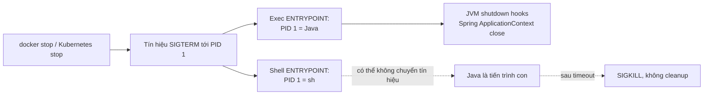
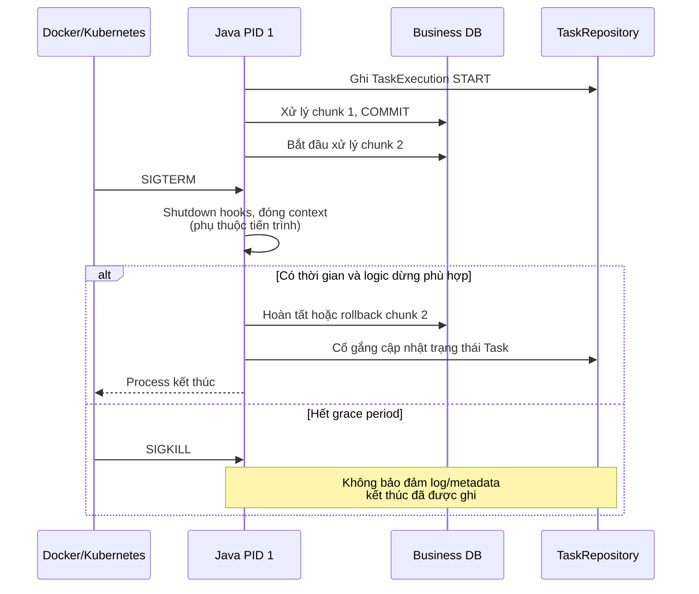

# Docker `ENTRYPOINT`, tín hiệu dừng và mã thoát container

## Mục tiêu học tập

Hoàn thành bài học, bạn có thể:

- Phân biệt `ENTRYPOINT` dạng **exec** và **shell**, hiểu vì sao tiến trình Java nên nhận tín hiệu dừng trực tiếp khi chạy trong container.
- Mô tả vai trò `PID 1`, `SIGTERM`, `SIGKILL`, thời gian chờ trước khi bị buộc dừng và hành vi của script khởi động.
- Đưa mã thoát của Spring Boot/Spring Cloud Task ra hệ điều hành bằng `SpringApplication.exit(...)` và `System.exit(...)`.
- Hiểu vì sao **container exit code**, `TaskExecution.exitCode`, trạng thái Spring Batch Job và kết quả nghiệp vụ có thể khác nhau.
- Đóng gói một ứng dụng Task chạy hữu hạn bằng Docker, chạy, kiểm tra exit status và thử đường dừng chủ động.
- Cấu hình Kubernetes Job/CronJob với `restartPolicy`, `backoffLimit`, `terminationGracePeriodSeconds` và giới hạn thời gian chạy.
- Thiết kế xử lý dừng có kiểm soát, chống trùng khi retry và đối chiếu log, metadata và trạng thái container sau sự cố.

> **Ngữ cảnh:** Bài thuộc chương **Triển khai** của module **SPRING_CLOUD_TASK**. Spring Cloud Task giúp xây dựng ứng dụng Spring Boot chạy hữu hạn, lưu thời gian, trạng thái và kết quả các lần thực thi trong cơ sở dữ liệu qua `TaskRepository`; có thể chạy thủ công, theo lịch hoặc cùng Spring Batch. Khi đóng gói thành Docker image và triển khai lên Kubernetes, **cách khởi động và kết thúc JVM** quyết định việc hệ điều phối có thể nhận đúng tín hiệu thành công/thất bại và cho Task cơ hội giải phóng tài nguyên hay không.

## 1. Ba câu hỏi phải tách biệt khi Task kết thúc

Giả sử `daily-settlement-task` xử lý lệnh:

```bash
java -jar /app/daily-settlement-task.jar --business-date=2026-11-24
```

Ứng dụng đối soát 50.000 giao dịch và ghi kết quả vào PostgreSQL. Khi tiến trình dừng, có ba lớp kết quả cần phân biệt:

| Lớp kết quả | Nơi có thông tin | Câu hỏi trả lời |
| --- | --- | --- |
| **Tiến trình Java/container** | Exit status do Docker/container runtime hoặc Kubernetes ghi nhận. | Tiến trình chính kết thúc bình thường hay lỗi/bị ngắt? |
| **Spring Cloud Task** | `TaskExecution` trong `TASK_EXECUTION`, các cột `END_TIME`, `EXIT_CODE`, `ERROR_MESSAGE`. | Framework đã ghi nhận lần chạy Task này như thế nào? |
| **Nghiệp vụ / Spring Batch** | Bảng đối soát, dữ liệu nghiệp vụ và `BATCH_JOB_EXECUTION` khi có Job. | Công việc thực sự đã hoàn tất, rollback hay mới xử lý một phần? |

Ba thông tin này **không tự động trùng nhau**. Ví dụ container bị `SIGKILL` có thể trả trạng thái lỗi dù database nghiệp vụ đã commit một phần, trong khi `TASK_EXECUTION.END_TIME` vẫn `NULL` vì JVM chưa kịp cập nhật repository.

**Mục tiêu triển khai đúng:** Để Java nhận tín hiệu, kết thúc theo quy tắc đã định nghĩa, trả exit code có ý nghĩa, đồng thời giữ đủ dữ liệu truy vết để kiểm tra những lượt bị ngắt bất thường.

## 2. `ENTRYPOINT` quyết định tiến trình nào nhận tín hiệu

Dockerfile hỗ trợ hai dạng chính:

```dockerfile
# Exec form (khuyến nghị cho Java Task):
ENTRYPOINT ["java", "-jar", "/app/daily-settlement-task.jar"]

# Shell form (tránh dùng kiểu này nếu không có lý do và xử lý tín hiệu rõ ràng):
ENTRYPOINT java -jar /app/daily-settlement-task.jar
```

Dạng exec trực tiếp chạy chương trình được chỉ định làm tiến trình chính của container. Dạng shell đi qua shell trung gian (thường là `/bin/sh -c`); Java có thể trở thành tiến trình con, và tín hiệu dừng đến shell **không được chuyển tiếp đúng cách** tới Java. Docker khuyến nghị exec form để tránh vấn đề truyền signal. 

### So sánh nhanh

| Đặc điểm | Exec form | Shell form |
| --- | --- | --- |
| Cú pháp | Mảng JSON, ví dụ `["java","-jar","/app/task.jar"]`. | Chuỗi lệnh, ví dụ `java -jar /app/task.jar`. |
| Tiến trình chính thông thường | Java là `PID 1`. | Shell là `PID 1`, Java là tiến trình con. |
| `SIGTERM` tới JVM | Có thể nhận trực tiếp. | Có nguy cơ không nhận do shell không forward. |
| Tham số từ `docker run image <args>` | Được nối vào `ENTRYPOINT`; thay thế `CMD` mặc định. | Có thể bị bỏ qua theo semantics shell-form. |
| Diễn giải `$VAR` / pipe | Không có shell expansion tự động. | Có shell xử lý expansion, pipe, redirect. |
| Lựa chọn cho Spring Cloud Task | **Ưu tiên.** | Chỉ dùng khi đã thiết kế wrapper xử lý tín hiệu. |

**`PID 1`** là tiến trình đầu tiên trong PID namespace của container, thường nhận lệnh stop từ runtime. Nếu PID 1 là shell không chuyển tiếp tín hiệu, Java có thể tiếp tục chạy đến khi container bị buộc dừng; cơ hội flush log và đóng Spring context không còn được bảo đảm.



Hình này thể hiện nguy cơ điển hình, không đồng nghĩa mọi shell đều không thể xử lý tín hiệu. Một script được thiết kế đúng có thể dùng `exec` hoặc tự forward signal và đợi tiến trình con.

## 3. Dockerfile phù hợp với Spring Cloud Task

Ví dụ dùng JDK/JRE 21 và Spring Boot executable JAR đã được build:

```dockerfile
FROM eclipse-temurin:21-jre

WORKDIR /app

COPY --chown=10001:10001 target/daily-settlement-task.jar /app/task.jar

USER 10001:10001

STOPSIGNAL SIGTERM

ENTRYPOINT ["java", "-jar", "/app/task.jar"]

CMD ["--business-date=2026-11-24"]
```

Giải thích:

- `FROM eclipse-temurin:21-jre`: base image phù hợp với phiên bản Java mà dự án đã build; phải kiểm tra hỗ trợ hệ điều hành, kiến trúc CPU và chính sách cập nhật image.
- `COPY`: lấy JAR được build trước; trong pipeline thực nên khóa version/digest của image và quét lỗ hổng.
- `USER 10001:10001`: chạy không dùng root; `COPY --chown` tạo quyền đọc artifact tương ứng.
- `STOPSIGNAL SIGTERM`: thể hiện chủ đích dừng có kiểm soát. Với Docker Linux thông thường, `SIGTERM` cũng là mặc định nếu không khai báo.
- **`ENTRYPOINT` dạng exec:** Java là tiến trình chính, được runtime gửi tín hiệu trực tiếp.
- `CMD` chứa tham số **mặc định** cho mục đích thử nghiệm. Khi chạy production theo lịch, phải cấp ngày nghiệp vụ đúng cho lượt chạy, không giữ nguyên một ngày cứng trong image.

Ví dụ build và chạy:

```bash
docker build -t example/daily-settlement-task:1.0 .

docker run --name settlement-run-1 \
  --env-file ./task.env \
  example/daily-settlement-task:1.0 \
  --business-date=2026-11-24
```

Lệnh `docker run` truyền argument thay `CMD` mặc định. File `task.env` trong ví dụ phải được quản lý an toàn, không commit secret vào repository. Với production nên dùng secret manager hoặc Kubernetes Secret cùng quyền tối thiểu. Ngoài ra, URL database dạng `localhost` bên trong container **trỏ tới chính container**, không mặc nhiên trỏ về máy host hay PostgreSQL bên ngoài.

**Lưu ý thao tác:** `docker run --rm` xóa container sau khi kết thúc, nên không dùng khi bạn cần kiểm tra `docker inspect` hoặc log của container đã dừng. Dùng một container tồn tại đến khi điều tra xong, hoặc thiết lập logging tập trung.

### Kết hợp `ENTRYPOINT` với `CMD`

Docker ghép các giá trị vào lệnh như sau:

```text
ENTRYPOINT ["java","-jar","/app/task.jar"]
CMD        ["--business-date=2026-11-24"]

Mặc định:
java -jar /app/task.jar --business-date=2026-11-24

docker run image --business-date=2026-11-25:
java -jar /app/task.jar --business-date=2026-11-25
```

Với Java `ApplicationArguments`, `--business-date=...` là đối số option để runner phân tích. Không đưa password, bearer token hoặc secret vào `CMD` hay CLI args vì chúng có thể xuất hiện trong metadata `TASK_EXECUTION_PARAMS`, cấu hình container và công cụ quan sát.

## 4. Nếu cần script khởi động: dùng `exec`

Đôi khi cần kiểm tra đầu vào, tạo directory tạm hoặc tính tham số trước khi chạy JVM. Đừng viết wrapper để shell làm PID 1 rồi bỏ mặc Java.

**Mẫu chưa phù hợp:**

```sh
#!/bin/sh
java -jar /app/task.jar "$@"
# Shell vẫn là PID 1 khi Java đang chạy.
```

**Mẫu đơn giản nên dùng:**

```sh
#!/bin/sh
set -eu

# Chỉ thực hiện chuẩn bị ngắn gọn, không chạy service nền.
echo "Launching finite Spring Cloud Task"

exec java -jar /app/task.jar "$@"
```

`exec` **thay thế shell process bằng JVM** trong cùng PID, nên Java nhận signal của tiến trình chính, và exit status của Java là exit status của container.

Dockerfile tương ứng:

```dockerfile
FROM eclipse-temurin:21-jre
WORKDIR /app
COPY --chown=10001:10001 target/daily-settlement-task.jar /app/task.jar
COPY --chown=10001:10001 --chmod=755 entrypoint.sh /app/entrypoint.sh
USER 10001:10001
ENTRYPOINT ["/app/entrypoint.sh"]
```

Đây là **đoạn cấu hình học tập**, với giả định file `entrypoint.sh` đã được tạo trong build context; không phải file được bài học tự sinh. `COPY --chmod` cần builder tương thích. Nếu xây dựng image trên Windows, chú ý line ending LF của shell script; CRLF có thể gây lỗi tìm interpreter.

### Khi nào `exec` không đủ?

Nếu container thực sự phải chạy **nhiều tiến trình**, một shell wrapper kết thúc bằng `exec java` không quản lý được vòng đời các tiến trình khác. Khi đó cần:

- Sắp xếp lại để mỗi container chỉ có một tiến trình chính nếu có thể.
- Dùng supervisor/init phù hợp, chuyển tiếp signal đến các child và `wait` đúng tiến trình.
- Cân nhắc `docker run --init` hoặc init process nhỏ có hỗ trợ forward signal/reap zombie.
- Quy định rõ exit status của process nào quyết định trạng thái container.

Đừng dùng `java ... &` rồi cho wrapper `exit 0` khi JVM vẫn đang chạy: container có thể bị coi là hoàn tất thành công dù công việc chưa kết thúc.

## 5. Các tín hiệu dừng và ý nghĩa

Trên Linux container, các tín hiệu thường gặp:

| Tín hiệu | Số phổ biến | Nguồn thường gặp | Ảnh hưởng |
| --- | ---: | --- | --- |
| `SIGTERM` | 15 | `docker stop`, Kubernetes graceful termination, hệ điều phối. | Yêu cầu dừng; JVM có thể chạy shutdown hook để đóng context. |
| `SIGINT` | 2 | Ctrl+C trong phiên terminal tương tác. | Thường được dùng để yêu cầu ngắt có thể xử lý. |
| `SIGKILL` | 9 | `docker kill`, hết grace period, một số trường hợp OOM. | **Không thể bắt, chặn hoặc chạy cleanup** trong tiến trình bị giết. |
| `SIGQUIT` | 3 | Chẩn đoán JVM tùy môi trường. | Hành vi JVM có thể khác; không dùng thay tín hiệu stop thông thường. |

Không đồng nhất “gửi tín hiệu” với “đã kết thúc”. Sau `SIGTERM`, Java còn phải xử lý shutdown/callback; sau `SIGKILL`, không có cơ hội chạy `finally`, `@PreDestroy` hoặc cập nhật TaskRepository. Tài liệu Docker quy định `docker stop` gửi stop signal đến tiến trình chính, chờ một khoảng thời gian rồi gửi `SIGKILL` nếu vẫn chạy.

### `docker stop` khác `docker kill`

```bash
# Yêu cầu dừng có kiểm soát; đợi tối đa 30 giây rồi cưỡng bức.
docker stop --timeout 30 settlement-run-1

# Gửi SIGTERM ngay, không phải một lần stop có thời gian chờ.
docker kill --signal=TERM settlement-run-1

# Tình huống test đặc biệt: dừng cưỡng bức, không cleanup.
docker kill --signal=KILL settlement-run-1
```

Lệnh thứ ba chỉ nên thử trên **môi trường test, dữ liệu không nhạy cảm**. `SIGKILL` có thể khiến DB đã commit một phần, metadata Task còn dang dở và log cuối cùng bị mất.

`docker stop` trả mã `0` của **lệnh Docker CLI** khi lệnh thành công; con số đó **không có nghĩa** tiến trình Java đã trả exit code `0`. Muốn biết mã của container, phải đọc `docker wait` hoặc `docker inspect`.

## 6. `SpringApplication.exit` và `System.exit` trong hàm `main`

Một Spring Cloud Task chạy hữu hạn không cần web server luôn mở. Mẫu Spring Boot phổ biến là:

```java
package com.example.settlement;

import org.springframework.boot.SpringApplication;
import org.springframework.boot.autoconfigure.SpringBootApplication;
import org.springframework.cloud.task.configuration.EnableTask;
import org.springframework.context.ConfigurableApplicationContext;

@SpringBootApplication
@EnableTask
public class SettlementTaskApplication {

    public static void main(String[] args) {
        ConfigurableApplicationContext context =
                SpringApplication.run(SettlementTaskApplication.class, args);

        int exitCode = SpringApplication.exit(context);
        System.exit(exitCode);
    }
}
```

**Ba lời gọi có chức năng khác nhau:**

1. `SpringApplication.run(...)` khởi tạo context và chạy `ApplicationRunner`/`CommandLineRunner` đồng bộ; trả `ConfigurableApplicationContext` khi thành công.
2. `SpringApplication.exit(context)` lấy mã thoát theo cơ chế Spring Boot (`ExitCodeGenerator`, callback liên quan) và đóng Spring context.
3. `System.exit(exitCode)` yêu cầu JVM trả số nguyên đó cho hệ điều hành; Docker theo dõi exit status của JVM nếu nó là tiến trình chính.

Nếu chỉ gọi `SpringApplication.exit(context)` rồi **không** `System.exit(code)`, kết quả số nguyên không tự trở thành exit status process; khi JVM kết thúc tự nhiên, mã có thể là `0` dù ứng dụng định nghĩa code khác.

Nếu `SpringApplication.run(...)` ném exception, các dòng phía sau nó **không chạy theo đường thành công**. Spring Boot có cơ chế xử lý lỗi khởi động; ngoại lệ không được xử lý đi khỏi `main` thường làm JVM kết thúc với mã khác `0`. Không hard-code `System.exit(0)` trong `finally`, vì có thể che thất bại thực tế.

### `application.yml` tối thiểu

```yaml
spring:
  application:
    name: daily-settlement-task
  main:
    web-application-type: none
  cloud:
    task:
      initialize-enabled: false
  datasource:
    url: ${TASK_JDBC_URL}
    username: ${TASK_DB_USER}
    password: ${TASK_DB_PASSWORD}
```

Ví dụ giả định `spring-cloud-starter-task`, JDBC driver, database và **schema Task đã được migration đúng phiên bản**. `initialize-enabled=false` có nghĩa runtime **không tự tạo bảng**, không phải tắt lưu TaskExecution. Đối với dự án có thêm Spring Batch, cần cấu hình JobRepository, metadata Batch và luật lan truyền Job failure riêng.

Không đưa secret vào Dockerfile hoặc environment dump. Các biến môi trường được inject từ cấu hình bảo mật của runtime.

## 7. Thất bại bị nuốt có thể khiến container trả `0`

Một lỗi thường gặp trong runner:

```java
@Component
class SettlementRunner implements ApplicationRunner {

    private static final Logger log =
            LoggerFactory.getLogger(SettlementRunner.class);

    private final SettlementService service;

    SettlementRunner(SettlementService service) {
        this.service = service;
    }

    @Override
    public void run(ApplicationArguments args) {
        try {
            service.process();
        } catch (Exception ex) {
            log.error("Settlement failed", ex);
            // Lỗi đã xảy ra nhưng bị nuốt.
        }
    }
}
```

`log.error` **không tự đổi mã thoát**. Runner trở về bình thường khiến Spring Boot có thể coi startup hoàn tất, `SpringApplication.exit(context)` trả `0`, và Docker/Kubernetes coi container đã hoàn tất thành công.

Cách sửa cho lỗi bắt buộc phải làm Task thất bại:

```java
@Override
public void run(ApplicationArguments args) {
    try {
        service.process();
    } catch (RuntimeException ex) {
        log.error("Settlement failed", ex);
        throw ex; // Lan truyền lỗi tới tầng quản lý Task.
    }
}
```

Tùy nhu cầu, có thể dùng một bean `ExitCodeGenerator` để phân loại các kết quả nghiệp vụ đã được xử lý, chẳng hạn `2` cho tham số sai và `10` cho nghiệp vụ thất bại. Nhưng phải **kiểm thử** đồng thời exit status process và `TaskExecution.exitCode`: cách gán exit code thủ công cho `SpringApplication.exit` không bảo đảm TaskRepository đã ghi đúng mã trong mọi phiên bản/đường chạy.

Nếu một Spring Batch Job trả `BatchStatus.FAILED` nhưng runner không kiểm tra JobExecution hoặc bắt lỗi rồi trả về, container cũng có nguy cơ báo `0`. Bộ điều phối chỉ nhìn exit status container thì không thể tự đọc được trạng thái Job bên trong nếu ứng dụng không lan truyền.

## 8. Tín hiệu `SIGTERM` và shutdown hook của Spring Boot

Spring Boot đăng ký **shutdown hook** với JVM để cố gắng đóng `ApplicationContext` khi JVM kết thúc. Các callback như `@PreDestroy`, `DisposableBean` và một số bean lifecycle khác có thể được gọi. Điều này giúp đóng tài nguyên do Spring quản lý nhưng cần hiểu giới hạn:

- Shutdown hook không phải một cơ chế **pause/restart checkpoint** của Spring Batch.
- Nó không tự chờ vô hạn cho một runner đang xử lý dở hoàn tất.
- Việc đóng context không bảo đảm transaction nghiệp vụ vừa gọi API ngoài đã commit/rollback đúng mong muốn.
- Khi `SIGKILL` đến, hook **không chạy**.
- Nếu database Task mất kết nối hoặc tiến trình bị dừng giữa callback, `TaskExecution` có thể thiếu cập nhật kết thúc.
- Tín hiệu `SIGTERM` không mặc định có nghĩa nghiệp vụ đã thành công hoặc thất bại; cần quy tắc vận hành riêng.

### Tín hiệu dừng có thể xảy ra giữa hai commit



Khi một chunk trước đó đã commit, việc worker dừng **không quay ngược lại các commit đã hoàn tất**. Một lần retry của scheduler có thể đọc lại cùng dữ liệu. Vì thế cần thiết kế idempotency theo **khóa nghiệp vụ**, transaction, checkpoint hoặc quy tắc restart Spring Batch; không lấy TaskExecution ID mới làm bằng chứng dữ liệu cần xử lý mới.

## 9. Thiết kế xử lý dừng có kiểm soát, không cố “cứu” mọi tình huống

Với tác vụ xử lý dài, runner có thể kiểm tra yêu cầu dừng **giữa các đơn vị công việc** để không bắt đầu chunk mới khi hệ thống đang shutdown. Ví dụ phần cốt lõi:

```java
package com.example.settlement;

import java.util.concurrent.atomic.AtomicBoolean;

import jakarta.annotation.PreDestroy;
import org.springframework.stereotype.Component;

@Component
public class StopRequested {

    private final AtomicBoolean stopping = new AtomicBoolean();

    public boolean isStopping() {
        return stopping.get();
    }

    @PreDestroy
    public void onShutdown() {
        stopping.set(true);
    }
}
```

Service hoặc runner có thể đọc cờ:

```java
for (WorkUnit unit : workUnits) {
    if (stopRequested.isStopping()
            || Thread.currentThread().isInterrupted()) {
        throw new IllegalStateException(
                "Task interrupted before next work unit");
    }

    processInTransaction(unit);
}
```

`WorkUnit` và `processInTransaction(...)` là thành phần nghiệp vụ minh họa, cần được định nghĩa trong dự án. Các điểm quan trọng:

1. Phương thức `processInTransaction(unit)` nên xử lý **một đơn vị idempotent** với ranh giới transaction rõ ràng.
2. Khi muốn dừng, **không nuốt exception** rồi trả thành công giả; phải định nghĩa chính sách abort/retry hoặc checkpoint.
3. `@PreDestroy` chỉ được gọi khi Spring context thực sự đóng và bean được hủy; nó có thể diễn ra trên shutdown thread **cùng lúc runner còn hoạt động**. Không mặc định mọi trường hợp `SIGTERM` đều chạy đủ callback và cập nhật được TaskRepository.
4. Không giữ khóa hoặc gọi mạng vô hạn trong `@PreDestroy`. Cleanup phải có deadline, xử lý interrupt và tôn trọng thời gian dừng.
5. Không tự thêm `Runtime.getRuntime().addShutdownHook(...)` để gọi `context.close()` nhiều lần khi Spring Boot đã quản lý hook, trừ khi đã có lý do và kiểm thử rõ.
6. Phụ thuộc ngoài database (email, message broker, ngân hàng) cần cơ chế xác minh/khóa idempotency; rollback JDBC không xóa được hiệu ứng đã gửi ra ngoài.

### Phân biệt hủy Task với “hoàn tất thành công”

Nếu operator dừng vì cấu hình sai hoặc cần bảo trì, đó không phải lượt chạy thành công về mặt nghiệp vụ. Hệ thống có thể lưu trạng thái `CANCELLED`/`INTERRUPTED` riêng trong bảng nghiệp vụ hay hệ điều phối, nhưng **không được suy ra Spring Cloud Task luôn có trạng thái enum như vậy**. Trong `TASK_EXECUTION`, trạng thái thường phải đọc từ `startTime`, `endTime`, `exitCode` và lỗi; sau crash có thể thiếu các trường cuối.

## 10. Timeout Docker và Kubernetes: phải đủ dài nhưng hữu hạn

### 10.1. Docker

Theo tài liệu Docker, `docker stop` gửi stop signal (thường `SIGTERM`) rồi đợi grace period. Nếu JVM không thoát, Docker gửi `SIGKILL`. Thời gian mặc định của Docker phụ thuộc nền tảng (ví dụ tài liệu CLI nêu **10 giây cho Linux container** khi không có cấu hình override); có thể thay bằng `--timeout` của `docker stop` hoặc `--stop-timeout` lúc tạo container.

```bash
docker run -d --name settlement-stop-test \
  --stop-timeout 45 \
  example/daily-settlement-task:1.0 \
  --business-date=2026-11-24

docker stop --timeout 45 settlement-stop-test
```

Để thực sự thử `SIGTERM`, công việc test phải đủ dài để container **còn chạy** lúc stop. Nếu Task đã hoàn tất trước đó, `docker stop` không mô phỏng được tình huống đang xử lý dở.

### 10.2. Kubernetes

Kubernetes Pod thường có `terminationGracePeriodSeconds` mặc định **30 giây**. Kubelet yêu cầu runtime dừng container bằng `SIGTERM` (hoặc signal được image/runtime hỗ trợ), chờ trong hạn rồi gửi `SIGKILL` tới tiến trình còn chạy.

```yaml
spec:
  terminationGracePeriodSeconds: 90
  restartPolicy: Never
  containers:
    - name: settlement
      image: registry.example.com/settlement-task:1.0
```

Đây là **đoạn Pod spec**, không phải manifest `Job` đầy đủ. Khi dùng trong Job, đặt dưới `spec.template.spec`. `terminationGracePeriodSeconds` phải đủ cho cleanup hợp lý, nhưng đừng đặt vô hạn: một workload treo cần có cơ chế fail/cleanup.

Nếu Pod có `preStop` hook, thời gian chạy hook cũng **tiêu tốn trong grace period**. Không thêm `sleep 60` vào `preStop` chỉ để đợi mà không có mục đích rõ ràng; việc đó có thể làm hết thời gian dành cho JVM đóng tài nguyên.

**Quan hệ với Spring Boot:** `spring.lifecycle.timeout-per-shutdown-phase` có thể giới hạn thời gian dừng các phase `SmartLifecycle` của Spring. Nó không thay cho `terminationGracePeriodSeconds`, và không tự bảo đảm toàn bộ `ApplicationRunner` dài nhiều phút được tiếp tục chạy xong.

## 11. Exit code container: cách diễn giải đúng

Một số giá trị thường gặp khi quan sát trên Linux:

| Exit code / trạng thái | Ý nghĩa thường gặp | Cần xác minh thêm |
| --- | --- | --- |
| `0` | Tiến trình chính tự kết thúc và báo thành công. | Nghiệp vụ thực sự hoàn tất? Batch Job `COMPLETED`? |
| `1` hoặc mã khác `0` do ứng dụng đặt | Ứng dụng báo lỗi. | Exception, cấu hình, input, log. |
| `2` | **Ví dụ quy ước** lỗi tham số của ứng dụng. | Ứng dụng có định nghĩa mã này không? |
| `143` | Giá trị thường thấy theo quy ước `128 + 15` khi process kết thúc do `SIGTERM`. | JVM/wrapper có tự chọn mã khác không? Shutdown hook đã chạy chưa? |
| `137` | Giá trị thường thấy theo quy ước `128 + 9` khi process bị `SIGKILL`. | Có hết grace period, OOM hay operator kill? |
| `OOMKilled` (container reason) | Runtime/Kubernetes xác định container vượt giới hạn bộ nhớ. | Memory limit, heap, native memory, số worker/threads. |
| `Error`/`ContainerCannotRun` (reason có thể có) | Container không chạy đúng. | Image, ENTRYPOINT, permission, architecture, mount, secret. |

**143 và 137 là cách diễn giải phổ biến, không phải quy tắc tuyệt đối cho mọi runtime/JVM.** Một shutdown hook có thể dẫn đến cách JVM kết thúc khác; wrapper có thể đổi mã; Windows container có semantics khác. Quan sát cả `exitCode`, `reason`, timestamps, trạng thái hạ tầng và log.

`SIGKILL` không thể bị bắt. Vì vậy khi thấy `137`, không nên kỳ vọng log cuối, `@PreDestroy` hay `TASK_EXECUTION.END_TIME` chắc chắn được cập nhật. Tìm thêm `OOMKilled` để phân biệt thiếu bộ nhớ với bị buộc dừng do hết grace period.

### Docker CLI: đọc đúng mã của container

```bash
# Với container đã chạy và chưa bị --rm xóa:
docker wait settlement-run-1

docker inspect \
  --format '{{.State.ExitCode}}' \
  settlement-run-1

docker inspect \
  --format '{{.State.OOMKilled}}' \
  settlement-run-1

docker logs --timestamps settlement-run-1
```

`docker wait` chờ container dừng và in exit status của container. `docker inspect` đọc trạng thái đã ghi; khác với `echo $?` sau lệnh `docker stop` (đó là mã của **lệnh Docker CLI**, không phải Java).

Với container đang chạy, `docker wait` có thể chờ đến khi Task hoàn tất; dùng trên môi trường test hoặc có cơ chế timeout phù hợp. Khi container bị `--rm` xóa sau lúc chạy, không còn gì để inspect; cần thu exit status lúc chạy hoặc truy cập nền tảng/log tập trung.

## 12. Kubernetes Job cho một Task hữu hạn

Một manifest `Job` phù hợp hơn `Deployment` cho chương trình chạy xong rồi thoát: Job controller quản lý hoàn thành/thất bại và có chính sách retry khi Pod lỗi. Ví dụ:

```yaml
apiVersion: batch/v1
kind: Job
metadata:
  name: settlement-once
spec:
  backoffLimit: 2
  activeDeadlineSeconds: 1800
  template:
    spec:
      restartPolicy: Never
      terminationGracePeriodSeconds: 90
      containers:
        - name: settlement
          image: registry.example.com/daily-settlement-task:1.0
          imagePullPolicy: IfNotPresent
          args:
            - "--business-date=2026-11-24"
          env:
            - name: TASK_JDBC_URL
              value: jdbc:postgresql://task-db:5432/taskdb
            - name: TASK_DB_USER
              valueFrom:
                secretKeyRef:
                  name: task-db-credentials
                  key: username
            - name: TASK_DB_PASSWORD
              valueFrom:
                secretKeyRef:
                  name: task-db-credentials
                  key: password
          resources:
            requests:
              cpu: "250m"
              memory: "256Mi"
            limits:
              memory: "512Mi"
```

Đây là **manifest minh họa**, giả định Secret và database/DNS đã tồn tại, image đã được đẩy lên registry, JAR có cấu hình đúng và `ENTRYPOINT` dạng exec. Không dùng nguyên ngày cố định cho CronJob chạy mỗi ngày; truyền ngày động theo contract từ scheduler hoặc tính trong nghiệp vụ có kiểm soát múi giờ.

Các trường quan trọng:

- `restartPolicy: Never`: khi container/Pod lỗi, Job controller có thể tạo **Pod mới**; thuận tiện khi cần tra log từng lượt.
- `backoffLimit: 2`: giới hạn retry theo quy tắc đếm lỗi của Job controller, **không** bảo đảm ứng dụng chỉ chạy đúng một lần.
- `activeDeadlineSeconds: 1800`: giới hạn tổng thời gian Job. Khi hết deadline, Job bị đánh dấu thất bại và workload được kết thúc theo cơ chế của Kubernetes.
- `terminationGracePeriodSeconds: 90`: dành thời gian cho dừng có kiểm soát trước khi bị cưỡng bức.
- `args`: được nối với ENTRYPOINT trong image; nếu khai báo `command` ở container, có thể ghi đè ENTRYPOINT, cần bảo đảm không vô tình chạy qua shell.
- `resources`: cần điều chỉnh theo profile tải thực; `OOMKilled` có thể xảy ra dù timeout/grace đã đúng.

### Tra cứu kết quả Job/Pod

```bash
kubectl get jobs
kubectl describe job settlement-once

# Lấy Pod của đúng Job.
kubectl get pods -l job-name=settlement-once

# Thay <pod-name> bằng tên Pod thật.
kubectl logs <pod-name>
kubectl describe pod <pod-name>

# Với Pod đã dừng và có một container:
kubectl get pod <pod-name> \
  -o jsonpath='{.status.containerStatuses[0].state.terminated.exitCode}'
```

Dòng lệnh dùng `<pod-name>` là placeholder, không thực thi nguyên xi. Với nhiều container, chọn đúng `containerStatuses` theo tên. Nếu Pod bị xóa theo TTL/cleanup, phải tìm ở hệ thống log và metrics đã lưu.

Kubernetes có thể retry Task do lỗi process, OOM, eviction hay các nguyên nhân hạ tầng khác. Tài liệu Kubernetes lưu ý ngay cả khi `parallelism=1` và `completions=1`, có trường hợp chương trình vẫn được bắt đầu hơn một lần. **Idempotency là trách nhiệm của ứng dụng**, không phải mặc định do Job cung cấp.

### Chính sách không retry lỗi đầu vào

Kubernetes Job chủ yếu phân biệt exit code `0`/khác `0` trong hành vi mặc định. Nếu muốn mã `2` (đầu vào không hợp lệ) kết thúc Job ngay thay vì thử lại, có thể dùng `podFailurePolicy` ở các cluster hỗ trợ, kết hợp `restartPolicy: Never`:

```yaml
spec:
  backoffLimit: 2
  podFailurePolicy:
    rules:
      - action: FailJob
        onExitCodes:
          containerName: settlement
          operator: In
          values: [2]
  template:
    spec:
      restartPolicy: Never
      containers:
        - name: settlement
          image: registry.example.com/daily-settlement-task:1.0
```

Đây là **đoạn minh họa Job spec**, cần gắn đầy đủ `apiVersion`/`kind`/`metadata` khi dùng. `FailJob` chỉ hoạt động nếu chương trình thực sự trả mã `2` đến container runtime. Với một `RuntimeException` không được ánh xạ, JVM có thể trả một mã lỗi khác, khiến policy không khớp.

## 13. CronJob, retry và nguy cơ xử lý lặp

Một Kubernetes CronJob tạo Job theo lịch. Mỗi Job có thể có nhiều lần chạy Pod do retry, vì vậy một lịch kích hoạt **không đồng nghĩa một lần thay đổi dữ liệu**.

Ví dụ lịch khái niệm:

```yaml
apiVersion: batch/v1
kind: CronJob
metadata:
  name: daily-settlement
spec:
  schedule: "0 2 * * *"
  concurrencyPolicy: Forbid
  successfulJobsHistoryLimit: 3
  failedJobsHistoryLimit: 5
  jobTemplate:
    spec:
      backoffLimit: 2
      template:
        spec:
          restartPolicy: Never
          terminationGracePeriodSeconds: 90
          containers:
            - name: settlement
              image: registry.example.com/daily-settlement-task:1.0
              # Không hard-code business date hằng ngày trong image.
```

Trong môi trường thực, cần xác định **múi giờ của lịch** và quy tắc suy ra `businessDate`. CronJob có hỗ trợ trường `timeZone` ở các phiên bản Kubernetes phù hợp; hãy kiểm tra cluster hiện tại. `concurrencyPolicy: Forbid` hạn chế Job của **cùng CronJob** chạy chồng nhau theo controller nhưng không loại trừ người vận hành gọi Task bằng tay hoặc một CronJob khác có cùng dữ liệu.

Khi Job retry, Spring Cloud Task thường tạo `TaskExecution` mới với `executionId` mới cho lần khởi chạy mới. **Không dùng `executionId` làm idempotency key**. Hãy dùng khóa nghiệp vụ (ví dụ `businessDate + region`), unique constraint, transaction và/hoặc checkpoint của Spring Batch để biết phần nào đã hoàn tất.

## 14. Đối chiếu `TaskRepository` với trạng thái container

Spring Cloud Task với JDBC thường lưu metadata tại bảng `TASK_EXECUTION`. Ví dụ truy vấn:

```sql
SELECT
    TASK_EXECUTION_ID,
    TASK_NAME,
    START_TIME,
    END_TIME,
    EXIT_CODE,
    EXIT_MESSAGE,
    ERROR_MESSAGE
FROM TASK_EXECUTION
WHERE TASK_NAME = 'daily-settlement-task'
ORDER BY START_TIME DESC, TASK_EXECUTION_ID DESC;
```

Phân tích kết quả bằng nhiều nguồn:

| `TaskRepository` | Container/Kubernetes | Diễn giải cần kiểm chứng |
| --- | --- | --- |
| `END_TIME` có, `EXIT_CODE=0` | Container exit `0` | Hai tín hiệu khớp; vẫn cần đối chiếu dữ liệu nghiệp vụ. |
| `END_TIME` có, mã khác `0` | Container có lỗi | Kiểm tra exception, Batch Job, retry và có commit dở không. |
| `END_TIME IS NULL` | Container đã bị `SIGKILL` | Metadata có thể chưa cập nhật; cần log/Pod và dữ liệu nghiệp vụ. |
| Không có row Task | Container không khởi động được | Có thể lỗi image, entrypoint, secret, datasource/schema hoặc Task chết rất sớm. |
| `EXIT_CODE=0` | Container bị dừng mã khác `0` | Có thể Task đã ghi kết quả trước khi bị ngắt hoặc lỗi xảy ra sau cập nhật Task. |
| `EXIT_CODE` khác `0` | Container exit `0` | Có thể wrapper/`main` không chuyển mã hoặc tầng kết quả bị cấu hình khác. |

**Lưu ý:** Không có quy tắc “`END_TIME IS NULL` chắc chắn còn RUNNING”. Một Pod đã mất hoặc container bị kill trước khi cập nhật metadata cũng để lại dạng dữ liệu này.

Nếu Task chạy Spring Batch Job, kiểm tra thêm:

```sql
SELECT
    JOB_EXECUTION_ID,
    STATUS,
    EXIT_CODE,
    EXIT_MESSAGE,
    START_TIME,
    END_TIME
FROM BATCH_JOB_EXECUTION
ORDER BY JOB_EXECUTION_ID DESC;
```

Với tích hợp Task–Batch phù hợp, bảng `TASK_TASK_BATCH` giúp nối `TASK_EXECUTION_ID` với `JOB_EXECUTION_ID`; không giả định hai khóa này bằng nhau. Một `JobExecution` `FAILED` có thể bị bỏ qua nếu runner nuốt exception, khiến process trả `0`. Ở nhánh hỗ trợ, cân nhắc cấu hình `spring.cloud.task.batch.fail-on-job-failure=true` và **kiểm thử toàn tuyến**.

## 15. Một quy trình thử nghiệm an toàn từ Docker tới Kubernetes

### 15.1. Kiểm tra exit code khi chạy bình thường

1. Tạo image theo Dockerfile exec form và chuẩn bị `taskdb`, schema Task, biến môi trường.
2. Chạy một lần với tham số hợp lệ trên dữ liệu test.
3. Ghi `docker wait`/`docker inspect` exit code và tra `TASK_EXECUTION`.
4. Chạy `--business-date=not-a-date` và đảm bảo runner ném lỗi hoặc có cơ chế phát exit code khác `0`.
5. Kiểm tra kết quả có nhất quán với trạng thái nghiệp vụ.

```bash
docker run -d --name settlement-valid \
  --env-file ./task.env \
  example/daily-settlement-task:1.0 \
  --business-date=2026-11-24

docker wait settlement-valid
docker inspect --format '{{.State.ExitCode}}' settlement-valid
docker logs settlement-valid
```

Nếu ứng dụng có logic đặc biệt bắt lỗi rồi trả về, việc test đầu vào không hợp lệ phải xác nhận **cả code tiến trình lẫn mã repository**; một dòng `ERROR` không đủ làm scheduler đánh dấu thất bại.

### 15.2. Thử graceful stop

Trên môi trường test, cho công việc xử lý đủ lâu và đang hoạt động:

```bash
docker run -d --name settlement-term \
  --stop-timeout 60 \
  --env-file ./task.env \
  example/daily-settlement-task:1.0 \
  --business-date=2026-11-24

docker stop --timeout 60 settlement-term

docker inspect \
  --format '{{.State.ExitCode}}' \
  settlement-term

docker logs --timestamps settlement-term
```

**Điều kiện:** Chỉ có ý nghĩa khi tiến trình còn chạy lúc `docker stop` được gọi. Có thể dùng dữ liệu test lớn hoặc chế độ chạy chậm được ứng dụng hỗ trợ; không gây trì hoãn trên production. Quan sát log `@PreDestroy` (nếu ứng dụng có), rollback/checkpoint nghiệp vụ và `END_TIME` trong TaskRepository. Không kết luận việc nhìn thấy shutdown hook là bằng chứng mọi commit/retry đã an toàn.

### 15.3. Thử cưỡng bức dừng

```bash
# Chỉ thực hiện trên test sau khi đánh giá tác động:
docker kill --signal=KILL settlement-term
```

Lệnh này không thực hiện được nếu container `settlement-term` đã dừng ở bước trước; muốn thử bắt buộc phải tạo **một lượt chạy mới còn hoạt động**. Khi bị SIGKILL, không có cleanup do JVM chạy; so sánh container state, Task metadata và dữ liệu đã commit để tìm cửa sổ bất nhất.

### 15.4. Thử trên Kubernetes Job

1. Dùng Job manifest với `restartPolicy: Never`, `backoffLimit` có kiểm soát và grace period hợp lý.
2. Cho Task chạy đủ lâu, quan sát Pod/Job bằng `kubectl get` và log theo container.
3. Trên dev/test, yêu cầu xóa Pod hoặc dừng workload theo thủ tục được phép; ghi lại exit code/reason và thời điểm nhận signal.
4. Kiểm tra liệu controller có tạo Pod thay thế, thêm TaskExecution mới hay không.
5. Xác minh bản ghi nghiệp vụ không bị nhân đôi và lỗi không bị nuốt.
6. Đối chiếu các `StepExecution` nếu có Spring Batch Job, đặc biệt những Step đã commit trước sự cố.

Không tự ý delete/kill Pod production để làm bài tập, nhất là tác vụ thanh toán hoặc import dữ liệu quan trọng.

## 16. Các lỗi triển khai hay gặp

| Hiện tượng | Nguyên nhân có thể | Hướng xử lý |
| --- | --- | --- |
| `docker stop` chờ hết hạn rồi container bị kill | `ENTRYPOINT` shell-form không chuyển `SIGTERM`; JVM treo hoặc cleanup quá lâu. | Dùng exec form/`exec` trong wrapper; đo thời gian shutdown, xem thread dump/log. |
| Docker báo `137` | Có thể bị `SIGKILL` hoặc OOM. | Đọc `OOMKilled`, container reason, grace period và memory limits; không kết luận chỉ từ code. |
| Docker báo `143` | Thường liên quan `SIGTERM` trên Linux. | Kiểm tra ai gửi signal, JVM/wrapper đã nhận chưa và Task đã ghi metadata chưa. |
| Task log `ERROR` nhưng Job thành công | Exception bị bắt rồi bỏ qua; exit code JVM `0`. | Lan truyền exception hoặc cấu hình exit code có kiểm chứng. |
| `TaskExecution.exitCode` khác container exit | Cập nhật repository và thoát process là hai cơ chế; bị kill hoặc wrapper đổi code. | Đối chiếu Task logs, `main`, `ENTRYPOINT`, JVM và runtime. |
| `END_TIME` còn `NULL` sau Pod chết | Task không kịp ghi hoàn tất hoặc DB metadata lỗi. | Đối chiếu Pod termination, logs và dữ liệu nghiệp vụ; không sửa metadata tùy tiện. |
| Job bị retry tạo giao dịch trùng | Idempotency dựa sai trên TaskExecution ID hoặc không có khóa nghiệp vụ. | Dùng business key, unique constraint, transaction, checkpoint và kiểm soát concurrency. |
| Worker không kết thúc sau runner | Có non-daemon thread, scheduler hoặc executor chưa được đóng. | Dùng `SpringApplication.exit`, lifecycle/close đúng, kiểm tra thread còn sống. |
| Cấu hình `command` Kubernetes làm mất `ENTRYPOINT` | Ghi đè entrypoint của image bằng shell/chương trình khác. | Dùng `args` nếu chỉ muốn truyền tham số; giữ Java làm tiến trình chính. |
| `CrashLoopBackOff` trong Job kiểu `OnFailure` | Container liên tục thất bại và bị restart trong Pod. | Đọc exit code/log và cân nhắc `Never` để debug từng Pod. |
| `OOMKilled` khi Batch xử lý lớn | Heap/native memory hoặc concurrency vượt resource limit. | Đặt JVM memory budget hợp lý, giảm chunk/parallelism và đo tải thật. |
| Tham số ngày cố định khiến CronJob chạy sai dữ liệu | Hard-code `CMD`/`args` ngày trong image hoặc manifest. | Tạo ngày nghiệp vụ dựa trên lịch/triggers và quy tắc múi giờ. |
| Không xem được log sau Job cleanup | Pod/container đã xóa, log không được tập trung. | Thiết lập log aggregation/retention trước khi bật cleanup. |

## 17. Checklist vận hành an toàn

- [ ] Dockerfile dùng **`ENTRYPOINT` dạng exec**, hoặc script cuối cùng chạy `exec java ... "$@"`.
- [ ] Java nhận `SIGTERM` trong thử nghiệm và có đường đóng tài nguyên hữu hạn; `SIGKILL` được coi là tình huống có thể mất metadata.
- [ ] `main` chuyển mã thoát Spring Boot thành mã JVM; runner không nuốt lỗi nghiệp vụ.
- [ ] `TaskRepository` và schema migration phù hợp; `executionId` được ghi vào log và gắn với container/pod ID khi cần.
- [ ] Với Spring Batch, kiểm tra JobExecution/StepExecution và xử lý Job failure trong exit code tiến trình.
- [ ] `terminationGracePeriodSeconds` đủ cho cleanup, có deadline; không đặt preStop sleep không cần thiết.
- [ ] Kubernetes Job có `restartPolicy`, `backoffLimit`, `activeDeadlineSeconds` và tài nguyên CPU/RAM phù hợp.
- [ ] Có idempotency theo **business key** và kế hoạch restart khi các chunk đã commit trước khi bị kill.
- [ ] Có centralized logging, monitoring mã `137`/`143`, `OOMKilled`, `END_TIME NULL` và Job/Task failure.
- [ ] Secret được cấp qua cơ chế bảo mật, không xuất hiện trong Dockerfile, CLI args hoặc log.
- [ ] Quy trình cleanup/TTL không xóa log và metadata trước thời hạn cần điều tra.

## 18. Bài tập thực hành

**Bài tập 1 — So sánh ENTRYPOINT:** Tạo hai image test, một dùng `ENTRYPOINT ["java", "-jar", "/app/task.jar"]` và một dùng `ENTRYPOINT java -jar /app/task.jar`. Chạy Task xử lý lâu, gọi `docker stop`, ghi PID và quan sát khả năng Java nhận SIGTERM. Giải thích vì sao kết quả có thể khác.

**Bài tập 2 — Wrapper `exec`:** Tạo `entrypoint.sh` có bước kiểm tra cấu hình rồi gọi `exec java -jar /app/task.jar "$@"`. So sánh exit code và cách truyền tham số với bản wrapper chỉ gọi `java` thông thường.

**Bài tập 3 — Mã thoát JVM:** Cho runner ném `IllegalArgumentException` khi tham số sai. Kiểm tra `docker wait`, `docker inspect`, `TASK_EXECUTION.EXIT_CODE`; phân tích trường hợp có log lỗi nhưng container vẫn `0` do exception bị nuốt.

**Bài tập 4 — Graceful stop:** Cho Task cập nhật 10 chunk, mỗi chunk có transaction riêng. Yêu cầu stop sau chunk thứ ba trên test, xác định dữ liệu đã commit, trạng thái Task, có callback shutdown nào chạy và chính sách retry nào không tạo bản ghi trùng.

**Bài tập 5 — `SIGKILL`/OOM:** Thử `SIGKILL` trên môi trường cô lập và so sánh `EXIT_CODE` container với `END_TIME` database. Không dùng tình huống OOM thực tế nếu có nguy cơ gây hại môi trường; có thể mô phỏng theo báo cáo/case test an toàn.

**Bài tập 6 — Kubernetes retry:** Triển khai Job có `restartPolicy: Never` và `backoffLimit: 2`. Ép lần chạy đầu thất bại, quan sát Pod được tạo lại và `TaskExecution` mới. Thiết kế idempotency bằng `businessDate + region` thay vì TaskExecution ID.

**Bài tập 7 — Chính sách lỗi đầu vào:** Định nghĩa mã `2` cho tham số sai và cấu hình `podFailurePolicy` tương ứng trên cluster hỗ trợ. Xác minh Job không retry lỗi không thể phục hồi nhưng vẫn retry lỗi tạm thời theo chính sách.

## Ghi nhớ

- **`ENTRYPOINT` exec form** giúp Java là tiến trình chính của container và nhận tín hiệu dừng phù hợp; shell-form có nguy cơ chặn hoặc không forward `SIGTERM`.
- **`docker stop`** yêu cầu dừng có thời gian chờ, sau đó có thể gửi **`SIGKILL`**. `SIGKILL` không cho JVM chạy cleanup.
- **`SpringApplication.exit(context)`** tính mã kết quả/đóng context; **`System.exit(code)`** đưa mã đó đến hệ điều hành.
- **Exit code container khác `TaskExecution.exitCode` và trạng thái Spring Batch Job**; cần đối chiếu cả log và dữ liệu nghiệp vụ khi bị dừng bất thường.
- `143`/`137` là các giá trị thường thấy do TERM/KILL trên Linux, không phải bằng chứng duy nhất về nguyên nhân.
- Job/CronJob có thể khởi chạy lại Task; **idempotency, transaction, checkpoint và quản lý concurrency** là thiết kế bắt buộc để chạy lại an toàn.

## Tài liệu tham khảo

- [Docker — Dockerfile reference: ENTRYPOINT, CMD, STOPSIGNAL](https://docs.docker.com/reference/dockerfile/)
- [Docker — JSON arguments recommended for signal handling](https://docs.docker.com/reference/build-checks/json-args-recommended/)
- [Docker — docker container stop](https://docs.docker.com/reference/cli/docker/container/stop/)
- [Docker — docker container wait](https://docs.docker.com/reference/cli/docker/container/wait/)
- [Spring Boot — SpringApplication và Application Exit](https://docs.spring.io/spring-boot/reference/features/spring-application.html)
- [Spring Cloud Task — Reference Documentation](https://docs.spring.io/spring-cloud-task/reference/)
- [Spring Cloud Task — Features và TaskRepository](https://docs.spring.io/spring-cloud-task/reference/features.html)
- [Kubernetes — Termination of Pods](https://kubernetes.io/docs/concepts/workloads/pods/pod-termination/)
- [Kubernetes — Jobs](https://kubernetes.io/docs/concepts/workloads/controllers/job/)
- [Kubernetes — CronJobs](https://kubernetes.io/docs/concepts/workloads/controllers/cron-jobs/)
