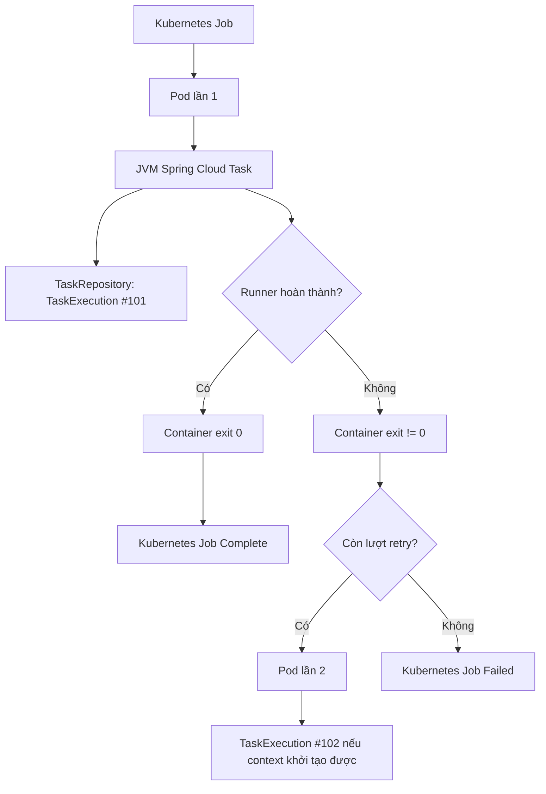

# Chạy Spring Cloud Task bằng Kubernetes Job

## 1. Vì sao Kubernetes Job phù hợp với Spring Cloud Task?

**Spring Cloud Task** giúp tạo ứng dụng Spring Boot có **thời gian chạy hữu hạn**: khởi động, nhận tham số, làm việc, lưu kết quả vào `TaskRepository` và kết thúc. Ví dụ, hệ thống cần nhập đơn hàng, đối soát thanh toán hoặc tổng hợp báo cáo theo lịch. Một Task có thể được yêu cầu chạy thủ công, theo lịch hoặc bởi nền tảng điều phối; nếu công việc lớn, nó cũng có thể gọi Spring Batch.

**Kubernetes Job** được thiết kế cho workload chạy đến khi hoàn tất, khác với `Deployment` chủ yếu duy trì các Pod phục vụ liên tục. Job controller tạo Pod để thực hiện công việc, theo dõi Pod thành công/thất bại và có thể thử lại theo chính sách. Khi đã đạt điều kiện hoàn tất, Job chuyển sang `Complete`; nếu hết giới hạn retry hoặc thời gian, Job có thể chuyển sang `Failed`.

Ví dụ Task `invoice-import` nhận `businessDate`, nhập hóa đơn rồi thoát:

1. Scheduler tạo Kubernetes Job để chạy ảnh container chứa ứng dụng.
2. Pod khởi động JVM; Spring Cloud Task tạo `TaskExecution` trong database dùng chung.
3. Runner đọc tham số, thực hiện nghiệp vụ và kết thúc; repository ghi `endTime`, `exitCode` cùng thông điệp.
4. Container dừng với mã thoát; Kubernetes dùng kết quả Pod để quyết định `Job` thành công hay thất bại.
5. Đội vận hành đối chiếu **Kubernetes Job/Pod** với **TaskRepository** và log để biết có chạy lại hay không.

Sau bài này, bạn sẽ:

- Đóng gói Task thành container thực sự **tự kết thúc**, không mở HTTP server lâu dài.
- Viết manifest `batch/v1` `Job` có database, Secret, tài nguyên, timeout và retry.
- Giải thích khác biệt giữa `restartPolicy`, `backoffLimit`, `activeDeadlineSeconds` và `ttlSecondsAfterFinished`.
- Quan sát Job/Pod và metadata `TaskExecution`, xử lý Pod thất bại hoặc bị kill.
- Mở rộng sang `CronJob` và vận hành an toàn khi Task có Spring Batch, nhiều lần retry hoặc yêu cầu không xử lý trùng.

## 2. Hai vòng đời không hoàn toàn trùng nhau

Một **Kubernetes Job** và một **Spring Cloud TaskExecution** ghi nhận các đơn vị khác nhau:

| Thành phần | Theo dõi | Kết quả chính |
| --- | --- | --- |
| `Job` của Kubernetes | Một yêu cầu hoàn thành khối lượng công việc; có thể tạo nhiều Pod | Điều kiện `Complete` / `Failed`, số `succeeded` / `failed` / `active` |
| `Pod` | Một lần chạy container trên node | Trạng thái Pod, mã thoát từng container, lý do `OOMKilled` hoặc `Error` |
| `TaskExecution` | Một lần ứng dụng Spring Cloud Task khởi chạy thành công về mặt context | `taskExecutionId`, `startTime`, `endTime`, `exitCode`, `exitMessage`, `errorMessage` |
| `JobExecution` của Spring Batch (nếu có) | Một lần thực thi Batch Job bên trong Task | `BatchStatus`, `ExitStatus`, trạng thái Step và checkpoint |



Sơ đồ đơn giản hóa đường retry. **Một Kubernetes Job không nhất thiết bằng một TaskExecution.** Khi Pod thứ nhất thất bại và Job controller tạo Pod khác, mỗi JVM có thể sinh **một `TaskExecution` mới**. Nếu Pod chết trước khi khởi tạo đủ `ApplicationContext`, TaskRepository thậm chí **không có bản ghi** tương ứng.

Kubernetes có thể tạo Pod thay thế ngay cả khi `parallelism=1` và `completions=1` trong một số tình huống gián đoạn. Vì thế **Job không bảo đảm exactly-once ở cấp nghiệp vụ**. Cần unique constraint, idempotency key hoặc thiết kế transaction/Batch restart để chống xử lý trùng.

## 3. Chuẩn bị một Task thực sự hữu hạn

Một ứng dụng dùng `@SpringBootApplication` và `@EnableTask`, với công việc đặt trong `ApplicationRunner` hoặc `CommandLineRunner`. Nó không cần là ứng dụng web. Nếu có dependency web, cấu hình `spring.main.web-application-type=none` để không duy trì HTTP server.

Ví dụ **Java 17+**:

```java
package com.example.invoice;

import java.time.LocalDate;
import java.time.format.DateTimeParseException;
import java.util.List;

import org.springframework.boot.ApplicationArguments;
import org.springframework.boot.ApplicationRunner;
import org.springframework.boot.SpringApplication;
import org.springframework.boot.autoconfigure.SpringBootApplication;
import org.springframework.cloud.task.configuration.EnableTask;
import org.springframework.context.ConfigurableApplicationContext;
import org.springframework.context.annotation.Bean;

@SpringBootApplication
@EnableTask
public class InvoiceImportTaskApplication {

    public static void main(String[] args) {
        ConfigurableApplicationContext context =
            SpringApplication.run(InvoiceImportTaskApplication.class, args);
        int exitCode = SpringApplication.exit(context);
        System.exit(exitCode);
    }

    @Bean
    ApplicationRunner importInvoices() {
        return arguments -> {
            LocalDate date = readBusinessDate(arguments);

            // Thay bằng importService.importForDate(date) trong thực tế.
            // Logic thật phải dùng transaction và idempotency theo businessDate.
            System.out.println("Import completed for date=" + date);
        };
    }

    private static LocalDate readBusinessDate(ApplicationArguments arguments) {
        List<String> values = arguments.getOptionValues("task.business-date");
        if (values == null || values.size() != 1
                || values.get(0) == null || values.get(0).isBlank()) {
            throw new IllegalArgumentException(
                "Cần đúng một --task.business-date=yyyy-MM-dd"
            );
        }
        try {
            return LocalDate.parse(values.get(0));
        } catch (DateTimeParseException ex) {
            throw new IllegalArgumentException(
                "task.business-date không đúng ISO date", ex
            );
        }
    }
}
```

Giải thích:

1. `@EnableTask` đăng ký hạ tầng Spring Cloud Task; `TaskRepository` cần datasource/schema phù hợp.
2. `ApplicationRunner` chạy sau khi context khởi tạo. Khi runner thành công, nó trả về bình thường; khi có lỗi thực sự, **ném ngoại lệ** để lifecycle ghi nhận thất bại.
3. `SpringApplication.exit(context)` lấy mã thoát được Spring Boot xác định khi đóng context; `System.exit(exitCode)` giúp mã thoát trở thành **process exit code** mà Kubernetes quan sát. Nếu `SpringApplication.run(...)` thất bại trước khi trả về context, nhánh `exit` thông thường này không được gọi; cần kiểm tra mã thoát thực tế trong thử nghiệm lỗi.
4. Không mở server HTTP, không để thread nền hoặc scheduler không-daemon vô thời hạn. Nếu công việc chạy bất đồng bộ, **chờ cho nó kết thúc** trước khi runner trả về.
5. Với Spring Batch, cần bảo đảm Batch Job `FAILED` thực sự được phản ánh lên mã thoát Task, ví dụ kiểm tra `spring.cloud.task.batch.fail-on-job-failure=true` khi sử dụng tích hợp tương ứng; không mặc định mọi Batch Job lỗi đều khiến container exit khác 0.

> Lưu ý: nếu JVM bị `SIGKILL` hoặc lỗi trước khi Spring Cloud Task ghi repository, `endTime` và `exitCode` có thể còn `NULL`. Thông tin Kubernetes và TaskRepository là **hai nguồn bằng chứng bổ sung**, không thay thế lẫn nhau.

## 4. Đóng gói ứng dụng thành container

Xây một JAR thực thi từ dự án dùng Spring Boot Maven Plugin hoặc Gradle plugin, sau đó đóng gói bằng Docker/Buildpacks. Dưới đây là **Dockerfile minh họa** cho JAR đã build; không phải kết quả chạy build thực tế:

```dockerfile
FROM eclipse-temurin:21-jre

WORKDIR /app
RUN useradd --system --uid 10001 --no-create-home taskuser
COPY target/invoice-import-task.jar /app/app.jar

USER 10001
ENTRYPOINT ["java", "-jar", "/app/app.jar"]
```

Nếu đang dùng Gradle, điều chỉnh đường `COPY` thành JAR thực thi trong `build/libs/`. Nếu dùng Buildpacks (ví dụ `spring-boot:build-image` hoặc `bootBuildImage`), có thể không cần Dockerfile; chỉ cần kiểm tra ENTRYPOINT và mã thoát của ảnh.

Các điểm thiết kế ảnh container:

- Java runtime phải phù hợp phiên bản ứng dụng; ví dụ ảnh trên dùng JRE 21 cho chương trình Java 17+.
- Dùng `ENTRYPOINT` dạng JSON (exec form) để `java` nhận tín hiệu dừng trực tiếp, tránh shell wrapper bỏ qua mã thoát hoặc không chuyển `SIGTERM`.
- Chạy bằng user không có quyền root, hạn chế quyền filesystem và network.
- Pin ảnh theo **digest đã được kiểm chứng** hoặc tag bất biến, quét lỗ hổng và ký/phê duyệt ảnh theo chính sách.
- Không nhúng mật khẩu, token hay giá trị môi trường production vào lớp image.

Ví dụ lệnh build/push khi nhóm có registry phù hợp:

```bash
./mvnw -DskipTests package
docker build -t registry.example.com/batch/invoice-import-task:1.0.0 .
docker push registry.example.com/batch/invoice-import-task:1.0.0
```

`registry.example.com` là **địa chỉ minh họa**. Trong thực tế không nên bỏ qua test khi chuẩn bị phát hành; `-DskipTests` ở trên chỉ làm rõ bước đóng gói độc lập, còn CI/CD cần chạy test và kiểm tra bảo mật trước khi đẩy image.

## 5. Manifest Kubernetes Job hoàn chỉnh cho một lần chạy

Ví dụ tạo một Job nhập hóa đơn cho ngày `2026-11-24`. Namespace, Secret, registry và quyền mạng **phải được chuẩn bị trước**; đây là manifest mẫu để sửa theo môi trường, không phải lệnh tự triển khai production.

```yaml
apiVersion: batch/v1
kind: Job
metadata:
  name: invoice-import-20261124
  namespace: batch-workloads
  labels:
    app.kubernetes.io/name: invoice-import
    app.kubernetes.io/part-of: billing-batch
spec:
  completions: 1
  parallelism: 1
  backoffLimit: 2
  activeDeadlineSeconds: 1800
  ttlSecondsAfterFinished: 86400
  template:
    metadata:
      labels:
        app.kubernetes.io/name: invoice-import
    spec:
      restartPolicy: Never
      automountServiceAccountToken: false
      terminationGracePeriodSeconds: 60
      securityContext:
        runAsNonRoot: true
        runAsUser: 10001
      containers:
        - name: invoice-import-task
          image: registry.example.com/batch/invoice-import-task:1.0.0
          imagePullPolicy: IfNotPresent
          args:
            - "--task.business-date=2026-11-24"
          env:
            - name: SPRING_MAIN_WEB_APPLICATION_TYPE
              value: "none"
            - name: SPRING_APPLICATION_NAME
              value: "invoice-import"
            - name: SPRING_CLOUD_TASK_NAME
              value: "invoice-import"
            - name: SPRING_CLOUD_TASK_INITIALIZE_ENABLED
              value: "false"
            - name: SPRING_DATASOURCE_URL
              valueFrom:
                secretKeyRef:
                  name: invoice-task-db
                  key: jdbc-url
            - name: SPRING_DATASOURCE_USERNAME
              valueFrom:
                secretKeyRef:
                  name: invoice-task-db
                  key: username
            - name: SPRING_DATASOURCE_PASSWORD
              valueFrom:
                secretKeyRef:
                  name: invoice-task-db
                  key: password
            - name: K8S_POD_NAME
              valueFrom:
                fieldRef:
                  fieldPath: metadata.name
          resources:
            requests:
              cpu: "250m"
              memory: "512Mi"
            limits:
              cpu: "1"
              memory: "1Gi"
          securityContext:
            allowPrivilegeEscalation: false
            readOnlyRootFilesystem: true
            capabilities:
              drop:
                - ALL
          volumeMounts:
            - name: temporary-files
              mountPath: /tmp
      volumes:
        - name: temporary-files
          emptyDir: {}
```

**Các điều kiện để ví dụ hoạt động:**

- Namespace `batch-workloads` và Secret `invoice-task-db` đã tồn tại; Secret có đúng ba key `jdbc-url`, `username` và `password`.
- Database ngoài Pod chứa **schema TaskRepository đúng phiên bản**, do migration quản lý. `SPRING_CLOUD_TASK_INITIALIZE_ENABLED=false` nghĩa là không trông chờ Task tự khởi tạo bảng.
- NetworkPolicy, firewall, DNS và TLS cho phép Task truy cập database; JDBC driver đã nằm trong JAR.
- Image dùng `USER 10001`; nếu đổi image, kiểm tra quyền và đường ghi tạm. `readOnlyRootFilesystem` kết hợp volume `/tmp` dành cho JVM/thư viện cần file tạm.
- Mọi lần thử của cùng Kubernetes Job dùng cùng `SPRING_CLOUD_TASK_NAME`, nhưng mỗi lần JVM khởi tạo có thể nhận `TaskExecutionId` khác.
- `args` chỉ chứa **ngày nghiệp vụ không nhạy cảm**. Không đưa credential vào tham số dòng lệnh vì chúng có thể đi vào `TaskExecution.arguments` và metadata Pod.

### Ý nghĩa của các trường trong spec

| Trường | Giá trị ví dụ | Cách hiểu |
| --- | --- | --- |
| `apiVersion / kind` | `batch/v1` / `Job` | Bộ điều khiển chạy công việc hữu hạn |
| `completions` | `1` | Job cần một lần Pod thành công để hoàn thành |
| `parallelism` | `1` | Mức song song mong muốn là một Pod; **không phải cam kết exactly-once** |
| `restartPolicy` | `Never` | Container không khởi động lại trong cùng Pod; Job controller có thể tạo Pod **mới** |
| `backoffLimit` | `2` | Giới hạn số thất bại được retry theo quy tắc Job controller |
| `activeDeadlineSeconds` | `1800` | Tổng thời gian hoạt động tối đa của **Job**, tính bằng giây, kể cả retry |
| `ttlSecondsAfterFinished` | `86400` | Sau khi Job `Complete`/`Failed`, Job có thể được dọn sau 1 ngày |
| `terminationGracePeriodSeconds` | `60` | Thời gian Pod được phép xử lý SIGTERM trước khi bị dừng cưỡng bức |
| `resources` | CPU/RAM request và limit | Cho scheduler cấp tài nguyên và giới hạn dùng quá mức |
| `automountServiceAccountToken` | `false` | Không tự mount token API nếu Task không cần gọi Kubernetes API |

Không nên chọn tất cả tham số bằng một công thức duy nhất. Ví dụ `activeDeadlineSeconds=1800` là 30 phút **cho cả Job**; nếu lần đầu mất 25 phút rồi thất bại, retry mới có thể không còn đủ thời gian. Giá trị phải phù hợp timeout thật của tác vụ và chính sách khôi phục.

## 6. Deploy và kiểm tra lần chạy

Khi đã tạo tệp manifest ví dụ `invoice-import-job.yaml` **ở nơi vận hành** và có `kubectl` truy cập đúng cluster/namespace:

```bash
kubectl config current-context
kubectl apply --dry-run=server -f invoice-import-job.yaml
kubectl apply -f invoice-import-job.yaml
kubectl get jobs -n batch-workloads
kubectl describe job invoice-import-20261124 -n batch-workloads
```

**Không chạy thử trực tiếp trên production** nếu chưa duyệt môi trường và kiểm tra input có thể gây side effect. `kubectl apply` tạo Job thật; các lệnh trên dùng làm hướng dẫn, không phải các lệnh đã được thực thi.

Xem danh sách Pod thuộc Job bằng label chuẩn:

```bash
kubectl get pods -n batch-workloads \
  -l batch.kubernetes.io/job-name=invoice-import-20261124 \
  -o wide

kubectl logs -n batch-workloads \
  -l batch.kubernetes.io/job-name=invoice-import-20261124 \
  --all-containers=true --prefix=true --max-log-requests=10
```

Nếu Pod từng retry, có thể có nhiều Pod với các log khác nhau. Khi cần xem một lần cụ thể, dùng `kubectl logs pod/<pod-name> -n batch-workloads`; nếu container được restart trong cùng Pod (trường hợp `OnFailure`), có thể cần `--previous`. Với `restartPolicy: Never`, Job thường tạo Pod thay thế nên phải xem Pod đã thất bại, không chỉ Pod cuối.

Kiểm tra trạng thái một Job:

```bash
kubectl get job invoice-import-20261124 -n batch-workloads -o yaml

# Lệnh này thành công nếu Job đạt Complete trước timeout.
kubectl wait -n batch-workloads \
  --for=condition=complete job/invoice-import-20261124 \
  --timeout=30m
```

**`kubectl wait --for=condition=complete` sẽ không trả thành công nếu Job bị Failed.** Khi timeout, đừng kết luận nguyên nhân ngay; đọc `Job.status.conditions`, Pod exit code, sự kiện controller và TaskRepository. Các Job bị xóa theo TTL có thể biến mất khỏi API, nên hệ thống production cần log/metrics tập trung.

### Đối chiếu trạng thái Kubernetes với TaskRepository

Truy vấn chỉ đọc với bảng `TASK_EXECUTION` chuẩn:

```sql
SELECT
    TASK_EXECUTION_ID,
    TASK_NAME,
    START_TIME,
    END_TIME,
    EXIT_CODE,
    EXIT_MESSAGE,
    CASE
        WHEN ERROR_MESSAGE IS NULL THEN 'NO'
        ELSE 'YES'
    END AS HAS_ERROR_MESSAGE
FROM TASK_EXECUTION
WHERE TASK_NAME = 'invoice-import'
ORDER BY TASK_EXECUTION_ID DESC;
```

Các bản ghi trong ví dụ có thể có `TASK_EXECUTION_ID` khác nhau nếu Kubernetes đã thử chạy nhiều Pod. Không mặc định Kubernetes Job name tự được Spring Cloud Task ghi vào `EXTERNAL_EXECUTION_ID`: phải có tích hợp/logic gán ID tương quan phù hợp. Khi cần truy vết, ghi `K8S_POD_NAME` và execution ID vào log an toàn hoặc metadata nghiệp vụ có quy tắc rõ ràng.

**Đừng đếm số TaskExecution bằng số Kubernetes Job.** K8s Job có thể retry Pod nhiều lần, và một Pod bị lỗi trước `ApplicationContext` có thể không tạo TaskExecution nào.

## 7. Phân biệt bốn cơ chế “chạy lại”

### 7.1. `restartPolicy: Never` so với `OnFailure`

`restartPolicy` nằm trong **Pod template**, không phải cấp Job. Kubernetes Job chỉ cho phép `Never` hoặc `OnFailure`.

- **`Never`:** container kết thúc lỗi, Pod có thể mang trạng thái Failed; Job controller xét `backoffLimit` để tạo **Pod mới**. Tốt khi cần giữ log và nguyên nhân riêng từng lượt chạy.
- **`OnFailure`:** kubelet có thể restart container trong **cùng Pod**; các lần container retry cũng góp vào giới hạn Job theo quy tắc controller. Cần xem `restartCount` và log `--previous`.

Không dùng `Always` cho Kubernetes Job. Không đồng nhất `restartPolicy` với `spring.batch.job.enabled` của Spring Boot hoặc chính sách restart của Batch.

### 7.2. `backoffLimit` so với retry nghiệp vụ

`backoffLimit` là **ngưỡng retry của Job controller**; mặc định thường là `6` nếu không có chính sách per-index. Nó không phân biệt lỗi input không thể sửa với mất kết nối tạm thời, trừ khi triển khai chính sách Pod failure phù hợp.

Ví dụ:

- Task có lỗi SQL timeout tạm thời: một lần retry có thể hợp lý nếu transaction và dữ liệu idempotent.
- Task nhận `businessDate` không hợp lệ: retry cùng lệnh nhiều lần **không giải quyết lỗi**.
- Pod bị `OOMKilled`: nếu không tăng memory/giảm tải, retry tiếp chỉ lặp lỗi.

Với policy `podFailurePolicy` (trên cluster hỗ trợ), có thể dùng mã thoát phân loại để **FailJob** ngay thay vì retry lỗi không thể phục hồi, hoặc bỏ qua một số loại Pod disruption theo chính sách. Đây là cấu hình nâng cao cần kiểm thử: khi dùng `podFailurePolicy`, Kubernetes yêu cầu `restartPolicy: Never`.

**Cơ chế idempotency vẫn bắt buộc** vì một retry Pod có thể xảy ra **sau khi lượt trước đã ghi một phần dữ liệu**.

### 7.3. `activeDeadlineSeconds` là timeout toàn Job

Trường `spec.activeDeadlineSeconds` giới hạn thời gian kể từ khi Job bắt đầu hoạt động. Khi quá hạn, Kubernetes bắt đầu kết thúc Pod và đánh dấu Job `Failed` với nguyên nhân có thể là `DeadlineExceeded`. Nó có **ưu tiên hơn `backoffLimit`**: Job không tiếp tục retry sau khi đã hết hạn tổng.

Điều này **không bảo đảm** mọi transaction bên ngoài Pod được rollback, mọi sự kiện đã gửi được hoàn tác hoặc TaskRepository được cập nhật `endTime`. Trước khi khởi chạy lại, kiểm tra side effect trên database/file/broker.

### 7.4. `ttlSecondsAfterFinished` chỉ dọn tài nguyên Kubernetes

`ttlSecondsAfterFinished` bắt đầu đếm khi Job có trạng thái hoàn tất (`Complete` hoặc `Failed`), rồi khiến Job và Pod phụ thuộc có thể bị dọn theo cơ chế TTL controller. Nó **không**:

- Xóa `TaskExecution` trong `TASK_EXECUTION`.
- Xóa JobExecution/StepExecution của **Spring Batch**.
- Xóa log đã được chuyển vào kho tập trung.
- Quy định thời hạn giữ dữ liệu nghiệp vụ.

Ví dụ TTL một ngày trong manifest giúp giảm số Job/Pod cũ trong API server, **không phải chính sách retention metadata của Spring Cloud Task**. Nếu cần điều tra thất bại lâu hơn, phải cấu hình lưu log, giám sát, backup và retention DB riêng.

## 8. Chạy định kỳ bằng Kubernetes CronJob

Nếu cần kích hoạt Task theo lịch, dùng **CronJob**, không đặt `@Scheduled` vô thời hạn bên trong một Task đã được thiết kế chạy rồi thoát. CronJob tạo **Job** mới theo lịch, còn mỗi Job tạo Pod để thực hiện công việc.

Ví dụ tối giản chỉ minh họa cơ chế điều phối (để chạy thật cần bổ sung biến datasource, Secret, bảo mật và resources giống manifest Job ở mục 5):

```yaml
apiVersion: batch/v1
kind: CronJob
metadata:
  name: invoice-import-daily
  namespace: batch-workloads
spec:
  schedule: "0 1 * * *"
  timeZone: "Asia/Ho_Chi_Minh"
  concurrencyPolicy: Forbid
  startingDeadlineSeconds: 900
  successfulJobsHistoryLimit: 3
  failedJobsHistoryLimit: 5
  jobTemplate:
    spec:
      backoffLimit: 1
      activeDeadlineSeconds: 1800
      ttlSecondsAfterFinished: 604800
      template:
        spec:
          restartPolicy: Never
          containers:
            - name: invoice-import-task
              image: registry.example.com/batch/invoice-import-task:1.0.0
              env:
                - name: SPRING_MAIN_WEB_APPLICATION_TYPE
                  value: "none"
```

`timeZone` là field của CronJob, **không viết `TZ`/`CRON_TZ` trong biểu thức `schedule`**. Một lần chạy lúc 01:00 theo `Asia/Ho_Chi_Minh` phải được ứng dụng gắn với **businessDate nào** là quyết định nghiệp vụ. Không chỉ dùng `LocalDate.now()` tại thời điểm Pod thực sự chạy vì Pod có thể bị trễ hoặc retry sang ngày khác. Cần truyền ngày nghiệp vụ ổn định từ scheduler hoặc định nghĩa rõ cách suy ra ngày từ thời điểm lịch được kích hoạt.

| `concurrencyPolicy` | Hành vi | Giới hạn |
| --- | --- | --- |
| `Allow` | Cho phép Job từ cùng CronJob chạy chồng | Mặc định; nghiệp vụ phải chịu được đồng thời |
| `Forbid` | Bỏ qua lịch mới khi Job cũ của **cùng CronJob** còn chạy | Có thể bỏ lỡ lịch; không tạo hàng đợi thay thế |
| `Replace` | Thay Job đang chạy bằng Job mới | Có thể dừng giữa chừng; cần idempotency/compensation |

**`concurrencyPolicy` chỉ điều phối các Job do cùng một CronJob tạo**, không chặn một Job được chạy thủ công hoặc từ CronJob khác. Nếu cần ngăn xử lý trùng tuyệt đối theo dữ liệu, bổ sung khóa nghiệp vụ, ràng buộc duy nhất hoặc single-instance lock của Spring Cloud Task với database chung (và thiết kế TTL đúng).

CronJob có thể tạo **hai Job hoặc bỏ lỡ một Job** trong những tình huống lịch/điều khiển nhất định; không coi CronJob là cơ chế exactly-once. Giữ `successfulJobsHistoryLimit`/`failedJobsHistoryLimit` và `ttlSecondsAfterFinished` phù hợp khả năng điều tra, không xóa lịch sử quá sớm.

## 9. Bảo vệ dữ liệu khi Job retry hoặc bị kill

Với ứng dụng xử lý đơn hàng, tính đúng đắn quan trọng hơn việc Pod báo thành công. Một phương án:

1. **Business key ổn định:** ví dụ `(tenant_id, business_date, invoice_id)`.
2. **Unique constraint** để tránh hai lần chạy ghi cùng hóa đơn; có thể kết hợp upsert nếu nghiệp vụ cho phép.
3. **Transaction/chunk:** mỗi lô có ranh giới commit rõ ràng; khi fail, biết bản ghi nào đã được ghi.
4. **Idempotency:** chạy lại cùng yêu cầu không tạo tác dụng phụ không mong muốn; nếu gửi thông báo, cân nhắc outbox.
5. **Theo dõi attempt:** ghi Job name, Pod name, TaskExecutionId và ngày nghiệp vụ; không nhầm retry Pod với restart Batch Job.
6. **Không retry khi owner chưa kết thúc:** nếu Pod ở trạng thái terminating nhưng vẫn còn tiến trình/transaction, xác minh trước khi cho lần chạy mới ghi cùng tập dữ liệu.

Nếu Task tích hợp Spring Batch, **Kubernetes retry Pod** thường khởi động một JVM mới và có thể tạo TaskExecution mới; **Spring Batch restart** lại dùng JobRepository để tiếp tục một JobInstance đã thất bại theo JobParameters. Hai hành động không giống nhau. Tránh thêm tham số ngẫu nhiên chỉ để né `JobInstanceAlreadyCompleteException` khi mục tiêu là restart từ checkpoint.

### Mã thoát phải phản ánh kết quả thật

| Tình huống | Task/Batch | Container/Pod và Kubernetes | Cần kiểm chứng |
| --- | --- | --- | --- |
| Runner thành công và JVM exit 0 | `TaskExecution.exitCode` thường là `0` | Pod `Succeeded`, Job có thể `Complete` | Kết quả nghiệp vụ đã được commit? |
| Runner ném ngoại lệ chưa xử lý | Task có thể ghi `exitCode=1` hoặc mã ánh xạ | Container thường exit khác 0; Job xét retry | Đã ghi một phần dữ liệu chưa? |
| Batch Job `FAILED` nhưng Task không phát tín hiệu lỗi | Batch `FAILED`, Task có thể `0` | Pod có thể `Succeeded` | Bật cầu nối `fail-on-job-failure` hoặc kiểm tra thủ công |
| JVM bị `OOMKilled` | Repository có thể chưa ghi trạng thái cuối | Pod bị terminate, reason `OOMKilled` | Memory limit, heap, chunk/page size |
| Job quá `activeDeadlineSeconds` | Task có thể chưa có `endTime` | Job `Failed` / `DeadlineExceeded` | Pod còn hoạt động? Transaction đã commit? |
| Không kết nối được DB khi khởi tạo | Có thể không tạo `TaskExecution` | Pod/Job thất bại nếu exit khác 0 | Secret, DNS, network và schema |

Không dùng mỗi mã thoát để kết luận cả quy trình đã hoàn tất đúng nghiệp vụ. Đặc biệt, một worker Batch có thể fail nhưng lỗi bị bắt rồi bỏ qua; ứng dụng cần truyền kết quả lên Task và JVM.

## 10. Security, cấu hình và giới hạn tài nguyên

Trong Kubernetes, một Task thường chỉ cần quyền **đọc Secret và kết nối database**, không cần gọi Kubernetes API:

- **Dùng Secret** cho JDBC credentials; tách quyền đọc Secret khỏi quyền cập nhật Job. Việc tham chiếu Secret bằng env không tự tạo mã hóa end-to-end, cần RBAC, encryption at rest và quy trình rotate Secret.
- **Không mount ServiceAccount token** khi không dùng Kubernetes API (`automountServiceAccountToken: false`). Nếu Task thật sự cần thao tác với API, cấp ServiceAccount riêng và RBAC tối thiểu, không mặc định dùng quyền rộng.
- **Dùng NetworkPolicy** để hạn chế outbound tới database/broker đúng endpoint, đồng thời cấp TLS khi phù hợp.
- **Chạy non-root** và giới hạn quyền filesystem; cấu hình vùng `/tmp` có thể ghi nếu bật `readOnlyRootFilesystem`.
- **Giới hạn CPU/RAM** phù hợp; Java heap nên tính đến native memory, Metaspace, buffer và overhead, không chỉ `-Xmx` bằng memory limit.
- **Quản lý schema** bằng Flyway/Liquibase/quy trình migration riêng. Không cho mọi Pod Task đồng thời chạy DDL khi deploy.
- **Không truyền password trong CLI args, log hoặc `exitMessage`**; Spring Cloud Task có thể lưu nguyên đối số chạy trong `TASK_EXECUTION_PARAMS`.
- **Đặt tên và nhãn rõ ràng** theo ứng dụng/môi trường/đợt chạy; khi dùng namespace chung, gắn quyền truy cập và quota phù hợp.

### Phối hợp khi có nhiều instance

Một Job `parallelism=1` và một CronJob `concurrencyPolicy=Forbid` không ngăn hoàn toàn các đường launch khác nhau. Nếu hai Job khác tên nhưng cùng nhập ngày nghiệp vụ, cần kiểm soát:

- Ở cấp Kubernetes: chính sách CronJob, admission, công cụ điều phối, hoặc controller chuyên dụng.
- Ở cấp Spring Cloud Task: `single-instance-enabled` khi thích hợp, với **kho khóa chung** và TTL lớn hơn thời gian xử lý hợp lệ.
- Ở cấp dữ liệu: unique constraint, idempotent write, state transition và khóa nghiệp vụ.

Ngay cả khi có khóa, một TTL quá ngắn hoặc một tiến trình bị dừng không đúng cách vẫn có thể gây tình huống chạy chồng; **ràng buộc dữ liệu là lớp bảo vệ cuối**.

## 11. Runbook khi Kubernetes Job thất bại

Khi Job không đạt `Complete`, làm theo thứ tự:

1. **Đọc Job condition:** `kubectl describe job`; xem `Failed`, `DeadlineExceeded`, `backoffLimit` và những sự kiện của controller.
2. **Đọc toàn bộ Pod attempt:** liệt kê theo label `batch.kubernetes.io/job-name`; lấy container exit code, `reason`, log của **từng** Pod, không chỉ Pod cuối.
3. **Đối chiếu thời gian và metadata:** tra `TASK_EXECUTION` theo tên và khoảng thời gian; ghi lại từng `TaskExecutionId` sinh ra từ retry.
4. **Kiểm tra lớp lỗi:** thiếu image/registry credentials, DB Secret sai, migration/schema lỗi, `OOMKilled`, deadline, tham số không hợp lệ hay logic nghiệp vụ.
5. **Kiểm tra tác động:** có dữ liệu đã commit, message đã gửi hoặc file đã tạo chưa; nếu Batch Job, xem `JobRepository` và checkpoint.
6. **Phân loại retry:** lỗi tạm thời có thể retry có giới hạn; lỗi cấu hình/input cần sửa trước. Không tự động retry mù hoặc xóa dữ liệu để “làm sạch”.
7. **Khởi chạy một Job mới có chủ đích** khi đã kiểm soát nguyên nhân và idempotency. Kubernetes Job đã hoàn tất/thất bại thường không được “restart” bằng sửa tên Pod; cần một Job/attempt mới hoặc restart Batch theo cơ chế riêng.
8. **Ghi lại bằng chứng:** Job name, Pod name, TaskExecutionId, business key, image digest, exit code, log/trace ID và quyết định vận hành.

Ví dụ xem container termination của một Pod đã xác định:

```bash
kubectl get pod POD_NAME -n batch-workloads \
  -o jsonpath='{range .status.containerStatuses[*]}{.name}{" exit="}{.state.terminated.exitCode}{" reason="}{.state.terminated.reason}{"\n"}{end}'
```

Thay `POD_NAME` bằng tên Pod thật. Khi container còn chạy, `state.terminated` chưa có; khi Pod có nhiều container, phải xem đúng container của Task. Lệnh trên chỉ đọc trạng thái; không khởi chạy hay sửa tài nguyên.

### Những tình huống thường gặp

| Triệu chứng | Nguyên nhân có thể | Hướng khắc phục |
| --- | --- | --- |
| `ImagePullBackOff` | Không kéo được image, registry hoặc credentials sai | Kiểm tra image/tag/digest và quyền imagePullSecrets |
| `CrashLoopBackOff` | Phù hợp hơn với restart container kiểu `OnFailure`; hoặc workload triển khai nhầm Deployment | Xem loại workload và `restartPolicy` trước |
| `OOMKilled` | RAM thiếu, heap/chunk quá lớn | Đo profile bộ nhớ, điều chỉnh limit và batch size |
| `DeadlineExceeded` | Hết thời gian Job, có thể nhiều lần retry | Kiểm tra runtime phân phối, timeout và khả năng resume |
| Pod `Succeeded` nhưng nghiệp vụ thiếu dữ liệu | Ứng dụng nuốt lỗi hoặc Batch không truyền thất bại | Kiểm tra Task/Batch status và logic nghiệp vụ |
| Job Failed nhưng không có TaskExecution | Lỗi trước khi context tạo, kết nối DB/schema chưa sẵn sàng | Xem startup log/Secret/network |
| Job có nhiều TaskExecution cùng tên | Kubernetes retry tạo JVM mới | Kiểm soát idempotency, tổng hợp theo Job/Pod attempt |
| `kubectl logs` không còn thấy Pod | TTL controller đã dọn Job/Pod | Dùng log tập trung và retention phù hợp |

## 12. Bài tập thực hành

### Bài 1 — Chạy một Job thành công

Tạo JAR Task giả lập đếm 100 hóa đơn (không dùng dữ liệu thật), đóng gói image, chuẩn bị database TaskRepository trong namespace thử nghiệm, áp dụng manifest Job với `backoffLimit=0`. Quan sát Pod `Succeeded` và `TASK_EXECUTION.EXIT_CODE=0`, ghi lại `TASK_EXECUTION_ID`.

### Bài 2 — Một Job, nhiều TaskExecution

Sửa runner để ném ngoại lệ trong một lần chạy thử, cấu hình `restartPolicy=Never`, `backoffLimit=2`. Đếm số Pod thất bại và số dòng TaskExecution phát sinh, so sánh với một Kubernetes Job. Giải thích vì sao số dòng không nhất thiết bằng số Pod nếu context lỗi trước khi TaskRepository ghi.

### Bài 3 — Timeout và SIGTERM

Cho Task mô phỏng chạy lâu hơn `activeDeadlineSeconds` của Job. Quan sát `DeadlineExceeded` và các trường `END_TIME`/`EXIT_CODE` trong TaskRepository. Kiểm tra `terminationGracePeriodSeconds` và giải thích vì sao không được coi mất Pod là đã rollback mọi thay đổi.

### Bài 4 — CronJob và ngày nghiệp vụ

Thiết kế CronJob chạy 01:00 mỗi ngày theo `Asia/Ho_Chi_Minh` với `concurrencyPolicy=Forbid`. Giải thích nếu lịch bị trễ qua ngày mới thì Task lấy business date ở đâu để không xử lý nhầm. Kiểm tra nếu có một Job thủ công cùng tên Task thì `Forbid` có chặn không.

### Bài 5 — Spring Batch và retry

Task gọi một Batch Job ghi dữ liệu theo chunk. Cho Job thất bại giữa chừng, quan sát `BATCH_JOB_EXECUTION` và `TASK_EXECUTION`. Thiết kế chiến lược **restart JobInstance** thay vì chạy lại tất cả từ đầu, đồng thời thêm unique constraint hoặc idempotency key để không tạo dữ liệu trùng.

### Câu hỏi tự đánh giá

1. Vì sao Spring Cloud Task nên chạy bằng `Job` thay vì `Deployment` với replica luôn bằng 1?
2. `restartPolicy=Never` có nghĩa Kubernetes sẽ không bao giờ thử chạy lại Job không?
3. `backoffLimit` và `activeDeadlineSeconds` khác nhau thế nào?
4. Vì sao một Kubernetes Job có thể sinh nhiều `TaskExecution`?
5. `ttlSecondsAfterFinished` có xóa các bảng `TASK_EXECUTION` hoặc `BATCH_JOB_EXECUTION` không?
6. Một Batch Job đã `FAILED` nhưng container exit 0 thì Kubernetes thấy gì?
7. Vì sao `CronJob.concurrencyPolicy=Forbid` không đủ để ngăn mọi kiểu launch trùng?
8. Những dữ liệu nào cần ghi lại trước khi retry một Job đã ghi một phần kết quả?

**Tiêu chí hoàn thành:** Bạn biết đóng gói Task hữu hạn vào container, triển khai Job `batch/v1` với database bền vững và Secret, đọc kết quả từ Kubernetes lẫn TaskRepository, cấu hình retry/timeout/TTL riêng biệt, và thiết kế được việc chạy lại an toàn khi có Batch, crash hoặc nhiều Pod attempt.

## Tài liệu tham khảo chính thức

- [Kubernetes — Jobs](https://kubernetes.io/docs/concepts/workloads/controllers/job/): Pod restart, backoff, active deadline, completions, Job conditions.
- [Kubernetes — Job API (batch/v1)](https://kubernetes.io/docs/reference/kubernetes-api/batch/job-v1/): chi tiết trường của `JobSpec` và `PodTemplate`.
- [Kubernetes — CronJobs](https://kubernetes.io/docs/concepts/workloads/controllers/cron-jobs/): schedule, timeZone, concurrencyPolicy và giới hạn lập lịch.
- [Kubernetes — TTL After Finished](https://kubernetes.io/docs/concepts/workloads/controllers/ttlafterfinished/): dọn Job/Pod sau khi hoàn tất.
- [Kubernetes — Pod Failure Policy](https://kubernetes.io/docs/tasks/job/pod-failure-policy/): phân loại retry và lỗi không thể phục hồi.
- [Spring Cloud Task — Features](https://docs.spring.io/spring-cloud-task/reference/features.html): `TaskExecution`, TaskRepository, lifecycle và exit code.
- [Spring Cloud Task — Batch Integration](https://docs.spring.io/spring-cloud-task/reference/batch.html): phối hợp kết quả Batch Job và Task.
- [Spring Boot — Container Images](https://docs.spring.io/spring-boot/reference/packaging/container-images/index.html): Dockerfile và Buildpacks.
