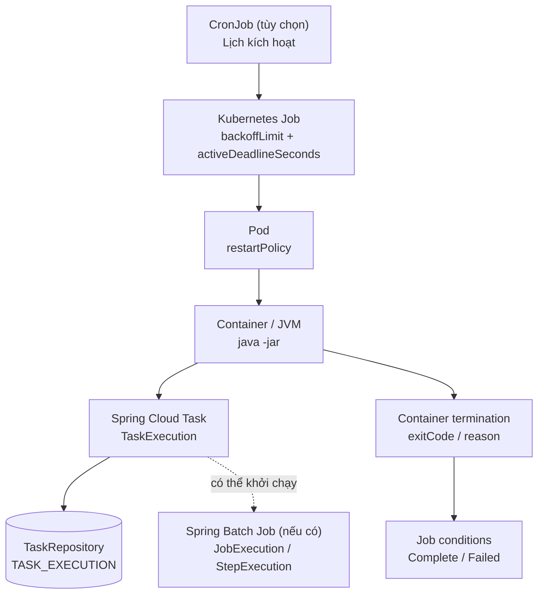
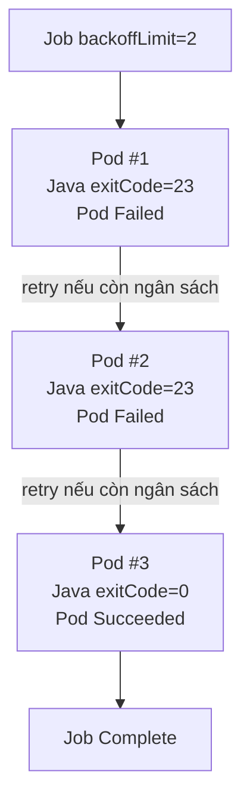
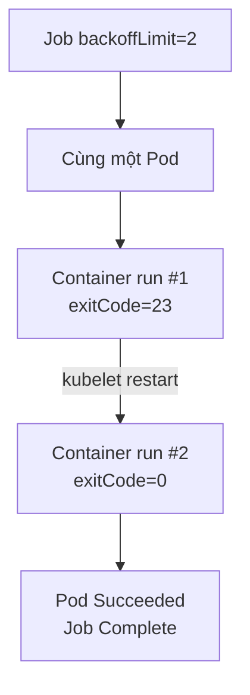
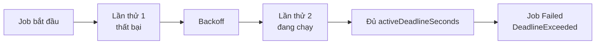

# restartPolicy, backoffLimit và activeDeadlineSeconds

## Mục tiêu bài học

Trong chương **Triển khai** của mô-đun **Spring Cloud Task**, bài này giải thích ba thuộc tính quan trọng khi chạy một ứng dụng Spring Boot hữu hạn bằng **Kubernetes Job** hoặc **CronJob**: `restartPolicy`, `backoffLimit` và `activeDeadlineSeconds`. Chúng quyết định *cách thử lại sau lỗi*, *khi nào ngừng thử* và *khi nào toàn bộ lượt chạy phải dừng vì quá hạn*.

Sau bài học, bạn có thể:

- Xác định đúng **cấp cấu hình** của từng thuộc tính trong manifest Job/CronJob.
- So sánh `restartPolicy: Never` với `restartPolicy: OnFailure`; biết container được khởi động lại trong cùng Pod hay controller tạo Pod khác.
- Giải thích ý nghĩa của `backoffLimit: 0`, số lần thử lại, backoff tăng dần và chính sách phân loại lỗi theo mã thoát.
- Sử dụng `activeDeadlineSeconds` để giới hạn **thời lượng tổng thể của một Job**, kể cả khi Job đang retry.
- Phân biệt `activeDeadlineSeconds` của **Job**, `activeDeadlineSeconds` của **Pod** và `startingDeadlineSeconds` của **CronJob**.
- Viết manifest, chạy thử thành công/thất bại, đọc Pod/Job conditions và exit code bằng `kubectl`.
- Đối chiếu `TaskExecution` trong `TaskRepository` với trạng thái Kubernetes, nhận diện lịch sử chưa được cập nhật khi tiến trình bị kill.
- Thiết kế retry an toàn, idempotency, timeout, giám sát và lưu trữ metadata cho tác vụ theo lịch hoặc theo yêu cầu.

## 1. Một tác vụ hữu hạn có thể thất bại ở nhiều tầng

Giả sử ứng dụng `rental-reconcile` chạy mỗi đêm để đối soát giao dịch thuê xe ngày `2026-11-23`:

1. Kubernetes tạo **Job** hoặc CronJob tạo ra một Job.
2. Job controller tạo **Pod**; Pod chạy container có tiến trình `java -jar app.jar`.
3. Spring Boot khởi động; Spring Cloud Task bắt đầu ghi metadata vào `TaskRepository`.
4. `ApplicationRunner` hoặc Spring Batch Job chạy nghiệp vụ.
5. Tiến trình Java thoát với một mã kết quả; container kết thúc; Kubernetes cập nhật trạng thái Pod và Job.



**Có ít nhất bốn loại kết quả cần phân biệt:**

| Lớp | Trạng thái/giá trị | Phạm vi |
| --- | --- | --- |
| Spring Cloud Task | `TaskExecution.exitCode`, `endTime`, `errorMessage` | Một lần chạy JVM được framework theo dõi |
| Container | `state.terminated.exitCode`, `reason`, `restartCount` | Một hoặc nhiều lần chạy container |
| Pod | `Pending` / `Running` / `Succeeded` / `Failed` | Một Pod do Job quản lý |
| Kubernetes Job | `Complete` / `Failed`, số Pod đã thành công/thất bại | **Toàn bộ** công việc với chính sách retry |

Một container thất bại **không có nghĩa Job đã thất bại cuối cùng**: Job có thể thử lại rồi thành công. Ngược lại, JVM có thể bị dừng trước khi Spring Cloud Task kịp ghi `endTime`, khiến Job `Failed` nhưng repository vẫn còn một lượt TaskExecution chưa kết thúc.

## 2. Ba thuộc tính nằm ở ba vị trí có chủ đích

Đối với **Job** thông thường:

```yaml
apiVersion: batch/v1
kind: Job
metadata:
  name: rental-reconcile-demo
spec:
  backoffLimit: 2
  activeDeadlineSeconds: 600
  template:
    spec:
      restartPolicy: Never
      containers:
        - name: task
          image: registry.example.com/rental-reconcile:1.0.0
          args: ["--businessDate=2026-11-23"]
```

`registry.example.com/rental-reconcile:1.0.0` là **tên image minh họa**; phải build/push image thật được cluster truy cập trước khi dùng. Manifest trên chủ yếu dùng để học vị trí và quan hệ của ba tham số.

| Thuộc tính | Đường dẫn API | Giá trị điển hình | Điều chỉnh điều gì? |
| --- | --- | --- | --- |
| `restartPolicy` | `Job.spec.template.spec.restartPolicy` | `Never` hoặc `OnFailure` | Kubelet có restart **container trong Pod** khi container lỗi không? |
| `backoffLimit` | `Job.spec.backoffLimit` | `0`, `1`, `2`, mặc định thường là `6` | Khi nào **Job controller** dừng thử lại do đủ số lần thất bại? |
| `activeDeadlineSeconds` | `Job.spec.activeDeadlineSeconds` | Ví dụ `600` (giây) | Giới hạn tổng thời gian Job hoạt động, kể cả các lần thử |

**Quy tắc cú pháp:** `restartPolicy` phải nằm **bên trong Pod template**; `backoffLimit` và `activeDeadlineSeconds` phải nằm ở **`spec` của Job**. Đặt sai cấp YAML có thể khiến Kubernetes từ chối manifest hoặc không áp dụng điều bạn mong đợi.

### 2.1. Không nhầm ba ý nghĩa của “restart”

| Từ thường dùng | Thực chất |
| --- | --- |
| **Container restart** | Kubelet chạy lại container trong cùng Pod theo `restartPolicy: OnFailure` |
| **Job retry** | Job controller tiếp tục thử thực thi công việc, có thể bằng Pod mới và chịu `backoffLimit` |
| **Batch restart** | Spring Batch dùng lại `JobInstance` và `ExecutionContext` để thử `JobExecution` khác, nếu kho metadata và tham số định danh còn nguyên |

Đây là **ba cơ chế độc lập**. Cài `backoffLimit: 2` không tự làm Spring Batch khôi phục từ checkpoint. Tương tự, Spring Batch lưu checkpoint không bảo đảm Kubernetes sẽ còn tiếp tục tạo Pod khi đã đạt deadline.

## 3. `restartPolicy`: container được chạy lại ở đâu?

Kubernetes Job chỉ hỗ trợ hai giá trị cho `spec.template.spec.restartPolicy`:

- `Never`.
- `OnFailure`.

**`Always` không hợp lệ đối với Pod template của Job**, dù `Always` được dùng phổ biến với một số workload chạy liên tục như Deployment.

### 3.1. `Never` — giữ nguyên Pod thất bại để quan sát

Khi container Java trả mã khác `0`, Pod thông thường đi đến trạng thái `Failed`. Nếu Job vẫn còn quyền retry theo `backoffLimit` và chưa hết deadline, **Job controller có thể tạo Pod mới** để thử lại.



Các Pod số 1/2/3 là **kịch bản minh họa về mặt logic**, không phải cam kết hệ thống luôn tạo đúng ba Pod hay đúng các mốc thời gian. Trong thực tế còn có eviction, Pod creation failure, quota, Pod failure policy và race condition của controller.

**Ưu điểm của `Never`:**

- Mỗi lần thử hỏng thường có một **Pod thất bại riêng** để quan sát log và `terminated.exitCode`.
- Dễ phân biệt lượt thử của Kubernetes và `TaskExecution` tương ứng nếu mỗi Pod có một Java process.
- Hữu ích khi debug lỗi nghiệp vụ và khi dùng `podFailurePolicy` để phân loại exit code.

**Giới hạn:** Pod cũ có thể bị xóa bởi TTL, CronJob history cleanup hoặc thao tác vận hành. Cần log tập trung và metadata bền vững nếu phải kiểm toán lâu dài.

### 3.2. `OnFailure` — restart container ngay trong Pod

Khi container thoát với lỗi, **kubelet** có thể khởi động lại container đó **trong cùng Pod**:



Kubernetes vẫn có thể tạo Pod mới nếu **toàn bộ Pod** thất bại hoặc node bị thay thế; `OnFailure` không hứa rằng mọi lượt thử chỉ nằm trong một Pod duy nhất.

**Ưu điểm của `OnFailure`:** tiết kiệm chi phí tạo Pod mới trong một số trường hợp lỗi tạm thời; phù hợp nếu ứng dụng có tính lặp an toàn và không cần giữ từng Pod thất bại.

**Rủi ro với Spring Cloud Task:**

- Mỗi lần **JVM được chạy lại** là một lần thực thi ứng dụng mới, có thể ghi **TaskExecution mới**, dù tên Pod không đổi.
- `restartCount` tăng nhưng `kubectl get pods` chỉ cho thấy một Pod; nếu chỉ đếm Pod, bạn có thể **bỏ sót nhiều lần chạy nghiệp vụ**.
- Log của container trước đó cần xem bằng `kubectl logs --previous` (nếu runtime vẫn giữ); không được cho rằng log mới chứa lỗi cũ.
- Khi đã chạm `backoffLimit`, Kubernetes có thể kết thúc Pod, khiến việc giữ log thất bại trở nên khó hơn.

### 3.3. So sánh nhanh

| Câu hỏi | `Never` | `OnFailure` |
| --- | --- | --- |
| Container lỗi trong Pod còn khả năng chạy? | Không restart container lỗi trong Pod đó | Kubelet có thể restart container trong cùng Pod |
| Job còn retry? | Thường tạo Pod thay thế | Có thể restart container hoặc tạo Pod nếu Pod hỏng |
| Theo dõi số lượt thử | Thường quan sát nhiều Pod thất bại | Xem cả `restartCount` trong một Pod |
| Điều tra log lỗi | Dễ gắn với Pod cũ hơn | Phải dùng `--previous` hoặc log tập trung |
| Hỗ trợ `podFailurePolicy` | **Có**, theo yêu cầu API | **Không**, policy yêu cầu `Never` |
| Bảo đảm exactly-once | **Không** | **Không** |

Với tác vụ đối soát có tác động đến database và cần audit từng lần thử, **`Never` thường là lựa chọn dễ kiểm soát hơn**. Tuy nhiên, cả hai đều yêu cầu thiết kế idempotency.

## 4. `backoffLimit`: bao nhiêu lỗi thì Job dừng?

`Job.spec.backoffLimit` là ngân sách retry của Job. Kubernetes mặc định đặt `backoffLimit=6` trong trường hợp Job thông thường, trừ các cấu hình Indexed Job dùng `backoffLimitPerIndex` (khi đó default toàn cục khác).

| Cấu hình | Ý nghĩa thực tế |
| --- | --- |
| `backoffLimit: 0` | Không chủ ý retry sau khi có lần thất bại được tính vào ngân sách |
| `backoffLimit: 1` | Ngân sách retry rất nhỏ; cần kiểm tra đúng số Pod/lượt khởi chạy thực tế |
| `backoffLimit: 2` | Cho phép một số lỗi tạm thời trước khi Job bị đánh dấu thất bại |
| Không khai báo | Mặc định thường là `6`, không có nghĩa sáu lần thử thêm luôn được bảo đảm |

**Không dùng `backoffLimit` như bộ đếm chính xác số lượt Java đã chạy.** Theo tài liệu Kubernetes, Job controller tính lỗi dựa trên:

1. Số Pod thuộc Job có `status.phase = Failed`.
2. Khi `restartPolicy=OnFailure`, tổng số lần container restart trong các Pod thuộc trạng thái `Pending` hoặc `Running`.

Khi ngưỡng được chạm theo cơ chế controller, Job được xem là thất bại; Pod đang chạy có thể bị kết thúc. Nếu bạn cần **đếm đúng bao nhiêu lần nghiệp vụ đã bắt đầu**, dùng `TaskExecutionId`, log và audit dữ liệu, không suy từ một trường `backoffLimit`.

### 4.1. Backoff tăng dần

Kubernetes áp dụng **exponential backoff** khi tạo lại Pod hoặc chạy lại container sau lỗi. Tài liệu Job hiện hành nêu chuỗi khởi đầu cỡ `10s, 20s, 40s...` và có giới hạn trên; các phiên bản Kubernetes khác nhau có thể công bố giá trị trần khác nhau.

```text
Tác vụ lỗi lần đầu
    ↓ chờ backoff
Thử lại → nếu tiếp tục lỗi
    ↓ chờ lâu hơn
Thử lại → hết ngân sách backoffLimit
    ↓
Job Failed (reason có thể là BackoffLimitExceeded)
```

Các khoảng này là **backoff của Kubernetes**, không phải retry do bạn viết trong HTTP client, database driver hoặc Spring Batch. Nếu **mỗi lần Java lại tự retry 10 lần**, còn Kubernetes cũng retry nhiều lượt, tổng số yêu cầu tới hệ thống ngoài có thể tăng mạnh.

### 4.2. `backoffLimit: 0` có nghĩa “at most once” không?

**Không.** `backoffLimit: 0` chỉ hạn chế đường retry thông thường của controller. Tài liệu Kubernetes cảnh báo ngay cả Job có `parallelism=1`, `completions=1` và `restartPolicy=Never`, cùng chương trình vẫn **có thể được bắt đầu nhiều lần** trong một số sự cố điều phối.

Do đó, hệ thống xử lý giao dịch cần:

- **Business key** rõ ràng, chẳng hạn `(partnerId, businessDate)`.
- Unique constraint hoặc idempotent upsert ở database đích.
- Kiểm soát concurrent execution/khóa nghiệp vụ nếu hai Job khác nhau cùng nhận một ngày.
- Kết quả có thể kiểm tra lại sau khi một lần chạy kết thúc không rõ ràng.

### 4.3. Retry lỗi tạm thời, dừng ngay lỗi cố định

Ví dụ hợp đồng mã thoát do **ứng dụng tự quy định**:

| Mã từ Java | Tình huống | Retry có ích không? |
| --- | --- | --- |
| `0` | Đối soát thành công | Không cần |
| `12` | `businessDate` sai hoặc thiếu file bắt buộc vĩnh viễn | Thường không; sửa đầu vào |
| `23` | HTTP 503/timeout từ đối tác | Có thể, với backoff và giới hạn |
| `1` | Lỗi chung, chưa phân loại | Cần xem logs trước khi quyết định |
| `137` hoặc `OOMKilled` | Container bị kill, thường do bộ nhớ | Chẩn đoán resource; retry y nguyên có thể lặp lỗi |

`12` và `23` là **mã minh họa**, không phải chuẩn do Kubernetes hay Spring Cloud Task bắt buộc.

Nếu dùng cùng `backoffLimit=3` cho mọi lỗi, Job có thể thử lại cả trường hợp cấu hình sai, vừa lãng phí tài nguyên vừa gây nhiễu cảnh báo. Khi cần phân loại bằng exit code, xem `podFailurePolicy` ở mục 10.

## 5. `activeDeadlineSeconds`: giới hạn toàn bộ thời gian Job

`Job.spec.activeDeadlineSeconds` là số **giây tối đa** Job được phép hoạt động, tính theo vòng đời Job và bao gồm các lần thử lại; **không phải** chỉ thời gian chạy phần `ApplicationRunner` trong một JVM.

Ví dụ:

```yaml
spec:
  backoffLimit: 5
  activeDeadlineSeconds: 180
```

Nếu Job đã hoạt động đủ khoảng `180` giây mà chưa hoàn thành, Job controller sẽ chấm dứt những Pod còn chạy và Job chuyển sang điều kiện **`Failed`**, thường có `reason: DeadlineExceeded`.



### 5.1. Deadline **ưu tiên hơn** retry budget

Theo tài liệu chính thức của Kubernetes:

> `activeDeadlineSeconds` của Job có **ưu tiên hơn** `backoffLimit`.

Điều đó có nghĩa Job **ngừng thử** khi chạm thời hạn kể cả khi chưa sử dụng hết các lần retry. Không cấu hình `backoffLimit: 100` để “bảo đảm sẽ thử đủ” nếu `activeDeadlineSeconds` chỉ cho phép một khoảng rất ngắn.

### 5.2. Deadline có reset mỗi lần Pod được tạo không?

**Không.** Đây là thời lượng của **Job**, không phải “mỗi Pod được thêm `180` giây”. Một Pod mới có thể chỉ nhận **phần thời gian còn lại** của deadline Job.

Ví dụ khái niệm:

| Mốc thời gian tính từ khi Job bắt đầu | Sự kiện |
| --- | --- |
| `0s` | Job bắt đầu |
| `60s` | Lượt Java đầu thất bại |
| `90s` | Lượt thử lại bắt đầu |
| `180s` | Job hết deadline, dù Pod thứ hai mới chạy được khoảng `90s` |

Đừng dùng bảng trên làm dự báo thời gian chính xác vì scheduling, image pull, delay/reconciliation và shutdown có thể làm các mốc dao động. Trong Kubernetes, khi Job được **suspend rồi resume**, start time để tính active deadline có thể được đặt lại theo hành vi được tài liệu mô tả; cần kiểm tra nếu hệ thống có sử dụng `spec.suspend`.

### 5.3. Deadline không phải cam kết rollback

Khi hết deadline, Kubernetes yêu cầu dừng Pod; có thể có giai đoạn shutdown graceful rồi cưỡng bức kill. Java có thể chưa kịp ghi `TaskExecution.endTime`, Batch Step vẫn có metadata `STARTED`, hoặc dữ liệu nghiệp vụ đã commit một phần.

**Không coi `DeadlineExceeded` là “không có dữ liệu được ghi”.** Phải đối chiếu kết quả nghiệp vụ, database, logs và metadata. Nếu có retry ở cấp CronJob hoặc chạy lại thủ công, tác vụ cần idempotency.

### 5.4. Cảnh báo ba trường “deadline”

| Trường | Đường dẫn | Ý nghĩa |
| --- | --- | --- |
| **Job active deadline** | `Job.spec.activeDeadlineSeconds` | Tổng thời gian Job hoạt động trước khi thất bại |
| **Pod active deadline** | `Job.spec.template.spec.activeDeadlineSeconds` | Giới hạn vòng đời **Pod**; không thay thế giới hạn ở cấp Job |
| **CronJob start deadline** | `CronJob.spec.startingDeadlineSeconds` | Cho phép Job được **tạo trễ tối đa bao lâu so với lịch** |

Viết `activeDeadlineSeconds` **bên trong Pod template** sẽ tạo giới hạn Pod khác với giới hạn Job được đề cập ở bài. Viết `startingDeadlineSeconds` vào `Job.spec` cũng không tạo ra giới hạn thời lượng chạy Job.

## 6. Ví dụ đầy đủ: Job chạy Spring Cloud Task một lần

Giả sử ứng dụng đã được đóng gói thành image `registry.example.com/rental-reconcile:1.0.0`, dùng `@EnableTask`, nhận `--businessDate`, xử lý xong rồi trả mã thoát phù hợp.

Manifest `reconcile-job.yaml`:

```yaml
apiVersion: batch/v1
kind: Job
metadata:
  name: rental-reconcile-20261123
  labels:
    app: rental-reconcile
spec:
  completions: 1
  parallelism: 1
  backoffLimit: 2
  activeDeadlineSeconds: 900
  ttlSecondsAfterFinished: 86400
  template:
    metadata:
      labels:
        app: rental-reconcile
    spec:
      restartPolicy: Never
      terminationGracePeriodSeconds: 30
      containers:
        - name: task
          image: registry.example.com/rental-reconcile:1.0.0
          imagePullPolicy: IfNotPresent
          args:
            - "--businessDate=2026-11-23"
          resources:
            requests:
              cpu: "250m"
              memory: "256Mi"
            limits:
              cpu: "1"
              memory: "512Mi"
          env:
            - name: SPRING_DATASOURCE_URL
              value: "jdbc:postgresql://postgres.example.svc:5432/taskdb"
            - name: SPRING_DATASOURCE_USERNAME
              valueFrom:
                secretKeyRef:
                  name: task-db-credentials
                  key: username
            - name: SPRING_DATASOURCE_PASSWORD
              valueFrom:
                secretKeyRef:
                  name: task-db-credentials
                  key: password
```

Các giá trị hostname, Secret, tên image và tài nguyên là **ví dụ**, không phải tài nguyên có sẵn. Cần tạo database/schema và Secret đúng namespace, cấu hình driver PostgreSQL trong image, bảo đảm network policy cho phép truy cập.

Giải thích các lựa chọn:

1. `completions: 1` và `parallelism: 1`: mục tiêu là một kết quả hoàn tất, không chủ động yêu cầu nhiều Pod song song.
2. `restartPolicy: Never`: dễ giữ Pod thất bại riêng để điều tra, trong khi Job controller quyết định retry.
3. `backoffLimit: 2`: ngân sách retry có giới hạn; không sử dụng vô hạn.
4. `activeDeadlineSeconds: 900`: tổng thời lượng Job tối đa **15 phút**, gồm các lượt thử và backoff.
5. `ttlSecondsAfterFinished: 86400`: Job hoàn thành hoặc thất bại có thể bị TTL controller xóa sau **24 giờ**; dữ liệu logs/metadata cần lưu riêng trước khi dọn.
6. `terminationGracePeriodSeconds: 30`: cho container thời gian shutdown graceful khi hệ thống yêu cầu dừng, **không bảo đảm** mọi callback cuối sẽ luôn chạy.
7. `env.valueFrom.secretKeyRef`: lấy thông tin đăng nhập DB từ Kubernetes Secret; **không** truyền mật khẩu trong `args` vì tham số Task có thể được Spring Cloud Task ghi vào metadata.

Để Java là tiến trình chính, Dockerfile nên dùng **exec-form**:

```dockerfile
FROM eclipse-temurin:21-jre
WORKDIR /app
COPY target/rental-reconcile-0.0.1-SNAPSHOT.jar /app/app.jar
ENTRYPOINT ["java", "-jar", "/app/app.jar"]
```

Đây là ví dụ Java 21; phải khớp phiên bản Java được dùng khi build và các thư viện Spring Boot/Spring Cloud. Nếu dùng shell entrypoint `sh -c "java ...; echo done"`, exit code của shell có thể che lỗi Java.

## 7. Ví dụ đối chiếu: cùng Job nhưng `OnFailure`

Đổi **chỉ** phần Pod restart policy và giữ các cấu hình khác:

```yaml
spec:
  backoffLimit: 2
  activeDeadlineSeconds: 900
  template:
    spec:
      restartPolicy: OnFailure
      containers:
        - name: task
          image: registry.example.com/rental-reconcile:1.0.0
```

Đây là **trích đoạn cấu hình**, không phải Job YAML hoàn chỉnh. Với `OnFailure`, một Pod có thể chạy nhiều lượt Java. Khi kiểm tra, hãy quan sát:

- `kubectl get pod ... -o jsonpath='{.status.containerStatuses[0].restartCount}'`.
- `kubectl logs POD_NAME -c task --previous` để xem log của container trước, nếu còn.
- `kubectl describe pod POD_NAME` để xem trạng thái và lý do restart.
- `TaskRepository`: có thể có nhiều `TASK_EXECUTION_ID` dù chỉ nhìn thấy **một Pod**.

**Đề xuất thực hành:** khi mới debug một Spring Cloud Task có ghi DB hoặc chạy Batch Job, thử `Never` trước; sau khi xác nhận idempotency và log tập trung, mới đánh giá `OnFailure` theo nhu cầu vận hành.

## 8. CronJob: đặt ba tham số vào đúng `jobTemplate`

CronJob quyết định **khi nào tạo Job**. Chính các Job được tạo ra mới chịu `restartPolicy`, `backoffLimit` và `activeDeadlineSeconds`.

Ví dụ chạy lúc 02:00 theo múi giờ Việt Nam:

```yaml
apiVersion: batch/v1
kind: CronJob
metadata:
  name: rental-reconcile-nightly
spec:
  schedule: "0 2 * * *"
  timeZone: "Asia/Ho_Chi_Minh"
  concurrencyPolicy: Forbid
  startingDeadlineSeconds: 600
  successfulJobsHistoryLimit: 3
  failedJobsHistoryLimit: 3
  jobTemplate:
    spec:
      backoffLimit: 2
      activeDeadlineSeconds: 900
      template:
        spec:
          restartPolicy: Never
          containers:
            - name: task
              image: registry.example.com/rental-reconcile:1.0.0
              args: ["--businessDate=2026-11-23"]
```

**Đây là ví dụ cố định ngày để minh họa cú pháp.** Không dùng `--businessDate=2026-11-23` cho một CronJob chạy mãi: phải tính ngày nghiệp vụ từ lịch/snapshot theo múi giờ và quy tắc đóng sổ, hoặc truyền tham số qua cơ chế launch thích hợp. Nếu không, CronJob sẽ xử lý lặp lại đúng một ngày.

### 8.1. Ba thuộc tính CronJob thường bị nhầm với retry

| Thuộc tính | Ý nghĩa |
| --- | --- |
| `schedule: "0 2 * * *"` | Lịch **tạo Job** lúc 02:00 mỗi ngày |
| `concurrencyPolicy: Forbid` | Không chủ động tạo lượt Job trùng lịch khi Job trước do **cùng CronJob** còn hoạt động |
| `startingDeadlineSeconds: 600` | Nếu lịch bị trễ, Job chỉ được tạo trong cửa sổ trễ **10 phút** theo chính sách CronJob |

`startingDeadlineSeconds` **không** phải thời gian tối đa để tác vụ chạy. Sau khi Job được tạo, `activeDeadlineSeconds: 900` mới quy định thời lượng Job.

`concurrencyPolicy: Forbid` không khóa toàn bộ cluster: một Job chạy thủ công, một CronJob khác hoặc sự cố controller vẫn có thể gây xử lý trùng. **Idempotency ở dữ liệu nghiệp vụ vẫn bắt buộc.**

### 8.2. Lựa chọn `Allow`, `Forbid`, `Replace`

| CronJob concurrency policy | Hành vi | Khi cân nhắc |
| --- | --- | --- |
| `Allow` (mặc định) | Cho phép các lượt theo lịch chồng nhau | Mỗi lượt độc lập và không tranh chấp dữ liệu |
| `Forbid` | Bỏ qua lượt mới nếu lượt trước của cùng CronJob còn chạy | Đối soát ngày không được chạy chồng |
| `Replace` | Thay lượt đang chạy bằng Job mới theo lịch | Chỉ khi có cơ chế dừng và khôi phục an toàn |

Không dùng `Replace` cho công việc có tác dụng phụ không thể đảo ngược nếu chưa thử tình huống bị dừng giữa commit. Khi dùng `Forbid`, một lần chạy quá lâu có thể khiến lịch kế tiếp bị bỏ qua; cần cảnh báo và kế hoạch xử lý ngày bị bỏ lỡ.

## 9. Thực hành: quan sát Kubernetes Job bằng `kubectl`

**Điều kiện:** image, namespace, Secret, DB và cluster được chuẩn bị trước. Không chạy thí nghiệm cố tình tạo lỗi trên hệ thống production. Các lệnh sau chỉ là **hướng dẫn để thực hành trên cluster thử nghiệm**.

### 9.1. Kiểm tra YAML trước khi tạo

```bash
kubectl apply --dry-run=server -f reconcile-job.yaml
kubectl apply -f reconcile-job.yaml
```

Kết quả `kubectl apply` thành công chỉ xác nhận **API chấp nhận khai báo**, không có nghĩa Job xử lý thành công.

### 9.2. Xem Job và những Pod thuộc Job

```bash
kubectl get job rental-reconcile-20261123
kubectl describe job rental-reconcile-20261123
kubectl get pods -l batch.kubernetes.io/job-name=rental-reconcile-20261123
```

Nhãn `batch.kubernetes.io/job-name` được Job controller gắn trên các Pod ở những phiên bản hiện đại; với cluster cũ, có thể cần kiểm tra nhãn `job-name` thực tế trong Pod.

Đọc log của một Pod:

```bash
kubectl logs pod/POD_NAME -c task
```

Thay `POD_NAME` bằng tên thật lấy từ `kubectl get pods`. Nếu `restartPolicy: Never` và Job đã retry, **có thể có nhiều Pod**: phải xem log của các Pod thất bại trước đó chứ không chỉ Pod hiện tại.

### 9.3. Đọc mã thoát container và số lần restart

Với Pod có **một container chính**:

```bash
kubectl get pod POD_NAME \
  -o jsonpath='{.status.containerStatuses[0].state.terminated.exitCode}'

kubectl get pod POD_NAME \
  -o jsonpath='{.status.containerStatuses[0].state.terminated.reason}'

kubectl get pod POD_NAME \
  -o jsonpath='{.status.containerStatuses[0].restartCount}'
```

Nếu container **chưa ở trạng thái terminated** (đang Running hoặc Waiting), trường `state.terminated.exitCode` có thể rỗng; đó không phải mã `0`. Trong `OnFailure`, container hiện tại có thể đang chạy, còn lần trước nằm ở `lastState.terminated`:

```bash
kubectl get pod POD_NAME \
  -o jsonpath='{.status.containerStatuses[0].lastState.terminated.exitCode}'

kubectl logs POD_NAME -c task --previous
```

Khi Pod có sidecar hoặc nhiều container, **đừng mặc định containerStatuses[0] là Java Task**; xem tên container và chọn đúng `task`. Với PowerShell, nhập các lệnh trên một dòng hoặc dùng cú pháp nối dòng của PowerShell; dấu `\` ở cuối dòng là cú pháp shell kiểu Bash.

### 9.4. Đọc trạng thái cuối của Job

```bash
kubectl get job rental-reconcile-20261123 -o yaml
kubectl describe job rental-reconcile-20261123
```

Trong `status.conditions`, xem:

- `type: Complete`, `status: "True"`: Job đạt điều kiện hoàn thành.
- `type: Failed`, `status: "True"`: Job đã thất bại.
- `reason: BackoffLimitExceeded` hoặc lý do tương tự: đã chạm cơ chế giới hạn retry.
- `reason: DeadlineExceeded`: đã chạm `activeDeadlineSeconds`.

Kubernetes có thể chưa ghi điều kiện cuối cho đến khi những Pod liên quan thực sự kết thúc. **Đọc `Failed` của một Pod không thay thế điều kiện `Failed` của Job.**

Nếu chỉ cần chờ Job thành công:

```bash
kubectl wait --for=condition=complete job/rental-reconcile-20261123 --timeout=20m
```

**Cảnh báo:** lệnh này không tự động phân tích nguyên nhân Job thất bại ngay lập tức; có thể đợi đến timeout khi Job đã `Failed`. Muốn pipeline CI phản ứng đúng, cần **kiểm tra cả condition `Complete` và `Failed`**, lấy reason/message và giới hạn thời gian chờ.

### 9.5. Đối chiếu với Spring Cloud Task

Nếu ứng dụng dùng database Task bền vững, truy vấn:

```sql
SELECT
    TASK_EXECUTION_ID,
    TASK_NAME,
    START_TIME,
    END_TIME,
    EXIT_CODE,
    EXIT_MESSAGE,
    ERROR_MESSAGE
FROM TASK_EXECUTION
WHERE TASK_NAME = 'rental-reconcile'
ORDER BY TASK_EXECUTION_ID DESC;
```

`TASK_NAME` ở SQL chỉ là ví dụ; tên thực tế có thể đến từ `spring.application.name` hoặc `spring.cloud.task.name`. Với các lần thử lại, kiểm tra từng `TaskExecutionId` và mốc thời gian để gắn đúng với Pod/container:

| Kubernetes | Spring Cloud Task | Diễn giải |
| --- | --- | --- |
| Container `exitCode=0`, Job `Complete` | `EXIT_CODE=0`, `END_TIME` có giá trị | Luồng hoàn thành bình thường, còn phải kiểm tra dữ liệu nghiệp vụ |
| Một Pod `Failed`, Job cuối `Complete` | Ít nhất một lượt Task có thể lỗi, lượt sau thành công | Retry đã giải quyết lỗi; xem **mọi lần thử** |
| Job `Failed` vì deadline | `END_TIME` có thể `NULL` | JVM bị dừng trước khi repository cập nhật |
| `OnFailure`, một Pod `restartCount=2` | Có thể có nhiều TaskExecution | Mỗi restart JVM có thể tạo một lượt Task khác |
| Pod chưa khởi động Java vì `ImagePullBackOff` | Không có TaskExecution mới | Lỗi hạ tầng trước khi Spring Cloud Task bắt đầu |

**Không sửa trực tiếp `TASK_EXECUTION.EXIT_CODE` về `0` để làm đẹp lịch sử.** Với bản ghi bị treo, cần quy trình điều tra riêng, kết hợp Job/Pod status, logs, ID và dữ liệu đầu ra.

## 10. Tùy chọn nâng cao: `podFailurePolicy` phân loại exit code

Khi `backoffLimit` chưa đủ để phân biệt lỗi không thể retry và lỗi tạm thời, Kubernetes cung cấp `Job.spec.podFailurePolicy`. Tính năng ổn định ở Kubernetes 1.31 trở đi, và **yêu cầu `restartPolicy: Never`**.

Ví dụ: Job phải **dừng ngay** nếu ứng dụng trả `12` (đầu vào không hợp lệ), nhưng vẫn dùng backoff cho những mã lỗi khác:

```yaml
apiVersion: batch/v1
kind: Job
metadata:
  name: rental-reconcile-policy
spec:
  backoffLimit: 3
  activeDeadlineSeconds: 900
  podFailurePolicy:
    rules:
      - action: FailJob
        onExitCodes:
          containerName: task
          operator: In
          values: [12]
  template:
    spec:
      restartPolicy: Never
      containers:
        - name: task
          image: registry.example.com/rental-reconcile:1.0.0
          args: ["--businessDate=2026-11-23"]
```

Quy tắc:

- Nếu container `task` kết thúc bằng `12`, controller có thể đánh dấu Job thất bại **không cần chờ hết `backoffLimit`**.
- Các lỗi khác không khớp rule đi theo cách tính thất bại mặc định, có thể tiếp tục retry trong ngân sách.
- `podFailurePolicy.rules` được xét **theo thứ tự**; rule đầu tiên khớp sẽ quyết định hành động.
- Các action có thể gồm `FailJob`, `Ignore`, `Count` và `FailIndex` trong ngữ cảnh Indexed Job.

Trong thực tế, bạn còn có thể bỏ qua một số Pod failure do gián đoạn hạ tầng bằng `Ignore` theo `DisruptionTarget`. **Không lạm dụng `Ignore`**: một lỗi bị bỏ qua nhiều lần có thể khiến hệ thống cần phụ thuộc nhiều vào `activeDeadlineSeconds` để dừng.

### 10.1. `backoffLimitPerIndex` không phải cùng `backoffLimit`

Với Indexed Job xử lý nhiều partition/index, Kubernetes hỗ trợ `backoffLimitPerIndex` để quản lý số lần thất bại **riêng từng index**. Nó được đánh dấu ổn định từ Kubernetes 1.33. Khi đặt `backoffLimitPerIndex`, mặc định của `backoffLimit` toàn cục có thể trở thành giá trị rất lớn (`MaxInt32`) nếu không ghi rõ.

Bài này tập trung **non-indexed Job với `completions: 1`**. Khi chuyển sang Indexed Job, phải thiết kế lại phạm vi partition, idempotency theo index, `maxFailedIndexes` và policy dừng, không dùng y nguyên bảng retry của một Job một tiến trình.

## 11. Timeout ở ứng dụng khác timeout ở Kubernetes

Ba tham số Kubernetes không thay thế timeout của logic nghiệp vụ:

| Cấp | Ví dụ | Khi nào cần? |
| --- | --- | --- |
| HTTP client | Kết nối 5s, đọc 30s | Một yêu cầu đến đối tác không treo vô hạn |
| Database / transaction | Query timeout, statement timeout | Một truy vấn không giữ lock quá lâu |
| Spring Batch Step | Giới hạn thời gian theo logic ứng dụng | Step dữ liệu quá hạn phải báo lỗi rõ |
| **Kubernetes Job** | `activeDeadlineSeconds: 900` | Toàn bộ việc chạy/retry không vượt 15 phút theo chính sách |
| Kubernetes Pod shutdown | `terminationGracePeriodSeconds: 30` | Cơ hội đóng tài nguyên khi nhận tín hiệu dừng |
| CronJob | `startingDeadlineSeconds: 600` | Không khởi chạy quá trễ so với lịch |

**Khuyến nghị thiết kế:** timeout nội bộ nên **ngắn hơn** active deadline để Java có cơ hội phát lỗi, đóng Spring Context và cập nhật TaskRepository. Nhưng kể cả như vậy, vẫn phải chuẩn bị cho trường hợp node chết, OOM hoặc `SIGKILL`, khi callback cuối không chạy.

### 11.1. Mã thoát và việc ghi metadata

Trong Spring Boot, có thể dùng `ExitCodeGenerator`/`ExitCodeExceptionMapper` để phân loại lỗi ứng dụng. Một exception không được nuốt trong runner giúp framework biết tác vụ thất bại.

Nếu ứng dụng tự bắt mọi exception rồi in `"ERROR"` nhưng return bình thường, Java có thể thoát `0`; Job controller sẽ hiểu đó là thành công và không retry, bất kể bảng nghiệp vụ sai.

Với Spring Batch, một `JobExecution` có trạng thái `FAILED` đôi khi **không tự dẫn tới exit code khác `0`** nếu không cấu hình đường ánh xạ. Khi tích hợp Spring Cloud Task/Batch phù hợp, kiểm tra `spring.cloud.task.batch.fail-on-job-failure=true` và **đo mã thoát Java thực tế**, không chỉ đọc `BatchStatus`.

### 11.2. Tại sao Job deadline có thể làm Task “kẹt đang chạy”?

`TaskLifecycleListener` của Spring Cloud Task cập nhật `endTime` khi nhận được đường kết thúc bình thường. Nếu container bị kill trước khi code cuối được thực thi, có thể tồn tại:

```text
Kubernetes:
  Job condition = Failed
  reason = DeadlineExceeded
  Pod/container = Terminated

Spring Cloud Task:
  START_TIME = 02:00
  END_TIME = NULL
  EXIT_CODE = NULL hoặc giá trị chưa phản ánh lỗi cuối
```

Đây là **sai khác có thể giải thích**, không phải bằng chứng Job vẫn đang chạy. Đối chiếu container và database trước khi quyết định chạy lại hoặc chỉnh sửa metadata theo chính sách kiểm toán.

## 12. Bảng chẩn đoán lỗi phổ biến

| Hiện tượng | Nguyên nhân khả dĩ | Cách kiểm tra/xử lý |
| --- | --- | --- |
| Job YAML bị từ chối với `restartPolicy: Always` | Job không chấp nhận `Always` | Chỉ dùng `Never` hoặc `OnFailure` |
| `restartPolicy` không có tác dụng mong đợi | Đặt sai cấp YAML hoặc đang nhìn **Job** thay vì Pod | Kiểm tra `spec.template.spec.restartPolicy` |
| Java trả lỗi liên tục dù backoff đã đặt | Lỗi cố định đầu vào, DB sai hoặc image không phù hợp | Xem logs/exit code; dùng fail-fast hoặc `podFailurePolicy` |
| Cùng Pod nhưng Task chạy nhiều lượt | `restartPolicy: OnFailure` | Xem `restartCount`, `--previous` và nhiều TaskExecution |
| Có nhiều Pod `Failed` cho một Job | `Never` và Job controller đã retry | Đọc tất cả Pods, so sánh mốc thời gian và mã lỗi |
| Job `Failed` dù chưa thấy đủ số lần retry | Đã chạm `activeDeadlineSeconds` hoặc `podFailurePolicy` | Kiểm tra Job `reason` và deadline |
| Deadline chưa đến mà Task bị kill | OOM, eviction, tín hiệu khác hoặc Pod-level deadline | Xem Pod reason, events và resource limits |
| Job đạt `DeadlineExceeded`, TaskExecution không có endTime | JVM không kịp cập nhật repository | So sánh Job/Pod logs với Task metadata |
| `kubectl apply` thành công nhưng Job thất bại | API chấp nhận manifest, nghiệp vụ chạy lỗi | Đọc Job conditions, Pod exitCode và log |
| `kubectl wait --for=condition=complete` hết timeout | Job `Failed` hoặc chậm | Kiểm tra cả `Complete` và `Failed`, không coi timeout là nguyên nhân gốc |
| Job `Complete` nhưng nghiệp vụ không đủ dữ liệu | Code nuốt exception hoặc thiếu validation | Kiểm tra số dòng, checksum, DB output và exit mapping |
| CronJob bỏ qua kỳ chạy kế tiếp | `concurrencyPolicy: Forbid`, Job trước còn chạy | Cảnh báo lượt bị bỏ lỡ, kiểm tra duration/deadline |
| CronJob không chạy đúng lịch | Sai timezone, `startingDeadlineSeconds` quá nhỏ, controller trễ | Đọc CronJob events, `schedule` và `timeZone` |
| Retry tạo kết quả trùng | Thiếu idempotency, hai Jobs khác nhau chồng dữ liệu | Unique key, upsert, business lock, quản lý concurrency |
| Mất Pod/log khi kiểm tra sau vài ngày | TTL/cleanup đã xóa Job và Pods | Gửi logs tập trung, retention metadata độc lập |
| `OnFailure` không cho dùng `podFailurePolicy` | API yêu cầu `Never` | Chuyển `restartPolicy: Never` cho policy theo exit code |

## 13. Chính sách thử nghiệm có kiểm soát

Để xác minh ba trường làm đúng điều mong đợi, nên thực hành **trong namespace dev** với một image thử nghiệm có thể chủ động trả mã thoát.

### 13.1. Trường hợp thành công

- `restartPolicy: Never`, `backoffLimit: 0`, `activeDeadlineSeconds: 120`.
- Ứng dụng hoàn thành trong vài giây, trả `0`.
- Quan sát `Pod Succeeded`, `Job Complete` và `TaskExecution.exitCode=0`.

### 13.2. Lỗi cố định không retry

- `restartPolicy: Never`, `backoffLimit: 0`.
- Ứng dụng kiểm tra tham số và trả mã `12`.
- Quan sát `Pod Failed`, Job cuối `Failed` và không kỳ vọng có thêm retry do cấu hình.
- Tìm lý do lỗi trước khi người vận hành chỉnh đầu vào để chạy lại **Job mới**.

### 13.3. Lỗi tạm thời có retry

- `restartPolicy: Never`, `backoffLimit: 2`, deadline đủ dài.
- Ứng dụng giả lập HTTP 503 trong lần thử đầu, sau đó thành công ở lần kế tiếp dựa trên **trạng thái ngoài tiến trình**.
- Quan sát số Pod, logs và số lượt TaskExecution; kiểm tra database đích không có dữ liệu trùng.
- Đừng dùng bộ đếm `static` trong JVM để “chỉ lỗi một lần”: với Pod mới, JVM mới nên biến tĩnh sẽ khởi tạo lại.

### 13.4. `OnFailure` và restart cùng Pod

- `restartPolicy: OnFailure`, `backoffLimit: 2`.
- Cho Java trả mã khác `0` rồi thành công ở lần thử sau.
- Kiểm tra `restartCount` và `lastState.terminated.exitCode`. So sánh số lượt TaskExecution với số Pod.

### 13.5. Deadline thắng backoff

- `restartPolicy: Never`, `backoffLimit: 10`, `activeDeadlineSeconds: 30`.
- Ứng dụng ngủ lâu hơn `30` giây hoặc liên tục lỗi.
- Quan sát `Job Failed`, `reason: DeadlineExceeded` dù chưa đạt ngân sách retry.
- Kiểm tra Pod termination, log, `END_TIME` trong TaskRepository và tác động nghiệp vụ đã commit.

**Không coi mọi tình huống đều phải tạo chính xác một số Pod cố định.** Kết quả có thể bị ảnh hưởng bởi admission policy, node, scheduling, image pull, version Kubernetes và những lần thất bại trước khi container thực sự chạy.

## 14. Checklist đưa vào vận hành

1. **Đúng cấp YAML:** `restartPolicy` trong Pod template; `backoffLimit` và `activeDeadlineSeconds` trong Job spec; với CronJob nằm trong `jobTemplate.spec`.
2. **Mã thoát phản ánh nghiệp vụ:** `0` chỉ khi thành công; tách lỗi không retry và lỗi tạm thời; bảo đảm Java là tiến trình chính của container.
3. **Retry có giới hạn:** đặt `backoffLimit` theo loại lỗi và SLA; nếu cần phân biệt mã, dùng `podFailurePolicy` với `Never`.
4. **Deadline thực tế:** đo thời lượng khởi động và xử lý; chọn `activeDeadlineSeconds` đủ cho những lần thử hợp lệ, nhưng không quá lớn đến mức treo việc.
5. **Giới hạn đồng thời:** CronJob `concurrencyPolicy`, `parallelism`, business lock và idempotency phải nhất quán.
6. **Kho metadata bền vững:** TaskRepository/Batch JobRepository dùng DB có migration; không phụ thuộc H2 trong filesystem tạm của Pod.
7. **Giám sát nhiều lớp:** Job conditions, Pod/container exit codes, logs, `TaskExecution` và kết quả nghiệp vụ; có cảnh báo khi TaskExecution thiếu `endTime`.
8. **Resource và shutdown:** xác định CPU/memory requests/limits, `terminationGracePeriodSeconds` và timeout nội bộ; không phụ thuộc tuyệt đối vào shutdown hook.
9. **Secrets:** dùng Kubernetes Secret/service account, không lưu token/mật khẩu trong `args`, command line, JobParameters hoặc log.
10. **Retention:** `ttlSecondsAfterFinished`/CronJob history limits dọn tài nguyên Kubernetes; chuyển log và audit sang kho bền vững trước khi cleanup.
11. **Tập luyện lỗi:** kiểm chứng `0`, lỗi đầu vào, lỗi tạm thời, OOM và deadline trong môi trường cô lập trước khi bật lịch production.

## 15. Câu hỏi tự đánh giá

**1. `restartPolicy: OnFailure` có tự khởi chạy lại một Job đã có condition `Failed` không?**

> Không. `restartPolicy` là chính sách restart **container trong Pod**. Khi Job đã kết thúc với điều kiện `Failed` do đạt backoff hoặc deadline, Kubernetes không tự reset và chạy lại chính Job đó; phải có thao tác/kỳ lịch mới.

**2. Với `restartPolicy: Never`, lần chạy Java đầu tiên trả `23`, `backoffLimit: 2` thì điều gì có thể xảy ra?**

> Job controller có thể tạo Pod mới để thử lại khi còn ngân sách và chưa hết deadline. Không được kết luận Job đã `Failed` cuối cùng chỉ từ Pod đầu bị lỗi.

**3. `activeDeadlineSeconds: 300` có cấp `300` giây riêng cho mỗi Pod mới không?**

> Không. Đây là giới hạn tổng thời lượng hoạt động của Job, bao gồm các lần retry.

**4. Job còn ngân sách retry nhưng chạm deadline thì sao?**

> Deadline ưu tiên; Job bị kết thúc và có thể có `Failed` với `reason: DeadlineExceeded`.

**5. Một Pod có `restartCount=3` nhưng chỉ có một tên Pod. Vì sao thấy nhiều `TaskExecutionId`?**

> Với `OnFailure`, một Pod có thể chạy lại Java nhiều lần; mỗi lần khởi động JVM là một lượt Spring Cloud Task mới.

**6. `backoffLimit: 0` có đảm bảo dữ liệu nghiệp vụ chỉ được xử lý đúng một lần không?**

> Không. Controller có những tình huống chạy lại/khởi chạy trùng, và có thể có Job khác xử lý cùng business key. Cần idempotency ở ứng dụng và database.

**7. Trong CronJob, `startingDeadlineSeconds` và `activeDeadlineSeconds` khác nhau thế nào?**

> `startingDeadlineSeconds` giới hạn mức trễ được phép khi **tạo Job từ lịch**; `activeDeadlineSeconds` giới hạn **thời gian hoạt động sau khi Job bắt đầu**.

**8. Vì sao `TaskExecution.endTime` có thể `NULL` dù Job đã `Failed`?**

> Java có thể bị kill bởi deadline, OOM hoặc node failure trước khi Spring Cloud Task cập nhật metadata cuối. Cần kiểm tra Job/Pod status và logs cùng database.

**9. Có thể dùng `podFailurePolicy` với `restartPolicy: OnFailure` không?**

> Không. Kubernetes yêu cầu `restartPolicy: Never` khi cấu hình `podFailurePolicy`.

## Ghi nhớ

- **`restartPolicy` thuộc Pod**: `Never` để Pod lỗi và Job có thể tạo Pod mới; `OnFailure` để kubelet restart container trong Pod khi phù hợp.
- **`backoffLimit` thuộc Job**: giới hạn ngân sách retry sau lỗi; không phải bộ đếm chính xác số TaskExecution hay bảo đảm exactly-once.
- **`activeDeadlineSeconds` thuộc Job**: giới hạn thời lượng của **toàn Job**, tính cả retry, và **ưu tiên hơn** `backoffLimit`.
- **CronJob có `startingDeadlineSeconds` riêng**, không được nhầm với thời gian chạy Job.
- **Job Failed khác Pod Failed; Pod Failed khác TaskExecution.exitCode; Java có thể bị kill trước khi cập nhật TaskRepository**.
- Vận hành Spring Cloud Task an toàn cần **exit code đúng, idempotency, deadline, log tập trung, schema/metadata bền vững và quan sát đa tầng**.

## Tài liệu tham khảo

1. [Kubernetes — Jobs: failure/retry, backoffLimit, activeDeadlineSeconds và podFailurePolicy](https://kubernetes.io/docs/concepts/workloads/controllers/job/)
2. [Kubernetes — CronJob: jobTemplate, concurrencyPolicy và startingDeadlineSeconds](https://kubernetes.io/docs/concepts/workloads/controllers/cron-jobs/)
3. [Kubernetes — Pod Lifecycle: restartPolicy, container termination và exit code](https://kubernetes.io/docs/concepts/workloads/pods/pod-lifecycle/)
4. [Kubernetes — Clean Up Finished Jobs Automatically: TTL](https://kubernetes.io/docs/concepts/workloads/controllers/ttlafterfinished/)
5. [Kubernetes API Reference — Job v1](https://kubernetes.io/docs/reference/kubernetes-api/workload-resources/job-v1/)
6. [Kubernetes API Reference — CronJob v1](https://kubernetes.io/docs/reference/kubernetes-api/batch/cron-job-v1/)
7. [Spring Cloud Task — Features: TaskExecution, TaskRepository và metadata](https://docs.spring.io/spring-cloud-task/reference/features.html)
8. [Spring Cloud Task — Batch: Job failure và exit code](https://docs.spring.io/spring-cloud-task/reference/batch.html)
9. [Spring Boot — Application Exit và ExitCodeGenerator](https://docs.spring.io/spring-boot/reference/features/spring-application.html)
