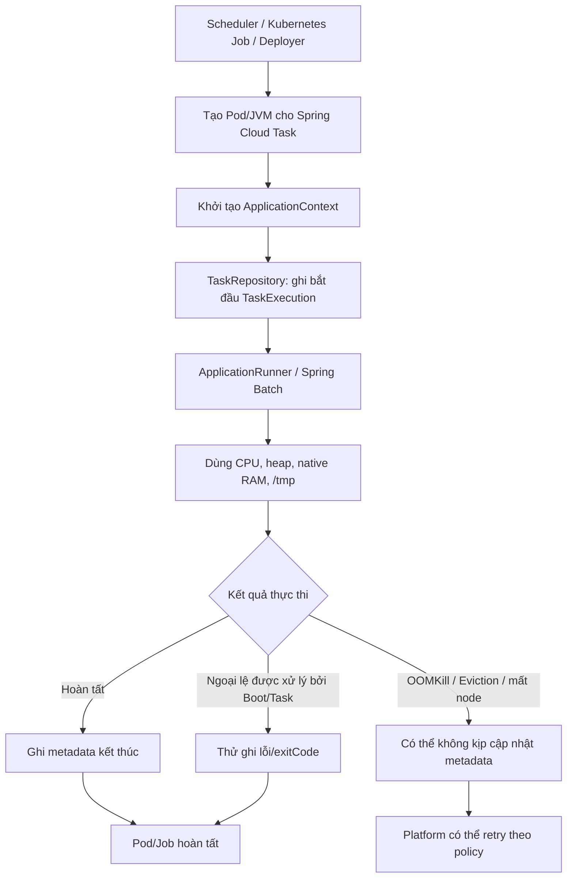

# Tài nguyên CPU, bộ nhớ và vùng lưu trữ tạm khi triển khai Spring Cloud Task

## 1. Tại sao giới hạn tài nguyên quan trọng với một ứng dụng chạy hữu hạn?

Ứng dụng **Spring Cloud Task** thường chỉ khởi động để làm một việc: nhập dữ liệu, tạo báo cáo, đối soát giao dịch hoặc chạy một Spring Batch job rồi kết thúc. Vì vậy, dễ có cảm giác rằng tác vụ “ngắn hạn” không cần được quản lý tài nguyên chặt chẽ như một dịch vụ web lâu dài. Thực tế, một lần chạy Task có thể đọc hàng triệu dòng, tạo tệp trung gian rất lớn hoặc mở nhiều kết nối tới database.

Ví dụ: một ứng dụng `daily-settlement` nhận dữ liệu giao dịch, giải nén tệp CSV 1,5 GiB, tính tổng và tải báo cáo lên object storage. Nếu cấu hình mặc định:

- JVM có thể giữ quá nhiều bản ghi trong heap và gặp `OutOfMemoryError` hoặc bị container `OOMKilled`.
- Tệp giải nén có thể làm đầy `/tmp`, writable layer của container hoặc ổ đĩa tạm trên node.
- CPU quá ít khiến công việc vượt deadline của Kubernetes Job; CPU limit quá thấp có thể gây *throttling* dù máy chủ còn năng lực tính toán.
- Một lần chạy hỏng có thể được scheduler tự động khởi chạy lại và tạo dữ liệu trùng nếu không có cơ chế idempotency.

Bài thuộc chương **Triển khai** của module `SPRING_CLOUD_TASK` này tập trung vào **CPU, bộ nhớ và vùng lưu trữ tạm** khi triển khai ứng dụng Task hữu hạn. Chúng ta dùng Kubernetes Job/CronJob để minh họa rõ resource requests/limits, đồng thời nêu cách tư duy tương tự cho máy ảo hoặc nền tảng cloud khác.

Sau bài này, bạn có thể:

1. Phân biệt `requests` và `limits` đối với CPU, RAM và `ephemeral-storage`.
2. Chọn giới hạn JVM heap có dự phòng cho phần bộ nhớ *ngoài heap*.
3. Hiểu file tạm, log, writable layer, `emptyDir` disk và `emptyDir.medium: Memory` sử dụng tài nguyên ra sao.
4. Viết Kubernetes Job minh họa cho một Spring Cloud Task không chạy web server.
5. Dùng luồng đọc/ghi có giới hạn thay vì tải cả file lớn vào RAM.
6. Điều tra `OOMKilled`, CPU throttling, thiếu vùng đĩa tạm và Pod `Evicted`.
7. Đặt giới hạn số Task chạy song song, timeout, retry và bảo đảm chạy lại an toàn.

## 2. Vòng đời Task liên quan gì đến tài nguyên?

Spring Cloud Task lưu **`TaskExecution`** trong **`TaskRepository`** để theo dõi một lần khởi chạy ứng dụng. Hạ tầng Task tạo metadata khi `ApplicationContext` khởi tạo thành công và cập nhật kết quả khi các runner đồng bộ hoàn tất hoặc ứng dụng đi vào đường lỗi.



Điều này tạo ra một yêu cầu quan trọng: **tài nguyên ảnh hưởng không chỉ đến tốc độ mà còn đến tính đầy đủ của lịch sử thực thi**.

Khi một container bị kernel dừng vì hết bộ nhớ, JVM có thể không nhận được cơ hội chạy shutdown callback để ghi `endTime`. Khi Pod bị eviction do áp lực ổ đĩa, metadata cũng có thể không phản ánh kết quả cuối. Do đó, phải quan sát **cả `TaskRepository` lẫn trạng thái Kubernetes Job/Pod**.

## 3. Ba loại tài nguyên chính

Trong Kubernetes, ứng dụng Task chạy trong container có thể khai báo các `resources.requests` và `resources.limits`.

| Tài nguyên | Đơn vị ví dụ | `requests` dùng để làm gì? | `limits` tác động thế nào? |
| --- | --- | --- | --- |
| **CPU** | `250m`, `1` | Giúp scheduler xét khả năng đặt Pod lên node; ảnh hưởng chia sẻ CPU khi tranh chấp | Kernel thường áp dụng CPU throttling khi container dùng vượt hạn mức |
| **Memory** | `512Mi`, `1Gi` | Cơ sở lập lịch và một số cơ chế phân bổ tài nguyên | Kernel/cgroup có thể OOM kill tiến trình khi vượt giới hạn |
| **Ephemeral storage** | `1Gi`, `2Gi` | Scheduler xét nhu cầu lưu trữ tạm cục bộ của Pod | Kubelet có thể eviction Pod nếu vượt giới hạn theo cơ chế đo lường hỗ trợ |

### 3.1. Phân biệt request và limit

`requests` **không phải** một ổ đĩa riêng hoặc một mức CPU tối đa cho container. Ví dụ, `cpu: 250m` là yêu cầu tương đương 0,25 CPU phục vụ lập lịch/chia sẻ; container có thể sử dụng nhiều hơn trong những điều kiện cho phép.

`limits` là ngưỡng kiểm soát tài nguyên. Đối với CPU, chạm giới hạn dẫn tới **throttling**, không thông thường khiến Pod chết ngay. Đối với memory, vượt giới hạn có thể khiến tiến trình bị **OOM kill**. Với local ephemeral storage, vượt mức sử dụng được kubelet theo dõi có thể làm Pod bị **eviction**. Những giới hạn lưu trữ tạm phụ thuộc layout filesystem và khả năng accounting của cluster.

### 3.2. Đơn vị dễ gây nhầm

- `1000m` CPU = **1 CPU**; `250m` = **0,25 CPU**.
- `1Gi` = 1.073.741.824 byte; `1G` là 1.000.000.000 byte.
- `512Mi` khác `512M`.
- Với `ephemeral-storage`, **`400m` không phải 400 MB**: `m` là hậu tố milli; hãy dùng `400Mi` hoặc `400M` nếu muốn đo dung lượng.

Khi sizing, hãy ghi rõ **đơn vị** và đối chiếu với quy ước môi trường. Tránh ghi “Task cần 1G” mà không biết đó là RAM, dung lượng đĩa hay heap Java.

## 4. CPU: lựa chọn request, limit và mức song song

CPU ảnh hưởng tới thời gian khởi động Spring Boot, giải nén file, mã hóa/giải mã, tính toán dữ liệu và overhead GC. Với một Task phải kết thúc trước deadline, **thời gian CPU bị throttling có thể khiến Job thất bại do quá giờ**, ngay cả khi chương trình không có exception nghiệp vụ.

### 4.1. Cách suy nghĩ khi chọn CPU

Giả sử một Task đo được mức sử dụng như sau khi chạy thử trên dữ liệu đại diện:

| Giai đoạn | Đặc trưng | Gợi ý |
| --- | --- | --- |
| Bootstrap Spring Boot | CPU tăng trong một khoảng ngắn | Không đặt limit quá thấp khiến thời gian startup kéo dài |
| Đọc dữ liệu từ database | Có thể thiên về I/O, CPU thấp | Kiểm tra cả độ trễ truy vấn và connection pool |
| Nén hoặc giải mã báo cáo | Có thể dùng nhiều CPU liên tục | Tăng CPU khi có lợi về throughput |
| Chờ HTTP API bên ngoài | CPU có thể thấp dù task kéo dài | Tập trung timeout, retry/backoff, không chỉ tăng CPU |
| GC khi heap chịu tải | CPU tăng do thu gom bộ nhớ | Tối ưu cách xử lý dữ liệu và heap trước khi chỉ tăng limit |

Không chọn CPU limit chỉ dựa trên số core của node. **Đo throughput, thời gian hoàn tất, thời gian throttling và tải lên downstream** rồi quyết định mức hợp lý.

### 4.2. Một cấu hình minh họa

```yaml
resources:
  requests:
    cpu: "250m"
  limits:
    cpu: "1"
```

Đây là cấu hình cho phép scheduler tính 0,25 CPU yêu cầu và áp trần 1 CPU cho container. Nó **không hứa hẹn** một Task luôn có 1 CPU rảnh, cũng không có nghĩa Task chỉ được dùng 250m. Nếu CPU limit làm giảm hiệu suất đáng kể, điều chỉnh dựa trên đo đạc và chính sách cluster.

### 4.3. Nhiều worker đồng thời

Nếu mỗi Task request 250m và scheduler cho chạy đồng thời 20 Task, phần request cộng lại là **5 CPU**, chưa tính system components và workload khác. Khi Task dùng Spring Batch partitioning hoặc Job với nhiều Pod, cần cân nhắc **ngân sách tổng của cả cụm**:

```text
Tổng CPU request của worker = số worker cùng hoạt động × CPU request mỗi worker
Ví dụ: 20 × 250m = 5000m = 5 CPU
```

Tăng số worker không bảo đảm thời gian xử lý giảm tương ứng; database, object storage hoặc API bên ngoài có thể trở thành nút thắt. Giới hạn số worker, connection pool và tốc độ request cùng với tài nguyên CPU.

## 5. Bộ nhớ: heap Java chỉ là một phần RAM của container

Một lỗi cấu hình phổ biến là thấy container có `memory: 1Gi` rồi đặt `-Xmx1g`. Cách này gần như không để chỗ cho phần bộ nhớ JVM và thư viện sử dụng **ngoài heap**, nên container có thể bị OOM kill dù Java heap chưa gây `OutOfMemoryError`.

Bộ nhớ thực tế có thể bao gồm:

| Thành phần | Ví dụ sử dụng |
| --- | --- |
| **Java heap** | Object, collection, record/row buffer, JSON/CSV parser, dữ liệu nghiệp vụ |
| **Metaspace và code cache** | Class metadata, runtime compilation |
| **Thread stacks** | Runner threads, JDBC/network threads, batch worker threads |
| **Direct/native buffers** | NIO, thư viện nén, TLS, I/O, JDBC driver |
| **GC/JVM native overhead** | Bộ nhớ nội bộ của máy ảo Java |
| **Memory-backed volume** | File ghi vào `emptyDir.medium: Memory`/tmpfs, tính vào memory của container ghi |
| **Các tiến trình khác trong container** | Agent hoặc process bổ sung nếu có |

Có thể mô hình hóa **ngân sách gần đúng** như sau:

```text
Memory limit của container
  > Java heap dùng thực tế
  + native/off-heap/threads
  + bộ nhớ file cache và các khoản có thể bị cgroup tính
  + tmpfs nếu ghi file lên RAM-backed volume
  + phần dự phòng biến động tải
```

Đây là **mô hình ước lượng**, không phải một công thức đo memory hoàn hảo. Hệ điều hành, JVM, GC và cgroup có cách tính chi tiết khác nhau; phải quan sát dữ liệu thực.

### 5.1. `-Xmx` và `MaxRAMPercentage`

Với Java hiện đại có hỗ trợ nhận biết giới hạn container, có thể giới hạn heap bằng:

```text
JAVA_TOOL_OPTIONS=-XX:MaxRAMPercentage=55.0 -Djava.io.tmpdir=/tmp
```

Nếu memory limit là `1Gi`, mức `MaxRAMPercentage=55` cho **trần heap xấp xỉ 563MiB** trong điều kiện JVM nhận đúng giới hạn container. Phần còn lại dành cho native memory, thread stacks, file cache và các khoản sử dụng khác; đây **không phải** một bảo đảm rằng JVM sẽ chỉ dùng đúng 563MiB RAM.

Ngoài cách theo tỷ lệ, có thể đặt trần tuyệt đối:

```bash
java -Xms128m -Xmx512m -jar settlement-task.jar
```

Đừng cấu hình `-Xmx` và `MaxRAMPercentage` với các giả định mâu thuẫn. `-Xmx` tường minh thường xác định trần heap; kiểm tra command line thực tế và log JVM để biết giá trị được áp dụng. Khi thay đổi Java version/container runtime, cần xác nhận JVM nhận cgroup limit đúng.

### 5.2. Không chỉ tăng heap khi bị OOM

Khi một Task đọc 5 triệu bản ghi bằng `findAll()` rồi cho vào một `List`, tăng `-Xmx` có thể trì hoãn lỗi nhưng không giải quyết thiết kế tiêu thụ bộ nhớ theo số bản ghi.

Các hướng khắc phục thường hiệu quả hơn:

- Dùng `JdbcTemplate` streaming, cursor, paging hoặc `ItemReader` phù hợp của Spring Batch.
- Xử lý theo chunk có commit định kỳ thay vì giữ toàn bộ dataset trong một collection.
- Chỉ giữ các trường thực sự cần thiết; tránh copy JSON/byte arrays nhiều lần.
- Đưa kết quả trung gian ra file tạm có giới hạn hoặc object storage nếu phù hợp.
- Giới hạn số worker/partition/thread song song, vì mỗi worker có buffer riêng.
- Kiểm tra connection pool, HTTP client buffering, kích thước queue và direct memory.

Với Spring Batch, **chunk size không phải thông số giới hạn toàn bộ heap**: reader, processor, writer và cache có thể giữ thêm dữ liệu. Hãy kiểm thử bằng kích thước và hình dạng dữ liệu thật.

### 5.3. JVM OOM khác Pod `OOMKilled`

`java.lang.OutOfMemoryError: Java heap space` là lỗi JVM phát hiện không cấp phát được trong heap. Ngược lại, `OOMKilled` là lý do kết thúc do kernel/container runtime cung cấp khi cgroup chịu áp lực. Một Pod có thể bị `OOMKilled` **mà không có stack trace Java**, vì tiến trình không kịp ghi log.

Muốn phân biệt phải kết hợp `kubectl describe pod`, trạng thái `lastState.terminated.reason`, log (nếu còn) và metric của container. Exit code `137` thường liên quan SIGKILL nhưng **không đủ để tự kết luận chắc chắn do OOM**, vì process cũng có thể bị kill từ nguồn khác.

## 6. Vùng lưu trữ tạm: `/tmp`, writable layer, log và `emptyDir`

Nhiều tác vụ tạo file CSV, ZIP, PDF, cache hoặc file sort trung gian. Những file này thường nằm ở:

1. **Writable layer của container**, ví dụ ứng dụng ghi trực tiếp vào một thư mục có quyền ghi bên trong image.
2. **`emptyDir` trên đĩa**, được mount vào Pod như `/tmp` hoặc `/work`.
3. **`emptyDir.medium: Memory`**, dùng RAM/tmpfs thay vì ổ đĩa thông thường.
4. **Persistent volume hoặc object storage**, khi dữ liệu phải tồn tại sau khi Pod kết thúc.

Đối với Kubernetes, local `ephemeral-storage` có thể được tính từ writable layer, log và `emptyDir` disk, tùy cấu hình node/kubelet. **Tmpfs `emptyDir` chủ yếu được tính vào memory sử dụng**, không phải cùng nhóm ephemeral disk storage.

### 6.1. `emptyDir` sử dụng đĩa

```yaml
volumes:
  - name: task-scratch
    emptyDir:
      sizeLimit: 1Gi

containers:
  - name: settlement
    volumeMounts:
      - name: task-scratch
        mountPath: /tmp
```

Trong manifest thực tế, `volumes` nằm trong `spec.template.spec` của Pod còn `volumeMounts` nằm ở container. Mảnh YAML ở đây chỉ tập trung cấu hình volume.

`emptyDir` tồn tại trong vòng đời **Pod**, có thể được chia sẻ bởi các container cùng Pod. Khi Pod bị xóa, dữ liệu volume mất theo; **container restart bên trong cùng Pod không nhất thiết xóa `emptyDir`**. Khi Job tạo **Pod mới** để retry, Pod mới không thấy file tạm của Pod cũ.

`sizeLimit: 1Gi` đặt giới hạn cho volume, **không đồng nghĩa tổng Pod được phép dùng 1Gi**: writable layer và logs vẫn tiêu thụ ephemeral storage. Dung lượng khả dụng còn phụ thuộc storage còn trống trên node; có thể hết đĩa trước khi chạm `sizeLimit`.

### 6.2. `emptyDir.medium: Memory`

```yaml
volumes:
  - name: in-memory-scratch
    emptyDir:
      medium: Memory
      sizeLimit: 256Mi
```

Volume này dùng tmpfs; file được ghi có thể làm **tăng memory sử dụng của container**, gây `OOMKilled` nếu heap/JVM đã dùng sát memory limit. `sizeLimit` là trần của volume, **không phải RAM cấp thêm miễn phí**.

Chỉ chọn tmpfs khi dữ liệu tạm nhỏ, nhạy cảm về tốc độ và đã được tính vào ngân sách memory. Không dùng tmpfs để giải nén file nhiều GiB trong container chỉ có 1Gi RAM.

### 6.3. Request và limit của `ephemeral-storage`

```yaml
resources:
  requests:
    ephemeral-storage: 1Gi
  limits:
    ephemeral-storage: 2Gi
```

Kubernetes scheduler dùng request để xét khả năng bố trí; kubelet có thể theo dõi tổng sử dụng ephemeral disk storage của Pod và eviction nếu vượt giới hạn theo cơ chế được cluster hỗ trợ. Các điều kiện đo lường và filesystem layout ảnh hưởng đến việc giới hạn được thực thi.

**Không coi limit của ephemeral-storage là quota luôn được reserve sẵn trên ổ cứng.** Khi node hết đĩa hoặc filesystem chịu áp lực, Pod có thể bị eviction dù ứng dụng chưa dùng tới trần cấu hình.

### 6.4. Log cũng chiếm dung lượng

Việc ghi hàng triệu dòng `System.out.println(...)` có thể khiến log container lớn, tăng local ephemeral usage và chi phí thu thập log. Chỉ log metadata quan trọng: task ID, khoảng thời gian xử lý, số lượng record, attempt và lỗi tóm tắt. Tránh log payload thô, token hoặc thông tin cá nhân.

Một Task có thể tiêu thụ ít dung lượng `/tmp` nhưng vẫn bị eviction vì log và writable layer vượt ngưỡng. Khi điều tra, kiểm tra **toàn bộ các nguồn lưu trữ tạm**, không chỉ volume được mount.

## 7. Manifest Kubernetes Job minh họa cho Spring Cloud Task

Ví dụ dưới đây triển khai một Job cho ứng dụng `daily-settlement`. Dung lượng chỉ là **giá trị khởi đầu để thử tải**; không có nghĩa phù hợp với mọi ứng dụng.

```yaml
apiVersion: batch/v1
kind: Job
metadata:
  name: daily-settlement-example
spec:
  backoffLimit: 1
  activeDeadlineSeconds: 1800
  ttlSecondsAfterFinished: 86400
  template:
    metadata:
      labels:
        app: daily-settlement
    spec:
      restartPolicy: Never
      containers:
        - name: settlement
          image: registry.example.invalid/team/daily-settlement:1.0.0
          imagePullPolicy: IfNotPresent
          env:
            - name: JAVA_TOOL_OPTIONS
              value: "-XX:MaxRAMPercentage=55.0 -Djava.io.tmpdir=/tmp"
          envFrom:
            - secretRef:
                name: task-metadata-db
          resources:
            requests:
              cpu: "250m"
              memory: 512Mi
              ephemeral-storage: 1Gi
            limits:
              cpu: "1"
              memory: 1Gi
              ephemeral-storage: 2Gi
          volumeMounts:
            - name: scratch
              mountPath: /tmp
      volumes:
        - name: scratch
          emptyDir:
            sizeLimit: 1Gi
```

**Điều kiện để ví dụ chạy:** image phải tồn tại và có entrypoint khởi chạy Spring Boot Task, Secret `task-metadata-db` phải cấp được các biến mà ứng dụng cần (ví dụ `TASK_DB_URL`, `TASK_DB_USER`, `TASK_DB_PASSWORD`), cluster có network tới database và đã có schema Spring Cloud Task tương thích. `registry.example.invalid` là địa chỉ minh họa, không phải registry dùng được.

### 7.1. Đọc đúng từng cấu hình

| Trường | Vai trò | Giới hạn của nó |
| --- | --- | --- |
| `requests.cpu: 250m` | Nhu cầu CPU dùng khi lập lịch | Không bảo đảm hoàn thành đúng hạn |
| `limits.cpu: 1` | Trần CPU | Có thể throttle khi tính toán nặng |
| `requests.memory: 512Mi` | Nhu cầu memory khi đặt Pod | Không phải trần JVM |
| `limits.memory: 1Gi` | Trần bộ nhớ container | OOM kill có thể xảy ra khi tổng sử dụng vượt giới hạn |
| `JAVA_TOOL_OPTIONS` | Giới hạn heap theo tỷ lệ, chuyển `java.io.tmpdir` tới `/tmp` | Không giới hạn direct memory, native stack hoặc file tmpfs |
| `emptyDir.sizeLimit: 1Gi` | Giới hạn dung lượng volume scratch | Không tính thay cho tổng writable layer/log |
| `limits.ephemeral-storage: 2Gi` | Giới hạn tổng local ephemeral storage được accounting | Eviction phụ thuộc node/kubelet và áp lực storage |
| `activeDeadlineSeconds: 1800` | Deadline tổng để Job hoạt động | Dừng cưỡng bức có thể khiến metadata chưa kết thúc |
| `backoffLimit: 1` | Giới hạn retry của Kubernetes Job | Không thay thế idempotency hoặc retry bên trong code |
| `ttlSecondsAfterFinished` | TTL thu dọn Job hoàn thành | Không giữ lại file tạm hay thay thế lưu log lâu dài |

`backoffLimit: 1` và `restartPolicy: Never` không có nghĩa mọi Job **chắc chắn chạy đúng hai Pod**: cách đếm retry có thể phụ thuộc trạng thái Pod và controller. Số lượt chạy thực tế phải được quan sát và tất cả lượt retry phải an toàn về nghiệp vụ.

### 7.2. Vì sao không đặt `memory limit = Xmx`?

Với memory limit `1Gi` và `MaxRAMPercentage=55`, heap tối đa được đặt **thấp hơn giới hạn RAM của container** để dành chỗ cho phần native, thread stacks và buffer. Đây là biện pháp giảm rủi ro, **không bảo đảm** không có OOM: ứng dụng có thể dùng quá nhiều direct buffers, native memory hoặc file tmpfs.

### 7.3. Không lưu kết quả cuối ở `emptyDir`

`emptyDir` chỉ nên chứa **scratch** hoặc dữ liệu có thể tạo lại. File báo cáo hoàn tất phải được tải lên object storage, lưu database, PVC hoặc hệ thống bền vững khác **trước khi runner kết thúc thành công**.

Nếu Job có `ttlSecondsAfterFinished` và Pod được dọn, tệp `/tmp/report.csv` mất đi. `TaskExecution.exitCode=0` không giúp phục hồi nội dung tệp đã biến mất. Phải xác minh kết quả đầu ra thực sự đã được persist.

## 8. Lập lịch qua CronJob và tài nguyên cho mỗi tick

Khi chạy định kỳ, có thể dùng Kubernetes `CronJob` hoặc một bộ điều phối như Spring Cloud Data Flow nếu nền tảng hỗ trợ. Tài nguyên CPU/RAM/scratch được áp vào **Pod của mỗi lượt Task**, không chỉ vào scheduler.

Trong CronJob, các trường tương ứng nằm tại:

```yaml
apiVersion: batch/v1
kind: CronJob
metadata:
  name: daily-settlement
spec:
  schedule: "0 2 * * *"
  timeZone: "Asia/Ho_Chi_Minh"
  concurrencyPolicy: Forbid
  jobTemplate:
    spec:
      backoffLimit: 1
      activeDeadlineSeconds: 1800
      template:
        spec:
          restartPolicy: Never
          containers:
            - name: settlement
              image: registry.example.invalid/team/daily-settlement:1.0.0
              resources:
                requests:
                  cpu: 250m
                  memory: 512Mi
                  ephemeral-storage: 1Gi
                limits:
                  cpu: "1"
                  memory: 1Gi
                  ephemeral-storage: 2Gi
```

Đây là **manifest minh họa cấu trúc**, chưa có Secret hay `emptyDir` như ví dụ Job ở mục 7. Để chạy thật, phải ghép đủ `env`, `volumeMounts`, `volumes` và các thiết lập bảo mật cần thiết. Trường `spec.timeZone` phụ thuộc phiên bản Kubernetes; khi không hỗ trợ, cần xác minh múi giờ scheduler và tính cron đúng.

`concurrencyPolicy: Forbid` giúp tránh **hai Job của cùng một CronJob** chạy chồng khi lượt trước còn hoạt động, nhưng không tự ngăn một lệnh chạy thủ công hoặc một CronJob khác xử lý cùng ngày nghiệp vụ. Cần idempotency ở tầng dữ liệu.

## 9. Xử lý file tạm bằng Java mà không giữ toàn bộ dữ liệu trong heap

Một lỗi dễ gặp là tải toàn bộ file CSV lớn vào `byte[]`/`String`, rồi mới ghi ra file. Cách đó tăng heap theo kích thước file. Thay vào đó có thể dùng buffer cố định và stream vào một file trong `/tmp`.

Ví dụ dưới đây minh họa chức năng **staging có giới hạn 800MiB**. Đầu vào được chuyển theo từng chunk nhỏ; sau khi staging thành công, phải **publish lên kho bền vững** trước khi hàm trả về. `ReportSink` là hợp đồng ứng dụng cần cung cấp implementation riêng (object storage, file server hoặc hệ thống đầu ra khác).

```java
import java.io.IOException;
import java.io.InputStream;
import java.io.OutputStream;
import java.nio.file.Files;
import java.nio.file.Path;

public final class BoundedReportStaging {

    private static final long MAX_FILE_BYTES = 800L * 1024 * 1024;
    private static final int BUFFER_SIZE = 64 * 1024;

    public static long stageAndPublish(
            InputStream source,
            String businessKey,
            ReportSink sink) throws IOException {

        Path tmpDir = Path.of(System.getProperty("java.io.tmpdir"));
        Path staged = Files.createTempFile(tmpDir, "report-", ".csv");
        long total = 0;

        try {
            try (OutputStream output = Files.newOutputStream(staged)) {
                byte[] buffer = new byte[BUFFER_SIZE];
                int n;

                while ((n = source.read(buffer)) != -1) {
                    if (n == 0) {
                        continue;
                    }
                    if (total > MAX_FILE_BYTES - n) {
                        throw new IOException(
                            "File tạm vượt giới hạn 800MiB");
                    }
                    output.write(buffer, 0, n);
                    total += n;
                }
            }

            // Phải lưu kết quả bền vững trước khi kết thúc thành công.
            sink.publish(businessKey, staged);
            return total;
        } finally {
            Files.deleteIfExists(staged);
        }
    }

    @FunctionalInterface
    public interface ReportSink {
        void publish(String businessKey, Path stagedFile)
                throws IOException;
    }

    private BoundedReportStaging() {}
}
```

**Lưu ý:** Đây là một lớp helper tập trung vào thao tác file tạm; chưa phải ứng dụng Spring Boot đầy đủ. `InputStream` do caller quản lý và phải được đóng đúng cách. `ReportSink.publish` cần trả về chỉ sau khi kho bền vững xác nhận việc ghi theo contract; phải có **idempotency key** ổn định như `(reportType,businessDate)` để retry không tạo bản ghi trùng.

### 9.1. Vì sao giới hạn 800MiB khi `emptyDir` là 1Gi?

800MiB là **mức giả định để lại khoảng trống cho file khác và metadata của filesystem**, không phải quy tắc bắt buộc. Nếu task chạy nhiều bước hoặc nhiều thread cùng tạo file, tổng scratch có thể vượt 1Gi dù mỗi file nhỏ hơn 800MiB.

Cần xác định **đỉnh dung lượng cùng tồn tại**:

```text
Scratch peak ≈
  các file input chưa xóa
+ các file output trung gian đồng thời
+ file nén và bản giải nén đồng thời
+ buffers/cache lưu trên đĩa
+ phần dự phòng
```

Ví dụ một tệp ZIP 400MiB có thể giải nén thành 2GiB. Dựa vào **kích thước tệp nén** để giới hạn `/tmp` có thể gây lỗi; phải dự đoán/khoanh vùng kích thước sau giải nén và bảo vệ trước zip bomb.

### 9.2. Cleanup lúc thành công khác cleanup lúc bị kill

`finally` giúp xóa file khi Java đi qua đường kết thúc bình thường hoặc ném exception có thể xử lý. Nhưng khi container `OOMKilled`/`kill -9`, `finally` không nhất thiết chạy. Volume `emptyDir` sẽ được thu hồi khi **Pod bị xóa**; trong khi Pod vẫn tồn tại hoặc container được restart, dữ liệu còn lại có thể tiếp tục chiếm chỗ.

Không dùng chỉ `finally` làm chiến lược quản lý scratch duy nhất; đặt `sizeLimit`, monitor dung lượng và không dựa vào file local để hỗ trợ resume giữa các Pod.

## 10. Sizing CPU, RAM và scratch theo đặc điểm workload

Trước khi chốt tài nguyên production, chạy thử trên dữ liệu **đại diện** cho kích thước lớn nhất dự kiến.

### 10.1. Các dữ liệu nên đo

| Metric | Câu hỏi |
| --- | --- |
| `TaskExecution` duration và mã thoát | Task chạy bao lâu, có thất bại khi tải cao không? |
| CPU usage/CPU throttling | Task thực sự cần bao nhiêu CPU và có bị giới hạn không? |
| Container memory working set/peak | Dùng bao nhiêu RAM ngoài heap? |
| JVM heap used, GC pause/time | Có giữ quá nhiều object hoặc GC liên tục không? |
| Kích thước file tạm cao nhất | Khi giải nén/sort/export, `/tmp` đạt đỉnh bao nhiêu? |
| Writable layer và log size | Có bị đầy đĩa vì log/cache ngoài `/tmp` không? |
| Số kết nối JDBC và thời gian truy vấn | Tăng worker có gây nghẽn database không? |
| Throughput, retry, lỗi API | Tài nguyên tăng có thật sự tăng tốc công việc không? |

Cần đo khi Task chạy với **dữ liệu có đuôi lớn**, ví dụ số dòng nhiều hơn dự kiến bình thường hoặc các record bất thường dài. “Chạy được file nhỏ” chưa chứng minh cấu hình phù hợp với production.

### 10.2. Ví dụ tính ngân sách worker

Giả sử workload được chia cho **8 worker**, mỗi worker có request:

- `cpu=500m`
- `memory=1Gi`
- `ephemeral-storage=2Gi`

Ngân sách request của các worker đang chạy đồng thời là:

```text
CPU request tổng = 8 × 0,5 = 4 CPU
Memory request tổng = 8 × 1Gi = 8Gi
Ephemeral-storage request tổng = 8 × 2Gi = 16Gi
```

Chưa tính manager Spring Batch, database, sidecar, system daemons và tài nguyên của các Job khác. Nếu scheduler/cluster không có đủ tài nguyên khả dụng, một số Pod sẽ **Pending** thay vì chạy. Điều chỉnh song song không chỉ là đổi `gridSize`; cần cân bằng throughput và năng lực hạ tầng.

### 10.3. Tăng CPU hay tối ưu I/O?

Nếu thời gian Task chủ yếu chờ database, tăng CPU từ 1 lên 4 có thể không cải thiện nhiều. Cần xem slow query, index, kết nối, fetch size và batch size. Nếu Task dùng CPU nén file liên tục và có throttling, tăng CPU có thể giúp rõ rệt.

Tương tự, tăng RAM không sửa được thao tác giữ hàng triệu object vô hạn; tăng `ephemeral-storage` không sửa được việc ghi log vô hạn. **Dùng metric để tìm nút thắt trước khi tăng limit.**

## 11. Quan sát và điều tra lỗi tài nguyên

### 11.1. Một số lệnh Kubernetes hữu ích

```bash
kubectl get jobs -n batch-workloads
kubectl get pods -n batch-workloads
kubectl describe job daily-settlement-example -n batch-workloads
kubectl describe pod <pod-name> -n batch-workloads
kubectl logs <pod-name> -n batch-workloads
kubectl top pod -n batch-workloads
```

`kubectl top` yêu cầu Metrics Server/metrics pipeline hoạt động; nó chủ yếu cho biết CPU/memory tại một thời điểm, **không phải toàn bộ lịch sử peak hoặc ephemeral-storage**. Khi Pod ngắn hạn đã bị xóa, phải dựa vào metrics/logs đã được thu thập từ trước.

Nếu Pod còn chạy và policy cho phép truy cập để điều tra scratch:

```bash
kubectl exec -n batch-workloads <pod-name> -- df -h /tmp
kubectl exec -n batch-workloads <pod-name> -- du -sh /tmp
```

Lệnh `df`/`du` chỉ phản ánh filesystem/đường dẫn nhìn từ container; không phải toàn bộ mức sử dụng mà kubelet tính cho Pod. Kiểm tra thêm writable layer và container logs qua công cụ quan sát node/platform.

### 11.2. Ma trận chẩn đoán

| Triệu chứng | Khả năng nguyên nhân | Kiểm tra và hướng xử lý |
| --- | --- | --- |
| Pod `Pending`, báo `Insufficient cpu` | CPU request cao so với năng lực node | Kiểm tra scheduler events, quota, số worker và resource requests |
| Pod `Pending`, báo `Insufficient memory` | Memory request không thể bố trí | Xem allocatable node, quota, điều chỉnh concurrency |
| Thời gian chạy tăng nhưng memory bình thường | CPU throttling hoặc downstream chậm | Xem CPU throttling, IO latency, truy vấn DB; tăng limit nếu cần |
| Pod `OOMKilled` | Tổng memory dùng vượt hạn mức, có thể do heap/native/tmpfs | Xem `lastState.terminated.reason`, heap/GC/native metrics |
| Log Java báo `OutOfMemoryError` | Heap/direct/metaspace hoặc nguyên nhân khác trong JVM | Xem loại lỗi, memory profile, tối ưu streaming/buffer |
| Pod `Evicted`, có `ephemeral-storage`/`DiskPressure` | Scratch, logs hoặc writable layer gây áp lực | Xem events, `emptyDir`, logs, node filesystem, retention |
| `No space left on device` | `/tmp` hoặc writable layer đầy; node cũng có thể hết đĩa | Kiểm tra đúng mount/sizeLimit và dung lượng node |
| Task mất metadata `endTime` | Kill cưỡng bức, eviction hoặc DB mất kết nối | Đối chiếu TaskRepository với Job/Pod status và log |
| Retry tạo báo cáo trùng | Side effect đã xảy ra trước khi Pod bị kill | Dùng idempotency key, ledger, unique constraint và đối soát |

Một container kết thúc với `exitCode=137` có thể do SIGKILL; nếu status ghi `reason=OOMKilled` thì đó mới là chứng cứ mạnh hơn về memory cgroup. Kubernetes cũng có thể dùng các điều kiện khác cho eviction; luôn xem `status.reason`/`message` và events trước khi kết luận.

### 11.3. Kiểm tra metadata Spring Cloud Task

```sql
SELECT TASK_EXECUTION_ID,
       TASK_NAME,
       START_TIME,
       END_TIME,
       EXIT_CODE,
       EXIT_MESSAGE,
       ERROR_MESSAGE
FROM TASK_EXECUTION
WHERE TASK_NAME = 'daily-settlement'
ORDER BY TASK_EXECUTION_ID DESC;
```

Câu SQL dùng tên bảng/cột phổ biến; đối chiếu schema và version thật. Nếu Task bị kill trước khi tạo `ApplicationContext`, có thể **không có bản ghi**. Nếu bị kill giữa chừng, `END_TIME` có thể rỗng.

Không đánh đồng kết quả trong `TaskRepository` với điều kiện Pod `Succeeded`/`Failed`. Scheduler có thể retry một Job nhiều lần; mỗi Pod bootstrap thành công có thể tạo **`TaskExecution` mới**. Để hiểu toàn bộ một kỳ, cần liên kết chúng bằng **khóa nghiệp vụ** (ví dụ ngày đối soát), không chỉ một `executionId`.

## 12. Retry và idempotency khi tài nguyên không đủ

Giả sử Job tạo báo cáo, đã upload file kết quả nhưng bị OOM kill trước khi ghi metadata hoàn tất. Kubernetes nhìn thấy Pod thất bại và khởi chạy lại. Nếu lần chạy sau ghi một báo cáo khác với tên file ngẫu nhiên, có thể có **hai kết quả cho cùng một kỳ**, dù `TaskRepository` của lần đầu còn thiếu `endTime`.

Cần thiết kế:

1. Khóa công việc ổn định, ví dụ `settlement:2026-11-23:merchant-42`.
2. Kiểm tra kết quả đã tồn tại trước khi làm lại.
3. Ghi dữ liệu theo transaction/unique constraint hoặc API có idempotency key.
4. Nếu kết quả chưa rõ sau timeout hoặc kill, tra trạng thái đích rồi quyết định.
5. Retry có giới hạn ở cả Spring Retry/Spring Batch và Kubernetes Job.
6. Sau số lượt tối đa, cảnh báo và yêu cầu xử lý điều tra thay vì thử vô hạn.

**Thiếu tài nguyên cố định không phải lỗi nên retry mãi.** Nếu Pod luôn `OOMKilled` do heap chạm 1Gi, thêm mười lượt retry với cùng giới hạn thường chỉ lặp lại lỗi. Cần chỉnh thuật toán/nguồn dữ liệu hoặc sizing sau khi đã phân tích.

### 12.1. Quan hệ với Spring Batch

Khi Task chạy Spring Batch:

- `TaskRepository` lưu **lần chạy ứng dụng**.
- `JobRepository` lưu `JobExecution`/`StepExecution`, checkpoint và trạng thái chunk.
- Một Task bị kill có thể để Batch step ở trạng thái chưa hoàn tất; cần đọc JobRepository trước khi restart.
- Tăng `chunkSize`, `gridSize` hoặc số worker có thể tăng tổng bộ nhớ và số kết nối.
- Nếu job có `BatchStatus.FAILED` nhưng ứng dụng vẫn trả về bình thường, cần kiểm tra cơ chế ánh xạ lỗi Batch sang mã thoát Task để scheduler nhận đúng thất bại.

Restart Batch có thể tiếp tục các bước phù hợp theo metadata **nếu job restartable**, nhưng không tự bảo đảm tác dụng phụ bên ngoài chỉ xảy ra một lần. Việc xử lý trùng vẫn cần idempotency.

## 13. Tài nguyên tạm và an toàn bảo mật

Vùng lưu trữ tạm không nên được coi là nơi an toàn để lưu dữ liệu nhạy cảm vô thời hạn.

- **Không ghi mật khẩu, token và dữ liệu thô nhạy cảm vào log** hoặc file tạm nếu không bắt buộc.
- Tạo file tạm với tên riêng bằng `Files.createTempFile`, quyền truy cập phù hợp; không dùng đường dẫn cố định có thể bị tranh chấp giữa nhiều worker.
- Nếu phải xử lý dữ liệu nhạy cảm trong scratch, xem xét kiểm soát truy cập, mã hóa khi lưu, chính sách bảo vệ của node và hạn chế retention.
- `emptyDir` mất theo Pod, nhưng điều này **không đồng nghĩa có cơ chế xóa dữ liệu an toàn theo chuẩn bảo mật** trên thiết bị lưu trữ vật lý.
- Chạy container với quyền tối thiểu và cân nhắc `readOnlyRootFilesystem` khi ứng dụng hỗ trợ. Nếu filesystem read-only, phải mount riêng các đường dẫn cần ghi như `/tmp`.
- Dùng Secret/ConfigMap phù hợp cho cấu hình, không nhúng credential trong image hoặc CLI.
- Tách tài khoản migration metadata và tài khoản runtime khi có thể; Task không cần quyền DDL để chạy nếu schema đã chuẩn bị.

Khi triển khai trên platform khác Kubernetes, mô hình resource tương ứng có thể dùng quota CPU/RAM/disk riêng. Không sao chép nguyên manifest Kubernetes thành cấu hình Cloud Foundry hoặc chạy local; cần đối chiếu **đơn vị và hành vi giới hạn** của nền tảng.

## 14. Kịch bản thực hành: xác định kích thước phù hợp cho Task nhập dữ liệu

Một Task nhập tệp 2 GiB được chạy mỗi đêm và cần kết thúc trước 30 phút. Hãy lập kế hoạch kiểm thử theo các bước:

1. **Đo baseline** trên file đại diện: thời gian xử lý, CPU trung bình/đỉnh, JVM heap peak, tổng memory, scratch và log.
2. **Thử chế độ streaming**: không đọc toàn bộ 2 GiB vào RAM, dùng chunk/iterator hoặc reader phù hợp.
3. **Ước lượng file tạm**: nếu nhập tệp nén, đo kích thước giải nén thực và các bản trung gian đồng thời; chọn `emptyDir.sizeLimit` và ephemeral limit có dự phòng.
4. **Bắt đầu với memory headroom**: đặt heap thấp hơn limit container; xem native/direct/threads thực tế.
5. **Chọn CPU từ benchmark**: so sánh runtime với limit 500m, 1 CPU và 2 CPU, quan sát throttling.
6. **Giới hạn thời gian**: Kubernetes `activeDeadlineSeconds` phải lớn hơn thời gian bình thường có dự phòng, nhưng không để Job treo vô hạn.
7. **Thử lỗi tài nguyên có kiểm soát** trong môi trường test: OOM, đầy `/tmp`, pod eviction giả lập; kiểm tra log, Job status và TaskRepository.
8. **Thử retry**: kết quả đã tồn tại thì Task không được ghi trùng, kể cả sau khi Pod bị kill giữa xử lý.
9. **Tăng số worker có giới hạn**: theo dõi quota và database pool khi chạy 2, 4, 8 worker đồng thời.
10. **Theo dõi sau triển khai**: cảnh báo khi runtime tiến sát deadline, memory/scratch peak tăng, OOM/eviction xuất hiện hoặc một kỳ dữ liệu bị lỡ.

**Không có cấu hình tài nguyên duy nhất phù hợp mọi Task.** Với Task thiên về I/O, tăng CPU có thể không có lợi; với Task giải nén và sort, scratch và RAM có thể là giới hạn chính. Hãy dựa trên tải thực và SLO vận hành.

## 15. Checklist triển khai

- [ ] Phân biệt `requests` và `limits` cho CPU, memory, ephemeral-storage.
- [ ] CPU limit không gây throttling quá mức làm vượt deadline.
- [ ] JVM heap có dự phòng cho metaspace, direct/native memory, threads, GC và file tmpfs.
- [ ] Không giữ toàn bộ file/dataset lớn trong một `List` hay `byte[]` không giới hạn.
- [ ] File tạm chỉ lưu dữ liệu có thể tạo lại, có dung lượng tối đa và cleanup.
- [ ] `/tmp` được mount đúng và `java.io.tmpdir` trỏ vào nơi có quyền ghi.
- [ ] `emptyDir.sizeLimit` và `ephemeral-storage` được tính riêng; logs/writable layer cũng được xét.
- [ ] Không dùng `emptyDir.medium: Memory` cho dữ liệu lớn khi RAM không đủ.
- [ ] Kết quả cuối được persist ở database/object storage/PVC trước khi runner báo thành công.
- [ ] Đã kiểm tra `Job`/`CronJob`, deadline, backoff, concurrency và resource quota.
- [ ] Task metadata nằm trong `TaskRepository` bền vững, schema đúng phiên bản.
- [ ] Có log/metric CPU, heap, memory tổng, scratch, exit code, OOM/eviction và runtime.
- [ ] Có idempotency và quy trình đối soát khi Job bị kill rồi retry.
- [ ] Đã kiểm thử tải lớn, data skew, worker đồng thời và trường hợp hết tài nguyên.
- [ ] Secrets không nằm trong log/arguments/file tạm không bảo vệ.

## 16. Câu hỏi tự kiểm tra

**Câu 1.** Tại sao container memory limit `1Gi` không nên tự động dẫn tới `-Xmx1g`?

**Câu 2.** CPU request `250m` và CPU limit `1` khác nhau thế nào? Một Task bị giới hạn CPU có nhất thiết bị Kubernetes kill không?

**Câu 3.** `emptyDir` disk với `sizeLimit=1Gi` có nghĩa Pod chỉ được dùng tối đa 1Gi local ephemeral storage không?

**Câu 4.** Vì sao đặt `emptyDir.medium: Memory` có thể làm một Task bị `OOMKilled` mặc dù Java heap không tăng nhiều?

**Câu 5.** Pod kết thúc với mã `137`. Có thể khẳng định ngay đó là lỗi Java heap không?

**Câu 6.** Một Task đã tạo báo cáo nhưng bị kill trước khi ghi `TaskExecution.endTime`. Scheduler retry, phải làm gì để không tạo báo cáo trùng?

**Câu 7.** Với tám worker, mỗi worker request 500m CPU và 1Gi RAM, tổng request là bao nhiêu? Vì sao tăng `gridSize` không bảo đảm giảm thời gian xử lý?

**Câu 8.** `Files.deleteIfExists` nằm trong `finally` có bảo đảm file luôn được xóa khi Pod bị `kill -9` không? File `emptyDir` còn tồn tại bao lâu?

**Gợi ý trả lời:** (1) JVM còn native/off-heap/threads, cần dự phòng; (2) request giúp scheduler bố trí và limit chặn CPU bằng throttling, không mặc định kill; (3) không, còn writable layer/log và giới hạn Pod riêng; (4) tmpfs tính vào memory container; (5) không, cần xem `reason=OOMKilled` và events; (6) dùng khóa nghiệp vụ ổn định, kiểm tra đích rồi retry idempotent; (7) 4 CPU và 8Gi RAM, bottleneck có thể ở DB/API; (8) không, chỉ đảm bảo cleanup khi JVM chạy qua `finally`, `emptyDir` tồn tại trong vòng đời Pod và bị xóa khi Pod bị loại bỏ.

## 17. Tổng kết

Đối với một **Spring Cloud Task**, **CPU quyết định khả năng xử lý trong deadline**, **RAM chứa heap cùng nhiều khoản native/off-heap**, còn **ephemeral storage chứa file tạm, writable layer và log**. Ba loại tài nguyên cần được giới hạn, đo lường và kiểm thử cùng nhau. Trên Kubernetes, `requests` phục vụ bố trí/chia sẻ tài nguyên, `limits` có cơ chế enforcement khác nhau: CPU có thể bị throttle, memory có thể OOM kill, còn local ephemeral storage có thể dẫn tới Pod eviction.

Thiết kế Task an toàn bao gồm: xử lý dữ liệu theo luồng/chunk, định kích thước heap có headroom, mount `/tmp` có giới hạn, persist kết quả trước khi thoát, giới hạn Job retry/concurrency và dựa vào **TaskRepository + trạng thái platform + dữ liệu nghiệp vụ** để xác định kết quả thật. Khi kết hợp Spring Batch, cần tính thêm worker/partition, memory buffer, checkpoint và khả năng restart idempotent.

**Tài liệu tham khảo chính thức:**

- [Kubernetes — Resource Management for Pods and Containers](https://kubernetes.io/docs/concepts/configuration/manage-resources-containers/)
- [Kubernetes — Local Ephemeral Storage](https://kubernetes.io/docs/concepts/storage/ephemeral-storage/)
- [Kubernetes — Volume Types / emptyDir](https://kubernetes.io/docs/concepts/storage/volumes/#emptydir)
- [Kubernetes — Jobs](https://kubernetes.io/docs/concepts/workloads/controllers/job/)
- [Kubernetes — CronJob](https://kubernetes.io/docs/concepts/workloads/controllers/cron-jobs/)
- [Spring Cloud Task — Task lifecycle and TaskRepository](https://docs.spring.io/spring-cloud-task/reference/features.html)
- [Spring Batch — Scaling and Parallel Processing](https://docs.spring.io/spring-batch/reference/scalability.html)
- [Java — JVM Options: MaxRAMPercentage](https://docs.oracle.com/en/java/javase/17/docs/specs/man/java.html)
