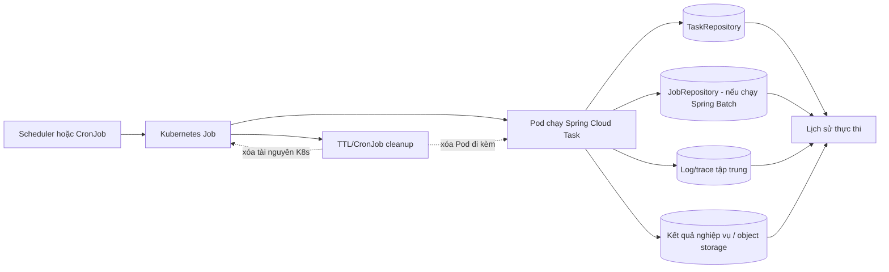
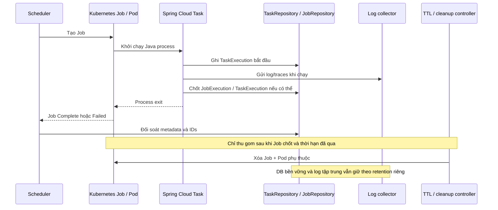
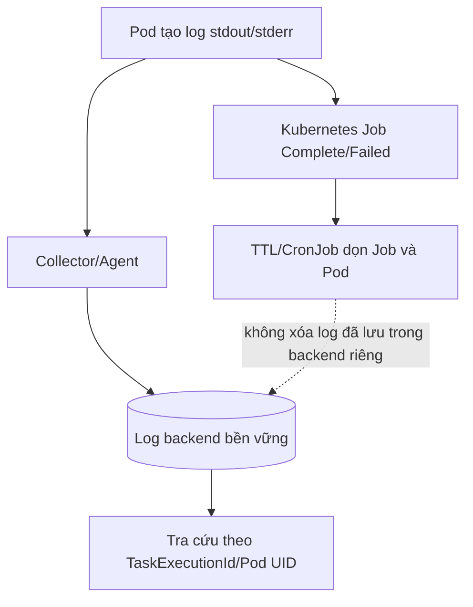

# Thu gom Job đã hoàn tất và bảo toàn lịch sử thực thi

## Mục tiêu và bối cảnh

Trong **Spring Cloud Task**, ứng dụng được thiết kế để thực thi một công việc **hữu hạn** rồi kết thúc: nhập hóa đơn, tổng hợp doanh thu, chạy một Spring Batch Job hoặc đối soát dữ liệu. Mỗi lần chạy có thể được khởi tạo bởi một **Kubernetes Job**, **Kubernetes CronJob**, scheduler bên ngoài hay **Spring Cloud Data Flow (SCDF)**. Nếu không dọn dẹp, Job/Pod đã kết thúc sẽ tích lũy trong cluster; nếu dọn sai, hệ thống có thể **mất log, bằng chứng lỗi hoặc metadata cần để restart và kiểm toán**.

Bài thuộc chương **Triển khai**, làm rõ cách **thu gom tài nguyên tính toán sau khi hoàn tất** mà vẫn **bảo toàn lịch sử thực thi** trong `TaskRepository`, `JobRepository` (khi tích hợp Spring Batch), log tập trung và kho dữ liệu đầu ra.

Sau bài học, bạn sẽ có thể:

- Phân biệt **Kubernetes Job**, **Spring Batch Job** và **Spring Cloud TaskExecution** — ba đối tượng thường bị gọi chung là “Job”.
- Cấu hình `ttlSecondsAfterFinished`, giới hạn lịch sử của `CronJob` và thao tác cleanup trong **Spring Cloud Data Flow**.
- Phân biệt **`CLEANUP` tài nguyên thực thi** với **`REMOVE_DATA` xóa metadata** trong API SCDF.
- Thiết kế chính sách lưu giữ `TASK_EXECUTION`, `BATCH_JOB_EXECUTION`, log, artifacts và bằng chứng vận hành.
- Kiểm tra tình huống pod bị dừng đột ngột, batch chưa chốt, lịch sử bị tách database, retry/chạy lại, hoặc Job bị xóa quá sớm.
- Xây quy trình đối soát **trước–sau cleanup**, có rollback/backup và giới hạn quyền xóa.

> **Về phiên bản:** Ví dụ Kubernetes dùng API `batch/v1` và TTL-after-finished (stable từ Kubernetes 1.23). Các lệnh và hành vi SCDF nêu theo tài liệu Spring Cloud Data Flow 2.11.x; kiểm tra cú pháp của phiên bản đang triển khai trước khi vận hành. Các cột repository lấy theo schema Spring Cloud Task/Spring Batch tương ứng. Giá trị thời hạn trong bài **chỉ là minh họa chính sách**, không phải mặc định an toàn cho mọi tổ chức.

## 1. Ba loại “Job” và bốn nhóm dữ liệu phải giữ

| Khái niệm | Sống ở đâu? | Ghi nhận điều gì? | Xóa tác động ra sao? |
| --- | --- | --- | --- |
| **Kubernetes Job** | Kubernetes API/etcd | Điều phối Pod, completions, failed/succeeded, thời điểm trạng thái | Xóa Job thường **cascading** xóa Pod thuộc Job |
| **Pod/container** | Node/Kubernetes | Đã chạy image nào, mã thoát process, stdout/stderr, nguyên nhân OOM/eviction | Xóa Pod thường làm mất đường truy cập log cục bộ và thông tin chẩn đoán ngắn hạn |
| **Spring Cloud TaskExecution** | `TaskRepository` trong RDBMS | `executionId`, `taskName`, `startTime`, `endTime`, `exitCode`, arguments và lỗi | Không tự bị xóa khi Kubernetes xóa Job/Pod **nếu DB là bền vững và độc lập** |
| **Spring Batch JobExecution** | `JobRepository` trong RDBMS | JobInstance, JobExecution, StepExecution, ExecutionContext và counters | Xóa metadata có thể làm mất lịch sử **và ngữ cảnh restart** |
| **Logs/traces/artifacts** | Log collector, tracing backend, object storage hoặc DB nghiệp vụ | Chi tiết điều tra, tệp CSV, checksum, correlation ID, phiên bản đầu ra | Phụ thuộc retention riêng; xóa Job/Pod không tự bảo vệ những dữ liệu này |

**Hai quy tắc quan trọng:**

1. **Thu gom Job/Pod** không đồng nghĩa **xóa `TASK_EXECUTION`/`BATCH_JOB_EXECUTION`**. Kubernetes không tự gọi `DELETE FROM TASK_EXECUTION`.
2. **Giữ TaskRepository** không đồng nghĩa **giữ đầy đủ bằng chứng**. Repository chỉ chứa metadata; nếu log chỉ nằm trong Pod đã bị xóa, bạn có thể biết tác vụ thất bại nhưng **không còn log để điều tra**.



Sơ đồ thể hiện **phân tách trách nhiệm**, không có bảo đảm mọi Task đều tạo được bản ghi khi khởi động lỗi quá sớm. Nếu `DataSource`/`ApplicationContext` không bootstrap được, TaskExecution có thể **không tồn tại**. Nếu JVM bị kill trước khi cập nhật metadata, `exitCode`/`endTime` có thể vẫn là `NULL`. Khi đó trạng thái Kubernetes và log càng quan trọng.

## 2. Thế nào là “đã hoàn tất” ở từng lớp?

| Lớp | Điều kiện kết thúc | Không nên suy ra |
| --- | --- | --- |
| Kubernetes Job | Có điều kiện cuối `Complete` hoặc `Failed`; Pod/container đã theo quy tắc của controller | Không suy ra lịch sử Task/Batch đã được lưu hoàn chỉnh |
| Container | Process kết thúc và có OS exit code | Không suy ra logic nghiệp vụ đã commit hoặc Batch Job thành công |
| Spring Cloud Task | `TaskExecution.endTime`/`exitCode` được framework ghi nhận khi có luồng hoàn tất phù hợp | Không suy ra metadata không thể bị kẹt nếu crash hoặc DB lỗi |
| Spring Batch | `JobExecution` có `BatchStatus.COMPLETED`/`FAILED`/`STOPPED`… và Step/ExecutionContext được cập nhật | Không suy ra Task exit code luôn trùng Job ExitStatus |
| Nghiệp vụ | Bản ghi, tệp, sự kiện ngoài hệ thống được ghi/publish theo hợp đồng | Không suy ra chỉ từ `exitCode=0` hoặc `Complete` của Kubernetes |

Ví dụ: JVM đã commit 100 hóa đơn nhưng bị `SIGKILL` trước khi cập nhật TaskRepository. Kubernetes có thể đánh dấu Pod `Failed` và sau nhiều lần retry mới chốt Kubernetes Job; `TASK_EXECUTION.EXIT_CODE` của lần JVM đó có thể vẫn `NULL`. Nếu dọn Pod ngay, **chỉ còn DB/log đã thu thập** để tái dựng tình huống.



Trước khi dọn, hãy quyết định **nguồn sự thật cho từng câu hỏi**: Kubernetes xác nhận tình trạng process, TaskRepository ghi lịch sử Task, JobRepository giữ khả năng restart Batch, và DB nghiệp vụ xác nhận hiệu ứng thực tế. Không thay thế tất cả bằng một cột trạng thái duy nhất.

## 3. Cấu hình Kubernetes Job với TTL sau khi hoàn tất

Kubernetes có **TTL-after-finished controller**, áp dụng cho **Job** đã có điều kiện `Complete` hoặc `Failed`. Trường:

```yaml
spec:
  ttlSecondsAfterFinished: 86400
```

nghĩa là sau **86.400 giây (24 giờ)** kể từ khi Job hoàn tất, Job **đủ điều kiện** được controller xóa. Không phải cam kết xóa chính xác đến từng giây. Khi dọn, Kubernetes xóa **cascading** Job và các đối tượng phụ thuộc như Pod, đồng thời tôn trọng finalizers/lifecycle guarantees. TTL không áp dụng trực tiếp lên Pod độc lập và **không xóa nội dung TaskRepository**.

Nguồn: [Kubernetes – Automatic Cleanup for Finished Jobs](https://kubernetes.io/docs/concepts/workloads/controllers/ttlafterfinished/).

### 3.1. Manifest minh họa

Một Job chạy ứng dụng `settlement-task` cho kỳ `2026-11-23`:

```yaml
apiVersion: batch/v1
kind: Job
metadata:
  name: settlement-20261123
  namespace: batch-workloads
  labels:
    app: settlement-task
    component: nightly-settlement
spec:
  backoffLimit: 0
  activeDeadlineSeconds: 3600
  ttlSecondsAfterFinished: 86400
  template:
    metadata:
      labels:
        app: settlement-task
    spec:
      restartPolicy: Never
      containers:
        - name: task
          image: registry.example.internal/settlement-task:1.0.0
          imagePullPolicy: IfNotPresent
          args:
            - "--business-date=2026-11-23"
          env:
            - name: SPRING_PROFILES_ACTIVE
              value: "prod"
            - name: SPRING_DATASOURCE_URL
              valueFrom:
                secretKeyRef:
                  name: settlement-db
                  key: jdbc-url
            - name: SPRING_DATASOURCE_USERNAME
              valueFrom:
                secretKeyRef:
                  name: settlement-db
                  key: username
            - name: SPRING_DATASOURCE_PASSWORD
              valueFrom:
                secretKeyRef:
                  name: settlement-db
                  key: password
          resources:
            requests:
              cpu: "250m"
              memory: "256Mi"
            limits:
              memory: "1Gi"
```

**Điều kiện của ví dụ:** namespace `batch-workloads`, Secret `settlement-db` (ba key nêu trên), container image và repository schema đã tồn tại; thay chúng bằng tài nguyên của bạn trước khi áp dụng. Image phải có entrypoint chạy Spring Cloud Task JAR và **thoát khi runner hoàn tất**; nếu container giữ HTTP server hoặc non-daemon thread chạy mãi, Kubernetes Job không đạt `Complete` và TTL sẽ **không bắt đầu đếm**.

Các trường cần hiểu:

- `restartPolicy: Never`: container lỗi thì Pod đạt `Failed`, Job controller có thể tạo Pod mới **nếu** policy retry cho phép.
- `backoffLimit: 0` trong demo: không chủ động retry Pod thất bại theo cơ chế mặc định; thích hợp khi chưa chứng minh thao tác nghiệp vụ có tính idempotent. Trong production, chọn backoff theo mã lỗi và tính an toàn của xử lý lại.
- `activeDeadlineSeconds: 3600`: giới hạn thời gian **Job** khoảng một giờ; nếu vượt deadline, Job bị fail và các Pod đang chạy bị chấm dứt. Đây là **timeout thực thi**, khác TTL **dọn sau khi hoàn tất**.
- `ttlSecondsAfterFinished: 86400`: thời gian quan sát Job/Pod sau khi đã có trạng thái cuối, không phải `timeout` và không giúp chấm dứt Job bị treo.
- `image: ...:1.0.0` chỉ là ví dụ; production nên ghi lại image digest, release ID và phiên bản schema để có thể tái dựng lịch sử.

**Không truyền password/token vào `args` hoặc `--spring.datasource.password=...`.** Spring Cloud Task lưu danh sách CLI arguments vào metadata; password có thể xuất hiện ở process list/log. Secret qua environment vẫn cần giới hạn RBAC, phân quyền Pod và không dump toàn bộ environment.

### 3.2. Lệnh quan sát an toàn trước cleanup

Sau khi đã triển khai trên cluster thử nghiệm có quyền `kubectl`, các lệnh **chỉ đọc**:

```bash
kubectl get jobs -n batch-workloads -l app=settlement-task
kubectl describe job settlement-20261123 -n batch-workloads
kubectl get pods -n batch-workloads -l job-name=settlement-20261123
kubectl logs -n batch-workloads job/settlement-20261123
```

`kubectl logs` từ Pod/Job chỉ hữu ích **khi Pod và log còn sẵn**; nó không phải cơ chế lưu trữ log dài hạn. Nên dùng collector/agent đưa stdout/stderr về hệ thống log tập trung **trước TTL**, kèm correlation ID. Lệnh xóa thủ công **chỉ dành cho Job đã xác minh có thể dọn**:

```bash
kubectl delete job settlement-20261123 -n batch-workloads
```

**Không chạy hàng loạt** `kubectl delete jobs --all` hoặc xóa Pod bằng label quá rộng để giải phóng dung lượng. Việc xóa Job thường xóa Pod phụ thuộc; cần xác minh đối tượng thực tế và có phương án xử lý finalizer/lỗi deletion. Tài liệu [Kubernetes Jobs](https://kubernetes.io/docs/concepts/workloads/controllers/job/) mô tả rằng khi không có cleanup tự động, Job và Pod hoàn tất có thể vẫn được giữ để tra log/status, gây áp lực lên Kubernetes API server.

### 3.3. TTL không xóa metadata Task/Batch, nhưng log vẫn có nguy cơ mất

`ttlSecondsAfterFinished` là chính sách vòng đời của **Kubernetes API objects**. Nó **không biết** schema `TASK_EXECUTION` hoặc `BATCH_JOB_EXECUTION`, nên không tự xóa các hàng trong repository. Tuy nhiên, nếu database của Task là **H2 in-memory nằm trong Pod**, lịch sử đã mất khi JVM chết, dù Kubernetes Job được giữ thêm 24 giờ.

Để giữ lịch sử xuyên Pod/Job:

1. Dùng database **bền vững bên ngoài vòng đời Pod** cho `TaskRepository` và `JobRepository`.
2. Quản lý schema bằng migration, backup, phân quyền và chính sách retention.
3. Gửi log/traces ra storage riêng và kiểm tra collector đã nhận.
4. Đặt business artifact (CSV, đối soát, manifest, checkpoint ngoài) trên storage bền vững nếu còn cần.
5. Truy vấn lại lịch sử **sau** khi Job/Pod bị xóa để xác minh không bị mất.

**PVC/PV:** Xóa Job không mặc nhiên xóa mọi PersistentVolumeClaim tham chiếu từ Pod; lifecycle phụ thuộc ownership, controller, finalizers và storage policy. Không dùng PVC tạm trong một Job làm giải pháp duy nhất lưu kết quả lâu dài nếu không có quy trình riêng cho dữ liệu.

## 4. Kubernetes CronJob: giữ bao nhiêu Job đã thành công/thất bại?

Với tác vụ chạy mỗi đêm, **CronJob** còn hỗ trợ hai trường:

- `spec.successfulJobsHistoryLimit`: số Job **đã thành công** được giữ. Mặc định là **3**.
- `spec.failedJobsHistoryLimit`: số Job **đã thất bại** được giữ. Mặc định là **1**.

Giá trị `0` nghĩa là không giữ các Job hoàn tất thuộc loại tương ứng theo chính sách đếm này. Đây là **giới hạn số đối tượng Job**, **không phải số ngày**, và không quản lý dữ liệu `TaskRepository`.

Nguồn: [Kubernetes – CronJob: Jobs history limits](https://kubernetes.io/docs/concepts/workloads/controllers/cron-jobs/).

Ví dụ CronJob (manifest đầy đủ ở mức template ứng dụng):

```yaml
apiVersion: batch/v1
kind: CronJob
metadata:
  name: settlement-nightly
  namespace: batch-workloads
spec:
  schedule: "15 2 * * *"
  timeZone: "Asia/Ho_Chi_Minh"
  concurrencyPolicy: Forbid
  successfulJobsHistoryLimit: 5
  failedJobsHistoryLimit: 3
  jobTemplate:
    spec:
      backoffLimit: 0
      activeDeadlineSeconds: 3600
      ttlSecondsAfterFinished: 604800
      template:
        metadata:
          labels:
            app: settlement-task
        spec:
          restartPolicy: Never
          containers:
            - name: task
              image: registry.example.internal/settlement-task:1.0.0
              env:
                - name: SPRING_PROFILES_ACTIVE
                  value: "prod"
                - name: SPRING_DATASOURCE_URL
                  valueFrom:
                    secretKeyRef:
                      name: settlement-db
                      key: jdbc-url
                - name: SPRING_DATASOURCE_USERNAME
                  valueFrom:
                    secretKeyRef:
                      name: settlement-db
                      key: username
                - name: SPRING_DATASOURCE_PASSWORD
                  valueFrom:
                    secretKeyRef:
                      name: settlement-db
                      key: password
```

Đây là **khung triển khai**, cần bổ sung cách xác định `business-date` cho từng lần chạy (scheduler/deployer tạo Job arguments hoặc ứng dụng suy ra kỳ dữ liệu theo timezone đã thống nhất); **không** hard-code cùng ngày vào một CronJob chạy hàng ngày. Hệ thống phải xác định rõ kỳ cần xử lý khi chạy bù hoặc khi có timezone/DST, tránh dùng `LocalDate.now()` tùy tiện ở mỗi replica.

- `schedule` và `timeZone` quy định giờ khởi chạy (timezone là tính năng ổn định trên Kubernetes từ 1.27).
- `concurrencyPolicy: Forbid` hạn chế chồng lấn **các Job từ cùng CronJob**; không chặn người vận hành tạo một Job thủ công với cùng dữ liệu. Nó cũng không thay idempotency.
- `successfulJobsHistoryLimit: 5` và `failedJobsHistoryLimit: 3` dọn theo **số lần thực thi đã kết thúc**.
- `ttlSecondsAfterFinished: 604800` dọn theo **7 ngày** sau khi Job kết thúc.

### TTL và history limits không cam kết được 7 ngày nếu cùng bật

Đây là điểm rất dễ mắc: **CronJob controller có thể xóa một Job cũ để tuân thủ history limit trước khi TTL 7 ngày của Job đó hết**. Ngược lại, TTL có thể xóa Job trước khi số lượng hoàn tất đạt ngưỡng. Hai cơ chế không cộng dồn thành “ít nhất 5 Jobs và ít nhất 7 ngày”.

Nếu yêu cầu giữ **đủ 7 ngày để điều tra**, đừng chỉ đặt TTL 7 ngày và history limit nhỏ trên một CronJob chạy nhiều lần/ngày. Nên định nghĩa retention dựa trên nơi lưu **log/metadata** và coi Job/Pod chỉ là công cụ chẩn đoán ngắn hạn. Muốn giữ Kubernetes Job chắc chắn theo thời gian phải thiết kế policy riêng, không trông đợi tính tối thiểu của hai controller cleanup đang hoạt động.

Khi dùng `concurrencyPolicy: Replace`, CronJob có thể hủy lần đang chạy để thay bằng lần mới; khi dùng `Forbid`, lần lịch mới có thể bị bỏ qua nếu lần cũ chưa xong. Đây là **quyết định thực thi**, không phải cleanup sau hoàn tất. Với tác vụ ghi dữ liệu, cấu hình này cần được kiểm thử cùng retry/idempotency.

## 5. Spring Cloud Data Flow: `CLEANUP` khác `REMOVE_DATA`

Nếu ứng dụng được triển khai qua **Spring Cloud Data Flow**, nền tảng có API và Shell để thao tác trên các lần chạy. Tài liệu SCDF 2.11.x mô tả hai hành động **khác nhau** trên `DELETE /tasks/executions/{ids}`:

| Action | Tác động chính | Ảnh hưởng lịch sử |
| --- | --- | --- |
| **`CLEANUP`** | Dọn **resource của deployer** liên quan đến một TaskExecution, tùy platform (ví dụ Pod của task) | Dành để thu gom tài nguyên; **không yêu cầu xóa metadata Task/Batch** |
| **`REMOVE_DATA`** | Xóa **dữ liệu TaskExecution** và có thể xóa cả **Spring Batch Job data** liên quan trong persistent store | **Có nguy cơ mất lịch sử và thông tin restart** |
| **`CLEANUP,REMOVE_DATA`** | Vừa dọn deployer resources vừa xóa dữ liệu repository | **Không phù hợp** nếu mục tiêu là giữ lịch sử |

Nguồn: [SCDF Reference – Delete Task Execution / Deleting Task Execution Data](https://docs.spring.io/spring-cloud-dataflow/docs/current/reference/htmlsingle/index.html). Ở tài liệu này, nếu bỏ action, **`CLEANUP` là mặc định**; nhưng automation production vẫn nên khai báo rõ action và kiểm tra phiên bản.

### 5.1. Lệnh SCDF Shell dọn tài nguyên, giữ metadata

Với Shell đã kết nối đúng SCDF Server (cú pháp **SCDF Shell**, không phải Bash):

```text
dataflow:> task execution list
dataflow:> task execution cleanup --id 123
```

Lệnh `task execution list` giúp xác định đúng **TaskExecution ID**; lệnh `cleanup` gửi yêu cầu dọn deployer resources của lần chạy `123`. Tài liệu SCDF mô tả việc dọn Pod đã hoàn tất theo execution ID. **Không tự coi thông báo “request submitted” là dọn xong**: xác minh tài nguyên thực sự biến mất và TaskExecution vẫn còn.

Ví dụ endpoint với **chỉ action CLEANUP** (cần authentication/network phù hợp; không dùng trực tiếp nếu không có quyền và runbook đã phê duyệt):

```bash
curl -X DELETE \
  'https://dataflow.example.internal/tasks/executions/123?action=CLEANUP'
```

Đây là **ví dụ cú pháp**, không thực hiện thao tác thật. URL, authentication, `schemaTarget` và API contract phải đối chiếu phiên bản SCDF; không đăng secret của SCDF vào tài liệu hoặc history dòng lệnh.

### 5.2. Vì sao phải tránh `REMOVE_DATA` khi muốn bảo toàn lịch sử?

Tài liệu SCDF cảnh báo khi dùng `REMOVE_DATA`, những metadata TaskExecution liên quan và **các Spring Batch JobExecution gắn với Task** cũng có thể bị xóa. Trong **composed task**, thao tác xóa dữ liệu của **child execution** bị từ chối; phải cung cấp ID của **parent task execution** theo quy tắc API tài liệu SCDF 2.11.x.

Vì vậy, **không** đưa một URI như sau vào script cleanup mặc định:

```text
DELETE /tasks/executions/123?action=CLEANUP,REMOVE_DATA
```

Dòng trên được đặt để **nhận diện anti-pattern**, **không phải lệnh khuyến nghị thực thi**. Nếu có nhu cầu xóa metadata theo chính sách retention, phải là **quy trình riêng**, có đánh giá compliance, backup/archive, xác minh restart, quản lý parent–child, ghi audit ai xóa và áp dụng logic xóa của đúng phiên bản framework.

Trong SCDF, **`task execution cleanup` không đồng nghĩa `task execution destroy`**; tên lệnh/tác động khác nhau theo loại đối tượng. Đừng suy ý nghĩa hành động chỉ từ chữ “delete” của HTTP verb; **chính tham số action quyết định ranh giới dữ liệu**.

### 5.3. Trước khi gọi cleanup cần đối chiếu platform

Với Task triển khai lên Kubernetes, SCDF có thể tạo **Pod độc lập** ở một số dòng phiên bản hoặc kiểu deployer; với hệ thống khác, Task có thể được tạo thành Kubernetes Job/Cloud Foundry Task. Hành động `CLEANUP` là **platform-specific**, nên không giả định đối tượng được xóa luôn là Kubernetes `Job`. Kiểm tra `externalExecutionId`, metadata SCDF, namespace, label và platform account.

## 6. Bảo toàn `TaskRepository`: lịch sử Task không nằm trong Pod

Schema Spring Cloud Task mặc định dùng các bảng sau (tên có thể đổi bởi prefix/schema tùy phiên bản):

| Bảng | Dữ liệu chính | Nếu xóa bừa sẽ mất gì? |
| --- | --- | --- |
| `TASK_EXECUTION` | Execution ID, tên Task, start/end, `EXIT_CODE`, `ERROR_MESSAGE`, parent/external ID | Lịch sử **lần chạy**, quan hệ cha–con và bằng chứng lỗi |
| `TASK_EXECUTION_PARAMS` | Các đối số dòng lệnh theo từng `TASK_EXECUTION_ID` | Ngữ cảnh lần chạy; **có thể chứa dữ liệu nhạy cảm** |
| `TASK_TASK_BATCH` | Liên kết `TASK_EXECUTION_ID` ↔ `JOB_EXECUTION_ID` | Khả năng truy từ một Task sang Batch Job liên quan |
| `TASK_LOCK` | Khóa phục vụ `single-instance-enabled` | Trạng thái điều phối; **không phải** bảng lịch sử |
| `TASK_SEQ` hoặc cơ chế sequence tương đương | Cấp ID cho TaskExecution tùy DB | Nguy cơ trùng ID hoặc lỗi khởi tạo ID khi restore sai |

Nguồn: [Spring Cloud Task – Task Repository Schema](https://docs.spring.io/spring-cloud-task/reference/appendix-task-repository-schema.html).

**Điều kiện căn bản để lịch sử còn sau cleanup:** `TaskRepository` phải kết nối một RDBMS **có persistence riêng**, đúng schema, được backup và giám sát. `jdbc:h2:mem:...` trong mỗi Pod là lựa chọn demo, không phải repository lịch sử production. Đặt `spring.datasource.url` nhầm sang một DB khác cũng có thể khiến dashboard “không còn lịch sử” dù thực tế dữ liệu nằm ở hệ khác.

Ví dụ cấu hình không chứa thông tin đăng nhập cố định:

```yaml
spring:
  application:
    name: settlement-task
  main:
    web-application-type: none
  datasource:
    url: ${TASK_DB_URL}
    username: ${TASK_DB_USER}
    password: ${TASK_DB_PASSWORD}
  cloud:
    task:
      initialize-enabled: false
      closecontext-enabled: true
```

Ở đây `initialize-enabled: false` **giả định** đội vận hành đã tạo schema Task bằng migration đúng phiên bản; nếu chưa tạo, ứng dụng có thể thất bại khi ghi metadata. Thuộc tính `closecontext-enabled` hữu ích trong ứng dụng batch không có web server, nhưng một Java process vẫn có thể không kết thúc nếu giữ thread/tài nguyên khác không được đóng đúng cách.

### 6.1. Truy vấn read-only xác minh Task trước và sau cleanup

Ví dụ PostgreSQL, cùng repository mà ứng dụng đã ghi, dùng quyền **chỉ đọc**:

```sql
SELECT
    TASK_EXECUTION_ID,
    TASK_NAME,
    START_TIME,
    END_TIME,
    EXIT_CODE,
    EXTERNAL_EXECUTION_ID,
    PARENT_TASK_EXECUTION_ID,
    LAST_UPDATED
FROM TASK_EXECUTION
WHERE TASK_NAME = 'settlement-task'
ORDER BY TASK_EXECUTION_ID DESC
LIMIT 20;
```

Tìm các Task chưa chốt metadata:

```sql
SELECT TASK_EXECUTION_ID, TASK_NAME, START_TIME, END_TIME, EXIT_CODE
FROM TASK_EXECUTION
WHERE END_TIME IS NULL OR EXIT_CODE IS NULL
ORDER BY START_TIME;
```

`EXIT_CODE IS NULL` là **chưa có mã cuối được ghi** — có thể đang chạy, crash, không cập nhật được DB hoặc còn một trường hợp lifecycle đặc biệt. **Không** dùng `WHERE EXIT_CODE = NULL`; SQL cần `IS NULL`. **Không** đổi thẳng `EXIT_CODE = 1` để “đánh dấu thất bại” vì như vậy tạo lịch sử giả và có thể che rủi ro dữ liệu đã commit một phần.

Khi chọn tài nguyên Kubernetes để cleanup, hãy đối chiếu **Job UID / tên / namespace / labels** với **TaskExecution ID** do ứng dụng hoặc launcher ghi nhận. `TASK_EXECUTION_ID` không nhất thiết bằng Kubernetes Job UID hay tên Pod; không đoán ID từ `MAX(TASK_EXECUTION_ID)` trong môi trường có nhiều task đồng thời.

### 6.2. Bảo toàn lịch sử quan hệ cha–con

Với Composed Task Runner hoặc launcher tự xây, child có thể mang `PARENT_TASK_EXECUTION_ID`. Khi giữ metadata, nên giữ **cùng một tập liên quan**:

```sql
SELECT
    p.TASK_EXECUTION_ID AS parent_id,
    p.TASK_NAME AS parent_name,
    c.TASK_EXECUTION_ID AS child_id,
    c.TASK_NAME AS child_name,
    c.EXIT_CODE AS child_exit_code
FROM TASK_EXECUTION p
LEFT JOIN TASK_EXECUTION c
  ON c.PARENT_TASK_EXECUTION_ID = p.TASK_EXECUTION_ID
WHERE p.TASK_EXECUTION_ID = 900
ORDER BY c.TASK_EXECUTION_ID;
```

Đây là `LEFT JOIN` đọc lịch sử; ID `900` chỉ là ví dụ. Nếu muốn archive theo độ tuổi, **đừng xóa cha trước** khi còn những lần chạy con cần giữ hoặc có liên kết Batch. Chính sách retention cần cân nhắc **toàn workflow**, không chỉ hàng riêng lẻ.

## 7. Bảo toàn Spring Batch `JobRepository` và khả năng restart

Khi Task có Spring Batch, framework lưu nhiều lớp metadata:

| Nhóm bảng mặc định | Vai trò |
| --- | --- |
| `BATCH_JOB_INSTANCE` | Định danh một JobInstance theo Job name + identifying JobParameters |
| `BATCH_JOB_EXECUTION` | Một lần thực thi Job, `STATUS`, `EXIT_CODE`, start/end |
| `BATCH_JOB_EXECUTION_PARAMS` | JobParameters dùng khi chạy và phân biệt JobInstance |
| `BATCH_STEP_EXECUTION` | Thực thi từng Step, read/write/skip/rollback counters |
| `BATCH_JOB_EXECUTION_CONTEXT` / `BATCH_STEP_EXECUTION_CONTEXT` | Trạng thái checkpoint/restart của Job và Step |
| `TASK_TASK_BATCH` | Liên kết một TaskExecution với Batch JobExecution nếu tích hợp Task–Batch |

Đây là các **bảng metadata của Spring Batch/Task**, không phải bảng dữ liệu nghiệp vụ. Schema khác nhau giữa phiên bản và có thể dùng table prefix. Với cấu hình MongoDB JobRepository, cấu trúc lưu còn khác hẳn RDBMS, nên ví dụ SQL bên dưới chỉ dành cho **JDBC JobRepository mặc định**.

Nguồn: [Spring Batch – Configuring a JobRepository](https://docs.spring.io/spring-batch/reference/job/configuring-repository.html) và [Spring Cloud Task – Batch integration](https://docs.spring.io/spring-cloud-task/reference/batch.html).

### 7.1. Kiểm tra Batch JobExecution liên quan tới Task

Khi `TaskRepository` và `JobRepository` nằm trong cùng database/có quyền query cross-schema phù hợp:

```sql
SELECT
    t.TASK_EXECUTION_ID,
    t.TASK_NAME,
    t.EXIT_CODE AS task_exit_code,
    b.JOB_EXECUTION_ID,
    b.STATUS AS batch_status,
    b.EXIT_CODE AS batch_exit_code,
    b.START_TIME AS batch_started,
    b.END_TIME AS batch_ended
FROM TASK_EXECUTION t
JOIN TASK_TASK_BATCH link
  ON link.TASK_EXECUTION_ID = t.TASK_EXECUTION_ID
JOIN BATCH_JOB_EXECUTION b
  ON b.JOB_EXECUTION_ID = link.JOB_EXECUTION_ID
WHERE t.TASK_EXECUTION_ID = 123
ORDER BY b.JOB_EXECUTION_ID;
```

Nếu Task và Batch repositories nằm ở **hai database** khác nhau, không thể dùng câu JOIN này trực tiếp nếu không có cơ chế cross-DB phù hợp; truy vấn hai nguồn theo `TASK_TASK_BATCH`/execution ID và đối chiếu ở service/BI.

Kết quả mong muốn trước cleanup resource: nếu Job `COMPLETED`, trạng thái Task tương ứng cũng được chốt; nếu Job `FAILED`/`STOPPED`/`STARTED` kéo dài bất thường, phải kiểm tra process và chính sách restart. `TaskExecution.exitCode=0` không chứng minh `BatchStatus.COMPLETED` trong mọi cấu hình; thuộc tính `spring.cloud.task.batch.fail-on-job-failure=true` giúp truyền failure từ Batch lên Task khi tích hợp tương ứng.

### 7.2. Xóa JobRepository quá sớm có thể làm mất khả năng restart

Spring Batch sử dụng `ExecutionContext`, `JobInstance` và `StepExecution` để quyết định trạng thái khôi phục. **Xóa metadata khi Job còn `FAILED` hoặc `STOPPED`** có thể phá hỏng đường restart bình thường. Tạo JobInstance mới thay vì restart **không** khẳng định dữ liệu đã ghi trước đó sẽ an toàn; writer cần idempotency riêng.

Do đó:

- **Không** dùng `TRUNCATE BATCH_*` hoặc xóa hàng trực tiếp theo tuổi mà bỏ qua liên kết.
- **Không** tự xóa `BATCH_JOB_EXECUTION_CONTEXT` chỉ để giảm kích thước DB, vì context có thể chứa checkpoint.
- Cân nhắc **thời hạn cần restart** theo SLA, chu kỳ đối soát và yêu cầu kiểm toán trước khi archive/remove metadata.
- Chỉ sử dụng API/procedure retention được kiểm soát của framework/ứng dụng nếu đã xác minh toàn bộ khóa ngoại, trạng thái Job và tác động khi restart.
- Thực hiện **backup/restore rehearsal** và đối chiếu số execution/relations sau phục hồi.

## 8. Log, trace và artifact: các loại “lịch sử” khác metadata

Giữ một hàng `TASK_EXECUTION` với mã `1` vẫn không trả lời **vì sao** ứng dụng thất bại nếu `errorMessage` bị cắt ngắn hoặc exception xảy ra trước khi TaskRepository khởi tạo. Trước khi xóa Pod, cần bảo đảm log và dữ liệu cần giữ đã được thu thập ra hệ thống khác.

### 8.1. Correlation ID xuyên Kubernetes và Spring Cloud Task

Một quy ước tham khảo:

| Nguồn | ID nên có | Dùng để nối với |
| --- | --- | --- |
| Kubernetes | Namespace, Job name, Job UID, Pod UID/container ID | Pod logs, failure reason, retry attempts |
| Spring Cloud Task | `TaskExecutionId`, task name, external execution ID | `TASK_EXECUTION`, Task arguments và lifecycle |
| Spring Batch | JobExecutionId, JobInstanceId, StepExecutionId | JobRepository và các counters |
| Nghiệp vụ | `tenantId`, `businessDate`, `requestId` hoặc idempotency key | Kết quả thật, artifacts, đối soát |
| Logs/traces | Trace/span ID, release/image digest | Chuỗi lỗi và phiên bản mã đã chạy |

**`TaskExecutionId` không phải Kubernetes Job UID**, và **`JobExecutionId` của Spring Batch không phải `TaskExecutionId`**. Cần chủ động truyền ID/correlation an toàn vào log hoặc tracing. Một số ID chỉ được biết **sau khi Task khởi động**, nên không thể kỳ vọng toàn bộ Kubernetes Job name tự chứa Task ID.

Ví dụ listener ghi ID an toàn:

```java
package com.example.task;

import org.slf4j.Logger;
import org.slf4j.LoggerFactory;
import org.springframework.cloud.task.repository.TaskExecution;
import org.springframework.cloud.task.listener.TaskExecutionListener;
import org.springframework.stereotype.Component;

@Component
public class TaskCorrelationLogging implements TaskExecutionListener {

    private static final Logger log =
            LoggerFactory.getLogger(TaskCorrelationLogging.class);

    @Override
    public void onTaskStartup(TaskExecution taskExecution) {
        log.info("task_started id={} name={}",
                taskExecution.getExecutionId(),
                taskExecution.getTaskName());
    }

    @Override
    public void onTaskEnd(TaskExecution taskExecution) {
        log.info("task_completed id={} name={}",
                taskExecution.getExecutionId(),
                taskExecution.getTaskName());
    }

    @Override
    public void onTaskFailed(
            TaskExecution taskExecution, Throwable throwable) {
        log.error("task_failed id={} type={}",
                taskExecution.getExecutionId(),
                throwable.getClass().getSimpleName());
    }
}
```

Code trên minh họa **correlation**, không thay thế logging stack trace do ứng dụng thực hiện và không bảo đảm callback được gọi nếu JVM bị kill hoặc thất bại trước khi listener sẵn sàng. Khi lỗi điều tra cần trace chi tiết, lưu stack trace có giới hạn dữ liệu nhạy cảm và quyền truy cập phù hợp; **không** đưa token/PII vào `exitMessage` hoặc `arguments`.

### 8.2. Log collector cần hoạt động trước khi cleanup

Một luồng lưu log tối thiểu:



- **Collector bất đồng bộ**: có thể có độ trễ, drop do quota/network hoặc cấu hình filter; không coi “đã bật agent” là bằng chứng dữ liệu đã tới backend.
- **Độ dài lưu log**: ví dụ 30 ngày so với metadata 180 ngày; sau 30 ngày chỉ còn metadata/tổng hợp, phù hợp hay không tùy yêu cầu kiểm toán.
- **Artifacts**: với tệp CSV hoặc báo cáo, lưu trên S3-compatible/object storage/DB bền vững và chỉ publish khi đã hoàn chỉnh; không để file đầu ra duy nhất trong filesystem tạm của Pod.
- **Sensitive data**: Task arguments có thể được ghi vào `TASK_EXECUTION_PARAMS`. Lịch sử lâu dài có thể chứa dữ liệu nhạy cảm nếu thiết kế CLI sai; cần giảm dữ liệu ngay từ nguồn, phân quyền và chính sách xóa theo yêu cầu pháp lý.

## 9. Thiết kế retention đa tầng

**Không có một số ngày mặc định chuẩn chung** cho mọi tổ chức. Dưới đây là một *ví dụ chính sách nội bộ giả định*, nhằm minh họa việc tách từng tầng:

| Tầng | Mục tiêu retention ví dụ | Điều kiện dọn | Cách xác minh |
| --- | --- | --- | --- |
| Kubernetes Job/Pod thành công | 24 giờ | Kubernetes đã chốt `Complete`; log đã thu thập | `kubectl get job`, log backend, TaskRepository |
| Kubernetes Job/Pod thất bại | 72 giờ | Kubernetes đã chốt `Failed`; đã có dấu vết điều tra | Pod exit reason, log và incident ID |
| Log/tracing thô | 30–90 ngày | Retention backend theo độ nhạy/chi phí | Tìm theo Job UID/TaskExecutionId |
| TaskExecution metadata | 180 ngày hoặc theo SLA nghiệp vụ | Chỉ archive/delete khi không còn phụ thuộc, có backup | Truy vấn TaskExplorer/SQL và restore test |
| Batch JobRepository metadata | Qua thời gian cần **restart/audit** | Chỉ xóa theo policy an toàn cho JobInstance/ExecutionContext | Test restart, ràng buộc khóa ngoại |
| Artifacts và kết quả nghiệp vụ | Theo hợp đồng dữ liệu/pháp lý | Theo lifecycle của object/DB nghiệp vụ | Checksum, owner, retention legal hold |

Các con số này **không phải yêu cầu của Spring hay Kubernetes**. Chúng phải được phê duyệt bởi chủ hệ thống, SRE/DBA/security/compliance. Với tài chính, y tế hoặc dữ liệu pháp lý, retention có thể dài hơn hoặc cần *legal hold*. Ngược lại, giữ raw arguments vô thời hạn có thể xung đột với nguyên tắc tối thiểu hóa dữ liệu.

### 9.1. “Archive” phải có bằng chứng phục hồi được

Một quy trình archive metadata tốt có thể gồm:

1. **Chụp danh sách candidate** từ DB (ID, trạng thái, ngày, tenant, liên kết Task–Batch, parent–child) theo điều kiện đã được review.
2. **Backup/export** dữ liệu ở mức nhất quán và mã hóa theo chính sách tổ chức, bao gồm bảng liên kết/counters/context cần thiết; không chỉ export một bảng rồi tưởng đủ.
3. **Kiểm tra checksum và số bản ghi**, kiểm soát schema/version và retention của bản archive.
4. **Thử restore trong môi trường cách ly** để chứng minh có thể tái lập thông tin và — nếu còn yêu cầu — restart đúng JobInstance.
5. **Ghi audit** ai phê duyệt, ai thực thi, tập ID, thời điểm và kết quả kiểm tra.
6. **Chỉ khi có chính sách riêng**, cân nhắc remove metadata theo API/thủ tục được hỗ trợ. Xóa dữ liệu **không nằm trong quy trình dọn Job/Pod mặc định**.

Không nên tự viết SQL `DELETE` hàng loạt lên `TASK_EXECUTION`/`BATCH_*` vì bảng phụ, khóa ngoại và semantics restart có thể khác theo phiên bản. `TASK_SEQ` hoặc database sequence cũng cần được bảo toàn khi restore để tránh tái sử dụng ID.

### 9.2. Chi phí và hiệu năng của kho lịch sử

Khi chạy hàng nghìn task mỗi ngày, metadata và log tăng nhanh. Thiết kế:

- Index các truy vấn phổ biến theo `TASK_NAME`, `START_TIME`, `PARENT_TASK_EXECUTION_ID` theo nhu cầu và kiểm tra execution plan; không tự thêm index gây overhead không cần thiết.
- Quy hoạch capacity/backup window cho database, filesystem và object store.
- Tách workload đọc dashboard nặng khỏi truy vấn ghi của TaskRepository nếu cần.
- Cảnh báo `TASK_EXECUTION` có `END_TIME IS NULL`/`EXIT_CODE IS NULL` quá SLA, nhưng không mặc định đó là task đang chạy.
- Theo dõi **số Kubernetes Job/Pod đã hoàn tất**, số log mất, retention backlog và tốc độ phình metadata.
## 10. Runbook thu gom: quan sát → đối soát → dọn → xác minh

Cleanup production phải có **điều kiện đầu vào** và bằng chứng sau thực hiện, không chỉ chạy một lệnh xóa.

### Bước 1 — Xác định đối tượng và trạng thái cuối

Chỉ đọc thông tin namespace/Job cụ thể:

```bash
kubectl get jobs -n batch-workloads -l app=settlement-task
kubectl get job settlement-20261123 -n batch-workloads -o yaml
kubectl get pods -n batch-workloads -l job-name=settlement-20261123
```

Kiểm tra `status.conditions` của Job, UID, namespace, owner reference và tình trạng Pod. Chỉ xem là ứng viên cleanup khi Job có `Complete` hoặc `Failed` và đã qua cửa sổ giữ phục vụ điều tra. Với SCDF, dùng `task execution list` để lấy **đúng TaskExecution ID**, không suy đoán từ tên Task.

### Bước 2 — Lưu dấu vết và đối chiếu dữ liệu

Ghi lại Job UID, Pod UID/container exit reason, image digest, thời điểm kết thúc, `TaskExecutionId`, `JobExecutionId` nếu có, và correlation ID. Xác minh log đã đến backend, artifact có checksum/URI ổn định, dữ liệu nghiệp vụ đã được commit hoặc ghi nhận trạng thái lỗi. Không đưa raw secret vào bản ghi audit.

Kiểm tra số liệu read-only trong PostgreSQL:

```sql
SELECT
    TASK_NAME,
    COUNT(*) AS executions,
    COUNT(*) FILTER (
        WHERE EXIT_CODE = 0 AND END_TIME IS NOT NULL
    ) AS successful,
    COUNT(*) FILTER (
        WHERE EXIT_CODE <> 0 AND END_TIME IS NOT NULL
    ) AS failed,
    COUNT(*) FILTER (
        WHERE EXIT_CODE IS NULL OR END_TIME IS NULL
    ) AS not_finalized
FROM TASK_EXECUTION
WHERE START_TIME >= CURRENT_TIMESTAMP - INTERVAL '7 days'
GROUP BY TASK_NAME
ORDER BY TASK_NAME;
```

`not_finalized` là nhóm **cần đối soát** với process/container, không đồng nghĩa `RUNNING`. Nếu Job Kubernetes `Failed` nhưng không có hàng TaskExecution, tìm lỗi bootstrap/schema/DB và Pod logs; không tự tạo một bản ghi thành công giả.

### Bước 3 — Chọn đúng công cụ quản lý vòng đời

| Ai quản lý task? | Cơ chế cleanup | Tuyệt đối không nhầm với |
| --- | --- | --- |
| Kubernetes Job do đội vận hành tạo | `ttlSecondsAfterFinished` hoặc xóa **một Job đã được xác minh** | Xóa database hoặc tất cả Job cùng namespace |
| Kubernetes CronJob | History limits và TTL theo retention phù hợp | Cam kết giữ Job tối thiểu N ngày |
| SCDF deployer | `task execution cleanup --id 123` / `action=CLEANUP` | `action=REMOVE_DATA` hoặc xóa metadata Task/Batch |
| Nền tảng khác | Deployer-specific cleanup theo phiên bản | Giả định mọi task chạy dưới Kubernetes Job |

Tránh để **hai controller/script** cùng quản lý cleanup mà không có ownership rõ ràng. Khi SCDF tạo Pod độc lập, không được máy móc áp dụng script xóa Kubernetes Job chỉ vì tên Task giống nhau.

### Bước 4 — Xác minh sau cleanup

Sau khi controller thực sự dọn xong, đối chiếu:

```bash
kubectl get jobs -n batch-workloads -l app=settlement-task
kubectl get pods -n batch-workloads -l app=settlement-task
```

Job đã định dọn phải biến mất mà các Job khác không bị ảnh hưởng. Truy vấn **cùng TaskExecution ID/JobExecution ID** trong repository và tìm log trong backend để chứng minh lịch sử còn nguyên. Với SCDF, `task execution cleanup` gửi yêu cầu bất đồng bộ; chỉ ghi nhận thành công khi resource thực tế đã được dọn và metadata vẫn có thể tra cứu.

### Bước 5 — Ghi audit và xử lý sai khác

Audit lưu scope, lý do cleanup, policy, người/phần mềm thực hiện, thời gian, IDs, và phép kiểm tra trước–sau. Nếu metadata biến mất, tìm xem có automation đã gọi `REMOVE_DATA`, DB đã đổi URL/schema hay chính sách DB retention đã chạy trùng thời điểm. Khôi phục theo backup/runbook đã kiểm chứng; **không** tự chèn lại `TASK_EXECUTION` hoặc `BATCH_JOB_EXECUTION` bằng ID đoán mò.

## 11. Cleanup không giải quyết retry và tác động dữ liệu trùng

Xóa Kubernetes Job chỉ xóa **tài nguyên chạy**, không undo các giao dịch hay API đã gọi. Khi operator không còn nhìn thấy Job cũ và quyết định “run again”, một Task có thể xử lý **cùng kỳ dữ liệu** lần nữa. Ngay cả với `parallelism=1` và `completions=1`, Kubernetes Job không bảo đảm ứng dụng chỉ được khởi chạy đúng một lần trong mọi tình huống lỗi.

Chính sách an toàn cần:

- **Business idempotency key ổn định**, ví dụ `(tenantId, businessDate, reportVersion)`; không sử dụng TaskExecution ID/Pod UID mới của mỗi retry làm khóa chống trùng.
- **Ràng buộc `UNIQUE`/`PRIMARY KEY`** trên DB nghiệp vụ và SQL ghi có điều kiện; phân biệt replay hợp lệ với payload xung đột.
- **Checkpoint của Spring Batch** và `JobRepository` được giữ trong thời hạn cần restart. Nếu writer không idempotent, retry có thể tạo thêm dữ liệu.
- **Outbox/dedup ở hệ ngoài** nếu Task publish Kafka, gửi email hoặc gọi API thanh toán.
- **Giới hạn backoff**, phân loại mã lỗi và xác minh dữ liệu đã commit trước khi chạy bù.
- **Kiểm soát đồng thời**: `CronJob.concurrencyPolicy=Forbid` chỉ giới hạn các Job do **cùng một CronJob** khởi chạy; không ngăn operator tạo Job riêng hoặc lần retry sau khi Job trước kết thúc.

Đặc biệt, nếu Task đã commit một phần nhưng `TaskExecution.exitCode=NULL` do crash, **không thể** chỉ nhìn repository để biết chính xác item nào đã xử lý. Cần đối soát dữ liệu đích và checkpoints.

## 12. Những tình huống cần điều tra

| Triệu chứng | Nguyên nhân có thể | Cách xử lý |
| --- | --- | --- |
| Kubernetes Job `Complete`, Task `EXIT_CODE=0` | Đường hoàn tất thông thường | Kiểm tra log/artifact, rồi TTL sau retention |
| Kubernetes Job `Failed`, Task `EXIT_CODE=NULL` | Kill/OOM hoặc lỗi cập nhật metadata | Giữ log, kiểm tra side effect và runtime trước retry |
| Kubernetes Job `Complete` nhưng Batch Job `FAILED` | Chưa propagate failure của Batch lên process | Kiểm tra `spring.cloud.task.batch.fail-on-job-failure` và runner |
| TTL không dọn Job | Job chưa có điều kiện cuối, thiếu TTL, finalizer/controller gặp vấn đề | Kiểm tra Job/Pod và policy; TTL không phải timeout |
| Pod bị xóa sớm hơn TTL | CronJob history limit hoặc script khác dọn trước | Điều tra owner/audit, sửa policy, bảo vệ log ngoài cluster |
| `kubectl logs` không còn truy cập được | Pod bị xóa/GC/log rotation | Đọc log backend và kiểm tra pipeline collector |
| Task history biến mất sau cleanup | `REMOVE_DATA`, DB retention, sai DB hoặc H2 in-memory | Xem audit và backup; không sửa metadata giả |
| JobRepository còn `STARTED` nhưng Pod đã chết | SIGTERM/kill, Batch chưa chốt metadata | Điều tra/recover JobInstance; không xóa ExecutionContext |
| Pod/Job đã sạch nhưng dung lượng DB tăng | Repository retention độc lập | Capacity/backup/archive theo DBA, không xóa thô |
| Chạy lại tạo hóa đơn trùng | Cleanup không phải idempotency | Thêm key nghiệp vụ/constraint, đối soát và sửa retry policy |

## 13. Kiểm thử cleanup trước production

Trên môi trường thử nghiệm độc lập, với schema và deployment tương đồng production:

1. **Thành công:** Job đạt `Complete`, đã có TaskExecution/Batch JobExecution, log và artifact. Sau TTL, Job/Pod mất nhưng các nguồn dữ liệu lịch sử còn.
2. **Lỗi nghiệp vụ:** Job `Failed` và Task có mã khác `0`. Kiểm tra retention đủ thời gian điều tra và không tự retry lỗi không hồi phục.
3. **Lỗi bootstrap:** cố tình cấp sai datasource/Secret. Pod logs phải giúp điều tra dù không có TaskExecution.
4. **Crash giữa chừng:** mô phỏng kill trong test; có thể thấy `EXIT_CODE=NULL` và dữ liệu đã ghi một phần. Retry không được tạo trùng.
5. **CronJob chạy nhiều lần:** kiểm chứng history limit có thể dọn Job cũ **trước TTL**.
6. **SCDF CLEANUP:** chạy cleanup resource theo execution ID rồi truy vấn lại Task/Batch metadata đúng ID.
7. **Backup/restore:** phục hồi metadata vào môi trường cách ly, đối chiếu quan hệ Task–Batch, JobInstance, StepExecution và ExecutionContext.
8. **Cùng business key:** tạo lần chạy mới sau khi Job cũ bị dọn; idempotency phải ngăn hiệu ứng trùng.
9. **Quyền và audit:** tài khoản cleanup không được có quyền gọi tùy tiện `REMOVE_DATA` hoặc xóa repository, phù hợp cơ chế phân quyền nền tảng.

Không cần thực hiện xóa production metadata để chứng minh quy trình; hãy dùng sandbox, dữ liệu giả/ẩn danh, approval và phương án rollback.

## 14. Bài tập tự đánh giá

**A.** Job có `ttlSecondsAfterFinished=3600` và đạt `Complete` lúc 02:00. Khi nào controller có thể xóa?

**Đáp án:** Từ sau khoảng 03:00, Job **đủ điều kiện** để dọn; Kubernetes không cam kết đúng giây 03:00. Việc dọn Job kéo theo Pod thuộc Job, **không tự xóa TaskRepository**.

**B.** CronJob chạy mỗi 5 phút với `successfulJobsHistoryLimit=2` và TTL một ngày. Có chắc giữ mỗi Job đủ 24 giờ?

**Đáp án:** Không. Controller history limits có thể dọn Job cũ khi vượt hai lần thành công, dù chưa hết TTL.

**C.** SCDF quản lý TaskExecution `123` và một Batch JobExecution liên quan. Muốn giải phóng Pod nhưng vẫn tra cứu/restart: dùng action nào?

**Đáp án:** `CLEANUP`; không dùng `REMOVE_DATA`. Sau đó kiểm tra metadata có còn và resource đã dọn.

**D.** Kubernetes Job `Failed` vì OOM, TaskExecution `EXIT_CODE=NULL`. Có nên cập nhật SQL thành `1` để báo cáo rồi xóa Pod ngay?

**Đáp án:** Không. `NULL` có thể do JVM bị kill trước khi chốt metadata. Cần giữ/thu thập log, kiểm tra side effect và lý do OOM trước khi quyết định retry/cleanup.

**E.** `kubectl delete job` đã thực hiện, nhưng `TaskExplorer.getTaskExecution(789)` vẫn trả bản ghi. Có bất thường không?

**Đáp án:** Không, nếu TaskRepository là database bền vững độc lập. Đây là hành vi mong muốn: dọn tài nguyên chạy nhưng giữ lịch sử.

**F.** DBA định xóa mọi `BATCH_STEP_EXECUTION_CONTEXT` cũ hơn 10 ngày, trong đó có JobInstance `FAILED` chưa restart. Rủi ro gì?

**Đáp án:** Mất checkpoint/context phục vụ restart. Cần chính sách retention riêng cho JobRepository, audit/backup và đánh giá khả năng khôi phục, không xóa một bảng riêng lẻ.

## 15. Checklist vận hành an toàn

- [ ] Phân biệt Kubernetes Job, Spring Cloud TaskExecution và Spring Batch JobExecution.
- [ ] Java process của Task kết thúc hữu hạn; Kubernetes Job thực sự đạt `Complete/Failed` trước khi TTL được áp dụng.
- [ ] `ttlSecondsAfterFinished` và CronJob history limits được cấu hình theo chính sách; không coi hai cơ chế là bảo đảm retention tối thiểu.
- [ ] `activeDeadlineSeconds`/`backoffLimit` được phân biệt với TTL cleanup sau hoàn tất.
- [ ] TaskRepository và JobRepository dùng database bền vững ngoài vòng đời Pod, có schema migration, backup và giới hạn quyền.
- [ ] Đã lưu correlation ID, image digest, Job/Pod UID, TaskExecution/JobExecution ID, log/traces và artifact checksums.
- [ ] SCDF mặc định chỉ `CLEANUP` khi dọn deployer resource; **không** ghép `REMOVE_DATA` vào lịch dọn thường xuyên.
- [ ] Giữ `ExecutionContext` và các bảng liên kết đủ lâu để restart/audit, có thủ tục archive/restore riêng.
- [ ] Có kiểm tra **trước và sau cleanup**: tài nguyên đã dọn đúng, metadata/log vẫn truy vấn được.
- [ ] Retry theo business idempotency key, không coi Job bị xóa là nghiệp vụ chưa từng xử lý.
- [ ] Không đưa token/PII vào CLI arguments, exit messages và logs; retention tuân theo chính sách dữ liệu.
- [ ] Đã thử Job success/failure/OOM, CronJob lịch dày, SCDF cleanup, backup/restore và retry khi dữ liệu đã commit một phần.

## 16. Tài liệu tham khảo chính thức

1. [Kubernetes – Automatic Cleanup for Finished Jobs](https://kubernetes.io/docs/concepts/workloads/controllers/ttlafterfinished/): TTL, điều kiện cuối và cascading deletion.
2. [Kubernetes – CronJob](https://kubernetes.io/docs/concepts/workloads/controllers/cron-jobs/): history limits, `concurrencyPolicy` và timezone.
3. [Kubernetes – Jobs](https://kubernetes.io/docs/concepts/workloads/controllers/job/): `backoffLimit`, `activeDeadlineSeconds`, lifecycle và lưu Pod hoàn tất.
4. [Spring Cloud Data Flow – Reference Guide](https://docs.spring.io/spring-cloud-dataflow/docs/current/reference/htmlsingle/index.html): SCDF Shell `task execution cleanup`, API `CLEANUP`/`REMOVE_DATA` và giới hạn xóa metadata.
5. [Spring Cloud Task – Features](https://docs.spring.io/spring-cloud-task/reference/features.html): vòng đời TaskExecution, mã thoát và repository.
6. [Spring Cloud Task – Repository Schema](https://docs.spring.io/spring-cloud-task/reference/appendix-task-repository-schema.html): `TASK_EXECUTION`, `TASK_EXECUTION_PARAMS`, `TASK_TASK_BATCH`.
7. [Spring Cloud Task – Batch integration](https://docs.spring.io/spring-cloud-task/reference/batch.html): quan hệ Task/Batch và truyền lỗi Job.
8. [Spring Batch – Configuring a JobRepository](https://docs.spring.io/spring-batch/reference/job/configuring-repository.html): cấu trúc lưu metadata Job/Step và khả năng restart.

**Nguyên tắc ghi nhớ:** **Thu gom Kubernetes Job/Pod là dọn tài nguyên nơi Task đã chạy; bảo toàn TaskRepository, JobRepository, log và artifact là giữ bằng chứng Task đã làm gì.** Hai vòng đời phải độc lập nhưng được đối soát. Khi dùng SCDF, **`CLEANUP` để thu gom, `REMOVE_DATA` để xóa lịch sử** — không nhầm lẫn hai hành động.
