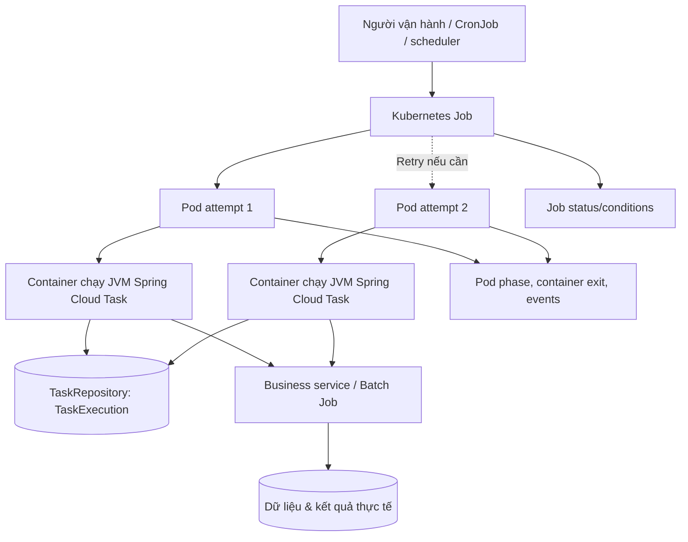
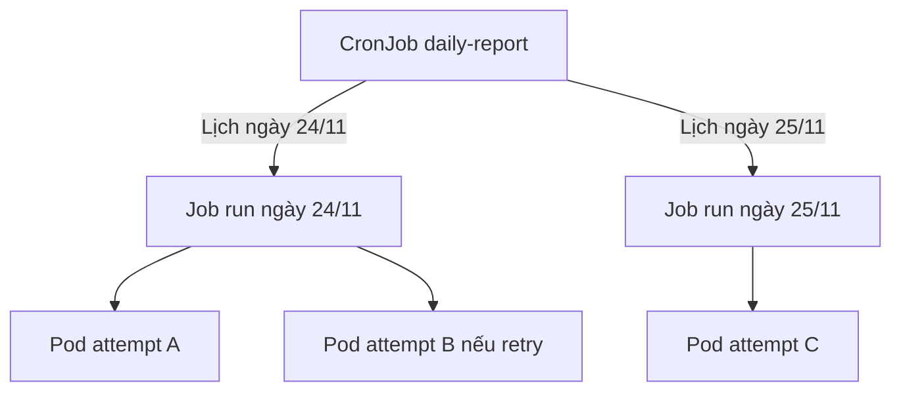

# Đối chiếu trạng thái Pod, Job và TaskExecution

## 1. Vì sao phải đối chiếu ba nguồn trạng thái?

**Spring Cloud Task** là framework cho ứng dụng Spring Boot có thời gian chạy hữu hạn: khởi động, nhận tham số, thực hiện nghiệp vụ rồi kết thúc. Khi cấu hình cơ sở dữ liệu, `TaskRepository` lưu một **`TaskExecution`** cho lần thực thi mà framework quản lý, gồm thời điểm bắt đầu, kết thúc, mã thoát và thông tin lỗi.

Khi triển khai ứng dụng thành **Kubernetes Job**, còn có hai loại đối tượng của Kubernetes:

- **Job**: bộ điều khiển theo dõi số Pod hoàn thành/thất bại và cố gắng đạt số lần hoàn thành mong muốn theo chính sách đã cấu hình.
- **Pod**: môi trường chạy một hoặc nhiều container. Kubernetes ghi nhận phase của Pod, trạng thái từng container, lý do chờ/chấm dứt và exit code của process.

Ba lớp này trả lời ba câu hỏi khác nhau:

| Câu hỏi | Nguồn kiểm tra | Giới hạn của nguồn đó |
| --- | --- | --- |
| Kubernetes đã tạo Pod và Pod kết thúc thế nào? | **Pod** (`status.phase`, `containerStatuses`, events, logs) | Không tự nói dữ liệu nghiệp vụ đã đúng |
| Lần chạy Kubernetes đã đáp ứng điều kiện hoàn thành chưa? | **Job** (`status.active/succeeded/failed`, `conditions`) | Có thể đã có nhiều Pod thử lại; không phản ánh trực tiếp `TaskExecution` |
| Spring Cloud Task đã ghi nhận một lần chạy ra sao? | **`TaskExecution`** trong `TaskRepository` | Có thể thiếu nếu JVM lỗi trước khi khởi tạo framework hoặc không kịp ghi kết thúc |
| Báo cáo/đơn hàng/tệp đã thực sự hoàn tất chưa? | **Bảng và bằng chứng nghiệp vụ** | Không được chứng minh chỉ bằng bất kỳ trạng thái nào ở ba lớp trên |

Ví dụ Kubernetes Job `daily-report-20261124` có một Pod bị `ImagePullBackOff`. Job chưa thể chạy task, nên database Spring Cloud Task **không có bản ghi mới**. Ngược lại, một Pod có thể chạy xong nghiệp vụ rồi bị `SIGKILL` trước khi framework ghi `END_TIME`: Kubernetes thấy container bị kết thúc bất thường, nhưng một phần hoặc toàn bộ dữ liệu nghiệp vụ đã commit.

**Mục tiêu bài học:** biết đọc Pod → Job → `TaskExecution` → kết quả nghiệp vụ theo một khóa tương quan, nhận diện các trạng thái tưởng như mâu thuẫn, và quyết định retry/khắc phục an toàn khi triển khai Spring Cloud Task qua Kubernetes hoặc một hệ điều phối tương tự.

## 2. Kiến trúc và vòng đời một lần chạy



Một Kubernetes Job có thể tạo **nhiều Pod** vì retry, replacement hoặc cấu hình parallelism. Mỗi Pod **không nhất thiết tạo đúng một** `TaskExecution`: một Pod lỗi trước khi vào Spring Boot có thể không tạo được bản ghi; một container có thể khởi chạy nhiều JVM nếu entrypoint tự làm như vậy; một Pod có thể chứa sidecar. Trong mô hình khuyến nghị của bài, mỗi Pod có **một container task chính chạy một JVM một lần**, nên thường mỗi attempt đi qua framework sẽ có một `TaskExecution` riêng.

### Phân biệt Kubernetes Job và Spring Batch Job

Từ **Job** có hai nghĩa rất dễ nhầm trong hệ sinh thái này:

| Thuật ngữ | Hệ thống | Ví dụ | Metadata chính |
| --- | --- | --- | --- |
| Kubernetes **Job** | Kubernetes batch/v1 | `daily-report-20261124` | Kubernetes API: `Job.status`, Pod status |
| Spring Batch **Job** | Spring Batch (tùy ứng dụng) | `importOrdersJob` | `BATCH_JOB_INSTANCE`, `BATCH_JOB_EXECUTION` |
| Spring Cloud **TaskExecution** | Spring Cloud Task | `executionId = 415` | `TASK_EXECUTION` |

Một Kubernetes Job có thể khởi một Spring Cloud Task; bên trong task có thể lại khởi một Spring Batch Job. **Không** dùng số `JOB_EXECUTION_ID` của Spring Batch làm tên Kubernetes Job, và không suy ra `TaskExecution.executionId` bằng UID Pod. Nếu có Spring Batch, việc đối chiếu cần thêm `JobRepository` và checkpoint/step status riêng.

## 3. Ý nghĩa chính xác của từng trạng thái

### 3.1. Pod phase và trạng thái container

`Pod.status.phase` là tóm tắt cấp Pod, thường nhận một trong các giá trị sau:

| Pod phase | Diễn giải | Cần kiểm tra thêm |
| --- | --- | --- |
| `Pending` | Pod đã được chấp nhận nhưng có container chưa được tạo/khởi động xong | Scheduling, `ImagePullBackOff`, Secret, volume, quota, init container |
| `Running` | Pod đã được bind node và có container đang chạy/khởi động lại; không có nghĩa nghiệp vụ đã hoàn thành | `containerStatuses[*]`, log ứng dụng, `TaskExecution` |
| `Succeeded` | Tất cả container thông thường đã chấm dứt thành công | Exit code của **container task**, trạng thái Job và dữ liệu đích |
| `Failed` | Ít nhất một container chấm dứt thất bại hoặc bị hệ thống kết thúc theo tình huống lỗi | `terminated.exitCode`, `reason`, `message`, Pod events |
| `Unknown` | Kubernetes chưa thể xác định trạng thái Pod | Node, kubelet, network, controller và log hạ tầng |

Chú ý: `ImagePullBackOff` và `CrashLoopBackOff` thường là **reason/trạng thái container đang chờ**, không phải hai giá trị `Pod.phase` chính thức. Dòng `STATUS` rút gọn do `kubectl get pods` hiển thị có thể lấy thông tin từ container reason, **không nhất thiết bằng `Pod.status.phase`**.

Khi điều tra, đọc **trạng thái của container task chính**, không chỉ dựa vào Pod phase. Một Pod có sidecar có thể còn `Running` dù container Java đã thoát; ngược lại, Pod bị đánh dấu lỗi do container phụ có thể không diễn tả đầy đủ kết quả nghiệp vụ của Java.

`exitCode = 0` thường nghĩa là process Java/container chính thoát thành công ở mức hệ điều hành. `exitCode != 0` có thể do exception, cấu hình, `OOMKilled`, tín hiệu hệ thống hoặc mã thoát do launcher định nghĩa. **Exit code không chứng minh mọi dữ liệu ngoài DB đã được đối tác xác nhận**.

### 3.2. Kubernetes Job status và conditions

Với Job chuẩn, các trường hữu ích là:

- `status.active`: số Pod đang hoạt động được controller theo dõi.
- `status.succeeded`: số Pod đã hoàn thành thành công.
- `status.failed`: số Pod thất bại được ghi nhận.
- `status.conditions`: các điều kiện như `Complete`, `Failed` hoặc trạng thái chuyển tiếp tùy phiên bản Kubernetes.
- `spec.completions`, `spec.parallelism`, `spec.backoffLimit`, `spec.activeDeadlineSeconds`: mục tiêu hoàn thành, đồng thời, retry và deadline.

Với `completions: 1`, `parallelism: 1`, một Pod `Succeeded` có thể làm Job đạt điều kiện `Complete` sau khi controller cập nhật. Nếu attempt đầu thất bại nhưng attempt sau thành công, **Job cuối cùng có thể `Complete` đồng thời `status.failed > 0`**. Đó không phải dữ liệu mâu thuẫn: counter ghi nhận những Pod từng thất bại.

Không coi `status.succeeded = 0` nghĩa là Job đã thất bại; Job có thể đang `Pending`/`Active`. Cũng không coi một Pod `Failed` nghĩa là **toàn Job `Failed`** khi Job còn quyền retry. Đọc cả `conditions` và các Pod thuộc cùng Job.

### 3.3. Spring Cloud Task TaskExecution

Schema TaskRepository mặc định thường có bảng `TASK_EXECUTION` với các trường:

| Trường | Ý nghĩa |
| --- | --- |
| `TASK_EXECUTION_ID` | Khóa định danh một lần thực thi do TaskRepository quản lý |
| `TASK_NAME` | Tên logic của task, thường ổn định giữa các attempt |
| `START_TIME`, `END_TIME` | Thời điểm framework ghi nhận bắt đầu và kết thúc |
| `EXIT_CODE` | Mã thoát do framework ghi nhận theo cơ chế thực thi/ánh xạ lỗi |
| `EXIT_MESSAGE`, `ERROR_MESSAGE` | Thông tin bổ sung về kết quả/lỗi |
| `EXTERNAL_EXECUTION_ID`, `PARENT_TASK_EXECUTION_ID` | Thông tin liên kết ngoài/cha–con nếu được sử dụng |

`TaskExecution` **không phải** Kubernetes Pod status. Nếu JVM không khởi tạo được `ApplicationContext`, không thể kết nối `TaskRepository`, thiếu bảng metadata hoặc bị kill quá sớm, hàng `TASK_EXECUTION` có thể không tồn tại hoặc không có `END_TIME`/mã thoát cuối. Điều này không phủ định log và events của Kubernetes.

## 4. Dùng khóa tương quan để nối đúng ba lớp

Khi Job retry, Kubernetes tạo Pod mới; `Pod.metadata.name` và `Pod.metadata.uid` thay đổi. `TASK_EXECUTION_ID` cũng có thể thay đổi giữa các lần Java được framework khởi tạo. Vì vậy, **đừng join log, Job và `TaskExecution` chỉ bằng timestamp gần nhau**.

Một chiến lược đơn giản là cấp **`runKey` nghiệp vụ ổn định cho toàn yêu cầu**, rồi ghi cùng khóa này vào các nguồn quan sát:

1. **Kubernetes Job:** label hoặc annotation theo `runKey`, kèm namespace, Job name và UID.
2. **Pod:** ghi Pod name, Pod UID từ Kubernetes Downward API; Pod có `ownerReferences`/label liên kết về Job.
3. **Ứng dụng Spring Cloud Task:** nhận `--app.run-key=...`, log có cấu trúc gồm `runKey`, Pod UID, `TASK_EXECUTION_ID` (khi đã có), task name.
4. **Dữ liệu nghiệp vụ:** lưu `runKey` hoặc business idempotency key ở bảng kết quả; ràng buộc unique/transaction phù hợp.

| ID | Phạm vi ổn định | Có đổi khi Kubernetes retry tạo Pod mới? |
| --- | --- | --- |
| `runKey` do nghiệp vụ/scheduler cấp | **Cùng yêu cầu logic** | **Không nên đổi** |
| Kubernetes Job name/UID | Một đối tượng Kubernetes Job | Thường giữ nguyên trong các attempt của cùng Job; nếu xóa/tạo lại Job, UID đổi |
| Pod name/UID | Một Pod cụ thể | Có |
| `TASK_EXECUTION_ID` | Một lần thực thi trong **một TaskRepository** | Thường có ID khác cho JVM/task execution mới |
| Spring Batch JobExecution ID | Một lần chạy Batch Job (nếu có) | Theo quy tắc JobRepository, không đồng nhất với Task ID |

Một `runKey` cố định **không tự mang lại exactly-once**. Nó chỉ giúp các tầng nói về cùng một yêu cầu. Cần khóa nghiệp vụ, ràng buộc duy nhất, checkpoint, transaction và/hoặc idempotency tại hệ thống bên ngoài để retry an toàn.

### Khi TaskExecution chưa tồn tại thì sao?

Giữ **Job UID, Pod UID, container state, events và log nền tảng** như chứng cứ cho lỗi trước bootstrap. Không tạo một `TaskExecution` giả rồi đánh dấu thành công chỉ để lấp khoảng trống. Có thể ghi một bản ghi audit ngoài framework rằng yêu cầu triển khai đã thất bại trước khi Java khởi động.

## 5. Ví dụ ứng dụng Spring Cloud Task để triển khai

Ví dụ dùng Spring Boot với Spring Cloud Task, **không cần Spring Batch** để người học tập trung vào quan hệ Pod/Job/TaskExecution. Một `ApplicationRunner` đọc `runKey`, in thông tin Pod để truy vết và mô phỏng lỗi theo tham số. Không có xử lý dữ liệu thật trong runner mẫu.

### 5.1. Dependency và application.yml

Trong dự án Maven sử dụng bộ phiên bản Spring Boot/Spring Cloud tương thích qua BOM:

```xml
<dependencies>
    <dependency>
        <groupId>org.springframework.cloud</groupId>
        <artifactId>spring-cloud-starter-task</artifactId>
    </dependency>
    <dependency>
        <groupId>org.springframework.boot</groupId>
        <artifactId>spring-boot-starter-jdbc</artifactId>
    </dependency>
    <dependency>
        <groupId>org.postgresql</groupId>
        <artifactId>postgresql</artifactId>
        <scope>runtime</scope>
    </dependency>
</dependencies>
```

`src/main/resources/application.yml`:

```yaml
spring:
  application:
    name: daily-report-task
  main:
    web-application-type: none
  datasource:
    url: ${TASK_DB_URL}
    username: ${TASK_DB_USER}
    password: ${TASK_DB_PASSWORD}
  cloud:
    task:
      name: daily-report-task
      initialize-enabled: false
```

`initialize-enabled: false` **giả định schema `TASK_*` chính thức đã được migration trước**; nếu database trống, task có thể không tạo được `TaskExecution`. Để quan sát qua nhiều Pod, phải dùng **database bền vững chung**: H2 `mem:` trong mỗi Pod là một database riêng và không cho bạn lịch sử tập trung.

### 5.2. Runner: một lần JVM cho một attempt

Tạo `DeploymentTaskApplication.java`:

```java
package com.example.deployment;

import java.util.List;

import org.springframework.boot.ApplicationArguments;
import org.springframework.boot.ApplicationRunner;
import org.springframework.boot.SpringApplication;
import org.springframework.boot.autoconfigure.SpringBootApplication;
import org.springframework.cloud.task.configuration.EnableTask;
import org.springframework.context.annotation.Bean;

@EnableTask
@SpringBootApplication
public class DeploymentTaskApplication {

    public static void main(String[] args) {
        SpringApplication.run(DeploymentTaskApplication.class, args);
    }

    @Bean
    ApplicationRunner runOnce() {
        return args -> {
            String runKey = required(args, "app.run-key");
            String podName = System.getenv().getOrDefault("POD_NAME", "local");
            String podUid = System.getenv().getOrDefault("POD_UID", "unknown");
            System.out.printf("RUN_START runKey=%s pod=%s podUid=%s%n",
                    runKey, podName, podUid);

            // Demo thất bại có chủ đích: không dùng cho production.
            if ("true".equalsIgnoreCase(optional(args, "demo.fail"))) {
                throw new IllegalStateException("Lỗi mô phỏng trong task");
            }

            // Ứng dụng thật gọi service nghiệp vụ có transaction/idempotency.
            System.out.printf("RUN_DONE runKey=%s pod=%s%n", runKey, podName);
        };
    }

    private static String required(ApplicationArguments args, String name) {
        String value = optional(args, name);
        if (value == null || value.isBlank()) {
            throw new IllegalArgumentException("Thiếu tham số --" + name);
        }
        return value;
    }

    private static String optional(ApplicationArguments args, String name) {
        if (!args.containsOption(name)) {
            return null;
        }
        List<String> values = args.getOptionValues(name);
        if (values == null || values.size() != 1 || values.get(0) == null) {
            throw new IllegalArgumentException("Cần đúng một giá trị --" + name);
        }
        return values.get(0);
    }
}
```

Thông tin `runKey`, Pod name và Pod UID xuất hiện trong **log ứng dụng**. Để thêm `TASK_EXECUTION_ID` vào log, có thể tạo một bean listener theo `TaskExecutionListener` hoặc `@BeforeTask`/`@AfterTask`, nhưng listener chỉ chạy khi Spring Cloud Task đã vào được vòng đời tương ứng. Nếu framework thất bại trước bootstrap, log Kubernetes là nguồn bắt buộc phải giữ.

### 5.3. Listener bổ sung TaskExecution ID vào log

Tạo `TaskExecutionAudit.java` (cùng package để được component scan):

```java
package com.example.deployment;

import org.slf4j.Logger;
import org.slf4j.LoggerFactory;
import org.springframework.cloud.task.listener.annotation.AfterTask;
import org.springframework.cloud.task.listener.annotation.BeforeTask;
import org.springframework.cloud.task.listener.annotation.FailedTask;
import org.springframework.cloud.task.repository.TaskExecution;
import org.springframework.stereotype.Component;

@Component
public class TaskExecutionAudit {

    private static final Logger log = LoggerFactory.getLogger(TaskExecutionAudit.class);

    @BeforeTask
    public void onStart(TaskExecution execution) {
        log.info("TASK_START taskExecutionId={} taskName={} podUid={}",
                execution.getExecutionId(), execution.getTaskName(),
                System.getenv().getOrDefault("POD_UID", "unknown"));
    }

    @FailedTask
    public void onFailure(TaskExecution execution, Throwable error) {
        log.error("TASK_FAILED taskExecutionId={} errorType={}",
                execution.getExecutionId(), error.getClass().getSimpleName());
    }

    @AfterTask
    public void onEnd(TaskExecution execution) {
        log.info("TASK_END taskExecutionId={} exitCode={}",
                execution.getExecutionId(), execution.getExitCode());
    }
}
```

Đây là **hook quan sát**, không phải nơi thực hiện nghiệp vụ bắt buộc. Tránh gửi HTTP hoặc SQL nặng trong listener: nếu listener lỗi, nó có thể ảnh hưởng vòng đời task. Log không nên chứa token, mật khẩu, payload cá nhân hoặc tham số nhạy cảm. `@AfterTask` có thể nhìn thấy dữ liệu trước khi framework cập nhật trạng thái cuối vào repository; kiểm tra SQL **sau khi tiến trình đã dừng**.

## 6. Kubernetes Job mẫu: một Pod tại một thời điểm

Giả sử namespace `batch-lab` và Kubernetes Secret `task-db-credentials` **đã được tạo** (các key: `url`, `username`, `password`), cùng image `registry.example.com/demo/daily-report-task:1.0.0` chứa Java runtime và JAR ở `/app/app.jar`. Dưới đây là manifest **minh họa**, cần thay image/resource/namespace theo môi trường:

```yaml
apiVersion: batch/v1
kind: Job
metadata:
  name: daily-report-20261124
  namespace: batch-lab
  labels:
    app.kubernetes.io/name: daily-report-task
    ops.example.com/run-key: daily-report-2026-11-24
spec:
  completions: 1
  parallelism: 1
  backoffLimit: 1
  activeDeadlineSeconds: 900
  template:
    metadata:
      labels:
        app.kubernetes.io/name: daily-report-task
        ops.example.com/run-key: daily-report-2026-11-24
    spec:
      restartPolicy: Never
      terminationGracePeriodSeconds: 30
      containers:
        - name: task
          image: registry.example.com/demo/daily-report-task:1.0.0
          command: ["java", "-jar", "/app/app.jar"]
          args:
            - "--app.run-key=daily-report-2026-11-24"
            - "--demo.fail=false"
          env:
            - name: POD_NAME
              valueFrom:
                fieldRef:
                  fieldPath: metadata.name
            - name: POD_UID
              valueFrom:
                fieldRef:
                  fieldPath: metadata.uid
            - name: TASK_DB_URL
              valueFrom:
                secretKeyRef:
                  name: task-db-credentials
                  key: url
            - name: TASK_DB_USER
              valueFrom:
                secretKeyRef:
                  name: task-db-credentials
                  key: username
            - name: TASK_DB_PASSWORD
              valueFrom:
                secretKeyRef:
                  name: task-db-credentials
                  key: password
          resources:
            requests:
              cpu: "100m"
              memory: "256Mi"
            limits:
              cpu: "500m"
              memory: "512Mi"
```

**Giải thích những lựa chọn có chủ đích:**

- `completions: 1`, `parallelism: 1`: một Job cần một Pod hoàn thành và chỉ tạo tối đa một Pod hoạt động cùng lúc theo cấu hình, phù hợp bài lab một task một lần.
- `restartPolicy: Never`: container lỗi thì Pod attempt thất bại; Job controller có thể tạo **Pod mới** theo `backoffLimit` và điều kiện thực tế. Mỗi Pod mới là một cơ hội tạo thêm `TaskExecution`.
- `backoffLimit: 1`: giới hạn số lỗi được Job chấp nhận trước khi đánh dấu thất bại theo quy tắc controller; **không có bảo đảm** rằng chỉ một tác động nghiệp vụ từng xảy ra.
- `activeDeadlineSeconds: 900`: deadline cấp Kubernetes Job, có thể khiến Job/Pod bị dừng khi vượt giới hạn; ứng dụng cần chịu được việc dừng không hoàn tất.
- `POD_NAME` và `POD_UID`: Kubernetes Downward API đưa định danh Pod vào env để log tương quan với TaskExecution.
- `ops.example.com/run-key`: label tĩnh phục vụ tìm kiếm theo yêu cầu nghiệp vụ; không chứa dữ liệu nhạy cảm.
- `command` và `args`: chỉ hợp lệ với image có Java và JAR ở vị trí ví dụ; nếu image có entrypoint riêng thì điều chỉnh tương ứng. Không bọc Java bằng script luôn `exit 0` vì có thể làm Kubernetes hiểu sai mã thoát.

Không ghi password trực tiếp trong manifest, command-line argument hoặc annotation. Resource limit nên được đo theo workload thật; `OOMKilled` vì limit quá thấp không phải lỗi logic nhập dữ liệu.

### Thử bằng một Job riêng

Lưu manifest theo quy trình triển khai ngoài nội dung bài học, chẳng hạn `daily-report-job.yaml`, rồi dùng quyền Kubernetes đã cấp:

```bash
kubectl -n batch-lab apply -f daily-report-job.yaml
kubectl -n batch-lab get job daily-report-20261124 -w
```

`kubectl apply` với một Job đã tồn tại không phải cơ chế restart chuẩn: nhiều trường trong Pod template không thể cập nhật khi Job đang tồn tại. Muốn chạy **một yêu cầu mới**, hãy tạo Job có tên/UID mới và `runKey` nghiệp vụ được xác định đúng; khi muốn retry **cùng yêu cầu**, trước tiên kiểm tra trạng thái/các side effect cũ để tránh xử lý trùng. Không tùy tiện xóa Job đang chạy chỉ để đổi YAML.

## 7. Quy trình kiểm tra: Kubernetes trước, TaskRepository sau

### 7.1. Xem Job và điều kiện hoàn thành

```bash
kubectl -n batch-lab get jobs
kubectl -n batch-lab describe job daily-report-20261124
kubectl -n batch-lab get job daily-report-20261124 -o yaml
```

Ở trạng thái JSON/YAML, xem `status.active`, `status.succeeded`, `status.failed`, `status.conditions`, `spec.completions`, `spec.parallelism` và `spec.backoffLimit`. `describe` hữu ích để đọc events có lỗi không tạo được Pod, vượt quota hoặc vấn đề controller. Chờ Job `Complete` **chưa đủ** để kết luận dữ liệu nghiệp vụ đạt invariant.

### 7.2. Liệt kê **tất cả** Pod attempt của Job

```bash
kubectl -n batch-lab get pods \
  -l batch.kubernetes.io/job-name=daily-report-20261124 \
  -o wide
```

`batch.kubernetes.io/job-name` là label do Kubernetes Job controller sử dụng ở các phiên bản hiện đại. Ở cluster/đối tượng cũ, có thể xem label `job-name` hoặc xác nhận `metadata.ownerReferences` trỏ về **đúng Job UID**. Nếu thấy hai Pod, cần xem cả hai: Pod trước có thể `Failed`, Pod sau `Succeeded`, trong khi Job cuối cùng `Complete`.

Kiểm tra một Pod cụ thể:

```bash
kubectl -n batch-lab describe pod <pod-name>
kubectl -n batch-lab get pod <pod-name> -o yaml
```

Trong YAML của Pod, kiểm tra `status.phase`, `status.containerStatuses[*].state`, `lastState`, `restartCount`, `terminated.exitCode`, `terminated.reason`, `containerID` và events. Với `restartPolicy: Never`, lần retry của Kubernetes Job thường là **Pod khác**, vì thế `kubectl logs --previous` trên Pod hiện tại **không thay thế** log của Pod lỗi trước.

### 7.3. Thu log đúng Pod và container

```bash
# Pod cụ thể trong danh sách của Job:
kubectl -n batch-lab logs pod/<pod-name> -c task --timestamps

# Chỉ dùng --previous khi container từng restart bên trong CÙNG Pod:
kubectl -n batch-lab logs pod/<pod-name> -c task --previous --timestamps
```

`kubectl logs job/daily-report-20261124` có thể hữu ích cho kiểm tra nhanh nhưng khi một Job có nhiều Pod, hãy **liệt kê và xem log từng Pod** để không bỏ sót attempt thất bại. Nếu Pod bị garbage collection hoặc Job có TTL cleanup, log có thể đã bị xóa khỏi API; cần hệ thống thu gom log tập trung có retention phù hợp.

### 7.4. Đối chiếu TaskExecution trong PostgreSQL

Khi Spring Cloud Task sử dụng schema mặc định và database bền vững đã được tạo đúng phiên bản, truy vấn:

```sql
SELECT TASK_EXECUTION_ID,
       TASK_NAME,
       START_TIME,
       END_TIME,
       EXIT_CODE,
       EXIT_MESSAGE,
       ERROR_MESSAGE
FROM TASK_EXECUTION
WHERE TASK_NAME = 'daily-report-task'
ORDER BY START_TIME DESC, TASK_EXECUTION_ID DESC;
```

Trong ví dụ, dùng log `RUN_START runKey=... podUid=...` và `TASK_START taskExecutionId=... podUid=...` để nối **Pod UID** với **TaskExecution ID**; dùng label `run-key` hoặc đối số `--app.run-key` để nối attempt với yêu cầu. Nếu cần báo cáo bằng SQL thường xuyên, có thể tạo **bảng tương quan nghiệp vụ riêng** chứa `run_key`, `task_execution_id`, `pod_uid`, `job_uid`, trạng thái xác minh; đừng sửa schema `TASK_EXECUTION` của framework.

Spring Cloud Task có bảng tham số thực thi ở những cấu hình/schema hỗ trợ; thông tin tham số có thể giúp truy vết, nhưng **không được giả định một tham số nhạy cảm luôn được lưu hoặc có thể được tìm kiếm an toàn**. Khóa tương quan chuyên dụng và log có cấu trúc đáng tin cậy hơn việc ghép hai bản ghi chỉ bằng thời điểm start gần nhau.

Nếu không thấy bản ghi tương ứng, trước tiên xác minh **JDBC URL/schema, profile, tài khoản, migration**, rồi kiểm tra liệu Pod chỉ lỗi ở `ImagePullBackOff`, `CreateContainerConfigError`, `CrashLoopBackOff` hoặc lỗi Java trước khi TaskRepository hoạt động. Không kết luận "task chưa từng được yêu cầu" chỉ vì bảng `TASK_EXECUTION` không có hàng.

## 8. Ma trận đối chiếu các trường hợp thường gặp

| Kubernetes Pod / container | Kubernetes Job | `TaskExecution` | Nhận định cần điều tra |
| --- | --- | --- | --- |
| Pod `Pending`, container `ImagePullBackOff` | `Active`/chưa `Complete` hoặc tiến tới lỗi theo deadline | **Không có** hàng mới | Không kéo được image, Java chưa chạy; xem registry, quyền, image tag |
| Pod `Pending`, thiếu Secret hoặc volume | Job chưa hoàn thành | **Không có** hàng mới | Lỗi môi trường trước bootstrap, xem Pod events |
| Pod `Running`, JVM còn xử lý | Job `active > 0` | Có `START_TIME`, `END_TIME` có thể rỗng | Bình thường khi task còn chạy; đối chiếu log và thời gian |
| Pod `Succeeded`, container chính exit `0` | Job `Complete` | `END_TIME` có, `EXIT_CODE=0` | Thành công kỹ thuật; vẫn phải xác minh dữ liệu nghiệp vụ |
| Pod `Failed`, container exit khác `0` | Job còn retry, chưa `Failed` | Một attempt có `EXIT_CODE!=0` | Đọc các Pod sau; chưa kết luận cả Job thất bại |
| Pod attempt 1 `Failed`, attempt 2 `Succeeded` | Job cuối cùng `Complete`, `failed > 0` có thể còn | **Hai** execution nếu cả hai JVM đã vào Task | Retry hợp lệ về mặt controller, kiểm tra idempotency |
| Pod bị `OOMKilled` | Job có thể retry rồi `Complete` hoặc `Failed` | Có thể thiếu `END_TIME` | JVM bị chấm dứt cưỡng bức, metadata không kịp cập nhật |
| Pod `Succeeded` nhưng task DB có `EXIT_CODE!=0` | Job có thể `Complete` | Task báo lỗi dù container exit `0` | Kiểm tra entrypoint/script nuốt exit code, xử lý exception và ánh xạ lỗi |
| Pod `Failed` sau commit nghiệp vụ | Job có thể `Failed` | Lỗi hoặc `END_TIME` rỗng | Dữ liệu có thể đã đủ; đối soát trước khi retry |
| Pod/Job đã bị xóa | Không còn đối tượng để truy vấn | Lịch sử Task có thể còn | Cần log tập trung, audit triển khai và retention đồng bộ |

Ma trận là **ví dụ diễn giải**, không phải các trạng thái luôn xảy ra cùng nhau. Kubernetes và database cập nhật **bất đồng bộ**, nên trong thời gian chuyển tiếp có thể thấy Job chưa đổi condition dù Pod đã kết thúc, hoặc TaskExecution chưa có `END_TIME` tại thời điểm đang đọc. Để kết luận cuối cùng, kiểm tra sau một khoảng quan sát phù hợp và giữ timestamp/UID của dữ liệu đã lấy.

### Lỗi điển hình: Job Complete nhưng một Pod Failed

Giả sử `backoffLimit` cho phép retry:

1. Pod A chạy JVM, task `executionId=501` nhập được 850/1.000 đơn rồi lỗi.
2. Kubernetes tạo Pod B, task `executionId=502` được khởi động lại với **cùng `runKey`**.
3. B dùng khóa nghiệp vụ/checkpoint để chỉ xử lý 150 đơn còn thiếu, rồi thoát `0`.
4. Kubernetes Job có thể đạt `Complete` vì có một Pod thành công, dù Pod A vẫn mang phase `Failed` và TaskExecution 501 còn lịch sử lỗi.

Đây là **điều mong đợi nếu retry được thiết kế đúng**. Tuy nhiên, nếu B nhập lại toàn bộ 1.000 đơn mà không có idempotency thì Job `Complete` có thể che giấu hậu quả ghi trùng; phải đối soát dữ liệu thực tế, không chỉ xem condition `Complete`.

## 9. CronJob, retry, timeout và giới hạn đồng thời

Khi task chạy theo lịch, Kubernetes **CronJob** tạo Kubernetes **Job**; Job lại tạo Pod. Một ngày có thể có nhiều attempt Pod cho cùng một Job. Một CronJob cũng có thể tạo Job mới ở lịch tiếp theo trong lúc Job cũ chưa kết thúc, tùy chính sách.



- `CronJob.spec.concurrencyPolicy: Forbid` giúp tránh chồng lịch do **chính CronJob đó** tạo; nó không chặn một Job do người dùng tạo thủ công hay từ CronJob khác.
- `Job.spec.parallelism > 1` có thể tạo nhiều Pod **đồng thời trong cùng Job**; nếu mỗi Pod chạy cùng một logic nhập đầy đủ, nguy cơ ghi trùng rất lớn. Chỉ dùng khi task có phân vùng/khóa/idempotency được thiết kế rõ ràng.
- `Job.spec.backoffLimit` điều khiển retry cấp Kubernetes; `spring.cloud.task.single-instance-enabled` là cơ chế khóa theo task name (cần Spring Integration và kho khóa chung), **không thay** chính sách Job hoặc CronJob.
- `Job.spec.activeDeadlineSeconds` có thể kết thúc một Job dù xử lý còn dở; retry sau deadline cần xác minh dữ liệu và trạng thái worker cũ.
- Không lấy `TaskExecution ID` làm idempotency key: mỗi lần retry có thể tạo ID mới; dùng `runKey`, business key hoặc khóa giao dịch ổn định.

Nếu ứng dụng chạy Spring Batch, có thêm một lớp restart: cùng `Job` name và **identifying `JobParameters`** mới xác định đúng Job instance để tiếp tục checkpoint. Kubernetes retry một Pod **không tự bảo đảm** Spring Batch restart đúng Step đang lỗi. Phải kiểm tra `JobRepository` và tham số Batch được truyền qua mỗi attempt.

## 10. Quy trình chẩn đoán an toàn khi trạng thái không khớp

Khi một nguồn báo thành công nhưng nguồn khác báo lỗi, thực hiện theo thứ tự:

1. **Định danh yêu cầu:** ghi `runKey`, cluster, namespace, Kubernetes Job name/UID và khoảng thời gian dự kiến. Tránh tìm nhầm Job có tên giống ở namespace khác.
2. **Kiểm tra Job:** xem `conditions`, `active/succeeded/failed`, `backoffLimit`, deadline, events. Xác nhận Job đã thật sự đạt trạng thái kết thúc hay đang chuyển tiếp.
3. **Liệt kê tất cả Pod của Job UID:** xem phase, main-container exit code/reason, init container, sidecar, thời điểm tạo và log riêng của từng attempt.
4. **Nối tới Spring Cloud Task:** dùng Pod UID trong log `TASK_START` và truy vấn `TASK_EXECUTION` cùng kho metadata; xác định execution nào chưa kết thúc hoặc đã lỗi. Nếu không có ID thì điều tra lỗi trước bootstrap.
5. **Nếu có Spring Batch, kiểm tra thêm Job/Step:** xem `BATCH_JOB_EXECUTION`, `BATCH_STEP_EXECUTION`, checkpoint và tham số nhận diện để tránh restart sai instance.
6. **Đối soát đầu ra:** xác nhận dữ liệu đã commit, file và checksum, receipt từ API ngoài hoặc bảng trạng thái nghiệp vụ. Phân biệt "task hoàn tất kỹ thuật" với "yêu cầu đã hoàn tất đúng".
7. **Quyết định retry/khắc phục:** chỉ phát lại khi process cũ đã dừng hoặc hạ tầng cho phép, khóa nghiệp vụ/idempotency đầy đủ, đã biết phạm vi dữ liệu cần tiếp tục. Đặt backoff và giới hạn số lần thử.
8. **Ghi kết luận:** giữ UID, execution ID, nguyên nhân và hành động đã thực hiện trong sổ vận hành; không cập nhật thủ công hàng framework để làm đẹp lịch sử.

### Các lỗi thường gặp và cách xử lý

| Triệu chứng | Nguyên nhân có thể | Bước kiểm tra đầu tiên |
| --- | --- | --- |
| `kubectl get job` còn `Active` nhưng Pod `Pending` lâu | Không schedule được node, image pull, Secret/volume hoặc quota | `kubectl describe pod`, Job/Pod events |
| Job `Failed` nhưng TaskExecution không có | JVM chưa khởi động, sai JDBC/schema, lỗi bootstrap | Container log, Pod reason và log khởi tạo Spring |
| TaskExecution `EXIT_CODE=0` nhưng Pod `Failed` | JVM thoát lỗi sau callback, container phụ lỗi hoặc tín hiệu hệ thống | Main-container exit code, sidecar/init, log sau Task end |
| Pod `Succeeded`, TaskExecution thiếu `END_TIME` | Lỗi ghi metadata, sai DB khi truy vấn, trạng thái chưa cập nhật | TaskRepository log, DB URL/schema, thời gian quan sát |
| Job `Complete` nhưng dữ liệu thiếu | Task trả success giả, bỏ qua lỗi hoặc kiểm tra hoàn tất chưa đủ | SQL đối soát, business logs, các attempt trước |
| Một Kubernetes Job có nhiều TaskExecution | Pod retry, nhiều JVM trong image hoặc task khởi lại | Pod UID, Job UID và startup logs |
| Không tìm thấy Pod lỗi sau retry | Pod/Job cleanup, retention thấp | Log tập trung, events, cấu hình TTL/history |
| Scheduler tạo nhiều Job cùng một ngày | CronJob overlap/missed schedule hoặc thao tác thủ công | CronJob events, lịch, runKey và concurrency policy |
| Hai Pod cùng sửa một bản ghi nghiệp vụ | Song song không có partition/idempotency | Job `parallelism`, khóa nghiệp vụ, unique constraint |
| `EXIT_CODE` Task và container khác nhau | Wrapper script không truyền exit code, ánh xạ lỗi không phù hợp | Entrypoint image, `exec`, shell exit status và Task logs |

**Không dùng `kubectl delete pod` hoặc `DELETE FROM TASK_EXECUTION` như cách mặc định để sửa lỗi.** Kubernetes có thể tạo lại Pod theo Job controller, còn xóa metadata sẽ làm mất bằng chứng. Để dừng xử lý thật sự cần thao tác lên đối tượng điều phối phù hợp, xác minh không còn process hợp lệ và đánh giá mọi side effect đã commit.

## 11. Thiết kế quan sát và bảo toàn lịch sử

Kubernetes Pod và Job có thể bị xóa theo chính sách TTL/retention; TaskRepository có thể được lưu lâu hơn; dữ liệu nghiệp vụ lại có vòng đời riêng. Muốn điều tra sau nhiều tuần, nên lưu ít nhất:

- `runKey` ổn định, cluster, namespace, Kubernetes Job UID, Pod UID và tên container chính.
- Timestamp khởi động/scheduling, thời điểm container chạy, terminated exit code/reason, Job conditions và sự kiện quan trọng.
- `TASK_EXECUTION_ID`, `TASK_NAME`, `START_TIME`, `END_TIME`, `EXIT_CODE`, `ERROR_MESSAGE`; Spring Batch ID/status nếu có.
- Artifact version (image digest/tag cố định), version cấu hình và nguồn tham số nghiệp vụ không nhạy cảm.
- Chứng cứ đầu ra: business key, số lượng/tập ID đã xử lý, checksum, receipt hệ thống bên ngoài và kết luận đối soát.

Thiết kế dashboard với cả **số Job chưa khởi tạo được Pod**, **Pod thất bại trước khi tạo TaskExecution**, **TaskExecution chưa kết thúc quá ngưỡng**, **Job Complete nhưng đối soát nghiệp vụ thất bại**, **số Pod attempt trên mỗi Job** và **tỷ lệ retry**. Một dashboard chỉ hiển thị TaskRepository sẽ không phát hiện được tất cả lỗi `ImagePullBackOff` hoặc Secret thiếu.

Khi log chứa ID từ môi trường đa thuê, cần phân quyền đọc, retention phù hợp và tránh đưa dữ liệu cá nhân/secret vào label hoặc argument. Kubernetes Secret được truyền qua environment không tự ngăn ứng dụng vô tình ghi giá trị ra log.

## 12. Bài thực hành tự kiểm tra

1. Giải thích vì sao **Kubernetes Job**, **Pod** và **TaskExecution** không phải ba tên cho cùng một lần chạy. Nêu điều kiện mà Job có thể có nhiều Pod và nhiều `TaskExecution`.
2. Triển khai manifest Job mẫu với `--demo.fail=false` trên namespace/DB lab đã chuẩn bị. Dùng `kubectl get job`, `get pods`, `describe`, `logs` và SQL để thu thập ba lớp trạng thái.
3. Tạo một Job **mới** với `--demo.fail=true` ở môi trường lab. Quan sát `backoffLimit`, số Pod attempt, log và các TaskExecution (nếu được ghi). Vì sao một Pod `Failed` chưa kết luận Job cuối cùng `Failed`?
4. Cố ý dùng image tag không tồn tại trong môi trường thử nghiệm. Dự đoán Pod reason, Job status và khả năng xuất hiện `TASK_EXECUTION`. Tại sao SQL TaskRepository không đủ để phát hiện lỗi đó?
5. Cấu hình một container bị giới hạn RAM quá thấp để mô phỏng `OOMKilled` **chỉ khi có quyền trên môi trường lab**. Quan sát Pod `terminated.reason` và xác minh `END_TIME` có thể thiếu.
6. Lấy hai Pod trong cùng một Job có retry; so sánh `Pod UID`, `TASK_EXECUTION_ID`, `runKey` và Job UID. ID nào cần giữ ổn định cho nghiệp vụ?
7. Giả sử Job `Complete` nhưng báo cáo thiếu một phần dữ liệu. Thiết kế SQL hoặc quy tắc checksum/unique key để xác nhận và lựa chọn retry không ghi trùng.
8. Trong CronJob, so sánh `concurrencyPolicy: Forbid` với Job `backoffLimit` và Spring Cloud Task single-instance. Chúng kiểm soát các vấn đề gì khác nhau?
9. Nếu Pod chạy một Spring Batch Job, hãy chỉ rõ khác biệt giữa Kubernetes Job UID, `TASK_EXECUTION_ID`, `BATCH_JOB_EXECUTION.JOB_EXECUTION_ID` và identifying `JobParameters`.
10. Thiết kế runbook xử lý trường hợp Kubernetes Job đã bị TTL xóa nhưng còn dữ liệu TaskRepository và dữ liệu nghiệp vụ. Bạn cần thêm log/label/UID nào để truy vết?

Sau bài học, bạn cần **đối chiếu có hệ thống từ Pod → Kubernetes Job → TaskExecution → kết quả nghiệp vụ**, nhận ra những trường hợp không có TaskExecution vì lỗi trước bootstrap, nhiều attempt do retry, timeout/chấm dứt cưỡng bức, và biết giữ khóa tương quan, log, metadata để xử lý Spring Cloud Task an toàn khi chạy theo lịch hoặc yêu cầu.

## 13. Tài liệu tham khảo

- [Kubernetes — Pod Lifecycle](https://kubernetes.io/docs/concepts/workloads/pods/pod-lifecycle/): Pod phase, container states, terminated reason và restart.
- [Kubernetes — Jobs](https://kubernetes.io/docs/concepts/workloads/controllers/job/): Job status, conditions, retry/backoff, completions và parallelism.
- [Kubernetes — CronJob](https://kubernetes.io/docs/concepts/workloads/controllers/cron-jobs/): lịch chạy và chính sách đồng thời theo CronJob.
- [Kubernetes — Downward API](https://kubernetes.io/docs/concepts/workloads/pods/downward-api/): truyền metadata Pod vào biến môi trường.
- [Spring Cloud Task Reference Guide](https://docs.spring.io/spring-cloud-task/reference/): `TaskExecution`, `TaskRepository` và lifecycle listener.
- [Spring Cloud Task — Repository Schema](https://docs.spring.io/spring-cloud-task/reference/appendix-task-repository-schema.html): các bảng metadata mặc định của TaskRepository.
- [Spring Batch Reference](https://docs.spring.io/spring-batch/reference/): `JobExecution`, `StepExecution`, checkpoint và restart khi task tích hợp Batch.

Các ví dụ trong bài là hướng dẫn học tập, không phải runbook có thể chạy nguyên trạng trên mọi cluster. Trước triển khai thực tế, kiểm tra **phiên bản Kubernetes, Spring Cloud Task, Spring Boot, JDBC driver và DDL** đang dùng; xác nhận chính sách retry, retention, quyền truy cập và kết quả nghiệp vụ trên môi trường thử nghiệm an toàn.
