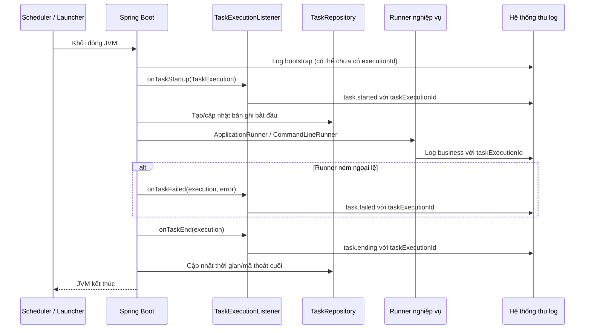
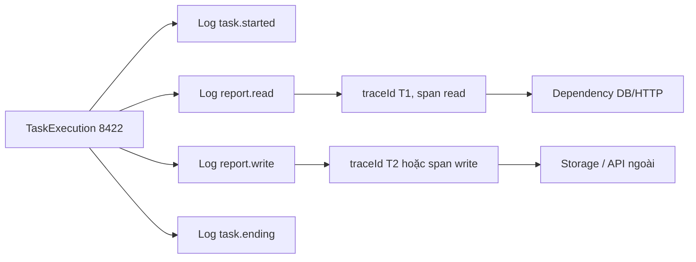
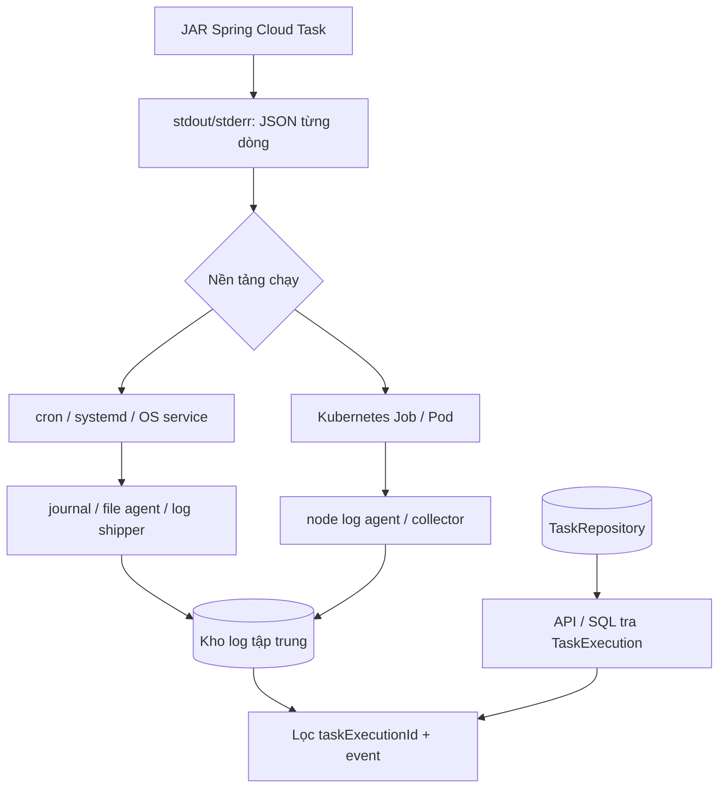

# Nhật ký có cấu trúc và liên kết bằng executionId

## Mục tiêu bài học

**SPRING_CLOUD_TASK (Spring Cloud Task)** xây dựng ứng dụng Spring Boot **chạy hữu hạn**: nhận tham số, thực hiện công việc, sau đó kết thúc. Framework ghi metadata của từng lượt chạy vào `TaskRepository`, giúp theo dõi `TaskExecution`, mã thoát, lỗi và kết quả. Các lượt này có thể được kích hoạt bằng cron, yêu cầu thủ công hoặc nền tảng điều phối, và có thể chứa một hay nhiều Spring Batch Job.

Trong chương **Quan sát**, câu hỏi quan trọng không chỉ là “Task đã chạy chưa?” mà là: **làm sao tìm tất cả dòng nhật ký của đúng một lượt chạy, kể cả khi nhiều lượt dùng cùng tên Task và nhiều tiến trình chạy gần nhau?** Bài này dùng **nhật ký có cấu trúc (structured logging)** và `TaskExecution.executionId` làm khóa liên kết để trả lời.

Sau bài học, bạn có thể:

- Phân biệt `executionId` của Spring Cloud Task với `requestId`, ID scheduler, ID Pod, `traceId` và `JobExecution.id` của Spring Batch.
- Thiết kế schema JSON log nhất quán, có tên sự kiện, mức độ lỗi, ID lượt chạy và thời điểm.
- Cấu hình structured logging của Spring Boot 3.4+ hoặc dùng log pattern ở phiên bản chưa có chức năng này.
- Dùng `TaskExecutionListener`, SLF4J `MDC` và `ApplicationRunner` để đưa execution ID vào log, tránh rò rỉ context giữa các lượt.
- Hiểu giới hạn của `ThreadLocal`/MDC khi xử lý `@Async`, worker thread hoặc Spring Batch multi-threaded Step.
- Truy vấn log tập trung và đối chiếu với `TASK_EXECUTION`, log scheduler, trạng thái tiến trình và `JobExecution`.
- Phân biệt quan sát bằng log, metric và distributed tracing mà không đưa ID có cardinality cao vào metric labels.
- Kiểm thử các trường hợp thiếu execution ID, Task lỗi lúc khởi động, ghi metadata thất bại hoặc bị kill đột ngột.

## 1. Vì sao log truyền thống chưa đủ?

Giả sử `daily-report-task` được chạy lúc 02:00 để xuất báo cáo cho ngày `2026-11-23`, nhưng người vận hành cũng bấm “chạy lại” lúc 02:01. Log dạng văn bản:

```text
02:00:00 INFO  Start report
02:01:00 INFO  Start report
02:01:15 ERROR Query failed
02:01:17 INFO  Report finished
```

Không rõ dòng lỗi thuộc lượt nào; dòng “finished” cũng không chứng minh kết quả thật thành công. Thêm tên Task vẫn chưa đủ, vì cả hai tiến trình có **cùng tên**.

Một log có cấu trúc sẽ mang các trường riêng:

```json
{
  "@timestamp": "2026-11-23T02:01:15.123Z",
  "log": {"level": "ERROR"},
  "service": {"name": "daily-report-task"},
  "taskName": "daily-report-task",
  "taskExecutionId": "8422",
  "businessDate": "2026-11-23",
  "event": "report.query_failed",
  "errorType": "DataAccessException",
  "message": "Không đọc được nguồn dữ liệu báo cáo"
}
```

Đây là **mẫu do bài học thiết kế**, minh họa dạng ECS + MDC; không phải toàn bộ JSON do Spring Boot tự tạo. Những key như `taskExecutionId`, `businessDate` và `event` phải được ứng dụng bổ sung. Khi hệ thống thu log hỗ trợ JSON, bạn có thể lọc `taskExecutionId = "8422"` để tìm đúng những dòng có ID đó mà không phải regex toàn bộ message.

### Hai quy tắc cốt lõi

1. **Mỗi log record chỉ nên là một JSON object hoàn chỉnh**, có timestamp, severity, service và tên sự kiện; exception có thể được lưu ở field chuyên biệt theo log encoder.
2. **`executionId` là khóa liên kết của một lượt Task**, không phải mã định danh của toàn bộ quy trình nghiệp vụ; mỗi lần chạy lại có thể có ID mới.

## 2. Các định danh cần phân biệt

Trong một hệ thống thực tế, có thể có nhiều ID đồng thời:

| Trường | Do ai cấp? | Dùng khi nào? | Có thay thế `taskExecutionId` không? |
| --- | --- | --- | --- |
| `taskExecutionId` | `TaskRepository` của Spring Cloud Task. | Gom log của **một lượt chạy ứng dụng Task**. | **Là khóa chính trong bài này.** |
| `taskName` | Cấu hình/`TaskNameResolver`. | Nhóm cùng loại tác vụ. | **Không**; nhiều lượt trùng tên. |
| `businessDate` | Tham số nghiệp vụ. | Gom các lượt xử lý cùng ngày, kể cả retry. | **Không**; một ngày có thể chạy nhiều lần. |
| `requestId` | API hoặc scheduler cấp. | Truy một yêu cầu khởi chạy, chống gọi lặp. | **Không**; một yêu cầu có thể có nhiều lần thử. |
| `launchId`, `podUid` hoặc ID Job nền tảng | Spring Cloud Deployer/Kubernetes/OS. | Truy tài nguyên và trạng thái hạ tầng. | **Không**; ID này khác TaskRepository. |
| `externalExecutionId` | Nền tảng khởi chạy truyền vào Task. | Lưu một ID hạ tầng trong metadata Task. | **Không**; là trường liên kết bổ sung. |
| `traceId` / `spanId` | Hệ thống distributed tracing. | Truy các lời gọi/span giữa dịch vụ. | **Không**; một Task có thể tạo nhiều span/trace. |
| `jobExecutionId` | Spring Batch `JobRepository`. | Truy một lần chạy Batch Job bên trong Task. | **Không**; ID thuộc kho metadata khác. |

Nếu launcher tạo trước `TaskExecution`, có thể truyền `spring.cloud.task.executionid` để tiến trình cập nhật record đã được tạo. Đừng tự chọn một số ngẫu nhiên rồi coi là ID có thật; record đó phải được tạo và commit trong đúng repository. Nếu cần lưu ID từ scheduler, Spring Cloud Task hỗ trợ `spring.cloud.task.external-execution-id`.

### Quy ước tên field

Ví dụ dùng các key **ổn định**:

| Key JSON | Ví dụ | Ghi chú |
| --- | --- | --- |
| `taskExecutionId` | `"8422"` | Khi đến từ MDC, giá trị thường là **chuỗi**; chuẩn hóa kiểu trong hệ thống tìm kiếm. |
| `taskName` | `"daily-report-task"` | Giữ cùng với `spring.cloud.task.name`. |
| `event` | `"task.started"`, `"report.generated"`, `"task.failed"` | Tên máy đọc được, không phụ thuộc ngôn ngữ của message. |
| `businessDate` | `"2026-11-23"` | Chỉ thêm khi liên quan; kiểm tra không chứa dữ liệu nhạy cảm. |
| `requestId` | `"req-105"` | ID cấp từ request/điều phối; xác thực độ dài và format. |
| `traceId`, `spanId` | Chuỗi do tracer tạo. | Không tự bịa trace ID nếu chưa cấu hình tracing. |
| `errorType` | `"SQLTransientConnectionException"` | Loại lỗi; không tự ghi toàn bộ SQL chứa tham số mật. |

Không đưa `taskExecutionId` vào thông điệp tự do theo những kiểu thay đổi như `execution#8422`, `task-id=8422`, `id 8422`. Cùng một field thống nhất giúp tìm kiếm và phân tích hiệu quả hơn.

## 3. Vòng đời Task và thời điểm có executionId

Spring Cloud Task có `TaskExecutionListener` với ba callback chính:

- `onTaskStartup(TaskExecution)`: callback quanh mốc bắt đầu, được tài liệu reference mô tả là **trước** bước lưu `TaskExecution` khởi đầu vào repository.
- `onTaskFailed(TaskExecution, Throwable)`: callback khi có ngoại lệ chưa xử lý, trước `onTaskEnd`.
- `onTaskEnd(TaskExecution)`: callback **trước** bước cập nhật trạng thái cuối vào repository.



Sơ đồ mô tả **luồng logic phổ biến** theo tài liệu Spring Cloud Task; thứ tự chính xác của thao tác JDBC/commit và một số callback có thể phụ thuộc phiên bản. Đặc biệt, **log `task.ending` không đồng nghĩa kết quả cuối đã commit vào DB**.

Các log tạo **trước khi `TaskExecution` có ID** (tải dependency, chọn profile, tạo bean, lỗi `ApplicationContext`) có thể **không có `taskExecutionId`**. Điều này không phải bug của JSON logging. Để truy chúng, kết hợp `requestId`, launch ID, log container/Pod ID, hostname, thời gian và exception khởi động. Không gán ID giả như `0` hoặc `-1` cho một execution chưa tồn tại.

Nếu JVM bị kill đột ngột hoặc database metadata mất kết nối, callback cuối có thể không chạy, `END_TIME` có thể rỗng và log cuối có thể thiếu. Kết quả của scheduler và trạng thái process luôn là nguồn bổ sung bắt buộc.

## 4. Bật JSON logging trong Spring Boot

Từ **Spring Boot 3.4**, Spring Boot cung cấp structured logging tích hợp, bao gồm `ecs`, `gelf` và `logstash`. Có thể chọn định dạng trên console hoặc file bằng:

```yaml
# application-prod.yml, ví dụ cho Spring Boot 3.4+ có logger được hỗ trợ
spring:
  application:
    name: daily-report-task
  main:
    web-application-type: none
  datasource:
    url: ${TASK_DB_URL}
    username: ${TASK_DB_USER}
    password: ${TASK_DB_PASSWORD}
  cloud:
    task:
      name: daily-report-task
      initialize-enabled: false

logging:
  structured:
    format:
      console: ecs
    ecs:
      service:
        name: daily-report-task
        environment: ${APP_ENV:prod}
  level:
    root: INFO
    com.example.report: INFO
```

Đây là cấu hình áp dụng khi `TaskRepository` dùng PostgreSQL/DB đã migrate schema và có cấu hình ghi log mặc định tương thích. `logging.structured.format.console=ecs` tạo log JSON trên stdout; `logging.structured.format.file=ecs` cũng được hỗ trợ nếu có lý do cần ghi file. Trong container, thường nên **ghi stdout/stderr** để agent của nền tảng thu log, tránh quản lý nhiều file trong một container sống ngắn.

Với encoder ECS của Spring Boot, các cặp key/value trong **SLF4J MDC** cũng được đưa vào JSON. Do đó, đưa `taskExecutionId` vào MDC đúng phạm vi sẽ làm nhiều dòng log nghiệp vụ mang cùng field mà không phải tự nối ID vào mỗi message. Có thể dùng fluent logging API `addKeyValue(…)` cho key-value của **một log event**.

**Hai giới hạn phiên bản:**

1. Không sao chép property `logging.structured.format.console` sang Spring Boot 3.3 hoặc bản cũ rồi mặc định nó hoạt động; các bản cũ thường cần cấu hình JSON encoder của Logback/Log4j2 phù hợp phiên bản.
2. Nếu ứng dụng có `logback-spring.xml` hoặc `log4j2-spring.xml` tùy chỉnh, appender tự viết có thể bỏ qua cấu hình structured logging mặc định. Kiểm tra encoder/layout đúng như hướng dẫn Spring Boot cho phiên bản đang dùng.

### Phương án text pattern cho hệ thống cũ

Trước khi triển khai encoder JSON, bạn vẫn có thể tăng khả năng tìm kiếm bằng MDC trong log text:

```yaml
# Phương án log text với Logback, không đồng thời dùng làm JSON formatter.
logging:
  pattern:
    level: "%5p taskExecutionId=%X{taskExecutionId:-unknown}"
```

Tùy pattern của phiên bản Spring Boot, field này xuất hiện gần log level; định dạng chính xác do log system quyết định. Đây **không phải structured JSON logging thực sự**: hệ thu log có thể vẫn phải parse chuỗi. Khi nâng cấp, ưu tiên có một quy ước JSON thay vì mỗi service phát log theo một pattern khác nhau.

## 5. Dùng TaskExecutionListener để lấy executionId

Listener là điểm thích hợp để biết **ID được Spring Cloud Task cấp cho lượt chạy**, bởi nó nhận trực tiếp `TaskExecution`. Tuy nhiên, MDC là một **ThreadLocal**: không nên chỉ gọi `MDC.put(…)` trong callback khởi động rồi hy vọng mọi thread sau đó tự kế thừa.

Ví dụ sau giữ ID hiện tại trong một component nhỏ, còn log của **từng callback** có MDC được mở/đóng rõ ràng. Ứng dụng mẫu giả định **một TaskExecution cho một ApplicationContext**, phù hợp tiến trình Spring Cloud Task thông thường:

```java
package com.example.report.observability;

import java.util.concurrent.atomic.AtomicReference;

import org.slf4j.Logger;
import org.slf4j.LoggerFactory;
import org.slf4j.MDC;
import org.springframework.cloud.task.listener.TaskExecutionListener;
import org.springframework.cloud.task.repository.TaskExecution;
import org.springframework.stereotype.Component;

@Component
public class TaskLogContext implements TaskExecutionListener {

    private static final Logger log =
            LoggerFactory.getLogger(TaskLogContext.class);

    private final AtomicReference<Long> currentId =
            new AtomicReference<>();

    public Long currentExecutionId() {
        return currentId.get();
    }

    @Override
    public void onTaskStartup(TaskExecution execution) {
        currentId.set(execution.getExecutionId());
        try (MDC.MDCCloseable id = MDC.putCloseable(
                "taskExecutionId",
                Long.toString(execution.getExecutionId()));
             MDC.MDCCloseable name = MDC.putCloseable(
                "taskName", execution.getTaskName())) {
            log.info("event=task.started");
        }
    }

    @Override
    public void onTaskFailed(TaskExecution execution, Throwable error) {
        try (MDC.MDCCloseable id = MDC.putCloseable(
                "taskExecutionId",
                Long.toString(execution.getExecutionId()))) {
            String errorType = error == null
                    ? "Unknown" : error.getClass().getSimpleName();
            log.error("event=task.failed errorType={}", errorType);
        }
    }

    @Override
    public void onTaskEnd(TaskExecution execution) {
        try (MDC.MDCCloseable id = MDC.putCloseable(
                "taskExecutionId",
                Long.toString(execution.getExecutionId()))) {
            log.info("event=task.ending exitCodeAtCallback={}",
                    execution.getExitCode());
        } finally {
            currentId.set(null);
        }
    }
}
```

`TaskExecution.getExecutionId()` trả `long` trong API Spring Cloud Task được tài liệu hóa. `MDC.putCloseable` thuộc SLF4J, trả một handle đóng tự động; `try-with-resources` tránh để lại giá trị ID trên thread được tái sử dụng. `AtomicReference` chỉ là nơi trao ID trong **một JVM Task**, không phải registry phân tán hay cơ chế chống chạy trùng.

### Tại sao callback chỉ nên ghi log?

`onTaskFailed` và `onTaskEnd` nằm gần đường xử lý lỗi/cập nhật metadata Task. Nếu gọi API remote, gửi email hoặc ghi bảng nghiệp vụ trong listener và thao tác đó thất bại, nó có thể làm quá trình kết thúc khó chẩn đoán hơn. Giữ callback nhẹ, không ném lỗi chỉ vì logger/metric sink phụ mất kết nối, và **không đổi `exitCode` để che ngoại lệ gốc**.

`onTaskEnd` xảy ra trước bước cập nhật trạng thái cuối theo tài liệu; vì thế ví dụ đặt key `exitCodeAtCallback` thay vì một field `finalExitCode` có vẻ đã được xác nhận. Kết quả cuối phải được đối chiếu sau đó từ `TaskRepository` và trạng thái process.

Không đặt ý nghĩa “Task chắc chắn hoàn tất” cho log `task.ending`: nó chỉ chứng minh callback đã chạy. Nếu ứng dụng lỗi trước khi tạo `ApplicationContext`, ngay cả listener này cũng có thể không được gọi.

## 6. Đưa executionId vào log của ApplicationRunner

Trong runner, việc bắt đầu và kết thúc một **phạm vi MDC rõ ràng** an toàn hơn việc phụ thuộc MDC còn sót từ listener. Ví dụ dùng `TaskLogContext` ở mục trước:

```java
package com.example.report;

import java.time.LocalDate;
import java.util.List;

import com.example.report.observability.TaskLogContext;
import org.slf4j.Logger;
import org.slf4j.LoggerFactory;
import org.slf4j.MDC;
import org.springframework.boot.ApplicationRunner;
import org.springframework.context.annotation.Bean;
import org.springframework.context.annotation.Configuration;

@Configuration(proxyBeanMethods = false)
public class ReportRunnerConfiguration {

    private static final Logger log =
            LoggerFactory.getLogger(ReportRunnerConfiguration.class);

    @Bean
    ApplicationRunner reportRunner(
            TaskLogContext context,
            ReportService service) {
        return arguments -> {
            List<String> days =
                    arguments.getOptionValues("businessDate");
            if (days == null || days.size() != 1) {
                throw new IllegalArgumentException(
                        "Cần --businessDate=yyyy-MM-dd");
            }
            LocalDate day = LocalDate.parse(days.get(0));

            Long id = context.currentExecutionId();
            if (id == null) {
                throw new IllegalStateException(
                        "TaskExecution chưa được khởi tạo");
            }

            try (MDC.MDCCloseable taskId = MDC.putCloseable(
                    "taskExecutionId", id.toString());
                 MDC.MDCCloseable taskName = MDC.putCloseable(
                    "taskName", "daily-report-task");
                 MDC.MDCCloseable businessDay = MDC.putCloseable(
                    "businessDate", day.toString())) {

                log.info("event=report.started");
                service.generate(day);
                log.info("event=report.generated");
            }
        };
    }
}
```

`ReportService` là service nghiệp vụ do dự án triển khai; ví dụ giả định method `generate(LocalDate)` thực sự tạo báo cáo và **ném ngoại lệ khi thất bại**. Không chuyển `service.generate(…)` vào listener vì side effect nghiệp vụ cần giao dịch, idempotency và chính sách retry riêng.

Khi gọi logger trong cùng thread và phạm vi `try`, encoder JSON có thể thêm `taskExecutionId`, `taskName`, `businessDate` cho các dòng thuộc runner/service. `try-with-resources` đóng context ngay cả khi `generate` ném ngoại lệ, tránh rò rỉ ID vào lần xử lý tiếp.

**Cảnh báo:** nếu exception bị ném sau khi MDC đã đóng, logger của một framework khác có thể không còn `taskExecutionId`. Để vẫn liên kết được nguyên nhân chính, listener `onTaskFailed` ghi theo `TaskExecution` và hệ thống thu log nên giữ `requestId`/launch ID/Pod ID từ trước lúc khởi tạo.

## 7. Tổ chức log event rõ nghĩa

Khuyên dùng tên event ổn định và log message ngắn, tách key/value:

| Event | Mức | Nên ghi | Không nên ghi |
| --- | --- | --- | --- |
| `task.started` | INFO | Task ID, tên Task, phiên bản build, môi trường. | Toàn bộ arguments có mật khẩu hoặc token. |
| `report.started` | INFO | Ngày nghiệp vụ, nguồn dữ liệu logic, request ID. | SQL động có dữ liệu khách hàng. |
| `report.read.completed` | INFO | `rowsRead`, thời lượng đọc. | Nội dung từng đơn hàng. |
| `report.write.completed` | INFO | `rowsWritten`, vị trí kết quả đã được kiểm soát. | Full payload chứa thông tin nhạy cảm. |
| `task.failed` | ERROR | Error type, mã lỗi nghiệp vụ, execution ID. | Stack trace công khai ngoài ranh giới quyền truy cập. |
| `task.ending` | INFO | Mốc listener kết thúc, exit code tại callback. | Khẳng định metadata đã commit. |
| `task.reconciled` | INFO/WARN | Kết quả đã đối chiếu từ DB/scheduler. | Kết luận thành công chỉ vì nhìn thấy START/END log. |

Nếu dùng SLF4J 2.x, có thể đặt key-value **theo từng log**:

```java
log.atInfo()
   .addKeyValue("event", "report.read.completed")
   .addKeyValue("rowsRead", 1200)
   .addKeyValue("durationMs", 320)
   .log("Đọc dữ liệu đầu vào hoàn tất");
```

API fluent logging cần phiên bản SLF4J và backend tương thích; Spring Boot structured logging hỗ trợ xuất key-values trong các formatter được tài liệu hóa. Nếu phiên bản ứng dụng không hỗ trợ, vẫn có thể dùng parameterized logging chuẩn nhưng phải kiểm tra khả năng parse ở hệ thu log.

### Tránh ghi một thông tin dưới quá nhiều dạng

Ví dụ **không nên** vừa đặt `taskExecutionId` trong MDC, vừa tự thêm vào message, rồi lại thêm một field `execution_id` có cùng giá trị trong JSON. Một schema nhất quán giúp giảm chi phí lưu trữ, tránh sai lệch và đơn giản hóa query.

Log JSON thường cần timestamp theo UTC/ISO-8601, log level, logger, service name, taskName, taskExecutionId (nếu đã có), event, duration và error type. Không nên đặt toàn bộ dữ liệu nghiệp vụ vào một field `message` không cấu trúc.

## 8. MDC là ThreadLocal: xử lý bất đồng bộ cần truyền context

`MDC` của các logging backend phổ biến được gắn với **thread hiện tại**. Khi Task dùng `@Async`, `CompletableFuture`, executor, parallel stream, hoặc Spring Batch multi-threaded Step, thread thực hiện có thể **không có** `taskExecutionId` dù thread của runner đã đặt MDC.

**Không mặc định** rằng `InheritableThreadLocal` hay việc đặt MDC một lần ở listener sẽ tự giải quyết thread pool tái sử dụng. Cần chủ động truyền context và dọn dẹp:

```java
package com.example.report.observability;

import java.util.Map;

import org.slf4j.MDC;
import org.springframework.context.annotation.Bean;
import org.springframework.context.annotation.Configuration;
import org.springframework.scheduling.concurrent.ThreadPoolTaskExecutor;

@Configuration(proxyBeanMethods = false)
public class MdcExecutorConfiguration {

    @Bean("taskExecutor")
    ThreadPoolTaskExecutor taskExecutor() {
        ThreadPoolTaskExecutor executor = new ThreadPoolTaskExecutor();
        executor.setCorePoolSize(2);
        executor.setMaxPoolSize(4);
        executor.setQueueCapacity(50);
        executor.setTaskDecorator(task -> {
            Map<String, String> submitted = MDC.getCopyOfContextMap();
            return () -> {
                Map<String, String> previous =
                        MDC.getCopyOfContextMap();
                try {
                    if (submitted == null) {
                        MDC.clear();
                    } else {
                        MDC.setContextMap(submitted);
                    }
                    task.run();
                } finally {
                    if (previous == null) {
                        MDC.clear();
                    } else {
                        MDC.setContextMap(previous);
                    }
                }
            };
        });
        executor.initialize();
        return executor;
    }
}
```

Ví dụ này chỉ truyền **MDC** từ thread submit sang các task chạy bằng **đúng executor này**. Nó không tự cấu hình `@EnableAsync`, không áp dụng cho mọi executor khác hoặc thread do thư viện bên thứ ba tự tạo. `TaskDecorator` phải được gắn với executor thực sự dùng trong `@Async`/Spring Batch; việc truyền context được chụp **khi submit** công việc.

Nếu ứng dụng có **Micrometer Tracing/Observation**, chỉ sao chép MDC chưa đủ để truyền trace/span context chính xác. Spring Boot hỗ trợ `ContextPropagatingTaskDecorator` hoặc các cấu hình propagation tương ứng phiên bản để chuyển observation context qua executor. Hãy chọn giải pháp thống nhất và kiểm thử; đừng vô tình sao chép trace ID cũ vào một hoạt động không thuộc trace đó.

### Với Spring Batch

Nếu một Task chạy Spring Batch:

- `TaskExecution ID` gắn với **toàn bộ ứng dụng**; các Batch Step có thể chạy ở những thread khác nhau.
- `JobExecution.id` xác định **một lần chạy Job**; `StepExecution.id` xác định một lượt Step riêng.
- Có thể đưa thêm `jobExecutionId`, `stepExecutionId` vào MDC **trong đúng callback/thread** của Batch `JobExecutionListener` hoặc `StepExecutionListener`, và nhớ dọn context.
- Nếu dùng chunk workers, partitioning hoặc worker JVM riêng, phải truyền ID/correlation qua metadata hoặc tham số/Message một cách có chủ đích. MDC của manager JVM không tự xuất hiện ở worker JVM.

`TaskBatchExecutionListener` có thể lưu quan hệ `TASK_TASK_BATCH` giữa `TaskExecution` và `JobExecution` khi cấu hình tích hợp Spring Cloud Task–Batch. Truy bảng liên kết có thể giúp tra ra tất cả log Batch của đúng Task, kể cả khi một Task chạy nhiều Job.

## 9. Phân biệt taskExecutionId và traceId

Distributed tracing qua Micrometer/Zipkin/OpenTelemetry giải quyết một câu hỏi **khác**: “Lời gọi nào đã đi qua những dịch vụ nào, mất bao lâu và lỗi ở span nào?”

| Trường | Phạm vi | Nên có ở đâu? |
| --- | --- | --- |
| `taskExecutionId` | Một lần chạy ứng dụng Spring Cloud Task. | Log chính của Task; bảng `TASK_EXECUTION`. |
| `traceId` | Một trace của chuỗi thao tác xuyên nhiều dịch vụ. | Log/span nếu tracing được cấu hình và context còn hiệu lực. |
| `spanId` | Một thao tác con trong trace. | Log/span tương ứng. |
| `requestId` | Yêu cầu từ người gọi/scheduler. | Log của launcher và Task, nếu được truyền an toàn. |
| `businessDate` | Đơn vị nghiệp vụ cần xử lý. | Log/metadata nghiệp vụ, không phải ID tracing. |

Trong Spring Boot có Micrometer Tracing, `traceId` và `spanId` có thể được thêm vào MDC và chuỗi correlation của log, nhưng **tracing không tự đồng nghĩa việc đã có `taskExecutionId`**. Một Task có thể gọi nhiều dịch vụ và sinh nhiều trace/span; cần đặt execution ID riêng nếu mục tiêu là tra toàn bộ vòng đời Task.



Đừng gửi `taskExecutionId` như metric label cho từng item hoặc tạo hàng triệu giá trị tag; nó là định danh có **cardinality cao**. Log và tracing attributes có thể mang ID để drill-down; metric labels nên giới hạn ở các chiều hữu hạn như `taskName`, `outcome`, `environment` hoặc loại lỗi đã chuẩn hóa.

## 10. Liên kết log với TaskRepository bằng SQL

`TaskRepository` lưu lịch sử bền vững khi dùng JDBC. Với schema mặc định của Spring Cloud Task, bảng `TASK_EXECUTION` chứa `TASK_EXECUTION_ID`, `TASK_NAME`, `START_TIME`, `END_TIME`, `EXIT_CODE`, `EXIT_MESSAGE` và một số trường liên kết ngoài.

Truy vấn một execution theo ID đã tìm thấy từ log:

```sql
SELECT TASK_EXECUTION_ID,
       TASK_NAME,
       START_TIME,
       END_TIME,
       EXIT_CODE,
       EXIT_MESSAGE,
       EXTERNAL_EXECUTION_ID,
       PARENT_TASK_EXECUTION_ID
FROM TASK_EXECUTION
WHERE TASK_EXECUTION_ID = 8422;
```

Một execution mới `START_TIME` đã có nhưng `END_TIME` có thể rỗng khi đang chạy. Sau khi có log `task.ending`, truy vấn DB ngay lập tức **có thể chưa thấy update cuối**. Hãy thử lại với backoff giới hạn hoặc dùng công cụ theo dõi trạng thái đã commit.

Ví dụ tìm các Task không có thời gian kết thúc sau thời lượng cho phép (cú pháp PostgreSQL):

```sql
SELECT TASK_EXECUTION_ID,
       TASK_NAME,
       START_TIME,
       END_TIME
FROM TASK_EXECUTION
WHERE END_TIME IS NULL
  AND START_TIME < CURRENT_TIMESTAMP - INTERVAL '30 minutes'
ORDER BY START_TIME;
```

**Không tự xem kết quả query này là danh sách Task còn sống.** Đây là những **ứng viên cần kiểm tra**. Một Task có thể đã bị kill, mất database khi kết thúc, hoặc bị lỗi từ sớm; cần so sánh log platform, trạng thái process/Pod và nguồn nghiệp vụ.

### Khi kết hợp Spring Batch

Nếu thư viện tích hợp Task–Batch đã tạo liên kết trong `TASK_TASK_BATCH`, truy vấn:

```sql
SELECT TASK_EXECUTION_ID, JOB_EXECUTION_ID
FROM TASK_TASK_BATCH
WHERE TASK_EXECUTION_ID = 8422;
```

Sau đó tìm `JobExecution` trong `BATCH_JOB_EXECUTION` và `StepExecution` trong `BATCH_STEP_EXECUTION` bằng các ID tương ứng. Nếu Task và Batch dùng **hai database metadata khác nhau**, không giả định SQL join xuyên DB hoạt động; tra riêng rồi ghép trong hệ thống điều tra.

**Giới hạn:** các câu SQL này giả định bảng/cột mặc định của một schema Spring Cloud Task tương thích, và PostgreSQL cho cú pháp thời lượng. Dùng table prefix tùy chỉnh, schema riêng hoặc dialect khác thì cần điều chỉnh.

## 11. Tập trung log từ cron, systemd, container và Kubernetes

Một JAR Spring Cloud Task có thể kết thúc trong vài giây. Nếu không có nơi thu log bền vững, người vận hành sẽ **không thể truy lại** log chỉ vì tiến trình không còn tồn tại.



| Môi trường | Cách thu log | Rủi ro cần xử lý |
| --- | --- | --- |
| Cron Linux | Redirect stdout/stderr vào file được rotate hoặc chuyển qua journal/agent. | Log file phát triển không giới hạn; thiếu quyền ghi; bị mất khi host thay thế. |
| systemd timer | `journalctl -u daily-report.service` và forwarding journald. | Retention cục bộ có thể ngắn, máy bị lỗi có thể mất log. |
| Windows Task Scheduler | File/event/log agent phù hợp; `Last Run Result` chỉ là tín hiệu cấp OS. | Lỗi trước khi JVM chạy chưa chắc có log ứng dụng. |
| Kubernetes Job | Log stdout/stderr của container, collector trên node hoặc hệ thống log cluster. | Pod bị xóa sau TTL/cleanup; chỉ xem `kubectl logs` muộn có thể không còn dữ liệu. |
| Spring Cloud Data Flow/Deployer | Log nền tảng và metadata launch/execution. | Launch ID không tự đồng nhất TaskExecution ID; phải có correlation. |

Ví dụ truy log trên Linux:

```bash
journalctl -u daily-report.service --since "2026-11-23 01:50"
```

Ví dụ với Kubernetes (tên Job/namespace **minh họa**):

```bash
kubectl get jobs -n reporting
kubectl logs job/daily-report-20261123 -n reporting
```

Những lệnh trên chỉ giúp xem log **còn được nền tảng lưu**. Để query nhiều lượt/hệ thống sau khi Pod/Job đã bị dọn, cần ship log về kho tập trung trước khi hết retention. Khi phân tích, lọc theo `taskExecutionId` ở **field JSON**; nếu chưa có ID (bootstrap failure), lọc thêm request ID, Pod UID, launch ID hoặc khoảng thời gian.

### Truy vấn minh họa trong công cụ tìm kiếm log

Ví dụ **pseudo-query**, không phải cú pháp bắt buộc của Elastic/Loki/Splunk:

```text
service.name == "daily-report-task"
AND taskExecutionId == "8422"
ORDER BY @timestamp ASC
```

Tìm lỗi của cùng execution:

```text
taskExecutionId == "8422"
AND log.level IN ("ERROR", "WARN")
```

Tùy backend, field có thể bị đổi tên, thêm prefix hoặc đổi sang numeric. Trước khi xây dashboard, xem JSON thực, index mapping và chính sách ingest; không áp dụng cú pháp giả này vào production như một câu truy vấn đã được xác minh.

## 12. Bảo mật, chi phí và chính sách giữ log

Structured logging giúp query nhanh nhưng không tự động an toàn. `TaskExecution` có thể chứa arguments và lỗi. Metadata `TASK_EXECUTION_PARAMS` có thể lưu tham số đã truyền qua command line; log cũng có thể vô tình in SQL hoặc thông tin người dùng.

### Quy tắc bảo vệ dữ liệu

1. **Không log password/token/connection string chứa credentials**, kể cả ở DEBUG hoặc trong exception message.
2. Không đưa toàn bộ command-line arguments vào log; chỉ chọn các field an toàn đã kiểm tra.
3. Dùng exception type/mã lỗi để tổng hợp. Stack trace đầy đủ chỉ lưu trong hệ log giới hạn quyền, có retention và redaction phù hợp.
4. Không coi `executionId` là secret hay token xác thực: API đọc log/Task phải kiểm tra quyền của người gọi.
5. Tránh nhét email, số điện thoại hoặc payload khách hàng vào `taskName`, `requestId` hay metric label.
6. Dùng retention phù hợp nhu cầu audit, làm sạch dữ liệu nhạy cảm và mã hóa đường truyền từ log agent đến backend.

### Chi phí và hiệu năng

Một Task xuất 100.000 dòng log cho 100.000 item có thể tạo chi phí lớn, đặc biệt khi chạy hằng ngày. Thường nên:

- Log theo **mốc xử lý/chu kỳ chunk**, tổng số item và thời gian thay vì từng record.
- Dùng `INFO` cho bắt đầu/kết thúc, `WARN` cho lỗi có thể khôi phục và `ERROR` cho lỗi cần xử lý; `DEBUG` bật có kiểm soát, không bật trên toàn bộ framework ở production.
- Không dùng `taskExecutionId` hoặc `requestId` làm label Prometheus/Micrometer vì cardinality rất cao.
- Giữ JSON một dòng cho mỗi sự kiện; tránh output tiến trình tạo nhiều dòng không có metadata chung.

## 13. Những tín hiệu khác log: metric và tracing

Log là **dữ liệu sự kiện**; metric theo dõi **số lượng/xu hướng**; trace ghi **đường đi và thời lượng của các span**. Ba kênh bổ sung nhau.

| Tín hiệu | Ví dụ | Mục tiêu | Giới hạn |
| --- | --- | --- | --- |
| Log | `event=task.failed`, `taskExecutionId=8422` | Điều tra một lượt chạy cụ thể. | Phụ thuộc log retention và việc truyền ID. |
| Counter metric | `task_runs_total{taskName, outcome}` | Đếm số lượt thành công/thất bại. | Không dùng execution ID như label. |
| Timer/histogram metric | `task_duration_seconds{taskName, outcome}` | Xem p95/p99 thời gian chạy. | Ứng dụng ngắn hạn có thể kết thúc trước khi server Prometheus kịp scrape. |
| Trace | `traceId` và các span đọc DB/gọi HTTP. | Tìm nút thắt giữa các dịch vụ. | Có thể bị sampling; không thay metadata Task. |
| Metadata Task | `TASK_EXECUTION` | Xác minh lịch sử theo ID, time và exit code. | Có thể thiếu nếu context chưa khởi tạo hoặc DB hỏng. |

Đối với **ứng dụng Task sống ngắn**, không nên chỉ bật một endpoint `/actuator/prometheus` rồi kỳ vọng Prometheus pull đúng lúc mỗi lượt. Có thể cần một collector/đường export phù hợp, hoặc tổng hợp thống kê từ TaskRepository và log. Nếu dùng push-style metrics, phải xử lý trạng thái cũ, phân biệt retry và chọn nơi lưu bền vững.

## 14. Chẩn đoán các trường hợp khó

| Triệu chứng | Nguyên nhân khả dĩ | Cách kiểm tra |
| --- | --- | --- |
| Một số log không có `taskExecutionId` | Log bootstrap trước listener; thiếu MDC; thread khác. | Kiểm tra thời điểm, thread, callback và đường truyền context. |
| Toàn bộ log chỉ là text dù đặt `ecs` | Spring Boot trước 3.4 hoặc custom Logback appender không dùng formatter. | Xác nhận Boot version, dependency và encoder/layout. |
| Log từ `@Async` mất ID | MDC là ThreadLocal, executor không truyền context. | Thử TaskDecorator trên đúng executor; thêm kiểm thử parallel tasks. |
| Log của lượt B mang ID lượt A | MDC không được cleanup hoặc thread pool bị reuse. | `try-with-resources`/`finally` restore context; không giữ MDC toàn cục. |
| Log `task.ending` có nhưng `END_TIME` vẫn rỗng | Callback xảy ra trước update DB; lỗi DB hoặc kill sau callback. | Đối chiếu repository, process exit và log error update. |
| Có error log nhưng `EXIT_CODE=0` | Exception bị bắt rồi bỏ qua, Batch Job failed không truyền thất bại lên Task. | Kiểm tra runner, Batch status và quy tắc exit code. |
| Có JobExecution nhưng log không liên kết Task | Thiếu context propagation hoặc `TASK_TASK_BATCH`. | Tra JobRepository, TaskBatchExecutionListener và ID của worker. |
| Không tìm thấy log cũ | Pod bị xóa, log rotation/retention quá ngắn hoặc collector không nhận được. | Kiểm tra hệ thống log tập trung và tiến trình shipper. |
| Hai lượt cùng ngày bị trộn log | Chỉ lọc `taskName`/`businessDate`, không có execution ID. | Lọc theo `taskExecutionId`; giữ `requestId` để nối lần thử. |
| Task chết trước khi tạo `TaskExecution` | Lỗi bootstrap, thiếu JAR/secret/DB. | Tìm theo launch ID/Pod, thời gian và log scheduler. |

Một lỗi quan sát thường gặp là **bắt exception trong runner, chỉ `log.error(…)` rồi trả về bình thường**. Khi đó log ghi ERROR nhưng framework có thể kết thúc Task với exit code thành công. Hãy xử lý ngoại lệ theo hợp đồng nghiệp vụ: khôi phục hợp lệ, hoặc cho lỗi nghiêm trọng lan truyền để hệ điều phối nhìn thấy thất bại.

## 15. Ma trận kiểm thử log correlation

| Kịch bản | Thao tác | Kết quả cần xác nhận |
| --- | --- | --- |
| Chạy thành công | Một Task với `businessDate` hợp lệ. | Log trong runner có cùng `taskExecutionId` với record `TASK_EXECUTION`. |
| Chạy lại cùng ngày | Chạy hai JVM Task liên tiếp. | Hai `executionId` khác nhau; log không bị trộn theo ID. |
| Hai Task song song | Khởi chạy cùng `taskName` trên hai tiến trình. | Mỗi tiến trình mang ID riêng; logger không mượn ID của nhau. |
| Lỗi nghiệp vụ | `ReportService.generate` ném exception. | Có `task.failed` cùng execution ID; Task metadata có lỗi nếu DB còn sống. |
| Lỗi bootstrap sớm | Cố ý cấu hình bean/DB sai. | Có thể không có execution ID; vẫn tra được log theo Pod/launch ID. |
| Lỗi cập nhật metadata cuối | Ngắt DB sau khi runner bắt đầu trong test. | Nhìn thấy log cuối nhưng vẫn phát hiện DB chưa commit; không báo thành công giả. |
| `@Async` | Chạy service trên thread pool. | ID xuất hiện khi dùng đúng TaskDecorator; không xuất hiện nếu thiếu propagation. |
| Thread pool tái sử dụng | Cho hai công việc khác nhau qua cùng executor. | Không tồn tại MDC từ công việc trước. |
| Spring Batch Job | Có Job/Step và TaskExecution liên kết. | Có thể tra Task → JobExecution → Step và log của worker. |
| JSON encoder | Kiểm tra một dòng stdout ở production profile. | JSON parse được, có timestamp, level, service, MDC fields đã đặt. |
| Xử lý dữ liệu nhạy cảm | Truyền secret qua nguồn cấu hình trong môi trường test có redaction. | Secret không xuất hiện trong log hoặc arguments metadata bị phơi bày. |
| Crash/kill | Dừng cưỡng bức Task sau khi bắt đầu. | Log/metadata cuối có thể thiếu; hệ điều phối vẫn phát hiện lượt không hoàn tất. |

Đừng chỉ assert một chuỗi `taskExecutionId=8422` xuất hiện đâu đó trong log. Test nên kiểm tra **các field parse được**, đúng execution, không trộn giữa thread/lượt, và bảng Task dùng đúng database/schema.

## 16. Bài thực hành tổng hợp

**Bối cảnh:** `daily-report-task` được Kubernetes CronJob hoặc systemd timer khởi chạy lúc 02:00. Mỗi ngày có thể có lượt chạy lại bằng tay. Người vận hành cần mở dashboard, chọn `TaskExecution ID` và xem log của riêng lượt đó, sau đó đối chiếu trạng thái Batch/báo cáo.

1. Tạo Spring Cloud Task có `@EnableTask`, một `ApplicationRunner` đọc `--businessDate=yyyy-MM-dd` và gọi `ReportService` giả lập.
2. Tạo `TaskLogContext implements TaskExecutionListener`; ghi log `task.started`, `task.failed` và `task.ending` theo `TaskExecution.getExecutionId()`.
3. Trong runner, đặt `taskExecutionId`, `taskName` và `businessDate` vào SLF4J MDC bằng `putCloseable`; bảo đảm dọn khi thành công hoặc exception.
4. Nếu dùng Spring Boot 3.4+, bật `logging.structured.format.console=ecs`; nếu dùng bản cũ, cấu hình JSON encoder tương thích hoặc pattern text có MDC để so sánh.
5. Khởi chạy một lần thành công và một lần lỗi; lưu JSON log vào hệ thu tập trung và tra lại theo execution ID đã thấy trong `TASK_EXECUTION`.
6. Chạy hai lượt cho cùng `businessDate` và xác minh query theo `businessDate` ra cả hai, nhưng query theo `taskExecutionId` chỉ ra một lượt.
7. Dùng một executor có `TaskDecorator`, thực hiện xử lý bất đồng bộ; chứng minh rằng MDC được truyền khi submit và được restore sau task.
8. Nếu có Spring Batch, ghi log `JobExecution ID`/`StepExecution ID` và đối chiếu với `TASK_TASK_BATCH`; phân biệt lần chạy Task và lần chạy Job.
9. Cố ý làm lỗi khởi tạo `ApplicationContext` và kill JVM giữa chừng; thử tra bằng launch ID/Pod ID khi execution ID chưa có hoặc metadata chưa hoàn tất.
10. Viết ít nhất ba truy vấn dashboard: (a) log theo execution ID, (b) Task chưa có `END_TIME` quá ngưỡng, (c) số lỗi theo tên Task/ngày, **không** dùng execution ID làm metric label.

**Tiêu chí hoàn thành:** log JSON có schema ổn định, execution ID nhất quán từ listener tới runner/service, không rò MDC qua thread/lượt, tra cứu được qua TaskRepository, và quy trình xử lý được cả lỗi trước khi có execution ID lẫn trường hợp event/log cuối không được lưu.

## 17. Tài liệu tham khảo

- [Spring Cloud Task — Features và TaskExecutionListener](https://docs.spring.io/spring-cloud-task/reference/features.html): vòng đời Task, `TaskRepository`, callback khởi đầu/thất bại/kết thúc và ID ngoài.
- [TaskExecution API](https://docs.spring.io/spring-cloud-task/docs/current/apidocs/org/springframework/cloud/task/repository/TaskExecution.html): `getExecutionId()`, `getTaskName()`, `getExitCode()` và các trường metadata.
- [TaskExplorer API](https://docs.spring.io/spring-cloud-task/docs/current/apidocs/org/springframework/cloud/task/repository/TaskExplorer.html): truy một execution theo ID và liên kết JobExecution.
- [Spring Cloud Task — Task Repository Schema](https://docs.spring.io/spring-cloud-task/docs/current/reference/html/appendix-task-repository-schema.html): bảng `TASK_EXECUTION`, `TASK_TASK_BATCH` và các cột metadata.
- [Spring Boot — Logging và Structured Logging](https://docs.spring.io/spring-boot/reference/features/logging.html): ECS/GELF/Logstash, JSON console/file, MDC fields và encoder.
- [Spring Boot — Observability / Context Propagation](https://docs.spring.io/spring-boot/reference/actuator/observability.html): ThreadLocal, tracing context và `ContextPropagatingTaskDecorator`.
- [Spring Boot — Tracing / Logging Correlation IDs](https://docs.spring.io/spring-boot/reference/actuator/tracing.html): `traceId`, `spanId` và correlation qua MDC.

Các ví dụ ứng dụng mang tính hướng dẫn và dựa trên API được tài liệu hóa. Kiểm tra **đúng phiên bản** Spring Boot, Spring Cloud Task, SLF4J và logging backend trước khi dùng trong production; việc kiểm chứng thời điểm commit metadata, propagation và format JSON cần có integration test.

## Ghi nhớ

- **`taskExecutionId` là định danh của một lượt chạy Spring Cloud Task**. Tên Task hoặc ngày nghiệp vụ không thay thế ID này, vì nhiều lượt có thể cùng tên/ngày.
- Log có cấu trúc tách `timestamp`, `level`, `event` và `taskExecutionId` thành **field có thể tìm kiếm**, thay vì chỉ ghép chúng trong message.
- `TaskExecutionListener` cung cấp ID để gắn log vòng đời, nhưng callback kết thúc **không chứng minh TaskRepository đã commit trạng thái cuối**.
- `MDC` là context theo thread; mở/đóng theo phạm vi và truyền rõ ràng qua executor/Spring Batch workers. Đừng để ID cũ rò sang lượt khác.
- Spring Boot **3.4+** có structured JSON logging tích hợp; phiên bản cũ cần giải pháp logging tương thích. Tracing `traceId` khác Task `executionId`.
- Khi Task lỗi khởi tạo hoặc bị kill, log có thể không có execution ID/kết thúc; phải đối chiếu thêm scheduler, platform và database.
- Dùng execution ID để **lọc log**, không dùng làm metric label có cardinality cao. Giữ log an toàn, giảm dữ liệu nhạy cảm và kiểm chứng kết quả nghiệp vụ riêng.
