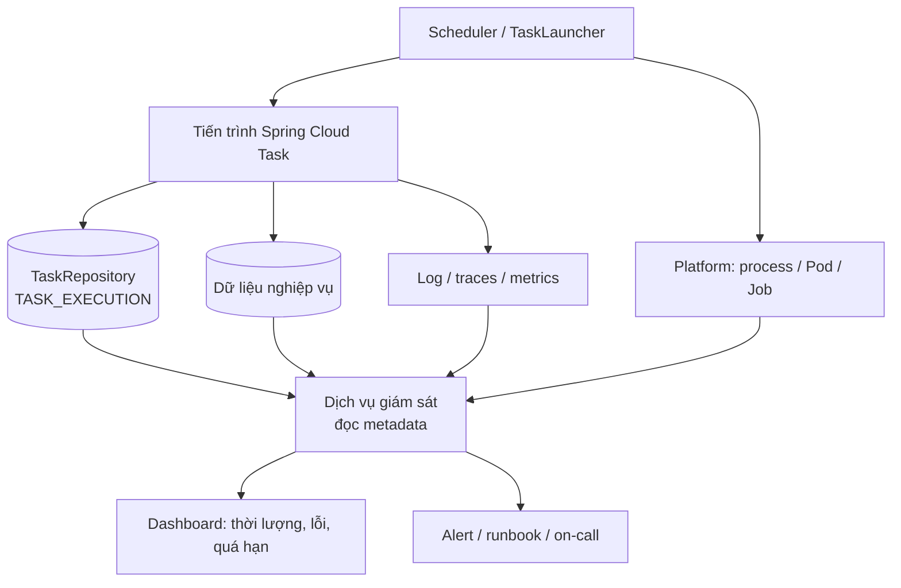

# Theo dõi thời lượng, tỷ lệ lỗi và tác vụ quá hạn

Một ứng dụng **Spring Cloud Task** không chạy liên tục như web service: nó **khởi động, xử lý công việc hữu hạn, ghi metadata qua `TaskRepository` rồi kết thúc**. Khi tác vụ được gọi bởi cron, Kubernetes Job hoặc Spring Cloud Data Flow, câu hỏi vận hành không chỉ là “JVM đã thoát chưa?” mà còn là:

- Mỗi lần đối soát doanh thu mất bao lâu? Có chậm hơn tuần trước không?
- Trong các lần chạy đã có kết quả, bao nhiêu phần trăm thất bại?
- Tác vụ đang chạy có vượt thời gian xử lý cho phép không?
- Lịch 02:00 đã đến nhưng **không thấy tác vụ nào bắt đầu** thì phát hiện bằng cách nào?
- Nếu database metadata chưa ghi `END_TIME` nhưng Pod đã chết, có nên chạy lại ngay không?

Bài học thuộc chương **Quan sát** này hướng dẫn xây dựng ba nhóm chỉ số: **thời lượng**, **tỷ lệ lỗi**, **quá hạn/SLA**. Ta dùng `TaskExecution` trong cơ sở dữ liệu làm nguồn lịch sử, kết hợp metrics, log, thông tin scheduler và trạng thái tiến trình/container để có bức tranh chính xác hơn. Ví dụ xuyên suốt là task `dailyReconcile` chạy theo ngày nghiệp vụ, truy cập PostgreSQL để lưu metadata và xử lý báo cáo doanh thu.

Sau bài này, bạn có thể xác định công thức chỉ số, truy vấn SQL cho dashboard, xây dựng quy tắc cảnh báo có ngưỡng và số mẫu hợp lý, hiểu cách thu thập metric của ứng dụng chạy ngắn, và thiết kế runbook an toàn khi task chậm hoặc thất bại.

## 1. Nguồn dữ liệu nào trả lời câu hỏi nào?

| Nguồn | Thông tin chính | Giới hạn |
| --- | --- | --- |
| **`TaskRepository` / `TaskExecution`** | Tên, ID thực thi, `START_TIME`, `END_TIME`, `EXIT_CODE`, thông điệp lỗi | Có thể thiếu bản ghi khi khởi động thất bại sớm; có thể không cập nhật kết thúc khi JVM bị kill. |
| **Scheduler / launcher** | Lịch dự kiến, lần gọi launch, kết quả yêu cầu tạo tiến trình | Launch được chấp nhận **không chứng minh** task đã xử lý thành công. |
| **Hệ điều hành/Kubernetes/Cloud Foundry** | Process, Job/Pod, thời điểm tạo/chạy, mã thoát, OOM, timeout, image-pull error | Container thành công không chứng minh mọi dữ liệu nghiệp vụ đúng; Pod có thể bị dọn theo TTL. |
| **Log, tracing, Micrometer metrics** | Các giai đoạn xử lý, độ trễ từng runner/Step, exception và kết nối dịch vụ ngoài | Metric có thể chưa được xuất trước khi process chết; log/traces cần backend thu thập. |
| **Database/file nghiệp vụ** | Báo cáo đã ghi, bản ghi đã đối soát, khóa idempotency | Không tự cho biết trạng thái toàn bộ vòng đời Task. |

Để đánh giá một lần chạy, hãy liên kết các nguồn bằng **`TaskExecution.executionId`**, tên task, thời điểm chạy và **correlation/request ID** nghiệp vụ. Nếu có Spring Batch, bổ sung `JobExecution`/`StepExecution`. **Không dùng execution ID làm khóa idempotency**: khi retry cùng công việc, Spring Cloud Task thường tạo một ID mới.



**Điểm quan trọng:** Một dashboard tốt phân biệt **trạng thái đã quan sát**, **trạng thái chưa biết** và **trạng thái dự đoán**. Đừng biến “không có `END_TIME`” thành “đang chạy” nếu chưa kiểm tra hạ tầng.

## 2. Các trường metadata cần hiểu trước khi tính toán

Bảng metadata JDBC phổ biến của Spring Cloud Task là `TASK_EXECUTION`:

| Cột | Ý nghĩa | Ảnh hưởng đến chỉ số |
| --- | --- | --- |
| `TASK_EXECUTION_ID` | ID duy nhất của **lần chạy đã được ghi** | Dùng chống đếm trùng khi một collector quét lại dữ liệu. |
| `TASK_NAME` | Tên logic của task | Nhóm số liệu theo cùng công việc. |
| `START_TIME` | Thời điểm framework ghi nhận bắt đầu Task | Mốc đầu để tính thời lượng task đã ghi nhận. |
| `END_TIME` | Thời điểm framework ghi nhận kết thúc Task | `NULL` không đồng nghĩa task chắc chắn vẫn sống. |
| `EXIT_CODE` | Mã kết thúc theo cơ chế ứng dụng/Spring Boot | Thông thường `0` thành công, khác `0` lỗi; có thể `NULL` khi chưa kết thúc. |
| `EXIT_MESSAGE` / `ERROR_MESSAGE` | Mô tả kết quả hoặc nguyên nhân lỗi | Phục vụ điều tra, không nên hiển thị công khai dữ liệu nhạy cảm. |
| `EXTERNAL_EXECUTION_ID` | Mã thực thi hạ tầng nếu được cung cấp | Đối chiếu với Job/Pod/process khi cần. |
| `LAST_UPDATED` (nếu schema có) | Thời điểm cập nhật metadata | **Không mặc định là heartbeat** của một tác vụ đang chạy. |

Tên cột, ràng buộc và schema có thể khác theo phiên bản. Các ví dụ SQL phía dưới dùng **PostgreSQL** và bảng metadata chuẩn để minh họa; kiểm tra DDL đúng phiên bản Spring Cloud Task trước khi áp dụng.

### Thời lượng metadata khác thời gian Pod tồn tại

Thông thường, thời lượng quan sát từ repository:

```text
task_duration = END_TIME - START_TIME
```

Đây là **thời lượng vòng đời Task do framework ghi nhận**, không nhất thiết bao gồm toàn bộ thời gian tải image, tạo Pod, JVM khởi tạo trước khi context sẵn sàng, shutdown sau callback hoặc thời gian Pod ở trạng thái Pending.

Nếu mục tiêu là **SLA từ lúc scheduler yêu cầu đến lúc kết quả có sẵn**, cần thêm `requested_at`/`launched_at` từ scheduler hoặc orchestrator để tính:

```text
end_to_end_latency = business_result_ready_at - scheduled_fire_at
launch_latency     = task_start_time - launch_requested_at
```

Không lấy `START_TIME` của repository thay cho `scheduled_fire_at` rồi khẳng định đã đo được độ trễ end-to-end.

## 3. Định nghĩa ba chỉ số chính và quy tắc phân loại

### 3.1. Thời lượng thực thi

Với một lần chạy **đã có `START_TIME` và `END_TIME` hợp lệ**:

```text
duration_seconds = (END_TIME - START_TIME) / 1 giây
```

Những chỉ số nên lưu cho từng `TASK_NAME`:

- **Thời lượng gần nhất**: phục vụ xác minh một lần chạy cụ thể.
- **Trung vị (p50)**: phản ánh mức điển hình, ít bị tác động bởi vài lần chạy rất chậm.
- **p95/p99**: giúp phát hiện phần đuôi của phân phối thời gian, nhưng chỉ ổn định khi đủ số mẫu.
- **Trung bình và số mẫu**: dễ tính, cần hiển thị kèm nhau; trung bình riêng lẻ dễ che giấu một số lần quá lâu.
- **Số lần vượt ngưỡng thời lượng**: ví dụ hoàn tất nhưng mất hơn 20 phút.

Nên phân tích **thành công và thất bại riêng**: một lần lỗi sau 2 giây sẽ làm thời lượng trung bình của tất cả lần chạy thấp hơn, dù các lần chạy thành công vẫn quá chậm.

### 3.2. Tỷ lệ lỗi

Định nghĩa một cách nhất quán theo **lần chạy kết thúc trong cửa sổ thời gian**. Ví dụ 7 ngày:

```text
known_completed = số TaskExecution có END_TIME và EXIT_CODE khác NULL
failed          = số trong known_completed có EXIT_CODE khác 0
failure_rate    = 100 × failed / known_completed  (%)
```

**Không đưa những lần còn `END_TIME = NULL` vào mẫu số** rồi mặc nhiên coi là thành công. Đồng thời, nếu đã có `END_TIME` nhưng `EXIT_CODE = NULL`, hãy đưa vào nhóm **unknown** riêng để tránh báo tỷ lệ lỗi thấp giả tạo.

Ví dụ: trong 24 giờ có **92 thành công**, **5 lỗi** và **3 lần đã có `END_TIME` nhưng chưa xác định `EXIT_CODE`**. Tỷ lệ lỗi trên kết quả đã biết là `5 / (92 + 5) ≈ 5,15%`. Ba lần unknown phải được hiển thị riêng và điều tra.

**Chính sách mã thoát là của ứng dụng.** Nhiều scheduler coi mọi mã khác `0` là thất bại; nếu doanh nghiệp có một mã “không có dữ liệu nhưng được chấp nhận”, phải định nghĩa rõ nó thuộc success, failure hay neutral trước khi tính tỷ lệ. Ví dụ SQL dưới đây dùng quy ước thông thường **`0 = success`, `<> 0 = failure`**.

### 3.3. Tác vụ quá hạn

“Quá hạn” có ít nhất **ba** nghĩa khác nhau:

| Loại | Cách xác định | Cảnh báo cần gì? |
| --- | --- | --- |
| **Đang chạy vượt thời gian** | Có `START_TIME`, chưa có `END_TIME`, đã vượt ngưỡng `max_run_duration` | Kiểm tra process/Pod còn sống và trạng thái DB trước khi kết luận. |
| **Đã chạy xong nhưng chậm** | Có cả hai mốc, `END_TIME - START_TIME` vượt SLA | Đưa vào phân tích p95, truy nguyên thời gian chậm và tải. |
| **Bị lỡ lịch/không khởi chạy** | Đã quá `scheduled_fire_at + allowed_lateness` mà chưa thấy launch/`TaskExecution` tương ứng | **Phải đối chiếu scheduler/launcher** vì TaskRepository có thể không có bản ghi. |

Một task đang xử lý 40 phút trong khi SLA chỉ 30 phút cần cảnh báo **đang quá hạn**. Một task mất 40 phút rồi hoàn thành thành công cũng là **vi phạm SLA đã xảy ra**; tỷ lệ lỗi có thể vẫn bằng `0%`. Đây là lý do duration/SLA và failure rate cần đo **độc lập**.

## 4. SQL kiểm tra các lần chạy gần đây

Với PostgreSQL và bảng `TASK_EXECUTION` đã có dữ liệu, xem 50 lần gần nhất:

```sql
SELECT
    TASK_EXECUTION_ID,
    TASK_NAME,
    START_TIME,
    END_TIME,
    EXIT_CODE,
    CASE
        WHEN START_TIME IS NULL THEN 'UNKNOWN_START'
        WHEN END_TIME IS NULL THEN 'NO_END_RECORDED'
        WHEN EXIT_CODE IS NULL THEN 'UNKNOWN_EXIT_CODE'
        WHEN EXIT_CODE = 0 THEN 'SUCCESS'
        ELSE 'FAILURE'
    END AS OBSERVED_STATE,
    CASE
        WHEN START_TIME IS NOT NULL
         AND END_TIME IS NOT NULL
         AND END_TIME >= START_TIME
        THEN ROUND(
            EXTRACT(EPOCH FROM (END_TIME - START_TIME))::numeric, 2
        )
        ELSE NULL
    END AS DURATION_SECONDS
FROM TASK_EXECUTION
WHERE TASK_NAME = 'dailyReconcile'
ORDER BY TASK_EXECUTION_ID DESC
LIMIT 50;
```

Chú ý tên cột giả `OBSERVED_STATE` **do truy vấn tính ra**, không phải trạng thái chính thức được Spring Cloud Task lưu. Giá trị `NO_END_RECORDED` **chỉ có nghĩa chưa thấy thời điểm kết thúc**, có thể đang chạy hoặc đã chết mà không kịp cập nhật.

Nếu có bản ghi `END_TIME < START_TIME`, không dùng thời lượng âm cho dashboard; đánh dấu lỗi dữ liệu và kiểm tra thời gian/clock. Tốt nhất đồng nhất timezone và đồng hồ trên các node, database và backend giám sát.

## 5. SQL tính p50, p95 và thời lượng trung bình

Đối với **những lần thành công trong 7 ngày gần nhất**, truy vấn:

```sql
SELECT
    TASK_NAME,
    COUNT(*) AS SUCCESS_RUNS,
    ROUND(
        AVG(EXTRACT(EPOCH FROM (END_TIME - START_TIME)))::numeric,
        2
    ) AS AVG_SECONDS,
    ROUND(
        (
            PERCENTILE_CONT(0.50) WITHIN GROUP (
                ORDER BY EXTRACT(
                    EPOCH FROM (END_TIME - START_TIME)
                )::double precision
            )
        )::numeric,
        2
    ) AS P50_SECONDS,
    ROUND(
        (
            PERCENTILE_CONT(0.95) WITHIN GROUP (
                ORDER BY EXTRACT(
                    EPOCH FROM (END_TIME - START_TIME)
                )::double precision
            )
        )::numeric,
        2
    ) AS P95_SECONDS
FROM TASK_EXECUTION
WHERE END_TIME >= CURRENT_TIMESTAMP - INTERVAL '7 days'
  AND END_TIME < CURRENT_TIMESTAMP
  AND START_TIME IS NOT NULL
  AND END_TIME >= START_TIME
  AND EXIT_CODE = 0
GROUP BY TASK_NAME
ORDER BY TASK_NAME;
```

**Giới hạn cần hiểu:**

- `PERCENTILE_CONT` là hàm thống kê được PostgreSQL hỗ trợ; các CSDL khác có thể yêu cầu cú pháp khác.
- Mẫu này **chỉ dùng những lần thành công**. Nếu muốn quan sát thời gian của lần thất bại, tạo biểu đồ khác thay vì trộn chung không chú thích.
- **p95 chỉ có ý nghĩa khi đủ mẫu**. Với task chạy một lần/ngày, p95 của bảy mẫu rất dễ dao động; có thể dùng cửa sổ 30 ngày hoặc so sánh từng lần với SLA.
- Cửa sổ được tính theo **`END_TIME`**, tránh đếm một task khởi động hôm trước nhưng kết thúc hôm sau vào hai khoảng thời gian.
- Một task còn chạy dài không đi vào thống kê completed duration cho đến khi kết thúc; phải có cảnh báo **running overdue** độc lập.

## 6. SQL tính tỷ lệ lỗi, giữ riêng kết quả chưa rõ

Đếm các lần **đã có `END_TIME`** trong 7 ngày:

```sql
SELECT
    TASK_NAME,
    COUNT(*) AS ENDED_RUNS,
    COUNT(*) FILTER (WHERE EXIT_CODE = 0) AS SUCCEEDED,
    COUNT(*) FILTER (WHERE EXIT_CODE <> 0) AS FAILED,
    COUNT(*) FILTER (WHERE EXIT_CODE IS NULL) AS UNKNOWN_EXIT,
    ROUND(
        100.0
        * (COUNT(*) FILTER (WHERE EXIT_CODE <> 0))
        / NULLIF(
            COUNT(*) FILTER (WHERE EXIT_CODE IS NOT NULL), 0
        ),
        2
    ) AS FAILURE_PERCENT
FROM TASK_EXECUTION
WHERE END_TIME >= CURRENT_TIMESTAMP - INTERVAL '7 days'
  AND END_TIME < CURRENT_TIMESTAMP
GROUP BY TASK_NAME
ORDER BY TASK_NAME;
```

`NULLIF(..., 0)` tránh lỗi chia cho 0 nếu cửa sổ không có lần chạy nào có mã thoát xác định. Khi đó `FAILURE_PERCENT` nhận `NULL`, nghĩa là **chưa đủ dữ liệu**, không phải `0%`.

Đối với task một lần/ngày, tỷ lệ lỗi `1/2 = 50%` có thể gây hiểu nhầm về mức độ dài hạn vì mẫu quá nhỏ. Dashboard nên hiển thị cả **số lần thành công, số lần lỗi, unknown và tổng mẫu**, không chỉ phần trăm.

### Vì sao chưa thể coi mọi `EXIT_CODE = 0` là thành công nghiệp vụ?

Nếu runner đã nuốt ngoại lệ và trả về bình thường, Spring Boot có thể kết thúc với `0` mặc dù báo cáo không được tạo. Nếu có yêu cầu nghiệm thu nghiệp vụ như “file đã xuất hiện”, “tổng tiền khớp” hoặc “đã ghi dấu hoàn thành”, cần thêm **business success indicator** độc lập trong database nghiệp vụ hoặc sự kiện đáng tin cậy.

## 7. SQL tìm tác vụ quá hạn

### 7.1. Chưa thấy kết thúc sau 30 phút

```sql
SELECT
    TASK_EXECUTION_ID,
    TASK_NAME,
    START_TIME,
    EXTRACT(
        EPOCH FROM (CURRENT_TIMESTAMP - START_TIME)
    ) / 60.0 AS AGE_MINUTES
FROM TASK_EXECUTION
WHERE TASK_NAME = 'dailyReconcile'
  AND START_TIME IS NOT NULL
  AND END_TIME IS NULL
  AND START_TIME < CURRENT_TIMESTAMP - INTERVAL '30 minutes'
ORDER BY START_TIME;
```

Kết quả là **các bản ghi quá 30 phút mà metadata chưa có kết thúc**, không phải danh sách Pod chắc chắn còn hoạt động. Hệ thống giám sát cần **tra lại platform state** theo `EXTERNAL_EXECUTION_ID`, tên Job/Pod hoặc correlation ID trước khi thông báo “task đang treo”.

Đặc biệt:

- Pod còn `Running` và log vẫn tiến triển → có thể là công việc chậm, tắc I/O hoặc ngưỡng SLA quá thấp.
- Pod đã `Failed`/`OOMKilled` nhưng metadata chưa kết thúc → nhiều khả năng là **stale TaskExecution**.
- Pod đã bị dọn vì TTL hoặc lịch sử hạ tầng không còn → trạng thái **unknown**, cần log tập trung và dấu nghiệp vụ.
- Không tìm thấy `TaskExecution` → có thể **chưa khởi chạy hoặc lỗi quá sớm để ghi metadata**; phải đối chiếu scheduler.

### 7.2. Các lần đã hoàn thành nhưng vượt SLA

Ví dụ SLA thời lượng là **20 phút**:

```sql
SELECT
    TASK_EXECUTION_ID,
    TASK_NAME,
    START_TIME,
    END_TIME,
    EXIT_CODE,
    ROUND(
        EXTRACT(EPOCH FROM (END_TIME - START_TIME))::numeric
        / 60, 2
    ) AS DURATION_MINUTES
FROM TASK_EXECUTION
WHERE TASK_NAME = 'dailyReconcile'
  AND START_TIME IS NOT NULL
  AND END_TIME IS NOT NULL
  AND END_TIME >= START_TIME
  AND END_TIME - START_TIME > INTERVAL '20 minutes'
  AND END_TIME >= CURRENT_TIMESTAMP - INTERVAL '7 days'
ORDER BY END_TIME DESC;
```

Truy vấn giữ cả mã thoát thành công và lỗi để biết loại nào vượt SLA. Nếu chỉ quan tâm **SLA của công việc thành công**, có thể thêm `AND EXIT_CODE = 0`. Đừng lẫn “Job chạy quá lâu” với “Job đã thất bại”.

### 7.3. Không có lần chạy đúng lịch

Giả sử scheduler yêu cầu task `dailyReconcile` lúc **02:00 hằng ngày**, cho phép bắt đầu trễ tối đa **15 phút**. Sau 02:15, nếu chưa thấy lần chạy của kỳ đó, phải điều tra scheduler/launcher. Kiểm tra metadata cho **một mốc thời gian cụ thể**:

```sql
SELECT COUNT(*) AS STARTED_IN_WINDOW
FROM TASK_EXECUTION
WHERE TASK_NAME = 'dailyReconcile'
  AND START_TIME >= TIMESTAMP '2026-11-24 02:00:00'
  AND START_TIME <  TIMESTAMP '2026-11-24 02:15:00';
```

**Đây chỉ là phép kiểm tra metadata theo thời gian**; nó không thay thế truy vấn scheduler xem có fire event hay launch request thất bại. Nếu JVM không tạo được `ApplicationContext` hoặc database metadata không khả dụng, có thể không có bản ghi dù scheduler đã cố launch.

Trong production, mốc 02:00 phải được xác định theo **timezone nghiệp vụ**. Nên lưu `scheduled_fire_at`, `launch_requested_at` và `business_date` ở hệ thống điều phối để phát hiện lịch bị lỡ chính xác, kể cả thay đổi giờ mùa hè hoặc retry sang ngày hôm sau.

## 8. Đề xuất bộ chỉ số SLI/SLO và dashboard

Không có một SLA phù hợp cho mọi task. Ví dụ sau là **mục tiêu mẫu**, cần hiệu chỉnh theo dữ liệu lịch sử, mức độ quan trọng và tần suất chạy:

| Chỉ số | Định nghĩa | Mục tiêu minh họa | Khi vi phạm |
| --- | --- | --- | --- |
| **Completion success rate** | Số kết thúc mã `0` / số kết thúc có mã xác định | ≥ 99% trong 30 ngày, đủ mẫu | Mở điều tra lỗi, đánh giá tác động đến kỳ dữ liệu. |
| **p95 duration** | p95 của các lần thành công có hai timestamp hợp lệ | Dưới 20 phút khi đủ mẫu | Kiểm tra dữ liệu đầu vào, DB, tài nguyên và chờ ngoài. |
| **Running overdue** | `END_TIME` trống và tuổi metadata trên 30 phút | 0 trường hợp không được giải thích | Kiểm tra nền tảng trước khi dừng/retry. |
| **Schedule freshness** | Có lần bắt đầu đúng hạn sau mỗi giờ kích hoạt | Bắt đầu trong vòng 15 phút sau 02:00 | Kiểm tra scheduler, launcher, image/secret/network. |
| **Last successful run age** | Thời gian tính từ lần có `EXIT_CODE=0` gần nhất | Không quá 26 giờ cho lịch hằng ngày | Kiểm tra lịch bị lỡ, Job lỗi hoặc metadata không cập nhật. |
| **Unknown/stale executions** | Bản ghi thiếu mã/điểm kết thúc sau ngưỡng điều tra | Không có bản ghi tồn đọng quá SLA vận hành | Đối chiếu DB, log và Pod/Job. |

### Cách tổ chức dashboard

<svg xmlns="http://www.w3.org/2000/svg" width="690" height="300" viewBox="0 0 690 300" role="img" aria-label="Bố cục dashboard quan sát Spring Cloud Task">
  <rect x="4" y="4" width="682" height="292" rx="14" fill="#f7f9fc" stroke="#c9d5e5"/>
  <text x="23" y="30" font-family="Arial,sans-serif" font-size="18" font-weight="bold" fill="#27374d">Task observability · dailyReconcile</text>
  <rect x="20" y="48" width="203" height="80" rx="9" fill="#e9f5ed" stroke="#9abdaa"/>
  <rect x="243" y="48" width="203" height="80" rx="9" fill="#fff3e3" stroke="#dcc49d"/>
  <rect x="466" y="48" width="203" height="80" rx="9" fill="#eaf1ff" stroke="#a5b9dd"/>
  <g font-family="Arial,sans-serif" fill="#27374d">
    <text x="34" y="72" font-size="13">Last success</text>
    <text x="34" y="104" font-size="22" font-weight="bold">02:12</text>
    <text x="257" y="72" font-size="13">Failure rate · 30d</text>
    <text x="257" y="104" font-size="22" font-weight="bold">2 / 30</text>
    <text x="480" y="72" font-size="13">p95 success duration</text>
    <text x="480" y="104" font-size="22" font-weight="bold">14 min</text>
  </g>
  <rect x="20" y="145" width="315" height="126" rx="9" fill="#ffffff" stroke="#ccd7e6"/>
  <rect x="354" y="145" width="315" height="126" rx="9" fill="#ffffff" stroke="#ccd7e6"/>
  <text x="35" y="169" font-family="Arial,sans-serif" font-size="14" font-weight="bold" fill="#27374d">Thời lượng theo lần chạy</text>
  <text x="369" y="169" font-family="Arial,sans-serif" font-size="14" font-weight="bold" fill="#27374d">Danh sách quá hạn / chưa rõ</text>
  <path d="M38 245 L76 218 L112 226 L148 203 L184 214 L220 181 L258 204 L309 190" fill="none" stroke="#537cae" stroke-width="3"/>
  <line x1="35" y1="252" x2="316" y2="252" stroke="#d6dfe8"/>
  <g font-family="Arial,sans-serif" font-size="12" fill="#44536a">
    <text x="369" y="193">#105 · chưa kết thúc · 42 phút</text>
    <text x="369" y="217">#099 · Pod đã Failed · cần đối soát</text>
    <text x="369" y="241">02:00 · chưa thấy run hôm nay</text>
  </g>
</svg>

*Bố cục và số liệu trên là minh họa, không phải dữ liệu thực của một hệ thống đang chạy.*

Dashboard nên có **bộ lọc theo môi trường, task name, khoảng thời gian, kết quả**. Luôn hiển thị **số lượng mẫu** và thời gian cập nhật mới nhất của collector, để người xem biết một biểu đồ “đẹp” có thể chỉ do mất telemetry.

## 9. Dùng Micrometer/Observation khi framework hỗ trợ

Trong các phiên bản Spring Cloud Task mới có tích hợp **Micrometer Observation**, tài liệu chính thức công bố các phép đo như:

| Tên observation/metric | Kiểu | Ý nghĩa |
| --- | --- | --- |
| `spring.cloud.task` | Timer | Quan sát thời lượng task hoàn thành. |
| `spring.cloud.task.active` | Long task timer | Quan sát thời gian task đang hoạt động. |
| `spring.cloud.task.runner` | Timer | Quan sát thời gian thực thi runner. |
| `spring.cloud.task.runner.active` | Long task timer | Runner đang hoạt động. |

Các observation còn cung cấp thông tin như `spring.cloud.task.name`, `spring.cloud.task.status` và định danh thực thi, tùy convention/phiên bản. Tên metric **sau khi xuất sang backend** có thể được chuẩn hóa, thêm suffix đơn vị hoặc chuyển dấu chấm sang dấu gạch dưới; không khẳng định `spring.cloud.task` luôn xuất hiện y nguyên như vậy trong Prometheus.

**Lưu ý về version:** Tên metric và cách kích hoạt có thể khác ở Spring Cloud Task 3.x và 5.x. Cần kiểm tra [Observability reference](https://docs.spring.io/spring-cloud-task/reference/observability.html) của đúng release train, bean `ObservationRegistry`/`MeterRegistry`, registry exporter và cơ chế thu thập hiện có. Chỉ thêm `spring-boot-starter-actuator` **không bảo đảm** Prometheus nhận được metric nếu thiếu registry, điểm export hoặc tuyến gửi phù hợp.

### Tác vụ ngắn không phù hợp để chỉ scrape lúc chạy

Một task hoàn thành trong vài giây có thể đã thoát trước khi Prometheus kịp scrape `/actuator/prometheus`. Nếu đã cấu hình `web-application-type: none`, ứng dụng cũng không mở HTTP endpoint Actuator thông thường để scrape. Vì thế nên cân nhắc:

1. **Dịch vụ giám sát chạy ổn định**: quét `TaskRepository` theo chu kỳ, tính/đưa metric aggregate về backend. Ưu tiên cho **thời lượng, tỷ lệ lỗi, stale task**.
2. **Log/traces tập trung**: nhận thông tin runtime và error có correlation ID, cả khi container đã bị dọn.
3. **Push metrics kết quả cho service-level batch job**: chỉ dùng Pushgateway khi phù hợp mô hình Prometheus và có quy tắc dọn dữ liệu stale.
4. **Scrape khi task chạy lâu**: có thể bổ sung metric CPU, heap, DB pool hoặc long task timer khi tiến trình đủ lâu và có endpoint/agent phù hợp.

Theo khuyến nghị của Prometheus, **Pushgateway chỉ phù hợp một số trường hợp batch service-level**, không phải giải pháp mặc định cho mọi Pod/Job. Pushgateway **không tự xóa time series khi worker chết**; nếu dùng label chứa `executionId` hoặc Pod name cho mỗi lần chạy sẽ dễ tạo chuỗi metric tồn đọng và tăng cardinality.

### Thiết kế exporter bền vững từ TaskRepository

Một dịch vụ riêng, chạy liên tục, có thể:

```text
Mỗi 1–5 phút:
  1. Đọc TASK_EXECUTION bằng tài khoản chỉ đọc.
  2. Tính cửa sổ thời lượng / tỷ lệ lỗi / last success.
  3. Truy vấn các lần chưa kết thúc quá SLA.
  4. Tra nguồn nền tảng cho những execution nghi stale.
  5. Xuất metric aggregate cho Prometheus hoặc dashboard.
```

Ví dụ **tên custom metrics do bạn tự thiết kế**, không phải tên có sẵn của Spring Cloud Task:

```text
batch_task_success_runs_7d{task_name="dailyReconcile"} 96
batch_task_failure_runs_7d{task_name="dailyReconcile"} 4
batch_task_duration_p95_seconds{task_name="dailyReconcile"} 842
batch_task_overdue_observed{task_name="dailyReconcile"} 1
batch_task_last_success_timestamp_seconds{task_name="dailyReconcile"} ...
```

Các giá trị trên là minh họa; khi triển khai phải nêu rõ mỗi metric là **gauge cho cửa sổ truy vấn** hay counter dựa trên event để tránh hiểu sai. Không tăng counter **mỗi lần poll cùng một bản ghi**: cần deduplicate bằng `TASK_EXECUTION_ID` hoặc chỉ công bố giá trị tổng hợp cửa sổ dưới dạng gauge.

**Tránh high-cardinality labels** trong metric backend: dùng `task_name`, `environment`, `result`, có thể `tenant_group` nếu số nhóm hữu hạn. Không gắn mọi `request_id`, `execution_id`, tài khoản hoặc business date riêng lên metric time series; giữ các ID này trong log/tracing và link từ dashboard tới bản ghi chi tiết.

## 10. Log vòng đời bằng `TaskExecutionListener`

Để điều tra một lần chạy, bạn có thể bổ sung **log có cấu trúc** với `TaskExecutionListener`. Đây là công cụ hỗ trợ, **không thay thế bản ghi đã commit** trong `TaskRepository`.

Ví dụ `TaskLifecycleLog.java`:

```java
package com.example.task;

import org.slf4j.Logger;
import org.slf4j.LoggerFactory;
import org.springframework.cloud.task.listener.TaskExecutionListener;
import org.springframework.cloud.task.repository.TaskExecution;
import org.springframework.stereotype.Component;

@Component
public class TaskLifecycleLog implements TaskExecutionListener {
    private static final Logger log =
        LoggerFactory.getLogger(TaskLifecycleLog.class);

    @Override
    public void onTaskStartup(TaskExecution taskExecution) {
        log.info(
            "event=task_start task={} executionId={}",
            taskExecution.getTaskName(),
            taskExecution.getExecutionId()
        );
    }

    @Override
    public void onTaskEnd(TaskExecution taskExecution) {
        log.info(
            "event=task_end task={} executionId={} exitCode={}",
            taskExecution.getTaskName(),
            taskExecution.getExecutionId(),
            taskExecution.getExitCode()
        );
    }

    @Override
    public void onTaskFailed(
            TaskExecution taskExecution, Throwable throwable) {
        log.error(
            "event=task_failed task={} executionId={} errorType={}",
            taskExecution.getTaskName(),
            taskExecution.getExecutionId(),
            throwable.getClass().getSimpleName()
        );
    }
}
```

Spring Cloud Task gọi `onTaskStartup`, `onTaskFailed` và `onTaskEnd` ở các mốc vòng đời tương ứng. **Các callback có thể xảy ra trước khi repository commit cập nhật**, nên một dòng log `task_end` không phải bằng chứng `END_TIME` đã lưu thành công. Nếu JVM bị `SIGKILL` hoặc chưa khởi tạo context, callback có thể không chạy.

Không cho lỗi gửi log/metric ở listener làm hỏng nghiệp vụ ngoài dự kiến; callback ném ngoại lệ có thể làm luồng Task báo lỗi hoặc ảnh hưởng listener khác. Cũng không đưa password, toàn bộ CLI args hoặc thông tin cá nhân vào log. Với tracing, hãy giữ `trace_id`/`request_id` trong hệ thống log được kiểm soát.

## 11. Thiết kế cảnh báo thực tế

Một cấu hình cảnh báo mẫu cho `dailyReconcile` chạy mỗi ngày lúc **02:00**, thường hoàn tất trong 10–15 phút:

| Điều kiện | Ngưỡng minh họa | Mức độ | Hành động đầu tiên |
| --- | --- | --- | --- |
| Không có lần chạy bắt đầu sau lịch | Sau **02:15** chưa có record và launcher chưa xác nhận thành công | Warning/Critical tùy nghiệp vụ | Kiểm tra scheduler, launch request và lỗi khởi động. |
| Chưa có `END_TIME` | Tuổi metadata hơn **30 phút** | Warning | Kiểm tra Pod/process còn sống, log và trạng thái DB. |
| Kết thúc có mã khác `0` | **Một lần thất bại** với tác vụ quan trọng | Critical | Xem error message, log, dữ liệu đã commit và điều kiện retry. |
| Tỷ lệ lỗi tăng | `>5%` trong 7 ngày **và** có ít nhất 20 lần kết thúc đã biết | Warning | Đọc mẫu lỗi, phân loại theo phiên bản/nguồn dữ liệu. |
| p95 duration tăng | `>20 phút` với số mẫu phù hợp | Warning | So sánh tải, Batch Step, DB query, CPU/memory. |
| Không có lần thành công gần đây | `>26 giờ` cho task ngày | Critical | Kiểm tra cả lịch đã chạy nhưng lỗi và lịch bị lỡ. |
| Collector không cập nhật | Không lấy được dữ liệu >2 chu kỳ polling | Warning | Kiểm tra quyền đọc TaskRepository, DB và exporter. |

Với task chỉ chạy **một lần mỗi ngày**, quy tắc **lỗi một lần** và **last success age** thường thiết thực hơn cảnh báo “tỷ lệ lỗi 5% trong 1 giờ” vì cửa sổ có thể chỉ có 0–1 lần chạy. Một task chạy hàng phút lại phù hợp với tỷ lệ lỗi theo rolling window hơn.

**Hạn chế alert storm:** nhóm cảnh báo theo task/environment, có thời gian xác nhận ngắn khi cần, phân mức severity và tránh bắn hàng trăm cảnh báo từ các partition/worker cùng một nguyên nhân. Tuy nhiên, không dùng debounce quá dài khiến sự cố công việc tài chính quan trọng bị bỏ qua.

## 12. Xử lý tác vụ quá hạn mà không retry trùng

Một quy trình chuẩn khi exporter báo `TaskExecution #105` có `END_TIME = NULL` và đã 42 phút:

1. **Xác định lần chạy:** ghi lại `TASK_EXECUTION_ID`, `TASK_NAME`, `START_TIME`, tham số nghiệp vụ đã được lọc bí mật và correlation ID.
2. **Tra hạ tầng:** kiểm tra Kubernetes Job/Pod hoặc tiến trình local bằng `EXTERNAL_EXECUTION_ID`, resource name, timestamp và log.
3. **Nếu còn chạy:** kiểm tra CPU, memory, DB lock, upstream API, tiến độ Batch Step; phân biệt **đang tiến triển chậm** với **bị treo**.
4. **Nếu đã chết:** xác định thời điểm chết, mã OS, lý do `OOMKilled`/timeout và vì sao metadata chưa kịp cập nhật.
5. **Xác minh dữ liệu nghiệp vụ:** bảng doanh thu/báo cáo/file đã commit chưa? Có khóa idempotency cho kỳ `business-date` không?
6. **Quyết định:** chờ thêm, dừng theo cơ chế được hỗ trợ, sửa lỗi hoặc retry với giới hạn/backoff. Trước retry phải kiểm tra worker cũ không còn tạo hiệu ứng trùng.
7. **Ghi lại hậu kiểm:** bổ sung nguyên nhân, cải thiện timeout, capacity, SQL, alert hoặc chính sách lịch.

Nếu dùng Kubernetes, những lệnh trợ giúp trong môi trường được cấp quyền:

```bash
kubectl get jobs -n finance
kubectl get pods -n finance
kubectl describe job reconcile-20261124 -n finance
kubectl logs job/reconcile-20261124 -n finance
```

Tên namespace/job chỉ là ví dụ, không dùng để suy ra `TASK_EXECUTION_ID`. Nếu Pod đã bị dọn do TTL, xem **centralized logs**, lịch sử Kubernetes events nếu còn lưu và TaskRepository.

**Không nên sửa tay `TASK_EXECUTION.END_TIME` hay `EXIT_CODE`** để dashboard báo “đã xong”; thay đổi metadata thủ công có thể che giấu sự cố, làm sai lịch sử và ảnh hưởng phân tích SLA. Nếu tổ chức có công cụ reconcile metadata chính thức, phải có quy trình kiểm soát, ghi audit và phân biệt trạng thái nguồn hạ tầng với dữ liệu do framework ghi.

## 13. Khi Task chứa Spring Batch Job

Một Spring Cloud Task có thể chạy một hoặc nhiều Batch Job. Để biết **phần nào gây chậm**, phải phân biệt:

| Cấp độ | Repository | Theo dõi |
| --- | --- | --- |
| **Ứng dụng Task** | `TaskRepository` | Thời lượng `TaskExecution`, exit code, stale execution. |
| **Batch Job** | `JobRepository` | `JobExecution`, `BatchStatus`, `ExitStatus`, tổng thời gian Job. |
| **Batch Step/chunk** | `JobRepository` | `StepExecution`, số item đọc/ghi/bỏ qua, checkpoint và thời gian mỗi Step. |
| **Nền tảng** | Kubernetes/local process | Thời gian chờ lịch/đợi Pod, CPU/memory, restart, exit. |

Ví dụ Task chạy 18 phút, trong đó Batch Step `readTransactions` mất 15 phút chờ truy vấn DB. Cảnh báo p95 Task giúp nhận biết sự suy giảm; dữ liệu `StepExecution` và query timing giúp xác định chỗ nghẽn.

Một `JobExecution` có thể thất bại dù code runner không ném lỗi ra ngoài. Nếu không chuyển trạng thái Batch thất bại sang mã thoát ứng dụng, `TaskExecution` có thể báo thành công sai. Cần kiểm tra `JobExecution#getStatus()`/`ExitStatus` và lập quy tắc lỗi rõ ràng.

SQL đọc Step theo một JobExecution cụ thể:

```sql
SELECT
    STEP_EXECUTION_ID,
    JOB_EXECUTION_ID,
    STEP_NAME,
    STATUS,
    START_TIME,
    END_TIME,
    READ_COUNT,
    WRITE_COUNT,
    READ_SKIP_COUNT,
    PROCESS_SKIP_COUNT,
    WRITE_SKIP_COUNT
FROM BATCH_STEP_EXECUTION
WHERE JOB_EXECUTION_ID = 700
ORDER BY STEP_EXECUTION_ID;
```

**Chú ý schema:** Các bản Spring Batch phổ biến lưu số lượng skip theo từng loại trong `READ_SKIP_COUNT`, `PROCESS_SKIP_COUNT`, `WRITE_SKIP_COUNT`, chứ không có cột tổng `SKIP_COUNT`. Khi muốn có tổng số skip, tính từ ba cột trên:

```sql
SELECT
    STEP_EXECUTION_ID,
    STEP_NAME,
    READ_SKIP_COUNT
      + PROCESS_SKIP_COUNT
      + WRITE_SKIP_COUNT AS TOTAL_SKIPS
FROM BATCH_STEP_EXECUTION
WHERE JOB_EXECUTION_ID = 700;
```

Hai truy vấn chỉ mang tính minh họa. Đối chiếu bảng/cột với DDL thật và có thể dùng `JobExplorer` để tránh phụ thuộc SQL dialect. Với bước remote partitioning, một Job có thể có nhiều `StepExecution` của các worker; cần tổng hợp theo Job/partition và tránh đếm nhiều lần khi retry.

## 14. Những sai lầm quan sát thường gặp

| Sai lầm | Hậu quả | Cách sửa |
| --- | --- | --- |
| Tính tỷ lệ lỗi trên tất cả record, kể cả đang chạy | Tỷ lệ lỗi bị giảm giả tạo | Dùng số lần kết thúc có exit code xác định, hiển thị unknown riêng. |
| Chỉ dùng thời lượng của các lần đã kết thúc | Không phát hiện task đang treo | Có thêm running-overdue query và platform state. |
| Coi `END_TIME = NULL` là “đang chạy” | Báo sai với Pod đã bị kill | Kiểm tra launcher, Job/Pod và log. |
| Coi thiếu record là “scheduler không chạy” | Bỏ sót lỗi khởi động trước khi tạo metadata | Quan sát schedule fire/launch request riêng. |
| Chỉ scrape metric từ process chạy 5 giây | Không thu được lần chạy | Dùng collector ổn định, logs hoặc cách push có kiểm soát. |
| Gắn `execution_id` vào mọi Prometheus label | Cardinality tăng theo số lần chạy | Dùng nhãn ít giá trị, đưa ID chi tiết vào log/traces. |
| Coi mã `0` là bảo đảm dữ liệu báo cáo đúng | Không phát hiện exception bị nuốt | Có chỉ số kết quả nghiệp vụ và kiểm thử đường lỗi. |
| Dùng p95 của 3 lần chạy để cảnh báo nghiêm trọng | Dễ bị nhiễu do mẫu ít | Kèm sample count, chọn cửa sổ phù hợp hoặc dùng SLA từng lần. |
| Pushgateway không có cleanup | Giữ metric stale từ task đã chết | Dọn theo quy ước và không dùng per-pod identity cho service-level batch. |
| Retry ngay khi thấy quá hạn | Có thể hai worker ghi trùng dữ liệu | Xác minh process cũ và dùng idempotency/khóa nghiệp vụ. |

## 15. Bài thực hành và tự kiểm tra

Thực hành với **PostgreSQL môi trường thử nghiệm**, một Spring Cloud Task chạy hữu hạn và bảng `TASK_EXECUTION` theo schema đúng phiên bản:

1. Chạy task `dailyReconcile` ba lần: thành công, mô phỏng lỗi và thành công chậm. Truy vấn thời lượng từng lần, xem `END_TIME` và `EXIT_CODE`.
2. Viết báo cáo 7 ngày về số `SUCCEEDED`, `FAILED`, `UNKNOWN_EXIT` và `FAILURE_PERCENT`. Giải thích tại sao unknown không được tự coi là success.
3. Tính `AVG_SECONDS`, `P50_SECONDS` và `P95_SECONDS` cho các lần thành công. Thử thêm một lần chạy rất chậm và mô tả ảnh hưởng đến từng chỉ số.
4. Dùng truy vấn running-overdue 30 phút với một bản ghi còn `END_TIME = NULL` trên môi trường kiểm thử. Đối chiếu trạng thái thực của JVM/Pod trước khi phân loại “đang chạy” hoặc “stale”.
5. Giả sử lịch chạy là 02:00 mỗi ngày. Thiết kế phép kiểm tra “chưa bắt đầu sau 02:15” dựa trên **scheduler + TaskRepository**, kể cả khi JVM chết trước khi kết nối DB.
6. Thêm `TaskLifecycleLog` để phát log `task_start`, `task_failed`, `task_end`. Tại sao log `task_end` không phải bằng chứng metadata đã commit?
7. Thiết kế một collector chạy mỗi 5 phút với tài khoản **read-only** tới TaskRepository. Định nghĩa metric gauge, label cardinality, retry khi DB mất kết nối và cảnh báo collector stale.
8. Nếu dùng Micrometer, thử xác nhận các observation `spring.cloud.task`/`spring.cloud.task.runner` có trong phiên bản framework thực tế và xem cơ chế export nào thu được kết quả của task ngắn.
9. Với một Spring Batch Job có nhiều Step, xác định bước chậm nhất qua `BATCH_STEP_EXECUTION`; so sánh tổng thời gian Step với thời lượng Task.
10. Viết runbook cho trường hợp Kubernetes Job đã `Failed` nhưng `TaskExecution` vẫn không có `END_TIME`. Liệt kê bằng chứng nghiệp vụ cần kiểm tra trước khi retry.

**Câu hỏi ôn tập:**

- Thời lượng từ `END_TIME - START_TIME` có tính được độ trễ kéo image và chờ scheduler không?
- Nên dùng tập mẫu nào làm mẫu số cho tỷ lệ lỗi?
- Tại sao phải theo dõi riêng **running overdue**, **completed SLA breach** và **missed schedule**?
- Với một task chạy một lần/ngày, cảnh báo nào đáng tin hơn: tỷ lệ lỗi trong 5 phút hay “không có lần thành công 26 giờ”?
- Pushgateway có tự xóa metric của một Pod khi Pod chết không?
- Có thể kết luận Task thất bại/chưa xử lý gì chỉ vì `END_TIME` trống không?
- Khi Task chứa Spring Batch Job, kho metadata nào giúp biết Step nào chậm?

**Ghi nhớ:** Quan sát Spring Cloud Task cần **định nghĩa đo lường rõ ràng** và **đối chiếu nhiều nguồn**. `TaskRepository` giúp tính **thời lượng, tỷ lệ lỗi và quá hạn đã ghi nhận**; scheduler cho biết công việc có được kích hoạt đúng giờ; nền tảng cho biết tiến trình/container thực sự ở trạng thái nào; dữ liệu nghiệp vụ xác nhận tác động đã commit. Chỉ sau khi đối chiếu những nguồn đó mới nên quyết định dừng, chạy lại hoặc điều chỉnh SLA.

**Tài liệu tham khảo chính thức:**

- [Spring Cloud Task — Observability](https://docs.spring.io/spring-cloud-task/reference/observability.html): các observation/metric liên quan Task và runner.
- [Spring Cloud Task — Features](https://docs.spring.io/spring-cloud-task/reference/features.html): `TaskExecution`, `TaskRepository` và `TaskExecutionListener`.
- [Spring Cloud Task — Task Repository Schema](https://docs.spring.io/spring-cloud-task/docs/current/reference/html/appendix-task-repository-schema.html): bảng `TASK_EXECUTION` và các trường metadata.
- [Prometheus — Instrumentation: Batch Jobs](https://prometheus.io/docs/practices/instrumentation/): những chỉ số hữu ích cho tác vụ chạy hữu hạn.
- [Prometheus — When to Use Pushgateway](https://prometheus.io/docs/practices/pushing/): giới hạn dùng Pushgateway và quản lý time series stale.
