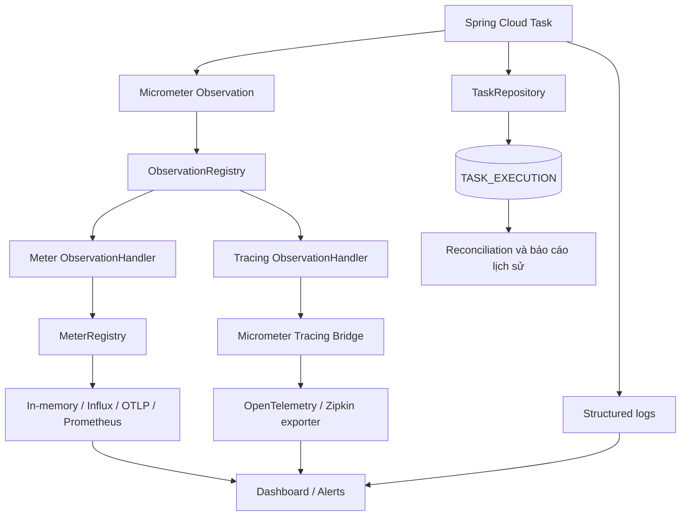

# Micrometer Observation và các phụ thuộc cần thiết

## 1. Mục tiêu: quan sát được một tác vụ chạy hữu hạn

**Spring Cloud Task** xây dựng ứng dụng Spring Boot chạy một công việc hữu hạn rồi kết thúc: nhập tệp, tổng hợp báo cáo, đồng bộ dữ liệu hoặc thực hiện Spring Batch Job. Mỗi lần chạy được mô tả bằng **`TaskExecution`** và lưu qua **`TaskRepository`**. Từ database, chúng ta tra được tác vụ bắt đầu lúc nào, kết thúc lúc nào, mã thoát và thông tin lỗi.

Tuy nhiên, dữ liệu lịch sử chỉ trả lời một phần câu hỏi vận hành. Người quản trị còn cần biết:

- Thời lượng trung bình, p95/p99 và xu hướng tăng chậm của tác vụ.
- Số lần chạy thành công/thất bại theo nhóm công việc và khoảng thời gian.
- Tác vụ nào đang chạy quá lâu; bước xử lý nào gây trễ.
- Một lần chạy đã gọi dịch vụ hoặc truy vấn database nào.
- Nếu tác vụ bị kill trước khi ghi kết quả, phải đối chiếu với log và hệ thống điều phối thế nào.

**Micrometer Observation** là mô hình thống nhất để ghi nhận hoạt động thành **metrics** và, nếu có cấu hình tracer, **traces**. Spring Cloud Task tích hợp Micrometer để tạo observation cho vòng đời task và có thể cho cả `ApplicationRunner`/`CommandLineRunner`.

Bài học thuộc phần **Quan sát** của module `SPRING_CLOUD_TASK`, tập trung vào **Micrometer Observation và các phụ thuộc cần thiết**, chứ không đồng nhất observation với TaskRepository hoặc cho rằng thêm một dependency sẽ tự làm mọi metrics xuất hiện trên dashboard.

Sau bài học, bạn có thể:

1. Phân biệt **log**, **metric**, **trace** và **TaskExecution metadata**.
2. Chọn đúng dependency `spring-boot-starter-actuator`, một `MeterRegistry` xuất metrics và một tracing bridge/exporter khi cần traces.
3. Bật `spring.cloud.task.observation.enabled=true` cho các runner.
4. Biết các tên observation, timer và span mà Spring Cloud Task công bố.
5. Sử dụng `ObservationRegistry` để đo một đoạn nghiệp vụ trong task.
6. Kiểm tra số liệu bằng `SimpleMeterRegistry` và truy vấn `TaskRepository`.
7. Chọn cách xuất telemetry cho tiến trình **sống ngắn**, tránh mất dữ liệu do scrape/push không kịp.
8. Hạn chế cardinality, lộ dữ liệu nhạy cảm, chi phí lưu trữ và hiểu các lỗi giám sát thường gặp.

## 2. Bốn nguồn tín hiệu không thay thế nhau

| Nguồn thông tin | Ví dụ dữ liệu | Mục đích |
| --- | --- | --- |
| **TaskRepository** | `TaskExecution`: ID, tên, `START_TIME`, `END_TIME`, `EXIT_CODE` | Lịch sử **một lần chạy** và kết quả mà framework lưu trong database. |
| **Logs** | “Bắt đầu nhập đơn hàng”, stack trace, mã định danh lần chạy | Điều tra sự cố và các bước nghiệp vụ cụ thể. |
| **Metrics** | `spring.cloud.task` timer, số lần chạy, thời lượng trung bình | Tổng hợp số liệu theo thời gian, dashboard và cảnh báo. |
| **Traces** | Span `spring.cloud.task`, span `spring.cloud.task.runner` và các lời gọi downstream | Phân tích đường đi, thời lượng của nhiều công đoạn và hệ thống liên quan. |



**`ObservationRegistry` không phải database**: nó điều phối các `ObservationHandler`. Handler có thể tạo timer trong `MeterRegistry` hoặc tạo span thông qua Micrometer Tracing. **`MeterRegistry` cũng không đồng nghĩa “đã đẩy dữ liệu lên server”**; registry mặc định có thể chỉ giữ số liệu trong bộ nhớ JVM.

Quan trọng với Spring Cloud Task: tiến trình có thể kết thúc sau vài trăm mili giây. Nếu metrics chỉ chờ một lần scrape HTTP hoặc đợi chu kỳ xuất định kỳ, thông tin có thể biến mất cùng JVM dù `TaskRepository` vẫn còn bản ghi.

## 3. Cơ chế Observation trong Spring Cloud Task

Theo tài liệu **Spring Cloud Task 3.2**, framework công bố các observation chính:

| Phạm vi | Tên observation/timer | Metric hoạt động | Span khi có tracing |
| --- | --- | --- | --- |
| Vòng đời **TaskExecution** | `spring.cloud.task` | `spring.cloud.task.active` | `spring.cloud.task` |
| Một `ApplicationRunner` hoặc `CommandLineRunner` | `spring.cloud.task.runner` | `spring.cloud.task.runner.active` | `spring.cloud.task.runner` |

`spring.cloud.task` và `spring.cloud.task.runner` là các **timer**; các biến thể `.active` là **long task timer** cho hoạt động đang chạy. Tên hiển thị ở hệ thống đích có thể được chuyển đổi theo naming convention: ví dụ Prometheus thường thay dấu chấm bằng dấu gạch dưới và bổ sung hậu tố theo đơn vị/loại metric.

### 3.1. Bật observation cho các runner

Đặt:

```yaml
spring:
  cloud:
    task:
      observation:
        enabled: true
```

Dạng properties:

```properties
spring.cloud.task.observation.enabled=true
```

Thuộc tính này được tài liệu Spring Cloud Task chỉ rõ để **bật observation cho `ApplicationRunner` và `CommandLineRunner`**. Hãy khai báo tường minh thay vì suy đoán giá trị mặc định của mọi bản thư viện. Muốn phát **metrics thực sự**, cần hạ tầng Micrometer từ Actuator và một registry; muốn có **traces**, cần thêm tracing bridge/exporter.

`spring.cloud.task.observation.enabled` **không phải** `spring.cloud.task.enabled`, không tạo bảng repository và không làm task chạy lần thứ hai. Nó chỉ liên quan đến khả năng đo đạc.

### 3.2. Metadata và nhãn (tags)

Tài liệu Spring Cloud Task ghi các nhãn như:

| Nhãn | Ý nghĩa |
| --- | --- |
| `spring.cloud.task.name` | Tên tác vụ. |
| `spring.cloud.task.status` | Trạng thái như `success` hoặc `failure`. |
| `spring.cloud.task.exit.code` | Mã thoát, có ý nghĩa khi biết kết quả cuối. |
| `spring.cloud.task.execution.id` | ID của lần chạy. |
| `spring.cloud.task.runner.bean-name` | Tên bean runner đang thực thi. |

Các nhãn liên quan Cloud Foundry hoặc external/parent execution cũng có thể xuất hiện theo môi trường và convention. **Không giả định mọi nhãn đều có giá trị ở mọi thời điểm.** Đặc biệt, tài liệu lưu ý nhãn chỉ được bổ sung **sau khi observation bắt đầu** có thể không xuất hiện trong metric `.active`.

Một nhãn được tài liệu phân loại là *low cardinality* không có nghĩa luôn an toàn về lượng series trong sản phẩm của bạn: **`execution.id` tăng sau mỗi lần chạy**, nên đưa nó vào metrics lưu dài hạn có thể tạo quá nhiều time series. Cần kiểm tra backend và lọc/giới hạn nhãn biến động khi thích hợp.

### 3.3. Observation khác callback listener

`@BeforeTask`, `@AfterTask` và `@FailedTask` là callback theo vòng đời, thường dùng để log, audit hoặc chỉnh `exitMessage`. Micrometer Observation thì đo khoảng hoạt động và đóng góp dữ liệu cho metrics/traces. Chúng có thể cùng tồn tại nhưng không thay thế nhau.

Nếu runner bắt ngoại lệ rồi không ném lại, cả hệ thống theo dõi thực thi lẫn observation có thể nhìn thấy một lần chạy “thành công” dù nghiệp vụ thất bại. Thiết kế truyền lỗi và mã thoát phải đúng từ lớp nghiệp vụ.

## 4. Những dependency nào thật sự cần?

**Bắt đầu từ nhu cầu, không thêm tất cả thư viện giám sát một cách máy móc.**

| Mục tiêu | Dependency chính | Cần lưu ý |
| --- | --- | --- |
| Task và metadata JDBC | `spring-cloud-starter-task`, `spring-boot-starter-jdbc`, JDBC driver | Có database và schema TaskRepository. |
| Micrometer Observation + Actuator | `spring-boot-starter-actuator` | Tự cấu hình `ObservationRegistry`, `MeterRegistry`, các handler phù hợp. |
| Metrics trong bộ nhớ để học/test | `SimpleMeterRegistry` từ Micrometer | Actuator có simple registry fallback nếu không có backend khác. Không tồn tại sau khi JVM tắt. |
| Metrics xuất Influx | `micrometer-registry-influx` | Cần cấu hình Influx endpoint/credential và chu kỳ gửi; job ngắn có rủi ro không kịp gửi. |
| Metrics xuất OTLP | `micrometer-registry-otlp` | Cần collector nhận OTLP metrics và cấu hình `management.otlp.metrics.export.*`. |
| Metrics Prometheus scrape | `micrometer-registry-prometheus` | Đòi endpoint HTTP hoạt động đủ lâu; không phù hợp trực tiếp với mọi task ngắn. |
| Tracing qua OpenTelemetry | `micrometer-tracing-bridge-otel` và `opentelemetry-exporter-otlp` | Cần một OTLP tracing collector; chỉ thêm registry metrics không tự tạo trace. |
| Dùng annotation `@Observed` tự động | `spring-boot-starter-aop` và bật `management.observations.annotations.enabled` | Annotation được áp dụng qua AOP; không cần AOP nếu gọi `ObservationRegistry` trực tiếp. |

**`micrometer-observation`** là API cốt lõi; trong ví dụ dùng `spring-boot-starter-actuator`, dependency này thường đã được kéo theo qua hệ sinh thái quản lý của Spring Boot. Không cần khai báo thêm một bản Micrometer version tùy ý dễ gây lệch với BOM.

**`micrometer-tracing` không tự đồng nghĩa với exporter hoạt động**. Trong Spring Boot 3.4, lựa chọn phổ biến là **Micrometer Tracing bridge → OpenTelemetry SDK → OTLP exporter**. Cần chọn một đường tracing tương thích; không trộn OpenTelemetry và Brave bridge một cách tùy tiện.

### 4.1. Dependency tối thiểu cho bài thực hành

Ví dụ Maven dưới đây chỉ dùng **Actuator và metrics trong bộ nhớ**; không đòi một monitoring server khi học.

```xml
<dependency>
    <groupId>org.springframework.cloud</groupId>
    <artifactId>spring-cloud-starter-task</artifactId>
</dependency>
<dependency>
    <groupId>org.springframework.boot</groupId>
    <artifactId>spring-boot-starter-jdbc</artifactId>
</dependency>
<dependency>
    <groupId>org.springframework.boot</groupId>
    <artifactId>spring-boot-starter-actuator</artifactId>
</dependency>
<dependency>
    <groupId>com.h2database</groupId>
    <artifactId>h2</artifactId>
    <scope>runtime</scope>
</dependency>
```

### 4.2. Chỉ thêm backend cần thiết khi triển khai

Xuất metrics qua OTLP:

```xml
<dependency>
    <groupId>io.micrometer</groupId>
    <artifactId>micrometer-registry-otlp</artifactId>
    <scope>runtime</scope>
</dependency>
```

Xuất traces qua OpenTelemetry/OTLP:

```xml
<dependency>
    <groupId>io.micrometer</groupId>
    <artifactId>micrometer-tracing-bridge-otel</artifactId>
</dependency>
<dependency>
    <groupId>io.opentelemetry</groupId>
    <artifactId>opentelemetry-exporter-otlp</artifactId>
</dependency>
```

Các đoạn này là **tùy chọn bổ sung**, không phải dependency tối thiểu của bản chạy H2 trong bộ nhớ. Maven nên lấy version từ Spring Boot/Spring Cloud BOM tương thích, không gắn các version Micrometer rời rạc.

## 5. Ứng dụng mẫu: quan sát một task xuất báo cáo

Ví dụ sử dụng **Java 17**, **Spring Boot 3.4.5**, **Spring Cloud 2024.0.2**, H2 file và Actuator. Đây là một tổ hợp cùng thế hệ để minh họa; với dự án khác, hãy dùng release train được kiểm chứng tương thích với Spring Boot đang chạy.

```text
observed-task/
├── pom.xml
└── src/main/
    ├── java/com/example/observedtask/
    │   ├── ObservedTaskApplication.java
    │   └── DailyReportRunner.java
    └── resources/
        ├── application.yml
        └── application-init.yml
```

### 5.1. `pom.xml` hoàn chỉnh

```xml
<?xml version="1.0" encoding="UTF-8"?>
<project xmlns="http://maven.apache.org/POM/4.0.0"
         xmlns:xsi="http://www.w3.org/2001/XMLSchema-instance"
         xsi:schemaLocation="http://maven.apache.org/POM/4.0.0 https://maven.apache.org/xsd/maven-4.0.0.xsd">
    <modelVersion>4.0.0</modelVersion>

    <parent>
        <groupId>org.springframework.boot</groupId>
        <artifactId>spring-boot-starter-parent</artifactId>
        <version>3.4.5</version>
        <relativePath/>
    </parent>

    <groupId>com.example</groupId>
    <artifactId>observed-task</artifactId>
    <version>0.0.1-SNAPSHOT</version>

    <properties>
        <java.version>17</java.version>
    </properties>

    <dependencyManagement>
        <dependencies>
            <dependency>
                <groupId>org.springframework.cloud</groupId>
                <artifactId>spring-cloud-dependencies</artifactId>
                <version>2024.0.2</version>
                <type>pom</type>
                <scope>import</scope>
            </dependency>
        </dependencies>
    </dependencyManagement>

    <dependencies>
        <dependency>
            <groupId>org.springframework.cloud</groupId>
            <artifactId>spring-cloud-starter-task</artifactId>
        </dependency>
        <dependency>
            <groupId>org.springframework.boot</groupId>
            <artifactId>spring-boot-starter-jdbc</artifactId>
        </dependency>
        <dependency>
            <groupId>org.springframework.boot</groupId>
            <artifactId>spring-boot-starter-actuator</artifactId>
        </dependency>
        <dependency>
            <groupId>com.h2database</groupId>
            <artifactId>h2</artifactId>
            <scope>runtime</scope>
        </dependency>
    </dependencies>

    <build>
        <plugins>
            <plugin>
                <groupId>org.springframework.boot</groupId>
                <artifactId>spring-boot-maven-plugin</artifactId>
            </plugin>
        </plugins>
    </build>
</project>
```

`spring-boot-starter-actuator` giúp tạo `ObservationRegistry` và `MeterRegistry`, đồng thời đăng ký Meter ObservationHandler trong cấu hình phù hợp. Nếu chưa thêm registry ngoài, Spring Boot có thể dùng simple registry trong bộ nhớ; điều này đủ để quan sát kết quả tự đo trong lần chạy mẫu.

### 5.2. Cấu hình `application.yml`

```yaml
spring:
  application:
    name: observed-task
  main:
    web-application-type: none
  datasource:
    url: jdbc:h2:file:./data/observed-db;DB_CLOSE_ON_EXIT=FALSE
    driver-class-name: org.h2.Driver
    username: sa
    password: ""
  cloud:
    task:
      name: observed-task
      initialize-enabled: false
      closecontext-enabled: true
      observation:
        enabled: true

management:
  observations:
    key-values:
      application: observed-task
```

Những điểm đáng chú ý:

- `spring.cloud.task.observation.enabled=true` bật instrument cho các runner theo tài liệu Spring Cloud Task.
- `spring.main.web-application-type=none` tránh tạo một web server không cần thiết.
- `closecontext-enabled=true` hỗ trợ Spring context đóng khi task hoàn tất, phù hợp tiến trình hữu hạn.
- `management.observations.key-values.application` thêm một nhãn chung **ít biến động** cho observation. Không gắn execution ID hoặc số tài khoản làm common tag.
- `initialize-enabled=false` yêu cầu các bảng TaskRepository đã được tạo trước khi chạy bình thường.

Tạo `src/main/resources/application-init.yml` để **chỉ khởi tạo schema trong lần chạy thử đầu tiên**:

```yaml
spring:
  cloud:
    task:
      initialize-enabled: true
```

H2 file lưu metadata sau khi JVM thoát. `./data/observed-db` được tính từ thư mục chạy lệnh, nên cần dùng cùng working directory khi chạy và khi kết nối SQL client. Ở production nên sử dụng PostgreSQL/MySQL bền vững cùng quy trình migration, không chạy DDL khởi tạo ở tất cả các replica.

### 5.3. Lớp ứng dụng

Tạo `ObservedTaskApplication.java`:

```java
package com.example.observedtask;

import org.springframework.boot.SpringApplication;
import org.springframework.boot.autoconfigure.SpringBootApplication;
import org.springframework.cloud.task.configuration.EnableTask;

@SpringBootApplication
@EnableTask
public class ObservedTaskApplication {

    public static void main(String[] args) {
        SpringApplication.run(ObservedTaskApplication.class, args);
    }
}
```

### 5.4. Runner sử dụng `ObservationRegistry`

Tạo `DailyReportRunner.java`:

```java
package com.example.observedtask;

import java.time.LocalDate;
import java.util.List;

import io.micrometer.core.instrument.MeterRegistry;
import io.micrometer.core.instrument.Timer;
import io.micrometer.observation.Observation;
import io.micrometer.observation.ObservationRegistry;
import org.springframework.boot.ApplicationArguments;
import org.springframework.boot.ApplicationRunner;
import org.springframework.stereotype.Component;

@Component
public class DailyReportRunner implements ApplicationRunner {

    private final ObservationRegistry observationRegistry;
    private final MeterRegistry meterRegistry;

    public DailyReportRunner(
            ObservationRegistry observationRegistry,
            MeterRegistry meterRegistry) {
        this.observationRegistry = observationRegistry;
        this.meterRegistry = meterRegistry;
    }

    @Override
    public void run(ApplicationArguments args) {
        List<String> values = args.getOptionValues("report-date");
        if (values == null || values.size() != 1) {
            throw new IllegalArgumentException(
                    "Cần một tham số --report-date=yyyy-MM-dd");
        }

        LocalDate date = LocalDate.parse(values.get(0));

        Observation.createNotStarted("report.generate", observationRegistry)
                .lowCardinalityKeyValue("report.type", "daily")
                // Chỉ vào trace; KHÔNG làm tag có nhiều giá trị
                // trong metrics theo từng ngày báo cáo.
                .highCardinalityKeyValue("report.date", date.toString())
                .observe(() -> {
                    System.out.println("[RUN] Tạo báo cáo " + date);

                    if (args.containsOption("fail")) {
                        throw new IllegalStateException(
                                "Giả lập lỗi tạo báo cáo");
                    }

                    long checksum = 0;
                    for (int i = 0; i < 100_000; i++) {
                        checksum += i;
                    }
                    System.out.println("[RUN] Hoàn tất, checksum=" + checksum);
                });

        // report.generate vừa kết thúc; có thể đọc timer tự đo.
        // Timer bao quanh CHÍNH runner của Spring Cloud Task có thể
        // chỉ hoàn tất sau khi phương thức run() trả về.
        Timer timer = meterRegistry.find("report.generate")
                .tags("report.type", "daily")
                .timer();

        if (timer != null) {
            System.out.println("[METRIC] report.generate count="
                    + timer.count()
                    + ", totalSeconds="
                    + timer.totalTime(java.util.concurrent.TimeUnit.SECONDS));
        }
    }
}
```

Đoạn mã dùng trực tiếp **`ObservationRegistry`**, không cần `@Observed` hay AspectJ. Khi `Observation` bắt đầu/kết thúc, Micrometer dùng các observation handler đã được cấu hình để ghi metrics và có thể tạo trace spans.

Hai loại nhãn minh họa:

- `lowCardinalityKeyValue("report.type", "daily")`: ít giá trị, có thể dùng để phân nhóm metric.
- `highCardinalityKeyValue("report.date", date.toString())`: giá trị thay đổi theo ngày, đưa vào trace nếu có tracing; không nên tạo metric series riêng cho từng ngày.

Nếu runner ném ngoại lệ trong `observe(...)`, observation được kết thúc và có thể mang thông tin lỗi; ngoại lệ tiếp tục lan truyền để Spring Cloud Task ghi kết quả thất bại. `Timer` custom `report.generate` được đọc **sau khi đoạn observation nội bộ hoàn tất**. Ngược lại, `spring.cloud.task.runner` do framework bao quanh runner chỉ dừng sau khi `run()` trả về, nên **không đòi tìm timer cuối cùng của runner ngay bên trong `run()`**.

## 6. Thực hành chạy và kiểm tra số liệu

### 6.1. Đóng gói và khởi tạo database thực hành

Đứng trong thư mục `observed-task`:

```bash
mkdir -p data
mvn clean package

java -jar target/observed-task-0.0.1-SNAPSHOT.jar \
  --spring.profiles.active=init \
  --report-date=2026-11-24
```

Trên PowerShell, có thể tạo thư mục bằng `New-Item -ItemType Directory -Force data` và đặt tất cả tham số Java trên một dòng.

Log mẫu về nghiệp vụ và metric:

```text
[RUN] Tạo báo cáo 2026-11-24
[RUN] Hoàn tất, checksum=4999950000
[METRIC] report.generate count=1, totalSeconds=...
```

Giá trị `totalSeconds` phụ thuộc tốc độ máy; không kỳ vọng một con số cố định. `count=1` mô tả một observation `report.generate` đã kết thúc **trong JVM hiện tại**, không phải tổng số lần chạy tích lũy qua các JVM.

### 6.2. Lần chạy thường và lần chạy lỗi

Sau khi schema đã có, bỏ profile init:

```bash
java -jar target/observed-task-0.0.1-SNAPSHOT.jar \
  --report-date=2026-11-25

java -jar target/observed-task-0.0.1-SNAPSHOT.jar \
  --report-date=2026-11-26 --fail
```

Lần thứ hai bình thường có một `TaskExecution` khác. Lần `--fail` ném `IllegalStateException`, vì thế không in dòng metric ở cuối `run()` nhưng observation vẫn được kết thúc khi xử lý ngoại lệ, miễn JVM thực thi được đường xử lý thông thường.

Kiểm tra exit code tiến trình Java sau khi lỗi (Bash: `echo $?`, PowerShell: `$LASTEXITCODE`) và log. Không xem “không thấy metric được in” là bằng chứng duy nhất rằng instrumentation thất bại; trong nhánh lỗi, code sau `observe(...)` sẽ không được chạy.

### 6.3. Đối chiếu qua TaskRepository

Sau khi JAR đã dừng, kết nối H2 JDBC `jdbc:h2:file:./data/observed-db` từ cùng working directory (hoặc dùng đường dẫn tuyệt đối), username `sa`, password rỗng.

```sql
SELECT TASK_EXECUTION_ID,
       TASK_NAME,
       START_TIME,
       END_TIME,
       EXIT_CODE,
       ERROR_MESSAGE
FROM TASK_EXECUTION
ORDER BY TASK_EXECUTION_ID DESC;
```

Trong ví dụ chạy đủ ba lần, kỳ vọng có các hàng `TaskExecution` cho các lần khởi động thành công đến bước ghi repository, kèm mã thoát của nhánh thành công/thất bại. Nếu application context lỗi **trước khi TaskRepository ghi bản ghi đầu**, có thể không có hàng nào cho lần chạy đó.

```sql
SELECT TASK_NAME,
       COUNT(*) AS RUN_COUNT,
       SUM(CASE WHEN EXIT_CODE = 0 THEN 1 ELSE 0 END) AS SUCCESS_COUNT,
       SUM(CASE WHEN EXIT_CODE IS NOT NULL AND EXIT_CODE <> 0
                THEN 1 ELSE 0 END) AS FAILURE_COUNT
FROM TASK_EXECUTION
GROUP BY TASK_NAME;
```

Truy vấn SQL này giúp **đối chiếu lịch sử** ngay cả khi task quá ngắn khiến một registry metric không kịp xuất dữ liệu ra ngoài. Nó không thay thế biểu đồ thời gian thực hoặc distributed tracing, mà là lớp dữ liệu có tính bền vững bổ sung.

## 7. Xuất metrics cho task chạy ngắn: không chỉ bật Actuator

**SimpleMeterRegistry chỉ lưu trong bộ nhớ JVM**. Với tiến trình kết thúc ngay sau khi chạy `ApplicationRunner`, số liệu trong registry có thể bị mất khi JVM thoát. Vì vậy, để có dashboard theo thời gian cần quyết định chiến lược xuất (export) phù hợp.

| Cách xuất | Ưu điểm | Rủi ro với task hữu hạn |
| --- | --- | --- |
| SimpleMeterRegistry | Dễ học/test, không cần backend | Chỉ tồn tại trong process; không có lịch sử sau khi thoát. |
| `/actuator/prometheus` để Prometheus scrape | Phù hợp service chạy dài, dùng Prometheus quen thuộc | Task không mở web server hoặc thoát trước chu kỳ scrape thì Prometheus không đọc được. |
| Prometheus Pushgateway | Giữ metric của batch job cho Prometheus scrape sau khi job kết thúc | Cần cấu hình push và xóa metric cũ đúng lúc; phụ thuộc hỗ trợ/version Prometheus client. |
| Registry push như Influx, OTLP | Có thể gửi ra backend không cần endpoint HTTP của task | Nhiều registry gửi theo `step` định kỳ; task có thể kết thúc trước lần gửi đầu. |
| Log có cấu trúc + TaskRepository | Dễ thu thập bởi platform và vẫn có lịch sử thực thi | Truy vấn/đối chiếu cần pipeline riêng; không thay thế metric histogram/tracing. |

### 7.1. Vì sao `/actuator/prometheus` không tự hoạt động?

Trong ví dụ này, `spring.main.web-application-type=none`. Đã thêm Actuator **không đồng nghĩa có HTTP server**, nên không có endpoint HTTP cho Prometheus đến scrape.

Ngay cả khi bật HTTP server và expose `/actuator/prometheus`, task chỉ sống vài giây có thể kết thúc **trước khi Prometheus kịp scrape**. Không nên giữ JVM mở lâu chỉ để chờ scrape; điều đó làm sai vòng đời tác vụ và tăng chi phí.

### 7.2. Pushgateway theo đúng phiên bản

**Spring Boot 3.4** có tích hợp Prometheus Pushgateway cho ứng dụng batch ngắn, nhưng tài liệu phiên bản này nêu rõ auto-configuration Pushgateway chỉ hỗ trợ **Prometheus simpleclient cũ**. Nếu chọn hướng này, cần:

```xml
<dependency>
    <groupId>io.micrometer</groupId>
    <artifactId>micrometer-registry-prometheus-simpleclient</artifactId>
    <scope>runtime</scope>
</dependency>
<dependency>
    <groupId>io.prometheus</groupId>
    <artifactId>simpleclient_pushgateway</artifactId>
</dependency>
```

Sau đó cấu hình cơ chế push:

```yaml
management:
  prometheus:
    metrics:
      export:
        pushgateway:
          enabled: true
          base-url: http://pushgateway.internal:9091
```

Đây là một **phương án có ràng buộc phiên bản**, không phải yêu cầu bắt buộc của Micrometer Observation. Kiểm tra đường truyền, quyền truy cập, các nhãn phân biệt job/instance, chu kỳ gửi và chính sách xóa series cũ. Nếu dùng Spring Boot/Micrometer đời mới hơn, phải đọc lại tài liệu Pushgateway của đúng phiên bản, không mặc định hai dependency simpleclient ở trên vẫn được hỗ trợ.

### 7.3. Xuất OTLP metrics hoặc Influx

Để gửi metrics qua OTLP, thêm `micrometer-registry-otlp` (đã nêu ở phần dependency) và cấu hình URL collector:

```yaml
management:
  otlp:
    metrics:
      export:
        url: http://otel-collector.internal:4318/v1/metrics
```

Tương tự, `micrometer-registry-influx` cần cấu hình Influx endpoint và credential. Các registry kiểu `StepMeterRegistry` có thể xuất theo **chu kỳ**, do đó task kết thúc quá nhanh có thể không hoàn tất gửi. Hãy kiểm thử với một backend thật và xác minh số liệu tại collector; đừng chỉ dựa vào log `[METRIC]` của `SimpleMeterRegistry`.

Đối với yêu cầu phải có kết quả mỗi lần chạy, có thể ưu tiên **TaskRepository + một tiến trình tổng hợp metrics sống lâu** hoặc thiết kế publisher có cơ chế flush/retry theo hợp đồng đã kiểm chứng, thay vì hy vọng chu kỳ xuất định kỳ của process ngắn sẽ luôn kịp.

## 8. Thêm tracing khi cần quan sát các bước bên trong

Traces giúp thấy đường đi của một lần chạy qua nhiều span: bắt đầu Task, `ApplicationRunner`, phần tính toán riêng và các lời gọi HTTP/database đã được instrument.

### 8.1. Tracing dependency cho Spring Boot 3.4

Ngoài Actuator:

```xml
<dependency>
    <groupId>io.micrometer</groupId>
    <artifactId>micrometer-tracing-bridge-otel</artifactId>
</dependency>
<dependency>
    <groupId>io.opentelemetry</groupId>
    <artifactId>opentelemetry-exporter-otlp</artifactId>
</dependency>
```

Khai báo endpoint minh họa:

```yaml
management:
  tracing:
    sampling:
      probability: 1.0
  otlp:
    tracing:
      endpoint: http://otel-collector.internal:4318/v1/traces
```

`management.tracing.sampling.probability=1.0` dùng để **kiểm thử**, khi muốn thu tất cả trace. Production nên chọn sampling rate theo lưu lượng, chi phí và yêu cầu điều tra. Nếu ứng dụng gọi API khác, cần dùng HTTP client đã được auto-configure/instrument và truyền context phù hợp; chỉ bật `ObservationRegistry` không tự nối mọi HTTP client tùy biến thành một trace duy nhất.

### 8.2. Span và tags thực tế

Theo tài liệu Spring Cloud Task 3.2, span names chính là `spring.cloud.task` và `spring.cloud.task.runner`. Bạn có thể có thêm span `report.generate` từ code mẫu khi tracing được cấu hình.

```text
Trace: một lần chạy report-task (minh họa)
└── spring.cloud.task
    └── spring.cloud.task.runner
        └── report.generate
            └── (các HTTP/DB span nếu được instrument)
```

Cây span ở đây là **minh họa cách phân cấp**; parent/child thực tế phụ thuộc observation scope, cấu hình context propagation và điểm khởi tạo span của phiên bản framework. Đừng coi sơ đồ là bằng chứng rằng tự động có tất cả span.

Task có thể chạy trong thread khác hoặc dùng `CompletableFuture`; trace context không tự bảo đảm đi qua mọi thread pool tùy biến. Với công việc bất đồng bộ, dùng cơ chế context propagation được Spring/Micrometer hỗ trợ và bảo đảm runner chờ công việc bắt buộc hoàn tất.

**Traces cũng có rủi ro mất khi process thoát nhanh**: exporter thường gửi theo batch hoặc dùng thread nền. Cần kiểm thử hành vi shutdown/flush, timeout và Collector reachability; không dùng việc có `traceId` trong log làm bằng chứng span đã đến backend.

## 9. Có cần `@Observed` không?

Không bắt buộc. Bài mẫu đã sử dụng API `ObservationRegistry` trực tiếp. Nếu muốn instrument một phương thức Spring bean bằng annotation:

```java
import io.micrometer.observation.annotation.Observed;
import org.springframework.stereotype.Service;

@Service
public class ReportService {

    @Observed(name = "report.validate",
              lowCardinalityKeyValues = {"report.type", "daily"})
    public void validate() {
        // Kiểm tra input trước khi tạo báo cáo.
    }
}
```

Trong Spring Boot 3.4, để `@Observed` được xử lý qua AOP, cần thêm:

```xml
<dependency>
    <groupId>org.springframework.boot</groupId>
    <artifactId>spring-boot-starter-aop</artifactId>
</dependency>
```

và:

```properties
management.observations.annotations.enabled=true
```

Nếu annotation được gọi **bên trong cùng object** qua `this.validate()`, Spring AOP proxy có thể bị bỏ qua; hãy gọi qua Spring bean/proxy phù hợp hoặc dùng `ObservationRegistry` trực tiếp cho logic nội bộ. Tránh đặt `@Observed` lên phương thức vốn đã được framework instrument nếu điều đó tạo **hai observation trùng nhau**.

**Không thêm AOP chỉ vì muốn bật `spring.cloud.task.observation.enabled`.** Auto instrumentation của Spring Cloud Task và annotation `@Observed` của ứng dụng là hai cơ chế khác nhau.

## 10. Nhãn, cardinality và an toàn dữ liệu

Ví dụ nhóm nhãn tương đối an toàn cho metrics:

| Nhãn | Ví dụ | Lý do |
| --- | --- | --- |
| `task.name` | `daily-report` | Tập tên có giới hạn nếu hệ thống kiểm soát danh sách task. |
| `task.status` | `success`, `failure` | Tập giá trị nhỏ và ổn định. |
| `environment` | `staging`, `production` | Dễ phân nhóm theo môi trường. |
| `runner.bean` | `dailyReportRunner` | Số lượng bean cố định theo ứng dụng. |

Những thông tin **không nên dùng làm nhãn metrics**:

- `taskExecutionId` hoặc `spring.cloud.task.execution.id`: thay đổi ở mỗi lần chạy.
- `customerId`, `orderId`, đường dẫn file/tên file phát sinh liên tục.
- URL chứa query string, mã yêu cầu hoặc trace ID ngẫu nhiên.
- Mật khẩu, access token, địa chỉ email hay dữ liệu cá nhân.

Nếu convention của phiên bản framework đưa execution ID vào nhãn timer, có thể dùng `MeterFilter` để bỏ một nhãn có cardinality lớn:

```java
import io.micrometer.core.instrument.config.MeterFilter;
import org.springframework.context.annotation.Bean;
import org.springframework.context.annotation.Configuration;

@Configuration(proxyBeanMethods = false)
class MetricsCardinalityConfiguration {

    @Bean
    MeterFilter removePerExecutionMetricTag() {
        return MeterFilter.ignoreTags("spring.cloud.task.execution.id");
    }
}
```

Đoạn này chỉ ảnh hưởng **metric tags** đi qua Micrometer registry, không xóa ID trong `TaskRepository`. Cần kiểm tra naming/tag convention thực tế trước khi áp dụng; nếu còn các nhãn khác tăng vô hạn, phải giới hạn chúng riêng.

Thông tin có cardinality cao có thể hữu ích trong **traces** để điều tra từng lần chạy, nhưng cũng cần tuân thủ chính sách riêng tư và retention. High-cardinality tag không phải nơi lưu bí mật.

## 11. Metrics và SQL phối hợp để cảnh báo

Một dashboard vận hành tốt không chỉ vẽ số lần Task đã chạy; nó cần liên hệ với scheduler, log và repository.

| Câu hỏi vận hành | Nguồn dữ liệu phù hợp | Gợi ý cảnh báo |
| --- | --- | --- |
| Tác vụ gần đây có lỗi nhiều không? | Timer `spring.cloud.task` với tag trạng thái và/hoặc SQL `EXIT_CODE` | Tỷ lệ thất bại tăng trong một cửa sổ thời gian. |
| Runner nào chậm? | Timer `spring.cloud.task.runner` | p95/p99 vượt ngưỡng **khi backend có histogram/số liệu đủ**. |
| Một tác vụ còn đang chạy quá lâu? | Long task timer `.active`, scheduler và `START_TIME` | Thời gian vượt SLA; đối chiếu process còn sống hay đã chết. |
| Task không xuất metrics? | Registry/exporter/collector logs + TaskRepository | Phân biệt lỗi telemetry với lỗi nghiệp vụ. |
| Bước tạo báo cáo chậm? | Observation `report.generate` và spans | So sánh thời lượng bước với cả runner. |
| Task bị kill trước khi lưu `END_TIME`? | Scheduler/pod status, logs, database | Reconcile trạng thái; không mặc định `END_TIME IS NULL` là còn chạy. |

Ví dụ SQL tính số lần chạy và thất bại bằng metadata H2:

```sql
SELECT TASK_NAME,
       COUNT(*) AS TOTAL,
       SUM(CASE WHEN EXIT_CODE = 0 THEN 1 ELSE 0 END) AS SUCCESS_COUNT,
       SUM(CASE WHEN EXIT_CODE IS NOT NULL AND EXIT_CODE <> 0
                THEN 1 ELSE 0 END) AS FAILURE_COUNT
FROM TASK_EXECUTION
GROUP BY TASK_NAME;
```

**p95/p99 không xuất hiện chỉ vì đã tạo một timer**: cần backend có histogram hoặc phân phối đủ chi tiết, cấu hình SLO và số lượng mẫu phù hợp. Với các task chạy rất ít lần, dùng thống kê từng lần `TaskExecution` thường có ý nghĩa hơn một percentile rất thiếu mẫu.

Nếu một CronJob cần chạy đúng một lần/ngày nhưng hôm nay **không có lần chạy nào**, chỉ nhìn số lỗi từ timer cũng không phát hiện được. Phải có tín hiệu từ scheduler hoặc so sánh lịch dự kiến với dữ liệu repository.

## 12. Những lỗi thường gặp

| Hiện tượng | Nguyên nhân khả dĩ | Kiểm tra và khắc phục |
| --- | --- | --- |
| Không inject được `ObservationRegistry` | Thiếu Actuator/auto-configuration observability hoặc custom context loại bean | Kiểm tra `spring-boot-starter-actuator`, auto-config và dependency version. |
| Có `TaskExecution` nhưng không có metric `spring.cloud.task.runner` | Chưa bật property runner observation hoặc registry/handler không có | Xác minh `spring.cloud.task.observation.enabled`, classpath Actuator và log startup. |
| Mất metric sau JVM exit | Chỉ dùng SimpleMeterRegistry | Dùng backend/publisher phù hợp hoặc tổng hợp TaskRepository bằng collector sống lâu. |
| Không truy cập được `/actuator/prometheus` | Task là non-web hoặc endpoint chưa expose | Đừng mặc định Task có HTTP; chọn giải pháp push/thu thập khác cho batch ngắn. |
| Có OTLP registry nhưng backend không thấy metric | Collector sai URL hoặc task thoát trước chu kỳ gửi | Kiểm tra `management.otlp.metrics.export.url`, thời gian gửi và network. |
| Có metric nhưng không có trace | Thiếu tracing bridge/exporter, sampling hoặc collector | Kiểm tra `micrometer-tracing-bridge-otel`, `opentelemetry-exporter-otlp` và sampling. |
| `@Observed` không tạo observation | Chưa bật annotations/AOP hoặc self-invocation | Bật property + AOP, gọi qua bean proxy hoặc dùng API trực tiếp. |
| Quá nhiều time series | Đưa execution ID, file name, customer ID vào metric tag | Dùng nhãn ít biến động, `MeterFilter` và kiểm tra chi phí backend. |
| Tên metric khác tài liệu | Backend đổi naming convention | Tra cứu theo tên Micrometer trong code rồi đối chiếu tên đã chuẩn hóa. |
| Active timer thiếu status/exitCode | Các nhãn cuối chỉ có sau khi observation bắt đầu | Hiểu giới hạn long task timer; dùng completed timer hoặc repository để tra kết quả cuối. |
| Có trace ID trong log nhưng không thấy trên Collector | Exporter chưa flush hoặc lỗi network/shutdown | Kiểm tra đường gửi, exporter batching và lifecycle JVM. |
| Runner thấy thành công nhưng nghiệp vụ thực tế lỗi | Code đã nuốt ngoại lệ hoặc worker async chưa hoàn tất | Lan truyền lỗi, chờ future và xác nhận mã thoát/metadata. |

Khi chẩn đoán, đi theo thứ tự: **Task chạy → TaskRepository ghi execution → ObservationRegistry có bean → framework tạo observation → MeterRegistry/tracing handler nhận → exporter gửi → backend nhận → dashboard truy vấn đúng metric/tag**. Cách này tránh việc chỉ sửa cấu hình dashboard trong khi thiếu dependency.

## 13. Vận hành an toàn trong container và Spring Batch

### 13.1. Task chạy trên Kubernetes Job/CronJob

Với Kubernetes `Job`, mỗi Pod có thể chạy một JVM ngắn; thông tin in-memory sẽ mất khi Pod bị dọn. Nên:

1. Dùng database metadata TaskRepository bền vững và có backup.
2. Thu stdout/stderr vào hệ thống log của cluster, không chỉ file trong container.
3. Thiết lập timeouts, retry và `backoffLimit` có chủ đích; đảm bảo nghiệp vụ idempotent.
4. Chọn cơ chế xuất metrics phù hợp task ngắn; kiểm thử một Pod thực sự kết thúc trước chu kỳ scrape.
5. Với tracing, kiểm thử Collector, propagation và shutdown ngay cả khi Job lỗi.
6. Ghép sự kiện Job/Pod với `TaskExecution` bằng metadata/log có định danh, nhưng không làm nhãn metrics biến động theo từng Pod UID.

### 13.2. Khi Task chạy Spring Batch

Spring Batch có `JobRepository`, `JobExecution` và `StepExecution` riêng. Task observation **không thay thế** thống kê số item đọc/ghi, retry/skip hay trạng thái từng Step.

| Phạm vi | Nguồn thông tin |
| --- | --- |
| Toàn ứng dụng | `TaskExecution` và observation `spring.cloud.task`. |
| Một runner | `spring.cloud.task.runner`. |
| Batch Job/Step | `JobExecution`, `StepExecution` và metrics/traces do Batch hoặc code nghiệp vụ instrument. |
| Logic đặc thù như xác minh đơn hàng | Observation custom `orders.validate`, metrics/SQL nghiệp vụ. |

Nếu Batch Job thất bại nhưng runner không lan truyền trạng thái, Task vẫn có thể báo mã thoát thành công. Khi dùng `spring-cloud-task-batch`, kiểm tra cơ chế như `spring.cloud.task.batch.fail-on-job-failure` và chắc chắn task đợi các Batch Job bất đồng bộ hoàn tất.

## 14. Bài tập thực hành

### Bài tập 1: Xác minh dependency và Observation

1. Tạo dự án `observed-task` và thêm Actuator như phần mẫu.
2. Chạy profile `init` trên H2 database mới với tham số `--report-date` hợp lệ.
3. Quan sát `report.generate` và đọc `TASK_EXECUTION`.
4. Thử bỏ `spring-boot-starter-actuator` để giải thích vai trò `ObservationRegistry` trong cấu hình mẫu.
5. Thử tắt `spring.cloud.task.observation.enabled`; phân biệt instrumentation mặc định của framework với observation tự tạo bằng code.

### Bài tập 2: Trạng thái lỗi

Chạy lần mới với `--fail`. Kiểm tra log, mã thoát và `TaskExecution`; giải thích vì sao dòng `[METRIC]` của ví dụ không được in sau khi ngoại lệ được ném, và tại sao vẫn phải kiểm tra backend để biết observation đã được xuất hay chưa.

### Bài tập 3: Task ngắn và exporter

Chạy tác vụ kết thúc trong dưới một giây, rồi chọn một trong các phương án: Prometheus Pushgateway, OTLP metrics registry hoặc collector đọc `TaskRepository`. Mô tả cách kiểm chứng dữ liệu **đã đến nơi** và chiến lược tránh mất metric khi JVM thoát.

### Bài tập 4: Cardinality

Giả sử mỗi ngày có 50.000 lần chạy, mỗi lần gắn `taskExecutionId` và `customerId` vào timer. Phân tích lượng series có thể phát sinh và chuyển các thông tin đó sang trace/log hoặc database. Chỉ giữ metric tags ít biến động.

### Câu hỏi ôn tập

1. `TaskRepository` lưu loại dữ liệu gì mà metrics không nhất thiết lưu được?
2. `ObservationRegistry` khác `MeterRegistry` như thế nào?
3. Thuộc tính nào bật observation cho `ApplicationRunner`/`CommandLineRunner`?
4. `spring-boot-starter-actuator`, metrics registry và tracing bridge/exporter đóng ba vai trò gì?
5. Hai timer và hai long task timer được Spring Cloud Task 3.2 công bố có tên gì?
6. Vì sao `spring.cloud.task.runner` có thể chưa hoàn tất khi bạn truy vấn registry ngay bên trong `ApplicationRunner.run()`?
7. Vì sao `/actuator/prometheus` không phù hợp với mọi task vài trăm mili giây?
8. Khi nào cần `spring-boot-starter-aop` cho `@Observed` và khi nào không cần?
9. Tại sao execution ID không nên trở thành nhãn metric lưu dài hạn?
10. Khi Task chạy Spring Batch Job, cần quan sát thêm những cấp metadata nào?

**Ghi nhớ:** Spring Cloud Task ghi **TaskExecution** vào repository để lưu lịch sử; Micrometer **Observation** tạo tín hiệu có thể được chuyển thành **metrics** và **traces**. Bắt đầu bằng `spring-boot-starter-actuator`, bật `spring.cloud.task.observation.enabled=true` cho runner và chọn registry/tracing bridge theo nhu cầu. Với tiến trình hữu hạn, thành công ở mức instrumentation **không đồng nghĩa dữ liệu đã xuất ra ngoài**: hãy kiểm thử exporter, thiết kế nhãn có cardinality phù hợp và luôn đối chiếu TaskRepository với log/scheduler.

## Tài liệu tham khảo

- [Spring Cloud Task 3.2 — Features](https://docs.spring.io/spring-cloud-task/reference/3.2/features.html): cách bật observations cho runner và dependencies Actuator/metrics/tracing.
- [Spring Cloud Task 3.2 — Observability](https://docs.spring.io/spring-cloud-task/reference/3.2/observability.html): tên timer, long task timer, span và các tag chuẩn.
- [Spring Boot 3.4 — Observability](https://docs.spring.io/spring-boot/3.4/reference/actuator/observability.html): `ObservationRegistry`, high/low cardinality và `@Observed`.
- [Spring Boot 3.4 — Metrics](https://docs.spring.io/spring-boot/3.4/reference/actuator/metrics.html): `MeterRegistry`, simple registry, OTLP và Pushgateway theo phiên bản.
- [Spring Boot 3.4 — Tracing](https://docs.spring.io/spring-boot/3.4/reference/actuator/tracing.html): các dependency Micrometer Tracing, OpenTelemetry và OTLP exporter.
- [Micrometer Observation](https://docs.micrometer.io/micrometer/reference/observation/introduction.html): `Observation`, `ObservationHandler` và cách thiết kế observation.
