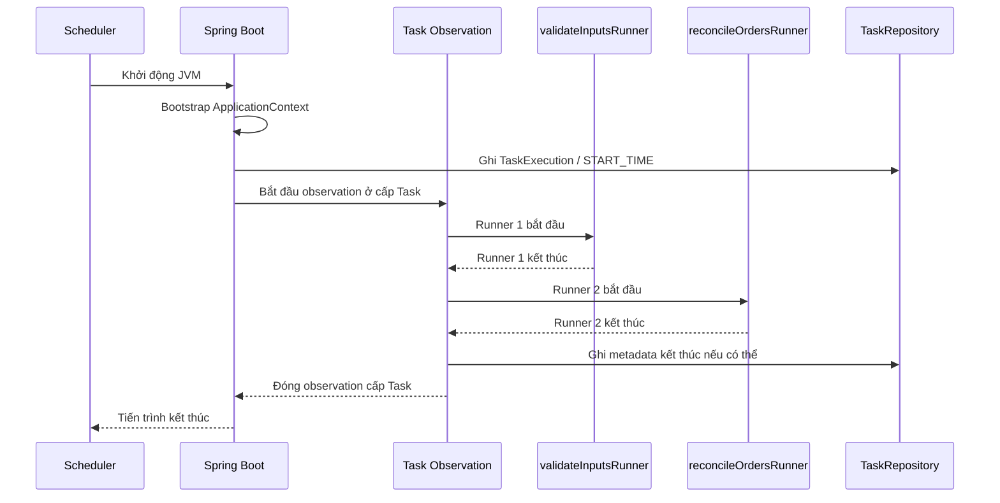
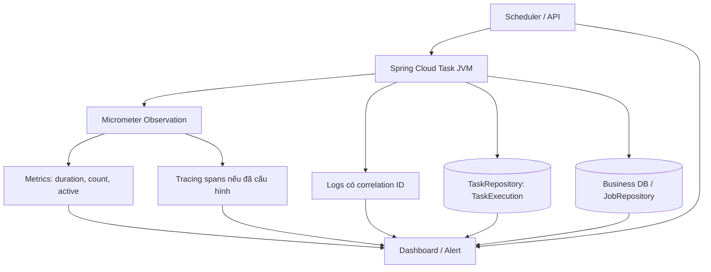

# Các phép đo `spring.cloud.task` và `spring.cloud.task.runner`

## 1. Vì sao một ứng dụng Task hữu hạn vẫn cần metrics?

Trong chương **Quan sát** của **Spring Cloud Task**, chúng ta vận hành các ứng dụng Spring Boot chạy hữu hạn: chúng được khởi động theo lịch hoặc yêu cầu, xử lý dữ liệu, ghi kết quả thực thi vào `TaskRepository` rồi kết thúc. Đặc điểm “chạy xong là thoát” đem lại một vấn đề quan sát khác với dịch vụ HTTP chạy liên tục: **tiến trình có thể kết thúc trước khi hệ thống giám sát kịp lấy metrics**.

Giả sử mỗi đêm có 300 lượt chạy `order-reconciliation`. Database Task ghi lại từng lần chạy với `TASK_EXECUTION_ID`, `START_TIME`, `END_TIME` và `EXIT_CODE`. Nhưng người vận hành còn muốn biết:

- Thời gian chạy Task trung bình và xu hướng các lượt chạy chậm.
- Thời gian thực hiện **từng runner** trong ứng dụng, để tìm đoạn xử lý kéo dài.
- Số công việc đang hoạt động ở thời điểm quan sát.
- Tỷ lệ thất bại theo tên tác vụ và biến động sau khi triển khai một phiên bản mới.
- Khi một Task bị kill đột ngột, vì sao dashboard metrics có thể không thấy lượt chạy đó dù runtime đã báo lỗi.

Spring Cloud Task tích hợp **Micrometer Observation** để đo thời gian vòng đời Task và việc chạy các `ApplicationRunner`/`CommandLineRunner`. Tài liệu chính thức khai báo hai observation có tên `spring.cloud.task` và `spring.cloud.task.runner`; mỗi observation có một **timer** và một **long task timer** dành cho giai đoạn đang thực thi.

Sau bài học, bạn có thể:

1. Phân biệt các phép đo `spring.cloud.task`, `spring.cloud.task.active`, `spring.cloud.task.runner` và `spring.cloud.task.runner.active`.
2. Giải thích thời gian đo ở cấp toàn Task khác thời gian đo một runner như thế nào.
3. Hiểu các tag như `spring.cloud.task.name`, `spring.cloud.task.status` và `spring.cloud.task.runner.bean-name`.
4. Cấu hình Micrometer/Actuator với một metrics registry phù hợp cho ứng dụng chạy ngắn.
5. Nhận diện vấn đề **high cardinality**, xuất dữ liệu trễ, task bị kill và sự khác biệt giữa metrics với `TaskRepository`.
6. Thiết kế dashboard, cảnh báo và bài thử phù hợp cho Task chạy theo lịch, retry và phối hợp với Spring Batch.

> **Phạm vi phiên bản:** Tên observation và các key trong bài được đối chiếu với mục Observability của Spring Cloud Task. Cấu hình registry, exporter, Micrometer và tên metric ở backend có thể khác theo Spring Boot/Spring Cloud Task và hệ thống lưu trữ. Không ghép ngẫu nhiên các phiên bản; đối chiếu dependency, tài liệu release train và các metric thực tế của ứng dụng.

## 2. Bốn phép đo có sẵn và ý nghĩa

Theo tài liệu Observability của Spring Cloud Task:

| Tên observation / phép đo | Loại Micrometer | Đang đo điều gì? | Khi nào hữu ích? |
| --- | --- | --- | --- |
| `spring.cloud.task` | `Timer` | Thời lượng một lượt thực thi Task đã được quan sát | Thống kê duration, count, lỗi theo task |
| `spring.cloud.task.active` | `LongTaskTimer` | Thời gian và số lượt Task **đang thực thi** | Tìm Task kéo dài ở thời điểm hiện tại |
| `spring.cloud.task.runner` | `Timer` | Thời gian chạy một runner bean | So sánh chi phí của những runner trong cùng ứng dụng |
| `spring.cloud.task.runner.active` | `LongTaskTimer` | Những runner bean **đang chạy** | Phát hiện runner kéo dài bất thường |

Hai nhóm có convention khác nhau:

- `spring.cloud.task` và `spring.cloud.task.active` được định nghĩa bởi `DefaultTaskExecutionObservationConvention`, xoay quanh `TaskExecutionObservation`.
- `spring.cloud.task.runner` và `spring.cloud.task.runner.active` được định nghĩa bởi `DefaultTaskObservationConvention`, xoay quanh `TaskDocumentedObservation` của cấu hình runner.

Đây là **metric/observation names**, không phải thuộc tính cấu hình. Đặt `spring.cloud.task.runner=true` vào YAML không phải cách bật metrics. Tương tự, `spring.cloud.task` trong bảng không phải tên bảng metadata của repository.

### Timer khác LongTaskTimer như thế nào?

**`Timer`** ghi nhận thời lượng của những lần thực thi đã kết thúc. Tùy registry và cấu hình phân phối, bạn có thể phân tích **số lượt ghi nhận**, **tổng thời gian**, thời gian tối đa và histogram/percentile nếu được bật.

**`LongTaskTimer`** phản ánh những công việc **đang hoạt động**: số tác vụ hiện còn chạy và thời gian đã trôi qua. Nó không phải một kho lịch sử độc lập. Khi Task kết thúc hoặc tiến trình biến mất, dữ liệu active có thể không còn được lấy mẫu nữa. Không suy rằng `active=0` trên backend nghĩa là chưa có Task nào chạy trong ngày.

Micrometer dùng **nanosecond** làm đơn vị thời gian cơ sở bên trong, nhưng backend quyết định đơn vị hiển thị; Prometheus thường dùng **giây**. Khi so sánh dashboard, hãy xác nhận đơn vị và cách metric được đổi tên trước khi đặt ngưỡng cảnh báo.

## 3. Ranh giới thời gian: Task và runner không đo cùng một đoạn

Xét một ứng dụng có hai runner:

1. `validateInputsRunner` xác thực tham số và quyền truy cập.
2. `reconcileOrdersRunner` đọc, xử lý và ghi dữ liệu nghiệp vụ.

Một sơ đồ logic:



Sơ đồ nhằm minh họa **phạm vi đo**, không ấn định thứ tự callback/commit tuyệt đối giữa `TaskExecutionObservation`, vòng đời `TaskRepository` và Spring Boot trong mọi phiên bản. Điểm quan trọng: **timer cấp Task đo một phạm vi rộng hơn công việc bên trong một runner**; timer runner chỉ đo lúc runner đang được gọi.

Do đó:

- `spring.cloud.task` giúp trả lời “framework quan sát lượt Task này kéo dài bao lâu?”.
- `spring.cloud.task.runner` giúp trả lời “runner bean này thực thi bao lâu?”.
- Một Task có thể có **nhiều runner**, nên không mặc định mỗi Task tạo đúng một điểm đo runner.
- Tổng thời gian runner **không nhất thiết bằng** duration cấp Task: còn có overhead của framework, listener, hoạt động ngoài runner và các khác biệt ở thời điểm đo.
- Timer Task không phải đồng hồ đo toàn bộ độ trễ **từ lúc scheduler đưa yêu cầu đến lúc Pod được tạo**. Phần queue/provisioning diễn ra **trước khi tiến trình và Task bắt đầu** cần được theo dõi ở scheduler/deployer.

### Ví dụ số liệu minh họa

Giả sử scheduler cần 20 giây để cấp Pod, JVM bootstrap mất 4 giây, validation runner mất 0,2 giây, xử lý nghiệp vụ mất 25 giây, ghi metadata cuối mất thêm một ít thời gian. Dashboard có thể cho thấy:

| Phép đo | Giá trị ví dụ | Giải thích |
| --- | ---: | --- |
| Độ trễ scheduler → Pod ready | 20 s | **Không** do `spring.cloud.task` tự đo |
| `spring.cloud.task.runner` với `validateInputsRunner` | 0,2 s | Một runner |
| `spring.cloud.task.runner` với `reconcileOrdersRunner` | 25 s | Runner nghiệp vụ |
| `spring.cloud.task` | Xấp xỉ thời gian vòng đời Task được observation bao phủ | Có thể khác tổng các runner |
| Thời gian từ yêu cầu đến kết quả | Tổng độ trễ cấp phát + khởi động + xử lý + kết thúc | Cần nhiều nguồn quan sát |

Không tự lấy `spring.cloud.task - spring.cloud.task.runner` làm phép đo chính xác của **startup time**. Nếu một ứng dụng có nhiều runner, hoạt động không đồng bộ hoặc callback riêng, phép trừ này có thể đánh lừa.

## 4. Các tag (key values) mà Spring Cloud Task công bố

Tài liệu hiện hành liệt kê nhiều key đi kèm observation cấp Task, trong đó có:

| Tag cấp Task | Ý nghĩa |
| --- | --- |
| `spring.cloud.task.name` | Tên Task |
| `spring.cloud.task.status` | Trạng thái observation, ví dụ `success` hoặc `failure` |
| `spring.cloud.task.execution.id` | ID nội bộ của `TaskExecution` |
| `spring.cloud.task.exit.code` | Exit code do Task ghi nhận |
| `spring.cloud.task.external.execution.id` | ID được hệ thống điều phối bên ngoài cấp, nếu có |
| `spring.cloud.task.parent.execution.id` | ID Task cha nếu được cấu hình |
| `spring.cloud.task.cf.app.id` / `spring.cloud.task.cf.app.name` | Thông tin ứng dụng Cloud Foundry khi môi trường áp dụng |
| `spring.cloud.task.cf.app.version` / `spring.cloud.task.cf.instance.index` | Phiên bản/instance index của Cloud Foundry |
| `spring.cloud.task.cf.org.name` / `spring.cloud.task.cf.space.id` / `spring.cloud.task.cf.space.name` | Thông tin tổ chức/space Cloud Foundry |

Tài liệu convention ghi danh sách các key này trong bảng **low cardinality**, nhưng không nên suy rằng **giá trị mọi key đều ít biến thể trong hệ thống của bạn**. `execution.id` và `external.execution.id` có thể thay đổi **mỗi lần chạy**; khi ghi vào hệ thống metrics theo labels, số lượng time series có thể tăng rất nhanh.

Runner observation có một key đặc trưng:

```text
spring.cloud.task.runner.bean-name
```

Key này nhận **tên bean runner** được Spring Cloud Task thực thi, giúp bạn phân biệt các runner. Nó không tự động là tên method Java, không nhất thiết là tên Job/Step của Spring Batch và **không phải `TASK_EXECUTION_ID`**.

### Tag xuất hiện muộn và `*.active`

Tài liệu Micrometer của Spring Cloud Task cảnh báo: các **key values được bổ sung sau lúc observation bắt đầu** có thể **không xuất hiện** trong metric `spring.cloud.task.active` hoặc `spring.cloud.task.runner.active`. Chẳng hạn, exit code/status chỉ có ý nghĩa đầy đủ sau khi kết thúc.

Vì thế:

- Không xây alert active tasks bắt buộc phải có `spring.cloud.task.exit.code`.
- Không kết luận Task đang chạy “không có exit code” là lỗi: trước khi kết thúc, `EXIT_CODE` trong repository thường chưa có.
- Không gắn mọi label cấp Task vào `runner.active`: convention runner chính thức nêu `runner.bean-name`, không hứa rằng các tag Task đều hiện diện trên runner.
- Xác nhận **effective labels** của exporter/backend thật trước khi viết PromQL hoặc dashboard.

## 5. Bật observability trong ứng dụng Spring Cloud Task

Spring Cloud Task tích hợp với **Micrometer Observation**. Tài liệu tính năng hướng dẫn thêm:

1. `spring-boot-starter-actuator` để tích hợp observability của Spring Boot.
2. **Registry implementation** như OTLP, Influx hoặc Prometheus nếu muốn xuất metrics ra hệ thống ngoài.
3. **Micrometer Tracing** nếu muốn xuất các span/trace, cùng tracing bridge/exporter tương thích.

Ví dụ **phần dependencies Maven** (giả định dự án đã quản lý Spring Boot và Spring Cloud BOM tương thích):

```xml
<dependencies>
    <dependency>
        <groupId>org.springframework.cloud</groupId>
        <artifactId>spring-cloud-starter-task</artifactId>
    </dependency>
    <dependency>
        <groupId>org.springframework.boot</groupId>
        <artifactId>spring-boot-starter-actuator</artifactId>
    </dependency>
    <dependency>
        <groupId>io.micrometer</groupId>
        <artifactId>micrometer-registry-otlp</artifactId>
        <scope>runtime</scope>
    </dependency>
    <dependency>
        <groupId>org.postgresql</groupId>
        <artifactId>postgresql</artifactId>
        <scope>runtime</scope>
    </dependency>
</dependencies>
```

Đây **không phải `pom.xml` đầy đủ**: còn cần version management, plugin build, cấu hình datasource và schema metadata Task. Nếu bạn dùng registry khác, chọn dependency phù hợp thay vì thêm tất cả registry không cần thiết.

### Cấu hình ví dụ với OTLP Metrics

Với một bản Spring Boot hỗ trợ các property OTLP metrics tương ứng, có thể cấu hình mẫu:

```yaml
spring:
  application:
    name: reconciliation-task
  main:
    web-application-type: none
  datasource:
    url: jdbc:postgresql://localhost:5432/task_metadata
    username: task_user
    password: ${TASK_DB_PASSWORD}
  cloud:
    task:
      name: reconciliation-task

management:
  otlp:
    metrics:
      export:
        url: http://otel-collector:4318/v1/metrics
        step: 5s
```

URL và `step` minh họa một collector đã được cấu hình và reachable trong mạng nội bộ, **không bảo đảm** mọi bản Spring Boot sử dụng cùng property hoặc exporter flush được toàn bộ metric khi task rất ngắn. Cần kiểm tra tài liệu registry của **phiên bản thực tế** và test end-to-end từ tiến trình Java đến backend. `spring.main.web-application-type=none` giữ mô hình Task không-web; nó cũng có nghĩa là không tự nhiên có một HTTP endpoint công khai để Prometheus scrape.

### Vì sao `management.metrics.*` không phải `spring.cloud.task.*`?

- `spring.cloud.task.name` và các property cùng namespace cấu hình cách Spring Cloud Task hoạt động.
- `management.*` của Spring Boot thường cấu hình **Actuator, registry và cách export** dữ liệu Micrometer.
- `spring.cloud.task.runner` là **tên observation/metric**, không phải một Spring Boot property bật timer runner.

Mối liên hệ giữa **framework instrumentation** và **exporter** là hai bước: có observation trong ứng dụng chưa đồng nghĩa dữ liệu đã tới Prometheus, OpenTelemetry Collector hay dashboard.

## 6. Ví dụ Java: một runner có thể đo thời gian thực thi

Ứng dụng sau chạy một tác vụ ngắn và cho phép mô phỏng lỗi. Spring Cloud Task tự instrument các runner trong cấu hình observability phù hợp; ví dụ **không tự tạo Timer trùng tên** để tránh đếm đôi.

```java
package com.example.observability;

import java.time.LocalDate;
import java.util.List;

import org.slf4j.Logger;
import org.slf4j.LoggerFactory;
import org.springframework.boot.ApplicationRunner;
import org.springframework.boot.SpringApplication;
import org.springframework.boot.autoconfigure.SpringBootApplication;
import org.springframework.cloud.task.configuration.EnableTask;
import org.springframework.context.annotation.Bean;

@SpringBootApplication
@EnableTask
public class TaskMetricsApplication {
    private static final Logger log =
            LoggerFactory.getLogger(TaskMetricsApplication.class);

    public static void main(String[] args) {
        SpringApplication.run(TaskMetricsApplication.class, args);
    }

    @Bean("reconcileOrdersRunner")
    ApplicationRunner reconcileOrdersRunner() {
        return args -> {
            List<String> dates = args.getOptionValues("business-date");
            if (dates == null || dates.size() != 1) {
                throw new IllegalArgumentException(
                        "Cần --business-date=yyyy-MM-dd");
            }
            LocalDate date = LocalDate.parse(dates.get(0));
            log.info("Bắt đầu đối soát {}", date);

            // Chỉ mô phỏng thời gian xử lý; production dùng service thật.
            Thread.sleep(1_000);

            if (args.containsOption("fail")) {
                throw new IllegalStateException(
                        "Lỗi đối soát mô phỏng cho " + date);
            }
            log.info("Đối soát hoàn tất {}", date);
        };
    }
}
```

Khi framework và registry được cấu hình đúng, runner observation có thể được gắn tag `spring.cloud.task.runner.bean-name=reconcileOrdersRunner`. Timer `spring.cloud.task.runner` đo thời gian bên trong lần gọi runner này. Timer `spring.cloud.task` phản ánh phạm vi TaskExecution theo cơ chế instrument của Spring Cloud Task.

Chạy thử:

```bash
java -jar task-metrics-demo.jar --business-date=2026-11-24

# Lỗi có chủ đích để so sánh metric/TaskRepository.
java -jar task-metrics-demo.jar --business-date=2026-11-24 --fail
```

**Không giả định** rằng mỗi lượt chạy `java -jar` đều tự xuất metric thành công lên backend. Một task kết thúc sau khoảng một giây có thể **thoát trước chu kỳ export 5 giây**; cần kiểm tra cơ chế flush khi shutdown, độ trễ exporter/collector và cách nền tảng quản lý vòng đời tiến trình. Nếu exporter không phát được dữ liệu, `TaskRepository` vẫn có thể ghi nhận TaskExecution bình thường.

### Khi có nhiều runner

Nếu một ứng dụng đăng ký `validateRunner` và `reconcileOrdersRunner`, Spring Boot sẽ gọi các runner theo thứ tự được framework xác định. Mỗi runner được instrument có thể có một điểm đo `spring.cloud.task.runner` với `runner.bean-name` khác nhau.

**Tổng số điểm đo runner có thể lớn hơn số TaskExecution.** Một Task có nhiều runner không đồng nghĩa có nhiều tiến trình. Khi một runner ném exception không xử lý, các runner phía sau có thể không chạy, khiến metric của chúng **không xuất hiện** cho lần thử thất bại đó.

## 7. Đọc Timer: count, sum, max và histogram

Một Micrometer `Timer` lưu thông tin về **thời lượng các lần chạy đã quan sát**. Theo registry, bạn có thể gặp các đại lượng:

| Đại lượng | Cách diễn giải | Điều cần tránh |
| --- | --- | --- |
| `count` | Số lần Timer hoàn tất và được ghi nhận | Không mặc định bằng số bản ghi `TASK_EXECUTION` khi thiếu export |
| `total time / sum` | Tổng thời lượng của các lần đã ghi nhận | Không nhầm đơn vị giây và nanosecond |
| `max` | Giá trị lớn nhất trong cửa sổ/registry tương ứng | Không mặc định là max lịch sử vĩnh viễn |
| Histogram buckets | Phân bố duration khi histogram được cấu hình | Không mặc định mọi registry xuất bucket |
| Percentiles | Ước lượng P50/P95/P99 khi có dữ liệu và cấu hình đủ | Không tính P95 đáng tin từ một vài Task ngắn rời rạc |

Nếu có `count=20` và `sum=240s` trong một tập quan sát, duration trung bình của tập đó là `240 / 20 = 12s`. Nhưng **đây là trung bình các mẫu thực sự được ghi**, không phải mọi lần chạy đã từng tồn tại trong repository.

### Ví dụ tên metric sau khi backend chuyển đổi

Micrometer đặt tên instrument ở Java dạng dấu chấm, nhưng **Prometheus có thể chuyển sang tên gạch dưới và suffix đơn vị**, chẳng hạn:

```text
spring.cloud.task
  -> spring_cloud_task_seconds_count
  -> spring_cloud_task_seconds_sum

spring.cloud.task.runner
  -> spring_cloud_task_runner_seconds_count
  -> spring_cloud_task_runner_seconds_sum
```

Các tên Prometheus trên là **ví dụ quy tắc chuyển đổi thường gặp**, không phải lời hứa mọi backend/version sẽ xuất chính xác tên ấy. Hãy mở dữ liệu thực tế trong exporter/collector rồi kiểm tra tên series, labels và đơn vị trước khi tạo truy vấn hoặc alert.

Nếu histogram chưa được bật, không xây dashboard `histogram_quantile(...)` từ những bucket vốn không tồn tại. Khi bật histogram, kiểm tra storage cardinality và retention trước khi dùng cho hàng nghìn tên task.

## 8. Đọc `*.active`: công việc đang chạy, không phải lịch sử

Long task timer có thể hỗ trợ quan sát:

- Số Task **đang hoạt động** tại thời điểm đo.
- Thời gian trôi qua của những Task chưa hoàn tất.
- Tương tự, số runner đang chạy và duration của chúng theo `runner.bean-name`.

Ví dụ một Task đối soát chạy lâu 45 phút: nếu backend còn có thể nhận dữ liệu trong lúc tiến trình hoạt động, `spring.cloud.task.active` có thể giúp phát hiện nó vượt ngưỡng thời gian. Sau khi Task đã hoàn tất, LongTaskTimer không tự trở thành một bản ghi “task đã chạy 45 phút”: phần đó thuộc Timer hoàn tất hoặc TaskRepository.

**Cảnh báo quan trọng:** Với ứng dụng Task chạy hữu hạn, backend có thể chỉ nhìn thấy một ít mẫu active hoặc không có mẫu nào:

1. Task quá ngắn, không kịp chu kỳ xuất metrics.
2. Collector/backend chưa nhận được dữ liệu trước khi tiến trình thoát.
3. Metric active chỉ có hiệu lực trong thời gian observation đang chạy.
4. JVM bị kill nên không chạy pha dọn dẹp/shutdown bình thường.
5. Key values như status/exit code được gắn **sau khi bắt đầu** và vắng mặt trong `*.active`.

Vì vậy không dùng duy nhất `spring.cloud.task.active` để đếm số Task thật sự đang chạy trên toàn cụm; kết hợp số workload từ Kubernetes/Deployer và metadata Task còn mở. Nếu một Pod mất tín hiệu metric, phải kiểm tra **runtime** thay vì mặc định nó đã hoàn tất.

## 9. Xuất metrics từ ứng dụng chạy ngắn: pull hay push?

### 9.1. Vì sao Prometheus scrape thông thường dễ bỏ lỡ Task?

Prometheus thường **pull** metrics từ một HTTP endpoint tại các thời điểm định kỳ. Nếu Task chạy 2 giây nhưng scrape interval là 15 giây, một tiến trình có thể xuất hiện và kết thúc **giữa hai lần scrape**. Dữ liệu của lần chạy đó sẽ không được lấy, kể cả khi timer có tồn tại trong JVM.

Một ứng dụng `web-application-type=none` thông thường cũng không tự mở HTTP port để scrape. Bật `management.endpoints.web.exposure.include=prometheus` mà không có web server phù hợp **không tự làm endpoint trở nên truy cập được**.

### 9.2. Các hướng thu thập có thể chọn

| Hướng thu thập | Điểm mạnh | Điểm yếu/cần kiểm tra |
| --- | --- | --- |
| HTTP pull từ tiến trình Task | Dễ hiểu khi Task chạy đủ lâu và endpoint tồn tại | Task ngắn có thể chết trước scrape |
| Push/step registry (OTLP, Influx, StatsD tùy stack) | Có thể đẩy dữ liệu trong khi Task chạy | Cần interval/flush, retry, collector và xử lý mạng |
| Collector/agent nhận telemetry từ process | Tách một phần trách nhiệm khỏi ứng dụng | Phải có pipeline hoạt động trước khi process thoát |
| Log có cấu trúc + pipeline tập trung | Log vẫn có thể thu thập sau khi process thoát nếu runtime giữ log | Không thay thế histogram/timer; có nguy cơ thiếu log |
| `TaskRepository` + truy vấn định kỳ | Bền vững cho lịch sử Task nếu DB hoạt động | Không thay thế giám sát thời gian thực và chi tiết runner |
| Scheduler/platform metrics | Ghi nhận queued/running/failed của workload | Không cung cấp thời lượng mỗi runner trong JVM |

Không nên suy rằng **Pushgateway là mặc định tốt nhất** cho mọi job ngắn. Nếu dùng Prometheus Pushgateway, cần quản lý vòng đời grouping key và xóa series cũ để tránh hiển thị công việc đã kết thúc như vẫn còn chạy; cân nhắc hướng dẫn của Prometheus và chính sách hạ tầng.

### 9.3. Đặt tiêu chí kiểm thử “metric đã xuất” cụ thể

Với Task chạy 1 giây, 5 giây và 60 giây, hãy kiểm tra:

1. Backend có nhận **ít nhất một điểm đo hoàn tất** cho Task hay không.
2. Có nhận `runner` timer tương ứng hay không.
3. Độ trễ từ lúc Task kết thúc đến lúc dashboard nhìn thấy số liệu.
4. Khi Task bị lỗi, metric có phản ánh status thích hợp và dữ liệu Tag có được publish?
5. Khi JVM bị kill cưỡng bức, lần chạy nào **không có metric** nhưng vẫn hiện trên runtime hoặc Job/Task Repository?

Nếu không qua được các bước trên, đừng đặt cảnh báo quan trọng chỉ dựa vào số liệu exporter.

## 10. High cardinality: vì sao ID mỗi lần chạy không nên là mọi label dashboard

Tài liệu Spring Cloud Task liệt kê `spring.cloud.task.execution.id`, `spring.cloud.task.external.execution.id` và một số ID khác như những key của observation. Đây là thông tin hữu ích khi gắn với **trace hoặc log**, nhưng khi xuất thành metric labels, chúng thường có số lượng giá trị gần bằng **số lần Task đã chạy**.

Ví dụ mỗi ngày có 20.000 TaskExecution với ID duy nhất. Chỉ cần label `execution.id` đã có thể tạo ít nhất khoảng 20.000 chuỗi phân biệt trên một metric, và khi kết hợp tên task, status, instance, version, histogram buckets thì số time series lớn hơn nhiều. Điều này làm tăng memory, cardinality cost và chi phí truy vấn.

Một chiến lược tách lớp:

- **Metrics tổng hợp:** giữ tên task được quản lý, trạng thái, môi trường và tên runner ổn định, có số giá trị giới hạn.
- **Logs/traces:** giữ `TASK_EXECUTION_ID`, `externalExecutionId`, request ID và correlation ID để điều tra từng lần chạy.
- **Database Task:** lưu TaskExecution và kết quả để truy vết lâu dài.
- **Business audit:** lưu các chỉ số như số bản ghi xử lý, thành công, thất bại theo yêu cầu nghiệp vụ.

### Ví dụ lọc bớt tag ở tầng Micrometer metrics

Nếu chính sách hệ thống yêu cầu **không đưa ID từng lần chạy vào metric labels**, có thể đăng ký `MeterFilter` (API Micrometer thông dụng) như sau:

```java
import io.micrometer.core.instrument.config.MeterFilter;
import org.springframework.context.annotation.Bean;
import org.springframework.context.annotation.Configuration;

@Configuration(proxyBeanMethods = false)
public class MetricsCardinalityConfiguration {
    @Bean
    MeterFilter omitPerExecutionIdsFromMetrics() {
        return MeterFilter.ignoreTags(
                "spring.cloud.task.execution.id",
                "spring.cloud.task.external.execution.id",
                "spring.cloud.task.parent.execution.id");
    }
}
```

Đoạn code minh họa cách lọc **metric tags**, không tự xóa các trường tương ứng trong `TaskExecution` hay chắc chắn xóa chúng khỏi **tracing spans**. Kiểm thử hiệu lực trên registry thật vì filter, naming convention, meter registration và thứ tự cấu hình có thể ảnh hưởng kết quả. Đừng xóa tùy tiện những tag vận hành cần thiết nếu dashboard đang dựa vào chúng.

**Không lấy `taskName` trực tiếp từ input không tin cậy.** Nếu tên task tự chứa `requestId`/`tenantId`, cardinality có thể vẫn bùng nổ ngay cả khi đã lọc `execution.id`. Hãy dùng catalog tên task hữu hạn, trong khi thông tin theo request nằm ở trace/log/DB.

### Bảo mật telemetry

Task name, argument, exit message và đặc biệt external execution ID đôi khi chứa dữ liệu nhạy cảm nếu thiết kế không cẩn thận. Không đưa token, password, email cá nhân hoặc toàn bộ payload nghiệp vụ vào label; chúng sẽ bị sao chép và lưu trong nhiều backend. Áp dụng chính sách retention, RBAC, TLS và giới hạn export theo môi trường.

## 11. Metrics, traces, logs và TaskRepository bổ sung cho nhau



| Nguồn quan sát | Có thể trả lời tốt | Không tự trả lời đầy đủ |
| --- | --- | --- |
| `spring.cloud.task` Timer | Duration/count những Task đã được quan sát và export | Tác động nghiệp vụ, Task bị kill trước export |
| `spring.cloud.task.runner` Timer | Runner bean nào mất thời gian | Mọi thời gian startup, thời gian queue ngoài JVM |
| `*.active` LongTaskTimer | Task/runner đang hoạt động tại lúc có mẫu | Lịch sử đầy đủ sau khi tiến trình đã thoát |
| Tracing spans | Luồng thực thi/correlation trong một trace được lấy mẫu | Mọi lượt chạy nếu bị sample drop hoặc export lỗi |
| TaskRepository | Lịch sử Task ID, start/end, exit code và một số thông tin lỗi | Thời lượng từng runner, tình trạng Pod live |
| JobRepository (Spring Batch) | Job/step/chunk status, checkpoint và số lượng item | Mọi Task run hoặc trạng thái container |
| Scheduler/container runtime | Requested/queued/running/terminated, exit status, kill reason | Kết quả chi tiết của domain service |
| Business audit | Mức độ hoàn tất và tính đúng dữ liệu | Vì sao JVM lỗi bootstrap hoặc không tạo TaskExecution |

Với Spring Batch, **Timer runner của Spring Cloud Task không phải Step timer**. Một runner có thể gọi một hoặc nhiều Batch Job, hoặc trả về trước khi job bất đồng bộ kết thúc. Để tìm step chậm, dùng metadata/observability **của Spring Batch**; không suy ra step chậm nhất từ `runner.bean-name`.

### Liên kết log theo TaskExecution

Một `TaskExecutionListener` có thể ghi ID khi Task bắt đầu/kết thúc:

```java
import org.slf4j.Logger;
import org.slf4j.LoggerFactory;
import org.springframework.cloud.task.listener.TaskExecutionListener;
import org.springframework.cloud.task.repository.TaskExecution;
import org.springframework.stereotype.Component;

@Component
public class TaskTraceLogListener implements TaskExecutionListener {
    private static final Logger log =
            LoggerFactory.getLogger(TaskTraceLogListener.class);

    @Override
    public void onTaskStartup(TaskExecution execution) {
        log.info("taskExecutionId={}, taskName={}, phase=start",
                execution.getExecutionId(), execution.getTaskName());
    }

    @Override
    public void onTaskEnd(TaskExecution execution) {
        log.info("taskExecutionId={}, taskName={}, phase=end",
                execution.getExecutionId(), execution.getTaskName());
    }

    @Override
    public void onTaskFailed(TaskExecution execution, Throwable exception) {
        log.error("taskExecutionId={}, phase=failed",
                execution.getExecutionId(), exception);
    }
}
```

Listener là ví dụ log **có cấu trúc ở mức thông điệp**, không bảo đảm được gọi nếu JVM bị kill. Trong hệ thống thực, có thể dùng MDC/trace context có vòng đời quản lý đúng để thêm ID vào mọi log, nhưng phải dọn context đúng lúc để tránh lẫn task/tenant khi có nhiều luồng.

## 12. Ví dụ đọc TaskRepository để đối chiếu metric bị thiếu

Trong database metadata JDBC chuẩn của Spring Cloud Task, truy vấn các lần chạy mới nhất:

```sql
SELECT TASK_EXECUTION_ID,
       TASK_NAME,
       START_TIME,
       END_TIME,
       EXIT_CODE,
       EXTERNAL_EXECUTION_ID
FROM TASK_EXECUTION
WHERE TASK_NAME = 'reconciliation-task'
ORDER BY TASK_EXECUTION_ID DESC
LIMIT 50;
```

Ví dụ tính thời lượng từ metadata trong PostgreSQL:

```sql
SELECT TASK_EXECUTION_ID,
       EXTRACT(EPOCH FROM (END_TIME - START_TIME))
           AS recorded_duration_seconds,
       EXIT_CODE
FROM TASK_EXECUTION
WHERE TASK_NAME = 'reconciliation-task'
  AND START_TIME IS NOT NULL
  AND END_TIME IS NOT NULL
ORDER BY TASK_EXECUTION_ID DESC
LIMIT 50;
```

Đây là **duration suy ra từ hai timestamp của repository**, không phải số đo Micrometer `spring.cloud.task` được đảm bảo bằng nhau tuyệt đối. Những thời điểm được framework ghi nhận và ranh giới observation có thể khác. SQL cũng bỏ qua các Task chưa có `END_TIME`; trường này rỗng **không chứng minh tiến trình đang chạy**.

### Đối chiếu ba dữ kiện trước khi báo “mất metrics”

1. `TASK_EXECUTION` có bản ghi không? Nếu không, ứng dụng có thể lỗi **trước khi TaskRepository tạo metadata** hoặc dùng datasource khác.
2. Runtime có xác nhận Pod/process đã chạy và kết thúc không? Nếu bị kill, registry chưa chắc có cơ hội kết thúc/flush Timer.
3. Collector/exporter có nhận được điểm đo không? Nếu không, kiểm tra network, tên metric, tag filter và interval.

Nếu TaskRepository và runtime có dữ liệu nhưng backend metrics không có, đó **có thể là sự cố telemetry**, không nhất thiết là Task không chạy.

## 13. Thiết kế dashboard và cảnh báo

Một dashboard khả dụng cho Task chạy theo lịch nên có:

| Nhóm chỉ số | Nguồn khuyến nghị | Cách sử dụng |
| --- | --- | --- |
| Số Task hoàn thành theo tên/trạng thái | Timer `spring.cloud.task`, bổ sung TaskRepository | Phát hiện tỷ lệ lỗi hoặc lượng chạy bất thường |
| Duration trung bình và phân vị | Timer/histogram đủ mẫu, hoặc repository cho thống kê lịch sử | Phát hiện regression sau deploy |
| Runner chậm | `spring.cloud.task.runner` theo `runner.bean-name` | Xác định pha Java tốn thời gian |
| Task đang hoạt động quá lâu | `spring.cloud.task.active` + runtime/status DB | Cảnh báo stuck/timeout có xác minh |
| Task lỡ lịch | Scheduler dự kiến vs request/TaskRepository | Alert khi không hề có TaskExecution mới |
| Worker bị kill/OOM | Runtime Kubernetes/Deployer | Phân loại lỗi hạ tầng, tránh retry mù |
| Batch Job/Step thất bại | JobRepository/Batch metrics | Phân biệt lỗi batch với Task return 0 |
| Đối soát nghiệp vụ thiếu dữ liệu | Domain DB/audit | Phân biệt technical success với business success |

### Ngưỡng cảnh báo ví dụ

Các ngưỡng sau là **ví dụ khởi đầu**, không phải SLO mặc định của Spring Cloud Task:

- Báo động khi `daily-reconciliation` không có lượt chạy kết thúc trước deadline nghiệp vụ 03:00.
- Báo động nếu duration P95 vượt 20 phút **và có đủ mẫu xuất metrics**.
- Báo động nếu cùng một job có ba lần retry thất bại liên tiếp trong 2 giờ.
- Báo động nếu TaskRepository có bản ghi chưa có `END_TIME` quá lâu **và runtime xác nhận process đã biến mất**.
- Báo động khi tỷ lệ export thất bại/telemetry gap tăng dù scheduler có nhiều Task completed.

Đừng dùng một ngưỡng ngắn cho mọi loại Task: tác vụ xuất báo cáo 5 giây và job xử lý 5 triệu bản ghi có phân bố duration rất khác nhau. Gắn dashboard/alert theo tên tác vụ hoặc loại công việc ổn định, có SLO rõ ràng.

### Ví dụ PromQL minh họa

Chỉ dùng khi metrics đã được xuất và **xác nhận đúng tên series/label**:

```promql
# Số lượng task hoàn tất được quan sát trong 1 giờ.
sum(increase(spring_cloud_task_seconds_count[1h]))

# Tổng thời gian được ghi trong 1 giờ.
sum(increase(spring_cloud_task_seconds_sum[1h]))
```

Các biểu thức này giả định có **time series tồn tại đủ lâu và được lấy mẫu liên tục**, với tên chuyển đổi tương ứng từ Micrometer. Với hàng trăm tiến trình Task ngắn, một series có thể chỉ có **một mẫu** trước khi biến mất; `increase`/`rate` có thể không cho kết quả có ý nghĩa. Hãy kiểm thử pipeline/backend trước khi dùng biểu thức để tính số lượt chạy hoặc tỷ lệ lỗi; khi cần số lần chạy chính xác, đối chiếu `TaskRepository` hoặc một hệ thống counter có thiết kế thu thập bền vững.

## 14. Tracing spans: cùng tên observation nhưng khác mục tiêu

Spring Cloud Task còn tài liệu hóa các span có tên:

```text
spring.cloud.task
spring.cloud.task.runner
```

Spans giúp tái dựng **đường đi một lần thực thi**, trong khi metrics tổng hợp nhiều lượt chạy. Để thực sự thấy trace trên backend, cần cấu hình Micrometer Tracing bridge/exporter và sampling phù hợp. Bật Actuator một mình không bảo đảm trace đã đi tới hệ thống tracing.

Một trace có thể chứa ID Task, status và thời gian; nhưng khi hệ thống **sampling** hoặc exporter lỗi, trace của một attempt có thể mất. `TaskRepository` vẫn là nơi phù hợp để xác định danh sách các lượt thực thi đã được framework ghi. Không dùng trace ID như khóa nghiệp vụ chống retry trùng.

Với tác vụ gọi API ngoài hoặc thực thi Spring Batch, context propagation qua thread và process không phải lúc nào cũng tự động: worker container được khởi chạy riêng cần cơ chế truyền correlation/trace context phù hợp. Không hứa rằng một span cấp Task tự động bao phủ mọi tiến trình con được gọi từ xa.

## 15. Các tình huống trục trặc thường gặp

| Hiện tượng | Nguyên nhân có thể | Hướng kiểm tra |
| --- | --- | --- |
| Không thấy `spring.cloud.task` | Thiếu Actuator/registry, dùng version chưa hỗ trợ instrumentation tương ứng, exporter lỗi | Kiểm tra dependency, ObservationRegistry, backend và tài liệu version |
| Có `spring.cloud.task` nhưng không có `runner` | Không có runner được instrument, runner chưa chạy, cấu hình/version khác | Kiểm tra bean `ApplicationRunner`/`CommandLineRunner` và logs |
| Timer count nhỏ hơn số `TaskExecution` | Task quá ngắn, lỗi export hoặc một số process bị kill | Đối chiếu DB, runtime, collector step/flush |
| `spring.cloud.task.active` không có exit code | Tag chỉ xuất hiện sau khi observation bắt đầu/kết thúc | Không yêu cầu exit code cho active metrics |
| Dashboard tạo quá nhiều time series | Dùng `execution.id`/`external.execution.id` làm labels | Lọc ID khỏi metrics, giữ ID trong logs/traces/DB |
| Task duration trên metrics khác SQL | Ranh giới đo/timestamp khác nhau hoặc dữ liệu đo thiếu | So sánh timeline và phiên bản, không ép hai số bằng nhau |
| Task bị kill không xuất hiện trong Timer | Observation chưa kịp dừng hoặc exporter chưa flush | Xem trạng thái Pod/process và TaskRepository |
| P95 bằng 0/không có dữ liệu | Không có histogram, thiếu samples hoặc query sai | Kiểm tra registry buckets, labels, period |
| `runner.bean-name` thay đổi sau deploy | Tên bean khác do refactor hoặc cấu hình | Kiểm tra tên ổn định của runner và dashboard |
| Task exit 0 nhưng báo cáo thiếu | Nghiệp vụ nuốt lỗi hoặc xử lý async chưa hoàn tất | Kiểm tra business audit, Batch status và process exit status |

Khi debug, tăng mức log có kiểm soát và bảo vệ secrets. Không xuất raw arguments hoặc exception payload vào metric labels; dữ liệu khó xóa và bị nhân bản qua collector/backend.

## 16. Thực hành xác minh từng phép đo

Thực hiện với ứng dụng mẫu ở mục 6 và một backend/collector test:

1. **Task thành công:** chạy `--business-date=2026-11-24`, đọc `TASK_EXECUTION` và tìm Timer `spring.cloud.task` trên backend.
2. **Runner metric:** tìm `spring.cloud.task.runner` và tag `spring.cloud.task.runner.bean-name=reconcileOrdersRunner`; xác nhận duration xấp xỉ thời gian mô phỏng trong runner.
3. **Task thất bại:** chạy thêm `--fail`; đối chiếu `TaskExecution.EXIT_CODE` với status/tag thực tế, không đoán từ process exit status.
4. **Active metric:** tăng thời gian mô phỏng lên 60 giây ở môi trường test, theo dõi `spring.cloud.task.active` và `spring.cloud.task.runner.active` trong lúc runner còn hoạt động.
5. **Task cực ngắn:** chạy thời gian dưới chu kỳ exporter, ghi lại số lần thiếu metric và thử điều chỉnh pipeline/flush theo hướng dẫn registry.
6. **Process bị kill:** dừng cưỡng bức trong lúc xử lý, đối chiếu runtime, metadata `END_TIME` và sự thiếu hụt có thể có của Timer hoàn tất.
7. **Cardinality:** chạy nhiều lượt với execution ID thay đổi, quan sát số series theo tag; áp dụng `MeterFilter.ignoreTags` và so sánh.
8. **Nhiều runner:** thêm một `ApplicationRunner` hợp lệ, xác minh `runner.bean-name` phân biệt các runner; kiểm tra tổng số điểm đo runner không bằng số Task.
9. **Spring Batch:** nếu Task gọi một Job, kiểm tra riêng `JobExecution`/`StepExecution` để biết phần xử lý nào thất bại, không chỉ đọc timer runner.
10. **Truy vết cuối-cuối:** chọn một lượt chạy và so sánh TaskExecution ID, Pod/container ID, log, trace (nếu được lấy mẫu), các metrics và kết quả nghiệp vụ.

### Câu hỏi tự kiểm tra

1. `spring.cloud.task` khác `spring.cloud.task.runner` ở ranh giới thời gian đo nào?
2. Hai phép đo `*.active` thuộc kiểu Micrometer gì và vì sao không phải lịch sử lâu dài?
3. Khi một Task có ba `ApplicationRunner`, có nhất thiết đúng một điểm đo runner cho cả Task không?
4. Vì sao `TaskRepository` có thể có một lượt chạy nhưng metrics backend hoàn toàn không thấy lượt đó?
5. Key nào nhận tên bean runner? Có nên dùng `TASK_EXECUTION_ID` làm tên bean không?
6. Vì sao `spring.cloud.task.exit.code` có thể không xuất hiện trong `spring.cloud.task.active`?
7. Mặc dù tài liệu liệt kê `execution.id` trong bảng low cardinality, vì sao cần đánh giá số series thực tế?
8. Bật Actuator và Prometheus endpoint đã đủ để scrape một Task chạy chỉ hai giây chưa?
9. Vì sao không lấy `spring.cloud.task - spring.cloud.task.runner` để tính startup time một cách tuyệt đối?
10. Nếu Batch Job thất bại nhưng Task exit code 0, những nguồn metadata nào cần được đối chiếu?
11. Một Task bị `SIGKILL` có thể thiếu những dữ liệu quan sát nào?
12. Với yêu cầu “không được bỏ sót lần chạy”, nguồn nào có thể được dùng để reconcile khi metrics hoặc traces bị thiếu?

## 17. Tài liệu tham khảo

- [Spring Cloud Task — Observability: Metrics và Spans](https://docs.spring.io/spring-cloud-task/reference/observability.html), các tên `spring.cloud.task`, `spring.cloud.task.active`, `spring.cloud.task.runner` và `spring.cloud.task.runner.active`.
- [Spring Cloud Task — Features: Enable Task Metrics](https://docs.spring.io/spring-cloud-task/reference/features.html).
- [Spring Boot — Observability](https://docs.spring.io/spring-boot/reference/actuator/observability.html).
- [Spring Boot — Metrics](https://docs.spring.io/spring-boot/reference/actuator/metrics.html).
- [Micrometer — Timers](https://docs.micrometer.io/micrometer/reference/concepts/timers.html) và [Long Task Timers](https://docs.micrometer.io/micrometer/reference/concepts/long-task-timers.html).
- [Prometheus — When to use the Pushgateway](https://prometheus.io/docs/practices/pushing/).

**Ghi nhớ:** `spring.cloud.task` đo thời lượng Task ở cấp observation; `spring.cloud.task.runner` đo thời lượng thực thi các runner bean. Các biến thể `*.active` là **long task timers** dành cho công việc đang diễn ra, không phải lịch sử bền vững. Với Spring Cloud Task chạy hữu hạn, **thu thập/export đúng thời điểm** quan trọng không kém việc bật Micrometer. Giữ metric labels có cardinality kiểm soát, lưu ID chi tiết ở log/trace/TaskRepository và luôn đối chiếu tình trạng runtime, mã thoát cùng kết quả nghiệp vụ để tránh hiểu sai khi telemetry bị thiếu.
