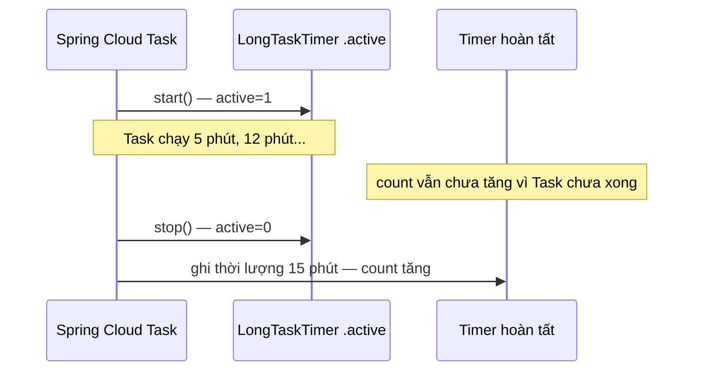
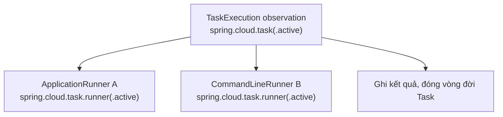
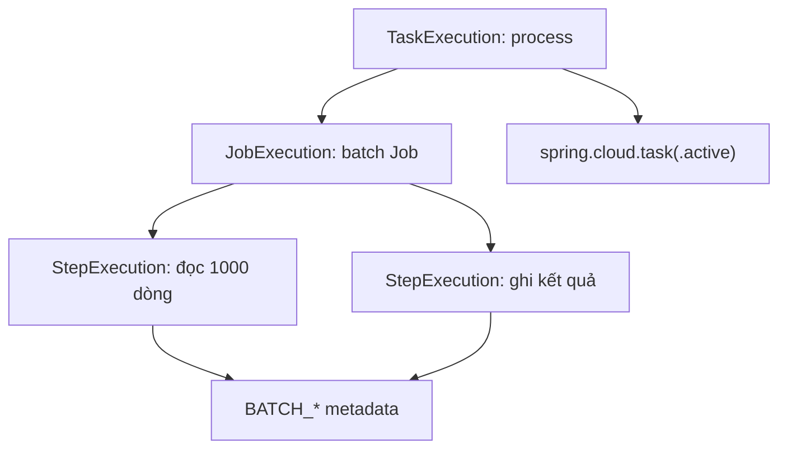

# Phân biệt số đo đang hoạt động và số đo khi hoàn tất

## 1. Vì sao cần phân biệt hai thời điểm đo lường?

**Spring Cloud Task** được dùng để phát triển ứng dụng Spring Boot chạy trong thời gian hữu hạn: khởi động, nhận tham số, thực hiện công việc, ghi nhận vòng đời vào `TaskRepository` và kết thúc. Task có thể chạy theo lịch hoặc yêu cầu, xử lý lỗi, phối hợp Spring Batch và được điều phối bởi Kubernetes Job, cron hoặc hệ thống triển khai khác.

Trong quá trình vận hành, hai câu hỏi dễ bị trộn lẫn:

- **Ngay bây giờ có bao nhiêu Task đang chạy, chúng đã chạy bao lâu?**
- **Trong một giờ vừa qua có bao nhiêu Task hoàn tất, bao nhiêu thành công/thất bại, thời lượng mỗi lần là bao nhiêu?**

Câu hỏi đầu tiên quan tâm tới **công việc còn đang thực thi** (*in-flight*). Câu hỏi thứ hai quan tâm tới **lần thực thi đã kết thúc** (*completed*). Cả hai đều là chỉ số quan sát cần thiết, nhưng được thu thập và tổng hợp khác nhau.

Ví dụ, một Task bắt đầu lúc 02:00 và vẫn đang xử lý lúc 02:20. Nếu dashboard chỉ hiển thị thời lượng của các lần **đã hoàn tất**, Task chậm này có thể **chưa đóng góp vào số đo thời lượng**. Kết luận “thời gian chạy trung bình vẫn 5 phút, hệ thống bình thường” có thể sai nghiêm trọng.

Ngược lại, nếu chỉ theo dõi Task đang chạy, khi một Task đã kết thúc thất bại ở phút thứ 12, bộ đếm active trở về 0. Không còn Task active **không đồng nghĩa đã hoàn tất thành công**.

Mục tiêu học tập:

1. Giải thích ý nghĩa của `LongTaskTimer`, `Timer`, `Counter` và `Gauge` trong bối cảnh Task hữu hạn.
2. Phân biệt metric chính thức `spring.cloud.task.active` với `spring.cloud.task`; tương tự cho `spring.cloud.task.runner.active` và `spring.cloud.task.runner`.
3. Hiểu thời điểm cập nhật, số lượng đang chạy, thời lượng đã hoàn tất và những nhãn chỉ có sau khi công việc kết thúc.
4. Cấu hình Micrometer/Actuator phù hợp với phiên bản Spring Cloud Task; nhận biết giới hạn của Prometheus scrape với ứng dụng ngắn hạn.
5. Kết hợp metric, trace, log, `TaskRepository` và trạng thái hệ điều phối để theo dõi thành công, lỗi và crash.
6. Thiết kế metric nghiệp vụ, dashboard, cảnh báo và quy trình kiểm tra không gây hiểu nhầm khi chạy lại hoặc chạy đồng thời.

## 2. Hai nhóm số đo theo vòng đời

### 2.1. Số đo đang hoạt động (active/in-flight)

Số đo đang hoạt động mô tả **phần việc đã bắt đầu nhưng chưa kết thúc**. Nó thường trả lời:

- Hiện tại có **bao nhiêu** lần thực thi đang hoạt động?
- Tổng thời gian đã trôi qua của tất cả lần thực thi active là bao nhiêu?
- Lần đang chạy lâu nhất đã chạy bao lâu?
- Có Task bị treo hoặc kéo dài bất thường so với deadline không?

Một `LongTaskTimer` của Micrometer được thiết kế cho loại quan sát này: nó theo dõi các sample còn mở, cung cấp thông tin về **active task count**, tổng thời lượng các công việc vẫn đang chạy và thời lượng lớn nhất trong nhóm đó.

### 2.2. Số đo khi hoàn tất (completed)

Số đo hoàn tất ghi nhận **mỗi lần thực thi đã kết thúc qua đường đo lường bình thường**. Nó thường trả lời:

- Đã hoàn tất **bao nhiêu lần** trong khoảng thời gian quan sát?
- Tổng thời lượng của các lần đã hoàn tất là bao nhiêu?
- Phân phối thời lượng có vượt SLO không?
- Tỷ lệ thành công/thất bại trong các lần được ghi nhận là bao nhiêu?

Một `Timer` thông thường của Micrometer ghi thời lượng khi sample được **stop**. Từ số liệu Timer, backend có thể cung cấp count, total time, max và histogram/percentile tùy cấu hình. Nếu cần đếm một sự kiện nghiệp vụ không có thời lượng, `Counter` phù hợp hơn.

### 2.3. So sánh trực tiếp

| Tiêu chí | `LongTaskTimer` / active | `Timer` / completed |
| --- | --- | --- |
| Khi bắt đầu có dữ liệu? | Có, khi sample bắt đầu và hệ thống có cơ hội quan sát | Chưa tăng count cho lần mới khi nó còn chạy |
| Khi Task còn chạy | Số active lớn hơn 0; thời gian đang chạy tăng | Lần đang chạy chưa được ghi vào count/duration đã hoàn tất |
| Khi sample được đóng | Số active giảm; thời lượng active của sample biến mất | Count tăng và thời lượng hoàn tất được ghi nhận |
| Dùng để cảnh báo Task treo | Phù hợp nếu metric được thu thập trong khi chạy | Không đủ nếu chỉ dựa trên thời lượng đã hoàn tất |
| Dùng để thống kê các lần đã xong | Không trực tiếp | Phù hợp |
| Nếu process bị kill đột ngột | Có thể không xuất được điểm cuối | Có thể không có sample hoàn tất |
| Nếu process kết thúc và biến mất | Metric active của process cũng biến mất | Metric trong memory của process cũng không tự tồn tại lâu dài nếu chưa xuất đi |

**Điểm cần nhớ:** Active **không phải** tổng số lần Task đã chạy từ trước đến nay. Completed **không phải** số Task đang chạy ở thời điểm hiện tại.

## 3. Timeline một Task: vì sao nhìn mỗi Timer sẽ bỏ sót Task chậm?

Giả sử Task `nightly-import` chạy trong 15 phút. Để dễ hiểu, bảng sau biểu diễn các phép đo **trong cùng một registry đang sống**:

| Mốc | Trạng thái | Active tasks | LongTaskTimer: thời gian đang chạy | Timer: số lần đã hoàn tất |
| --- | --- | ---: | --- | ---: |
| 02:00 | Task vừa bắt đầu | 1 | Gần 0 phút | 0 |
| 02:05 | Đang xử lý | 1 | Khoảng 5 phút | 0 |
| 02:12 | Vẫn đang xử lý | 1 | Khoảng 12 phút | 0 |
| 02:15 | Task kết thúc và sample được đóng | 0 | Không còn sample active | 1 |



Trình tự hai lời gọi stop ở sơ đồ chỉ mô tả **chuyển trạng thái logic**; callback thực tế do Observation/Micrometer thực hiện theo implementation. Khi Task kết thúc thất bại nhưng đường quan sát vẫn được đóng, Timer vẫn có thể nhận một duration với nhãn lỗi. Timer đo **thời lượng của lần được quan sát**, không chỉ các lần thành công.

Đừng lấy `active=0` sau 02:15 và suy ra trong ngày chưa có lần chạy nào. Ngược lại, đừng lấy `completed count=0` lúc 02:12 và suy ra Task chưa được khởi chạy.

### 3.1. Nếu nhiều Task cùng chạy

Giả sử trong một hệ thống quan sát liên tục có:

- Instance A đang chạy 2 phút.
- Instance B đang chạy 7 phút.
- Instance C vừa kết thúc sau 4 phút.

Tại thời điểm này:

```text
active_count        = 2
active_duration_sum ≈ 9 phút (A + B)
active_max_duration ≈ 7 phút
completed_count tăng thêm 1 do C
completed_duration ghi thêm 4 phút do C
```

Đây là ví dụ **tổng hợp logic**. Mỗi Spring Cloud Task thường là một process riêng và một `MeterRegistry` riêng; muốn nhìn toàn hệ thống phải gom metric từ các process vào backend. Không tự giả định một process Task có thể nhìn thấy metric của các process Task khác.

## 4. Các metric chính thức của Spring Cloud Task

Tài liệu **Observability** của Spring Cloud Task công bố hai cặp tên metric:

| Meter name trong Micrometer | Loại | Đối tượng theo dõi | Khi nào có ý nghĩa? |
| --- | --- | --- | --- |
| `spring.cloud.task.active` | **Long task timer** | Vòng đời một lần thực thi Task | Trong khi Task observation còn hoạt động |
| `spring.cloud.task` | **Timer** | Vòng đời một lần thực thi Task | Khi Task observation được kết thúc |
| `spring.cloud.task.runner.active` | **Long task timer** | Một lần thực thi runner bean | Trong khi runner observation còn hoạt động |
| `spring.cloud.task.runner` | **Timer** | Một lần thực thi runner bean | Khi runner observation kết thúc |

Đây là **tên meter ở cấp Micrometer**, không phải cam kết chuỗi tên series cụ thể của Prometheus/OTLP/Influx. Backend có thể chuẩn hóa dấu chấm thành gạch dưới, đổi đơn vị hoặc thêm hậu tố `_seconds_count` / `_active_count`. Luôn kiểm tra dữ liệu được exporter thực sự công bố.

### 4.1. Task observation và Runner observation khác phạm vi

Một Spring Cloud Task có thể có `ApplicationRunner`, `CommandLineRunner` hoặc nhiều runner bean:



Với mỗi lần thực thi:

- `spring.cloud.task(.active)` theo dõi **vòng đời Task**, gần với góc nhìn một `TaskExecution`.
- `spring.cloud.task.runner(.active)` theo dõi **thời gian thực thi runner**; metric được phân biệt bằng nhãn như `spring.cloud.task.runner.bean-name`.
- Nếu có nhiều runner, count của runner có thể lớn hơn count của Task. Không dùng số runner hoàn tất làm số Task hoàn tất.
- Nếu runner mở `CompletableFuture` rồi trả về ngay, metric runner có thể kết thúc **trước** công việc nền bắt buộc. Muốn đo đúng, phải chờ kết quả và bảo toàn exception.

Trong ứng dụng lý tưởng, runner chỉ trả về khi các bước bắt buộc đã hoàn thành hoặc đã được giao an toàn cho một hệ thống bền vững khác theo hợp đồng nghiệp vụ.

### 4.2. Tính khả dụng phụ thuộc phiên bản và dependency

Các tên trên được mô tả trong tài liệu Observability của Spring Cloud Task ở dòng phát hành hỗ trợ Observation. **Không giả định** ứng dụng dùng bản Spring Cloud Task cũ tự xuất đúng bốn metric. Phải kiểm tra dependency thực tế, phiên bản Spring Boot/Micrometer, việc đăng ký `ObservationRegistry` và cấu hình registry/export.

Tài liệu Spring Cloud Task hướng dẫn thêm `spring-boot-starter-actuator`, registry nếu muốn xuất metric, và Micrometer Tracing nếu muốn xuất trace. Nếu ứng dụng chưa có `MeterRegistry`/Observation handler hoạt động, việc nhìn thấy bốn tên metric có thể khác hoặc không xuất được số liệu như mong đợi.

## 5. LongTaskTimer cung cấp những con số nào?

### 5.1. Active count

`activeTasks()` là số sample đang hoạt động **trong registry cụ thể**. Nếu registry có một sample chưa đóng:

```text
activeTasks = 1
```

Nếu một process bị kill, registry có thể biến mất mà không xuất giá trị `0` cuối cùng. Nếu Pushgateway vẫn giữ metric cũ, bạn thậm chí có thể thấy số active cũ không còn đúng. Do đó, số active cần đi kèm dấu vết process/Pod còn sống và tuổi lần scrape cuối.

### 5.2. Active duration

`duration(...)` của LongTaskTimer thường phản ánh **tổng thời lượng hiện tại của các sample còn mở**. Nếu có ba sample active, đây là tổng chứ **không phải** thời lượng một Task cụ thể.

### 5.3. Active maximum duration

`max(...)` cho biết thời lượng lớn nhất trong nhóm **sample đang chạy**. Đây thường là tín hiệu phù hợp để cảnh báo công việc treo hoặc vượt thời gian tối đa. Tuy nhiên, backend có thể chuẩn hóa loại measurement khác nhau; cần kiểm tra cách exporter biểu diễn giá trị max.

### 5.4. Không nhầm LongTaskTimer với Gauge số tiến trình sống

Một `LongTaskTimer` hoạt động khi **Observation/Sample** còn mở; nó không tự kiểm tra bằng ping xem JVM có thật sự sống, có còn kết nối database hay thread bị kẹt hay không. Nó cũng không thể đo những lần Task không bao giờ khởi tạo được Micrometer.

Với quy mô nhiều Pod, nên kết hợp thêm:

- Số Job/Pod `Active`, `Running`, `Pending` từ Kubernetes.
- `TaskExecution` có `START_TIME` và chưa có `END_TIME`.
- Heartbeat/checkpoint ứng dụng nếu công việc dài.
- Deadline và tình trạng container bị kill/hết quota.

## 6. Timer đo hoàn tất: count, tổng thời lượng và phân phối

### 6.1. Count tăng khi công việc dừng đo

Micrometer `Timer` lưu số lần duration được ghi. Với Observation, Timer thường được cập nhật khi Observation **stop**. Vì vậy `Timer.count()` của `spring.cloud.task` diễn tả số **Task observations đã được kết thúc thành công theo cơ chế đo**, không mặc nhiên là tổng số Task bắt đầu trong database.

Timer có thể ghi cả lần kết thúc **thất bại** nếu đường xử lý exception vẫn kích hoạt stop. Để tính tỷ lệ thất bại, cần nhãn outcome/status thích hợp hoặc tín hiệu riêng từ `TaskRepository`.

### 6.2. Tổng thời lượng và thời lượng trung bình

Nếu ba Task đã kết thúc sau 2, 4 và 9 phút:

```text
completed_count = 3
completed_total_time = 15 phút
completed_mean_time = 15 / 3 = 5 phút
```

**Không** so sánh trực tiếp giá trị này với active duration của một Task đang chạy 20 phút rồi kết luận Task hiện tại “chỉ mất 5 phút”. Trung bình của các lần đã hoàn tất thường **bị thiên lệch** khi một phần công việc rất chậm chưa hoàn tất.

### 6.3. Percentile và histogram không luôn có sẵn

Việc Timer có xuất `p95`/`p99` hoặc histogram buckets hay không phụ thuộc cấu hình distribution statistics và backend. Không mặc định mọi `Timer` đều có percentile.

Với Prometheus, histogram cho phép tổng hợp thời lượng giữa các instance khi được cấu hình và thu thập đúng. Cần tránh percentile tính trên quá ít Task trong cửa sổ ngắn; khi mẫu ít, p99 thường không phản ánh đúng độ ổn định.

### 6.4. Không dùng Timer để thay cho số kỳ dữ liệu đã xử lý

Một Task có thể thực thi hai lần cùng `businessDate` do retry; hai Timer sample hoàn tất **không có nghĩa** hai kỳ nghiệp vụ khác nhau đã được xử lý thành công. Kỳ dữ liệu phải được thống kê bằng khóa nghiệp vụ và bảng kết quả/checkpoint riêng.

## 7. Nhãn (tags) ở lúc bắt đầu và lúc kết thúc

### 7.1. Vì sao metric active có ít nhãn hơn?

Micrometer Observation có thể thêm `KeyValues` ở thời điểm bắt đầu, trong quá trình xử lý hoặc khi kết thúc. Tài liệu Micrometer/Spring Cloud Task nêu rõ: **những KeyValue được thêm sau khi Observation bắt đầu có thể không xuất hiện trên metric `*.active`**.

Ví dụ:

```text
02:00 observation.start()
      biết taskName = orders-import
      chưa biết exitCode và status

02:07 xử lý ném lỗi
      status = failure
      exitCode được quyết định sau khi xử lý lỗi

02:07 observation.stop()
      Timer hoàn tất có thể có status và exitCode
      LongTaskTimer active không nhất thiết có các nhãn đó
```

Không dùng PromQL theo dạng “active Task có `status=failure` hay không” để kết luận Task đang lỗi. Khi Task **còn chạy**, trạng thái cuối **chưa tồn tại**; nhãn này có thể hoàn toàn vắng mặt trên active metric.

### 7.2. Những nhãn Spring Cloud Task có thể mô tả

Tài liệu Observability liệt kê các khóa như:

| KeyValue | Ý nghĩa |
| --- | --- |
| `spring.cloud.task.name` | Tên logic của Task |
| `spring.cloud.task.execution.id` | ID lần chạy Task |
| `spring.cloud.task.external.execution.id` | ID do bên triển khai cung cấp |
| `spring.cloud.task.parent.execution.id` | Liên hệ với Task cha (nếu có) |
| `spring.cloud.task.exit.code` | Exit code được ghi nhận |
| `spring.cloud.task.status` | `success` hoặc `failure` |
| `spring.cloud.task.runner.bean-name` | Runner bean tương ứng |

Danh sách chính xác và thời điểm key được gắn phụ thuộc phiên bản/convention đang dùng. Với Cloud Foundry có thể còn các key về app/org/space/instance. **Không tự gắn các nhãn chứa thông tin nhạy cảm** vào metrics.

### 7.3. Cẩn thận cardinality

Mỗi tập giá trị nhãn khác nhau có thể tạo **time series mới**. Những nhãn dễ bùng nổ cardinality:

- `TaskExecutionId`/request ID thay đổi mỗi lần chạy.
- Customer ID, order ID hoặc businessDate có số lượng giá trị lớn.
- Full exception message, SQL, URL chứa tham số.
- Tên file tạm hoặc tên Pod/instance luôn thay đổi.

Tài liệu framework có thể liệt kê ID thực thi trong convention, nhưng khi thiết kế **metric tùy chỉnh**, ưu tiên nhãn ít biến thể: `task_name`, `pipeline`, `environment`, `status`, `dependency`. Đưa ID chi tiết vào **log/trace/TaskRepository** rồi tương quan qua trường có kiểm soát.

Nếu metric mặc định gây cardinality quá lớn cho backend, cần đánh giá cấu hình `MeterFilter` hoặc convention riêng với phiên bản đang dùng. Không xóa nhãn tùy tiện trước khi hiểu yêu cầu dashboard, tracing và hệ thống cảnh báo.

## 8. Bật observability cho ứng dụng Spring Cloud Task

### 8.1. Dependency cơ bản

Với dự án dùng BOM Spring Boot/Spring Cloud tương thích, thêm Actuator:

```xml
<dependency>
    <groupId>org.springframework.boot</groupId>
    <artifactId>spring-boot-starter-actuator</artifactId>
</dependency>
```

Nếu xuất Prometheus:

```xml
<dependency>
    <groupId>io.micrometer</groupId>
    <artifactId>micrometer-registry-prometheus</artifactId>
</dependency>
```

Đây là dependency bổ sung, không phải `pom.xml` hoàn chỉnh. Starter Spring Cloud Task, JDBC driver, repository schema và môi trường backend phải được cấu hình riêng. Không chốt version Micrometer tùy tiện ngoài BOM của Spring Boot; cách thêm dependency và tên thuộc tính exporter có thể khác giữa các thế hệ Boot.

### 8.2. Cấu hình ứng dụng hữu hạn

Ví dụ `application.yml`:

```yaml
spring:
  application:
    name: orders-import-task
  main:
    web-application-type: none
  datasource:
    url: ${TASK_DB_URL:jdbc:postgresql://localhost:5432/taskdb}
    username: ${TASK_DB_USER:task_user}
    password: ${TASK_DB_PASSWORD}
  cloud:
    task:
      initialize-enabled: false
      closecontextEnabled: true

management:
  metrics:
    tags:
      application: orders-import-task
      environment: ${APP_ENV:dev}
```

Giải thích:

- `web-application-type: none` phù hợp với Task hữu hạn không cần mở HTTP server.
- `initialize-enabled: false` giả định các bảng `TASK_*` đã được migrate bằng DDL phù hợp phiên bản.
- `closecontextEnabled: true` yêu cầu đóng Spring context sau khi hoàn tất Task; ứng dụng vẫn phải quản lý executor/tài nguyên do nó tạo.
- Các common tags ở đây có **số lượng giá trị giới hạn**; không thêm business ID hoặc API token.

**Quan trọng:** Cấu hình trên **không tạo endpoint HTTP** để Prometheus scrape vì đây là ứng dụng không có web server. Actuator và registry có thể thu metric trong process, nhưng cần **cơ chế xuất metric** phù hợp với vòng đời rất ngắn nếu muốn lưu qua nhiều lần chạy.

### 8.3. Xem metric bằng Actuator khi cần chẩn đoán

Với **ứng dụng có web server** và Actuator endpoint được bật, `/actuator/metrics` cho phép xem tên meter trong Micrometer, ví dụ:

```text
/actuator/metrics
/actuator/metrics/spring.cloud.task
/actuator/metrics/spring.cloud.task.active
/actuator/metrics/spring.cloud.task.runner
/actuator/metrics/spring.cloud.task.runner.active
```

Đây là ví dụ **chẩn đoán khi process còn sống và endpoint thực sự được expose**, không phải bốn URL mặc định luôn có với mọi Task. Spring Boot không công khai tất cả endpoint theo mặc định; cần phân quyền và giới hạn mạng nếu muốn expose.

Không bật web server chỉ để chờ Prometheus scrape một Task chạy vài giây rồi để server giữ JVM sống sau khi Runner hoàn tất. Điều đó đi ngược mục tiêu ứng dụng hữu hạn nếu không thiết kế lifecycle rõ ràng.

## 9. Ví dụ Java: tự đo công việc đang chạy và khi hoàn tất

Giả sử muốn đo **một hoạt động nghiệp vụ riêng**, như nhập dữ liệu đơn hàng, thay vì chỉ đo vòng đời framework. Ta chọn tên metric **`app.orders.import.*`** để tránh xung đột với meter mặc định `spring.cloud.task.*`.

### 9.1. Ứng dụng với một ApplicationRunner

```java
import io.micrometer.core.instrument.LongTaskTimer;
import io.micrometer.core.instrument.MeterRegistry;
import io.micrometer.core.instrument.Timer;
import org.springframework.boot.ApplicationRunner;
import org.springframework.context.annotation.Bean;
import org.springframework.context.annotation.Configuration;

@Configuration
public class ImportMetricsConfiguration {

    @Bean
    ApplicationRunner ordersRunner(
            OrdersImportService service, MeterRegistry registry) {
        return args -> {
            LongTaskTimer activeTimer = LongTaskTimer
                    .builder("app.orders.import.active")
                    .description("Thời gian import còn đang chạy")
                    .tag("pipeline", "orders")
                    .register(registry);

            LongTaskTimer.Sample active = activeTimer.start();
            Timer.Sample completed = Timer.start(registry);
            String outcome = "success";

            try {
                long imported = service.importPendingOrders();
                registry.counter(
                        "app.orders.import.rows",
                        "pipeline", "orders",
                        "result", "imported"
                ).increment(imported);
            } catch (RuntimeException ex) {
                outcome = "failure";
                throw ex;
            } finally {
                active.stop();
                completed.stop(
                        Timer.builder("app.orders.import.duration")
                                .description("Thời gian mỗi lần import")
                                .tag("pipeline", "orders")
                                .tag("outcome", outcome)
                                .register(registry));
            }
        };
    }
}
```

`OrdersImportService` là service nghiệp vụ cần được cài đặt trong dự án. Ví dụ này giả định dịch vụ chỉ trả về sau khi đã hoàn thành phần việc bắt buộc và ném `RuntimeException` cho lỗi không chấp nhận được.

**Vì sao có hai meter?**

- `app.orders.import.active` tăng số sample active từ lúc `activeTimer.start()` đến `active.stop()`.
- `app.orders.import.duration` nhận một thời lượng **sau** khi `completed.stop(...)` được gọi.
- `app.orders.import.rows` ghi số lượng bản ghi nhập; đây là **Counter nghiệp vụ** và không thay thế kết quả Task.
- `outcome` chỉ có hai giá trị `success`/`failure` để giới hạn cardinality. Nó được gắn vào **Timer hoàn tất**, không dùng để lọc active metric khi outcome chưa biết.

Mã trên **không phải** cơ chế điều khiển exit code: khi service ném RuntimeException, runner ném lại để Spring Boot/Spring Cloud Task có cơ hội ghi nhận thất bại. Nếu ứng dụng bắt rồi nuốt exception, metric và trạng thái nghiệp vụ có thể bị báo thành công sai.

### 9.2. Nhận biết giới hạn của finally

`finally` chạy khi luồng Java đi qua đường kết thúc thông thường hoặc exception có thể xử lý. Nếu JVM bị `SIGKILL`, crash, OOM nghiêm trọng hoặc host mất điện, **không có bảo đảm `finally` được gọi**.

Khi đó:

- Timer hoàn tất `app.orders.import.duration` có thể **không ghi sample**.
- LongTaskTimer có thể mất cùng process mà không gửi giá trị active cuối.
- Dữ liệu nghiệp vụ đã commit trước đó vẫn tồn tại.
- `TaskExecution` có thể chưa có `END_TIME`.

Vì vậy **không dùng số completed timer làm tổng số lần Task thực sự đã được khởi chạy**. Muốn độ tin cậy cao, phải đối chiếu launcher/Job/Pod và TaskRepository.

### 9.3. Không đo song song nhiều lần cho cùng sự kiện mà không đặt tên rõ

Vì Spring Cloud Task đã có metric framework, không nên đăng ký lại `spring.cloud.task` trong Runner để đo service: bạn có thể làm metric trùng, pha trộn đơn vị hoặc khó biết metric nào tính phần startup/close. Giữ các tên `app.*` cho **nghiệp vụ**; các tên `spring.cloud.task.*` thuộc **framework**.

## 10. Thí nghiệm Micrometer: thấy count chỉ tăng sau stop()

Đoạn sau dùng `SimpleMeterRegistry` để chứng minh semantics mà không cần chạy Spring Cloud Task hay Prometheus:

```java
import io.micrometer.core.instrument.LongTaskTimer;
import io.micrometer.core.instrument.Timer;
import io.micrometer.core.instrument.simple.SimpleMeterRegistry;

public class TimerSemanticsDemo {
    public static void main(String[] args) {
        try (SimpleMeterRegistry registry =
                     new SimpleMeterRegistry()) {

            LongTaskTimer active =
                    LongTaskTimer.builder("demo.work.active")
                            .register(registry);
            Timer completed =
                    Timer.builder("demo.work.duration")
                            .register(registry);

            LongTaskTimer.Sample current = active.start();
            Timer.Sample sample = Timer.start(registry);

            System.out.println(active.activeTasks()); // 1
            System.out.println(completed.count());    // 0

            current.stop();
            sample.stop(completed);

            System.out.println(active.activeTasks()); // 0
            System.out.println(completed.count());    // 1
        }
    }
}
```

Giá trị `activeTasks()` và `count()` minh họa khác biệt **trong cùng process**. Bài thử không cần `Thread.sleep(...)`; muốn kiểm tra thời lượng tăng theo thời gian nên dùng clock giả hoặc chờ có kiểm soát trong test.

`SimpleMeterRegistry` thích hợp cho thí nghiệm và kiểm thử; nó **không tự đưa dữ liệu bền vững lên hệ thống giám sát**. Đóng registry ở cuối ví dụ giải phóng tài nguyên.

## 11. Bài toán khó nhất: ứng dụng Task chết quá nhanh để bị scrape

### 11.1. Vì sao Prometheus pull dễ bỏ lỡ?

Prometheus thường gọi `/actuator/prometheus` theo chu kỳ, chẳng hạn mỗi 15 hoặc 30 giây. Một Task:

1. Khởi động lúc 12:00:01.
2. Chạy trong 3 giây.
3. Kết thúc lúc 12:00:04.

Nếu Prometheus scrape trước lúc Task khởi động và lần kế tiếp sau khi Task đã chết, **không có lúc nào scrape được process**. Ngay cả khi Timer đã ghi sample ở cuối Runner, metric chỉ nằm trong bộ nhớ và có thể mất khi JVM thoát.

Không giải quyết vấn đề này bằng cách **cố giữ process sống thêm 60 giây** chỉ để scrape, trừ khi đó là quyết định kiến trúc có chủ đích. Hãy chọn cơ chế quan sát thích hợp cho workload hữu hạn.

### 11.2. Lựa chọn xuất số đo

| Giải pháp | Phù hợp với | Giới hạn |
| --- | --- | --- |
| Prometheus scrape trực tiếp | Task chạy đủ lâu và có endpoint được expose | Task ngắn có thể biến mất giữa hai lần scrape |
| Prometheus Pushgateway | Một số **service-level batch jobs** cần công bố kết quả cuối | Phải kiểm soát series cũ; không phù hợp làm nguồn active chính cho process đã chết |
| OTLP/StatsD/registry gửi ra ngoài | Backend hỗ trợ nhận metric qua giao thức phù hợp | Phải bảo đảm xuất/flush trước khi process thoát; tùy registry |
| TaskRepository + collector ngoài | Lịch sử thực thi bền vững và truy vấn số lần chạy | Dữ liệu DB không tự là metric realtime; cần xử lý process chết/stale |
| Log/trace gửi ra collector | Điều tra một lần chạy, gắn ID và nguyên nhân | Traces có thể bị sampling/lost; không thay thế ledger công việc |
| Scheduler/Job status | Phát hiện không khởi chạy, Pending, kill, exit code | Không đủ biết từng bản ghi nghiệp vụ đã commit |

**Khuyến nghị thực tế:** Chỉ số active realtime ưu tiên lấy từ **Task còn sống hoặc hạ tầng đang chạy**, còn thống kê hoàn tất dài hạn nên có nguồn **bền vững**: TaskRepository, ledger nghiệp vụ hoặc exporter ghi kết quả cuối có cơ chế kiểm tra.

### 11.3. Pushgateway phải được dùng đúng phạm vi

Tài liệu Prometheus lưu ý Pushgateway phù hợp trong **một số trường hợp batch job cấp dịch vụ**, không phải cách thay thế pull model cho mọi process. Pushgateway **không tự xóa series** khi process đã chết. Nếu push metric với nhãn `instance=pod-random-id`, dữ liệu cũ có thể ở lại lâu và tạo cảm giác còn Task active.

Trong các bản Spring Boot có hỗ trợ Pushgateway, cơ chế cấu hình thường dùng:

```yaml
management:
  prometheus:
    metrics:
      export:
        pushgateway:
          enabled: true
```

Cần thêm **dependency Pushgateway phù hợp phiên bản Spring Boot** và URL/credentials, cùng quy tắc xử lý series sau khi Task kết thúc. Ví dụ, dòng Spring Boot mới có thể dùng artifact `io.prometheus:prometheus-metrics-exporter-pushgateway`; các phiên bản Boot cũ từng dùng client khác. Đừng copy dependency của thế hệ khác mà không kiểm tra tài liệu tương ứng.

**Không push `active=1` rồi giữ vô thời hạn** trong Pushgateway như thể đó là số tiến trình đang chạy. Để đo số Task thực sự active, dùng trạng thái hạ tầng sống hoặc có cơ chế heartbeat/expiry có định nghĩa rõ.

### 11.4. Ghi thời điểm hoàn tất gần nhất

Với batch job, một số số đo vận hành quan trọng hơn tổng count:

```text
last_success_timestamp_seconds
last_attempt_timestamp_seconds
last_completed_timestamp_seconds
business_period_backlog
last_completed_business_date
```

Đây là **tên metric đề xuất tự xây**, không phải metric mặc định của Spring Cloud Task. Timestamp cần dùng epoch seconds thống nhất; business date có thể lưu ở ledger và xuất dạng số phù hợp hoặc dùng dashboard từ dữ liệu nghiệp vụ. Không gắn `businessDate` làm label thay đổi liên tục nếu không có nhu cầu cardinality rõ ràng.

Với lịch hằng ngày, cảnh báo “không có lần thành công nào từ 26 giờ trước” thường trực tiếp hơn việc chỉ nhìn số Task active tại thời điểm 09:00.

## 12. TaskRepository cung cấp dữ liệu bền vững gì?

`TaskRepository` lưu mỗi lần thực thi Task trong `TaskExecution`. Với PostgreSQL và schema mặc định phổ biến:

| Trường | Ý nghĩa |
| --- | --- |
| `TASK_EXECUTION_ID` | ID thực thi duy nhất |
| `TASK_NAME` | Tên logic Task |
| `START_TIME` | Thời điểm framework ghi nhận bắt đầu |
| `END_TIME` | Thời điểm kết thúc được ghi, nếu có |
| `EXIT_CODE` | Mã kết thúc Task |
| `EXIT_MESSAGE` / `ERROR_MESSAGE` | Kết quả và thông tin lỗi, nếu có |

**Khác với Timer trong bộ nhớ**, dữ liệu repository có thể tồn tại sau khi JVM chết. Nhưng repository không phải “sự thật tuyệt đối”: nếu tiến trình bị kill hoặc database không nhận được cập nhật cuối, `END_TIME` có thể rỗng; nếu Task không khởi tạo được repository, có thể không có bản ghi ngay từ đầu.

### 12.1. Liệt kê Task có thể đang chạy

```sql
SELECT TASK_EXECUTION_ID,
       TASK_NAME,
       START_TIME,
       END_TIME,
       EXIT_CODE
FROM TASK_EXECUTION
WHERE END_TIME IS NULL
ORDER BY START_TIME;
```

Đây là tập **“chưa được ghi nhận kết thúc”**, **không phải** tập chắc chắn đang sống. Cần ghép với trạng thái process/Pod và heartbeat nếu có. Không tự xóa bản ghi hoặc ép `END_TIME` chỉ để dashboard trở về 0.

### 12.2. Liệt kê những lần đã kết thúc

```sql
SELECT TASK_EXECUTION_ID,
       TASK_NAME,
       START_TIME,
       END_TIME,
       EXIT_CODE,
       ERROR_MESSAGE
FROM TASK_EXECUTION
WHERE END_TIME IS NOT NULL
ORDER BY END_TIME DESC
LIMIT 30;
```

Câu SQL này gần với **completed executions** trong repository. Nhưng `END_TIME IS NOT NULL` chỉ biểu thị đã có metadata kết thúc, không chắc nghiệp vụ đáp ứng điều kiện thành công. Cần kiểm tra exit code **và dữ liệu nghiệp vụ**.

### 12.3. Tính thời lượng các lần đã kết thúc

```sql
SELECT TASK_EXECUTION_ID,
       TASK_NAME,
       EXTRACT(EPOCH FROM (END_TIME - START_TIME))
           AS duration_seconds,
       EXIT_CODE
FROM TASK_EXECUTION
WHERE START_TIME IS NOT NULL
  AND END_TIME IS NOT NULL
  AND END_TIME >= START_TIME
ORDER BY END_TIME DESC
LIMIT 30;
```

`EXTRACT(EPOCH FROM ...)` là cú pháp PostgreSQL. Đây là **thời lượng từ timestamp repository**, không nhất thiết trùng chính xác với khoảng được đo bởi `spring.cloud.task` vì thời điểm bắt/đóng Observation và ghi database có thể khác nhau.

### 12.4. Tổng hợp số đã kết thúc và số chưa có END_TIME

```sql
SELECT TASK_NAME,
       COUNT(*) AS executions_recorded,
       COUNT(*) FILTER (
           WHERE END_TIME IS NULL
       ) AS without_end_time,
       COUNT(*) FILTER (
           WHERE END_TIME IS NOT NULL
       ) AS ended,
       COUNT(*) FILTER (
           WHERE END_TIME IS NOT NULL
             AND EXIT_CODE = 0
       ) AS ended_with_zero_exit,
       COUNT(*) FILTER (
           WHERE END_TIME IS NOT NULL
             AND EXIT_CODE <> 0
       ) AS ended_with_nonzero_exit
FROM TASK_EXECUTION
WHERE START_TIME >= CURRENT_TIMESTAMP - INTERVAL '7 days'
GROUP BY TASK_NAME
ORDER BY TASK_NAME;
```

Đây là truy vấn báo cáo metadata, **không thay thế** thống kê các business periods đã xử lý. Nếu `EXIT_CODE` rỗng hoặc bị ghi tùy biến, cần có nhóm kết quả chưa xác định thay vì bỏ qua trong tổng.

## 13. Một bản ghi không có END_TIME chưa chắc là active

Tình huống:

```text
02:00  Task A bắt đầu, START_TIME được lưu
02:04  Task A commit 500 bản ghi
02:06  Node mất điện; JVM không chạy callback cuối
02:10  Kubernetes xác nhận Pod đã chết
09:00  TASK_EXECUTION.END_TIME vẫn NULL
```

Nếu dashboard đếm mọi hàng `END_TIME IS NULL` là “đang chạy”, nó sẽ hiển thị Task A vẫn active suốt 7 giờ dù Pod đã chết. Ngược lại, nếu chỉ dùng active gauge từ process, task có thể biến mất và đánh mất dấu vết sự cố.

Thiết kế đúng thường gồm:

1. **Active observed:** những sample LongTaskTimer đang được exporter thấy **gần thời điểm hiện tại**.
2. **In-flight according to orchestrator:** Job/Pod/process còn Running/Pending theo hệ điều phối.
3. **Open according to repository:** `END_TIME IS NULL`.
4. **Suspected stale:** repository còn mở nhưng orchestrator xác nhận process không còn, vượt ngưỡng kiểm tra.
5. **Unknown:** không thể kết luận vì mất kết nối, thiếu log hoặc thay đổi trạng thái chưa đồng bộ.

Ba tập dữ liệu đầu **không hoàn toàn trùng nhau**. Khi xử lý sự cố, hãy giữ nguyên các trạng thái chưa chắc chắn thay vì âm thầm chuyển hết thành `FAILED` hoặc `COMPLETED`.

## 14. So sánh kết quả trong framework, process và nghiệp vụ

| Trạng thái | LongTaskTimer active | Timer hoàn tất | TaskRepository | Hệ điều phối |
| --- | --- | --- | --- | --- |
| Runner đang xử lý | Có thể active=1 nếu đang được quan sát | Chưa có sample của lần này | Có `START_TIME`, chưa có `END_TIME` | Pod Running |
| Runner xong thành công | Đóng sample | Có thể ghi duration và status success | Thường có `END_TIME`, exit code 0 | Job thường Succeeded |
| Runner ném RuntimeException | Đóng nếu đường lỗi còn chạy | Có thể ghi duration thất bại | Framework cố lưu lỗi | Job thường Failed |
| Lỗi trước TaskRepository | Có thể chưa tạo | Có thể chưa tạo | Có thể không có dòng | Process/Job lỗi |
| JVM bị `SIGKILL` | Không có sample stop đáng tin | Có thể mất sample cuối | Có thể `END_TIME NULL` | Pod Failed/terminated |
| Process bị kill sau commit | Sample cuối có thể mất | Có thể không ghi | Có thể thiếu kết thúc | Không nói được dữ liệu đã commit bao nhiêu |
| Job không bao giờ được scheduler tạo | Không | Không | Không | Cần xem CronJob/scheduler |

**Không dùng một metric đơn lẻ làm căn cứ retry.** Trước khi chạy lại, xác định process cũ đã dừng, dữ liệu đã commit, idempotency và trạng thái `JobRepository` nếu có Spring Batch.

## 15. Metric đang chạy và metric hoàn tất trên dashboard

### 15.1. Hai vùng dashboard khác nhau

Một dashboard cho `orders-import-task` có thể chia thành:

**Đang hoạt động**

- Số lần Task active theo tên và môi trường.
- Task đang chạy lâu nhất và số lần vượt ngưỡng thời gian.
- Số Job/Pod đang Running/Pending.
- Số `TaskExecution` chưa có `END_TIME` và nhóm nghi stale.

**Đã hoàn tất**

- Số lần hoàn tất thành công/thất bại theo cửa sổ 1 giờ, 24 giờ, 7 ngày.
- Tổng thời lượng, trung bình và p95/p99 (nếu có histogram hợp lệ).
- Thời điểm thành công gần nhất.
- Số kỳ nghiệp vụ đã hoàn tất, backlog, số bản ghi hợp lệ/thất bại/bỏ qua.

Không lấy **tổng thời gian active hiện tại** để so sánh trực tiếp với **trung bình thời lượng đã hoàn tất** nếu chưa chú thích đơn vị, phạm vi và tập mẫu.

### 15.2. Ví dụ công thức PromQL mang tính minh họa

Khi exporter dùng cách đặt tên Prometheus thường gặp, bạn **có thể** thấy các series như:

```promql
# Timer hoàn tất: số lần được ghi nhận trong 1 giờ
sum(increase(spring_cloud_task_seconds_count[1h]))
```

```promql
# LongTaskTimer: số sample active tại thời điểm scrape
sum(spring_cloud_task_active_active_count)
```

Đây là **mẫu gợi ý, không phải cam kết tên series**. Micrometer/Prometheus có quy tắc chuyển đổi tên và đơn vị; tên measurement, nhãn và suffix có thể khác theo registry/version. Hãy truy vấn `/actuator/prometheus` trên phiên bản thực tế hoặc xem tên series đã ingest trước khi dùng PromQL trong production.

Lưu ý thêm:

- `increase(...)` của Timer chỉ đếm những mẫu đã **hoàn tất và được exporter quan sát**, không đếm lần chưa xong.
- `sum(active_count)` trên Pushgateway có thể bao gồm **giá trị cũ** nếu không xóa series đúng cách.
- `rate` hoặc `increase` có thể thiếu mẫu với Task ngắn hơn chu kỳ scrape.
- Kết quả không nên được dùng thay cho dữ liệu repository khi cần kiểm toán chính xác từng lần chạy.

### 15.3. Sai lầm “không có active nghĩa là khỏe”

Một hệ thống hằng đêm chỉ chạy 1 Task thì phần lớn thời gian **active=0** là bình thường. Nhưng nếu hôm qua controller bỏ lỡ lịch, active vẫn bằng 0 — giống hệt ngày thành công. Vì vậy cần thêm:

```text
expected_business_periods
completed_business_periods
last_success_timestamp
unprocessed_period_backlog
```

Các tên này là **ý tưởng metric tùy chỉnh**. Nó giúp trả lời “đã có kết quả dữ liệu đúng hạn chưa?” thay vì chỉ “hiện có process chạy không?”.

## 16. Cảnh báo: chọn đúng tín hiệu cho đúng sự cố

| Mục tiêu | Tín hiệu phù hợp | Cảnh báo sai cần tránh |
| --- | --- | --- |
| Task đang chạy quá lâu | Max active duration + Job/Pod Running | Timer completed có p95 đẹp khi một Task đang treo |
| Task không được khởi chạy theo lịch | Ledger kỳ dự kiến + scheduler Job/events | Chỉ tìm lỗi trong `TaskExecution` |
| Task thất bại | `TaskExecution`, exit code Pod, metric completed outcome | Chỉ nhìn active trở về 0 |
| Task biến mất/crash | `END_TIME NULL` quá hạn + process đã chết | Mặc định có `END_TIME NULL` tức đang Running |
| Không có dữ liệu đúng hạn | `last_success`, backlog kỳ nghiệp vụ | Dựa vào số lần completed mà không xét businessDate |
| Retry tạo trùng | Khóa nghiệp vụ, số lượng unique, reconciliation | Tin rằng mỗi `TaskExecutionId` là một kỳ riêng |
| Nhiều worker cùng xử lý | Số Job active + lock/lease + dữ liệu | Dựa vào metric active từng process để kết luận độc quyền toàn hệ thống |

Một chiến lược cảnh báo đáng tin cậy thường kết hợp:

1. **SLA/SLO công việc:** kỳ dữ liệu của ngày hôm trước phải hoàn tất trước giờ quy định.
2. **Deadline thực thi:** Task không được chạy quá thời gian đã thiết kế.
3. **Khả năng phát hiện thất bại:** phải biết khi Job lỗi hoặc không được tạo.
4. **Khả năng khôi phục:** retry có giới hạn và không gây tác động trùng.

Không dùng nhãn `executionId` của metric mặc định để tạo hàng triệu alert riêng. Alert nên gom theo task/environment rồi liên kết tới log/traces/TaskRepository để điều tra từng lần.

## 17. Spring Batch: phân biệt active Task với tiến độ Step

Nếu Spring Cloud Task chạy Spring Batch, còn có `JobRepository` với `JobExecution` và `StepExecution`. Quan hệ:



| Tín hiệu | Nó đo gì? | Không thay thế được |
| --- | --- | --- |
| `spring.cloud.task.active` | Task execution observation còn hoạt động | Số dòng của Step đã commit |
| `spring.cloud.task` | Thời lượng Task đã kết thúc | Trạng thái từng Batch Step |
| `JobExecution.STATUS` | Batch Job đang/chưa hoàn tất | Trạng thái toàn JVM hoặc Pod |
| `StepExecution.READ_COUNT` / `WRITE_COUNT` | Tiến độ đọc/ghi theo Batch | Số lần Task bắt đầu |
| `TaskExecution.END_TIME` | Metadata Task đã kết thúc | Thời điểm toàn bộ effect ngoài DB được xác nhận |

Một Task có thể còn active trong khi Step A đã hoàn tất và Step B đang lỗi. Một Job `FAILED` không làm tất cả chunk thành công trước đó rollback. Nếu muốn dashboard hiển thị **tiến độ nghiệp vụ**, dùng số đã xử lý, tổng dự kiến hoặc checkpoint của Batch, thay vì suy tiến độ từ thời lượng.

### 17.1. Query Step để kiểm tra tiến độ

```sql
SELECT JOB_EXECUTION_ID,
       STEP_EXECUTION_ID,
       STEP_NAME,
       STATUS,
       READ_COUNT,
       WRITE_COUNT,
       FILTER_COUNT,
       COMMIT_COUNT,
       ROLLBACK_COUNT
FROM BATCH_STEP_EXECUTION
ORDER BY STEP_EXECUTION_ID DESC
LIMIT 30;
```

Tên cột theo schema Spring Batch JDBC phổ biến; đối chiếu DDL đúng phiên bản. `READ_COUNT` và `WRITE_COUNT` có thể cập nhật ở điểm checkpoint/commit, không phải meter realtime cập nhật từng microsecond. Không mặc định `WRITE_COUNT` bằng số bản ghi đã được phía nhận Kafka hoặc API xác nhận.

### 17.2. Job lỗi cần được ánh xạ thành kết quả Task

Nếu Batch Job thất bại nhưng Runner chỉ log rồi kết thúc, Task có thể được xem là thành công. Cần chính sách ánh xạ Batch failure lên Task/process, ví dụ `spring.cloud.task.batch.fail-on-job-failure` ở phiên bản hỗ trợ. Ngoài ra, metric Timer hoàn tất của **Task** và metadata Batch cần được đối chiếu theo Job/Task ID.

## 18. Trace và log bổ sung gì cho metrics?

### 18.1. Metrics trả lời “bao nhiêu”, trace/log trả lời “tại sao”

- **Metrics:** Task active, số completed, duration, số lỗi, backlog.
- **Traces/spans:** một Task gọi những API nào, bước nào chậm, nguyên nhân latency.
- **Logs:** thông điệp lỗi, stack trace, tham số không nhạy cảm, bước xử lý hiện tại.
- **TaskRepository/JobRepository:** lịch sử định danh thực thi và trạng thái có thể truy vấn sau khi process chết.

Spring Cloud Task công bố spans `spring.cloud.task` và `spring.cloud.task.runner` trong tài liệu Observability. Nếu muốn export traces, cần Micrometer Tracing và cấu hình exporter/collector phù hợp. **Không tự giả định trace 100% được gửi thành công**, vì sampling, buffer, lỗi mạng và việc Task kết thúc đột ngột có thể làm mất một phần.

### 18.2. Tương quan một lần thực thi

Ví dụ log có cấu trúc:

```json
{
  "event": "orders-import-progress",
  "task_name": "orders-import",
  "task_execution_id": 4821,
  "business_date": "2026-11-23",
  "processed": 9500,
  "expected": 10000,
  "elapsed_seconds": 105,
  "trace_id": "example-trace-id"
}
```

Các giá trị chỉ là **ví dụ**, không phải log tự sinh từ Spring Cloud Task. Với ứng dụng nhiều thread, phải chủ động chuyển correlation context giữa các luồng. Tránh log password, token, dữ liệu cá nhân hoặc toàn bộ câu SQL chứa bí mật.

ID chi tiết như `task_execution_id` nên có trong log/traces để drill-down, nhưng không nhất thiết đưa thành label của mọi custom time series.

## 19. Runbook: metric active biến mất mà Task chưa có END_TIME

**Tình huống:** lúc 02:15 dashboard không còn `spring.cloud.task.active` cho một Task, trong khi `TASK_EXECUTION.END_TIME` rỗng.

Các bước xử lý:

1. **Đọc trạng thái Pod/process.** Xác minh còn Running, Pending, Terminated, OOMKilled, bị kill bởi deadline hoặc không tìm thấy resource.
2. **Xác minh exporter.** Metric có bị mất do registry/collector lỗi, scrape trượt nhịp, label thay đổi hoặc time series hết hạn không?
3. **Đọc TaskRepository.** Kiểm tra `START_TIME`, `END_TIME`, `EXIT_CODE` và `ERROR_MESSAGE`, nhưng không coi `END_TIME NULL` là bằng chứng đang chạy.
4. **Đối chiếu log và trace.** Kiểm tra thời điểm xử lý cuối, stack trace và correlation ID.
5. **Đối chiếu dữ liệu nghiệp vụ.** Có bao nhiêu bản ghi đã commit; các thao tác ngoài DB có thể đã thành công không?
6. **Kiểm tra JobRepository** nếu có Spring Batch: Step đã commit checkpoint nào, Job có thể restart hay execution còn stale?
7. **Quyết định retry có kiểm soát.** Chỉ chạy lại sau khi xác minh process cũ không còn xử lý đồng thời và idempotency đủ an toàn.
8. **Sửa hạ tầng quan sát.** Nếu metrics luôn mất khi Task ngắn hạn kết thúc, chuyển sang nguồn bền vững hoặc push/export đúng quy tắc thay vì kéo dài process một cách tùy tiện.

**Không xóa TaskExecution hoặc tạo `END_TIME` giả** để dashboard đẹp hơn. Nếu phải sửa metadata vì một quy trình recovery được phê duyệt, cần xác minh dữ liệu và giữ audit.

## 20. Các lỗi đọc số đo thường gặp

| Hiện tượng | Cách hiểu sai | Cách hiểu đúng và xử lý |
| --- | --- | --- |
| Timer count bằng 0 khi Task chạy 20 phút | “Chưa có Job nào chạy” | Timer chưa ghi lần **chưa kết thúc**; kiểm tra LongTaskTimer/Pod |
| Active bằng 0 sau khi Task lỗi | “Tác vụ thành công” | Active về 0 cũng xảy ra khi lỗi; kiểm tra completed status/exit code |
| `*.active` không có nhãn `status` | “Framework không ghi được kết quả” | Nhãn có thể chỉ được thêm sau `Observation.start()` |
| Process kết thúc nhưng không có completed metric | “Ứng dụng chưa chạy” | Có thể do kill hoặc metric không được export trước khi thoát |
| `END_TIME IS NULL` liên tục | “Chắc chắn Job còn chạy” | Có thể process đã chết; đối chiếu backend |
| Pushgateway vẫn báo active=1 hôm sau | “Task còn chạy từ hôm qua” | Có thể là stale series; kiểm tra grouping/cleanup |
| Timer hoàn tất tăng gấp đôi | “Hai kỳ nghiệp vụ được hoàn tất” | Có thể là hai lần retry của **cùng kỳ** |
| Runner timer kết thúc sớm | “Toàn bộ Task chắc đã xong” | Runner có thể trả về trước async work hoặc Task cleanup |
| Percentile không hiển thị | “Timer không hoạt động” | Histogram/percentiles có thể chưa bật hoặc ít mẫu |
| Đổi Boot version thì tên Prometheus khác | “Framework mất metric” | Kiểm tra naming convention/registry/version |
| Metric mặc định gây nhiều series | “Cần thêm executionId vào mọi label” | Ngược lại, kiểm soát cardinality; ID vào log/trace |
| CronJob không tạo Job nhưng dashboard không báo lỗi | “Mọi thứ bình thường” | Không có TaskExecution; cần đối soát **kỳ dự kiến** |

## 21. Ma trận kiểm thử quan sát

| Thử nghiệm | Cách thực hiện trong môi trường test | Điều phải xác minh |
| --- | --- | --- |
| Active trong lúc chạy | Cho Runner ngủ có kiểm soát 20–30 giây | Có sample LongTaskTimer khi Task còn hoạt động |
| Hoàn tất bình thường | Runner trả về không lỗi | Active giảm, Timer ghi duration, TaskRepository có `END_TIME` |
| Ngoại lệ chưa xử lý | Runner ném `IllegalStateException` | Có tín hiệu lỗi, duration hoàn tất nếu observation stop, exit code thích hợp |
| Process bị kill | Dừng cưỡng bức trong DB test | Không tin sample cuối; phát hiện qua Pod/TaskRepository |
| Task ngắn hơn scrape interval | Chạy Task vài giây | Xác nhận pull model có thể bỏ lỡ metric |
| Nhiều runner | Định nghĩa hai runner không ghi trùng dữ liệu | Runner timer count khác Task timer count |
| Nhiều process | Khởi chạy hai Task độc lập | Metric của mỗi process phải được tổng hợp qua backend |
| Lỗi trước repository | Cấu hình DB sai trong môi trường test | Có thể không có `TaskExecution` và meter Task |
| Pushgateway stale | Cho Task kết thúc mà không cleanup grouping | Nhận diện series cũ và quy tắc xóa |
| Tag timing | Thêm key chỉ khi observation kết thúc | `*.active` không chắc mang key cuối |
| Spring Batch retry | Lỗi giữa chunk, restart phù hợp | So `JobExecution`, `StepExecution`, Task và metric |
| Mất kỳ lịch | Tạm dừng scheduler trong test | Ledger báo kỳ thiếu dù TaskRepository không có dòng |

Không dùng dữ liệu production để mô phỏng kill process hoặc lỗi database. Các bài thử phải được đặt trong namespace/database riêng và có quy trình dọn dẹp.

## 22. Bài tập vận dụng

**Bài tập 1 — Đọc hai đồng hồ.** Một Task đang chạy 25 phút nhưng dashboard Timer `spring.cloud.task` chỉ ghi một lần hoàn tất 3 phút từ hôm qua. Vì sao không thể kết luận Task hiện tại chỉ mất 3 phút? Nêu metric hoặc nguồn dữ liệu cần kiểm tra.

**Bài tập 2 — Đối chiếu timeline.** Vẽ timeline khi Task A chạy 7 phút, Task B chạy 12 phút và Task C thất bại sau 2 phút. Xác định active count, active max duration và số completed observations tại phút thứ 5, 8 và 13.

**Bài tập 3 — Runner và Task.** Một Task có hai `ApplicationRunner` chạy lần lượt. Giải thích vì sao số mẫu `spring.cloud.task.runner` có thể là 2 còn `spring.cloud.task` là 1.

**Bài tập 4 — Nhãn cuối đời.** Observation được start khi chưa biết `exitCode`, sau đó bị lỗi SQL. Vì sao `spring.cloud.task.active` có thể không có nhãn lỗi? Viết cách dùng Timer hoàn tất và TaskRepository để xem lỗi.

**Bài tập 5 — Lập trình Micrometer.** Chạy `TimerSemanticsDemo`, kiểm tra `LongTaskTimer.activeTasks()` trước/sau `stop()` và `Timer.count()`. Thêm một lần thất bại nhưng vẫn stop sample, so sánh count.

**Bài tập 6 — Task ngắn.** Một Task chỉ chạy 4 giây, Prometheus scrape mỗi 30 giây. Mô tả vì sao metric có thể bị mất và so sánh cách dùng TaskRepository, collector và Pushgateway.

**Bài tập 7 — Crash.** Một Pod bị OOM kill, `TASK_EXECUTION.END_TIME` rỗng và metric active không còn. Đề xuất runbook để phân biệt process đã chết với mất dữ liệu từ exporter, rồi quyết định retry an toàn.

**Bài tập 8 — Business date.** Job ngày 23/11 chạy hai lần do retry. Timer hoàn tất có hai sample, nhưng ledger nghiệp vụ chỉ có một `businessDate` `COMPLETED`. Giải thích vì sao cả hai kết quả không mâu thuẫn.

**Bài tập 9 — Alert.** Xây dashboard/cảnh báo cho Task chạy mỗi đêm, hoàn tất trước 06:00. Chọn ít nhất một tín hiệu active, một tín hiệu completed và một tín hiệu từ ledger lịch dự kiến; giải thích trường hợp thiếu lịch.

**Bài tập 10 — Cardinality.** Một nhóm thêm `orderId` làm label Counter cho 10 triệu đơn hàng. Phân tích ảnh hưởng và đề xuất cách lưu ID chi tiết qua log/traces thay vì meter label.

## 23. Những nguyên tắc cần nhớ

1. **`LongTaskTimer` phản ánh công việc đang chạy; `Timer` phản ánh thời lượng của những lần đo đã kết thúc.** Không dùng count của Timer để phát hiện Task treo chưa hoàn tất.
2. **Spring Cloud Task công bố hai cặp meter**: `spring.cloud.task(.active)` cho Task và `spring.cloud.task.runner(.active)` cho runner, ở các phiên bản hỗ trợ Observation.
3. **Nhãn chỉ biết sau khi Task kết thúc có thể không xuất hiện trên `*.active`**; không lọc active theo exit code hay status cuối như điều kiện bắt buộc.
4. **Timer completed chỉ ghi những sample thực sự đóng**; crash/kill có thể khiến metric cuối không được gửi.
5. **Task hữu hạn dễ biến mất trước lần Prometheus scrape kế tiếp**; cần chiến lược export và nguồn lịch sử bền vững.
6. **Pushgateway giữ series cũ nếu không có cleanup**; đừng coi số active từ series cũ là số process đang sống.
7. **`END_TIME IS NULL` không chắc nghĩa là Task còn chạy**. Đối chiếu `TaskRepository`, Pod/process và log.
8. **TaskExecution, JobExecution và kết quả nghiệp vụ khác nhau**; cần kiểm tra cả ba trước khi retry hoặc khẳng định một kỳ dữ liệu đã hoàn tất.
9. **Metrics nên dùng nhãn ít biến thể**, còn execution ID, order ID và lỗi chi tiết nên để trong log/trace/repository.
10. **Cảnh báo đúng cần kết hợp active duration, completed outcome và kỳ lịch dự kiến**, thay vì chỉ nhìn một biểu đồ.

## Tài liệu tham khảo

- [Spring Cloud Task — Observability](https://docs.spring.io/spring-cloud-task/reference/observability.html): bốn meter `spring.cloud.task`, `spring.cloud.task.active`, `spring.cloud.task.runner`, `spring.cloud.task.runner.active`, các key và spans.
- [Spring Cloud Task — Features](https://docs.spring.io/spring-cloud-task/reference/features.html): vòng đời Task, metric integration và `TaskRepository`.
- [Spring Boot — Metrics](https://docs.spring.io/spring-boot/reference/actuator/metrics.html): Actuator, Prometheus, Pushgateway, các exporter và metric endpoint.
- [Micrometer — Long Task Timers](https://docs.micrometer.io/micrometer/reference/concepts/long-task-timers.html): active count, tổng thời lượng active và max duration.
- [Micrometer — Observation Components](https://docs.micrometer.io/micrometer/reference/observation/components.html): Timer khi stop, LongTaskTimer khi start và giới hạn nhãn.
- [Prometheus — When to Use the Pushgateway](https://prometheus.io/docs/practices/pushing/): giới hạn và rủi ro metric tồn đọng của Pushgateway.
- [Prometheus — Instrumentation Best Practices](https://prometheus.io/docs/practices/instrumentation/): số đo và thời điểm thành công cuối cho batch jobs.
- [Spring Batch — Reference](https://docs.spring.io/spring-batch/reference/): `JobRepository`, `JobExecution`, `StepExecution` và checkpoint.
- [Kubernetes — Job](https://kubernetes.io/docs/concepts/workloads/controllers/job/): trạng thái Pod/Job, retry và deadline.
- [Spring Boot — Externalized Configuration](https://docs.spring.io/spring-boot/reference/features/external-config.html): quản lý properties và secrets của Task.
