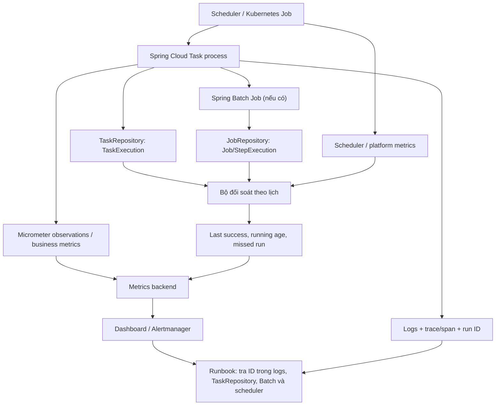

# Thiết kế nhãn số đo và cảnh báo theo lần chạy trong Spring Cloud Task

## 1. Bài toán: Một Task chạy vài phút mỗi ngày thì giám sát thế nào?

**Spring Cloud Task** dùng cho ứng dụng Spring Boot chạy trong thời gian hữu hạn: khởi động, nhận tham số, thực thi công việc và kết thúc. `TaskRepository` có thể lưu mỗi lần chạy thành một `TaskExecution`, gồm `taskName`, `startTime`, `endTime`, `exitCode`, `exitMessage` và thông tin lỗi. Task có thể chạy theo lịch, theo yêu cầu hoặc khởi chạy Spring Batch Job; trong sản xuất, nó thường được đóng gói thành một Kubernetes Job hoặc tiến trình ngắn hạn.

Hãy xét Task `invoice-import` chạy lúc 01:00 mỗi ngày:

- Hôm nay Task chạy 8 phút, kết thúc thành công.
- Ngày mai Job không khởi chạy vì lỗi của scheduler. Không có `TaskExecution` mới và cũng không có sự kiện thất bại từ ứng dụng.
- Ngày kế tiếp Task chạy 45 phút thay vì 8 phút; chưa lỗi nhưng đã vượt cam kết hoàn tất trước 02:00.
- Một lần khác Job bị kill vì hết bộ nhớ, TaskRepository chỉ còn `END_TIME IS NULL`, còn Kubernetes Pod có reason `OOMKilled`.
- Khi operator được gọi, họ cần biết **Task nào**, **lần chạy nào**, **lỗi gì** và **dữ liệu nào có thể đã được xử lý**, nhưng hệ metrics phải tránh tạo hàng triệu chuỗi thời gian.

Vì vậy, thiết kế quan sát không chỉ là “gắn ID vào mọi metric”. Ta cần kết hợp **metrics để phát hiện và cảnh báo theo nhóm ổn định**, **log/trace để truy vết một lần chạy cụ thể**, **TaskRepository/JobRepository để đối soát kết quả bền vững**, và **scheduler để phát hiện lịch bị bỏ lỡ**.

Sau bài học thuộc chương **Quan sát**, bạn có thể:

1. Chọn metric và nhãn phù hợp với Spring Cloud Task, kiểm soát **cardinality**.
2. Dùng mã `taskExecutionId`/`jobExecutionId` để tra cứu một lần chạy mà không biến chúng thành nhãn metric chi phí cao.
3. Thu thập metrics của tiến trình **ngắn hạn** bằng pipeline phù hợp.
4. Định nghĩa SLI/SLO, cảnh báo lỗi, quá thời gian, không chạy đúng lịch và mất tín hiệu telemetry.
5. Viết ví dụ Micrometer, PromQL, SQL đối soát và runbook xử lý sự cố.

## 2. Bốn nguồn dữ liệu bổ sung cho nhau



| Nguồn | Mạnh ở điểm nào? | Hạn chế cần nhớ |
| --- | --- | --- |
| **Micrometer metrics** | Đếm sự kiện, đo thời lượng, xu hướng, tạo cảnh báo số lượng lớn | Counter của tiến trình ngắn hạn có thể biến mất trước khi được scrape; nhãn ID gây tăng cardinality |
| **TaskRepository** | Lưu lịch sử từng `TaskExecution` để kiểm tra kết quả và thời gian | Nếu process chết rất sớm có thể không có bản ghi; `END_TIME IS NULL` không chứng minh process còn sống |
| **JobRepository của Spring Batch** | Theo dõi `JobExecution`, `StepExecution`, số item đọc/ghi/skip, checkpoint | Batch `FAILED` không tự đảm bảo Task báo mã thoát khác 0 |
| **Log/trace** | Truy nguyên lần chạy cụ thể, truy vấn bằng ID, xem exception và phụ thuộc | Không thay thế SLI tổng hợp; phải che thông tin nhạy cảm và đặt retention |
| **Scheduler/Kubernetes** | Biết lịch đáng lẽ phải chạy, Pod có thực sự được tạo, mã thoát và kill reason | Không hiểu đầy đủ thành công nghiệp vụ nếu ứng dụng nuốt lỗi |

**Quan sát phải theo cả hai hướng:** từ alert tổng hợp tìm được **một lần chạy**; từ `TaskExecutionId` tìm được log, trace, JobExecution liên quan và kết quả thực tế.

## 3. Các observation tích hợp sẵn của Spring Cloud Task

Spring Cloud Task tích hợp **Micrometer Observation**. Khi ứng dụng có Spring Boot Actuator, Micrometer registry phù hợp (và tracing bridge/exporter nếu cần), framework cung cấp các observation quanh vòng đời Task:

| Observation / tên logic | Loại | Ý nghĩa |
| --- | --- | --- |
| `spring.cloud.task` | Timer | Thời lượng một lần thực thi Task |
| `spring.cloud.task.active` | Long task timer | Thời lượng đang hoạt động |
| `spring.cloud.task.runner` | Timer | Thời lượng gọi Task runner |
| `spring.cloud.task.runner.active` | Long task timer | Runner đang hoạt động |

Ở tài liệu observability của Spring Cloud Task, các key như `spring.cloud.task.name`, `spring.cloud.task.status` (success/failure), `spring.cloud.task.exit.code`, `spring.cloud.task.execution.id` và `spring.cloud.task.external.execution.id` xuất hiện trong bảng attributes của observation. Trên trace, ID thực thi có thể hữu ích; **trên metric backend, ID tăng sau mỗi lần chạy lại là giá trị high-cardinality**, dù tài liệu framework liệt kê nó trong nhóm key values của observation.

> **Nguyên tắc quan trọng:** “Key được framework cung cấp” không có nghĩa “nên đưa nguyên giá trị của key đó lên mọi series metrics trong production”. Xem xét số lần chạy, số môi trường, số nhánh lỗi, mức độ chi tiết histogram và ngân sách chuỗi thời gian của backend.

Các thuộc tính được thêm **sau khi observation bắt đầu** có thể không xuất hiện trên metric `*.active`. Vì vậy đừng suy ra chính xác kết quả cuối từ long task timer đang chạy; trạng thái cuối chỉ đáng tin khi vòng đời hoàn tất và repository đã ghi dữ liệu.

Tên metric sau khi xuất sang Prometheus có thể được **chuyển đổi cú pháp** (dấu chấm thành dấu gạch dưới, thêm hậu tố `_seconds`, `_count` hoặc `_sum` tùy meter). Ví dụ trong phần PromQL phía dưới dùng **tên metric custom được xác nhận trong pipeline minh họa**, không mặc định chúng có mặt chỉ vì đã thêm dependency Actuator.

### 3.1. Cấu hình dependency

Ví dụ Maven cho Task có Micrometer và xuất Prometheus, với BOM Spring Boot/Spring Cloud **đã được import trong dự án**:

```xml
<dependencies>
    <dependency>
        <groupId>org.springframework.cloud</groupId>
        <artifactId>spring-cloud-starter-task</artifactId>
    </dependency>
    <dependency>
        <groupId>org.springframework.boot</groupId>
        <artifactId>spring-boot-starter-actuator</artifactId>
    </dependency>
    <dependency>
        <groupId>io.micrometer</groupId>
        <artifactId>micrometer-registry-prometheus</artifactId>
        <scope>runtime</scope>
    </dependency>
</dependencies>
```

Với backend OTLP hoặc Influx, thay registry tương ứng theo BOM đang dùng. Nếu cần trace, thêm **Micrometer Tracing bridge** và exporter do stack OpenTelemetry/Zipkin hỗ trợ; chỉ có Actuator không đảm bảo span được gửi tới trace backend.

Không cần giữ HTTP server chạy mãi chỉ để bật `/actuator/prometheus` cho một Task. Endpoint pull-based chỉ phù hợp nếu tiến trình tồn tại đủ lâu hoặc có một exporter khác sống lâu hơn; phần 7 sẽ giải thích cách xuất metrics cho các Job ngắn.

## 4. Thiết kế nhãn: nhãn thấp cardinality, định danh ở nơi khác

**Cardinality** là số tổ hợp nhãn khác nhau mà một metric tạo ra. Ví dụ:

```text
task_name: 12 giá trị
environment: 3 giá trị
outcome: 3 giá trị
failure_class: 6 giá trị

Tối đa lý thuyết: 12 x 3 x 3 x 6 = 648 tổ hợp metric.
Nếu thêm task_execution_id mới ở mỗi lần chạy (100.000 giá trị)
thì khả năng tạo series tăng lên rất lớn.
```

Nếu metric là histogram có nhiều bucket, tổng số series còn tăng theo mỗi bucket. Số series thực còn chịu ảnh hưởng tập nhãn hợp lệ, phiên bản ứng dụng, namespace và cách backend lưu metadata. Bởi vậy, **không biến ID từng lần chạy thành nhãn** chỉ để đặt link trên dashboard.

### 4.1. Bảng phân loại tag

| Tag/thuộc tính | Đưa vào metric? | Lý do / vị trí thay thế |
| --- | --- | --- |
| `task_name` | **Có, nếu tên ổn định và được quản lý** | Giúp so sánh các loại Task; tránh đặt tên chứa UUID hoặc ngày |
| `environment` | Có | Tập nhỏ như `dev`/`staging`/`production` |
| `outcome` | Có | Enum giới hạn `success`/`failure`/`unknown` |
| `failure_class` | Có, khi chuẩn hóa | Tập nhỏ như `input`/`database`/`downstream`/`timeout`/`other` |
| `worker_role` / `component` | Có nếu tập hữu hạn | `manager`/`worker` hoặc tên bước ổn định |
| `region` | Có khi thực sự cần | Chỉ khi số region được quản lý |
| `exit_code` | Cẩn trọng | Nếu mã khác nhau nhiều, nên gộp thành `outcome` hoặc nhóm lỗi |
| `task_execution_id` | **Không** | Log/trace, TaskRepository, URL drill-down |
| `job_execution_id` / `step_execution_id` | **Không** | Log/trace, JobRepository |
| `external_execution_id` / `trace_id` / `span_id` | **Không** | Tracing hoặc log có cấu trúc |
| `pod_name` / `container_id` | Không ở custom metrics nghiệp vụ | Dùng Kubernetes metadata/log; telemetry hạ tầng có nhãn riêng |
| `tenant_id` / `customer_id` / `order_id` | Thường không | Cardinality, bảo mật và phân quyền; dùng dữ liệu nghiệp vụ |
| `business_date` hoặc timestamp cụ thể | Không | Mỗi ngày tạo nhãn mới; dùng thời gian mẫu/metadata |
| `exception_message` / `error_message` | **Không** | Giá trị không giới hạn và có thể chứa thông tin nhạy cảm |

Mỗi tag phải có **từ điển giá trị hữu hạn và owner quản lý**. Một label `task_name` động kiểu `invoice-import-20261124-4812` là high-cardinality dù tên key trông an toàn.

### 4.2. Giữ các observation của framework khỏi làm tăng series

Micrometer hỗ trợ `MeterFilter.ignoreTags(...)` để bỏ những tag không nên gửi vào metrics registry. Ví dụ cấu hình một chính sách **loại ID riêng từng lần thực thi**:

```java
package com.example.observability;

import io.micrometer.core.instrument.config.MeterFilter;
import org.springframework.context.annotation.Bean;
import org.springframework.context.annotation.Configuration;

@Configuration(proxyBeanMethods = false)
public class TaskMetricTagPolicy {

    @Bean
    MeterFilter dropPerRunIdsFromMetrics() {
        return MeterFilter.ignoreTags(
            "spring.cloud.task.execution.id",
            "spring.cloud.task.external.execution.id",
            "spring.cloud.task.parent.execution.id"
        );
    }
}
```

`MeterFilter` chỉ biến đổi **metrics** trên registry được áp dụng, không xóa ID khỏi TaskRepository và không phải bộ lọc PII cho logs/traces. Cấu hình ở trên có phạm vi toàn registry; chỉ dùng khi đã xác minh các key bị loại không được metric nào khác sử dụng như một nhãn có giá trị quan trọng. Với trường hợp cần giữ nguyên observability của framework để tương thích, có thể xây **ObservationConvention** riêng hoặc lọc ở collector/backend, nhưng phải kiểm tra API đúng phiên bản.

Sau khi triển khai, kiểm tra endpoint/export output để xác nhận **không còn series theo `taskExecutionId` hoặc `externalExecutionId`**. Chỉ cấu hình filter nhưng không đo số series thực là chưa đủ.

## 5. Hợp đồng metric tùy chỉnh dành cho Task hữu hạn

Ngoài observation tự động, ứng dụng có thể định nghĩa metric **nghiệp vụ** có nhãn ổn định. Tên sau đây là **quy ước ví dụ**, không phải tên metric do Spring Cloud Task tự sinh:

| Tên logic trong Micrometer | Kiểu | Tags đề xuất | Cách hiểu |
| --- | --- | --- | --- |
| `batch_task_runs` | Counter | `task_name`, `environment`, `outcome`, `failure_class` | Số lần runner đã vào nhánh kết thúc được code ghi nhận |
| `batch_task_business_duration` | Timer | Cùng tập tags hữu hạn | Thời gian thực thi nghiệp vụ được đo trong runner |
| `batch_task_records_processed` | Counter | `task_name`, `environment`, `result` | Số bản ghi đã xử lý/ghi theo quy tắc nghiệp vụ |
| `batch_task_last_success_timestamp_seconds` | Gauge **được tổng hợp từ trạng thái bền vững** | `task_name`, `environment` | Unix timestamp của lần thành công gần nhất |
| `batch_task_last_finish_timestamp_seconds` | Gauge từ kho bền vững | `task_name`, `environment` | Unix timestamp của lần kết thúc gần nhất |
| `batch_task_running_age_seconds` | Gauge từ bộ đối soát | `task_name`, `environment` | Tuổi của lần chạy đang thực sự hoạt động, có đối chiếu scheduler |
| `batch_task_expected_run_timestamp_seconds` | Gauge từ lịch | `task_name`, `environment` | Mốc lịch chạy tiếp theo hoặc gần nhất theo định nghĩa |

**Phân biệt nguồn đo:** ba metric đầu có thể được tạo bởi code đang chạy, nhưng nếu tiến trình quá ngắn, exporter có thể không kịp thu thập. Bốn gauge còn lại nên đến từ **dịch vụ giám sát sống lâu** đọc TaskRepository và lịch, không phải gauge nằm trong JVM biến mất sau vài giây.

Đối với counter, một tên Micrometer `batch_task_runs` khi export sang Prometheus thường xuất hiện dạng `batch_task_runs_total`. Timer `batch_task_business_duration` có thể tạo `batch_task_business_duration_seconds_count` và `..._sum`. Hãy **kiểm tra tên thực** sau export trước khi dùng PromQL.

### 5.1. Định nghĩa outcome và failure_class

| Giá trị | Định nghĩa |
| --- | --- |
| `outcome=success` | Runner kết thúc bình thường và bước nghiệp vụ đạt điều kiện đã quy định |
| `outcome=failure` | Runner ném lỗi và tín hiệu được truyền lên lifecycle |
| `outcome=unknown` | Chưa đủ bằng chứng để khẳng định thành công/thất bại (thường do bộ đối soát gán) |
| `failure_class=none` | Không có lỗi |
| `failure_class=input` | Tham số, định dạng dữ liệu đầu vào không hợp lệ |
| `failure_class=database` | Kết nối, timeout hoặc xử lý dữ liệu ở DB |
| `failure_class=downstream` | API/broker/hệ phụ thuộc không sẵn sàng |
| `failure_class=timeout` | Quá giới hạn thời gian đã định nghĩa |
| `failure_class=other` | Lỗi khác, không phát sinh nhãn mới cho từng exception |

Nếu Batch Job bên trong runner có `BatchStatus.FAILED` nhưng code nuốt lỗi và trả về bình thường, metric được ghi nhận ở runner có thể là `success` **sai nghiệp vụ**. Cần chuyển trạng thái Batch Job lên Task (ví dụ cấu hình `spring.cloud.task.batch.fail-on-job-failure=true` trong trường hợp tích hợp được hỗ trợ, hoặc kiểm tra `JobExecution.status` và ném lỗi ở runner).

## 6. Ví dụ Java Micrometer: nhãn ổn định trong ApplicationRunner

Ví dụ dưới đây dùng Java 17+, Spring Boot và Spring Cloud Task tương thích. Nó đo **phần xử lý bên trong runner**, không phải toàn bộ thời gian khởi động JVM. Các nhãn dùng tập nhỏ; ID lần chạy sẽ được log riêng.

```java
package com.example.invoice;

import java.time.LocalDate;

import io.micrometer.core.instrument.MeterRegistry;
import io.micrometer.core.instrument.Tags;
import io.micrometer.core.instrument.Timer;
import org.slf4j.Logger;
import org.slf4j.LoggerFactory;
import org.springframework.boot.ApplicationRunner;
import org.springframework.boot.SpringApplication;
import org.springframework.boot.autoconfigure.SpringBootApplication;
import org.springframework.cloud.task.configuration.EnableTask;
import org.springframework.context.annotation.Bean;
import org.springframework.dao.DataAccessException;

@SpringBootApplication
@EnableTask
public class InvoiceTaskApplication {

    private static final Logger log =
        LoggerFactory.getLogger(InvoiceTaskApplication.class);

    public static void main(String[] args) {
        SpringApplication.run(InvoiceTaskApplication.class, args);
    }

    @Bean
    ApplicationRunner invoiceRunner(
            InvoiceImportService importer,
            MeterRegistry metrics) {
        return arguments -> {
            String taskName = "invoice-import"; // Tập tên ổn định.
            String environment = "production"; // Ví dụ; đọc từ cấu hình thật.
            String outcome = "success";
            String failureClass = "none";
            Timer.Sample sample = Timer.start(metrics);

            try {
                // Ngày nghiệp vụ phải lấy từ tham số đã validate ở bản thực.
                importer.importFor(LocalDate.of(2026, 11, 24));
            } catch (Exception ex) {
                outcome = "failure";
                failureClass = classify(ex);
                log.error(
                    "Invoice import failed; class={}",
                    failureClass,
                    ex
                );
                throw ex; // Giữ tín hiệu lỗi để Task/Kubernetes nhận biết.
            } finally {
                Tags tags = Tags.of(
                    "task_name", taskName,
                    "environment", environment,
                    "outcome", outcome,
                    "failure_class", failureClass
                );

                sample.stop(Timer.builder("batch_task_business_duration")
                    .description("Business processing time of a task run")
                    .tags(tags)
                    .register(metrics));

                metrics.counter("batch_task_runs", tags).increment();
            }
        };
    }

    private static String classify(Exception ex) {
        if (ex instanceof IllegalArgumentException) {
            return "input";
        }
        if (ex instanceof DataAccessException) {
            return "database";
        }
        return "other";
    }

    public interface InvoiceImportService {
        void importFor(LocalDate date) throws Exception;
    }
}
```

Lớp trên yêu cầu **một bean `InvoiceImportService` thực tế** của ứng dụng; không tự có code nhập hóa đơn, datasource hoặc schema. `LocalDate.of(2026, 11, 24)` chỉ là tham số mô phỏng. Khi đưa vào hệ thống thật, parse ngày từ `ApplicationArguments`, không hardcode và không đưa ngày vào metric label.

Các hạn chế có chủ đích:

1. Bộ đếm tăng khi **runner đi qua `finally`**. Nó không đếm được lỗi xảy ra trước runner (image pull, bootstrap Spring, thiếu Secret/DB) hoặc tiến trình bị kill bằng `SIGKILL`. Bộ đối soát bên ngoài phải lấp khoảng trống này.
2. Mã `outcome` dựa trên ngoại lệ của runner. Nếu code bắt rồi nuốt lỗi nghiệp vụ, metrics sẽ báo sai; đó là lỗi quy ước thành công của ứng dụng.
3. Timer không thay thế observation `spring.cloud.task` của framework: nó chỉ đo phạm vi `importer.importFor(...)` và phần code xung quanh trong runner.
4. Truyền `tags` là **bốn chiều hữu hạn**; `taskExecutionId`, exception message, tên file và `businessDate` không trở thành tag.
5. **Ghi meter trong JVM không bảo đảm meter được xuất ra khỏi tiến trình** trước khi JVM đóng. Phải chọn pipeline thích hợp như phần tiếp theo.

### 6.1. Ghi ID từng lần chạy vào log mà không tăng cardinality

Ví dụ `TaskExecutionListener` chỉ dùng để tạo log có cấu trúc; không sửa mã thoát hoặc thông điệp kết quả:

```java
package com.example.observability;

import org.slf4j.Logger;
import org.slf4j.LoggerFactory;
import org.springframework.cloud.task.listener.TaskExecutionListener;
import org.springframework.cloud.task.repository.TaskExecution;
import org.springframework.stereotype.Component;

@Component
public class TaskRunLogListener implements TaskExecutionListener {
    private static final Logger log =
        LoggerFactory.getLogger(TaskRunLogListener.class);

    @Override
    public void onTaskStartup(TaskExecution execution) {
        log.atInfo()
            .addKeyValue("task_execution_id", execution.getExecutionId())
            .addKeyValue("task_name", execution.getTaskName())
            .log("Task started");
    }

    @Override
    public void onTaskFailed(
            TaskExecution execution, Throwable error) {
        log.atError()
            .addKeyValue("task_execution_id", execution.getExecutionId())
            .addKeyValue("task_name", execution.getTaskName())
            .addKeyValue("error_class",
                error.getClass().getSimpleName())
            .setCause(error)
            .log("Task failed");
    }

    @Override
    public void onTaskEnd(TaskExecution execution) {
        log.atInfo()
            .addKeyValue("task_execution_id", execution.getExecutionId())
            .addKeyValue("task_name", execution.getTaskName())
            .log("Task end callback");
    }
}
```

`log.atInfo().addKeyValue(...)` là API SLF4J 2.x, có trong các stack Spring Boot hiện đại. Muốn trường key–value xuất ra JSON, backend Logback/Log4j2 và encoder/collector phải được cấu hình phù hợp. Đoạn code không cam kết mọi cấu hình console sẽ tự in key–value thành JSON.

**`onTaskEnd` chạy trước lúc metadata hoàn tất cuối được ghi**, nên log “Task end callback” không đồng nghĩa bản ghi repository đã có `endTime` cuối. Không dùng callback này để phát “đã commit xong toàn bộ kết quả” khi hệ thống cần chứng nhận giao dịch. Nếu phải xuất event audit bền vững, sử dụng outbox hoặc bộ đối soát độc lập.

## 7. Thu thập metrics từ Task ngắn hạn

Một Task chạy 4 giây có thể khởi động và kết thúc giữa hai lượt scrape Prometheus (thường vài chục giây). Vì vậy **chỉ mở Actuator endpoint là không đủ**. Có ba hướng chính:

| Hướng | Phù hợp khi | Điểm cần kiểm soát |
| --- | --- | --- |
| **Bộ đối soát TaskRepository → metrics** chạy liên tục | Muốn SLI bền vững cho Task theo lịch, bao gồm job không chạy hoặc process crash | Đối chiếu DB/scheduler, tránh đếm trùng, quản lý retention và độ trễ |
| **Prometheus Pushgateway** cho batch/service-level job | Task quá ngắn để scrape và số nhóm job được quản lý | Grouping key thấp cardinality, shutdown push, stale metrics, không biến counter reset thành cumulative toàn hệ thống |
| **OTLP/agent/collector** | Dùng hệ OpenTelemetry hoặc backend hỗ trợ push/export | Export/flush trước shutdown, retry/buffer, giới hạn overhead và không giả định đã nhận thành công |

### 7.1. Bộ đối soát bền vững là nền tảng cảnh báo theo lịch

Thiết kế một dịch vụ **chạy liên tục**:

1. Biết **lịch dự kiến** của mỗi Task từ scheduler hoặc registry cấu hình.
2. Định kỳ đọc `TaskRepository`, `JobRepository` nếu Task chạy Batch, và trạng thái Kubernetes/scheduler.
3. Chuẩn hóa mỗi lần chạy theo `(repository, taskExecutionId)`; nếu có nhiều TaskExecution do retry, ghi nhận attempt riêng.
4. Phát các **gauge** `last_success_timestamp_seconds`, `last_finish_timestamp_seconds`, `running_age_seconds` và metric tổng hợp có nhãn nhỏ.
5. Lưu watermark/offset bền vững nếu chuyển lịch sử thành counter, để không tăng lại sau mỗi lần polling hoặc khi exporter restart.
6. Khi cần điều tra, trả link theo `TaskExecutionId` vào dashboard/log, không đưa ID vào label series.

Ví dụ SQL truy vấn thống kê theo tên Task, giả định schema JDBC mặc định:

```sql
SELECT
    TASK_NAME,
    COUNT(*) AS TOTAL_RUNS,
    SUM(CASE
        WHEN END_TIME IS NOT NULL AND EXIT_CODE = 0 THEN 1
        ELSE 0
    END) AS SUCCEEDED_RUNS,
    SUM(CASE
        WHEN END_TIME IS NOT NULL AND EXIT_CODE <> 0 THEN 1
        ELSE 0
    END) AS FAILED_RUNS,
    MAX(CASE
        WHEN END_TIME IS NOT NULL AND EXIT_CODE = 0
        THEN END_TIME
        ELSE NULL
    END) AS LAST_SUCCESS_TIME,
    MAX(END_TIME) AS LAST_FINISH_TIME
FROM TASK_EXECUTION
WHERE TASK_NAME IN ('invoice-import', 'invoice-reconcile')
GROUP BY TASK_NAME;
```

**Trước khi xuất timestamp thành Unix seconds**, cần biết cột thời gian trong DB đang theo timezone nào. `LocalDateTime` không tự mang offset; không được tự thêm `Z` rồi coi là UTC nếu không có quy ước lưu rõ ràng.

Query trên **không phát hiện lần không khởi chạy** nếu không biết lịch dự kiến, và có thể thiếu lỗi chưa có `END_TIME`. Cần đối chiếu scheduler, timeout và trạng thái Pod. Với Job Batch, xem thêm `BATCH_JOB_EXECUTION.STATUS` để không đánh dấu thành công sai khi Batch Job failed nhưng Task exit code vẫn bằng `0` do cấu hình.

### 7.2. Pushgateway: đẩy số liệu khi kết thúc

Spring Boot Actuator có hỗ trợ Prometheus Pushgateway khi dùng registry và dependency phù hợp. Ví dụ bổ sung dependency Maven theo Spring Boot hiện đại:

```xml
<dependency>
    <groupId>io.prometheus</groupId>
    <artifactId>prometheus-metrics-exporter-pushgateway</artifactId>
</dependency>
```

Ví dụ cấu hình **minh họa**:

```yaml
management:
  prometheus:
    metrics:
      export:
        pushgateway:
          enabled: true
          address: pushgateway.monitoring.svc:9091
          job: invoice_import
          grouping-key:
            environment: production
          push-rate: 1m
          shutdown-operation: push
```

`shutdown-operation: push` cho phép cố gắng push khi context đóng theo cách bình thường; mặc định Spring Boot thường là `none`. Phần cấu hình trên chưa bao gồm bảo mật mạng/TLS, Service DNS và registry dependencies; không dùng nguyên xi trong production.

**Cảnh báo riêng với Pushgateway:**

- Đừng đưa `taskExecutionId`, Kubernetes Pod UID hoặc timestamp vào **grouping key**. Mỗi lần chạy sẽ tạo nhóm mới khó dọn, khiến số series tăng liên tục.
- Nhóm `(job=invoice_import, environment=production)` là nhóm ổn định. Hai lần chạy chồng nhau có thể **ghi đè dữ liệu cùng grouping key**; cần phối hợp retry/locking hoặc xuất tổng hợp từ repository.
- Pushgateway **giữ** metric cũ cho tới khi bị thay hoặc xóa theo quản trị; metric đang hiện diện **không chứng minh Task vừa chạy**. Phải có gauge thời điểm thành công hoặc bộ đối soát lịch.
- Một Counter tích lũy trong JVM **reset về 0 khi Pod mới khởi động**. Nếu mỗi Pod đẩy counter của riêng nó rồi ghi đè cùng group, `increase(...)` trên chuỗi đó **không còn phản ánh chính xác tổng lượt chạy dài hạn**. Muốn có counter toàn hệ thống, hãy tổng hợp bền vững từ TaskRepository/sự kiện với dedup, hoặc dùng một metrics backend có thiết kế phù hợp.
- `SIGKILL`, `OOMKilled` hoặc mất mạng có thể khiến không có shutdown push. Pipeline đối soát vẫn phải phát hiện lỗi từ Kubernetes/TaskRepository.

Không dùng `Pushgateway` thay thế cơ chế audit hoặc hàng đợi sự kiện có bảo đảm. Nếu cần duy trì “lần thành công gần nhất” qua hàng trăm lượt chạy, một **dịch vụ monitor sống lâu** tạo gauge từ nguồn dữ liệu bền vững thường dễ kiểm chứng hơn.

### 7.3. Với OTLP/Collector, phải tính thời gian export

Micrometer OTLP registry có thể gửi dữ liệu tới OpenTelemetry Collector/backend; tracing qua Micrometer Tracing bridge cần được cấu hình riêng. Registry dạng **step/periodic export** có chu kỳ gửi; Task chạy quá ngắn có thể kết thúc trước lượt export định kỳ.

Trước khi dùng cho metric “mỗi lần chạy”, hãy kiểm chứng:

1. Registry/exporter có **flush hoặc publish lần cuối khi shutdown** trong version đã chốt không.
2. Timeout, retry và cách xử lý export thất bại khi network/Collector không sẵn sàng.
3. Collector có buffer đủ lâu và không mất mẫu khi Pod biến mất.
4. Cấu hình sampling của trace không được hiểu nhầm là tần suất đếm metric.
5. Bộ đối soát từ database/scheduler vẫn cần cho trường hợp Task **không khởi chạy**.

## 8. Chọn SLI/SLO cho Task chạy theo lịch

Một Task “mỗi ngày chạy thành công” cần định nghĩa thành công bằng **kết quả và thời hạn**, không chỉ bằng sự tồn tại của metric.

| SLI | Câu hỏi vận hành | Nguồn dữ liệu phù hợp |
| --- | --- | --- |
| **Success rate** | Trong N lần chạy đã kết thúc, bao nhiêu lần thành công? | `TaskRepository` + `Batch JobRepository`, exporter tổng hợp |
| **Freshness / last success** | Bao lâu rồi chưa có lần thành công? | Gauge từ TaskRepository, có đối chiếu lịch |
| **Deadline compliance** | Task có hoàn tất trước giờ cam kết không? | Scheduler expected time + thời gian kết thúc bền vững |
| **Runtime** | Mỗi lần chạy mất bao lâu? Có vượt ngưỡng không? | Timer + `startTime`/`endTime` và timestamp ở scheduler |
| **Stuck run** | Task đang chạy có vượt timeout hợp lệ? | Bộ đối soát Pod/Job + TaskRepository |
| **Data completeness** | Có đủ N bản ghi hay batch đã bỏ qua nhiều dữ liệu? | Metric nghiệp vụ, Batch read/write/skip counts |
| **Telemetry integrity** | Mất log/metric/event export hay ứng dụng chưa chạy? | Monitoring pipeline và scheduler độc lập |

Ví dụ SLO **giả định**, không phải mặc định Spring Cloud Task:

- `invoice-import` có lịch 01:00 hằng ngày theo múi giờ vận hành đã thống nhất.
- **99% lịch chạy trong 30 ngày** phải hoàn tất thành công trước 02:00.
- Mọi lần chạy hợp lệ phải có thời gian thực thi nhỏ hơn **40 phút**.
- Nếu không có lần thành công mới trong **26 giờ**, phát cảnh báo. Ngưỡng lớn hơn 24 giờ là biên dự phòng cho trễ lịch và kiểm tra lại, không phải quy tắc chung.

**Success rate trong các lần đã chạy không phát hiện lịch bị bỏ lỡ.** Nếu một Task cả tuần không khởi chạy, mẫu số bằng 0; dashboard lỗi bằng 0 chưa có nghĩa hệ thống khỏe. Phải có SLI riêng dựa trên **expected schedule**.

### 8.1. Phân biệt run và attempt

Một Kubernetes Job có thể tạo nhiều Pod vì `backoffLimit`. Từng Pod khởi chạy ứng dụng có thể tạo một `TaskExecution` riêng. Nếu scheduler có retry ở cấp lịch, còn có nhiều Kubernetes Job cho **một kỳ nghiệp vụ**.

Trước khi đếm tỷ lệ thành công, định nghĩa đơn vị:

- **Attempt-level:** tỷ lệ TaskExecution thành công trên tất cả TaskExecution đã kết thúc.
- **Scheduled-run-level:** với mỗi kỳ lịch/`businessDate`, có **ít nhất một kết quả hoàn tất hợp lệ** trước deadline hay không.
- **Job-level:** một Batch JobInstance có được hoàn tất theo chính sách restart không.

Khi có retry, attempt-level có thể hiển thị nhiều lỗi nhưng scheduled-run-level vẫn đạt SLO; ngược lại, một attempt thành công sau deadline vẫn có thể vi phạm SLO về thời hạn.

Nếu muốn alert “theo lần chạy”, dùng **correlation ID** như `(environment, task_name, scheduled_time, business_key)` trong kho dữ liệu vận hành để gom attempt, nhưng không dùng các giá trị có cardinality cao đó làm label Prometheus.

## 9. Ví dụ cảnh báo Prometheus / Alertmanager

Các rule dưới đây giả định hệ thống đã có **một exporter sống lâu** phát các series:

- `batch_task_last_success_timestamp_seconds` (gauge từ TaskRepository),
- `batch_task_runs_total` (counter **tích lũy bền vững**, không phải counter reset theo Pod),
- `batch_task_running_age_seconds` (gauge từ scheduler + repository).

Chúng **không xuất hiện tự động** khi chỉ thêm `spring-cloud-starter-task` hoặc code ApplicationRunner ở mục 6. Trước khi áp dụng, kiểm tra trên Prometheus UI rằng tên metric, labels và dữ liệu mẫu thực sự tồn tại.

### 9.1. Không có lần thành công mới quá ngưỡng

```yaml
groups:
  - name: batch-task-alerts
    rules:
      - alert: InvoiceImportLastSuccessTooOld
        expr: |
          time() -
          batch_task_last_success_timestamp_seconds{
            task_name="invoice-import",
            environment="production"
          } > 93600
        for: 10m
        labels:
          severity: warning
          service: billing-batch
        annotations:
          summary: "Invoice import chưa thành công trong hơn 26 giờ"
          description: "Tra lịch dự kiến, TaskRepository, Kubernetes Job và lần chạy cuối."
```

`93600` giây bằng 26 giờ. Rule này dựa trên thời gian thành công gần nhất **đã được exporter kiểm chứng**. Nó không phản ánh riêng nguyên nhân: Job chưa khởi chạy, đang chậm hay đã thất bại.

**Nếu series không tồn tại, biểu thức phép trừ không trả về giá trị cho chuỗi đó và cảnh báo này không tự nổ.** Vì vậy cần rule riêng kiểm tra thiếu series, đồng thời xác định grace period cho Task mới được onboard.

### 9.2. Thiếu metric của Task quan trọng

```yaml
groups:
  - name: batch-task-telemetry
    rules:
      - alert: InvoiceImportSuccessMetricMissing
        expr: |
          absent(
            batch_task_last_success_timestamp_seconds{
              task_name="invoice-import",
              environment="production"
            }
          ) == 1
        for: 15m
        labels:
          severity: warning
        annotations:
          summary: "Không có dữ liệu last-success của invoice-import"
          description: "Kiểm tra exporter, datasource, quyền truy cập, retention và quá trình onboarding."
```

Rule `absent(...)` giúp phát hiện telemetry chưa hiện diện; **nó không đủ để kết luận Task thất bại**. Nếu exporter ngừng hoạt động nhưng sample cũ vẫn được lưu ở hệ push hoặc được scrape từ một gateway khác, việc kiểm tra freshness/timestamp và health exporter cũng cần riêng.

### 9.3. Có lỗi mới trong một giờ

```promql
sum by (task_name, environment) (
  increase(batch_task_runs_total{
    task_name="invoice-import",
    environment="production",
    outcome="failure"
  }[1h])
) > 0
```

Biểu thức phù hợp **nếu counter đã được tổng hợp liên tục, bền vững và deduplicate**; không áp dụng máy móc cho counter của từng JVM được Pushgateway ghi đè khi Pod restart. Có thể dùng `for: 0m` để phát hiện sớm hoặc thay bằng cảnh báo dựa trên sự kiện TaskExecution FAILED ngay khi bộ đối soát ghi nhận. Luật routing phải phân biệt lỗi input có thể xử lý thủ công với sự cố hạ tầng cần page ngay.

### 9.4. Task đang chạy quá lâu

```promql
batch_task_running_age_seconds{
  task_name="invoice-import",
  environment="production"
} > 2400
```

`2400` giây bằng 40 phút. Gauge này phải được tính từ những lần thực sự **còn hoạt động** sau khi đối chiếu scheduler/Pod; chỉ lấy `END_TIME IS NULL` có thể báo Task “đang chạy” mãi sau khi Pod đã chết.

**Không dùng một p99 latency trong cửa sổ 5 phút để đánh giá một Job chỉ chạy một lần mỗi ngày**: mẫu quá ít, độ trễ bị thống kê sai. Với Task hiếm, thời gian chạy gần nhất và last-success freshness thường có ý nghĩa hơn histogram percentile ngắn hạn.

### 9.5. Nhóm cảnh báo và chống nhiễu

Nên group/routing theo **`task_name`, `environment` và mức nghiêm trọng**, không group theo `taskExecutionId`. Một Task thất bại có thể tạo hàng chục log/traces nhưng người trực vận hành chỉ cần một alert có runbook. Alertmanager có thể tự nhóm và hạn chế repeat; hệ thống audit lưu từng lần chạy để truy vết.

Đặt ngưỡng theo lịch và mức ảnh hưởng:

| Tình huống | Mức đề xuất (ví dụ) | Gợi ý hành động |
| --- | --- | --- |
| Job xử lý báo cáo hàng ngày không có thành công mới sau deadline | Critical nếu chặn báo cáo tài chính | Kiểm tra scheduler → TaskRepository → dữ liệu nghiệp vụ |
| Một attempt lỗi rồi retry thành công đúng hạn | Warning hoặc ghi nhận ticket | Điều tra xu hướng lỗi, tránh page lặp |
| Batch bỏ qua nhiều bản ghi hơn ngưỡng | Warning/Critical tùy ngưỡng nghiệp vụ | Kiểm tra skip count và dữ liệu đầu vào |
| Không có metric do exporter hỏng | Warning và cảnh báo monitoring | Khôi phục pipeline quan sát, không tự kết luận Task lỗi |
| Runtime vượt ngưỡng nhưng Job chưa hoàn tất | Warning sớm, Critical nếu gần deadline | Kiểm tra Pod, khóa DB, Batch Step và timeout |

## 10. Quy trình xử lý alert: từ nhãn chung tới lần chạy cụ thể

Một alert chỉ có `task_name=invoice-import` và `environment=production` vẫn đủ để **tìm đúng lần chạy** nếu dashboard/runbook biết cách tra repository.

### 10.1. SQL tra cứu lần chạy gần nhất

```sql
SELECT
    TASK_EXECUTION_ID,
    TASK_NAME,
    START_TIME,
    END_TIME,
    EXIT_CODE,
    EXIT_MESSAGE,
    CASE
        WHEN ERROR_MESSAGE IS NULL THEN 'NO'
        ELSE 'YES'
    END AS HAS_ERROR
FROM TASK_EXECUTION
WHERE TASK_NAME = :taskName
ORDER BY START_TIME DESC, TASK_EXECUTION_ID DESC;
```

Phân trang/giới hạn ở ứng dụng truy vấn, không trả toàn bộ lịch sử. `EXIT_MESSAGE` và `ERROR_MESSAGE` có thể chứa chi tiết nội bộ; dashboard chung nên hiển thị mã lý do đã chuẩn hóa, còn stack trace yêu cầu quyền truy cập phù hợp.

### 10.2. Đối chiếu với Batch và scheduler

Nếu Task dùng Spring Batch và cấu hình liên kết metadata, có thể truy vấn:

```sql
SELECT
    t.TASK_EXECUTION_ID,
    t.EXIT_CODE AS TASK_EXIT_CODE,
    b.JOB_EXECUTION_ID,
    j.STATUS AS BATCH_STATUS,
    j.EXIT_CODE AS BATCH_EXIT_STATUS
FROM TASK_EXECUTION t
JOIN TASK_TASK_BATCH b
  ON b.TASK_EXECUTION_ID = t.TASK_EXECUTION_ID
JOIN BATCH_JOB_EXECUTION j
  ON j.JOB_EXECUTION_ID = b.JOB_EXECUTION_ID
WHERE t.TASK_EXECUTION_ID = :taskExecutionId;
```

**`BATCH_JOB_EXECUTION.EXIT_CODE` chứa chuỗi `ExitStatus`, còn `TASK_EXECUTION.EXIT_CODE` là mã số**. Nếu Batch Job `FAILED` mà Task exit code `0`, kiểm tra cơ chế truyền kết quả Batch lên Task. Bảng `TASK_TASK_BATCH` chỉ hữu ích khi tích hợp metadata Batch–Task thực sự được cấu hình.

### 10.3. Runbook ngắn

1. **Xác nhận alert và thời gian dự kiến:** lịch Task, timezone, deadline, đợt chạy được yêu cầu hay chạy theo lịch.
2. **Kiểm tra scheduler/Kubernetes Job:** có Job/Pod nào được tạo không? Pod đang chạy, `Failed`, `OOMKilled` hay `DeadlineExceeded`?
3. **Tra TaskRepository:** có `TaskExecution` cho attempt mới không? `END_TIME` còn null do đang chạy hay tiến trình đã chết?
4. **Tra Batch JobRepository:** nếu có Job/Step, xem `BatchStatus`, `ExitStatus`, checkpoint và số item được xử lý.
5. **Dùng ID drill-down:** từ `taskExecutionId`, `externalExecutionId`, `jobExecutionId` hoặc trace ID để mở log/trace chính xác. Không tìm bằng business date mơ hồ nếu đã có ID.
6. **Xác minh side effects:** có bản ghi, file hoặc thông điệp đã được commit/gửi chưa? Không retry khi tiến trình cũ vẫn còn ghi dữ liệu.
7. **Phân loại lỗi và quyết định chạy lại:** retry có backoff khi lỗi tạm thời; sửa input khi lỗi dữ liệu; dùng Batch restart và idempotency để tránh lặp xử lý.
8. **Đối soát telemetry:** nếu Task đã thành công nhưng alert vẫn nổ, kiểm tra exporter, Pushgateway, metric freshness và đường scrape.

## 11. Khi quan sát dữ liệu không khớp thực tế

| Triệu chứng | Giải thích có thể | Khắc phục |
| --- | --- | --- |
| Không có metric sau một Job 2 giây | JVM dừng trước lượt scrape/export | Dùng DB reconciler, push khi shutdown hoặc collector phù hợp |
| `batch_task_runs_total` giảm đột ngột | Counter reset vì Pod/JVM mới hoặc bị Pushgateway thay thế | Không dùng counter per-Pod làm tổng bền vững; chuyển qua aggregator |
| Rất nhiều series `spring_cloud_task...` | Tag execution ID/pod/business date tăng liên tục | Filter tag high-cardinality, đo cardinality thật |
| Task có `END_TIME IS NULL` hàng ngày | Process bị kill trước lúc hoàn tất hoặc repository không cập nhật | Đối chiếu scheduler; cảnh báo orphan/incomplete theo policy |
| Job Batch `FAILED` nhưng metric `outcome=success` | Runner nuốt lỗi hoặc chưa truyền trạng thái Batch | Sửa mapping Batch→Task, đối soát metadata |
| Dashboard báo last success mới dù job không chạy hôm nay | Pushgateway giữ gauge cũ hoặc exporter sai timezone | Đối chiếu expected schedule và thời điểm trong DB |
| Alert lỗi nhưng không có log | Pod bị xóa, log retention quá ngắn hoặc logging không có correlation | Gửi log tập trung, gắn execution ID, điều chỉnh retention |
| Gửi metric làm Task thất bại | Instrumentation/exporter ném lỗi vào nghiệp vụ | Thiết kế best-effort ở luồng quan sát; audit bắt buộc dùng outbox |
| Timer hoạt động nhưng thời lượng rất thấp | Chỉ đo runner, không tính startup hoặc Job bất đồng bộ | Xác định phạm vi Timer, bảo đảm đợi công việc hoàn tất |
| SLO vẫn xanh khi không có run | Chỉ tính success rate của các lần đã chạy | Thêm alert missed schedule/last-success freshness |

### An toàn và riêng tư

ID từng lần chạy tuy không nên ở metric label nhưng vẫn có thể là dữ liệu cần kiểm soát quyền truy cập trong logs, traces và TaskRepository. Không in password, token, thông tin khách hàng hoặc toàn bộ CLI arguments. Khi tạo link drill-down, dùng quyền truy cập theo môi trường/tenant và tránh đưa ID bí mật vào URL công khai. Áp dụng retention riêng cho metrics, logs, traces, metadata Task và dữ liệu nghiệp vụ.

## 12. Bài tập thực hành

### Bài 1 — Tính cardinality

Giả sử có 20 Task, 3 môi trường, 3 outcome và 6 failure_class. Hãy tính số tổ hợp tối đa cho một metric; sau đó thêm `taskExecutionId` với 50.000 lượt chạy và giải thích vì sao chi phí tăng mạnh. Thiết kế lại bảng nhãn chỉ gồm các giá trị hữu hạn.

### Bài 2 — Cấu hình Micrometer

Tạo Task Java có `ApplicationRunner` và một bean `MeterFilter.ignoreTags` loại `spring.cloud.task.execution.id` cùng ID bên ngoài khỏi metrics. Xác nhận trong exporter rằng các series chỉ có `task_name`, `environment`, `outcome`, `failure_class` và các nhãn hạ tầng hợp lý.

### Bài 3 — Task không được chạy

Task có lịch 01:00 mỗi ngày nhưng hôm nay scheduler không tạo Job. Vì sao `increase(batch_task_runs_total{outcome="failure"}[24h])` có thể bằng 0 dù hệ thống vi phạm SLO? Hãy đề xuất alert dựa trên `last_success_timestamp_seconds` và expected schedule.

### Bài 4 — Retry ba lần

Một Kubernetes Job tạo ba Pod attempt: hai lần đầu thất bại, lần ba thành công trước deadline. Hãy so sánh SLI attempt-level và scheduled-run-level; đếm đúng số TaskExecution và xác định cách liên kết về một kỳ nghiệp vụ.

### Bài 5 — Pushgateway và dữ liệu cũ

Cho một Task push metric với grouping key `(job, environment)`. Task hôm sau không chạy. Vì sao metric vẫn có thể tồn tại trong Pushgateway? Thiết kế gauge last-success có nguồn bền vững và cảnh báo thiếu lịch.

### Bài 6 — Điều tra lỗi Batch

Một Batch Job trong Task có `BatchStatus.FAILED`, nhưng TaskRepository ghi `EXIT_CODE=0`. Dùng SQL và log tìm nguyên nhân, sửa cơ chế truyền lỗi và kiểm chứng counter `outcome` phản ánh đúng lần chạy sau.

### Câu hỏi tự đánh giá

1. Khi nào nên đặt `taskExecutionId` vào log/trace nhưng không nên đặt vào metric tags?
2. Vì sao `spring.cloud.task.active` không bảo đảm có mọi tag chỉ được xác định khi Task kết thúc?
3. `TaskExecution.END_TIME IS NULL` có đủ để kết luận Pod còn đang chạy không?
4. Tại sao counter trong JVM của một Kubernetes Job ngắn hạn không tương đương tổng lượt chạy bền vững?
5. Khác nhau giữa cảnh báo “có lỗi mới” và “không có thành công đúng lịch” là gì?
6. Muốn alert theo từng lần chạy nhưng không tăng cardinality, cần đặt correlation ID ở những kho nào?
7. Vì sao cảnh báo dùng `time() - last_success` cần thêm cảnh báo `absent(...)`?
8. Khi nào nên page ngay và khi nào chỉ nên tạo warning/ticket?

**Tiêu chí hoàn thành:** Bạn có thể lập bảng metric/tag có cardinality kiểm soát được, đo runner bằng Micrometer, đưa execution ID vào log/trace và TaskRepository để drill-down, chọn cách export an toàn cho Task ngắn hạn, định nghĩa alert thất bại/quá hạn/mất lần chạy, và có runbook phân biệt lỗi nghiệp vụ với lỗi telemetry.

## Tài liệu tham khảo chính thức

- [Spring Cloud Task — Observability](https://docs.spring.io/spring-cloud-task/reference/observability.html): metric `spring.cloud.task`, `spring.cloud.task.active` và các observation tags.
- [Spring Cloud Task — Features](https://docs.spring.io/spring-cloud-task/reference/features.html): vòng đời `TaskExecution`, tích hợp Actuator/Micrometer và TaskRepository.
- [Spring Boot — Metrics](https://docs.spring.io/spring-boot/reference/actuator/metrics.html): Micrometer registries, Prometheus Pushgateway cho batch ngắn hạn.
- [Micrometer — Meter Filters](https://docs.micrometer.io/micrometer/reference/concepts/meter-filters.html): `ignoreTags`, giới hạn và biến đổi nhãn.
- [Prometheus — Instrumentation Best Practices](https://prometheus.io/docs/practices/instrumentation/): metrics phù hợp batch jobs và last-success time.
- [Prometheus — Pushing Metrics](https://prometheus.io/docs/instrumenting/pushing/): cách dùng Pushgateway và đặc điểm nhóm dữ liệu.
- [Prometheus — Alerting Rules](https://prometheus.io/docs/prometheus/latest/configuration/alerting_rules/): `expr`, `for`, labels và annotations.
- [Spring Batch — Reference Documentation](https://docs.spring.io/spring-batch/reference/): JobRepository, trạng thái Job/Step và xử lý restart.
