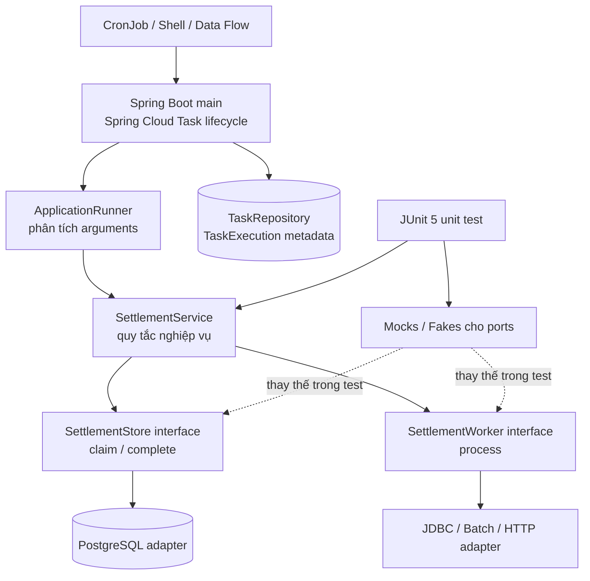

# Kiểm thử đơn vị dịch vụ nghiệp vụ độc lập với bộ chạy

## Mục tiêu học tập

Sau bài học, bạn có thể:

- Giải thích vì sao **dịch vụ nghiệp vụ** của ứng dụng Spring Cloud Task nên được kiểm thử mà **không cần khởi chạy `SpringApplication` hoặc `ApplicationRunner`**.
- Tách rõ trách nhiệm giữa lớp nhận tham số/bộ chạy, lớp thực thi quy tắc nghiệp vụ và các adapter truy cập database, HTTP, Spring Batch hoặc message broker.
- Viết unit test với **JUnit Jupiter (JUnit 5)** và **Mockito** để kiểm tra đường thành công, dữ liệu không hợp lệ, trạng thái đã xử lý, xử lý đồng thời và lỗi phụ thuộc.
- Dùng fake adapter trong bộ nhớ khi cần kiểm thử **trạng thái qua nhiều lời gọi**, thay vì phải luôn mock mọi tương tác.
- Chứng minh rằng exception quan trọng được **lan truyền**, không bị nuốt dẫn đến Task hoặc hệ điều hành báo thành công sai.
- Xác định giới hạn của unit test: không chứng minh được transaction JDBC, khóa database, cấu hình `@Transactional` proxy, `TaskRepository` hay mã thoát JVM.
- Lập ma trận kiểm thử nhiều tầng để bảo đảm Task chạy hữu hạn, lưu metadata đúng và có thể chạy lại an toàn khi kết hợp Spring Batch hoặc scheduler.

> **Ngữ cảnh:** Bài thuộc chương **Kiểm thử** của module **SPRING_CLOUD_TASK**. Một Spring Cloud Task là ứng dụng Spring Boot chạy trong thời gian hữu hạn, ghi thời gian, trạng thái và kết quả của mỗi lần chạy vào `TaskRepository`. Dù Task có thể chạy theo lịch hoặc yêu cầu, **quy tắc nghiệp vụ cốt lõi không nên phụ thuộc vào cách tiến trình được khởi chạy**. Nhờ đó, phần lớn hành vi có thể được kiểm tra nhanh, lặp lại được và không cần mở database hay tạo container.

## 1. Vấn đề: unit test không phải chạy cả ứng dụng Task

Xét một ứng dụng `daily-settlement-task` thực hiện đối soát giao dịch theo `businessDate` và `region`. Khi chạy thật:

1. Scheduler hoặc người vận hành gọi `java -jar daily-settlement-task.jar --business-date=2026-11-24 --region=apac`.
2. Spring Boot tạo `ApplicationContext` và Spring Cloud Task đăng ký `TaskExecution`.
3. `ApplicationRunner` phân tích hai tham số đầu vào.
4. `SettlementService` áp dụng quy tắc nghiệp vụ: chống xử lý lặp, thực hiện đối soát và ghi trạng thái hoàn tất.
5. Các adapter truy cập PostgreSQL, API bên ngoài hoặc Spring Batch Job.
6. Framework ghi kết quả Task nếu repository còn khả dụng; JVM kết thúc với exit code theo cấu hình.

Một unit test cho quy tắc “**nếu đợt đối soát đã hoàn tất thì không xử lý lại**” không cần thực hiện toàn bộ sáu bước. Nó chỉ cần tạo `SettlementService` cùng những phụ thuộc giả kiểm soát được và gọi phương thức nghiệp vụ trực tiếp.

### Tách tầng kiểm thử

| Loại kiểm thử | Đối tượng chính | Có cần Spring context? | Có cần database/broker? |
| --- | --- | --- | --- |
| **Unit test dịch vụ nghiệp vụ** | Hàm/phương thức và quy tắc nghiệp vụ. | **Không.** | **Không.** |
| Unit test `ApplicationRunner` | Chuyển tham số CLI thành yêu cầu nghiệp vụ; lan truyền lỗi. | Thường không. | Không. |
| Integration test adapter JDBC | SQL thật, transaction, constraint, locking và migration. | Có thể dùng Spring test context. | Thường có database test thật. |
| Integration test Spring Cloud Task | `TaskRepository`, `TaskExecution` và lifecycle. | Có. | Thường có database metadata. |
| End-to-end/process test | `main`, exit code JVM, Docker/Kubernetes và tương tác dịch vụ. | Có, ở process con. | Tùy hệ thống, thường có dịch vụ test. |

**Sai lầm phổ biến:** dùng `@SpringBootTest` cho mọi bài kiểm tra, rồi mỗi test lại chờ Spring Boot khởi tạo Task và kết nối database. Phương pháp này chậm, dễ bị ảnh hưởng cấu hình môi trường và khó xác định lỗi nằm trong quy tắc nghiệp vụ hay trong hạ tầng khởi chạy.

Unit test nên tập trung vào **hợp đồng đầu vào → quyết định nghiệp vụ → tương tác cần thiết/kết quả trả về**. Các tầng tích hợp còn lại được kiểm tra riêng chứ không bị bỏ qua.

## 2. Thiết kế: bộ chạy ở ngoài, dịch vụ ở giữa, hạ tầng ở rìa



Trong sơ đồ, **unit test** chỉ quan tâm `SettlementService` và các cổng phụ thuộc mà nó gọi. Nó không cần tạo `ApplicationRunner`, mở port HTTP, kết nối TaskRepository hoặc khởi tạo database.

### Phân trách nhiệm

| Thành phần | Nên chứa | Không nên chứa |
| --- | --- | --- |
| `main` / Spring Boot configuration | Bootstrap Spring, lifecycle, wiring bean, mã thoát tiến trình. | Quy tắc tính toán, trực tiếp gọi API cho từng giao dịch. |
| `ApplicationRunner` | Đọc và validate cú pháp arguments, chuyển thành `SettlementKey`, gọi service. | SQL, thuật toán idempotency, vòng lặp xử lý lớn, `System.exit` rải rác. |
| `SettlementService` | Quyết định được chạy/đã hoàn tất/đang chạy, điều phối nghiệp vụ, kiểm tra bất biến. | Phụ thuộc vào `ApplicationArguments`, `TaskExecution` hoặc tên Pod. |
| `SettlementStore` | Contract kiểm soát trạng thái và kết quả theo khóa nghiệp vụ. | Chi tiết Java/Spring của bộ chạy. |
| `SettlementWorker` | Contract thực hiện phần công việc đã xác định. | Logic phân tích tùy chọn CLI. |
| Adapter production | SQL, Spring Batch JobLauncher, HTTP client, transaction, retry kỹ thuật. | Quyết định thay service về quy tắc hoàn tất nghiệp vụ. |

**Nguyên tắc quan trọng:** `executionId` của Spring Cloud Task định danh **một lần chạy**, không định danh đợt đối soát. Khi scheduler retry, Task có thể có `executionId` mới nhưng vẫn xử lý `(businessDate, region)` cũ. Vì vậy service nên dùng **khóa nghiệp vụ** làm đơn vị idempotency, thay vì truyền `TaskExecution` qua toàn bộ code.

## 3. Bài toán mẫu: đối soát theo ngày và khu vực

Yêu cầu nghiệp vụ của ví dụ:

- Mỗi cặp `(businessDate, region)` chỉ có **một kết quả hoàn tất có hiệu lực**.
- Nếu chưa có lượt xử lý, service có thể giành quyền xử lý và yêu cầu worker chạy.
- Nếu đợt đối soát đã `COMPLETED`, gọi lại phải trả trạng thái đã hoàn tất **mà không thực thi lại tác động**.
- Nếu đợt đang được xử lý ở một worker khác, không được chạy trùng.
- Nếu worker lỗi hoặc không thể ghi trạng thái hoàn tất, service phải **không trả kết quả `COMPLETED` giả**.
- `processedCount` không thể âm.
- Tất cả hành vi trên phải kiểm thử được mà không tạo `ApplicationContext`.

Để đơn giản, ví dụ sử dụng **port** gồm một `SettlementStore` và một `SettlementWorker`. Khi triển khai thật, `SettlementStore.claim(...)` phải có tính **nguyên tử đối với các tiến trình đồng thời**, còn `SettlementWorker` phải được thiết kế xử lý lặp an toàn hoặc dựa vào checkpoint. Unit test không tự bảo đảm hai đặc tính hạ tầng này.

## 4. Mô hình miền: khóa và kết quả rõ ràng

### 4.1. Khóa nghiệp vụ

```java
package com.example.settlement.domain;

import java.time.LocalDate;
import java.util.Objects;

public record SettlementKey(LocalDate businessDate, String region) {

    public SettlementKey {
        Objects.requireNonNull(businessDate, "businessDate");
        Objects.requireNonNull(region, "region");
        if (region.isBlank()) {
            throw new IllegalArgumentException("region must not be blank");
        }
    }
}
```

`SettlementKey` là đối tượng Java đơn giản. Không có dependency Spring, `TaskExecution`, `JobExecution` hay dữ liệu CLI. Giá trị `LocalDate` ổn định trong unit test; không dùng `LocalDate.now()` khi chưa có lý do.

Với hệ thống sản xuất, nên thống nhất chuẩn hóa `region` (ví dụ lowercase, mã vùng có whitelist). Tránh để `APAC` và `apac` được xem là hai khóa khác nhau nếu nghiệp vụ coi chúng là một vùng.

### 4.2. Contract trạng thái cấp quyền xử lý

```java
package com.example.settlement.domain;

public enum ClaimResult {
    ACQUIRED,           // Được phép thực thi mới.
    ALREADY_COMPLETED,  // Đã có kết quả hợp lệ trước đó.
    IN_PROGRESS         // Có tiến trình khác đang giữ quyền xử lý.
}
```

```java
package com.example.settlement.domain;

public interface SettlementStore {

    ClaimResult claim(SettlementKey key);

    void complete(SettlementKey key, long processedCount);
}
```

**Ý nghĩa contract:** `claim(...)` trả về **kết quả của một quyết định nguyên tử**, không phải chỉ kết quả của một câu `SELECT` rồi sau đó mới `INSERT` không khóa. Các adapter production phải có unique constraint, locking/lease hoặc cơ chế tương đương phù hợp.

`complete(...)` chỉ được gọi sau khi worker trả kết quả hợp lệ; nó phải từ chối việc hoàn tất sai quyền/sai trạng thái ở tầng hạ tầng. Unit test sẽ kiểm tra service **gọi đúng lúc**, còn integration test phải chứng minh SQL adapter giữ đúng contract dưới concurrency.

### 4.3. Contract thực hiện công việc

```java
package com.example.settlement.domain;

@FunctionalInterface
public interface SettlementWorker {

    long process(SettlementKey key);
}
```

Ở production, adapter có thể gọi PostgreSQL, Batch Job hoặc API bên ngoài. Trong unit test, chỉ cần một mock hoặc lambda trả số lượng bản ghi đã xử lý.

**Cẩn trọng:** Một worker đã gọi API thanh toán rồi timeout có thể không biết phía nhận đã thực hiện hay chưa. Đừng định nghĩa `process(...)` là idempotent chỉ vì method có tên đơn giản; phải thiết kế thêm idempotency key, retry policy và cơ chế đối soát theo hợp đồng API thực tế.

### 4.4. Kết quả có ngữ nghĩa

```java
package com.example.settlement.domain;

public enum SettlementStatus {
    COMPLETED,
    ALREADY_COMPLETED
}
```

```java
package com.example.settlement.domain;

public record SettlementResult(
        SettlementStatus status,
        long processedCount
) {}
```

Các ví dụ `public` trong bài nên đặt **mỗi kiểu vào một file `.java` riêng đúng tên kiểu** khi đưa vào dự án; không đặt nhiều `public` top-level types trong cùng một file.

`ALREADY_COMPLETED` là kết quả idempotent đã được xác minh trong store, không phải một mã exit code riêng của Spring Cloud Task. Tùy chính sách, runner có thể xem trường hợp này là thành công nghiệp vụ vì không cần làm gì thêm.

## 5. Viết `SettlementService` độc lập với bộ chạy

```java
package com.example.settlement.domain;

import java.util.Objects;

public final class SettlementService {

    private final SettlementStore store;
    private final SettlementWorker worker;

    public SettlementService(
            SettlementStore store,
            SettlementWorker worker) {
        this.store = Objects.requireNonNull(store, "store");
        this.worker = Objects.requireNonNull(worker, "worker");
    }

    public SettlementResult execute(SettlementKey key) {
        Objects.requireNonNull(key, "key");

        ClaimResult claim = Objects.requireNonNull(
                store.claim(key), "claim result");

        return switch (claim) {
            case ALREADY_COMPLETED ->
                    new SettlementResult(
                            SettlementStatus.ALREADY_COMPLETED, 0);

            case IN_PROGRESS ->
                    throw new IllegalStateException(
                            "Settlement is already in progress: " + key);

            case ACQUIRED -> {
                long count = worker.process(key);
                if (count < 0) {
                    throw new IllegalStateException(
                            "processedCount must be non-negative");
                }

                store.complete(key, count);
                yield new SettlementResult(
                        SettlementStatus.COMPLETED, count);
            }
        };
    }
}
```

Đặc điểm thuận lợi cho unit test:

1. Constructor nhận hai dependency theo interface; có thể truyền mock/fake vào trực tiếp.
2. Logic không gọi `SpringApplication.run(...)`, `System.exit(...)`, `TaskExplorer`, `JobRepository` hoặc SQL.
3. Không đọc đồng hồ thực, biến môi trường hay thông số scheduler; mọi dữ liệu cần thiết nằm trong `SettlementKey`.
4. Quy tắc ra quyết định được biểu diễn qua `ClaimResult` và `SettlementStatus`, dễ assert.
5. Exception từ `worker.process(...)` hoặc `store.complete(...)` **không bị nuốt**. Unit test có thể kiểm tra đúng đường lỗi.

### Một giới hạn cần nói rõ

Ví dụ trên **không có cơ chế release lease khi worker thất bại**, không có retry hoặc cleanup của `IN_PROGRESS`, và không có transaction chung giữa toàn bộ hai port. Đó là những quyết định cần thiết kế ở adapter/orchestration production: lease hết hạn, trạng thái `FAILED`, transaction boundaries, cách xác minh kết quả API ngoài và quyền chuyển trạng thái.

**Đừng coi class này là triển khai production hoàn chỉnh chỉ vì unit test đạt.** Mục tiêu bài là cho thấy core business service có thể được kiểm tra độc lập.

## 6. Wiring trong Spring chỉ là một lớp mỏng

Trong ứng dụng thật, Spring container có thể tạo `SettlementService` bằng cấu hình:

```java
package com.example.settlement.config;

import com.example.settlement.domain.SettlementService;
import com.example.settlement.domain.SettlementStore;
import com.example.settlement.domain.SettlementWorker;
import org.springframework.context.annotation.Bean;
import org.springframework.context.annotation.Configuration;

@Configuration(proxyBeanMethods = false)
public class SettlementConfiguration {

    @Bean
    SettlementService settlementService(
            SettlementStore store,
            SettlementWorker worker) {
        return new SettlementService(store, worker);
    }
}
```

Spring chỉ thực hiện **dependency injection**: chọn adapter `SettlementStore` và `SettlementWorker` mà ứng dụng đăng ký. Unit test có thể gọi `new SettlementService(fakeStore, fakeWorker)`; không cần khởi tạo bean từ `@Configuration` này.

### Runner chỉ làm việc ở biên

```java
package com.example.settlement.task;

import java.time.LocalDate;
import java.util.List;

import com.example.settlement.domain.SettlementKey;
import com.example.settlement.domain.SettlementService;
import org.springframework.boot.ApplicationArguments;
import org.springframework.boot.ApplicationRunner;
import org.springframework.stereotype.Component;

@Component
public final class SettlementRunner implements ApplicationRunner {

    private final SettlementService service;

    public SettlementRunner(SettlementService service) {
        this.service = service;
    }

    @Override
    public void run(ApplicationArguments args) {
        String date = requiredOption(args, "business-date");
        String region = requiredOption(args, "region");

        service.execute(new SettlementKey(
                LocalDate.parse(date), region));
    }

    private static String requiredOption(
            ApplicationArguments args, String name) {
        List<String> values = args.getOptionValues(name);
        if (values == null || values.size() != 1
                || values.get(0).isBlank()) {
            throw new IllegalArgumentException(
                    "Exactly one --" + name + "=value is required");
        }
        return values.get(0);
    }
}
```

Đây là một adapter **đầu vào**, không phải nơi quyết định có được xử lý lại hay không. Trong tình huống tham số sai, runner ném exception; trong tình huống nghiệp vụ lỗi, exception từ service được lan truyền ra ngoài runner. Điều này giúp tránh nguy cơ runner **bắt lỗi rồi chỉ ghi log**, khiến Task/process bị báo thành công sai.

Hàm `main` của ứng dụng Spring Cloud Task có thể sử dụng `SpringApplication.exit(context)` và `System.exit(code)` để trả mã thoát ra hệ điều hành, nhưng unit test của `SettlementService` **không nên gọi vào `main`**.

## 7. Dependency kiểm thử: JUnit 5 và Mockito

Ví dụ dùng Java 17+ và phong cách API Spring Boot 3.x. Nếu dự án dùng một Spring Boot/Spring Cloud release mới hơn, cần dùng BOM tương thích và kiểm tra JUnit/Mockito APIs của stack thực tế.

Trong Maven, ứng dụng đã có Spring Boot dependency management có thể thêm:

```xml
<dependency>
    <groupId>org.springframework.boot</groupId>
    <artifactId>spring-boot-starter-test</artifactId>
    <scope>test</scope>
</dependency>
```

`spring-boot-starter-test` thường cung cấp JUnit Jupiter, Mockito, AssertJ và các công cụ test khác theo BOM. Phần lớn unit test trong bài chỉ dùng JUnit Jupiter và Mockito; thêm starter test **không có nghĩa phải dùng `@SpringBootTest`**.

Ví dụ Gradle ở dự án Spring Boot có dependency management tương ứng:

```groovy
dependencies {
    testImplementation 'org.springframework.boot:spring-boot-starter-test'
}

tasks.named('test') {
    useJUnitPlatform()
}
```

Nếu dự án tự quản lý JUnit/Mockito thay vì Boot starter, cần khai báo test engine, `mockito-junit-jupiter` và dependency phù hợp. **Không trộn phiên bản thư viện ngẫu nhiên** nếu BOM của dự án đã quản lý chúng.

Cấu trúc thư mục gợi ý:

```text
src/main/java/com/example/settlement/
  domain/
    SettlementKey.java
    ClaimResult.java
    SettlementStore.java
    SettlementWorker.java
    SettlementStatus.java
    SettlementResult.java
    SettlementService.java
  config/
    SettlementConfiguration.java
  task/
    SettlementRunner.java

src/test/java/com/example/settlement/domain/
  SettlementServiceTest.java
  SettlementServiceFakeTest.java
```

Thư mục kiểm thử phản ánh package của unit cần kiểm tra. Không cần copy `Application.java` hoặc tạo Spring context cho từng test chỉ để instantiate `SettlementService`.

## 8. Unit test bằng Mockito: đường thành công

Sử dụng `@ExtendWith(MockitoExtension.class)` để JUnit tạo mock và inject vào service. Không sử dụng `@SpringBootTest`, `@MockBean` hay `@MockitoBean` vì bài kiểm tra này **không tạo Spring ApplicationContext**.

```java
package com.example.settlement.domain;

import java.time.LocalDate;

import org.junit.jupiter.api.Test;
import org.junit.jupiter.api.extension.ExtendWith;
import org.mockito.InOrder;
import org.mockito.InjectMocks;
import org.mockito.Mock;
import org.mockito.junit.jupiter.MockitoExtension;

import static org.junit.jupiter.api.Assertions.assertEquals;
import static org.mockito.Mockito.inOrder;
import static org.mockito.Mockito.verify;
import static org.mockito.Mockito.when;

@ExtendWith(MockitoExtension.class)
class SettlementServiceTest {

    private static final SettlementKey KEY = new SettlementKey(
            LocalDate.of(2026, 11, 24), "apac");

    @Mock
    SettlementStore store;

    @Mock
    SettlementWorker worker;

    @InjectMocks
    SettlementService service;

    @Test
    void completesAfterAcquiringBusinessKey() {
        when(store.claim(KEY)).thenReturn(ClaimResult.ACQUIRED);
        when(worker.process(KEY)).thenReturn(12L);

        SettlementResult result = service.execute(KEY);

        assertEquals(SettlementStatus.COMPLETED, result.status());
        assertEquals(12L, result.processedCount());

        InOrder order = inOrder(store, worker);
        order.verify(store).claim(KEY);
        order.verify(worker).process(KEY);
        order.verify(store).complete(KEY, 12L);
    }
}
```

**Tại sao test này hiệu quả?**

- `KEY` cố định, không phụ thuộc ngày hiện tại.
- `store.claim(KEY)` được kiểm soát để trả `ACQUIRED`; không truy vấn database.
- `worker.process(KEY)` trả `12L`; không gọi HTTP hay Batch Job.
- Kiểm tra **kết quả** và **thứ tự quan trọng**: phải claim trước khi xử lý, chỉ complete sau khi xử lý thành công.
- Thời gian chạy thường rất ngắn vì không boot Spring và không mở kết nối.

### Không test quá chặt vào implementation

`InOrder` có ích vì ở đây **thứ tự claim → process → complete là một bất biến nghiệp vụ**. Không nên dùng `verifyNoMoreInteractions(...)` cho mọi test nếu các lời gọi không quan trọng đối với contract; việc đó có thể làm test hỏng khi refactor hợp lệ, dù kết quả nghiệp vụ vẫn đúng.

Ưu tiên assert **đầu ra, trạng thái và hiệu ứng có ý nghĩa**, chỉ verify tương tác khi chính tương tác đó tạo ra bảo đảm cần thiết.

## 9. Test trường hợp đã xử lý: không được chạy lại worker

Một lượt Task mới có `executionId` khác nhưng cùng `(businessDate, region)` có thể đến sau retry từ scheduler. Nếu store báo đã hoàn tất, service phải tránh chạy lại worker.

Thêm test:

```java
@Test
void skipsWhenSettlementWasAlreadyCompleted() {
    when(store.claim(KEY))
            .thenReturn(ClaimResult.ALREADY_COMPLETED);

    SettlementResult result = service.execute(KEY);

    assertEquals(
            SettlementStatus.ALREADY_COMPLETED, result.status());
    assertEquals(0L, result.processedCount());

    verify(store).claim(KEY);
    verifyNoInteractions(worker);
    verify(store, never()).complete(any(), anyLong());
}
```

Các static imports cần bổ sung:

```java
import static org.mockito.ArgumentMatchers.any;
import static org.mockito.ArgumentMatchers.anyLong;
import static org.mockito.Mockito.never;
import static org.mockito.Mockito.verifyNoInteractions;
```

**Ý nghĩa:** Unit test này chứng minh service **không gọi worker** khi port `SettlementStore` nói rằng khóa nghiệp vụ đã được hoàn tất. Nó **không chứng minh** JDBC implementation của `claim(...)` đọc/trả đúng dưới concurrency; phần đó cần integration test riêng.

Một thiết kế sai phổ biến là dùng `TaskExecution.executionId` để check duplicate. Do mỗi retry có ID mới, test cần dùng **business key ổn định** để phát hiện replay, không dùng ID của từng process.

## 10. Test khi có lượt khác đang xử lý

Khi một scheduler khác hoặc người vận hành vô tình khởi chạy Task cùng ngày, store có thể trả `IN_PROGRESS`.

```java
@Test
void failsFastWhenAnotherExecutionOwnsTheKey() {
    when(store.claim(KEY))
            .thenReturn(ClaimResult.IN_PROGRESS);

    IllegalStateException error = assertThrows(
            IllegalStateException.class,
            () -> service.execute(KEY));

    assertTrue(error.getMessage().contains("in progress"));
    verifyNoInteractions(worker);
    verify(store, never()).complete(any(), anyLong());
}
```

Bổ sung static imports `assertThrows` và `assertTrue` của JUnit Jupiter. Test này kiểm tra chính sách **không chạy cạnh tranh**.

Tuy nhiên, có hai cách xử lý nghiệp vụ hợp lệ tùy yêu cầu:

- **Fail-fast:** ném exception, để scheduler xem xét retry sau hoặc cảnh báo việc chạy chồng.
- **Return trạng thái đang chạy:** service trả một kết quả `IN_PROGRESS` có ý nghĩa và runner chuyển thành trạng thái vận hành phù hợp.

Bài chọn fail-fast cho ví dụ. Không tuyên bố `IN_PROGRESS` luôn là lỗi kỹ thuật; điều đó phụ thuộc chính sách hệ thống. Dù chọn phương án nào, unit test phải mô tả rõ kết quả mong đợi thay vì ngầm coi là thành công.

## 11. Test khi worker thất bại: không ghi `COMPLETED` giả

Nếu một API bị lỗi hoặc một Spring Batch Job không hoàn tất, service **không được gọi `store.complete(...)`**.

```java
@Test
void propagatesWorkerFailureWithoutCompleting() {
    when(store.claim(KEY)).thenReturn(ClaimResult.ACQUIRED);
    IllegalStateException cause =
            new IllegalStateException("payment API unavailable");
    when(worker.process(KEY)).thenThrow(cause);

    IllegalStateException actual = assertThrows(
            IllegalStateException.class,
            () -> service.execute(KEY));

    assertSame(cause, actual);
    verify(store).claim(KEY);
    verify(worker).process(KEY);
    verify(store, never()).complete(any(), anyLong());
}
```

Bổ sung `assertSame` từ JUnit Jupiter.

**Giá trị của bài test:** Chứng minh code **không bắt exception rồi ghi log và trả thành công**. Khi runner không nuốt ngoại lệ, lỗi có thể lan tới Spring Boot/Spring Cloud Task và làm tiến trình thất bại.

**Giới hạn:** Test không chứng minh hệ điều hành thật sự nhận exit code khác `0` hoặc `TaskRepository` ghi `ERROR_MESSAGE`. Hai hành vi đó cần process/integration test; đặc biệt khi Task bị kill hoặc database metadata không khả dụng.

### Vì sao không tự đánh dấu `FAILED` trong catch của ví dụ?

Khi worker gọi hệ thống ngoài và timeout, có thể không xác định được thao tác đã thành công ở phía ngoài hay chưa. Tự ghi `FAILED` rồi retry mù có thể gây hiệu ứng trùng. Cần chọn chính sách rõ: `FAILED_RETRYABLE`, `UNKNOWN`, lease expiry hoặc cần đối soát, tùy nghiệp vụ.

Trong unit test nên xác minh **lỗi được lan truyền** và **không tuyên bố hoàn tất sai**; kiểm thử cơ chế chuyển trạng thái khi có lỗi là bài riêng dành cho service/adapter có contract cụ thể.

## 12. Test kết quả worker không hợp lệ và lỗi ghi trạng thái

Ngoài exception khi xử lý, bản thân kết quả của worker có thể sai. Trong ví dụ, số bản ghi xử lý không được âm:

```java
@Test
void rejectsNegativeProcessedCount() {
    when(store.claim(KEY)).thenReturn(ClaimResult.ACQUIRED);
    when(worker.process(KEY)).thenReturn(-1L);

    assertThrows(IllegalStateException.class,
            () -> service.execute(KEY));

    verify(store, never()).complete(any(), anyLong());
}
```

Trường hợp worker hoàn tất nhưng `store.complete(...)` không ghi được:

```java
@Test
void doesNotReportSuccessWhenCompletionWriteFails() {
    when(store.claim(KEY)).thenReturn(ClaimResult.ACQUIRED);
    when(worker.process(KEY)).thenReturn(5L);

    IllegalStateException dbError =
            new IllegalStateException("metadata write failed");
    doThrow(dbError).when(store).complete(KEY, 5L);

    IllegalStateException actual = assertThrows(
            IllegalStateException.class,
            () -> service.execute(KEY));

    assertSame(dbError, actual);
    verify(worker).process(KEY);
    verify(store).complete(KEY, 5L);
}
```

Bổ sung static import `org.mockito.Mockito.doThrow`.

Điểm cần phân biệt: test xác nhận service **không trả kết quả thành công** khi không ghi được trạng thái. Nhưng worker đã có thể thực hiện **side effect ngoài database** trước lúc `complete(...)` lỗi. Một lượt retry sau đó phải có idempotency/checkpoint; không thể dùng unit test này làm bằng chứng “đã rollback mọi tác động”.

### Test đầu vào trước khi gọi phụ thuộc

```java
@Test
void rejectsNullKeyBeforeCallingDependencies() {
    assertThrows(NullPointerException.class,
            () -> service.execute(null));

    verifyNoInteractions(store, worker);
}

@Test
void rejectsBlankRegionAtDomainBoundary() {
    assertThrows(IllegalArgumentException.class,
            () -> new SettlementKey(
                    LocalDate.of(2026, 11, 24), " "));

    verifyNoInteractions(store, worker);
}
```

Đây là kiểm thử hợp đồng `SettlementKey`, tránh phụ thuộc vào parser CLI để kiểm tra mọi bất biến miền.

## 13. Kiểm thử bằng fake thay vì mock: quan sát nhiều lần gọi

Mockito phù hợp cho test một đường đi và các tương tác. Nhưng khi muốn kiểm tra **hai lần gọi liên tiếp với cùng business key**, một fake có trạng thái thường giúp dễ hiểu hơn.

### Fake store đơn giản trong bộ nhớ

```java
package com.example.settlement.domain;

import java.util.HashMap;
import java.util.HashSet;
import java.util.Map;
import java.util.Set;

final class InMemorySettlementStore implements SettlementStore {

    private final Set<SettlementKey> inProgress = new HashSet<>();
    private final Map<SettlementKey, Long> completed = new HashMap<>();

    @Override
    public ClaimResult claim(SettlementKey key) {
        if (completed.containsKey(key)) {
            return ClaimResult.ALREADY_COMPLETED;
        }
        if (inProgress.contains(key)) {
            return ClaimResult.IN_PROGRESS;
        }
        inProgress.add(key);
        return ClaimResult.ACQUIRED;
    }

    @Override
    public void complete(SettlementKey key, long processedCount) {
        if (!inProgress.remove(key)) {
            throw new IllegalStateException(
                    "No active claim for: " + key);
        }
        completed.put(key, processedCount);
    }

    long completedCount(SettlementKey key) {
        return completed.get(key);
    }
}
```

Đây là **test double**, không phải adapter dùng trong production. Nó dùng `HashMap`/`HashSet` **không thread-safe** và không có transaction/lease/atomicity khi nhiều process đồng thời. Trong test đơn luồng, điều đó là chủ đích để quan sát quy tắc qua nhiều lần gọi.

### Test chạy lại mà không xử lý trùng

```java
package com.example.settlement.domain;

import java.time.LocalDate;
import java.util.concurrent.atomic.AtomicInteger;

import org.junit.jupiter.api.Test;

import static org.junit.jupiter.api.Assertions.assertEquals;

class SettlementServiceFakeTest {

    @Test
    void sameBusinessKeyIsProcessedOnlyOnce() {
        SettlementKey key = new SettlementKey(
                LocalDate.of(2026, 11, 24), "apac");
        InMemorySettlementStore store =
                new InMemorySettlementStore();
        AtomicInteger calls = new AtomicInteger();

        SettlementWorker worker = ignored -> {
            calls.incrementAndGet();
            return 7L;
        };

        SettlementService service =
                new SettlementService(store, worker);

        SettlementResult first = service.execute(key);
        SettlementResult second = service.execute(key);

        assertEquals(SettlementStatus.COMPLETED, first.status());
        assertEquals(
                SettlementStatus.ALREADY_COMPLETED, second.status());
        assertEquals(1, calls.get());
        assertEquals(7L, store.completedCount(key));
    }
}
```

Test này làm rõ hành vi **idempotent ở mức service**: hai lần gọi với cùng khóa sẽ không gọi worker lần thứ hai nếu store đã hoàn tất. Nhưng trong thực tế hai JVM chạy đồng thời, fake này không thay được integration test với unique constraint, transaction và lock ở database.

### Fake hay mock: chọn theo mục tiêu

| Cần kiểm tra | Lựa chọn thường phù hợp |
| --- | --- |
| Worker có được gọi không, có gọi complete sau lỗi không? | Mockito `verify`. |
| Thứ tự claim → process → complete | Mockito `InOrder`. |
| Hai lần execute cùng khóa có chạy lặp không? | Fake có trạng thái. |
| Nhiều trạng thái `PENDING/IN_PROGRESS/COMPLETED` qua chuỗi hành động | Fake mô hình trạng thái. |
| SQL claim có nguyên tử khi 20 process cùng chạy không? | Integration test DB thật, không chỉ fake/mock. |
| JobRepository có nhận Batch JobExecution không? | Integration test Spring Batch. |

Không cần ép mọi test dùng Mockito. Một fake nhỏ, dễ đọc và đúng contract thường giúp test hành vi tốt hơn hàng chục dòng `when(...)` liên tiếp.

## 14. Kiểm thử logic thuần về ngày, vùng và ngưỡng

Những quy tắc thuần như tính ngày xử lý, phân vùng dữ liệu, ngưỡng cho phép skip nên đặt thành **hàm thuần** hoặc component đơn giản, tránh phụ thuộc `ApplicationArguments` và thời gian thật.

Ví dụ quy tắc ngày xử lý:

```java
package com.example.settlement.domain;

import java.time.LocalDate;

public final class BusinessDatePolicy {

    public boolean canSettle(
            LocalDate requested, LocalDate currentDate) {
        return !requested.isAfter(currentDate);
    }
}
```

Unit test:

```java
@ParameterizedTest
@CsvSource({
        "2026-11-23,2026-11-24,true",
        "2026-11-24,2026-11-24,true",
        "2026-11-25,2026-11-24,false"
})
void evaluatesBusinessDatePolicy(
        LocalDate requested,
        LocalDate currentDate,
        boolean expected) {
    BusinessDatePolicy policy = new BusinessDatePolicy();
    assertEquals(expected,
            policy.canSettle(requested, currentDate));
}
```

Với JUnit Jupiter, `@CsvSource` mặc định cung cấp chuỗi; **cơ chế chuyển đổi tham số có hỗ trợ các kiểu phổ biến** như `LocalDate`, nhưng phải kiểm tra bộ chuyển đổi tương ứng trong phiên bản JUnit đang dùng. Nếu muốn tránh phụ thuộc chuyển đổi tự động, khai báo `String` rồi gọi `LocalDate.parse(...)` trong thân test.

Đặc biệt, nếu nghiệp vụ phụ thuộc “hôm nay” hoặc múi giờ của lịch chạy, hãy truyền `Clock`/`LocalDate` vào policy. Không dùng `LocalDate.now()` trực tiếp khắp các service vì test có thể hỏng tại nửa đêm, DST hoặc khi CI chạy ở timezone khác.

### Kiểm thử bảng dữ liệu thay cho nhiều test trùng ý

Khi có nhiều giá trị biên, `@ParameterizedTest` giúp giữ test gọn và có thông điệp lỗi theo từng case. Tuy nhiên, đừng gộp những **quy tắc khác nhau** vào một test quá lớn; mỗi tên test nên mô tả một hành vi nghiệp vụ rõ ràng.

## 15. Nếu dịch vụ sử dụng `@Transactional` thì unit test chứng minh được gì?

Đây là ranh giới quan trọng đối với Spring Cloud Task, vì Task thường ghi dữ liệu vào database nghiệp vụ và có một `TaskRepository` riêng.

Giả sử adapter/service production có:

```java
@Transactional(transactionManager = "businessTransactionManager")
public void saveSettlement(SettlementKey key) {
    jdbcTemplate.update("UPDATE settlement_runs SET ...", ...);
    // Cập nhật các bảng nghiệp vụ liên quan.
}
```

Khi unit test gọi phương thức trên **một object tạo bằng `new` hoặc `@InjectMocks`**, bạn chỉ chạy **mã Java bên trong phương thức**. Không có Spring proxy/transaction interceptor, nên:

- Không chứng minh `@Transactional` thực sự bắt đầu hoặc commit/rollback transaction.
- Không chứng minh lựa chọn đúng `businessTransactionManager` khi ứng dụng có nhiều `DataSource`.
- Không chứng minh database áp dụng unique constraint, transaction isolation hoặc row lock.
- Không chứng minh rollback sau checked exception hay exception bị bắt ở tầng trong.
- Không chứng minh việc ghi `TASK_EXECUTION` và dữ liệu nghiệp vụ thuộc cùng giao dịch (chúng thường có transaction độc lập).

**Vì vậy không đặt tên test `rollsBackDatabaseOnFailure` nếu không hề có database và transaction thật.** Unit test có thể có tên `doesNotInvokeCompleteAfterWorkerFailure`, còn rollback phải được kiểm chứng bằng integration test.

### Một lộ trình kiểm thử transaction hợp lý

1. **Unit test:** service không gọi `complete` khi `worker` ném exception.
2. **Integration test với PostgreSQL thử nghiệm:** adapter thực sự rollback khi lỗi; unique constraint chặn hai claim cùng khóa.
3. **Integration test Spring Task:** một lần chạy ghi `TASK_EXECUTION` đầy đủ khi thành công/lỗi mà repository khả dụng.
4. **Process test:** mã thoát JVM/container phản ánh đường lỗi; không cần tin vào log `ERROR` để suy đoán.
5. **Resilience test:** thử crash sau commit nghiệp vụ nhưng trước cập nhật metadata, kiểm tra retry idempotent.

Với các tầng trên, mới có bằng chứng tương đối đầy đủ về vận hành an toàn khi Task chạy theo lịch hoặc yêu cầu.

## 16. Kiểm thử phần runner riêng, không trộn vào service test

Khi cần xác minh tham số CLI, có thể unit test `SettlementRunner` độc lập:

```java
package com.example.settlement.task;

import com.example.settlement.domain.SettlementKey;
import com.example.settlement.domain.SettlementService;
import org.junit.jupiter.api.Test;
import org.springframework.boot.DefaultApplicationArguments;

import static org.mockito.Mockito.mock;
import static org.mockito.Mockito.verify;

class SettlementRunnerTest {

    @Test
    void forwardsCliParametersAsDomainKey() throws Exception {
        SettlementService service = mock(SettlementService.class);
        SettlementRunner runner = new SettlementRunner(service);

        runner.run(new DefaultApplicationArguments(
                "--business-date=2026-11-24",
                "--region=apac"));

        verify(service).execute(
                new SettlementKey(
                        java.time.LocalDate.of(2026, 11, 24),
                        "apac"));
    }
}
```

**Chú ý về mocking:** Ví dụ trước đã khai báo `SettlementService` là `final`. Mockito trong các cấu hình mới có thể mock class final qua inline mock maker, nhưng khả năng này phải được kiểm tra theo phiên bản Mockito/JDK. Để tránh phụ thuộc việc mock final class, bạn có thể:

- Đặt interface `SettlementUseCase` chứa `execute(SettlementKey)` rồi cho `SettlementService` implement; inject interface vào runner và mock interface.
- Hoặc dùng một fake use case thực sự và assert khóa nhận được.
- Hoặc nếu thiết kế cho phép, tránh `final` và giữ unit test qua mock class thông thường.

Đây là một khác biệt quan trọng giữa **thiết kế dễ kiểm thử** và **dựa vào tính năng mocking nâng cao**. Với hệ thống lớn, cổng use-case giúp lớp runner không phụ thuộc class cụ thể.

### Test runner không chứng minh gì?

Test `SettlementRunner` chỉ chứng minh parser gọi service đúng đầu vào và không tự che lỗi. Nó **không** chứng minh:

- Spring Boot đã tạo bean runner trong runtime context.
- `TaskRepository` đã ghi `TaskExecution`.
- `main` trả exit code khác `0` nếu runner ném exception.
- Các bảng Batch Job/Step có trạng thái phù hợp.

Các hành vi đó thuộc integration/process test, không nên lẫn vào unit test của dịch vụ nghiệp vụ.

## 17. Test `ApplicationRunner` và service: bẫy exception bị nuốt

Một runner như sau dễ khiến scheduler báo thành công sai:

```java
@Override
public void run(ApplicationArguments args) {
    try {
        service.execute(parseKey(args));
    } catch (Exception ex) {
        log.error("Settlement failed", ex);
        // Không rethrow và không thiết lập exit code lỗi.
    }
}
```

Có thể unit test runner để phát hiện điều này mà không cần start Spring:

```java
@Test
void propagatesFailureFromUseCase() {
    SettlementUseCase useCase = mock(SettlementUseCase.class);
    SettlementRunner runner = new SettlementRunner(useCase);

    SettlementKey key = new SettlementKey(
            LocalDate.of(2026, 11, 24), "apac");
    doThrow(new IllegalStateException("upstream unavailable"))
            .when(useCase).execute(key);

    assertThrows(IllegalStateException.class,
            () -> runner.run(new DefaultApplicationArguments(
                    "--business-date=2026-11-24",
                    "--region=apac")));
}
```

Đây là **biến thể kiến trúc** có interface `SettlementUseCase`, không phải đoạn copy trực tiếp vào runner nhận `SettlementService` ở mục 6. Nếu chọn biến thể này, interface cần khai báo:

```java
public interface SettlementUseCase {
    SettlementResult execute(SettlementKey key);
}
```

và sửa `SettlementService implements SettlementUseCase`, constructor/field `SettlementRunner` nhận `SettlementUseCase`. Một dự án nên chọn **một cách wiring nhất quán**, không trộn nguyên xi hai biến thể.

Test này là kiểm thử **adapter đầu vào**; unit test chính của `SettlementService` vẫn phải xác nhận lý do nghiệp vụ thất bại. Không chỉ kiểm tra `log.error` có được gọi, vì log không tự làm thay đổi mã thoát.

## 18. Trường hợp Spring Batch: tách business rule khỏi JobLauncher

Nếu `SettlementWorker` ở production thực hiện một Spring Batch Job:

```java
public long process(SettlementKey key) {
    JobParameters parameters = ...; // Đưa business key vào JobParameters.
    JobExecution execution = jobLauncher.run(job, parameters);

    if (execution.getStatus() != BatchStatus.COMPLETED) {
        throw new IllegalStateException(
                "Batch Job did not complete: " + execution.getStatus());
    }

    return ...; // Số bản ghi từ nguồn dữ liệu/báo cáo đáng tin cậy.
}
```

Đây là **pseudocode định hướng adapter**, chưa phải method biên dịch độc lập: cần imports, xử lý checked exception từ `JobLauncher` và cách tính kết quả thật. Nếu launcher chạy bất đồng bộ, adapter phải **đợi Job kết thúc** trước khi đánh giá status.

Unit test của `SettlementService` không cần tạo `JobRepository` hoặc Job/Step. Chỉ cấu hình mock `SettlementWorker`:

- Khi worker thành công, service gọi `store.complete`.
- Khi worker ném lỗi vì Batch `FAILED`, service không gọi `store.complete`.
- Khi business key đã hoàn tất, service không gọi worker/JobLauncher một lần nữa.

**Adapter Batch và tương tác framework phải kiểm thử riêng** để chứng minh `JobExecution`/`StepExecution` đúng, mapping JobParameters có ý nghĩa restart và trạng thái thất bại được lan ra mã Task/process. `TaskExecution.executionId` khác `JobExecution.id` và không dùng hai ID làm khóa nghiệp vụ chống trùng.

## 19. Test dịch vụ xử lý phụ thuộc bên ngoài: giữ tính tất định

Một unit test tốt cho tác vụ hữu hạn không nên phụ thuộc vào:

- Network thật, thời gian phản hồi của API, availability của PostgreSQL.
- Thời điểm `LocalDate.now()`, timezone mặc định hoặc `Thread.sleep(...)`.
- Event ngẫu nhiên, `UUID.randomUUID()` không kiểm soát.
- Số lần retry thực tế của broker/scheduler hoặc thứ tự thread.
- `System.getenv(...)`, Spring profile trên máy CI.
- `TaskRepository`/JobRepository tồn tại từ lần test trước.

Để kiểm tra quy tắc retry ở cấp service, hãy đặt **policy** thành một dependency có thể điều khiển; dùng `Clock` giả, executor có thể kiểm soát, fake API hoặc sequence trả lời của mock.

Ví dụ một unit test **đường quyết định**, không giả vờ mô phỏng toàn bộ hạ tầng:

```java
@Test
void doesNotInvokeWorkerForDuplicateBusinessKey() {
    when(store.claim(KEY))
            .thenReturn(ClaimResult.ALREADY_COMPLETED);

    service.execute(KEY);

    verifyNoInteractions(worker);
}
```

Nếu muốn chứng minh số lần thử, timeout, exponential backoff hay retry sau lỗi mạng, cần test riêng thành phần retry policy và kiểm thử tích hợp ở boundary HTTP/client. Chạy `Thread.sleep` trong hàng trăm unit test vừa chậm vừa làm thời gian CI không ổn định.

### Dùng `Clock` hoặc thời điểm đưa vào rõ ràng

Nếu luật nghiệp vụ là “không xử lý ngày trong tương lai”, có thể:

```java
public final class DateValidator {

    private final Clock clock;

    public DateValidator(Clock clock) {
        this.clock = clock;
    }

    public void validate(LocalDate requested) {
        LocalDate today = LocalDate.now(clock);
        if (requested.isAfter(today)) {
            throw new IllegalArgumentException(
                    "Future businessDate is not allowed");
        }
    }
}
```

Test với `Clock.fixed(...)`, không phụ thuộc ngày chạy CI:

```java
Clock clock = Clock.fixed(
        Instant.parse("2026-11-24T00:00:00Z"),
        ZoneOffset.UTC);

DateValidator validator = new DateValidator(clock);

assertDoesNotThrow(() ->
        validator.validate(LocalDate.of(2026, 11, 24)));

assertThrows(IllegalArgumentException.class, () ->
        validator.validate(LocalDate.of(2026, 11, 25)));
```

Cần import `java.time.Clock`, `Instant`, `LocalDate`, `ZoneOffset` và các JUnit assertions. `ZoneOffset.UTC` chỉ là ví dụ lựa chọn múi giờ; ngày nghiệp vụ thực tế cần dựa trên múi giờ đã được thống nhất với scheduler và đơn vị vận hành.

## 20. Ma trận unit test tối thiểu cho `SettlementService`

| Case | `store.claim` | `worker.process` | Kết quả mong đợi | `store.complete` |
| --- | --- | --- | --- | --- |
| Chạy lần đầu thành công | `ACQUIRED` | Trả `12` | `COMPLETED(12)` | Gọi một lần với `12`. |
| Đã xử lý xong | `ALREADY_COMPLETED` | Không gọi | `ALREADY_COMPLETED(0)` | Không gọi. |
| Đang được xử lý | `IN_PROGRESS` | Không gọi | Exception theo policy. | Không gọi. |
| Worker lỗi | `ACQUIRED` | Ném exception | Lan truyền exception. | Không gọi. |
| Worker trả số âm | `ACQUIRED` | Trả `-1` | Exception về bất biến. | Không gọi. |
| Ghi complete thất bại | `ACQUIRED` | Trả `5` | Lan truyền lỗi complete. | Đã được gọi nhưng lỗi. |
| Khóa null | Không gọi | Không gọi | Exception đầu vào. | Không gọi. |
| Region rỗng | Không gọi | Không gọi | Exception ở `SettlementKey`. | Không gọi. |
| Hai lượt cùng khóa (fake tuần tự) | `ACQUIRED` rồi `ALREADY_COMPLETED` | Chỉ một lần | Lần hai không lặp xử lý. | Chỉ một lần. |

Đây là **ma trận hành vi lõi**. Test database concurrency, rollback, thời gian, khả năng restart và mã thoát phải bổ sung ở tầng thích hợp.

### Một ví dụ anti-pattern khi test

```java
@Test
void doEverything() {
    // Bật Spring toàn ứng dụng.
    // Tạo bảng Task + Batch.
    // Gọi API thanh toán thật.
    // Kiểm tra container đã exit code 0.
    // ...
}
```

Một test như vậy có thể là **end-to-end scenario** hợp lệ trên môi trường phù hợp, nhưng **không phải unit test cho `SettlementService`**. Khi thất bại, khó xác định đang sai ở dữ liệu, kết nối, transaction, Task lifecycle hay quy tắc nghiệp vụ.

## 21. Chạy bộ kiểm thử như thế nào?

Khi dự án đã cấu hình JUnit 5 với Maven hoặc Gradle, các lệnh tham khảo:

```bash
# Chạy test theo tên class, không cần khởi động Spring Boot.
./mvnw -Dtest=SettlementServiceTest test

# Hoặc Gradle:
./gradlew test --tests '*SettlementServiceTest'
```

Đây là **lệnh minh họa để người học thực hành**; chúng không được chạy trong bước biên soạn bài này. Tên lớp/path cần đúng với dự án thật và test engine được cấu hình phù hợp.

Khi bật test coverage, không nên đặt mục tiêu chỉ là số phần trăm line coverage. Một test kiểm tra `COMPLETED` khi worker trả số dương nhưng bỏ qua trường hợp **exception bị nuốt** có thể vẫn cho coverage cao và bỏ sót lỗi nghiêm trọng.

Gợi ý chỉ số chất lượng thiết thực:

- Có test cho từng nhánh chính sách và bất biến quan trọng.
- Có test lỗi phụ thuộc và lỗi ghi trạng thái.
- Có test đầu vào/giá trị biên.
- Có test chống xử lý lặp với cùng business key.
- Không phụ thuộc network/DB/clock thật trong unit test.
- Các test chạy độc lập, không yêu cầu thứ tự hay dữ liệu dùng chung.
- Test thất bại đưa thông điệp giúp người sửa biết **quy tắc nào bị vi phạm**.

## 22. Các lỗi thường gặp khi thiết kế unit test Spring Cloud Task

| Hiện tượng | Nguyên nhân | Cách khắc phục |
| --- | --- | --- |
| Test cần database Task mới chạy được | Service gọi `TaskRepository` hoặc bootstrap `SpringApplication` trực tiếp. | Tách service nghiệp vụ khỏi runner/repository metadata; inject port. |
| Mọi test dùng `@SpringBootTest` và chạy chậm | Trộn unit test với integration test. | Dùng JUnit + Mockito/fake cho logic; dành context thật cho kiểm thử tích hợp. |
| Test báo thành công dù service nuốt exception | Chỉ assert log hoặc không kiểm tra đường lỗi. | Dùng `assertThrows`, `verify(..., never())` và test mã thoát ở tầng process. |
| Retry tạo dữ liệu trùng | Dùng `executionId` làm business key hoặc store không có khóa nguyên tử. | Dùng `(businessDate, region)` và integration test transaction/unique constraint. |
| Unit test rollback “đạt” nhưng DB vẫn commit | Test object không qua `@Transactional` proxy. | Thực hiện integration test với manager và DB thật. |
| Test lỗi vì đổi thứ tự logging | Verify quá nhiều lời gọi không thuộc hợp đồng. | Assert trạng thái và các tương tác có ý nghĩa nghiệp vụ. |
| Test thỉnh thoảng lỗi ở CI nửa đêm | Dùng `LocalDate.now()`/timezone thật. | Inject `Clock`/ngày cố định. |
| Mockito không mock được class `final` trong một số môi trường | Mock maker/JDK/Mockito version không phù hợp. | Dùng interface use-case hoặc fake; kiểm tra cấu hình Mockito thực tế. |
| Test giả không phát hiện chạy song song | Fake `HashMap` chỉ dùng đơn luồng. | Kiểm tra concurrency bằng database thật và nhiều transaction/process. |
| Batch Job `FAILED` nhưng test service vẫn pass | Mock worker luôn trả thành công; adapter Batch chưa được test. | Test mapping JobExecution ở adapter/integration và exit code process. |
| Test gọi `System.exit` và dừng JVM test | Gọi `main` thay vì service/runner. | Kiểm thử logic trong cùng JVM; kiểm thử exit code bằng subprocess. |
| Test thay đổi theo Spring Boot version | Dùng test annotation/auto-config không cần thiết. | Giữ unit test thuần Java và pin dependency phù hợp BOM. |

## 23. Bài tập thực hành

### Bài tập 1 — Tách service khỏi runner

Cho một `ApplicationRunner` chứa cả parse arguments, SQL, gọi HTTP và quyết định trạng thái. Hãy tách thành `SettlementRunner`, `SettlementService`, `SettlementStore` và `SettlementWorker`. Viết test chứng minh service có thể được gọi qua `new` mà không cần Spring context.

### Bài tập 2 — Test thành công và chống trùng

Dùng Mockito để test `ACQUIRED` → worker trả `15` → `complete` được gọi. Dùng fake để gọi service hai lần với cùng `SettlementKey`; xác nhận worker chỉ thực thi một lần.

### Bài tập 3 — Test lỗi và thành công sai

Cho `worker.process(...)` ném `IllegalStateException`. Viết test bảo đảm service không gọi `complete` và exception được lan ra. Sau đó viết một runner cố ý bắt lỗi rồi `return`; bổ sung test để phát hiện runner vi phạm quy tắc báo thất bại.

### Bài tập 4 — Ranh giới transaction

Tạo một adapter JDBC dùng PostgreSQL, `@Transactional` và unique constraint trên `(businessDate, region)`. Viết integration test với hai luồng/transaction đồng thời để kiểm chứng `claim` chỉ cấp quyền cho một process. Giải thích tại sao fake đơn luồng không thay được bài test này.

### Bài tập 5 — Clock và timezone

Viết `BusinessDatePolicy` dùng `Clock` được inject. Test ngày hiện tại, ngày trước đó và ngày sau theo timezone ứng dụng. Chạy test trên các múi giờ khác nhau mà kết quả vẫn không đổi.

### Bài tập 6 — Batch Job thất bại

Viết adapter `SettlementWorker` dùng Spring Batch JobLauncher; nếu `JobExecution.status != COMPLETED` thì báo thất bại. Test adapter riêng, rồi mock worker trong unit test của `SettlementService` để xác nhận không đánh dấu hoàn tất khi Batch thất bại.

### Bài tập 7 — Ma trận test toàn tuyến

Lập bộ test từ service → runner → `TaskRepository` → process/container cho trường hợp thành công, tham số sai, worker lỗi và scheduler retry. Xác định rõ **test nào không cần Spring**, test nào cần database, test nào cần subprocess/container; nêu các kết quả khác nhau phải đối chiếu.

## Ghi nhớ

- **Unit test dịch vụ nghiệp vụ** nên tạo class qua constructor và dùng mock/fake, **không** phụ thuộc `ApplicationRunner`, `SpringApplication.run` hay `TaskRepository`.
- **Bộ chạy là adapter đầu vào**, chịu trách nhiệm chuyển tham số và lan truyền kết quả; **dịch vụ** chịu trách nhiệm quy tắc nghiệp vụ và tính idempotent.
- **Business key** (ví dụ `businessDate + region`) giúp kiểm tra replay; `TaskExecution.executionId` chỉ định danh một lần chạy Task.
- Test quan trọng phải bao gồm **không xử lý trùng**, **không hoàn tất sai sau exception** và **không trả thành công khi ghi trạng thái thất bại**.
- Unit test không chứng minh `@Transactional`, transaction database, lock/unique constraint, Spring Batch repository hay exit code JVM; các bảo đảm này cần integration/process test.
- Test càng độc lập với thời gian, mạng và container thì càng nhanh, ổn định và dễ tìm nguyên nhân khi thất bại.

## Tài liệu tham khảo

- [Spring Cloud Task — Reference Documentation](https://docs.spring.io/spring-cloud-task/reference/)
- [Spring Cloud Task — Features và TaskRepository](https://docs.spring.io/spring-cloud-task/reference/features.html)
- [Spring Cloud Task — Batch Integration](https://docs.spring.io/spring-cloud-task/reference/batch.html)
- [Spring Boot — Testing](https://docs.spring.io/spring-boot/reference/testing/index.html)
- [Spring Framework — Testing](https://docs.spring.io/spring-framework/reference/testing.html)
- [JUnit 5 — User Guide](https://junit.org/junit5/docs/current/user-guide/)
- [Mockito — Official Site](https://site.mockito.org/)
- [Testcontainers for Java — Documentation](https://java.testcontainers.org/)
