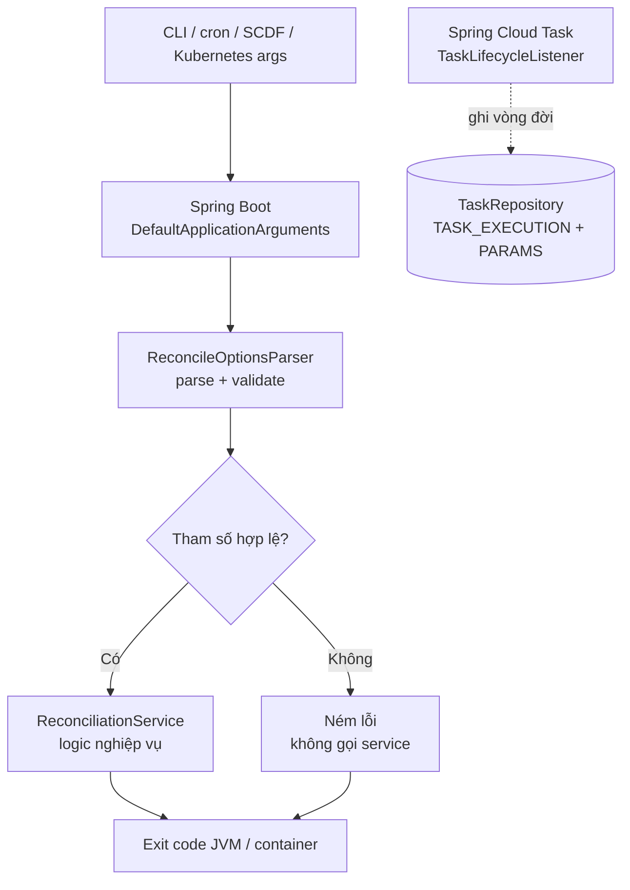

# Kiểm thử phân tích và kiểm tra tham số

## Mục tiêu bài học

Trong chương **Kiểm thử** của mô-đun **Spring Cloud Task**, bài này tập trung vào một lớp lỗi rất dễ bị bỏ sót: **ứng dụng nhận tham số dòng lệnh không đúng nhưng vẫn bắt đầu xử lý dữ liệu**. Một tác vụ hữu hạn chạy theo lịch, qua Kubernetes Job, Spring Cloud Data Flow hoặc theo yêu cầu thường nhận ngày nghiệp vụ, số lượng bản ghi, cờ chạy thử, ID đối tác và các tùy chọn vận hành. Nếu phân tích sai hoặc bỏ qua validation, tác vụ có thể cập nhật nhầm kỳ dữ liệu, chạy trùng hoặc báo thành công giả.

Sau bài học, bạn có thể:

- Phân biệt **raw arguments**, **option arguments** và **non-option arguments** của Spring Boot; hiểu cách chúng được chuyển vào `ApplicationRunner`.
- Kiểm thử các trạng thái **thiếu**, **rỗng**, **lặp**, **sai kiểu**, **ngoài giới hạn** và **hợp lệ** bằng `DefaultApplicationArguments`.
- Thiết kế parser/validator tách khỏi logic nghiệp vụ, sử dụng kiểu dữ liệu rõ ràng và ngoại lệ có thể kiểm tra.
- Viết unit test JUnit 5 và Mockito để bảo đảm tham số lỗi **không làm chạy service**.
- Viết integration test `@SpringBootTest(args = ...)` và biết giới hạn của việc kiểm tra lỗi làm thất bại khởi động context.
- Chạy smoke test qua executable JAR, xác nhận **exit code** và bản ghi `TaskExecution` trong database.
- Phân biệt tham số Spring Cloud Task/Spring Boot với **`JobParameters` của Spring Batch**, đặc biệt identifying parameters và kiểm thử restart.
- Bảo vệ secrets, tránh giả định dữ liệu trong `TASK_EXECUTION_PARAMS` là đã được validate hoặc mã hóa.

## 1. Bài toán: một tham số sai có thể gây hậu quả lớn

Giả sử một ứng dụng `rental-reconcile` được chạy cuối ngày để đối soát giao dịch thuê xe:

```bash
java -jar rental-reconcile.jar \
  --businessDate=2026-11-23 \
  --maxItems=500 \
  --dryRun
```

Ứng dụng có hợp đồng:

| Tham số | Bắt buộc? | Kiểu và ràng buộc | Ý nghĩa |
| --- | --- | --- | --- |
| `--businessDate=yyyy-MM-dd` | Có | Ngày ISO hợp lệ, ví dụ `2026-11-23` | Ngày dữ liệu phải đối soát |
| `--maxItems=500` | Không | Số nguyên trong khoảng `1..10000`, mặc định `1000` | Giới hạn số bản ghi trong một lượt |
| `--dryRun` | Không | Cờ **không có giá trị** | Chỉ kiểm tra/giả lập, không ghi dữ liệu nghiệp vụ |

Những lệnh sau **không được coi là tương đương**:

```text
--businessDate=2026-11-23
--businessDate=2026-02-29
--businessDate
--businessDate=
--businessDate=2026-11-23 --businessDate=2026-11-24
--maxItems=-1
--maxItems=100000
--maxItems=abc
--dryRun=false
```

`2026-02-29` không tồn tại vì 2026 không nhuận. Một `--businessDate` trơ không mang giá trị. Hai tham số ngày khác nhau là trường hợp **mơ hồ**, không nên tùy tiện chọn giá trị đầu hoặc cuối. `--dryRun=false` mang giá trị chuỗi, khác với cờ `--dryRun` trơ mà hợp đồng ví dụ chấp nhận.

**Nguyên tắc:** xác thực tham số phải hoàn tất **trước khi truy cập hệ thống ngoài hoặc ghi dữ liệu nghiệp vụ**. Nếu điều kiện đầu vào sai, ứng dụng cần báo lỗi rõ ràng, trả mã thoát không thành công theo cơ chế runtime và không chạy bước xử lý chính.

## 2. Các lớp xử lý và vị trí đặt kiểm thử



| Tầng | Trách nhiệm | Loại kiểm thử phù hợp |
| --- | --- | --- |
| Spring Boot argument parser | Phân biệt `--key=value`, cờ `--flag` và đối số không có `--` | Unit test với `DefaultApplicationArguments` |
| Parser nghiệp vụ | Bắt buộc, duy nhất, kiểu ngày/số, giới hạn, cờ | JUnit 5 thuần Java, parameterized tests |
| Runner | Gọi parser **trước service**, không nuốt lỗi | Mockito + kiểm tra không có side effect |
| Spring context | Cấu hình bean, arguments từ `@SpringBootTest` | Integration test với datasource cô lập |
| Spring Cloud Task | Tạo/cập nhật `TaskExecution`, ghi arguments, exit code | Kiểm thử khởi chạy thật và tra `TaskRepository` |
| Hệ điều phối | Truyền tham số đúng, đọc mã thoát, retry có giới hạn | Smoke/E2E test JAR hoặc container |

Không cần dùng database thật cho mọi ca `businessDate` sai. **Phần lớn lỗi parsing nên được phát hiện trong vài mili giây bằng unit test**, sau đó chỉ dùng một số ca đại diện để kiểm chứng đường đi đầy đủ qua Spring Boot, TaskRepository và tiến trình.

## 3. Hiểu đúng `ApplicationArguments`

Spring Boot cung cấp interface `org.springframework.boot.ApplicationArguments` và triển khai `DefaultApplicationArguments`. `ApplicationRunner.run(ApplicationArguments args)` nhận các đối số đã được phân tích; `CommandLineRunner.run(String... args)` nhận chuỗi nguyên bản.

Các API quan trọng:

| API | Kết quả |
| --- | --- |
| `getSourceArgs()` | Mảng chuỗi gốc truyền vào `SpringApplication.run(...)` |
| `getOptionNames()` | Tập tên tùy chọn có tiền tố `--` |
| `containsOption("dryRun")` | `true` nếu có `--dryRun` hoặc `--dryRun=...` |
| `getOptionValues("businessDate")` | Danh sách giá trị của option, hoặc `null` nếu vắng mặt |
| `getNonOptionArgs()` | Các chuỗi không được phân tích thành `--option` |

### 3.1. Bốn trạng thái bắt buộc phải phân biệt

Theo Javadoc Spring Boot, `getOptionValues("name")` có các trạng thái:

| Lệnh mẫu | `getOptionValues(...)` | Ý nghĩa |
| --- | --- | --- |
| Không có `--businessDate` | `null` | **Thiếu** option |
| `--businessDate` | Danh sách rỗng `[]` | **Có tên option nhưng không có giá trị** |
| `--businessDate=2026-11-23` | `["2026-11-23"]` | Có một giá trị |
| `--businessDate=2026-11-23 --businessDate=2026-11-24` | Hai giá trị | Bị **lặp** |

Với cờ `--dryRun`, danh sách rỗng là **đúng hợp đồng**, còn với `businessDate`, đó là **lỗi**. Vì vậy, **không viết một hàm kiểm tra đơn giản `containsOption(...)` cho tất cả các loại tham số**.

### 3.2. `--key=value` khác `--key value`

Ví dụ:

```bash
java -jar rental-reconcile.jar --maxItems 500
```

Với cú pháp phân tích mặc định, `--maxItems` có thể được xem là option **không có giá trị**, còn `500` là **non-option argument**. Đừng mặc định API sẽ tự ghép nó thành số `500`. Để tránh sự khác nhau giữa shell/framework, định nghĩa hợp đồng CLI bằng `--maxItems=500`.

Trong ví dụ Task thuần bên dưới, các tham số nghiệp vụ đều dùng dạng `--key=value` hoặc cờ `--dryRun`. Khi tích hợp Spring Batch auto-launcher, cú pháp `businessDate=...` **không có `--`** lại mang ý nghĩa khác; xem mục 10.

### 3.3. Không log toàn bộ tham số gốc

`getSourceArgs()` hữu ích khi debug, nhưng có thể chứa mật khẩu, token, đường dẫn nhạy cảm hoặc dữ liệu khách hàng. Spring Cloud Task còn có thể ghi arguments vào `TASK_EXECUTION_PARAMS`; vì vậy **không truyền secrets trên command line** chỉ để tiện khởi chạy. Sử dụng secret store/biến môi trường an toàn và giới hạn quyền đọc metadata.

## 4. Thiết kế parser có thể unit test độc lập

Ta tạo ba lớp:

1. `ReconcileOptions`: giá trị nghiệp vụ **đã được validate**, bất biến.
2. `ReconcileOptionsParser`: chỉ phân tích và kiểm tra đầu vào, **không kết nối DB**.
3. `ReconcileRunner`: gọi parser rồi mới gọi service.

Ví dụ sử dụng **Java 17**, Spring Boot 3.x và bản Spring Cloud Task tương thích theo BOM. Những đoạn mã là các tệp khác nhau trong cùng package `com.example.rentaltask`.

### 4.1. DTO bất biến

Tệp `src/main/java/com/example/rentaltask/ReconcileOptions.java`:

```java
package com.example.rentaltask;

import java.time.LocalDate;

public record ReconcileOptions(
        LocalDate businessDate,
        int maxItems,
        boolean dryRun) {
}
```

Chỉ code đã đi qua parser mới được tạo và chuyển tới nghiệp vụ theo hợp đồng ứng dụng. Java record không tự validate mọi giá trị khi được tạo bằng constructor ở nơi khác; nếu DTO là biên bảo mật chung của hệ thống, có thể thêm **compact constructor** để bảo vệ bất biến, hoặc giới hạn cách tạo DTO.

### 4.2. Parser và validator

Tệp `src/main/java/com/example/rentaltask/ReconcileOptionsParser.java`:

```java
package com.example.rentaltask;

import java.time.LocalDate;
import java.time.format.DateTimeFormatter;
import java.time.format.DateTimeParseException;
import java.util.List;

import org.springframework.boot.ApplicationArguments;
import org.springframework.stereotype.Component;

@Component
public class ReconcileOptionsParser {

    private static final int DEFAULT_MAX_ITEMS = 1000;
    private static final int MAX_ALLOWED_ITEMS = 10000;

    public ReconcileOptions parse(ApplicationArguments args) {
        String rawDate = singleValue(args, "businessDate", true);
        String rawMaxItems = singleValue(args, "maxItems", false);

        LocalDate businessDate;
        try {
            businessDate = LocalDate.parse(
                    rawDate, DateTimeFormatter.ISO_LOCAL_DATE);
        } catch (DateTimeParseException ex) {
            throw new IllegalArgumentException(
                    "businessDate phai la ngay ISO yyyy-MM-dd hop le", ex);
        }

        int maxItems = DEFAULT_MAX_ITEMS;
        if (rawMaxItems != null) {
            try {
                maxItems = Integer.parseInt(rawMaxItems);
            } catch (NumberFormatException ex) {
                throw new IllegalArgumentException(
                        "maxItems phai la so nguyen", ex);
            }
        }

        if (maxItems < 1 || maxItems > MAX_ALLOWED_ITEMS) {
            throw new IllegalArgumentException(
                    "maxItems phai nam trong khoang 1..10000");
        }

        List<String> dryRunValues = args.getOptionValues("dryRun");
        if (dryRunValues != null && !dryRunValues.isEmpty()) {
            throw new IllegalArgumentException(
                    "dryRun la co khong nhan gia tri; dung --dryRun");
        }

        return new ReconcileOptions(
                businessDate, maxItems, dryRunValues != null);
    }

    private static String singleValue(
            ApplicationArguments args,
            String name,
            boolean required) {
        List<String> values = args.getOptionValues(name);

        if (values == null) {
            if (required) {
                throw new IllegalArgumentException(
                        "Thieu tham so --" + name + "=...");
            }
            return null;
        }

        if (values.size() != 1
                || values.get(0) == null
                || values.get(0).isBlank()) {
            throw new IllegalArgumentException(
                    "Tham so --" + name
                    + " phai xuat hien dung mot lan va co gia tri");
        }

        return values.get(0);
    }
}
```

**Điểm thiết kế quan trọng:**

- Parser **không gọi DB, REST API hay message broker**.
- `singleValue` phân biệt `null` (vắng mặt), `[]` (có option nhưng thiếu giá trị), nhiều giá trị (lặp) và chuỗi trống.
- `LocalDate.parse(..., ISO_LOCAL_DATE)` phát hiện ngày không tồn tại như `2026-02-29` hoặc chuỗi sai định dạng.
- `Integer.parseInt` phân biệt lỗi kiểu; kiểm tra riêng khoảng `1..10000` và tràn kiểu số nguyên.
- `--dryRun` được chấp nhận, nhưng `--dryRun=true` hoặc `--dryRun=false` đều bị từ chối theo **hợp đồng minh họa này**.
- Thông báo lỗi chỉ mô tả **tên tham số và ràng buộc**, không in giá trị thô; cách này giảm khả năng làm lộ dữ liệu nhạy cảm trong logs/`ERROR_MESSAGE`.

Parser trên **không từ chối mọi option lạ**, vì Spring Boot cũng nhận các option vận hành như `--spring.profiles.active=...` hoặc `--spring.datasource.url=...`. Nếu nghiệp vụ cần chính sách cấm tham số lạ, hãy xác định rõ **namespace tham số nghiệp vụ** và bộ option hạ tầng được phép trước khi bật kiểm tra strict.

### 4.3. Phạm vi kiểm tra của parser

Ở ví dụ này, parser kiểm tra **cú pháp và giới hạn tĩnh**. Nó chưa kiểm tra ngày có ở tương lai không, đối tác có quyền xử lý ngày đó không, snapshot đã đóng sổ chưa hay có lượt khác đang chạy không.

Đó là **business validation**, thường cần service và dữ liệu hệ thống. Nếu ràng buộc phụ thuộc “ngày hiện tại”, inject `java.time.Clock` (hoặc cung cấp thời điểm kiểm thử rõ ràng), **không dùng `LocalDate.now()` trực tiếp trong code muốn kiểm thử ổn định**.

## 5. Runner: validate trước khi làm việc

Tệp `ReconcileRunner.java`:

```java
package com.example.rentaltask;

import org.springframework.boot.ApplicationArguments;
import org.springframework.boot.ApplicationRunner;
import org.springframework.stereotype.Component;

@Component
public class ReconcileRunner implements ApplicationRunner {

    private final ReconcileOptionsParser parser;
    private final ReconciliationService service;

    public ReconcileRunner(
            ReconcileOptionsParser parser,
            ReconciliationService service) {
        this.parser = parser;
        this.service = service;
    }

    @Override
    public void run(ApplicationArguments args) {
        ReconcileOptions options = parser.parse(args);
        service.reconcile(options);
    }
}
```

Định nghĩa service và implementation đơn giản cho demo:

```java
package com.example.rentaltask;

public interface ReconciliationService {
    void reconcile(ReconcileOptions options);
}
```

```java
package com.example.rentaltask;

import org.springframework.stereotype.Service;

@Service
public class DemoReconciliationService
        implements ReconciliationService {

    @Override
    public void reconcile(ReconcileOptions options) {
        if (options.dryRun()) {
            System.out.println("DRY_RUN: " + options.businessDate());
            return;
        }

        // Demo: thay bang logic doi soat va commit du lieu thuc te.
        System.out.println("DEMO_ONLY: " + options.businessDate());
    }
}
```

**Không dùng đoạn `DEMO_ONLY` để kết luận đối soát nghiệp vụ đã thành công trong production.** Service thật phải xác nhận số giao dịch, ràng buộc dữ liệu, giao dịch và idempotency trước khi trả về bình thường.

Trong runner, **không bắt `IllegalArgumentException` rồi chỉ ghi log và return bình thường**. Nếu bỏ qua lỗi validation, Spring Boot có thể coi runner đã hoàn tất và ghi mã thoát thành công. Với một Task, tốt hơn là cho ngoại lệ đi theo đường xử lý lỗi chuẩn của Spring Boot/Spring Cloud Task, sau đó kiểm chứng mã thoát và metadata trong integration test.

## 6. Unit test parser bằng JUnit 5

### 6.1. Dependencies kiểm thử

Nếu dự án sử dụng Spring Boot Maven parent và Spring Cloud BOM tương thích, thêm:

```xml
<dependency>
    <groupId>org.springframework.boot</groupId>
    <artifactId>spring-boot-starter-test</artifactId>
    <scope>test</scope>
</dependency>
```

Starter này cung cấp JUnit Jupiter, assertion và Mockito (theo nhánh Spring Boot tương ứng). Để unit test parser, **không cần khởi động Spring ApplicationContext**, không cần database và không cần khởi chạy JVM phụ.

Spring Boot có class `DefaultApplicationArguments` để tạo trực tiếp đối tượng `ApplicationArguments` trong test:

```java
ApplicationArguments args = new DefaultApplicationArguments(
        "--businessDate=2026-11-23",
        "--maxItems=500",
        "--dryRun");
```

### 6.2. Kiểm thử đường thành công và mặc định

Tệp `src/test/java/com/example/rentaltask/ReconcileOptionsParserTest.java`:

```java
package com.example.rentaltask;

import java.time.LocalDate;

import org.junit.jupiter.api.Test;
import org.springframework.boot.DefaultApplicationArguments;

import static org.junit.jupiter.api.Assertions.assertEquals;
import static org.junit.jupiter.api.Assertions.assertFalse;
import static org.junit.jupiter.api.Assertions.assertTrue;

class ReconcileOptionsParserTest {

    private final ReconcileOptionsParser parser =
            new ReconcileOptionsParser();

    @Test
    void parsesValidDateCountAndDryRun() {
        ReconcileOptions result = parser.parse(
                new DefaultApplicationArguments(
                        "--businessDate=2026-11-23",
                        "--maxItems=500",
                        "--dryRun"));

        assertEquals(LocalDate.of(2026, 11, 23),
                     result.businessDate());
        assertEquals(500, result.maxItems());
        assertTrue(result.dryRun());
    }

    @Test
    void usesDefaultMaxItemsAndDryRunFalse() {
        ReconcileOptions result = parser.parse(
                new DefaultApplicationArguments(
                        "--businessDate=2026-11-23"));

        assertEquals(1000, result.maxItems());
        assertFalse(result.dryRun());
    }
}
```

Chú ý `@Test` nằm trong **JUnit Jupiter** (`org.junit.jupiter.api.Test`), không dùng annotation của JUnit 4 cũ trộn lẫn. Hai test kiểm tra đầu ra **đã được chuẩn hóa**, không chỉ gọi `assertNotNull(...)`.

### 6.3. Kiểm thử dữ liệu lỗi có tham số hóa

Một test cho các trường hợp ngày sai định dạng/thiếu giá trị:

```java
package com.example.rentaltask;

import org.junit.jupiter.api.Test;
import org.junit.jupiter.params.ParameterizedTest;
import org.junit.jupiter.params.provider.ValueSource;
import org.springframework.boot.DefaultApplicationArguments;

import static org.junit.jupiter.api.Assertions.assertThrows;

class ReconcileOptionsValidationTest {

    private final ReconcileOptionsParser parser =
            new ReconcileOptionsParser();

    @ParameterizedTest
    @ValueSource(strings = {
            "--businessDate",
            "--businessDate=",
            "--businessDate=2026-02-29",
            "--businessDate=not-a-date"
    })
    void rejectsInvalidBusinessDate(String option) {
        assertThrows(
                IllegalArgumentException.class,
                () -> parser.parse(
                        new DefaultApplicationArguments(option)));
    }

    @Test
    void rejectsMissingRequiredDate() {
        assertThrows(
                IllegalArgumentException.class,
                () -> parser.parse(
                        new DefaultApplicationArguments()));
    }

    @Test
    void rejectsDuplicateBusinessDate() {
        assertThrows(
                IllegalArgumentException.class,
                () -> parser.parse(
                        new DefaultApplicationArguments(
                                "--businessDate=2026-11-23",
                                "--businessDate=2026-11-24")));
    }
}
```

**Lưu ý:** `@ValueSource` truyền **một** option vào mỗi lượt chạy test; không dùng `@CsvSource` để lưu một chuỗi chứa nhiều dấu phẩy nếu không có mục tiêu rõ ràng. Với tham số trùng, tạo `DefaultApplicationArguments` từ **hai phần tử**.

### 6.4. Biên số lượng, cờ và các biến thể khó

```java
package com.example.rentaltask;

import org.junit.jupiter.api.Test;
import org.junit.jupiter.params.ParameterizedTest;
import org.junit.jupiter.params.provider.ValueSource;
import org.springframework.boot.DefaultApplicationArguments;

import static org.junit.jupiter.api.Assertions.assertEquals;
import static org.junit.jupiter.api.Assertions.assertThrows;

class ReconcileOptionsBoundaryTest {

    private final ReconcileOptionsParser parser =
            new ReconcileOptionsParser();

    @ParameterizedTest
    @ValueSource(strings = {
            "--maxItems=",
            "--maxItems=0",
            "--maxItems=-1",
            "--maxItems=10001",
            "--maxItems=abc",
            "--maxItems=999999999999999999999"
    })
    void rejectsInvalidMaxItems(String option) {
        assertThrows(IllegalArgumentException.class,
                () -> parser.parse(
                        new DefaultApplicationArguments(
                                "--businessDate=2026-11-23",
                                option)));
    }

    @ParameterizedTest
    @ValueSource(strings = {
            "--maxItems=1",
            "--maxItems=10000"
    })
    void acceptsBoundaries(String option) {
        ReconcileOptions result = parser.parse(
                new DefaultApplicationArguments(
                        "--businessDate=2026-11-23",
                        option));

        int expected = Integer.parseInt(
                option.substring("--maxItems=".length()));
        assertEquals(expected, result.maxItems());
    }

    @Test
    void rejectsFlagWithExplicitValue() {
        assertThrows(IllegalArgumentException.class,
                () -> parser.parse(
                        new DefaultApplicationArguments(
                                "--businessDate=2026-11-23",
                                "--dryRun=false")));
    }

    @Test
    void rejectsDuplicateMaxItems() {
        assertThrows(IllegalArgumentException.class,
                () -> parser.parse(
                        new DefaultApplicationArguments(
                                "--businessDate=2026-11-23",
                                "--maxItems=50",
                                "--maxItems=100")));
    }
}
```

Với `maxItems=1` và `maxItems=10000`, bài kiểm tra **biên hợp lệ**. Với `0` và `10001`, bài kiểm tra **biên không hợp lệ**. Trường hợp giá trị rất dài còn kiểm tra overflow của `Integer.parseInt`.

### 6.5. Ma trận test cần có

| Trường hợp | Đầu vào | Kỳ vọng |
| --- | --- | --- |
| Hợp lệ tối thiểu | `--businessDate=2026-11-23` | Date đúng, maxItems mặc định, dryRun false |
| Hợp lệ đầy đủ | `--businessDate=2026-11-23 --maxItems=500 --dryRun` | Đủ ba trường đúng |
| Ngày thiếu | Không có `businessDate` | Validation fail |
| Ngày không có giá trị | `--businessDate` hoặc `--businessDate=` | Validation fail |
| Ngày không tồn tại | `--businessDate=2026-02-29` | Validation fail |
| Ngày trùng option | Hai `--businessDate` | Validation fail |
| Số ngoài biên | `--maxItems=0`, `10001` | Validation fail |
| Số sai kiểu/tràn | `--maxItems=abc` hoặc rất dài | Validation fail |
| Hai giá trị `maxItems` | `--maxItems=1 --maxItems=2` | Validation fail |
| Cờ trơ | `--dryRun` | dryRun true |
| Cờ có giá trị | `--dryRun=true`/`false` | Validation fail theo hợp đồng |
| Lệnh sai hình thức | `--maxItems 500` | Option maxItems không có value; validation fail |

**Không chỉ kiểm thử một happy path**: lỗi trùng option thường phát sinh từ hệ điều phối ghép default arguments với arguments người dùng, và lỗi ngày thường đến từ format locale/timezone hoặc nhập tay.

## 7. Unit test Runner: tham số sai không được gọi nghiệp vụ

Test parser đúng chưa đủ: runner vẫn có thể **gọi service trước khi parse** hoặc nuốt exception. Dùng Mockito để xác minh thứ tự trách nhiệm:

```java
package com.example.rentaltask;

import java.time.LocalDate;

import org.junit.jupiter.api.Test;
import org.springframework.boot.DefaultApplicationArguments;

import static org.junit.jupiter.api.Assertions.assertThrows;
import static org.mockito.Mockito.mock;
import static org.mockito.Mockito.verify;
import static org.mockito.Mockito.verifyNoInteractions;

class ReconcileRunnerTest {

    private final ReconcileOptionsParser parser =
            new ReconcileOptionsParser();

    private final ReconciliationService service =
            mock(ReconciliationService.class);

    private final ReconcileRunner runner =
            new ReconcileRunner(parser, service);

    @Test
    void validArgumentsInvokeServiceExactlyOnce() {
        runner.run(new DefaultApplicationArguments(
                "--businessDate=2026-11-23",
                "--maxItems=50",
                "--dryRun"));

        verify(service).reconcile(new ReconcileOptions(
                LocalDate.of(2026, 11, 23),
                50,
                true));
    }

    @Test
    void invalidDateNeverInvokesService() {
        assertThrows(IllegalArgumentException.class,
                () -> runner.run(
                        new DefaultApplicationArguments(
                                "--businessDate=2026-02-29")));

        verifyNoInteractions(service);
    }

    @Test
    void missingDateNeverInvokesService() {
        assertThrows(IllegalArgumentException.class,
                () -> runner.run(
                        new DefaultApplicationArguments(
                                "--maxItems=100")));

        verifyNoInteractions(service);
    }
}
```

Mockito `verify(...)` kiểm tra service được gọi với chính **đối tượng đã parse** (record có so sánh theo giá trị). `verifyNoInteractions(...)` giúp bảo vệ yêu cầu quan trọng nhất: **đầu vào sai không được ghi hay gọi nghiệp vụ**.

Đừng chỉ mock `ReconcileOptionsParser` để nó luôn trả đối tượng hợp lệ trong tất cả unit test; cách đó không phát hiện lỗi validation. Ở đây parser được dùng **thật**, chỉ service bị mock.

### 7.1. Mở rộng test: lỗi service phải đi ra ngoài Runner

Nếu service ném exception, Runner nên để framework nhận thất bại, thay vì lặng lẽ báo thành công:

```java
@Test
void serviceFailureIsPropagated() {
    ReconciliationService failingService = options -> {
        throw new IllegalStateException("Simulated storage error");
    };
    ReconcileRunner failingRunner = new ReconcileRunner(
            new ReconcileOptionsParser(), failingService);

    assertThrows(IllegalStateException.class,
            () -> failingRunner.run(
                    new DefaultApplicationArguments(
                            "--businessDate=2026-11-23")));
}
```

Đây là **phương thức test bổ sung** đặt trong một lớp test có imports JUnit và Spring Boot tương ứng. Unit test chỉ chứng minh exception được truyền tiếp, **chưa chứng minh mã thoát JVM hay `TaskRepository` đã ghi đúng**; hai việc đó thuộc lớp kiểm thử tiếp theo.

## 8. Integration test `@SpringBootTest(args = ...)`

Spring Boot cung cấp thuộc tính `args` của `@SpringBootTest` để đưa **application arguments** vào context test. Đây là công cụ phù hợp để kiểm tra wiring giữa Spring Boot, runner và Spring Cloud Task với một cấu hình kiểm thử.

### 8.1. Lớp khởi động

Tệp `ReconcileTaskApplication.java`:

```java
package com.example.rentaltask;

import org.springframework.boot.SpringApplication;
import org.springframework.boot.autoconfigure.SpringBootApplication;
import org.springframework.cloud.task.configuration.EnableTask;

@SpringBootApplication
@EnableTask
public class ReconcileTaskApplication {

    public static void main(String[] args) {
        SpringApplication.run(ReconcileTaskApplication.class, args);
    }
}
```

Đảm bảo có dependencies Spring Cloud Task, JDBC/H2 và phiên bản Spring Boot/Spring Cloud **tương thích**. Nếu sử dụng `spring-cloud-starter-task`, các dependency chính trong Maven:

```xml
<dependencies>
    <dependency>
        <groupId>org.springframework.cloud</groupId>
        <artifactId>spring-cloud-starter-task</artifactId>
    </dependency>
    <dependency>
        <groupId>com.h2database</groupId>
        <artifactId>h2</artifactId>
        <scope>runtime</scope>
    </dependency>
    <dependency>
        <groupId>org.springframework.boot</groupId>
        <artifactId>spring-boot-starter-test</artifactId>
        <scope>test</scope>
    </dependency>
</dependencies>
```

Đây là đoạn dependencies, không phải `pom.xml` đầy đủ. Dùng Spring Boot parent/BOM và Spring Cloud release train phù hợp, không chốt tùy tiện version riêng của starter Task.

### 8.2. Test arguments được inject và parse đúng

```java
package com.example.rentaltask;

import java.time.LocalDate;

import org.junit.jupiter.api.Test;
import org.springframework.beans.factory.annotation.Autowired;
import org.springframework.boot.ApplicationArguments;
import org.springframework.boot.test.context.SpringBootTest;

import static org.junit.jupiter.api.Assertions.assertEquals;
import static org.junit.jupiter.api.Assertions.assertTrue;

@SpringBootTest(
    classes = ReconcileTaskApplication.class,
    webEnvironment = SpringBootTest.WebEnvironment.NONE,
    args = {
        "--businessDate=2026-11-23",
        "--maxItems=500",
        "--dryRun"
    },
    properties = {
        "spring.application.name=reconcile-args-test",
        "spring.cloud.task.closecontext-enabled=false",
        "spring.datasource.url=jdbc:h2:mem:reconcile_args_test;DB_CLOSE_DELAY=-1",
        "spring.cloud.task.initialize-enabled=true"
    }
)
class ReconcileTaskArgumentsIntegrationTest {

    @Autowired
    ApplicationArguments arguments;

    @Autowired
    ReconcileOptionsParser parser;

    @Test
    void bootPassesArgumentsToTheParser() {
        ReconcileOptions options = parser.parse(arguments);

        assertEquals(LocalDate.of(2026, 11, 23),
                     options.businessDate());
        assertEquals(500, options.maxItems());
        assertTrue(options.dryRun());
    }
}
```

Những lưu ý quan trọng:

- `args` của `@SpringBootTest` **được truyền vào SpringApplication** trong context test, không phải chỉ tự tạo một mảng giả.
- `webEnvironment = NONE` không khởi động HTTP server; hợp với ứng dụng Task CLI.
- `closecontext-enabled=false` được dùng cho **integration test** để giữ context sẵn cho phương thức `@Test`. Điều này khác mục tiêu của một Task production cần kết thúc sau khi runner chạy xong.
- H2 `mem` là **kho cách ly trong JVM kiểm thử**, không dùng để đối chiếu lịch sử sau khi JVM thoát.
- Vì `ReconcileRunner` là bean thật, **nó sẽ chạy trong lúc bootstrap context**. Ví dụ dùng `--dryRun` để không ghi dữ liệu nghiệp vụ; môi trường thật phải mock/stub tích hợp bên ngoài hoặc chạy với database test cô lập.

**Không dùng `@SpringBootTest(args = "--businessDate=bad")` rồi mong phương thức `@Test` chạy và bắt exception bằng `assertThrows`.** Runner ném exception khi **SpringApplication đang khởi động**, nên context có thể thất bại *trước khi* JUnit gọi test method. Để kiểm tra lỗi validation, ưu tiên unit test parser/runner hoặc một phép chạy JAR/process có chủ đích và assert exit code.

### 8.3. Test metadata bằng repository: cần kiểm tra đúng thời điểm

Trong một context Task chạy thật, Spring Cloud Task có thể tạo `TaskExecution` trước runner và cập nhật kết quả khi vòng đời khởi động/runner kết thúc. Tên bảng mặc định là `TASK_EXECUTION` và `TASK_EXECUTION_PARAMS`.

Khi viết integration test truy vấn repository, hãy đảm bảo:

1. Dùng đúng **DataSource Task**, không nhầm database nghiệp vụ.
2. Runner đã hoàn tất và cơ chế lifecycle đã cập nhật metadata; kiểm tra `endTime` theo **đúng phiên bản/callback**.
3. Không chỉ truy vấn “bản ghi mới nhất” khi nhiều test/context dùng chung tên Task.
4. Không đổi `TaskExecution` hoặc tự tạo record giả trong test chỉ để khẳng định lifecycle đã chạy.

Nếu mục tiêu là xác minh **record được ghi sau khi tiến trình đã thoát**, bài kiểm thử JAR riêng là rõ nhất vì nó không lệ thuộc thời điểm test framework giữ context.

## 9. Smoke test JAR: kết quả process và TaskRepository

Unit test trả exception đúng chưa chứng minh rằng **shell, Docker, CronJob** thực sự nhận mã lỗi khác `0`. Để kiểm tra hệ điều phối, phải khởi chạy đúng artifact được đóng gói.

### 9.1. Đóng gói và chạy trường hợp thành công

```bash
./mvnw clean package
java -jar target/rental-reconcile-0.0.1-SNAPSHOT.jar \
  --businessDate=2026-11-23 --maxItems=100 --dryRun
printf 'JVM exit=%s\n' "$?"
```

Tên JAR minh họa; thay theo `artifactId` và `version` thật của dự án. Trong Bash, `$?` phải được đọc **ngay sau Java**; một lệnh khác có thể ghi đè nó. Trên PowerShell, dùng `$LASTEXITCODE` của native executable; trên Windows CMD dùng `%ERRORLEVEL%`.

### 9.2. Chạy các trường hợp thất bại

```bash
set +e
java -jar target/rental-reconcile-0.0.1-SNAPSHOT.jar \
  --businessDate=2026-02-29 --dryRun
bad_date_exit=$?

java -jar target/rental-reconcile-0.0.1-SNAPSHOT.jar \
  --businessDate=2026-11-23 --maxItems=0 --dryRun
bad_count_exit=$?

printf 'invalid-date=%s invalid-count=%s\n' \
  "$bad_date_exit" "$bad_count_exit"
```

Nếu parser ném `IllegalArgumentException` và exception không bị nuốt, hai lần chạy **dự kiến phải có mã thoát khác `0`**. Không gán cứng một mã số như `12` nếu ứng dụng chưa cấu hình `ExitCodeExceptionMapper`/`ExitCodeGenerator` và chưa kiểm tra cách Spring Boot/Spring Cloud Task của phiên bản đó ánh xạ lỗi.

Một smoke test Bash đơn giản:

```bash
if [ "$bad_date_exit" -eq 0 ]; then
  echo "FAIL: invalid date returned exit code 0"
  exit 1
fi

if [ "$bad_count_exit" -eq 0 ]; then
  echo "FAIL: invalid maxItems returned exit code 0"
  exit 1
fi

echo "PASS: invalid arguments did not report success"
```

`set +e` tạm tránh script bị dừng ngay khi Java trả nonzero nếu shell bên ngoài đang chạy với `set -e`. Nếu lệnh dùng `tee` để ghi log, dùng `set -o pipefail` của Bash hoặc lấy riêng `PIPESTATUS`, tránh chỉ đọc mã thành công của `tee`.

### 9.3. Vì sao lỗi parsing có thể không có TaskExecution?

Nếu validation diễn ra **trong `ApplicationRunner`**, Spring Cloud Task thường đã kịp khởi tạo context và tạo `TaskExecution` trước runner. Nhưng nếu datasource sai, bean khởi tạo bị lỗi hoặc validation được đặt trong một `@Bean` tạo quá sớm, **context có thể chưa bootstrap thành công**, và Spring Cloud Task **không có bản ghi** cho lượt chạy đó.

Do đó, một phép kiểm thử toàn diện kiểm tra **cả hai phía**:

| Trạng thái | Mã JVM | Repository |
| --- | --- | --- |
| Parser hợp lệ, runner kết thúc bình thường | Dự kiến `0` | `TaskExecution` hoàn thành |
| Parser sai, exception runner đi ra ngoài | Dự kiến khác `0` | Thường có bản ghi lỗi nếu lifecycle đã khởi động |
| DataSource/config lỗi trước lifecycle | Dự kiến khác `0` | Có thể **không có** bản ghi mới |
| JVM bị kill/OOM trước cập nhật cuối | Có thể là mã signal/container | Có thể có `END_TIME = NULL` |

Không dùng “không thấy row trong `TASK_EXECUTION`” làm bằng chứng runner **chưa bao giờ được launch**; cần kết hợp logs và trạng thái của hệ điều phối.

### 9.4. Truy vấn metadata sau khi JAR thoát

Để đọc lịch sử qua nhiều lần Java chạy, dùng **database bền vững** như PostgreSQL hoặc H2 file trong môi trường học tập. Ví dụ ứng dụng local:

```yaml
spring:
  application:
    name: rental-reconcile
  main:
    web-application-type: none
  datasource:
    url: jdbc:h2:file:./data/reconcile-task
    driver-class-name: org.h2.Driver
    username: sa
    password: ""
  cloud:
    task:
      closecontext-enabled: true
      initialize-enabled: true
```

Trong demo, phải tạo schema Task đúng phiên bản ở lần chạy đầu. Khi đã có bảng/schema, chuyển sang migration được kiểm soát và `initialize-enabled: false` nếu không muốn framework tự khởi tạo lại. **Không mở cùng file H2 từ nhiều process độc lập đồng thời** theo cách không được H2 hỗ trợ; production dùng database server.

Sau khi Java đã thoát và SQL client kết nối tới **đúng database**:

```sql
SELECT
    TASK_EXECUTION_ID,
    TASK_NAME,
    START_TIME,
    END_TIME,
    EXIT_CODE,
    ERROR_MESSAGE
FROM TASK_EXECUTION
WHERE TASK_NAME = 'rental-reconcile'
ORDER BY TASK_EXECUTION_ID DESC;
```

Và xem tham số của một lượt chạy:

```sql
SELECT
    TASK_EXECUTION_ID,
    TASK_PARAM
FROM TASK_EXECUTION_PARAMS
WHERE TASK_EXECUTION_ID = 42;
```

`42` là ID minh họa, phải thay bằng ID thực tế. Một lượt có thể có nhiều dòng `TASK_EXECUTION_PARAMS`. Bảng này lưu **chuỗi arguments của Task**, không phải chứng nhận chúng hợp lệ hoặc được mã hóa. Phân tích nghiệp vụ vẫn phải diễn ra tại parser/service.

## 10. Khi Task chạy Spring Batch: kiểm thử `JobParameters` riêng

Một lỗi phổ biến khi chuyển từ `ApplicationRunner` thuần sang **Spring Batch Job trong Spring Cloud Task** là áp dụng nhầm cú pháp tham số.

### 10.1. Hai đường tham số khác nhau

| Lệnh | Spring Boot hiểu là gì? | Khi dùng Batch auto-launcher |
| --- | --- | --- |
| `--businessDate=2026-11-23` | Option của Spring `Environment` / `ApplicationArguments` | **Không tự** là Batch JobParameter |
| `businessDate=2026-11-23` | Non-option argument | Thường được chuyển thành **`JobParameter`** |
| `--spring.batch.job.name=reconciliationJob` | Thuộc tính chọn Job trong Spring Boot | Không phải tham số nghiệp vụ của Job |
| `businessDate=2026-11-23,java.lang.String,true` | Non-option theo cú pháp `DefaultJobParametersConverter` của Batch 5 | JobParameter kiểu String, **identifying=true** |

Spring Boot Batch launcher mặc định nhận các JobParameters từ **non-option arguments**. Tài liệu Spring Boot nhấn mạnh không sử dụng tiền tố `--` để gửi JobParameters qua launcher này. Nếu dùng `JobLauncher` viết thủ công hoặc một launcher khác, hợp đồng có thể khác.

### 10.2. Identifying parameters và restart

Spring Batch xác định một **JobInstance** bởi tên Job và tập `JobParameters` được đánh dấu **identifying**. Trong Java:

```java
JobParameters params = new JobParametersBuilder()
        .addString("businessDate", "2026-11-23", true)
        .addString("operator", "nightly", false)
        .toJobParameters();
```

Đoạn này minh họa API Spring Batch 5.x; cần imports `org.springframework.batch.core.JobParameters` và `org.springframework.batch.core.JobParametersBuilder`.

Đổi `operator` (non-identifying) **không tạo JobInstance mới**. Đổi `businessDate` (identifying) sẽ tạo JobInstance khác. Với job thất bại cần restart cùng instance, phải giữ nguyên identifying parameters và **cung cấp lại các non-identifying parameters mong muốn** ở lần launch mới.

### 10.3. Unit test hợp đồng nhận tham số Batch

```java
import org.junit.jupiter.api.Test;
import org.springframework.batch.core.JobParameters;
import org.springframework.batch.core.JobParametersBuilder;

import static org.junit.jupiter.api.Assertions.assertEquals;
import static org.junit.jupiter.api.Assertions.assertFalse;
import static org.junit.jupiter.api.Assertions.assertTrue;

class BatchParameterContractTest {

    @Test
    void businessDateIdentifiesJobInstance() {
        JobParameters parameters = new JobParametersBuilder()
                .addString("businessDate", "2026-11-23", true)
                .addString("operator", "nightly", false)
                .toJobParameters();

        assertEquals("2026-11-23",
                     parameters.getString("businessDate"));
        assertTrue(parameters.getParameter(
                "businessDate").isIdentifying());
        assertFalse(parameters.getParameter(
                "operator").isIdentifying());
    }
}
```

Đây là unit test cho **JobParameters tạo trong Java**, chưa kiểm chứng chính xác cơ chế chuyển đổi **CLI → JobParameters** của Spring Boot. Để kiểm tra launcher, cần chạy một Batch Job thật với non-option arguments, đọc các bảng `BATCH_JOB_INSTANCE`/`BATCH_JOB_EXECUTION_PARAMS` và xác nhận identity/restart.

### 10.4. Test lỗi không được phép chạy lại với instance mới

Trong integration/E2E test có JobRepository bền vững:

1. Chạy `reconciliationJob businessDate=2026-11-23`, cố ý làm Job `FAILED`.
2. Sửa nguyên nhân lỗi rồi chạy lại **cùng** identifying parameters.
3. Xác minh có **một JobInstance**, **hai JobExecution** và StepExecution theo restart semantics.
4. Thử thêm `run.id` identifying mới; xác minh nếu launcher dùng tham số này thì **JobInstance mới** được tạo — khác với restart.

Không chạy bài kiểm tra restart bằng H2 in-memory được tạo mới mỗi JVM: repository sẽ mất metadata ở lần thử trước, khiến bạn không còn kiểm chứng đúng ý nghĩa restart.

## 11. Kiểm thử theo lịch, container và Spring Cloud Data Flow

### 11.1. Các nguồn truyền tham số

| Nguồn | Lỗi dễ mắc | Kiểm thử nên có |
| --- | --- | --- |
| Shell/CLI | Quên dấu `=`, quote sai, lặp option | Capture `ApplicationArguments` và smoke test JAR |
| Docker `CMD`/`ENTRYPOINT` | Shell wrapper nuốt mã Java, không truyền tiếp args | `docker run image --businessDate=...` và đọc `ExitCode` |
| Kubernetes Job `args` | Nhầm `--key=value` với hai phần tử `"--key", "value"` | Manifest test, logs, Pod exit code |
| CronJob | Ngày nghiệp vụ bị hardcode; lần sau chạy lại ngày cũ | Test xác định ngày theo lịch và timezone |
| Spring Cloud Data Flow task launch | Properties mặc định và arguments user chồng lặp | Test duplicate option và trace TaskExecution params |
| Spring Batch launcher | Truyền `--businessDate` thay vì `businessDate` | Test `JobParameters` và JobInstance |

### 11.2. Docker và Kubernetes: nguyên tắc kiểm tra

Dockerfile nên để Java là process chính:

```dockerfile
FROM eclipse-temurin:21-jre
WORKDIR /app
COPY target/rental-reconcile-0.0.1-SNAPSHOT.jar /app/app.jar
ENTRYPOINT ["java", "-jar", "/app/app.jar"]
```

Chạy:

```bash
docker run --rm rental-reconcile:test \
  --businessDate=2026-11-23 --dryRun
printf 'Container exit=%s\n' "$?"
```

Tên image chỉ minh họa; phải build/tag trước. Với Kubernetes Job, `args: ["--businessDate=2026-11-23", "--dryRun"]` truyền vào Java nếu `ENTRYPOINT` đúng. Test cả case lỗi và đọc `status.containerStatuses[].state.terminated.exitCode`. **`kubectl apply` trả `0` không có nghĩa Task đã thành công**.

Trong chạy theo lịch, phải có hợp đồng **ngày nghiệp vụ** rõ ràng; nếu CronJob có `--businessDate=2026-11-23` cố định, mọi ngày sau nó vẫn chạy cùng một ngày. Để tránh test lệ thuộc timezone, tách phép xác định ngày thành một service dùng `Clock` và unit test ở các mốc chuyển ngày.

## 12. Những lỗi kiểm thử thường gặp

| Triệu chứng | Nguyên nhân | Cách sửa |
| --- | --- | --- |
| Parser chấp nhận `--businessDate` không có value | Chỉ dùng `containsOption` | Kiểm tra `getOptionValues` có đúng một phần tử không rỗng |
| Parser âm thầm chọn ngày đầu khi có hai giá trị | Dùng `values.get(0)` mà không kiểm tra size | Reject duplicate hoặc định nghĩa chính sách rõ ràng |
| Test ngày sai không thất bại | Chỉ dùng regex `\d{4}-\d{2}-\d{2}` | Dùng `LocalDate.parse` để kiểm tra lịch hợp lệ |
| `--maxItems=0` được chấp nhận | Chỉ kiểm tra kiểu integer | Bổ sung kiểm tra biên `1..10000` |
| `--dryRun=false` bị hiểu như `dryRun=true` | Kiểm tra `containsOption` nhưng không kiểm tra value | Chọn rõ contract: cờ trơ hay boolean có giá trị |
| Unit test pass nhưng dữ liệu vẫn bị ghi khi args sai | Runner gọi service trước validation | Mockito `verifyNoInteractions` với invalid args |
| `@SpringBootTest` lỗi trước khi vào `@Test` | Runner fail khi bootstrap | Test invalid với parser hoặc process E2E |
| Test context bị đóng quá sớm | `spring.cloud.task.closecontext-enabled=true` | Trong integration test cần giữ context, đặt `false` |
| Không thấy `TASK_EXECUTION` sau startup fail | Lỗi xảy ra trước lifecycle Task | Đọc logs, exit code và datasource; không chỉ kiểm tra DB |
| JAR lỗi nhưng shell test vẫn báo thành công | Đọc `$?` sau `echo`/`tee` | Chụp exit code ngay sau Java hoặc dùng `pipefail` |
| Job Batch chạy sai kỳ | Nhầm non-option argument với Environment property | Kiểm tra JobParameters, identifying flag và launcher |
| Retry thành JobInstance mới | Thay đổi identifying parameter như `run.id` | Giữ nguyên identity nếu muốn restart |
| Test suite ảnh hưởng dữ liệu thật | Integration test dùng datasource production | Dùng DB test cô lập, test profile, secret riêng |
| Logs/metadata lộ token | Đưa secret vào arguments hoặc in `getSourceArgs` | Dùng secrets, mask dữ liệu và hạn chế quyền truy cập |
| Context test chạy tác vụ nhiều lần ngoài ý định | Runner được Spring Boot gọi khi test context khởi tạo | Dùng `--dryRun`, mock service hoặc tách cấu hình test |

## 13. Chiến lược kiểm thử theo ba lớp

**Lớp 1 — Unit (nhanh, chạy thường xuyên):**

- Kiểm tra `DefaultApplicationArguments` và parser với đủ ca biên.
- Kiểm tra Runner không gọi service khi args lỗi.
- Test parser dùng kiểu dữ liệu cố định, không phụ thuộc ngày thực, DB, mạng hoặc file.
- Mỗi thay đổi hợp đồng CLI phải thêm test; ví dụ thêm `--partnerId` thì có test thiếu/trùng/sai format.

**Lớp 2 — Integration (ít hơn, cách ly):**

- `@SpringBootTest(args = ...)` với H2/test database và `dryRun`.
- Xác minh bean injection, properties, Task listener, schema nếu thuộc mục tiêu.
- Khi có Batch, test converter JobParameters và repository cho restart.
- Không kiểm thử exception startup bằng cách đặt `assertThrows` trong test method nếu context không thể khởi động.

**Lớp 3 — Process/E2E (chạy trên CI trước release):**

- Đóng gói executable JAR, chạy các lệnh hợp lệ và không hợp lệ.
- Đọc mã thoát **trực tiếp của JVM/container**, kiểm tra logs và TaskExecution/Batch JobExecution khi có.
- Thử thiếu DB, sai broker, xử lý timeout và trường hợp bị kill trong môi trường riêng.
- Xác minh kết quả nghiệp vụ/idempotency chứ không chỉ nhìn thấy `EXIT_CODE=0`.

### 13.1. Tiêu chí hoàn thành trước khi đưa vào production

1. **Hợp đồng CLI được mô tả rõ**: tên, kiểu, bắt buộc/tùy chọn, mặc định, biên, cờ và lỗi.
2. **Mỗi ràng buộc có unit test**: thiếu, trống, trùng, sai kiểu, ngày sai, overflow, biên số.
3. **Runner không tạo side effect với đầu vào sai**: kiểm chứng bằng mock và integration test khi cần.
4. **Kết quả lỗi được lan truyền**: không nuốt exception để trả `0`.
5. **Cách truyền tham số của mỗi runtime đã được thử**: Bash, PowerShell, Docker, Kubernetes và SCDF khi áp dụng.
6. **TaskRepository và mã thoát được đối chiếu**: hiểu trường hợp context fail trước khi có row.
7. **Spring Batch identity không bị đổi vô ý**: kiểm thử identifying vs non-identifying `JobParameters`.
8. **Không đưa secrets vào CLI**; không in raw arguments trong logs công khai.
9. **Có timeout và idempotency**: sai số liệu không bị xử lý tiếp, retry không ghi trùng dữ liệu.

## 14. Câu hỏi tự đánh giá

**1. `getOptionValues("businessDate")` trả `null` khác gì trả `[]`?**

> `null` nghĩa là option không có trong args; `[]` nghĩa là có option nhưng không có value. Với một tham số ngày bắt buộc, cả hai đều phải bị từ chối, nhưng lý do chẩn đoán khác nhau.

**2. Vì sao không chỉ dùng `containsOption("dryRun")`?**

> Vì `containsOption` cũng trả `true` cho `--dryRun=false`. Nếu hợp đồng chỉ chấp nhận cờ trơ, phải kiểm tra danh sách giá trị rỗng.

**3. `--businessDate=2026-02-29` có thể qua regex đúng định dạng không?**

> Có thể. Regex dạng `yyyy-MM-dd` không phát hiện ngày không tồn tại. `LocalDate.parse` với chuẩn ISO phát hiện lỗi lịch.

**4. Unit test parser pass có chứng minh Docker trả nonzero khi params sai không?**

> Chưa. Phải chạy executable JAR/container để kiểm chứng đường exception/exit code và entrypoint thật.

**5. Vì sao `@SpringBootTest(args = "...invalid...")` có thể không chạy đến test method?**

> Vì Spring Boot chạy `ApplicationRunner` trong quá trình khởi tạo context; runner ném exception sẽ làm bootstrap fail trước khi JUnit gọi phương thức test.

**6. Chạy Batch Job với `--businessDate=...` đã chắc trở thành `JobParameter` chưa?**

> Chưa. Trong Spring Boot Batch auto-launcher mặc định, tham số Job thường là non-option `businessDate=...`, còn `--businessDate=...` là Environment property.

**7. Đổi `run.id` identifying khi retry một Batch Job thất bại có ý nghĩa gì?**

> Có thể tạo JobInstance mới, thay vì restart instance cũ từ checkpoint. Cần giữ nguyên identifying parameters nếu mong muốn restart.

**8. Có nên assert một mã thoát cụ thể như `12` cho mọi `IllegalArgumentException`?**

> Chỉ nếu ứng dụng đã cấu hình ánh xạ mã lỗi cụ thể và test xác minh runtime. Nếu chưa, tiêu chí tối thiểu với tham số sai là **exit code khác `0`**.

**9. Vì sao không được lưu password vào `--password=...` khi chạy Task?**

> Arguments có thể xuất hiện trong process list, logs và `TASK_EXECUTION_PARAMS`. Dùng secret management thay vì tham số dòng lệnh.

## Ghi nhớ

- **Phân tích cú pháp** và **kiểm tra nghiệp vụ** là hai bước khác nhau; cả hai cần hoàn tất trước khi có side effect.
- `DefaultApplicationArguments` giúp unit test đúng semantics `null` / `[]` / một giá trị / nhiều giá trị.
- **Parser thuần và Runner tách biệt** cho phép kiểm thử nhanh, rõ ràng và bảo đảm service không chạy nếu đầu vào sai.
- `@SpringBootTest(args = ...)` kiểm tra wiring/context với tham số hợp lệ; lỗi làm startup fail nên ưu tiên unit hoặc E2E process test.
- **Mã thoát, TaskRepository và Batch JobRepository là các điểm quan sát khác nhau**, cần đối chiếu khi kiểm thử toàn hệ thống.
- **`JobParameters` của Batch khác Spring Boot option arguments**; identifying parameters quyết định JobInstance/restart.
- Vận hành an toàn đòi hỏi **không đưa secrets vào CLI, kiểm thử biên, idempotency và xác nhận kết quả nghiệp vụ**.

## Tài liệu tham khảo

1. [Spring Boot 3.5 — `ApplicationArguments`: API và semantics của option values](https://docs.spring.io/spring-boot/3.5/api/java/org/springframework/boot/ApplicationArguments.html)
2. [Spring Boot 3.5 — `DefaultApplicationArguments`: khởi tạo đối tượng phục vụ unit test](https://docs.spring.io/spring-boot/3.5/api/java/org/springframework/boot/DefaultApplicationArguments.html)
3. [Spring Boot 3.5 — `@SpringBootTest`: thuộc tính `args`](https://docs.spring.io/spring-boot/3.5/api/java/org/springframework/boot/test/context/SpringBootTest.html)
4. [Spring Boot 3.5 — Testing Spring Boot Applications: Using Application Arguments](https://docs.spring.io/spring-boot/3.5/reference/testing/spring-boot-applications.html)
5. [Spring Boot 3.5 — SpringApplication: ApplicationRunner, CommandLineRunner, arguments](https://docs.spring.io/spring-boot/3.5/reference/features/spring-application.html)
6. [Spring Cloud Task 3.3 — Features: lifecycle, TaskRepository và cấu hình](https://docs.spring.io/spring-cloud-task/reference/3.3/features.html)
7. [Spring Cloud Task — Task repository schema và TASK_EXECUTION_PARAMS](https://docs.spring.io/spring-cloud-task/docs/current/reference/html/)
8. [Spring Boot 3.5 — Batch Applications: CLI args và restart](https://docs.spring.io/spring-boot/3.5/how-to/batch.html)
9. [Spring Batch 5 — Running a Job, `JobParameters` và identifying flags](https://docs.spring.io/spring-batch/reference/job/running.html)
