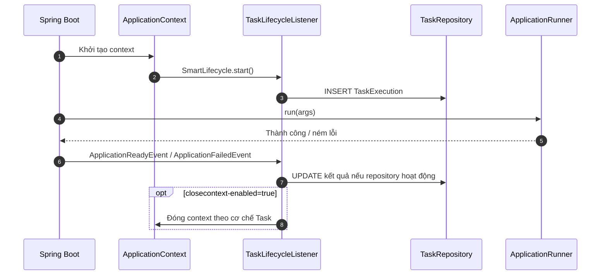
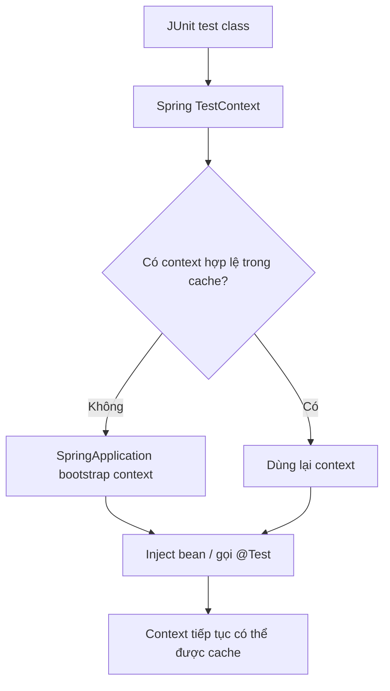

# Giữ `ApplicationContext` phù hợp khi chạy kiểm thử Spring Cloud Task

## 1. Vì sao kiểm thử Spring Cloud Task dễ gặp vấn đề vòng đời context?

Spring Cloud Task phù hợp để xây dựng ứng dụng **chạy hữu hạn rồi kết thúc**: nhập dữ liệu, đối soát giao dịch, tạo báo cáo hoặc thực thi Spring Batch job. Hạ tầng Spring Cloud Task tạo và cập nhật `TaskExecution` trong `TaskRepository` khi ứng dụng Spring Boot bắt đầu và kết thúc. Nhờ đó người vận hành biết lần chạy nào thành công, thất bại hoặc dừng bất thường.

Tuy nhiên, kiểm thử Spring thường hoạt động khác. Khi sử dụng `@SpringBootTest`, Spring Test Framework tạo `ApplicationContext`, inject các bean vào lớp test, chạy nhiều phương thức `@Test` và có thể **cache context** để tái sử dụng giữa những bài test tương thích. Kiểm thử kỳ vọng context vẫn hoạt động đủ lâu để đọc bean và chạy các assertion.

Xung đột xuất hiện khi ứng dụng Task được cấu hình **tự đóng `ApplicationContext` ngay sau khi các runner hoàn tất**. Một lần khởi chạy trong test có thể diễn ra như sau:

1. `@SpringBootTest` tạo context của ứng dụng Task.
2. `TaskLifecycleListener` tạo bản ghi bắt đầu trong `TaskRepository`.
3. Spring Boot gọi `ApplicationRunner` hoặc `CommandLineRunner`.
4. Spring Cloud Task cập nhật kết quả.
5. Nếu bật `spring.cloud.task.closecontext-enabled=true`, Task có thể đóng context.
6. Spring Test chuẩn bị inject/sử dụng bean hoặc tái sử dụng context nhưng context đã đóng.

Bài thuộc chương **Kiểm thử** của module `SPRING_CLOUD_TASK` này hướng dẫn **giữ ApplicationContext phù hợp khi chạy kiểm thử**, đồng thời kiểm soát runner, database, trạng thái thực thi và cách kiểm tra một tiến trình Task thật.

Sau bài học, bạn có thể:

- Giải thích vòng đời context theo góc nhìn của Spring Boot, Spring Test và Spring Cloud Task.
- Ghi đè `spring.cloud.task.closecontext-enabled=false` **trong phạm vi test** mà không làm thay đổi hành vi production.
- Tách unit test, slice test, integration test và test tiến trình thật.
- Ngăn `ApplicationRunner` hoặc Spring Batch job chạy nghiệp vụ ngoài ý muốn khi test bootstrap.
- Kiểm tra bản ghi `TaskExecution` bằng nguồn dữ liệu test, không làm bẩn production.
- Hiểu ảnh hưởng của cache context, `@DirtiesContext` và `@Transactional`.
- Kiểm thử đường lỗi, mã thoát JVM, retry và idempotency ở ranh giới thích hợp.

## 2. Hai vòng đời: Spring Cloud Task và Spring Test

### 2.1. Spring Cloud Task theo dõi vòng đời ứng dụng

Một ứng dụng có `@EnableTask` hoặc được bật hạ tầng Task theo cấu hình tương đương sẽ sử dụng `TaskLifecycleListener` để ghi metadata. Sau khi `ApplicationContext` bootstrap thành công, Task ghi thời điểm bắt đầu **trước khi các runner thực thi**. Khi các runner đồng bộ hoàn tất hoặc ứng dụng đi vào đường lỗi, framework cố cập nhật thông tin kết thúc.



`TaskExecution` biểu diễn **một lần chạy ứng dụng**, không phải một record riêng cho mỗi phương thức `@Test`, mỗi lời gọi service hoặc mỗi `Runnable`. Nếu JVM chết trước lúc context bootstrap, có thể không có metadata; nếu bị `kill -9`, bản ghi có thể thiếu `endTime`.

### 2.2. Spring Test muốn context còn sống

`@SpringBootTest` sử dụng `SpringApplication` để tạo `ApplicationContext` với những tính năng của Spring Boot. Spring TestContext Framework có **context cache**, cho phép nhiều phương thức test và thậm chí nhiều lớp test có cấu hình tương thích cùng dùng một context.



Nếu Task đóng context ngay sau runner, kỳ vọng “context có thể tái sử dụng” có thể bị phá vỡ. Do đó cần điều chỉnh lifecycle **theo mục tiêu kiểm thử**, thay vì thay đổi nội dung nghiệp vụ chỉ để khiến test không lỗi.

## 3. Thuộc tính trọng tâm: `spring.cloud.task.closecontext-enabled`

Thuộc tính sau quyết định **Spring Cloud Task có chủ động đóng context khi hoàn tất** hay không:

```yaml
spring:
  cloud:
    task:
      closecontext-enabled: false
```

Ở các dòng Spring Cloud Task có tài liệu cấu hình tương ứng, **giá trị mặc định là `false`**. Ứng dụng production có thể đặt `true` để chủ động đóng context khi công việc hoàn tất; điều này có ích nếu còn thread/tài nguyên khiến ứng dụng không tự thoát gọn gàng.

| Giá trị | Ý nghĩa | Tình huống phù hợp |
| --- | --- | --- |
| `false` | Spring Cloud Task không chủ động đóng context sau khi runner hoàn tất | `@SpringBootTest` cần inject bean, thực hiện assertion và tái sử dụng context |
| `true` | Spring Cloud Task có thể đóng context sau khi hoàn tất và cập nhật metadata | Lượt chạy Task production cần đóng tài nguyên để kết thúc |
| Không khai báo | Theo cấu hình mặc định của phiên bản đang sử dụng | Chỉ nên dựa vào mặc định khi đã kiểm tra cấu hình thật |

**Những điều `false` không có nghĩa:**

- **Không tắt Task lifecycle.** `TaskRepository` vẫn có thể ghi `TaskExecution` ngay khi test context bootstrap.
- **Không tắt runner.** `ApplicationRunner` và `CommandLineRunner` vẫn có thể thực thi nghiệp vụ.
- **Không tắt Spring Batch auto-launch.** Cần cấu hình riêng nếu có Batch job.
- **Không xóa dữ liệu test.** Các transaction và side effect có thể đã commit.
- **Không chứng minh JVM production tự kết thúc.** Một test context đang mở và một process thật là hai ranh giới khác nhau.

Dùng tên property kebab-case `spring.cloud.task.closecontext-enabled` trong ví dụ hiện đại; các tài liệu cũ có thể dùng dạng tên khác. Hãy đối chiếu với **phiên bản Spring Cloud Task** được quản lý bởi BOM trong dự án.

## 4. Chọn phạm vi kiểm thử trước khi chọn cấu hình context

| Kiểu kiểm thử | Có cần Spring context? | Có thể tạo `TaskExecution`? | Kiểm chứng điều gì? |
| --- | --- | --- | --- |
| **JUnit thuần / Mockito unit** | Không | Không | Validation, quy tắc nghiệp vụ, mapping, idempotency |
| **Slice test / test bean nhỏ** | Chỉ một phần context | Phụ thuộc cấu hình được nạp; thường không cần Task lifecycle | JDBC/JPA, bean condition, cấu hình nhỏ |
| **`@SpringBootTest`** | Context Boot gần đầy đủ | Có, nếu hạ tầng Task được bật và repository hoạt động | Wiring, runner, startup arguments, TaskRepository |
| **Subprocess/E2E** | JVM và context thực | Có, nếu ứng dụng bootstrap thành công | Mã thoát OS, log, shutdown, metadata và dữ liệu đầu ra |

Một phép kiểm tra `businessDate` hợp lệ **không nên mất vài giây khởi tạo Spring Boot**. Ngược lại, muốn xác minh `TaskRepository` có bản ghi trong lần bootstrap, phải dùng tích hợp thực sự thay vì mock toàn bộ framework.

### 4.1. Những câu hỏi quyết định test type

- “Parser có từ chối ngày sai định dạng?” → unit test.
- “Bean runner có được đăng ký khi bật flag?” → test cấu hình/context nhỏ.
- “Khi khởi động, TaskRepository có metadata đúng tên?” → integration test với database test.
- “Khi JAR kết thúc lỗi, scheduler thấy exit code bao nhiêu?” → subprocess/E2E.
- “Kubernetes restart có làm ghi dữ liệu trùng không?” → integration/workflow test nhiều lượt chạy với dữ liệu bền vững.

**Không dùng một `@SpringBootTest` lớn để thay thế mọi cấp độ kiểm thử**; điều đó tăng thời gian, rủi ro side effect và làm lỗi khó khoanh vùng.

## 5. Thiết kế ứng dụng Task có thể kiểm soát hành vi khi test

Ta xây ứng dụng `daily-import`, xử lý tham số `businessDate` và gọi một service nhập dữ liệu. Để test không truy cập API thật, runner được bật bằng một property của ứng dụng và phần nghiệp vụ có interface dễ thay bằng fake.

### 5.1. Một ứng dụng Java minh họa

```java
import java.time.LocalDate;
import java.util.List;

import org.springframework.boot.ApplicationRunner;
import org.springframework.boot.SpringApplication;
import org.springframework.boot.autoconfigure.SpringBootApplication;
import org.springframework.boot.autoconfigure.condition.ConditionalOnProperty;
import org.springframework.cloud.task.configuration.EnableTask;
import org.springframework.context.annotation.Bean;
import org.springframework.stereotype.Component;

@SpringBootApplication
@EnableTask
public class DailyImportTaskApplication {

    public static void main(String[] args) {
        SpringApplication.run(DailyImportTaskApplication.class, args);
    }

    @Bean
    @ConditionalOnProperty(
        prefix = "app.task",
        name = "run-on-startup",
        havingValue = "true",
        matchIfMissing = true
    )
    ApplicationRunner importRunner(ImportOperation operation) {
        return args -> {
            List<String> values = args.getOptionValues("businessDate");
            if (values == null || values.size() != 1) {
                throw new IllegalArgumentException(
                    "Cần truyền --businessDate=yyyy-MM-dd");
            }

            LocalDate date = LocalDate.parse(values.get(0));
            operation.importFor(date);
        };
    }
}

interface ImportOperation {
    void importFor(LocalDate businessDate);
}

@Component
class DefaultImportOperation implements ImportOperation {
    @Override
    public void importFor(LocalDate date) {
        // Minh họa; thay bằng xử lý nhập dữ liệu thực tế.
        System.out.println("Nhập dữ liệu ngày " + date);
    }
}
```

Ở đây:

- `@EnableTask` bật cơ chế theo dõi Task.
- `app.task.run-on-startup` là **property tự định nghĩa của ứng dụng**, không phải property chuẩn của Spring Cloud Task.
- Khi không khai báo, `matchIfMissing=true` khiến runner hoạt động ở đường chạy thông thường.
- Test smoke có thể dùng `app.task.run-on-startup=false` để không thực thi nghiệp vụ.
- Test tích hợp runner đặt `true` và thay `ImportOperation` bằng fake trước khi Spring Boot chạy runner.

### 5.2. Cấu hình production minh họa

```yaml
spring:
  application:
    name: daily-import-worker
  main:
    web-application-type: none
  cloud:
    task:
      name: daily-import
      closecontext-enabled: true
  datasource:
    url: ${TASK_DB_URL}
    username: ${TASK_DB_USER}
    password: ${TASK_DB_PASSWORD}
app:
  task:
    run-on-startup: true
```

`closecontext-enabled: true` là **lựa chọn ví dụ cho production**, không phải yêu cầu của mọi ứng dụng. Test sẽ ghi đè `false` **trong phạm vi test**, không sửa file production. Các biến database phải được cấp từ secret manager hoặc môi trường phù hợp, không đưa credential vào source.

## 6. Smoke test: giữ context mở và ngăn runner nghiệp vụ

### 6.1. `@SpringBootTest` với override trực tiếp

Ví dụ dùng H2 in-memory để tách dữ liệu test; cần thêm `spring-boot-starter-test`, H2 và JDBC dependencies tương thích.

```java
import static org.assertj.core.api.Assertions.assertThat;

import org.junit.jupiter.api.Test;
import org.springframework.beans.factory.annotation.Autowired;
import org.springframework.boot.test.context.SpringBootTest;
import org.springframework.context.ConfigurableApplicationContext;

@SpringBootTest(
    classes = DailyImportTaskApplication.class,
    webEnvironment = SpringBootTest.WebEnvironment.NONE,
    properties = {
        "spring.cloud.task.closecontext-enabled=false",
        "app.task.run-on-startup=false",
        "spring.batch.job.enabled=false",
        "spring.cloud.task.name=daily-import-context-test",
        "spring.cloud.task.initialize-enabled=true",
        "spring.datasource.url=jdbc:h2:mem:daily_import_smoke;DB_CLOSE_DELAY=-1",
        "spring.datasource.driver-class-name=org.h2.Driver"
    }
)
class DailyImportContextTest {

    @Autowired
    ConfigurableApplicationContext context;

    @Test
    void contextRemainsActive() {
        assertThat(context.isActive()).isTrue();
        assertThat(context.getBean(DailyImportTaskApplication.class))
            .isNotNull();
    }
}
```

Các property có vai trò riêng:

| Property | Lý do đặt trong test |
| --- | --- |
| `closecontext-enabled=false` | Giữ context sẵn sàng cho Spring Test và các assertion |
| `app.task.run-on-startup=false` | Tránh runner nhập dữ liệu thật khi bootstrap |
| `spring.batch.job.enabled=false` | Tránh tự khởi chạy Batch job nếu ứng dụng có tích hợp Batch |
| `spring.cloud.task.name=...-test` | Giúp phân biệt metadata test |
| `initialize-enabled=true` | Minh họa khởi tạo schema Task trong **database H2 test** |
| `spring.datasource.url=jdbc:h2:mem:...` | Cô lập nơi lưu metadata khỏi môi trường thật |
| `WebEnvironment.NONE` | Không tạo server cho Task hữu hạn |

**Lưu ý:** test context vẫn có thể tạo **một `TaskExecution`** vì hạ tầng Spring Cloud Task còn hoạt động. Chỉ có runner nghiệp vụ bị tắt. Nếu mục tiêu chỉ là kiểm tra business logic, dùng unit test thay vì chịu overhead của cả Task.

### 6.2. `@TestPropertySource` là một lựa chọn khác

```java
@SpringBootTest(
    classes = DailyImportTaskApplication.class,
    webEnvironment = SpringBootTest.WebEnvironment.NONE
)
@TestPropertySource(properties = {
    "spring.cloud.task.closecontext-enabled=false",
    "app.task.run-on-startup=false",
    "spring.batch.job.enabled=false"
})
class ImportWithPropertySourceTest {
    // Inject bean và viết @Test khi đã có datasource test phù hợp.
}
```

Đoạn trên chỉ minh họa **kỹ thuật override**, chưa phải test độc lập có database, vì datasource cần được cấp từ profile/test configuration khác. Không copy riêng snippet rồi nghĩ nó có schema H2 tự động.

### 6.3. Một lưu ý về `@SpringBootTest` và `main`

Theo Spring Boot, `@SpringBootTest` thông thường khởi tạo context **qua `SpringApplication`**, không mặc định gọi chính phương thức `main` của ứng dụng. Nếu `main` còn thực hiện `SpringApplication.exit(...)` và `System.exit(...)`, test context thông thường **không phải** bằng chứng rằng những lệnh đó hoạt động đúng trên JVM thật.

Không bật lựa chọn gọi `main` trong test một cách tùy tiện nếu `main` có `System.exit(...)`: nó có thể kết thúc toàn bộ JVM chạy bộ test.

## 7. Test runner thật: thay collaborator trước khi startup

Smoke test tắt runner không kiểm tra được runner đọc `businessDate` và gọi đúng nghiệp vụ. Khi muốn test đường chạy thật, dùng **fake bean** sẵn có trước lúc runner được Boot gọi.

### 7.1. Fake ghi nhận dữ liệu

```java
import java.time.LocalDate;
import java.util.concurrent.atomic.AtomicReference;

final class RecordingImportOperation implements ImportOperation {
    private final AtomicReference<LocalDate> last =
        new AtomicReference<>();

    @Override
    public void importFor(LocalDate date) {
        last.set(date);
    }

    LocalDate lastDate() {
        return last.get();
    }
}
```

### 7.2. Test tích hợp với `@TestConfiguration`

```java
import static org.assertj.core.api.Assertions.assertThat;

import java.time.LocalDate;
import org.junit.jupiter.api.Test;
import org.springframework.beans.factory.annotation.Autowired;
import org.springframework.boot.test.context.SpringBootTest;
import org.springframework.boot.test.context.TestConfiguration;
import org.springframework.context.annotation.Bean;
import org.springframework.context.annotation.Import;
import org.springframework.context.annotation.Primary;

@SpringBootTest(
    classes = DailyImportTaskApplication.class,
    webEnvironment = SpringBootTest.WebEnvironment.NONE,
    args = "--businessDate=2026-11-23",
    properties = {
        "spring.cloud.task.closecontext-enabled=false",
        "spring.cloud.task.name=daily-import-runner-test",
        "spring.cloud.task.initialize-enabled=true",
        "spring.datasource.url=jdbc:h2:mem:daily_import_runner;DB_CLOSE_DELAY=-1",
        "spring.datasource.driver-class-name=org.h2.Driver",
        "app.task.run-on-startup=true",
        "spring.batch.job.enabled=false"
    }
)
@Import(DailyImportRunnerTest.FakeConfig.class)
class DailyImportRunnerTest {

    @Autowired
    RecordingImportOperation operation;

    @Test
    void runnerUsesCommandLineDate() {
        assertThat(operation.lastDate())
            .isEqualTo(LocalDate.of(2026, 11, 23));
    }

    @TestConfiguration(proxyBeanMethods = false)
    static class FakeConfig {
        @Bean
        @Primary
        RecordingImportOperation recordingImportOperation() {
            return new RecordingImportOperation();
        }
    }
}
```

Fake được đăng ký **trước khi runner chạy**. `@Primary` khiến `ApplicationRunner` inject fake thay vì `DefaultImportOperation`. Nhờ đó test quan sát được tham số mà không gọi API/database nghiệp vụ thật.

**Cảnh báo thời điểm:** `ApplicationRunner` chạy **khi bootstrap context, trước `@Test` và thường trước `@BeforeEach`**. Vì thế việc tạo stub cho mock trong `@BeforeEach` có thể quá muộn nếu runner phải dùng stub đó ngay khi startup.

Những phiên bản Spring Boot/Spring Framework khác nhau hỗ trợ `@MockBean` hoặc `@MockitoBean`; khi cần thiết lập behavior **trước** runner, cách cấu hình fake bằng `@TestConfiguration` thường dễ hiểu hơn.

## 8. Unit test nghiệp vụ: không cần tạo Spring context

Một phần lớn việc kiểm tra logic Task nên là unit test thuần Java. Ví dụ quy tắc parse ngày:

```java
import java.time.LocalDate;

public final class ImportDatePolicy {

    public LocalDate parse(String value) {
        if (value == null || value.isBlank()) {
            throw new IllegalArgumentException("Thiếu ngày xử lý");
        }
        LocalDate date = LocalDate.parse(value);
        if (date.isAfter(LocalDate.of(2100, 1, 1))) {
            throw new IllegalArgumentException("Ngày vượt phạm vi");
        }
        return date;
    }
}
```

Kiểm thử JUnit 5:

```java
import static org.junit.jupiter.api.Assertions.assertEquals;
import static org.junit.jupiter.api.Assertions.assertThrows;

import java.time.LocalDate;
import org.junit.jupiter.api.Test;

class ImportDatePolicyTest {
    private final ImportDatePolicy policy = new ImportDatePolicy();

    @Test
    void validDate() {
        assertEquals(LocalDate.of(2026, 11, 23),
                     policy.parse("2026-11-23"));
    }

    @Test
    void invalidDate() {
        assertThrows(IllegalArgumentException.class,
                     () -> policy.parse(""));
    }
}
```

Các test này không phụ thuộc datasource, metadata schema, `@EnableTask` hoặc `closecontext-enabled`. Điều đó làm chúng nhanh, dễ chạy song song và xác định lỗi chính xác hơn.

## 9. Kiểm chứng `TaskRepository` nhưng không đụng database production

Một `@SpringBootTest` có `@EnableTask` có thể **ghi metadata ngay trong quá trình bootstrap**. Do đó, mọi test full-context phải sử dụng **DB test** và schema hợp lệ.

### 9.1. Ví dụ đọc bản ghi Task bằng JDBC

```java
import static org.assertj.core.api.Assertions.assertThat;

import org.junit.jupiter.api.Test;
import org.springframework.beans.factory.annotation.Autowired;
import org.springframework.boot.test.context.SpringBootTest;
import org.springframework.jdbc.core.JdbcTemplate;

@SpringBootTest(
    classes = DailyImportTaskApplication.class,
    webEnvironment = SpringBootTest.WebEnvironment.NONE,
    properties = {
        "spring.cloud.task.closecontext-enabled=false",
        "spring.cloud.task.name=daily-import-metadata-test",
        "spring.cloud.task.initialize-enabled=true",
        "app.task.run-on-startup=false",
        "spring.batch.job.enabled=false",
        "spring.datasource.url=jdbc:h2:mem:daily_import_metadata;DB_CLOSE_DELAY=-1",
        "spring.datasource.driver-class-name=org.h2.Driver"
    }
)
class TaskRepositoryMetadataTest {

    @Autowired
    JdbcTemplate jdbcTemplate;

    @Test
    void metadataExistsForStartedTask() {
        Integer count = jdbcTemplate.queryForObject(
            """
            SELECT COUNT(*)
              FROM TASK_EXECUTION
             WHERE TASK_NAME = 'daily-import-metadata-test'
            """,
            Integer.class);

        assertThat(count).isNotNull().isGreaterThanOrEqualTo(1);
    }
}
```

Tên bảng/cột phải khớp với schema Spring Cloud Task của phiên bản được thử nghiệm. Nếu test dùng H2, cần script khởi tạo schema tương ứng; `initialize-enabled=true` ở đây dùng cho **môi trường học/test**, không phải khuyến nghị cho production.

**Vì sao không assert chính xác “một hàng cho mỗi `@Test`”?** Vì Task lifecycle chạy khi **context bootstrap**, còn Spring Test có thể tái sử dụng context. Nhiều test methods trong một context **không tự tạo nhiều `TaskExecution`**.

### 9.2. Testcontainers cho database giống production

H2 có thể khác PostgreSQL/MySQL về SQL dialect, transaction isolation, sequence và migration. Khi cần kiểm tra repository concurrency, schema migration hoặc cách xử lý deadlock, nên chạy integration test trên **cùng loại DBMS với production** bằng Testcontainers hoặc database test biệt lập.

Tùy phiên bản Spring Boot, có thể dùng `@ServiceConnection` hoặc `@DynamicPropertySource` để cấp JDBC connection từ container. Phải khởi tạo schema Task/Batch bằng script/migration đúng phiên bản; không nên mặc định schema trong database ngoài sẽ tự có.

### 9.3. Không để CI trỏ nhầm URL production

Các biến như `TASK_DB_URL` hoặc `SPRING_DATASOURCE_URL` có thể được kế thừa từ môi trường. **Nếu context test khởi tạo được với URL production, framework có thể ghi `TaskExecution` trước khi bất kỳ `@Test` nào chạy.** Runner còn có thể thực hiện nghiệp vụ thật.

Bảo đảm cấu hình CI sử dụng DB riêng, tài khoản test có quyền giới hạn, không tái sử dụng credential production và có bước kiểm tra URL trước khi khởi chạy integration test.

## 10. Context cache, `@DirtiesContext` và số lần Task được ghi nhận

Spring Test cache context theo tổ hợp configuration class, active profiles, properties và những yếu tố cache key khác.

| Hành vi test | Hệ quả |
| --- | --- |
| Nhiều `@Test` trong cùng class | Thường dùng **một context**, runner không tự chạy lại mỗi method |
| Hai lớp có cấu hình tương thích | Có thể chia sẻ một context được cache |
| Thay properties/profile/test configuration | Có thể tạo context khác → Task bootstrap thêm lần |
| `@DirtiesContext` | Context bị đánh dấu không tái sử dụng → lần tiếp theo có thể khởi tạo lại |
| Test tự thay bean mutable state | Context cache có thể giữ state giữa các test, cần reset hợp lý |
| `closecontext-enabled=true` | Task có thể đóng context ngoài ý muốn của TestContext |

**Đừng dùng `@DirtiesContext` trên mọi test chỉ để dọn dữ liệu**. Nó làm tăng chi phí bootstrap và có thể tạo thêm `TaskExecution` không cần thiết. Khi cần test isolation, ưu tiên database/schema riêng, transaction đúng phạm vi hoặc dọn dữ liệu có kiểm soát.

### 10.1. `@Transactional` trên `@Test` không rollback runner startup

Một method có `@Transactional` thường được Spring Test mở transaction cho chính test method. Nhưng `ApplicationRunner` đã được Boot thực thi **khi bootstrap**, trước khi test method bắt đầu.

Vì thế, những thay đổi đã commit trong runner **không tự bị rollback** chỉ vì test có `@Transactional`. `TaskRepository` còn có thể sử dụng transaction riêng. Khi kiểm thử Task, phải kiểm soát setup/cleanup và database test, không trông chờ vào annotation trên method để hoàn tác mọi side effect.

## 11. Tránh side effect từ runner và Spring Batch

Các runner lúc startup có thể:

- Gọi API thanh toán hoặc dịch vụ ngoài.
- Ghi database nghiệp vụ.
- Gửi email hoặc message.
- Tạo file lớn trong `/tmp`.
- Khởi chạy Spring Batch Job.
- Đăng ký thread/TaskExecutor và giữ context hoạt động.

Khi chỉ cần smoke test, sử dụng flag **do ứng dụng tự định nghĩa** như `app.task.run-on-startup=false`. Khi muốn kiểm tra runner thật, thay collaborator bằng bean giả và dùng dữ liệu test.

Với Spring Batch, `spring.batch.job.enabled=false` có thể giúp test không tự chạy các `Job` khi startup. **Nó không tắt Spring Cloud Task** và không thay thế integration test cần chứng minh job chạy thành công/thất bại.

Nếu mục tiêu là kiểm tra `spring.cloud.task.batch.fail-on-job-failure`, cần cố ý bật job/runner tích hợp trong test riêng, kiểm tra `JobExecution.BatchStatus`, kết quả Task và mã thoát process theo yêu cầu.

Không nên “sửa” một test bằng cách bắt mọi exception trong runner rồi trả về bình thường. Điều đó dễ khiến Task ghi trạng thái thành công trong khi xử lý nghiệp vụ thất bại.

## 12. Kiểm thử đường lỗi: phân biệt lỗi context với lỗi nghiệp vụ

Có hai tình huống khác nhau:

1. **Lỗi trong business method:** unit test có thể gọi method và `assertThrows(...)` trực tiếp.
2. **Lỗi trong runner khi bootstrap:** `@SpringBootTest` có thể thất bại **trước khi JUnit gọi `@Test`**. Một test class bình thường không phải công cụ phù hợp để assert context đã không thể tạo.

Ví dụ, nếu runner đọc `--businessDate=invalid` và ném `DateTimeParseException`, `@SpringBootTest(args="--businessDate=invalid")` có thể khiến Spring Test báo lỗi khởi tạo context; test method dùng `assertThrows` **không bao giờ được chạy**.

Các cách kiểm thử phù hợp:

- Gọi riêng parser hoặc business service trong unit test.
- Tạo `SpringApplication` có kiểm soát trong test chuyên biệt nếu chỉ cần kiểm tra đường bootstrap.
- Chạy JAR thực sự trong **subprocess** nếu cần xác nhận mã thoát hệ điều hành và metadata sau khi process kết thúc.

Không dùng thử nghiệm lỗi bootstrap trên context cache mà nhiều test khác đang cần tái sử dụng.

## 13. Kiểm tra mã thoát JVM thật bằng `ProcessBuilder`

`@SpringBootTest` có thể kiểm tra `ApplicationContext` và `TaskRepository`, nhưng **không chứng minh exit code thực tế của JVM**. Muốn xác nhận hợp đồng với scheduler/Kubernetes, phải khởi chạy ứng dụng như process riêng.

Khung kiểm thử sau giả định JAR đã được build, database/schema test đã được chuẩn bị và cấu hình môi trường **không chứa secret production**:

```java
import static org.junit.jupiter.api.Assertions.assertEquals;
import static org.junit.jupiter.api.Assertions.assertTrue;

import java.nio.file.Files;
import java.nio.file.Path;
import java.util.concurrent.TimeUnit;

import org.junit.jupiter.api.Test;

class TaskProcessExitTest {

    @Test
    void successReturnsZero() throws Exception {
        Path jar = Path.of("build/libs/daily-import-task.jar");
        Path log = Files.createTempFile("task-e2e-", ".log");

        ProcessBuilder pb = new ProcessBuilder(
            "java", "-jar", jar.toAbsolutePath().toString(),
            "--businessDate=2026-11-23");
        pb.redirectErrorStream(true);
        pb.redirectOutput(log.toFile());

        // Bắt buộc thay các biến kết nối bằng database test riêng.
        pb.environment().put(
            "SPRING_CLOUD_TASK_CLOSECONTEXT_ENABLED", "true");

        Process p = pb.start();
        try {
            boolean done = p.waitFor(30, TimeUnit.SECONDS);
            if (!done) {
                p.destroyForcibly();
                p.waitFor();
            }

            assertTrue(done, "Task vượt timeout");
            assertEquals(0, p.exitValue());
        } finally {
            if (p.isAlive()) {
                p.destroyForcibly();
            }
            Files.deleteIfExists(log);
        }
    }
}
```

Đoạn này là **khung tham khảo**, không thể dùng ngay nếu thiếu file JAR hoặc database test. Cần kiểm tra file artifact tồn tại, environment của process con **không kế thừa datasource/credential production**, có startup profile phù hợp và có kế hoạch cleanup.

Test đường lỗi có thể truyền ngày không hợp lệ rồi assert mã khác 0. Tuy nhiên, mã chính xác còn phụ thuộc vào `main`, `SpringApplication.exit(...)`, `ExitCodeGenerator` và cách Spring Boot xử lý exception của phiên bản dùng. **Đừng giả định mọi exception luôn trả cùng một mã trên mọi môi trường**.

Quan trọng hơn, test subprocess còn nên truy vấn `TaskRepository` và dữ liệu nghiệp vụ test để kiểm tra kết quả thực, chứ không chỉ nhìn OS exit code.

## 14. Khi Task kết hợp Spring Batch và repository riêng

Một ứng dụng Spring Cloud Task có thể chạy Spring Batch. Khi đó có hai mô hình metadata:

| Repository | Bản ghi | Nội dung cần kiểm thử |
| --- | --- | --- |
| Spring Cloud Task `TaskRepository` | `TaskExecution` | Lifecycle ứng dụng, start/end/exitCode |
| Spring Batch `JobRepository` | `JobExecution`, `StepExecution` | Trạng thái job/step, checkpoint, đọc/ghi/skip |

Nếu test chỉ muốn kiểm tra wiring các bean nghiệp vụ, tắt Batch auto-launch bằng `spring.batch.job.enabled=false` có thể phù hợp. Nếu test muốn chứng minh Batch thực sự chạy, phải **cho chạy job trên DB test** với `JobParameters` kiểm soát, kiểm tra `BatchStatus` và `ExitStatus`, không tự động kết luận một context active là job thành công.

Khi muốn kiểm chứng property `spring.cloud.task.batch.fail-on-job-failure=true`, cần dùng đường runner tích hợp và cấu hình để `BatchStatus.FAILED` được lan truyền sang kết quả Task. Test này nên **tách khỏi smoke test**, vì nó cố tình tạo lỗi khi startup và có thể làm `@SpringBootTest` thất bại trước khi test method bắt đầu.

Với các kiểm thử remote partitioning, manager và worker là **các tiến trình khác nhau**; một context test trong JVM không thay thế kiểm thử truy cập chung `JobRepository`/`TaskRepository`, worker restart hoặc idempotency trên dữ liệu nghiệp vụ.

## 15. Bảng chẩn đoán lỗi thường gặp

| Triệu chứng | Nguyên nhân có thể | Cách khắc phục |
| --- | --- | --- |
| Context không active khi test dùng bean | Task tự đóng context sau runner | Đặt `spring.cloud.task.closecontext-enabled=false` trong test |
| Test gọi API thật trước khi `@Test` bắt đầu | Runner chạy trong giai đoạn bootstrap | Flag test tắt runner hoặc fake bean được tạo sẵn |
| Test tạo `TaskExecution` dù runner bị tắt | Task lifecycle vẫn hoạt động | Đây có thể là đúng; dùng DB test riêng |
| Có ít bản ghi hơn số phương thức `@Test` | Context được cache và tái sử dụng | Không coi một method bằng một TaskExecution |
| Có nhiều bản ghi hơn dự kiến | Context tạo lại do profile/property/`@DirtiesContext` | Kiểm tra cache key và DB isolation |
| `@Transactional` không rollback dữ liệu startup | Runner/TaskRepository đã commit trước test method | Dùng DB riêng/cleanup; tách runner |
| Mockito stub ở `@BeforeEach` không được runner dùng | Stub được thiết lập sau bootstrap | Fake qua `@TestConfiguration` trước startup |
| Context test lỗi do Batch job | Batch tự launch khi Spring Boot startup | Tắt Batch auto-launch trong smoke test |
| Test startup failure không đến được `assertThrows` | Context không bootstrap nên `@Test` chưa chạy | Unit test lỗi logic hoặc subprocess test |
| Process E2E lỗi trước khi ghi `TaskExecution` | Thiếu schema/secret/classpath | Xem log, process exit và datasource test |
| Database production xuất hiện bản ghi test | Context test dùng nhầm URL/credential | Khóa profile, URL và secret test |
| Test quá chậm | Dùng `@SpringBootTest` cho mọi kiểm tra | Tăng unit/slice test, giảm context churn |
| JVM test bị kết thúc | Test gọi vào `main` có `System.exit` | Tránh gọi main trong JVM test; dùng subprocess |

## 16. Checklist thiết kế bộ kiểm thử an toàn

- [ ] Xác định mỗi test là unit, slice, context integration hay process-level.
- [ ] Với `@SpringBootTest` của Task hữu hạn, sử dụng `WebEnvironment.NONE` khi không cần server.
- [ ] Với test cần giữ context mở, ghi đè `spring.cloud.task.closecontext-enabled=false` **chỉ trong test**.
- [ ] Không hiểu `closecontext-enabled=false` là tắt Task lifecycle hay runner.
- [ ] Mọi `ApplicationRunner`/`CommandLineRunner` có side effect đều được kiểm soát.
- [ ] Dùng fake bean được đăng ký **trước bootstrap** khi test runner.
- [ ] Spring Batch auto-launch được tắt ở test không kiểm tra Batch, bật có chủ đích ở test khác.
- [ ] DataSource test tách hẳn production; schema/migration đúng phiên bản.
- [ ] Không giả định một `@Test` sinh một `TaskExecution` do context cache.
- [ ] Không giả định `@Transactional` của test dọn mọi ghi dữ liệu lúc startup.
- [ ] `@DirtiesContext` chỉ dùng khi thật sự cần context mới.
- [ ] Test lỗi khởi động và exit code sử dụng ranh giới subprocess hoặc runner riêng.
- [ ] Process E2E có timeout, log capture và cleanup an toàn.
- [ ] Có kiểm thử database failure, retry, concurrency và idempotency với dữ liệu giả.
- [ ] Kết quả nghiệp vụ được xác minh riêng, không chỉ dựa vào `TaskExecution.exitCode`.

## 17. Bài tập và câu hỏi tự kiểm tra

**Bài tập A — Context bị đóng quá sớm.**

Production đặt `spring.cloud.task.closecontext-enabled=true`. Một `@SpringBootTest` cần inject service và gọi nhiều method nhưng context bị đóng. Hãy sửa test mà không thay đổi production.

**Gợi ý:** sử dụng `@SpringBootTest(properties = "spring.cloud.task.closecontext-enabled=false")` hoặc `@TestPropertySource`. Sau đó kiểm soát runner và datasource để không gây side effect.

**Bài tập B — Runner gọi dịch vụ ngoài ngay khi startup.**

Bạn dùng `@MockBean` hoặc `@MockitoBean` rồi stub trong `@BeforeEach`, nhưng API thật đã bị gọi trước đó. Vì sao?

**Gợi ý:** runner chạy trong quá trình bootstrap, trước `@BeforeEach`. Dùng test fake qua `@TestConfiguration`/`@Primary` hoặc property chặn runner trong smoke test.

**Bài tập C — Ba phương thức test, một bản ghi Task.**

Lớp test có ba `@Test` và cùng một `@SpringBootTest` context. Vì sao có thể chỉ có một `TaskExecution`?

**Gợi ý:** Task ghi metadata khi context bootstrap; Spring Test tái sử dụng context giữa methods.

**Bài tập D — Lỗi đầu vào khi bootstrap.**

Bạn muốn assert rằng `--businessDate=abc` khiến ứng dụng Task trả exit code khác 0. Có nên dùng một `@SpringBootTest` bình thường rồi đặt `assertThrows` trong `@Test` không?

**Gợi ý:** không; context có thể thất bại trước lúc JUnit chạy test method. Dùng unit test parser và subprocess E2E riêng để kiểm tra OS exit.

**Bài tập E — Dữ liệu test không rollback.**

Runner đã commit dữ liệu ngay khi context boot. Sau test method có `@Transactional` rollback nhưng dữ liệu vẫn còn. Vì sao?

**Gợi ý:** runner chạy trước transaction của test method; cần DB riêng và cleanup phù hợp.

**Câu hỏi 1.** `closecontext-enabled=false` có vô hiệu hóa `TaskRepository` không?

**Câu hỏi 2.** `ApplicationRunner` thường được chạy trước hay sau phương thức `@Test`?

**Câu hỏi 3.** `@DirtiesContext` làm thay đổi điều gì và có phải cách dọn DB tốt nhất cho mọi test không?

**Câu hỏi 4.** Một `JobExecution` của Spring Batch báo `FAILED` nhưng `@SpringBootTest` vẫn khởi tạo được. Điều đó chứng minh Task đã được ghi thất bại chưa?

**Câu hỏi 5.** Khi Task bị kill trước lúc bootstrap context thành công, có chắc tồn tại một dòng `TASK_EXECUTION` không?

**Gợi ý trả lời:** (1) không, chỉ ngăn tự đóng context; (2) trước, trong quá trình bootstrap; (3) hủy cache context và có thể buộc bootstrap lại, không tự thay thế DB cleanup; (4) không, phải kiểm tra đường lan truyền lỗi Batch/Task; (5) không, cần đối chiếu log và process/platform status.

## 18. Tổng kết và tài liệu tham khảo

**Giữ `ApplicationContext` phù hợp khi kiểm thử Spring Cloud Task** nghĩa là điều chỉnh lifecycle theo đúng mục tiêu của Spring Test: với `@SpringBootTest` cần tái sử dụng context và inject bean sau khi runner hoàn tất, thường đặt **`spring.cloud.task.closecontext-enabled=false` trong phạm vi test**. Production có thể bật tự đóng context nếu cần dừng tiến trình gọn gàng.

Dù context còn mở, **Task lifecycle có thể vẫn ghi metadata, runner vẫn có thể chạy, Batch job vẫn có thể khởi động và dữ liệu đã commit không tự rollback**. Vì vậy, một chiến lược tốt kết hợp unit test nhanh, context smoke test có kiểm soát, integration test dùng repository test riêng và subprocess E2E khi cần mã thoát JVM thật. Với Spring Batch hoặc retry, phải kiểm tra trạng thái dữ liệu và idempotency, không chỉ một assertion context active.

**Tài liệu tham khảo chính thức:**

- [Spring Cloud Task — Features, Closing the Context](https://docs.spring.io/spring-cloud-task/reference/features.html)
- [Spring Cloud — Configuration Properties của Spring Cloud Task](https://docs.spring.io/spring-cloud/docs/current/reference/html/configprops.html)
- [Spring Boot — Testing Spring Boot Applications](https://docs.spring.io/spring-boot/reference/testing/spring-boot-applications.html)
- [Spring Framework — TestContext Caching](https://docs.spring.io/spring-framework/reference/testing/testcontext-framework/ctx-management/caching.html)
- [Spring Framework — @DirtiesContext](https://docs.spring.io/spring-framework/reference/testing/annotations/integration-spring/annotation-dirtiescontext.html)
- [Spring Batch — Testing](https://docs.spring.io/spring-batch/reference/testing.html)
