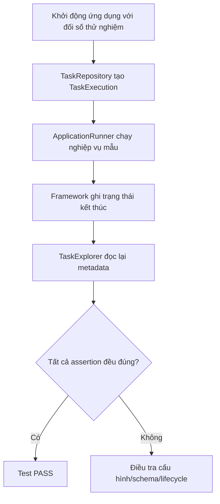

# Xác minh TaskExecution và tham số qua TaskExplorer

## 1. Vì sao cần kiểm thử dữ liệu thực thi?

Một ứng dụng **Spring Cloud Task** là chương trình Spring Boot thực hiện công việc có thời gian chạy hữu hạn: nhận yêu cầu, xử lý nghiệp vụ và kết thúc. Khi sử dụng `TaskRepository` dựa trên cơ sở dữ liệu, framework lưu metadata của từng lần chạy dưới dạng **`TaskExecution`**, bao gồm ID thực thi, tên tác vụ, thời điểm bắt đầu/kết thúc, mã thoát, thông báo lỗi và **danh sách đối số dòng lệnh**.

Trong kiểm thử, thấy dòng log `Task completed` hoặc `ApplicationRunner` chạy đến cuối **chưa đủ** để khẳng định metadata được ghi đúng. Một cấu hình sai `DataSource`, thiếu schema hoặc lỗi trong giai đoạn kết thúc có thể khiến dữ liệu truy vết không như mong muốn. Khi task được gọi qua cron, Kubernetes Job, Spring Cloud Data Flow hoặc Spring Batch, khả năng xem lại metadata còn quan trọng hơn vì mỗi lần chạy là một tiến trình riêng.

**`TaskExplorer`** là API chuyên dùng để **đọc và tìm kiếm lịch sử `TaskExecution`**. Bài này tập trung xác minh thông tin một lần chạy và các tham số được ghi lại, bằng JUnit và cơ sở dữ liệu H2 dành cho bài lab; sau đó mở rộng cách kiểm tra khi chạy bằng JAR hoặc scheduler.

Ví dụ mục tiêu kiểm thử một tác vụ nhập đơn hàng:

```text
Tên task: orders-import-test
Đối số: --import.date=2026-11-24
        --request.id=partner-a-2026-11-24

Kỳ vọng:
  TaskExecution có executionId hợp lệ
  taskName = orders-import-test
  startTime và endTime có giá trị khi đã hoàn tất
  exitCode = 0 khi lần chạy hoàn thành bình thường
  arguments chứa nguyên văn hai đối số đã truyền
```

Số `executionId` do repository cấp, **không nên hard-code phải bằng 1**. Cũng không dùng `TaskExecution` ID làm khóa chống trùng dữ liệu nghiệp vụ: một yêu cầu có thể được thử lại nhiều lần, mỗi lần có ID khác.

## 2. TaskRepository và TaskExplorer có vai trò khác nhau

| Thành phần | Trách nhiệm | Có nên dùng trong test? |
| --- | --- | --- |
| `TaskRepository` | Tạo và cập nhật trạng thái của `TaskExecution` | Kiểm thử chuyên biệt việc ghi/transaction, hoặc để framework tự quản lý trong integration test |
| **`TaskExplorer`** | Đọc theo execution ID, tên task, phân trang và truy vấn liên kết với Batch | **API chính** để assert metadata đã được lưu |
| `TaskExecution` | Đối tượng biểu diễn một lần thực thi và các thuộc tính đã lưu | Kiểm tra `getExecutionId()`, `getTaskName()`, `getArguments()`... |
| `ApplicationRunner` / `CommandLineRunner` | Nhận đối số và gọi use case nghiệp vụ khi task chạy | Test luồng nhận tham số, lỗi và kết quả nghiệp vụ |
| `JdbcTemplate`/SQL | Kiểm tra bảng metadata và dữ liệu đích trực tiếp | Hữu ích để đối chiếu schema hoặc điều tra sai lệch |
| Scheduler / Kubernetes Job | Khởi tạo tiến trình và quyết định retry | Kiểm thử riêng lịch, timeout, số attempt và tín hiệu hạ tầng |

`TaskExplorer` nằm trong package **`org.springframework.cloud.task.repository`**, có một implementation thông dụng là `SimpleTaskExplorer`. Trong ứng dụng cấu hình Spring Cloud Task theo cách chuẩn, framework cung cấp các thành phần repository/explorer phù hợp với `DataSource` và `TaskConfigurer`; **không cần tự viết lại SQL đọc metadata chỉ để lấy lịch sử**.

### Những phương thức TaskExplorer cần biết

| API | Kết quả và mục đích |
| --- | --- |
| `getTaskExecution(long executionId)` | Trả về một `TaskExecution` theo ID, hoặc `null` nếu không thấy |
| `getLatestTaskExecutionForTaskName(String name)` | Lần chạy có `START_TIME` mới nhất của tên task (có thể **chưa hoàn tất**) |
| `findTaskExecutionsByName(String name, Pageable pageable)` | `Page<TaskExecution>` để kiểm tra danh sách theo tên |
| `findAll(Pageable pageable)` | `Page<TaskExecution>` của tất cả các lần chạy với giới hạn phân trang |
| `getTaskExecutionCountByTaskName(String name)` | Số execution theo tên task |
| `getTaskExecutionCount()` | Tổng số execution trong repository |
| `getRunningTaskExecutionCount()` | Số execution được repository xem là đang chạy |
| `getTaskNames()` | Danh sách tên task đã được ghi nhận |
| `getJobExecutionIdsByTaskExecutionId(long id)` | Các ID Batch `JobExecution` được liên kết với TaskExecution, nếu có tích hợp |
| `getTaskExecutionIdByJobExecutionId(long jobExecutionId)` | ID task liên kết với Batch job execution, hoặc `null` nếu không có |

**Lưu ý về tên API:** với API Spring Cloud Task 3.x, danh sách tham số được lấy bằng **`TaskExecution.getArguments()`**, sau khi đã đọc `TaskExecution` từ `TaskExplorer`. Không sử dụng các tên tự đoán như `TaskExplorer.getTaskExecutionArgs(id)`; phương thức đó không nằm trong giao diện được tài liệu Javadoc hiện hành mô tả.

```java
TaskExecution execution = taskExplorer.getTaskExecution(executionId);
if (execution != null) {
    List<String> commandLineArguments = execution.getArguments();
}
```

`getArguments()` trả về một **`List<String>` chứa đối số dòng lệnh đã được truyền cho ứng dụng**, không phải `Map<String,String>` với các thuộc tính Spring Boot đã bind. Muốn xác minh `--import.date=2026-11-24`, hãy kiểm tra chính chuỗi đó trong list; việc kiểm tra giá trị đã được parse thành `LocalDate` thuộc về test của `ApplicationRunner`/service.

## 3. Những gì nên assert trên một TaskExecution



| Thuộc tính | Assertion với lần chạy **đã kết thúc thành công** | Cần tránh |
| --- | --- | --- |
| `executionId` | ID được cấp hợp lệ, lấy lại đúng cùng bản ghi | `assertEquals(1L, ...)` nếu database có thể đã có dữ liệu |
| `taskName` | Khớp tên logic đã cấu hình | Nhầm với tên class, tên JAR hoặc `spring.application.name` |
| `startTime` | Không `null` | Coi ID lớn hơn là bằng chứng bắt đầu sớm/muộn |
| `endTime` | Không `null`, không sớm hơn `startTime` | Yêu cầu có `endTime` **ngay lúc runner đang chạy** |
| `exitCode` | Bằng `Integer.valueOf(0)` cho lần thành công bình thường | So sánh bằng primitive khi trường có thể `null` |
| `arguments` | Chứa các đối số được truyền qua CLI | Mong mọi biến môi trường/YAML đều xuất hiện trong list |
| `errorMessage` | Thường `null`/rỗng trong lần chạy không lỗi | Dùng `errorMessage` làm nguồn sự thật duy nhất về nghiệp vụ |

**Thời điểm đọc rất quan trọng.** Spring Cloud Task ghi thông tin bắt đầu khi lifecycle khởi động và cập nhật kết quả sau khi các runner hoàn tất hoặc khi gặp lỗi được framework quản lý. Nếu test truy vấn **ngay bên trong `ApplicationRunner` của chính lần chạy đó**, `END_TIME`/`EXIT_CODE` cuối cùng có thể vẫn chưa tồn tại. Test integration nên **chạy ứng dụng rồi mới truy vấn metadata sau khi `SpringApplication.run(...)` trả về** hoặc chờ tiến trình con kết thúc khi kiểm thử đa tiến trình.

Nếu JVM bị `SIGKILL`, mất điện hoặc ứng dụng lỗi trước khi `ApplicationContext` hình thành, framework không thể bảo đảm có một bản ghi hoàn chỉnh. Một bản ghi thiếu `END_TIME` không đủ chứng minh process vẫn đang chạy.

## 4. Chuẩn bị bài lab: Spring Cloud Task và H2

Ví dụ sử dụng **Java 17+**, JUnit Jupiter, Spring Boot và một dòng **Spring Cloud Task tương thích**. Sử dụng Spring Cloud BOM phù hợp với Spring Boot của dự án; không ghép tùy ý starter thuộc những release train khác nhau.

### 4.1. Dependencies Maven

```xml
<!-- Dự án đã cấu hình Spring Boot parent/BOM và Spring Cloud BOM. -->
<dependencies>
    <dependency>
        <groupId>org.springframework.cloud</groupId>
        <artifactId>spring-cloud-starter-task</artifactId>
    </dependency>
    <dependency>
        <groupId>org.springframework.boot</groupId>
        <artifactId>spring-boot-starter-jdbc</artifactId>
    </dependency>
    <dependency>
        <groupId>com.h2database</groupId>
        <artifactId>h2</artifactId>
        <scope>runtime</scope>
    </dependency>
    <dependency>
        <groupId>org.springframework.boot</groupId>
        <artifactId>spring-boot-starter-test</artifactId>
        <scope>test</scope>
    </dependency>
</dependencies>
```

`spring-boot-starter-test` cung cấp JUnit Jupiter và các assertion thông dụng. `spring-cloud-starter-task` cung cấp lifecycle và API `TaskExplorer`. `spring-boot-starter-jdbc`/H2 tạo một database thử nghiệm gọn nhẹ. Trong ví dụ **một JVM test**, H2 in-memory giúp tránh phụ thuộc vào dịch vụ CSDL bên ngoài; nhưng **không dùng hai JVM với hai H2 `mem:` để giả vờ đã có chung metadata**.

### 4.2. Cấu hình task

`src/main/resources/application.yml`:

```yaml
spring:
  application:
    name: orders-import-app
  main:
    web-application-type: none
  datasource:
    driver-class-name: org.h2.Driver
    url: jdbc:h2:mem:orders_task_demo;DB_CLOSE_DELAY=-1
    username: sa
    password: ""
  cloud:
    task:
      name: orders-import-task
      initialize-enabled: true
```

`spring.main.web-application-type: none` giữ ứng dụng không khởi web server. `initialize-enabled: true` phù hợp cho bài lab khi framework hỗ trợ khởi tạo schema `TASK_*` tương ứng phiên bản thư viện; với một database mới, kiểm tra log và DDL nếu bảng chưa được tạo. **Đây không phải cấu hình production**: môi trường thật nên dùng RDBMS bền vững, migration được kiểm soát và tài khoản có quyền tối thiểu.

### 4.3. Ứng dụng hữu hạn cần kiểm tra

Tạo `src/main/java/com/example/tasktest/OrdersImportTaskApplication.java`:

```java
package com.example.tasktest;

import java.time.LocalDate;
import java.util.List;

import org.springframework.boot.ApplicationArguments;
import org.springframework.boot.ApplicationRunner;
import org.springframework.boot.SpringApplication;
import org.springframework.boot.autoconfigure.SpringBootApplication;
import org.springframework.cloud.task.configuration.EnableTask;
import org.springframework.context.annotation.Bean;

@EnableTask
@SpringBootApplication
public class OrdersImportTaskApplication {

    public static void main(String[] args) {
        SpringApplication.run(OrdersImportTaskApplication.class, args);
    }

    @Bean
    ApplicationRunner runImport() {
        return args -> {
            String dateText = required(args, "import.date");
            LocalDate date = LocalDate.parse(dateText); // kiểm tra ISO yyyy-MM-dd
            String requestId = required(args, "request.id");

            // Demo: chưa ghi dữ liệu nghiệp vụ thật.
            System.out.printf("IMPORT_OK date=%s request=%s%n", date, requestId);
        };
    }

    private static String required(ApplicationArguments args, String key) {
        List<String> values = args.getOptionValues(key);
        if (values == null || values.size() != 1 ||
                values.get(0) == null || values.get(0).isBlank()) {
            throw new IllegalArgumentException("Thiếu hoặc sai --" + key);
        }
        return values.get(0);
    }
}
```

Business logic chỉ được mô phỏng bằng `System.out` để bài tập tập trung vào **truy vết `TaskExecution` và tham số**. Trong ứng dụng thật, runner nên gọi service xử lý nghiệp vụ có transaction/idempotency, và ném lỗi nếu không thể hoàn tất yêu cầu; không bắt exception rồi bỏ qua chỉ để task trả mã 0.

## 5. Integration test bằng TaskExplorer

Không bắt buộc dùng `@SpringBootTest` cho ví dụ này. Ta dùng **`SpringApplicationBuilder` trong một JUnit test**, chạy application context thực với H2 in-memory, chờ `run(...)` trả về, sau đó lấy chính bean `TaskExplorer` từ context để kiểm tra metadata.

Vì test dùng **một context trong một JVM**, H2 `mem:` và bean TaskExplorer truy cập cùng repository; không vướng xung đột khóa file giữa hai JVM. Tên task riêng `orders-import-test` và JDBC URL test riêng giúp test không phụ thuộc lịch sử chạy thủ công khác.

Tạo `src/test/java/com/example/tasktest/TaskExplorerIntegrationTest.java`:

```java
package com.example.tasktest;

import static org.junit.jupiter.api.Assertions.assertEquals;
import static org.junit.jupiter.api.Assertions.assertNotNull;
import static org.junit.jupiter.api.Assertions.assertNull;
import static org.junit.jupiter.api.Assertions.assertTrue;

import org.junit.jupiter.api.Test;
import org.springframework.boot.WebApplicationType;
import org.springframework.boot.builder.SpringApplicationBuilder;
import org.springframework.cloud.task.repository.TaskExecution;
import org.springframework.cloud.task.repository.TaskExplorer;
import org.springframework.context.ConfigurableApplicationContext;
import org.springframework.data.domain.Page;
import org.springframework.data.domain.PageRequest;

class TaskExplorerIntegrationTest {

    @Test
    void verifiesExecutionAndCommandLineArguments() {
        String taskName = "orders-import-test";
        String dateArg = "--import.date=2026-11-24";
        String requestArg = "--request.id=partner-a-2026-11-24";

        try (ConfigurableApplicationContext context =
                new SpringApplicationBuilder(OrdersImportTaskApplication.class)
                        .web(WebApplicationType.NONE)
                        .properties(
                                "spring.datasource.url="
                                    + "jdbc:h2:mem:task_explorer_it;DB_CLOSE_DELAY=-1",
                                "spring.cloud.task.name=" + taskName,
                                "spring.cloud.task.initialize-enabled=true")
                        .run(dateArg, requestArg)) {

            TaskExplorer explorer = context.getBean(TaskExplorer.class);

            // Đọc sau khi các ApplicationRunner đã kết thúc.
            TaskExecution execution =
                    explorer.getLatestTaskExecutionForTaskName(taskName);

            assertNotNull(execution, "Phải có TaskExecution đã ghi");
            assertTrue(execution.getExecutionId() > 0);
            assertEquals(taskName, execution.getTaskName());
            assertNotNull(execution.getStartTime());
            assertNotNull(execution.getEndTime());
            assertTrue(!execution.getEndTime().isBefore(
                    execution.getStartTime()));
            assertEquals(Integer.valueOf(0), execution.getExitCode());

            assertNotNull(execution.getArguments());
            assertTrue(execution.getArguments().contains(dateArg));
            assertTrue(execution.getArguments().contains(requestArg));

            // Đọc lại đúng execution theo ID, không dựa vào số ID cố định.
            TaskExecution byId =
                    explorer.getTaskExecution(execution.getExecutionId());
            assertNotNull(byId);
            assertEquals(execution.getExecutionId(), byId.getExecutionId());
            assertEquals(execution.getArguments(), byId.getArguments());

            // Truy vấn theo tên; luôn phân trang thay vì đọc vô hạn.
            Page<TaskExecution> page = explorer.findTaskExecutionsByName(
                    taskName, PageRequest.of(0, 10));
            assertTrue(page.getContent().stream()
                    .anyMatch(e -> e.getExecutionId() == execution.getExecutionId()));
            assertTrue(explorer.getTaskExecutionCountByTaskName(taskName) >= 1);

            // Hành vi theo hợp đồng TaskExplorer khi không có ID.
            assertNull(explorer.getTaskExecution(Long.MAX_VALUE));
        }
    }
}
```

### Đọc và hiểu từng nhóm assertion

1. **Context thật:** `SpringApplicationBuilder` khởi ứng dụng như một task, trigger vòng đời framework và runner, thay vì chỉ gọi method service trong unit test.
2. **Execution ID:** lấy ID từ bản ghi thật để kiểm tra; không phụ thuộc việc `TASK_SEQ` bắt đầu từ số nào.
3. **Tên task:** `spring.cloud.task.name` trong test ghi đè tên mặc định từ `application.yml`; trường `TASK_NAME` phải phản ánh cấu hình có hiệu lực.
4. **Thời điểm và mã thoát:** chỉ assert `endTime`/`exitCode` sau khi `run(...)` đã trả về từ lần khởi động thành công. Kiểm tra `endTime` không trước `startTime` mà không cần biết đồng hồ của máy cụ thể.
5. **Tham số:** `getArguments()` phải chứa đúng các chuỗi `--import.date` và `--request.id` được truyền khi chạy. Đừng suy diễn thứ tự tham số khi thứ tự không quan trọng đối với nghiệp vụ.
6. **Truy vấn theo ID và theo tên:** `getTaskExecution(id)` và `findTaskExecutionsByName(...)` cùng trả về lần chạy đã ghi, giúp phát hiện trường hợp chọn nhầm tên hoặc truy vấn nhầm repository.
7. **`null` khi không thấy:** kiểm tra behavior được tài liệu Javadoc mô tả, khác với việc ném lỗi vì thiếu schema hoặc mất kết nối DB.

Test có thể chạy bằng `mvn test` trong một dự án đã cấu hình Maven/JDK và BOM tương thích. Bài học **không yêu cầu** chạy lệnh build trên production. Nếu một phiên bản Spring Cloud Task có cấu hình lifecycle/auto-initialization khác, hãy đối chiếu Javadoc của chính artifact và kiểm tra log/schema thay vì đổi assertion chỉ để test xanh.

### Vì sao không kiểm tra ngay trong `@SpringBootTest` thông thường?

Một `@SpringBootTest` dùng chính ứng dụng Spring Cloud Task có thể **tạo TaskExecution cho test context**, và tại lúc JUnit method thực thi, vòng đời lần chạy đó có thể đã ở trạng thái khác mong muốn. Đọc “latest task” mà không biết task nào vừa khởi động dễ gây sai assertion. `SpringApplicationBuilder` ở trên giúp chỉ rõ **lúc chạy và lúc đọc**, nhưng cần bảo đảm test không chạy song song trên cùng H2 URL/tên task.

Với CI chạy test song song, dùng tên database H2 và taskName riêng cho từng test, hoặc dùng Testcontainers với database server hỗ trợ đồng thời. Không chia sẻ một H2 in-memory database cố định cho mọi test worker rồi mong `getLatest...` luôn trả về attempt của chính mình.

## 6. Đối chiếu TaskExplorer với bảng SQL

Theo schema mặc định của Spring Cloud Task, **`TASK_EXECUTION`** lưu thông tin lần chạy, còn **`TASK_EXECUTION_PARAMS`** lưu các đối số command-line liên quan. Trên H2/PostgreSQL, có thể kiểm tra:

```sql
SELECT TASK_EXECUTION_ID, TASK_NAME,
       START_TIME, END_TIME, EXIT_CODE,
       EXIT_MESSAGE, ERROR_MESSAGE
FROM TASK_EXECUTION
WHERE TASK_NAME = 'orders-import-test'
ORDER BY TASK_EXECUTION_ID DESC;

SELECT p.TASK_EXECUTION_ID, p.TASK_PARAM
FROM TASK_EXECUTION_PARAMS AS p
JOIN TASK_EXECUTION AS t
  ON t.TASK_EXECUTION_ID = p.TASK_EXECUTION_ID
WHERE t.TASK_NAME = 'orders-import-test'
ORDER BY p.TASK_EXECUTION_ID, p.TASK_PARAM;
```

Với bài kiểm thử một JVM dùng H2 `mem:`, **database thường chỉ tồn tại trong JVM đang chạy**. Bạn có thể dùng `JdbcTemplate` từ context trong test để chạy các SQL này **trước khi JVM test kết thúc**, hoặc đổi sang database H2 file-based/Testcontainers để kiểm tra sau bằng client. Mở một JVM H2 `mem:` độc lập với cùng chuỗi JDBC URL sẽ **không** thấy database cũ.

Ví dụ bổ sung trong test, khi `context` vẫn đang mở:

```java
JdbcTemplate jdbc = context.getBean(JdbcTemplate.class);

Long count = jdbc.queryForObject("""
        SELECT COUNT(*)
        FROM TASK_EXECUTION_PARAMS
        WHERE TASK_EXECUTION_ID = ?
        """, Long.class, execution.getExecutionId());

assertNotNull(count);
assertTrue(count >= 2L);
```

Đoạn này dùng trong **cùng method test** bên trên, sau khi đã lấy biến `context` và `execution`; cần import `org.springframework.jdbc.core.JdbcTemplate`. Nó chỉ khẳng định có ít nhất hai tham số được lưu cho lần chạy, không thay thế kiểm tra **giá trị** bằng `TaskExecution.getArguments()`.

**Không nên chỉ đếm tham số:** framework còn có thể lưu các đối số khác do launcher/platform cung cấp; một số tham số có thể lặp hoặc thay đổi theo phương thức khởi động. Mục tiêu test là các đối số nghiệp vụ **bắt buộc** còn hiện diện và được parse đúng, không ép tổng số tham số luôn bằng hai.

## 7. Kiểm thử lần chạy thất bại và các tình huống biên

Một bài kiểm thử đủ tin cậy không chỉ kiểm tra đường thành công. Hãy xây dựng thêm các tình huống sau trên một database thử nghiệm tách biệt:

| Tình huống | Kỳ vọng kiểm tra bằng TaskExplorer | Điều cần xem thêm |
| --- | --- | --- |
| Input hợp lệ | Tên đúng, arguments đủ, `endTime` và mã thoát thành công | Kết quả nghiệp vụ thực tế |
| Thiếu `--request.id` | Runner ném lỗi; nếu lifecycle đủ để ghi thì execution có trạng thái lỗi | Exception của process, log, schema |
| `--import.date` không đúng ISO | Runner lỗi khi `LocalDate.parse` | Có `errorMessage`/exit code phù hợp phiên bản không? |
| Đổi `spring.cloud.task.name` | Explorer trả lịch sử theo **tên cuối cùng** của task | Cấu hình property source và `TaskNameResolver` |
| Chạy hai lần cùng tên | Có hai execution ID khác nhau khi cùng repository | Yêu cầu nghiệp vụ có bị xử lý trùng không? |
| Runner đang xử lý lâu | `endTime`/`exitCode` có thể chưa có | JVM/pod còn sống, thời điểm truy vấn |
| JVM bị `kill -9` | Có thể có execution thiếu `END_TIME`; callback kết thúc không chắc được gọi | Trạng thái Kubernetes Pod/Job và log hạ tầng |
| Lỗi trước khi tạo `ApplicationContext` | Có thể không có execution | Log khởi tạo Spring Boot, thiếu dependency/schema |
| Task được gọi từ scheduler | `arguments` gồm đối số task thật sự nhận được | Scheduler đã truyền đúng ngày/mã yêu cầu chưa? |

Khi kiểm thử lỗi của một `ApplicationRunner`, **không được giả định** mọi lỗi đều trả cùng một mã hoặc tạo đầy đủ metadata trong mọi phiên bản. Spring Boot có cơ chế ánh xạ exit code, Spring Cloud Task xử lý `ApplicationFailedEvent`, còn lỗi trước bootstrap có thể xảy ra trước khi ghi repository. Hãy assert điều được hợp đồng phiên bản bảo đảm và đối chiếu log/process exit status trong một integration test thật.

### Quy trình test failure có kiểm soát

1. Dùng **database test bền vững** (PostgreSQL Testcontainers hoặc H2 file-based khi chạy tuần tự) và schema đã tạo đúng phiên bản.
2. Khởi chạy một JAR **thành tiến trình con** với `--import.date=bad-date`, ghi lại mã thoát và log; không truyền password vào CLI.
3. Đợi process thật sự kết thúc. Sau đó dùng một ứng dụng kiểm tra được kết nối tới **cùng** `TaskRepository` để gọi `TaskExplorer` và đọc lịch sử theo tên, execution ID hoặc một khóa tương quan được ghi nhận.
4. Kiểm tra `getArguments()` vẫn phản ánh đầu vào sai nếu framework đã kịp ghi lần chạy; đối chiếu `endTime`, `exitCode`, `errorMessage` theo chính sách lỗi của phiên bản.
5. Nếu không có `TaskExecution`, phân biệt lỗi trước bootstrap với sai database/schema trước khi kết luận framework mất dữ liệu.

Với mô hình **hai JVM**, không nên sử dụng `jdbc:h2:mem:...` để chia sẻ kết quả. H2 file-based khi truy cập đồng thời giữa hai JVM còn có giới hạn khóa file; database server như PostgreSQL/Testcontainers dễ phù hợp hơn cho bài test quy trình scheduler hoặc nhiều tiến trình.

## 8. Kiểm thử tham số: không nhầm CLI với cấu hình Environment

Spring Boot có nhiều nguồn cấu hình: `application.yml`, profile, biến môi trường, system properties, command-line arguments, secret được runtime cấp. `TaskExecution.getArguments()` chỉ đại diện các **đối số lệnh** mà framework nhận khi chạy task. Nó **không phải ảnh chụp toàn bộ `Environment`**.

| Cách cung cấp dữ liệu | Ví dụ | Có nên kỳ vọng trong `getArguments()`? |
| --- | --- | --- |
| Đối số CLI | `--import.date=2026-11-24` | **Có**, nếu CLI argument đã được truyền cho task |
| Đối số CLI | `--request.id=partner-a-2026-11-24` | **Có** |
| `application.yml` | `spring.cloud.task.name: orders-import-task` | **Không**, trừ khi thuộc tính này cũng được cấp qua CLI |
| Biến môi trường | `TASK_DB_URL=jdbc:postgresql://...` | **Không**, đó là Environment variable |
| Kubernetes Secret qua env | `TASK_DB_PASSWORD` | **Không**, nếu chỉ cấp qua environment; không đưa giá trị vào log/CLI |
| Spring Batch `JobParameters` | `businessDate=2026-11-24` | **Không mặc định**; đây là metadata của JobRepository, khác task CLI arguments |

Nếu muốn bảo đảm *giá trị cấu hình có hiệu lực*, hãy viết test riêng đọc `Environment.getProperty(...)` hoặc bean `@ConfigurationProperties` ở thời điểm phù hợp. Nếu muốn bảo đảm **runner parse đúng và gọi service đúng**, viết unit test/integration test của runner/service. Kiểm tra `TaskExplorer.getTaskExecution(id).getArguments()` là để chứng minh **dấu vết đối số chạy** đã được lưu, không chứng minh mọi dữ liệu đã bind chính xác.

### Tránh lưu bí mật trong TaskExecution arguments

Đối số command-line có thể được lưu vào `TASK_EXECUTION_PARAMS`, xuất hiện trong process list và log hoặc dashboard tùy nền tảng. **Không truyền password, token, API key, dữ liệu cá nhân hoặc thông tin nhạy cảm qua `--...` rồi kiểm thử rằng chúng đã được lưu.** Cấp các thông tin đó qua secret management/biến môi trường được phân quyền thích hợp và không ghi lại nguyên văn trong thông báo lỗi.

Ngay cả `request.id` nếu có thể liên quan khách hàng thật cũng nên dùng mã tương quan không tiết lộ danh tính. Bảo vệ quyền đọc bảng metadata và đặt retention/archival phù hợp với chính sách dữ liệu.

## 9. Kiểm thử trong môi trường chạy theo lịch và khi kết hợp Spring Batch

### Scheduler và Kubernetes Job

Một Kubernetes **Job** có thể retry tạo nhiều Pod nếu pod trước lỗi. Khi mỗi Pod chạy một JVM Spring Cloud Task tới giai đoạn framework hoạt động, bạn có thể có **nhiều `TaskExecution`** cho cùng một `request.id`. `TaskExplorer` giúp đọc lịch sử, nhưng để gắn đúng từng execution với từng Pod nên log thêm `Pod UID` và execution ID từ listener, hoặc ghi bảng tương quan riêng.

Kiểm tra những vấn đề này ở tầng thích hợp:

- **Kubernetes:** Pod được tạo chưa, container exit code là gì, Kubernetes Job đã `Complete`/`Failed` hay còn retry?
- **Spring Cloud Task:** `TaskExecution` đã có, `endTime`/`exitCode` phản ánh lần chạy ra sao, `arguments` chứa đúng ngày và request ID?
- **Nghiệp vụ:** đơn hàng/báo cáo đã được ghi đúng, có bị trùng sau retry hay không?

`getLatestTaskExecutionForTaskName` chọn **lần bắt đầu gần nhất**, không phải “lần kết thúc gần nhất” hay “lần thành công cuối cùng”. Khi cần phân tích một attempt chính xác, hãy dùng execution ID/khóa tương quan đã thu thập; không chọn bản ghi `latest` chỉ vì có tên trùng.

### Spring Batch

Nếu ứng dụng Spring Cloud Task gọi một Spring Batch Job, có thể cần kiểm tra liên kết Task–Batch:

```java
// Chỉ có dữ liệu khi tích hợp Task–Batch thực sự ghi liên kết.
Set<Long> jobExecutionIds =
        taskExplorer.getJobExecutionIdsByTaskExecutionId(taskExecutionId);

Long taskExecutionIdFromBatch =
        taskExplorer.getTaskExecutionIdByJobExecutionId(jobExecutionId);
```

Đoạn này là minh họa API và giả định bạn đã có `taskExecutionId`, `jobExecutionId` hợp lệ, `import java.util.Set;` và bean `taskExplorer`. Các bảng `TASK_TASK_BATCH` (liên kết Task–Batch), `BATCH_JOB_EXECUTION`, `BATCH_STEP_EXECUTION` dùng những cơ chế metadata khác nhau; nếu không cấu hình tích hợp hoặc không có liên kết, `Set` có thể rỗng và ID ánh xạ có thể `null`.

**Đừng dùng `TaskExplorer` thay `JobExplorer` của Spring Batch**. `TaskExplorer` xác minh lần chạy task và đối số CLI, còn `JobExplorer`/`JobRepository` của Batch cung cấp dữ liệu job instance, identifying `JobParameters`, step status và checkpoint. Khi cần chứng minh xử lý chunk đúng, phải kiểm tra cả metadata Batch và dữ liệu đích thực tế.

## 10. Những lỗi thường gặp khi test TaskExplorer

| Triệu chứng | Nguyên nhân có thể | Cách kiểm tra / xử lý |
| --- | --- | --- |
| `NoSuchBeanDefinitionException: TaskExplorer` | Chưa kích hoạt cấu hình Task, starter/version không khớp hoặc test context chưa có `DataSource` | Xác nhận `@EnableTask`, dependencies, `TaskConfigurer`, log autoconfiguration |
| `getTaskExecution(id)` trả `null` | ID không tồn tại trong database đang đọc, sai schema/prefix hoặc ID thuộc repository khác | Kiểm tra JDBC URL, `TASK_EXECUTION`, table prefix, ID thực tế |
| `getLatestTaskExecutionForTaskName(name)` trả `null` | Tên task khác tên mong đợi hoặc chưa tạo execution | Kiểm tra `spring.cloud.task.name`, `TaskNameResolver`, tên trong DB |
| `getArguments()` không có tham số cần tìm | Tham số được cấp qua env/YAML, sai cú pháp hoặc test chạy không truyền CLI | Kiểm tra args thực tế của `SpringApplicationBuilder.run(...)` |
| `endTime` hoặc `exitCode` `null` | Đọc khi runner còn đang chạy hoặc JVM bị dừng trước khi hoàn tất | Đợi hoàn thành, kiểm tra log/process/Pod và repository |
| Test lúc pass lúc fail khi chạy song song | Chung H2 URL/tên task, truy vấn “latest” của test khác | Mỗi test một DB/namespace riêng; dùng ID cụ thể khi có thể |
| H2 `mem:` không thấy kết quả ở CLI khác | Mỗi JVM có H2 in-memory riêng | Dùng PostgreSQL/Testcontainers hoặc database file-based truy cập tuần tự |
| Table `TASK_EXECUTION_PARAMS` không tồn tại | Chưa initialize schema, dùng sai dialect/version hoặc prefix | Xác minh migration và script Spring Cloud Task đúng phiên bản |
| `EXIT_CODE=0` nhưng báo cáo nghiệp vụ sai | Runner nuốt lỗi hoặc thiếu đối soát nghiệp vụ | Kiểm thử service, output, transaction và idempotency riêng |
| Test lỗi sau khi đổi profile | Task name hoặc DataSource bị đổi bởi profile/property source | In cấu hình không nhạy cảm, truy vấn đúng metadata và xác định override |

### Quy trình điều tra nhanh

1. Xác nhận **đang kết nối đúng database** có schema TaskRepository, không phải H2 `mem:` mới trong JVM khác.
2. Kiểm tra `TASK_EXECUTION.TASK_NAME`, `TASK_EXECUTION_ID`, `START_TIME` để biết execution có được tạo hay không.
3. Kiểm tra `TASK_EXECUTION_PARAMS` để biết chuỗi CLI nào thực sự đã được ghi; không đưa secret vào truy vấn/log chia sẻ công khai.
4. Sau khi task đã kết thúc, dùng `TaskExplorer.getTaskExecution(executionId)` để đọc lại đúng ID và kiểm tra `END_TIME`, `EXIT_CODE`.
5. Đối chiếu trạng thái Pod/Job nếu có, cùng kết quả nghiệp vụ thay vì chỉ nhìn một trường `TaskExecution`.

## 11. Bài thực hành và câu hỏi tự kiểm tra

1. Chạy integration test trong mục 5. Giải thích vì sao assertion `execution.getExecutionId() > 0` phù hợp hơn `execution.getExecutionId() == 1` khi database đã có dữ liệu.
2. Đổi đối số `--import.date=2026-11-24` thành `--import.date=2026-11-25`; cập nhật assertion. Vì sao `getArguments()` lưu **chuỗi CLI** chứ không phải `LocalDate`?
3. Đổi tên task trong test qua `spring.cloud.task.name`. Kiểm tra `getLatestTaskExecutionForTaskName` với tên cũ và tên mới; khi nào trả `null`?
4. Bổ sung assertion cho `findTaskExecutionsByName` với `PageRequest.of(0, 1)` và `PageRequest.of(1, 1)` sau khi chạy hai lần trong một repository. Vì sao không nên dựa vào thứ tự khi nhiều task chạy đồng thời?
5. Dùng `JdbcTemplate` đếm `TASK_EXECUTION_PARAMS` của đúng execution ID rồi so sánh với `getArguments()`. Những đối số nào do framework/deployer có thể được thêm vào?
6. Tạo lỗi có chủ đích do thiếu `--request.id` trên **database thử nghiệm**, sau đó truy vấn lại. Trình bày sự khác biệt giữa lỗi runner, lỗi trước khi tạo context và dữ liệu metadata có thể còn thiếu.
7. Thử cấp một thuộc tính qua `application.yml` và một thuộc tính qua CLI. Cái nào có trong `getArguments()`? Viết test `Environment` riêng cho thuộc tính không truyền qua CLI.
8. Một Kubernetes Job retry tạo hai Pod, cùng `request.id` nhưng hai `TaskExecution` ID. Đề xuất cách liên kết log/Pod UID với execution ID và kiểm chứng idempotency dữ liệu.
9. Với một Spring Cloud Task kích hoạt Spring Batch Job, dùng API liên kết của `TaskExplorer` để tìm `JobExecution` ID nếu có; sau đó giải thích cần dùng `JobExplorer` để kiểm tra dữ liệu Step gì.
10. Lập checklist CI cho một tác vụ chạy theo lịch: task name, CLI args, `START_TIME`, `END_TIME`, `EXIT_CODE`, lỗi, schema/DB, kết quả nghiệp vụ, bảo mật tham số và khả năng retry.

Kết thúc bài học, bạn cần biết **dùng đúng `TaskExplorer` để tìm `TaskExecution`**, kiểm tra tên, ID, thời điểm, mã thoát và đặc biệt **đối số qua `getArguments()`**; hiểu vì sao phải đợi task hoàn tất trước khi assert metadata cuối cùng, phân biệt tham số CLI với `Environment` và phối hợp kiểm thử `TaskRepository`, kết quả nghiệp vụ, Spring Batch và scheduler một cách an toàn.

## 12. Tài liệu tham khảo

- [Javadoc `TaskExplorer`](https://docs.spring.io/spring-cloud-task/docs/current/apidocs/org/springframework/cloud/task/repository/TaskExplorer.html): `getTaskExecution`, `getLatestTaskExecutionForTaskName`, `findTaskExecutionsByName` và các API tra cứu Task–Batch.
- [Javadoc `TaskExecution`](https://docs.spring.io/spring-cloud-task/docs/current/apidocs/org/springframework/cloud/task/repository/TaskExecution.html): `getExecutionId`, `getTaskName`, `getArguments`, `getStartTime`, `getEndTime`, `getExitCode`.
- [Spring Cloud Task — Features](https://docs.spring.io/spring-cloud-task/docs/current/reference/html/features.html): vòng đời task, metadata và exit code.
- [Spring Cloud Task — Repository Schema](https://docs.spring.io/spring-cloud-task/docs/current/reference/html/appendix-task-repository-schema.html): `TASK_EXECUTION`, `TASK_EXECUTION_PARAMS`, `TASK_TASK_BATCH` và yêu cầu về schema.
- [Spring Boot — Testing](https://docs.spring.io/spring-boot/reference/testing/): chạy ứng dụng trong test context và các lựa chọn integration test.
- [Spring Batch — JobRepository và JobExplorer](https://docs.spring.io/spring-batch/reference/): phân biệt metadata Task và metadata Job/Step Batch.

Các ví dụ minh họa một phương pháp kiểm thử hữu hạn, có thể lặp lại trong một JVM với H2. Khi đưa vào CI/production, hãy chọn **phiên bản Spring Boot/Spring Cloud Task tương thích, schema chính thức và database cô lập**, đồng thời kiểm tra giá trị thực trong môi trường triển khai thay vì giả định mọi lỗi hoặc mọi lần chạy đều tạo đầy đủ metadata.
