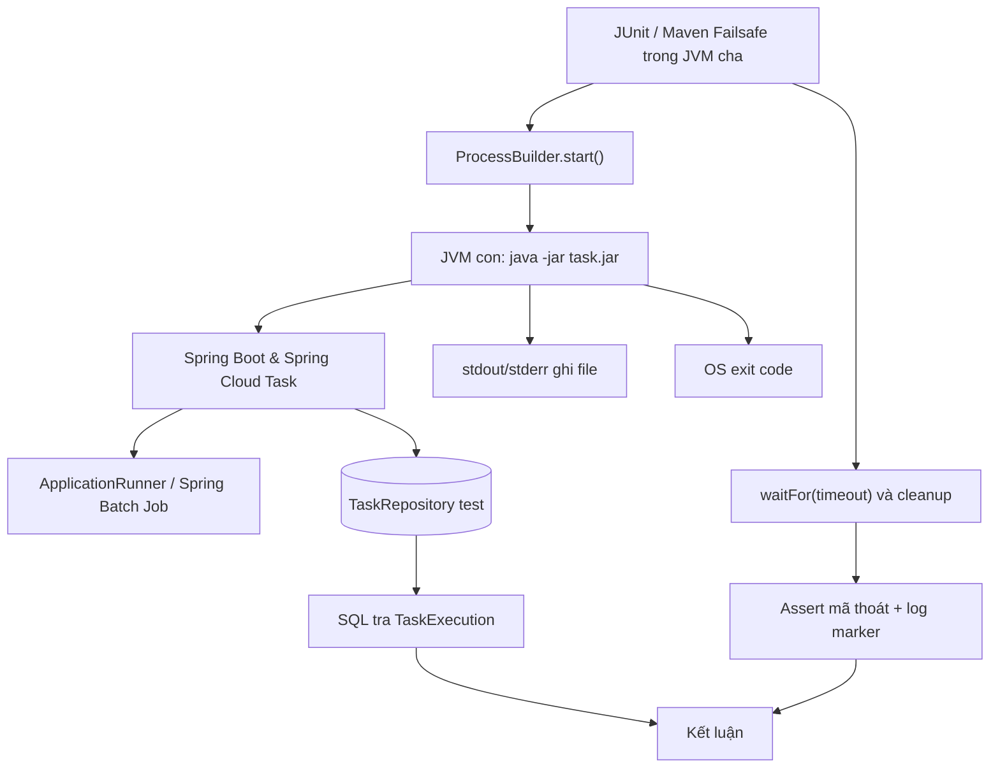
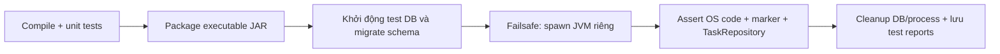

# Kiểm thử mã thoát bằng tiến trình JAR độc lập

## Mục tiêu bài học

**SPRING_CLOUD_TASK (Spring Cloud Task)** giúp xây dựng ứng dụng Spring Boot chạy **hữu hạn**, nhận tham số, thực thi công việc rồi kết thúc. Mỗi lượt có thể được theo dõi trong `TaskRepository` qua `TaskExecution`, bao gồm thời gian, thông tin lỗi và mã thoát. Một Task có thể được gọi theo lịch cron, theo yêu cầu hoặc dùng Spring Batch để xử lý dữ liệu theo lô. Tín hiệu mà scheduler nhìn thấy đầu tiên thường là **mã thoát của tiến trình Java**.

Trong chương **Kiểm thử**, bài này hướng dẫn kiểm tra **mã thoát thực sự của executable JAR chạy trong một JVM mới**. Unit test gọi method của runner không thay thế được phép thử này: chỉ tiến trình thật mới thể hiện đầy đủ các bước bootstrap, listener, đóng context, xử lý lỗi và trả mã cho hệ điều hành.

Học xong, bạn có thể:

- Phân biệt **OS exit code**, `TaskExecution.exitCode` và `BatchStatus`/`ExitStatus` của Spring Batch.
- Tạo một JAR thử nghiệm với kịch bản thành công và lỗi nghiệp vụ có thể dự đoán.
- Chạy thủ công bằng `java -jar`, ghi nhận mã thoát trên POSIX shell và PowerShell.
- Dùng `ProcessBuilder` trong JUnit 5 để spawn JVM độc lập, truyền argument và environment, thu log và chờ kết thúc có timeout.
- Kiểm chứng không chỉ mã thoát mà cả log marker và metadata `TASK_EXECUTION` nhằm tránh test xanh giả.
- Xử lý đúng các trường hợp JAR không tồn tại, lỗi database, runtime treo, bị kill và Batch Job thất bại.
- Tích hợp bài kiểm thử cấp tiến trình vào Maven Failsafe/CI sau khi đã package JAR.

## 1. Vì sao unit test của runner chưa đủ?

Một unit test như:

```java
reportRunner.run(applicationArguments);
```

có thể xác nhận business logic ném `IllegalArgumentException`, nhưng không chạy `SpringApplication.main`, không tải toàn bộ `ApplicationContext` và **không tạo tiến trình hệ điều hành mới**. Nó không chứng minh được những điều sau:

- Executable JAR có đủ class/dependency và dùng đúng Java runtime.
- Profile và tham số CLI được Spring Boot chuyển đến `ApplicationRunner` đúng cách.
- Spring Cloud Task ghi được `TaskExecution` và trả mã lỗi qua lifecycle chuẩn.
- `ExitCodeGenerator`/`ExitCodeExceptionMapper`, listener, `ApplicationFailedEvent` và Boot có phối hợp theo mong đợi hay không.
- Có thread, scheduler hoặc web server nào khiến JVM không tự kết thúc hay không.
- Spring Batch Job bị `FAILED` có thật sự làm **Task process** trả mã khác 0 hay không.
- Một lỗi quá sớm có khiến tiến trình thất bại **trước khi TaskRepository có bản ghi** không.

Kiểm thử cấp tiến trình gọi JAR bằng `ProcessBuilder` và lấy `Process.exitValue()`, tương tự cách cron, systemd hoặc Kubernetes nhìn thấy tiến trình Java.



**Điểm phân biệt:** mã trong `Process.exitValue()` là mã của **JVM con**; còn `TaskExecution.getExitCode()` là dữ liệu do framework **cố gắng ghi** vào repository. Kiểm thử đáng tin cậy cần đo và đối chiếu cả hai.

## 2. Ba lớp trạng thái cần kiểm chứng

| Lớp | Nguồn | Ý nghĩa | Giới hạn |
| --- | --- | --- | --- |
| **OS exit code** | `$?` (POSIX), `$LASTEXITCODE` (PowerShell), `Process.exitValue()` (Java). | Tiến trình con kết thúc với mã gì. | Không cho biết dữ liệu nghiệp vụ có đúng hay chưa; mã kill phụ thuộc OS/wrapper. |
| **`TaskExecution.exitCode`** | `TaskRepository` và bảng `TASK_EXECUTION`. | Kết quả do Spring Cloud Task ghi lại của lượt chạy. | Có thể thiếu nếu lỗi startup sớm, mất DB hoặc JVM bị kill. |
| **`JobExecution`** của Batch | `JobRepository`, `BATCH_JOB_EXECUTION`, `BATCH_STEP_EXECUTION`. | Batch Job/Step thực sự ở trạng thái nào. | Không tự đồng nhất với mã thoát Task. |

Kỳ vọng của một Task đơn giản, chưa tùy biến exit code:

| Tình huống | OS exit code | Metadata Task | Có cần đối chiếu gì nữa? |
| --- | --- | --- | --- |
| Runner thành công | Thường `0`. | Thường `EXIT_CODE=0` và có `END_TIME`. | Đầu ra nghiệp vụ thật. |
| Runner ném ngoại lệ chưa xử lý | Khác `0`, thường `1`. | Có trạng thái lỗi nếu DB còn hoạt động. | Lỗi đến từ **đúng nhánh runner**. |
| JAR không tồn tại | Khác `0`. | **Không có** `TaskExecution` mới. | Lỗi launcher, không phải lỗi nghiệp vụ. |
| Không nối được Task DB khi bootstrap | Thường khác `0`. | Có thể không có bản ghi. | Connection URL, migration, log startup. |
| JVM bị kill hoặc timeout | Phụ thuộc OS/tín hiệu. | Có thể thiếu `END_TIME`/exit code cuối. | Trạng thái scheduler và output đã ghi. |
| Spring Batch Job `FAILED` | **Có thể vẫn 0** khi chưa chuyển lỗi Batch sang Task. | Task có thể ghi `0`. | `JobExecution`/`ExitStatus`. |

**Không chỉ assert “mã khác 0” cho tình huống cố ý làm nghiệp vụ lỗi.** Nếu JAR sai path hoặc thiếu bảng metadata, test cũng có mã khác 0 dù chưa chạy runner. Phải có **log marker cho nhánh cần test**, rồi kiểm tra metadata theo điều kiện của từng scenario.

## 3. Tạo executable JAR làm test fixture

Một ứng dụng mẫu có hai tình huống: `success` hoàn thành bình thường và `business-fail` ném lỗi có chủ đích.

```java
package com.example.exitprobe;

import java.util.List;
import org.slf4j.Logger;
import org.slf4j.LoggerFactory;
import org.springframework.boot.ApplicationRunner;
import org.springframework.boot.SpringApplication;
import org.springframework.boot.autoconfigure.SpringBootApplication;
import org.springframework.cloud.task.configuration.EnableTask;
import org.springframework.context.annotation.Bean;

@SpringBootApplication
@EnableTask
public class ExitProbeTaskApplication {

    private static final Logger log =
            LoggerFactory.getLogger(ExitProbeTaskApplication.class);

    public static void main(String[] args) {
        SpringApplication.run(ExitProbeTaskApplication.class, args);
    }

    @Bean
    ApplicationRunner exitProbeRunner() {
        return args -> {
            List<String> values =
                    args.getOptionValues("probe.scenario");
            if (values == null || values.size() != 1) {
                throw new IllegalArgumentException(
                        "PROBE_INVALID_SCENARIO");
            }

            switch (values.get(0)) {
                case "success" -> {
                    log.info("PROBE_RUNNER_ENTERED scenario=success");
                    log.info("PROBE_BUSINESS_SUCCESS");
                }
                case "business-fail" -> {
                    log.info("PROBE_RUNNER_ENTERED scenario=business-fail");
                    throw new IllegalStateException(
                            "PROBE_BUSINESS_FAILURE");
                }
                default -> throw new IllegalArgumentException(
                        "PROBE_UNKNOWN_SCENARIO");
            }
        };
    }
}
```

Đây là **fixture**, không phải xử lý báo cáo thật. Các marker `PROBE_RUNNER_ENTERED` và `PROBE_BUSINESS_FAILURE` giúp phân biệt một lần fail chủ động **bên trong runner** với lỗi trước khi runner được gọi.

### Cấu hình profile process-test

```yaml
# application-process-test.yml
spring:
  application:
    name: exit-probe-task
  main:
    web-application-type: none
  datasource:
    url: ${TASK_TEST_DB_URL}
    username: ${TASK_TEST_DB_USER}
    password: ${TASK_TEST_DB_PASSWORD}
  cloud:
    task:
      name: exit-probe-task
      initialize-enabled: false
      closecontext-enabled: true
```

`initialize-enabled: false` giả định schema Spring Cloud Task **đã được migrate** trong database thử nghiệm trước khi test bắt đầu. `web-application-type: none` tránh tạo web server; `closecontext-enabled: true` giúp Task đóng context theo cơ chế phiên bản được hỗ trợ. Nếu có thread không-daemon do ứng dụng tự tạo, phải đóng đúng cách.

Không truyền password qua command-line argument vì `TASK_EXECUTION_PARAMS` có thể lưu arguments. Hãy dùng biến môi trường được CI cấp an toàn; đừng dùng database production cho bài test này.

### Thử thủ công trên Linux/macOS

```bash
java -jar target/exit-probe-task.jar \
  --spring.profiles.active=process-test \
  --probe.scenario=success
code=$?
printf 'exit=%s\n' "$code"
```

Sau khi đóng gói đúng executable JAR và chuẩn bị DB, mong đợi marker `PROBE_BUSINESS_SUCCESS` và `exit=0`. Với lỗi:

```bash
java -jar target/exit-probe-task.jar \
  --spring.profiles.active=process-test \
  --probe.scenario=business-fail
code=$?
printf 'exit=%s\n' "$code"
```

Mong đợi marker `PROBE_BUSINESS_FAILURE` và exit code **khác 0**. Với default mapping, nhiều cấu hình cho kết quả `1`, nhưng nên assert mã theo **hợp đồng ứng dụng và bản framework đã chốt**, không giả định mọi ngoại lệ đều bắt buộc mã 1.

Trên PowerShell:

```powershell
& java -jar target/exit-probe-task.jar --spring.profiles.active=process-test --probe.scenario=business-fail
$code = $LASTEXITCODE
Write-Host "exit=$code"
```

Trên POSIX, `$?` phải được lưu ngay sau Java, trước một lệnh `echo` hay `grep` khác; trên PowerShell, `$LASTEXITCODE` là mã của native process, khác với boolean `$?`. Shell wrapper chạy `echo "done"` sau Java có thể vô tình trả `0` dù Java thất bại. Nếu bắt buộc dùng script, truyền nguyên mã bằng `exec java -jar ...` hoặc `exit "$code"`.

## 4. JUnit 5: spawn JVM con bằng ProcessBuilder

`ProcessBuilder` nhận **danh sách token** thay vì một dòng command cho shell tự parse. Nhờ đó đường dẫn JAR có dấu cách vẫn là **một argument** và có thể kiểm soát environment của riêng tiến trình con.

Ví dụ test này:

- Nhận đường dẫn JAR từ system property `task.jar` do Maven Failsafe cấp.
- Dùng Java binary tương ứng với JVM chạy JUnit.
- Đặt tên Task riêng cho mỗi lần thử, tránh lẫn metadata khi CI chạy song song.
- Redirect cả stderr lẫn stdout ra file test.
- Chờ tối đa 60 giây, sau đó dừng process nếu bị treo.
- Kiểm tra marker *đã vào runner* cùng mã OS exit thực.

```java
package com.example.exitprobe;

import java.nio.charset.StandardCharsets;
import java.nio.file.Files;
import java.nio.file.Path;
import java.util.List;
import java.util.UUID;
import java.util.concurrent.TimeUnit;
import org.junit.jupiter.api.Test;
import org.junit.jupiter.api.io.TempDir;
import static org.junit.jupiter.api.Assertions.*;

class ExitProbeProcessIT {

    @TempDir
    Path logs;

    record RunResult(int exitCode, String output, String taskName) {}

    private RunResult runJar(String scenario) throws Exception {
        String configuredJar = System.getProperty("task.jar");
        assertNotNull(configuredJar, "Thiếu -Dtask.jar");
        Path jar = Path.of(configuredJar).toAbsolutePath();
        assertTrue(Files.isRegularFile(jar),
                "Không tìm thấy JAR: " + jar);

        String java = Path.of(
                System.getProperty("java.home"), "bin",
                System.getProperty("os.name").startsWith("Windows")
                        ? "java.exe" : "java").toString();

        String taskName = "exit-probe-" + UUID.randomUUID();
        Path logFile = logs.resolve("child-" + scenario + ".log");
        ProcessBuilder builder = new ProcessBuilder(
                List.of(java, "-jar", jar.toString(),
                        "--spring.profiles.active=process-test",
                        "--spring.cloud.task.name=" + taskName,
                        "--probe.scenario=" + scenario));

        for (String variable : List.of(
                "TASK_TEST_DB_URL", "TASK_TEST_DB_USER",
                "TASK_TEST_DB_PASSWORD")) {
            assertNotNull(builder.environment().get(variable),
                    "Thiếu biến môi trường: " + variable);
        }

        builder.redirectErrorStream(true);
        builder.redirectOutput(logFile.toFile());
        Process process = builder.start();
        try {
            if (!process.waitFor(60, TimeUnit.SECONDS)) {
                process.destroy();
                if (!process.waitFor(3, TimeUnit.SECONDS)) {
                    process.destroyForcibly();
                    process.waitFor();
                }
                fail("JAR quá hạn 60 giây; log:\n" +
                        Files.readString(logFile,
                                StandardCharsets.UTF_8));
            }
            return new RunResult(
                    process.exitValue(),
                    Files.readString(logFile, StandardCharsets.UTF_8),
                    taskName);
        } finally {
            if (process.isAlive()) {
                process.destroyForcibly();
            }
        }
    }

    @Test
    void successReturnsZero() throws Exception {
        RunResult result = runJar("success");
        assertTrue(result.output().contains(
                "PROBE_RUNNER_ENTERED scenario=success"));
        assertTrue(result.output().contains("PROBE_BUSINESS_SUCCESS"));
        assertEquals(0, result.exitCode(), result.output());
    }

    @Test
    void businessFailureReturnsNonZero() throws Exception {
        RunResult result = runJar("business-fail");
        assertTrue(result.output().contains(
                "PROBE_RUNNER_ENTERED scenario=business-fail"));
        assertTrue(result.output().contains("PROBE_BUSINESS_FAILURE"));
        assertNotEquals(0, result.exitCode(), result.output());
    }
}
```

**Lưu ý khi thực thi:** JVM con có thể mất thời gian tải context và kết nối DB. Chọn timeout phù hợp với CI và độ trễ startup thực tế, thay vì một giá trị quá ngắn gây flakiness. Khi quá hạn, test phải **fail** và dọn process; một process chưa kết thúc không có exit code hợp lệ để assert.

### Tại sao redirect log ra file?

Theo API Java, stdout/stderr của process mặc định là hai pipe. Nếu không đọc pipe và tiến trình ghi quá nhiều, buffer có thể đầy khiến process bị chặn. Kết hợp `redirectErrorStream(true)` với `redirectOutput(logFile)` tránh nguy cơ đó và lưu lại log cho CI. Với log chứa thông tin nhạy cảm, **không** upload nguyên log lên kho công khai.

`ProcessBuilder` cũng không tự mở shell. Không nên viết:

```java
// Sai cách dùng: nguyên command không phải một executable path.
new ProcessBuilder("java -jar exit-probe-task.jar --probe.scenario=success");
```

Hãy dùng từng token như trong fixture. Không nối chuỗi shell từ input chưa kiểm chứng và không đặt mật khẩu trong command line.

## 5. Truyền kết nối DB cho JVM độc lập

JVM cha và JVM con **không chia sẻ cùng heap**, do đó H2 in-memory nằm trong JVM cha không thể mặc nhiên được JVM con truy vấn. Để kiểm tra `TaskExecution`, dùng database **có thể truy cập qua network** như PostgreSQL thử nghiệm.

Nếu dùng Testcontainers, hãy truyền JDBC URL/username/password của container sau khi khởi động vào environment của `ProcessBuilder`:

```java
// Ví dụ biến lấy từ fixture PostgreSQL Testcontainers:
builder.environment().put("TASK_TEST_DB_URL", jdbcUrl);
builder.environment().put("TASK_TEST_DB_USER", dbUsername);
builder.environment().put("TASK_TEST_DB_PASSWORD", dbPassword);
```

Những biến `jdbcUrl`, `dbUsername`, `dbPassword` do test fixture cung cấp; chúng **không phải** biến tự động có sẵn. Chạy migration Task schema **trước khi spawn** rồi cấu hình `spring.cloud.task.initialize-enabled=false` để tránh các tiến trình tranh chấp tạo bảng.

Đặt `taskName` duy nhất theo UUID như trong fixture. Sau đó có thể truy vấn metadata bằng prepared statement:

```sql
SELECT TASK_EXECUTION_ID,
       TASK_NAME,
       START_TIME,
       END_TIME,
       EXIT_CODE,
       EXIT_MESSAGE
FROM TASK_EXECUTION
WHERE TASK_NAME = :taskName
ORDER BY TASK_EXECUTION_ID DESC;
```

`:taskName` là placeholder do thư viện query hỗ trợ; với JDBC `PreparedStatement` thuần dùng dấu `?`. Sau process success, mong một hàng có `EXIT_CODE=0` và `END_TIME` không null. Với lỗi runner, mong có trạng thái thất bại **nếu repository hoạt động và đường lỗi đi qua lifecycle**. Với JAR không tồn tại/lỗi bootstrap quá sớm, có thể **không có hàng nào**.

Không lấy `TaskExecution.exitCode` làm expected của mã OS rồi nói “hai giá trị trùng nhau”: test cần có **mã kỳ vọng độc lập** từ hợp đồng ứng dụng, sau đó assert từng nguồn. Metadata cũng có thể chưa kết thúc nếu process bị kill.

## 6. Thêm assertion JDBC vào bài test

Ví dụ method sau bổ sung vào class `ExitProbeProcessIT` ở mục 4, sử dụng JDBC driver tương ứng với PostgreSQL test và các hàm assertion JUnit đã import:

```java
import java.sql.Connection;
import java.sql.DriverManager;
import java.sql.PreparedStatement;
import java.sql.ResultSet;

void assertTaskExecutionInDatabase(
        String taskName, int expectedExitCode) throws Exception {

    try (Connection connection = DriverManager.getConnection(
            System.getenv("TASK_TEST_DB_URL"),
            System.getenv("TASK_TEST_DB_USER"),
            System.getenv("TASK_TEST_DB_PASSWORD"));
         PreparedStatement statement = connection.prepareStatement(
            "SELECT EXIT_CODE, END_TIME FROM TASK_EXECUTION " +
            "WHERE TASK_NAME = ?")) {

        statement.setString(1, taskName);
        try (ResultSet result = statement.executeQuery()) {
            assertTrue(result.next(),
                    "Không có TaskExecution của " + taskName);

            int code = result.getInt("EXIT_CODE");
            assertFalse(result.wasNull(), "EXIT_CODE chưa được ghi");
            assertEquals(expectedExitCode, code);
            assertNotNull(result.getTimestamp("END_TIME"));

            assertFalse(result.next(),
                    "Có nhiều execution cùng tên test");
        }
    }
}
```

Đây là **snippet method riêng**: khi sao chép, đặt các dòng `import` ở đầu file Java và method vào bên trong class JUnit. Đoạn này có thể được gọi sau khi `runJar(…)` trả về:

```java
// Trong successReturnsZero():
assertTaskExecutionInDatabase(result.taskName(), 0);

// Trong businessFailureReturnsNonZero():
// Chỉ assert 1 sau khi xác minh contract release này là 1.
assertTaskExecutionInDatabase(result.taskName(), 1);
```

**Lưu ý:** mã `1` của trường hợp lỗi là một kỳ vọng của cấu hình mặc định được kiểm chứng trước, không phải quy luật cho mọi exception/custom mapper. Nếu đã khai báo mapping thành `10`, thay assertion bằng mã phù hợp và kiểm tra **OS code riêng**. Không dùng test thất bại do thiếu DB để assert `EXIT_CODE=1`, vì lúc đó có thể chẳng có record.

Nếu dùng `TaskExplorer` trong một service đọc metadata riêng, có thể dùng `getTaskExecution(long executionId)` thay SQL, nhưng trước tiên vẫn cần biết execution ID thật. Truy theo tên riêng của mỗi test là một cách tìm bản ghi, không phải API phổ quát để ánh xạ một launcher ID thành TaskExecution ID.

### Vì sao không dùng chung H2 in-memory giữa hai JVM?

Với JDBC URL `jdbc:h2:mem:taskdb`, mỗi process thường có database in-memory độc lập. JVM test và JVM child nhìn thấy **hai database khác nhau**, nên test không đối chiếu được metadata. Có thể dùng H2 server mode đúng cách hoặc Testcontainers/PostgreSQL dùng chung; với hệ thống production dùng PostgreSQL/MySQL, database cùng loại với production thường giúp phát hiện lỗi schema, transaction và dialect.

Không cho phép integration test chạy với URL trỏ sang production. CI nên có kiểm tra allowlist môi trường/schema trước khi migration, xóa dữ liệu hoặc thử các trường hợp lỗi.

## 7. Mã thoát tùy chỉnh: ExitCodeGenerator và ExitCodeExceptionMapper

Trong ứng dụng thật, scheduler có thể cần phân biệt lỗi tham số, lỗi tạm thời và lỗi không thể phục hồi. Spring Boot cung cấp `ExitCodeGenerator` và `ExitCodeExceptionMapper`, còn Spring Cloud Task có cơ chế ghi exit code và exit message của lượt chạy.

Ví dụ một loại exception có mã theo hợp đồng nghiệp vụ:

```java
package com.example.exitprobe;

import org.springframework.boot.ExitCodeGenerator;

public class InvalidReportInputException
        extends RuntimeException implements ExitCodeGenerator {

    public InvalidReportInputException(String message) {
        super(message);
    }

    @Override
    public int getExitCode() {
        return 10;
    }
}
```

Khi một exception dạng này đi qua đường lỗi do Spring Boot quản lý, framework có thể dùng `getExitCode()` khi xử lý sự kiện thoát; Spring Cloud Task cũng có logic ánh xạ exit code của `TaskExecution`. **Bước kiểm thử cấp tiến trình vẫn bắt buộc** để biết mã `10` có được truyền ra OS hay chỉ xuất hiện trong metadata trên đúng bộ release/framework hiện tại.

Với ứng dụng cần trả một mã đã tính **sau khi `SpringApplication.run(…)` thành công**, tài liệu Spring Boot minh họa:

```java
// Chỉ dùng khi chủ động thiết kế hợp đồng mã thoát
// và biết rõ vòng đời context.
System.exit(SpringApplication.exit(
        SpringApplication.run(MyApplication.class, args)));
```

`SpringApplication.exit(context)` xử lý `ExitCodeGenerator` và đóng context; `System.exit(…)` trả mã được tính cho OS. Không gọi `System.exit(…)` từ giữa `ApplicationRunner` hoặc listener chỉ để “đạt mã thoát”, vì có nguy cơ cắt ngang việc ghi metadata cuối, cleanup hoặc transaction.

### Cẩn thận với callback lỗi

Spring Cloud Task tài liệu hóa quy tắc riêng cho exception ném từ `TaskExecutionListener`:

- Một lỗi từ `onTaskStartup` có thể làm kết thúc lượt Task với mã `1`.
- Lỗi từ `onTaskFailed`/`onTaskEnd` có thể lấy mã từ `ExitCodeEvent`, `ExitCodeGenerator` hoặc mặc định `1` theo đường lỗi.
- `ExitCodeExceptionMapper` **không thể override** mã lỗi ném từ các callback listener này theo cơ chế đã mô tả.

Không nên tạo lỗi nghiệp vụ bằng cách ném exception từ `@AfterTask` chỉ để lấy một exit code. Hãy đặt lỗi vào runner/service đúng trách nhiệm, và kiểm thử riêng trường hợp lỗi listener nếu ứng dụng có callback tùy chỉnh.

### Mã nào nên dùng?

| Mã minh họa | Nghĩa do dự án tự định nghĩa | Chính sách điều phối gợi ý |
| ---: | --- | --- |
| `0` | Thành công theo hợp đồng nghiệp vụ. | Ghi hoàn tất. |
| `10` | Tham số sai, cần sửa input. | Không retry mù. |
| `20` | Lỗi dịch vụ ngoài có thể khôi phục. | Retry giới hạn, có backoff. |
| `30` | Vi phạm điều kiện dữ liệu. | Chặn bước downstream, kiểm tra. |

Đây **không** phải danh sách mã mặc định của Spring Cloud Task. Trên POSIX, mã do shell hiển thị có giới hạn và quy tắc riêng cho tiến trình kết thúc bởi tín hiệu; trên Windows các mã được biểu diễn khác. Với mã tùy chỉnh, chọn miền giá trị được platform/scheduler hỗ trợ, thử qua wrapper thực tế và ghi rõ hợp đồng trong tài liệu triển khai.

## 8. Spring Batch: Job FAILED nhưng process vẫn 0

Một trường hợp bắt buộc có test riêng là ứng dụng Task chạy Spring Batch. `JobExecution` và `TaskExecution` là hai đối tượng khác nhau:

- `BatchStatus.FAILED` phản ánh một Batch Job không hoàn tất.
- `TaskExecution.exitCode` phản ánh kết quả Task theo vòng đời ứng dụng.
- OS exit code là kết quả tiến trình mà scheduler quan sát.

Tài liệu Spring Cloud Task mô tả rằng trong hành vi mặc định của một số cách chạy Boot/Batch, Job có thể `FAILED` nhưng Task vẫn trả `0`. Để chuyển trạng thái lỗi Batch thành mã thoát Task trong luồng tích hợp được hỗ trợ, có thể bật:

```yaml
spring:
  cloud:
    task:
      batch:
        fail-on-job-failure: true
```

Khi Job trả `BatchStatus.FAILED`, cơ chế tích hợp có thể đặt Task exit code khác `0` (mặc định `1` hoặc theo `ExitCodeGenerator` phù hợp). Nếu tự viết `JobLauncher` hoặc chạy Job bất đồng bộ, không được giả định property trên tự động sửa mọi trường hợp; hãy đo thật với JAR.

| Test | Trạng thái Batch | Kỳ vọng cần kiểm chứng |
| --- | --- | --- |
| Batch hoàn thành | `COMPLETED` | OS `0`, Task metadata hợp lệ, output đúng. |
| Batch lỗi nhưng `fail-on-job-failure=false` | `FAILED` | Có thể OS `0` và Task `0`; cần ghi nhận rõ sai lệch. |
| Batch lỗi và `fail-on-job-failure=true` | `FAILED` | Trong đường tích hợp hỗ trợ, OS/Task exit khác `0`. |
| Step chết khi JVM bị kill | Có thể `STARTED`/`FAILED` chưa được cập nhật. | Mã OS phụ thuộc platform; metadata có thể chưa hoàn tất. |
| Batch không khởi động vì JobRepository sai | Chưa chắc có JobExecution. | Kiểm tra log bootstrap, không coi là lỗi Step. |

Nếu dùng `TaskBatchExecutionListener` và schema `TASK_TASK_BATCH`, hãy đối chiếu liên kết giữa hai kho:

```sql
SELECT TASK_EXECUTION_ID, JOB_EXECUTION_ID
FROM TASK_TASK_BATCH
WHERE TASK_EXECUTION_ID = :taskExecutionId;
```

`:taskExecutionId` là tham số của công cụ truy vấn. Không suy rằng hai ID bằng nhau; `JobExecution` có namespace và quá trình cấp ID riêng. Khi restart, một `JobInstance` có thể sinh nhiều `JobExecution`.

## 9. Tích hợp với Maven Failsafe và CI

Kiểm thử process-level cần một **executable JAR đã package**. Trong Maven, nên để tên lớp `*IT.java` cho Maven Failsafe và chạy qua các pha `integration-test`/`verify` sau `package`.

Ví dụ phần `plugins` của `pom.xml`:

```xml
<build>
    <plugins>
        <!-- Spring Boot plugin phải được cấu hình tạo
             executable/repackaged JAR trong lifecycle package. -->
        <plugin>
            <groupId>org.springframework.boot</groupId>
            <artifactId>spring-boot-maven-plugin</artifactId>
        </plugin>

        <plugin>
            <groupId>org.apache.maven.plugins</groupId>
            <artifactId>maven-failsafe-plugin</artifactId>
            <version>3.6.1</version>
            <configuration>
                <systemPropertyVariables>
                    <task.jar>${project.build.directory}/${project.build.finalName}.jar</task.jar>
                </systemPropertyVariables>
            </configuration>
            <executions>
                <execution>
                    <goals>
                        <goal>integration-test</goal>
                        <goal>verify</goal>
                    </goals>
                </execution>
            </executions>
        </plugin>
    </plugins>
</build>
```

Đoạn `spring-boot-maven-plugin` ở trên **không tự đảm bảo** mọi POM đều tạo executable JAR: phải có cấu hình `repackage` tương ứng, thường do Spring Boot parent quản lý; với POM tự quản lý plugin, cần cấu hình goal phù hợp. Nếu JAR có classifier hoặc đổi `finalName`, hãy sửa system property `task.jar`.

Chạy sau khi chuẩn bị database test và migration:

```bash
mvn verify
```

Theo Maven Failsafe, nên gọi `verify` thay vì dừng ở `integration-test` để các bước `post-integration-test` và kiểm tra report vẫn được chạy. `mvn test` thường xảy ra **trước khi package**, nên chưa có JAR của phiên bản code đang kiểm tra.

Với Gradle, nguyên tắc tương tự: `integrationTest` phải phụ thuộc `bootJar`, nhận path artifact từ build output, dùng Java runtime/test fixtures xác định và thu report. DSL và tên task có thể khác giữa phiên bản Gradle/Spring Boot; hãy đối chiếu plugin đang dùng.

### Sơ đồ CI



Trong CI cần lưu log file khi test thất bại. Vì `@TempDir` có thể được tự động dọn sau test, nếu muốn upload artifacts phải **copy log lỗi** đến thư mục reports có chính sách retention cụ thể. Không upload credential hay toàn bộ environment. Dùng timeout cả ở mức process và ở mức job CI để tránh một process con treo giữ runner quá lâu.

## 10. Ma trận kiểm thử cần có

| Mã | Kịch bản | Điều cần xác minh | Không được kết luận sai |
| --- | --- | --- | --- |
| T01 | JAR hợp lệ, runner thành công | OS `0`, marker thành công, Task DB có exit `0`. | “Có log success” đồng nghĩa business output chắc chắn đúng. |
| T02 | Runner ném lỗi chưa xử lý | OS khác `0`, marker đã vào runner, Task DB có lỗi nếu còn hoạt động. | Mọi mã khác `0` đều do runner lỗi. |
| T03 | Thiếu `--probe.scenario` | Marker `PROBE_INVALID_SCENARIO`, mã khác `0`. | Lỗi input giống lỗi thiếu schema. |
| T04 | Đường dẫn JAR không tồn tại | Launcher không mở được JAR; không có TaskExecution mới. | Có một Task được tạo bởi framework. |
| T05 | Java version/dependency sai | Log JVM/class loading, mã khác `0`. | Business logic đã chạy. |
| T06 | Sai DB URL/credential | Lỗi bootstrap/task repository, có thể chưa có TaskExecution. | Có exit code đã commit trong DB. |
| T07 | Thiếu bảng `TASK_EXECUTION` | SQL/bootstrap lỗi, marker runner có thể không xuất hiện. | Failure thuộc nghiệp vụ. |
| T08 | Runner hoặc thread không kết thúc | `waitFor(timeout)` quá hạn, cleanup rồi fail. | Có OS exit code hợp lệ trước khi process dừng. |
| T09 | Bị kill giữa chừng | Process thực sự dừng; metadata có thể thiếu cuối. | Mã `137` là hợp đồng mọi OS. |
| T10 | `onTaskStartup` ném lỗi | Runner không chạy, mã theo listener/Task lifecycle. | Mã listener tùy ý có thể map bằng `ExitCodeExceptionMapper`. |
| T11 | Batch Step `FAILED`, property off | So sánh Batch `FAILED` và Task có thể `0`. | Chỉ nhìn OS code là đủ. |
| T12 | Batch Step `FAILED`, property on | OS/Task khác `0` nếu đường tích hợp hỗ trợ. | Property tự sửa mọi launcher tùy chỉnh. |
| T13 | Chạy hai process gần nhau | Theo dõi execution IDs, khóa/isolation và output. | Hai process cùng taskName có cùng TaskExecution. |
| T14 | Crash sau khi ghi một phần output | Đối chiếu dữ liệu đã commit và khả năng idempotency. | Retry luôn an toàn chỉ vì exit code khác `0`. |

### Timeout và kill phải là phép thử riêng

Ví dụ `ProcessBuilder.waitFor(60, TimeUnit.SECONDS)` trả `false` nghĩa là **chưa có mã thoát**. Test phải dừng process và fail bằng nguyên nhân timeout. Đừng biến `destroyForcibly()` thành một exit code “nghiệp vụ” cần assert.

Trên POSIX, shell thường biểu diễn `SIGKILL` thành `128 + 9 = 137`, nhưng đây không phải hợp đồng đa nền tảng; Windows có cách biểu diễn khác. Nếu thử SIGTERM, Spring Boot có shutdown hook và Spring Cloud Task còn có các quy tắc riêng về việc cập nhật exit code. Phải xác minh thực tế, không hard-code một mã OS cho mọi nền tảng.

Để thử timeout/kill, thêm một scenario `hang` riêng vào fixture rồi giới hạn vòng đời process tại harness. **Không** tạo vòng lặp vô hạn hoặc ngủ rất lâu trong test không có cleanup.

## 11. Tránh test xanh giả và flakiness

**Sai JAR nhưng assertion nonzero vẫn pass.** Phải kiểm tra file JAR trước khi spawn, và marker chứng minh runner thực sự chạy.

**Không thu stderr khiến JVM bị chặn.** Dùng `redirectErrorStream(true)` và redirect tới file, hoặc đọc hai stream đồng thời. Đừng chờ process trong khi không hút dữ liệu mà nó đang xuất ra.

**Một Java process kết thúc nhưng Task DB chưa có bản ghi.** Có thể do lỗi bootstrap, sai profile hoặc Task nối tới **database khác**. Assert SQL cần kiểm tra đúng schema, không chỉ nhìn log.

**Dùng ngày “yesterday” khiến test phụ thuộc thời gian.** Chọn `businessDate` cố định, nguồn dữ liệu fixture bất biến và timezone test rõ ràng.

**Hai test dùng chung tên Task hoặc shared output.** Dùng tên Task UUID, input/output directory riêng, và tắt parallelism không phù hợp với kho metadata/khóa hiện tại.

**Wrapper script che mã thoát.** Shell có thể trả mã của lệnh log cuối thay vì Java. Kiểm thử trực tiếp `java -jar` trước, sau đó bổ sung test cho wrapper sản xuất nếu cron/systemd thực tế gọi wrapper.

**Chỉ nhìn OS code mà quên Batch.** Job có thể thất bại nhưng runner đã nuốt exception hoặc hoàn tất không ném lỗi. Test cần đọc trạng thái `JobExecution`.

**Chỉ nhìn metadata mà quên output nghiệp vụ.** Một Task exit `0` chỉ phản ánh kết quả theo hợp đồng code; không tự chứng minh báo cáo đúng số record. Nên test thêm business invariants, checksum hoặc unique key.

### Hợp đồng kiểm thử hữu ích

```text
PASS =
    child_terminated_within_timeout
    AND expected_runner_marker_found
    AND actual_OS_exit_code_matches_scenario
    AND TaskExecution_matches_expected_state
    AND business_output_is_correct
    AND (if Batch) JobExecution_matches_expected_status
```

Không phải test nào cũng cần tất cả điều kiện: test JAR không tồn tại **cố ý** xác minh không có TaskExecution; test lỗi runner phải chứng minh runner đã chạy. Điểm quan trọng là biết **tầng nào đang được thử** và không cho lỗi ở tầng khác làm assertion vô tình pass.

## 12. Ghi nhận bằng chứng và bảo mật

Một report test nên lưu:

```text
scenario=business-fail
testTaskName=exit-probe-<uuid>
artifact=target/exit-probe-task.jar
processExitCode=<actual>
runnerEntered=true
taskExecutionId=<id hoặc missing>
taskExitCode=<value hoặc missing>
taskEndTime=<value hoặc null>
batchJobExecutionId=<id nếu có>
logFile=<path của test log>
```

Không bao giờ ghi `TASK_TEST_DB_PASSWORD`, token, full JDBC URL chứa credential hay toàn bộ arguments nhạy cảm vào reports. Spring Cloud Task có thể lưu command-line arguments trong metadata; dùng secret manager hoặc environment bảo vệ phù hợp, không để test kích hoạt debug log chứa password trên CI công khai.

Nếu test xóa dữ liệu sau chạy, hãy có guard xác nhận JDBC URL thuộc hệ thống **test**. Không thực hiện migration destructive hoặc cleanup trên connection chưa được xác nhận; tránh dùng credential có quyền rộng hơn nhu cầu test.

## 13. Bài thực hành tổng hợp

**Tình huống:** `daily-report-task` chạy theo cron, có thể chạy lại bằng tay và đôi khi sử dụng Spring Batch. CI phải chứng minh ứng dụng trả exit code đúng để scheduler quyết định retry hay báo lỗi.

1. Tạo fixture Spring Cloud Task hỗ trợ `success` và `business-fail` như mục 3; chạy thử thủ công từ JAR để xem mã thoát.
2. Tạo database PostgreSQL test và migrate schema Spring Cloud Task; cấp `TASK_TEST_DB_URL`, `TASK_TEST_DB_USER`, `TASK_TEST_DB_PASSWORD`.
3. Viết `ExitProbeProcessIT` với `ProcessBuilder`, tên Task UUID, redirect log, timeout và cleanup.
4. Assert OS `0` khi thành công, OS khác `0` khi lỗi, cùng marker xác định đúng runner.
5. Đọc `TASK_EXECUTION` theo tên test; kiểm tra `EXIT_CODE`, `END_TIME` và phân biệt lỗi metadata không tồn tại.
6. Tạo một scenario lỗi tham số rồi thử sai đường dẫn JAR; chứng minh hai lỗi đều nonzero nhưng chỉ lỗi tham số đã vào runner.
7. Thử một process treo có cleanup; xác nhận test không làm treo CI và không để lại process.
8. Bổ sung exception mapping có mã cụ thể theo hợp đồng; xác minh cả OS code lẫn metadata thay vì đoán từ tên interface.
9. Nếu có Spring Batch, làm Step trả `FAILED`, chạy với `fail-on-job-failure=false` rồi `true`; so sánh ba lớp trạng thái.
10. Tích hợp `mvn verify`, lưu report/log thất bại, bảo đảm có teardown DB và các secrets không xuất hiện trong log.
11. Kiểm chứng hai lần chạy lại cùng dữ liệu không tạo side effect trùng; mã thoát là tín hiệu lỗi chứ **không thay thế** idempotency.

**Tiêu chí đạt:** test chạy executable JAR trong **JVM riêng**, đo được mã thoát OS thật; lỗi trước bootstrap và lỗi nghiệp vụ được phân loại; TaskRepository/Batch JobRepository được đối chiếu; timeout không để tiến trình treo và không có dữ liệu production bị thay đổi.

## 14. Tài liệu tham khảo

- [Spring Cloud Task — Features và Mapping Exit Codes](https://docs.spring.io/spring-cloud-task/reference/features.html): `TaskExecution.exitCode`, `ExitCodeExceptionMapper` và lỗi listener.
- [Spring Cloud Task — Batch Job Exit Codes](https://docs.spring.io/spring-cloud-task/reference/batch.html): `spring.cloud.task.batch.fail-on-job-failure` và trạng thái Batch.
- [Spring Boot — SpringApplication: Application Exit](https://docs.spring.io/spring-boot/reference/features/spring-application.html): `ExitCodeGenerator`, `SpringApplication.exit(…)` và `System.exit(…)`.
- [Java — ProcessBuilder](https://docs.oracle.com/en/java/javase/21/docs/api/java.base/java/lang/ProcessBuilder.html): process arguments, environment, stdin/stdout/stderr.
- [Java — Process](https://docs.oracle.com/en/java/javase/21/docs/api/java.base/java/lang/Process.html): `waitFor(timeout, unit)`, `exitValue()`, `destroy()` và `destroyForcibly()`.
- [Maven Failsafe Plugin — Usage](https://maven.apache.org/surefire/maven-failsafe-plugin/usage.html): tích hợp `integration-test` và `verify`.
- [Maven — Build Lifecycle](https://maven.apache.org/guides/introduction/introduction-to-the-lifecycle.html): `package`, `integration-test`, `post-integration-test` và `verify`.
- [Spring Batch — Reference](https://docs.spring.io/spring-batch/reference/): `JobExecution`, `BatchStatus`, `ExitStatus` và restart.

Các ví dụ Java sử dụng phong cách Java 17+, JUnit 5 và API Spring Boot/Spring Cloud Task phổ biến; **chưa được biên dịch hoặc chạy trong bước biên soạn bài này**. Trước khi áp dụng, hãy chốt phiên bản tương thích và chạy thực tế để xác nhận exit code/metadata trên JDK và OS đích.

## Ghi nhớ

- **Gọi `ApplicationRunner.run(…)` không tương đương chạy executable JAR.** Muốn kiểm thử mã thoát thật, dùng `ProcessBuilder` để chạy `java -jar` trong **JVM con**.
- `Process.exitValue()`, `TaskExecution.exitCode` và `JobExecution` thuộc **ba tầng khác nhau**; đối chiếu chứ không tự coi chúng luôn bằng nhau.
- Với kịch bản failure, đừng chỉ assert nonzero: thêm marker runner và kết quả metadata để tránh trường hợp JAR/DB hỏng nhưng test vẫn pass.
- Chờ có **timeout**, redirect stdout/stderr và dọn tiến trình. Một process chưa kết thúc **không có exit code** hợp lệ.
- JAR phải được package trước integration tests; dùng Maven Failsafe tới pha `verify` để kiểm thử artifact và cleanup đúng vòng đời.
- Database test phải truy cập được từ **cả JVM cha và con**; H2 in-memory trong hai JVM không tự chia sẻ dữ liệu.
- Khi Batch Job `FAILED` nhưng Task trả `0`, xem `fail-on-job-failure` và cách launch Job; retry an toàn còn cần idempotency nghiệp vụ.
