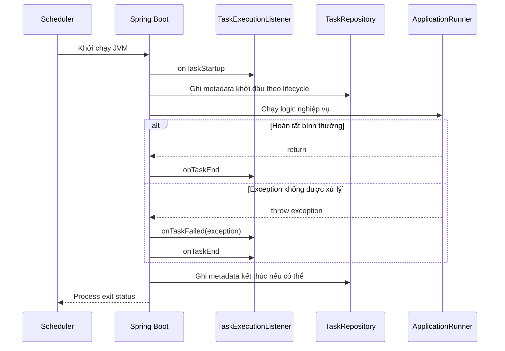
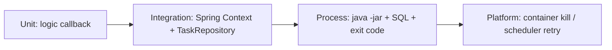

# Kiểm thử listener và ngoại lệ tại từng giai đoạn

## 1. Vì sao phải kiểm thử cả vòng đời, không chỉ service nghiệp vụ?

Trong chương **Kiểm thử** của **Spring Cloud Task**, chúng ta kiểm tra một ứng dụng Spring Boot có thời gian chạy hữu hạn: khởi động, nhận tham số, chạy nghiệp vụ, lưu kết quả vào `TaskRepository` rồi kết thúc. Với các task chạy theo lịch hoặc theo yêu cầu, lỗi không chỉ xuất hiện trong code xử lý dữ liệu. Nó còn có thể xảy ra **trước khi TaskExecution được tạo**, trong **listener khởi động**, giữa một `ApplicationRunner`, trong **listener thất bại/kết thúc**, lúc **cập nhật repository**, hoặc khi container bị dừng cưỡng bức.

Ví dụ một task đối soát đã chuyển thành công 9.000/10.000 bản ghi sang hệ thống ngoài, rồi `onTaskEnd` gặp lỗi khi ghi audit. Nếu scheduler nhìn thấy mã thoát khác 0 và tự chạy lại toàn bộ công việc, hệ thống có thể phát sinh bản ghi trùng. Ngược lại, khi code nghiệp vụ nuốt exception và trả về bình thường, `TaskRepository` có thể ghi thành công mặc dù kết quả nghiệp vụ không đạt.

**Mục tiêu của bài** là thiết kế bộ kiểm thử xác nhận đúng hành vi ở *từng ranh giới lỗi*, đồng thời phân biệt ba câu hỏi:

- **Callback nào thực sự chạy**, theo thứ tự nào, và listener có nhìn thấy thông tin gì?
- **TaskRepository cuối cùng ghi gì**: bản ghi có tồn tại không, `EXIT_CODE`/`END_TIME`/`ERROR_MESSAGE` ra sao?
- **Bộ điều phối nhận gì**: process exit status, runtime status, khả năng retry và tác động nghiệp vụ?

Sau bài học, bạn có thể:

1. Viết unit test cho logic bên trong `TaskExecutionListener` và các phương thức đánh dấu bằng `@BeforeTask`, `@AfterTask`, `@FailedTask`.
2. Xây ma trận integration test cho thành công, lỗi runner, lỗi ở ba callback và lỗi bootstrap/database.
3. Kiểm tra thứ tự `onTaskStartup`, `onTaskFailed`, `onTaskEnd` mà không dựa vào suy đoán hoặc đồng hồ.
4. Hiểu quy tắc xử lý ngoại lệ, mã thoát và `exitMessage` khi listener gây lỗi.
5. Kiểm thử qua **tiến trình Java riêng** để không làm hỏng Spring Context của test runner.
6. Đối chiếu kết quả từ repository, process, scheduler và dữ liệu nghiệp vụ trước khi cho phép retry.

> **Phạm vi phiên bản:** API, schema Task Repository và hành vi xử lý lỗi có thể thay đổi theo Spring Cloud Task / Spring Boot. Bài sử dụng các tên listener và cơ chế được tài liệu Spring Cloud Task mô tả; dependency và code mẫu cần được kiểm tra với bộ phiên bản tương thích đã khóa trong dự án. Các ví dụ có chủ đích dùng môi trường test và **không được bật fault injection trong production**.

## 2. Các giai đoạn vòng đời Task và callback

Spring Cloud Task cung cấp `TaskExecutionListener` với ba phương thức:

| Callback | Khi nào được gọi? | Điều nên kiểm tra |
| --- | --- | --- |
| `onTaskStartup(TaskExecution)` | Ở pha bắt đầu theo dõi Task, gần thao tác tạo/lưu metadata | Callback được gọi cho lần chạy hợp lệ; dữ liệu truyền vào đúng; không tự tin bản ghi DB đã commit |
| `onTaskFailed(TaskExecution, Throwable)` | Khi có exception **không được xử lý** ở luồng vòng đời Task; trước callback kết thúc | Throwable phù hợp, giữ nguyên tín hiệu thất bại, không rò rỉ dữ liệu nhạy cảm |
| `onTaskEnd(TaskExecution)` | Trước khi cập nhật metadata cuối của Task vào repository | Callback cuối chạy trong các trường hợp framework xử lý được; exit message hợp lệ |

Các annotation tương ứng:

| Interface | Annotation trong bean |
| --- | --- |
| `onTaskStartup` | `@BeforeTask` |
| `onTaskFailed` | `@FailedTask` |
| `onTaskEnd` | `@AfterTask` |

Theo tài liệu tham khảo Spring Cloud Task, **`onTaskFailed` xảy ra trước `onTaskEnd`** khi ứng dụng ném ngoại lệ không được xử lý. Khi chạy thành công, đường thông thường là `onTaskStartup → onTaskEnd`. <u>Đừng biến hai chuỗi này thành khẳng định cho mọi lỗi</u>: JVM có thể chết trước khi callback kết thúc chạy, hoặc context có thể thất bại trước khi hạ tầng listener được khởi tạo.

Lưu ý nhỏ về tài liệu phiên bản: phần *reference guide* mô tả `onTaskStartup` ở mốc trước thao tác lưu TaskExecution, trong khi một số bản Javadoc mô tả callback được gọi sau thao tác lưu. Vì vậy **không viết test giả định chắc chắn rằng một truy vấn database ở trong `onTaskStartup` đã nhìn thấy hàng metadata**; điều cần assert là trạng thái **sau khi tiến trình kết thúc và repository đã commit**, phù hợp với version thực chạy.



Sơ đồ biểu diễn *quan hệ logic giữa các callback*, không phải thứ tự câu lệnh/transaction tuyệt đối của mọi release. Nó cũng không mô tả bước khởi tạo ApplicationContext **trước khi** hạ tầng Task sẵn sàng.

## 3. Ma trận kiểm thử theo nơi phát sinh lỗi

| Kịch bản | `onTaskStartup` | `onTaskFailed` | `onTaskEnd` | Điều cần xác minh sau chạy |
| --- | --- | --- | --- | --- |
| Runner hoàn tất bình thường | Có | Không | Có | Task ghi thành công, exit message, process status |
| Runner ném exception không xử lý | Có | Có | Có | Ghi lỗi, `EXIT_CODE`, process status khác 0 theo mapping |
| Runner bắt exception rồi return | Có | **Không vì lỗi đã bị nuốt** | Có | Phát hiện “thành công giả” qua business audit |
| `onTaskStartup` ném exception | Có đến lúc ném | Các callback thất bại/kết thúc được framework cố xử lý theo quy tắc listener | Có thể chạy trong quy trình xử lý lỗi | Lỗi mã 1 ở đường thông thường; kiểm tra hàng Task và listener khác |
| `onTaskFailed` ném exception | Có | Có đến lúc ném | Các callback giai đoạn sau vẫn được framework xử lý theo cơ chế riêng | Kiểm tra cả lỗi nghiệp vụ gốc lẫn lỗi listener |
| `onTaskEnd` ném exception | Có | Tùy có lỗi trước đó | Có đến lúc ném | Lỗi listener, exit code và metadata cuối; không giả định bị rollback nghiệp vụ |
| Bean/DS/schema lỗi **rất sớm** khi bootstrap | Không bảo đảm | Không bảo đảm | Không bảo đảm | Có thể **không có** TaskExecution; kiểm tra log startup |
| Task Repository mất kết nối ở pha kết thúc | Có thể | Tùy kịch bản | Có thể | `END_TIME`/`EXIT_CODE` có thể chưa được cập nhật |
| `SIGKILL`/OOM hoặc mất container đột ngột | Có thể | Không bảo đảm | Không bảo đảm | Runtime có lỗi, metadata có thể bị treo |

Các chữ “có thể” là có chủ đích: **mức độ khởi tạo của Task, loại lỗi và thời điểm commit** quyết định callback/metadata thực sự hiện diện. Bộ kiểm thử cần thu log, ghi nhận event và đối chiếu DB thay vì ép một kết luận chung cho mọi lỗi.

### Ba tầng kết quả phải được assert riêng

| Tầng | Ví dụ assertion | Ý nghĩa |
| --- | --- | --- |
| Listener | Nhận được `startup, failed, end` theo chuỗi mong đợi | Kiểm tra vòng đời callback |
| TaskRepository | Bản ghi có `EXIT_CODE`, `END_TIME`, `ERROR_MESSAGE` phù hợp | Kiểm tra lưu trữ metadata |
| OS/scheduler | `java -jar` trả exit status khác 0 ở đường lỗi | Kiểm tra tín hiệu cho bộ điều phối |

Một test chỉ dùng Mockito để gọi ba phương thức listener **không thể chứng minh** Spring Cloud Task gọi chúng ở đúng thời điểm. Một test chỉ thấy `EXIT_CODE=1` trong DB **không chứng minh** launcher hoặc shell wrapper đã trả mã 1 cho Kubernetes.

## 4. Chiến lược ba lớp test

### Lớp 1: Unit test logic listener

Khởi tạo listener như class Java bình thường, truyền `TaskExecution` giả hoặc mock, kiểm tra message, cách log/record và exception mà listener có thể ném. Không cần khởi chạy Spring Context hoặc database.

**Lợi ích:** nhanh, cô lập rõ logic của bạn. **Giới hạn:** thứ tự callback do unit test gọi thủ công, không phải framework thực.

### Lớp 2: Integration test với Context và repository thật

Khởi chạy Spring Boot có `@EnableTask`, `spring-cloud-starter-task`, datasource metadata và schema đúng version; kiểm tra listener được đăng ký, runner thực sự được gọi, TaskExecution được tạo/cập nhật. Có thể dùng PostgreSQL Testcontainers hoặc một database test được chuẩn bị, miễn là metadata không biến mất trước khi đọc.

**Lợi ích:** kiểm chứng wiring và giao dịch. **Giới hạn:** `@SpringBootTest` có thể chạy `ApplicationRunner` ngay khi context khởi tạo. Nếu cố ý gây lỗi runner trong chính test JVM, test framework có thể thất bại **trước khi chạy phương thức `@Test`**.

### Lớp 3: Black-box process test

Chạy artifact `java -jar` trong **tiến trình con**, truyền tùy chọn để gây lỗi từng giai đoạn và thu:

- Exit status của tiến trình Java.
- Log có marker callback và thời điểm.
- Các dòng TaskExecution trong database metadata của bài test.
- Kết quả nghiệp vụ trên schema/output thử nghiệm.

**Đây là lớp cần thiết** để thử lỗi khởi động, lỗi listener phá context, exit code và signal từ hệ điều hành. Mỗi kịch bản nên có task name/DB namespace riêng để không trộn lịch sử khi chạy CI song song.



Không cần chạy tất cả process/chaos test trong mọi lần build nhanh. Nhóm unit tests chạy thường xuyên, integration tests trong CI, còn các ca kill DB/Pod thật chạy ở môi trường test có kiểm soát.

## 5. Xây ứng dụng thử nghiệm có thể tạo lỗi theo giai đoạn

Ví dụ sau có property **chỉ dành cho môi trường kiểm thử**:

```text
demo.fail-stage=none | runner | startup-listener | failed-listener | end-listener
```

Nó cho phép tái hiện lỗi mà không phải sửa mã nguồn giữa các test. Tuy nhiên, hãy tách code fault-injection ra khỏi artifact production hoặc bảo đảm chỉ được đăng ký trong profile test nội bộ.

### 5.1. Ứng dụng Spring Cloud Task mẫu

```java
package com.example.tasktesting;

import java.time.LocalDate;
import java.util.List;

import org.slf4j.Logger;
import org.slf4j.LoggerFactory;
import org.springframework.boot.ApplicationRunner;
import org.springframework.boot.SpringApplication;
import org.springframework.boot.autoconfigure.SpringBootApplication;
import org.springframework.cloud.task.configuration.EnableTask;
import org.springframework.context.annotation.Bean;
import org.springframework.core.env.Environment;

@SpringBootApplication
@EnableTask
public class LifecycleTestTaskApplication {
    private static final Logger log =
            LoggerFactory.getLogger(LifecycleTestTaskApplication.class);

    public static void main(String[] args) {
        SpringApplication.run(LifecycleTestTaskApplication.class, args);
    }

    @Bean
    ApplicationRunner lifecycleTestRunner(Environment environment) {
        return args -> {
            List<String> values = args.getOptionValues("business-date");
            if (values == null || values.size() != 1) {
                throw new IllegalArgumentException(
                        "Cần đúng một --business-date=yyyy-MM-dd");
            }

            LocalDate date = LocalDate.parse(values.get(0));
            log.info("PROBE RUNNER businessDate={}", date);

            if ("runner".equals(
                    environment.getProperty("demo.fail-stage", "none"))) {
                throw new IllegalStateException(
                        "Mô phỏng lỗi trong ApplicationRunner");
            }

            log.info("PROBE BUSINESS_SUCCESS businessDate={}", date);
        };
    }
}
```

Bean `ApplicationRunner` sẽ được Spring Boot gọi sau khi context khởi tạo. Nếu ném exception và không bị bắt, đường `ApplicationFailedEvent` của Boot/Cloud Task có thể kích hoạt callback thất bại. Trong các bản tích hợp tương ứng, TaskRepository sẽ cố lưu mã thoát và thông điệp lỗi.

### 5.2. Listener ghi dấu callback và tạo lỗi

```java
package com.example.tasktesting;

import org.slf4j.Logger;
import org.slf4j.LoggerFactory;
import org.springframework.cloud.task.listener.TaskExecutionListener;
import org.springframework.cloud.task.repository.TaskExecution;
import org.springframework.core.env.Environment;
import org.springframework.stereotype.Component;

@Component
public class FaultInjectionTaskListener implements TaskExecutionListener {
    private static final Logger log =
            LoggerFactory.getLogger(FaultInjectionTaskListener.class);

    private final Environment environment;

    public FaultInjectionTaskListener(Environment environment) {
        this.environment = environment;
    }

    @Override
    public void onTaskStartup(TaskExecution execution) {
        log.info("PROBE CALLBACK=startup task={}", execution.getTaskName());
        execution.setExitMessage("STARTUP_SEEN");
        maybeFail("startup-listener");
    }

    @Override
    public void onTaskFailed(TaskExecution execution, Throwable cause) {
        log.info("PROBE CALLBACK=failed cause={}",
                cause.getClass().getSimpleName());
        execution.setExitMessage("FAILURE_SEEN");
        maybeFail("failed-listener");
    }

    @Override
    public void onTaskEnd(TaskExecution execution) {
        log.info("PROBE CALLBACK=end task={}", execution.getTaskName());
        // Không tự ghi 'SUCCESS' vào exitMessage:
        // callback end cũng có thể chạy sau đường thất bại.
        maybeFail("end-listener");
    }

    private void maybeFail(String phase) {
        if (phase.equals(
                environment.getProperty("demo.fail-stage", "none"))) {
            throw new IllegalStateException(
                    "Mô phỏng lỗi tại " + phase);
        }
    }
}
```

Các marker `PROBE CALLBACK=...` giúp test process kiểm tra thứ tự mà không phải dựa vào thread sleep. Listener **không tạo TaskExecutionId**, không tự update SQL và không gọi `System.exit`. `exitMessage` được đặt thông qua object truyền vào callback rồi framework có thể ghi vào repository theo hợp đồng version tương ứng.

**Đừng dùng kiểu listener có side effect quan trọng** như gửi thanh toán hoặc ghi bản tổng hợp không idempotent. Callback có thể được gọi ở pha xử lý lỗi; nếu chính callback lại ném exception, bức tranh lỗi trở nên phức tạp hơn. Những tác động nghiệp vụ cần được thực hiện trong service có transaction/idempotency rõ ràng.

### 5.3. Cấu hình database metadata

Ví dụ `application-test.yml`, giả định PostgreSQL và schema Task Repository đã được migrate theo version:

```yaml
spring:
  main:
    web-application-type: none
  datasource:
    url: jdbc:postgresql://localhost:5432/task_listener_test
    username: task_test
    password: ${TASK_TEST_DB_PASSWORD}
  cloud:
    task:
      name: lifecycle-probe
```

Các dependency cần có `spring-cloud-starter-task`, Spring Boot starter, JDBC driver, cộng `spring-boot-starter-test` cho JUnit 5/Mockito. Hãy chọn version Spring Cloud tương thích với Spring Boot, không trộn schema/JDBC DAO khác đời. Trường `spring.cloud.task.name` có thể bị override khi khởi chạy test để tách từng kịch bản.

## 6. Test unit: kiểm tra listener không cần khởi động Spring

Trước tiên hãy kiểm thử **logic thuần**: khi callback được gọi với `TaskExecution` và một exception thì listener đặt thông điệp gì, ném lỗi khi nào?

JUnit 5 + Mockito:

```java
import static org.junit.jupiter.api.Assertions.assertDoesNotThrow;
import static org.junit.jupiter.api.Assertions.assertThrows;
import static org.mockito.Mockito.mock;
import static org.mockito.Mockito.verify;
import static org.mockito.Mockito.when;

import org.junit.jupiter.api.Test;
import org.springframework.cloud.task.repository.TaskExecution;
import org.springframework.mock.env.MockEnvironment;

class FaultInjectionTaskListenerTest {

    @Test
    void startupMarksExecutionWithoutThrowing() {
        var environment = new MockEnvironment()
                .withProperty("demo.fail-stage", "none");
        var listener = new FaultInjectionTaskListener(environment);
        TaskExecution execution = mock(TaskExecution.class);
        when(execution.getTaskName()).thenReturn("lifecycle-probe");

        assertDoesNotThrow(() -> listener.onTaskStartup(execution));
        verify(execution).setExitMessage("STARTUP_SEEN");
    }

    @Test
    void failureReceivesThrowableAndMarksExitMessage() {
        var listener =
                new FaultInjectionTaskListener(new MockEnvironment());
        TaskExecution execution = mock(TaskExecution.class);

        listener.onTaskFailed(
                execution, new IllegalStateException("business failed"));

        verify(execution).setExitMessage("FAILURE_SEEN");
    }

    @Test
    void startupListenerCanBeMadeToThrow() {
        var environment = new MockEnvironment()
                .withProperty("demo.fail-stage", "startup-listener");
        var listener = new FaultInjectionTaskListener(environment);
        TaskExecution execution = mock(TaskExecution.class);
        when(execution.getTaskName()).thenReturn("lifecycle-probe");

        assertThrows(IllegalStateException.class,
                () -> listener.onTaskStartup(execution));
    }

    @Test
    void endListenerCanBeMadeToThrow() {
        var environment = new MockEnvironment()
                .withProperty("demo.fail-stage", "end-listener");
        var listener = new FaultInjectionTaskListener(environment);
        TaskExecution execution = mock(TaskExecution.class);
        when(execution.getTaskName()).thenReturn("lifecycle-probe");

        assertThrows(IllegalStateException.class,
                () -> listener.onTaskEnd(execution));
    }
}
```

**Giới hạn của ví dụ:** test gọi callback **trực tiếp**. Nó không kiểm tra việc Spring Cloud Task có phát `ApplicationFailedEvent`, callback nào tới trước, task metadata có được commit hay process thoát với mã bao nhiêu. Chỉ integration/process test mới xác minh được đường thực tế.

## 7. Kiểm thử thứ tự callback bằng evidence thay vì suy đoán

Khi chạy không có lỗi, log mong đợi theo luồng Task điển hình:

```text
PROBE CALLBACK=startup
PROBE RUNNER
PROBE BUSINESS_SUCCESS
PROBE CALLBACK=end
```

Khi runner ném exception không xử lý:

```text
PROBE CALLBACK=startup
PROBE RUNNER
PROBE CALLBACK=failed
PROBE CALLBACK=end
```

Chúng là **chuỗi kỳ vọng của luồng chuẩn**, không phải dữ liệu log đã được thực thi trong bài học này. Một số log của framework có thể xen giữa các marker. Khi kiểm tra, lọc log theo prefix `PROBE` và so sánh thứ tự xuất hiện, không assert rằng toàn bộ output chỉ có bốn dòng.

Nếu có nhiều listener, thứ tự **giữa các listener cùng callback** cần được kiểm chứng theo version và quy tắc đăng ký/ordering hiện tại. Không viết test chỉ dựa vào thứ tự file Java hoặc tên class. Đặc biệt, một listener ném exception có thể làm các listener còn lại **trong cùng pha** không được gọi.

### Dữ liệu callback không nên được “lưu” bằng biến static

Một bộ test process chạy mỗi JVM riêng sẽ không thể đọc được biến `static List` trong JVM đã thoát. Hãy dùng:

- Log có cấu trúc và correlation ID để kiểm tra chuỗi marker.
- Một bảng audit kiểm thử riêng nếu cần bằng chứng bền vững.
- Công cụ quan sát của process runner và repository.
- Unit test với recorder nội bộ nếu chỉ kiểm tra logic Java.

Nếu chọn audit database, làm nó **không phá vỡ** kết quả nghiệp vụ khi log/audit thất bại, trừ khi yêu cầu của hệ thống xem audit bắt buộc và đã có chính sách transaction rõ ràng.

## 8. Kiểm thử sự khác nhau giữa lỗi runner và lỗi listener

### 8.1. Lỗi runner không được xử lý

Chạy:

```bash
java -jar lifecycle-probe.jar \
  --spring.profiles.active=test \
  --business-date=2026-11-24 \
  --demo.fail-stage=runner
```

Điều cần xác nhận: callback `failed` xảy ra trước `end`; TaskRepository lưu thông tin lỗi nếu repository còn hoạt động; process báo lỗi cho bộ điều phối trong cấu hình phù hợp. `ExitCodeExceptionMapper` có thể được Spring Boot/Task dùng để phân loại lỗi **ngoài listener** theo cơ chế version; kiểm tra số cụ thể thay vì mặc định luôn `1`.

### 8.2. Lỗi bị bắt rồi bỏ qua

Đổi logic runner trong môi trường test thành:

```java
try {
    businessService.process();
} catch (IllegalStateException error) {
    log.error("Business failed, but runner will return normally", error);
    // Không throw lại, không đặt trạng thái lỗi.
}
```

Nếu runner hoàn tất bình thường, `onTaskFailed` có thể **không được gọi** và Task có thể ghi exit code thành công. Bài thử này chứng minh **log.error không phải tín hiệu lỗi của framework**. Đó là lý do cần assert kết quả nghiệp vụ bên cạnh metadata Task.

### 8.3. Lỗi ở `onTaskStartup`

```bash
java -jar lifecycle-probe.jar \
  --spring.profiles.active=test \
  --business-date=2026-11-24 \
  --demo.fail-stage=startup-listener
```

Theo tài liệu Spring Cloud Task, ngoại lệ trong `onTaskStartup` làm application exit code ở đường thông thường thành **`1`**. Framework có đường xử lý lỗi để gọi các callback pha thất bại/kết thúc, nhưng không nên giả định mọi bean đã được khởi tạo hoặc mọi dữ liệu đã commit nếu lỗi xảy ra rất sớm. Hãy kiểm tra log marker, process code **và** sự tồn tại/cập nhật của hàng Task trong database.

### 8.4. Lỗi ở `onTaskFailed`

Để đi vào `onTaskFailed`, trước tiên phải có một lỗi không được xử lý, ví dụ runner ném exception. Nếu chỉ đặt `--demo.fail-stage=failed-listener` trong ứng dụng mẫu, runner **không tự lỗi**, vì thế callback failed **không được gọi** và bạn chưa kiểm thử được trường hợp này.

Có thể điều chỉnh fault injection để **hai điểm lỗi độc lập**, chẳng hạn thêm property `demo.fail-runner=true` và cho runner ném lỗi nếu property đó bật:

```java
if (environment.getProperty(
        "demo.fail-runner", Boolean.class, false)) {
    throw new IllegalStateException("Lỗi nghiệp vụ mô phỏng");
}
```

Sau đó chạy:

```bash
java -jar lifecycle-probe.jar \
  --spring.profiles.active=test \
  --business-date=2026-11-24 \
  --demo.fail-runner=true \
  --demo.fail-stage=failed-listener
```

Lúc này hai lỗi có thể cùng tồn tại: **lỗi runner gốc** và **lỗi do callback xử lý lỗi ném ra**. Test phải ghi nhận cả hai, kiểm tra `onTaskEnd` nếu framework tiếp tục gọi, và xem `ERROR_MESSAGE`/process status cuối. Không nên để listener tự che giấu lỗi nghiệp vụ gốc.

### 8.5. Lỗi ở `onTaskEnd`

```bash
java -jar lifecycle-probe.jar \
  --spring.profiles.active=test \
  --business-date=2026-11-24 \
  --demo.fail-stage=end-listener
```

Runner có thể đã hoàn tất công việc **trước khi** `onTaskEnd` ném exception. Một process code khác 0 ở đây không nhất thiết có nghĩa nghiệp vụ chưa xử lý được gì. Hãy kiểm tra repository và domain DB; nếu đã ghi tiền hoặc gửi message, retry phải có idempotency.

> Trong mẫu ban đầu chỉ có một giá trị `demo.fail-stage`. Khi cần một test có **cả** runner failure và listener failure, hãy tách thành hai switch độc lập hoặc tạo hai configuration profile riêng. Không giả định một string property có thể chọn hai stage cùng lúc.

## 9. Ngoại lệ trong listener: những quy tắc dễ bị kiểm thử sai

Tài liệu Spring Cloud Task nêu rõ:

1. Nếu một `TaskExecutionListener` ném exception trong **một callback**, việc chạy các listener còn lại **của callback đó** bị dừng. Các pha callback khác vẫn được framework cố xử lý theo cơ chế vòng đời.
2. Với lỗi trong `onTaskStartup`, đường mặc định cho application exit code là `1`.
3. Với lỗi trong `onTaskFailed` hoặc `onTaskEnd`, exit code được xác định từ thông tin như `ExitCodeEvent` hoặc exception có `ExitCodeGenerator` nếu áp dụng, và có mặc định theo quy tắc framework. **Đừng tự viết test cứng mã 1 cho mọi trường hợp** nếu ứng dụng có generator/event khác.
4. **`ExitCodeExceptionMapper` không thể dùng để ghi đè mã thoát sinh ra do exception được ném trong chính ba phương thức listener**. Đây là khác biệt với phân loại lỗi runner thông thường.

| Nơi exception xuất phát | Có thể dùng `ExitCodeExceptionMapper` theo luồng thông thường? | Điều cần test |
| --- | --- | --- |
| `ApplicationRunner` hoặc logic được Boot quản lý | Có, tùy cơ chế Boot/Task và version | Mã lỗi, Throwable chain, TaskRepository, process |
| `onTaskStartup` | **Không dùng để override lỗi listener này** | Mã thoát khởi động, callback còn được gọi và metadata |
| `onTaskFailed` | **Không dùng để override lỗi listener này** | Lỗi thứ cấp, callback end, trạng thái cuối |
| `onTaskEnd` | **Không dùng để override lỗi listener này** | Mã cuối, kết quả nghiệp vụ đã ghi, metadata |
| JVM `SIGKILL` | Không còn chạy Java exception mapper | Runtime status, log trước kill, metadata chưa đóng |

Không sử dụng `System.exit(...)` bên trong listener chỉ để “ép test fail”, vì điều đó có thể chặn shutdown/cập nhật repository và làm thay đổi chính hành vi bạn cần kiểm chứng.

### Khi nhiều listener cùng muốn đặt `exitMessage`

Spring Cloud Task cho phép gọi `TaskExecution.setExitMessage(...)` trong các callback. Tài liệu nêu **thứ tự ưu tiên theo pha**:

1. `onTaskEnd` (cao nhất).
2. `onTaskFailed`.
3. `onTaskStartup`.

Nếu `onTaskEnd` đặt thông điệp mới, nó có thể ghi đè thông điệp do `onTaskFailed` cung cấp. Vì vậy **đừng tự động đặt `SUCCESS` trong `onTaskEnd`** — callback này cũng chạy trong đường thất bại. Ví dụ phương thức được annotate sau sẽ ghi một summary cố định, nhưng chỉ nên dùng khi phù hợp:

```java
import org.springframework.cloud.task.listener.annotation.AfterTask;
import org.springframework.cloud.task.repository.TaskExecution;
import org.springframework.stereotype.Component;

@Component
class FinalMessageListener {
    @AfterTask
    public void finalMessage(TaskExecution execution) {
        if (execution.getExitMessage() == null) {
            execution.setExitMessage("Task đã kết thúc");
        }
    }
}
```

Đoạn minh họa này **không nên đăng ký đồng thời** với listener khác chỉ để thử thứ tự ưu tiên mà không kiểm soát thứ tự bean. Test precedence theo pha trong môi trường test xác định, và xác nhận **giá trị cuối đã persist** — không chỉ xác nhận method được gọi.

## 10. Kiểm thử annotations `@BeforeTask`, `@FailedTask`, `@AfterTask`

Ngoài interface, Spring Cloud Task hỗ trợ listener theo annotation trên các phương thức của bean:

```java
import org.springframework.cloud.task.listener.annotation.BeforeTask;
import org.springframework.cloud.task.listener.annotation.AfterTask;
import org.springframework.cloud.task.listener.annotation.FailedTask;
import org.springframework.cloud.task.repository.TaskExecution;
import org.springframework.stereotype.Component;

@Component
public class AnnotatedTaskProbe {
    @BeforeTask
    public void before(TaskExecution execution) {
        // Quan sát metadata đầu lần chạy.
    }

    @FailedTask
    public void failed(TaskExecution execution, Throwable cause) {
        // Không nuốt lỗi hoặc ghi thông tin nhạy cảm.
    }

    @AfterTask
    public void after(TaskExecution execution) {
        // Pha kết thúc cũng xuất hiện sau lỗi.
    }
}
```

Ở integration test, kiểm chứng:

- Bean thực sự nằm trong component scan của Spring Boot.
- Chữ ký phương thức đúng với contract annotation (đặc biệt `Throwable` ở `@FailedTask`).
- Không vô tình đặt cả interface listener và annotation **cho cùng một logic** khiến callback được thực hiện hai lần.
- Các annotated methods được gọi ở pha mong đợi và ngoại lệ bên trong có cơ chế xử lý tương ứng.
- Thêm một listener khác có thể thay đổi thứ tự xử lý; nếu thứ tự là yêu cầu thật, phải có ràng buộc/kiểm thử phù hợp với version.

Test trực tiếp method `before(...)` không phải kiểm thử cơ chế **đăng ký annotated listener**. Chỉ integration/process test mới chứng minh annotation đã được framework phát hiện.

## 11. Kiểm thử như tiến trình thật: capture exit code và log

Trong Bash trên Linux/macOS, có thể chạy từng kịch bản với cùng artifact, mỗi lần đổi tên Task để dễ phân biệt:

```bash
# Thành công.
java -jar lifecycle-probe.jar \
  --spring.profiles.active=test \
  --spring.cloud.task.name=probe-success \
  --business-date=2026-11-24 \
  --demo.fail-stage=none
echo "exit=$?"

# Lỗi runner.
java -jar lifecycle-probe.jar \
  --spring.profiles.active=test \
  --spring.cloud.task.name=probe-runner-failure \
  --business-date=2026-11-24 \
  --demo.fail-stage=runner
echo "exit=$?"
```

Trong PowerShell:

```powershell
java -jar lifecycle-probe.jar --spring.profiles.active=test `
  --spring.cloud.task.name=probe-runner-failure `
  --business-date=2026-11-24 --demo.fail-stage=runner
$LASTEXITCODE
```

Ghi nhận exit status **ngay sau lệnh Java**, trước khi gọi các lệnh shell khác; nếu chạy qua wrapper Maven/Gradle hoặc script nhiều bước, status của wrapper không nhất thiết giống status tiến trình Java. Khi `SpringApplication.run` thất bại trong startup, logic gọi `SpringApplication.exit(context)` sau khi `run` trả về không nhất thiết được thực thi; test phải quan sát mã OS thật.

### JUnit 5: ví dụ black-box process test

Sau khi đã **build artifact bằng pipeline riêng**, một test Java có thể khởi chạy nó:

```java
import static org.junit.jupiter.api.Assertions.assertNotEquals;
import static org.junit.jupiter.api.Assertions.assertTrue;

import java.nio.file.Path;
import java.util.Locale;
import java.util.concurrent.TimeUnit;

import org.junit.jupiter.api.Test;

class TaskProcessTest {
    @Test
    void unhandledRunnerFailureReachesProcessBoundary() throws Exception {
        String executable = System.getProperty("os.name")
                .toLowerCase(Locale.ROOT).contains("win")
                ? "java.exe" : "java";
        String java = Path.of(
            System.getProperty("java.home"), "bin", executable).toString();
        String jar = System.getProperty("task.test.jar");
        if (jar == null) {
            throw new IllegalStateException(
                    "Thiếu -Dtask.test.jar=<absolute-path-to-built-jar>");
        }

        ProcessBuilder builder = new ProcessBuilder(
            java, "-jar", jar,
            "--spring.profiles.active=test",
            "--spring.cloud.task.name=probe-process-failure",
            "--business-date=2026-11-24",
            "--demo.fail-stage=runner");
        builder.redirectErrorStream(true);
        builder.inheritIO();

        Process process = builder.start();
        boolean finished = process.waitFor(45, TimeUnit.SECONDS);
        if (!finished) {
            process.destroyForcibly();
            process.waitFor();
        }
        assertTrue(finished, "Task vượt timeout kiểm thử");
        assertNotEquals(0, process.exitValue(),
                "Exception không xử lý phải được báo ra process");
    }
}
```

Ví dụ trên minh họa **assert tại ranh giới process**, không phải một test độc lập hoàn chỉnh. Nó yêu cầu biến `task.test.jar` đã được pipeline cấp, datasource test có thể truy cập, schema đã khởi tạo và secret nằm trong environment. Nên đặt tên task **duy nhất cho từng lần test** (ví dụ thêm UUID) và giới hạn test chạy song song. Trong sản phẩm thật, còn cần capture log marker, cleanup process subtree phù hợp OS và truy vấn repository sau kết thúc.

**Không gọi `System.exit` trong chính JVM đang chạy JUnit**. Thử mã thoát bằng `ProcessBuilder` hoặc một integration harness chuyên biệt là an toàn hơn.

## 12. Assert metadata sau khi tiến trình kết thúc

Với database JDBC metadata có schema Spring Cloud Task mặc định, truy vấn:

```sql
SELECT TASK_EXECUTION_ID,
       TASK_NAME,
       START_TIME,
       END_TIME,
       EXIT_CODE,
       EXIT_MESSAGE,
       ERROR_MESSAGE
FROM TASK_EXECUTION
WHERE TASK_NAME = :taskName
ORDER BY TASK_EXECUTION_ID DESC
LIMIT 1;
```

`:taskName` là named parameter cho `NamedParameterJdbcTemplate`/SQL client tương ứng. Không dùng `SELECT MAX(TASK_EXECUTION_ID)` **toàn database** nếu các test khác có thể tạo TaskExecution song song.

Các assertion nên tách:

| Điều kiện | Assertion mong đợi |
| --- | --- |
| Thành công | Có đúng hàng của kịch bản, `START_TIME`/`END_TIME` thích hợp, exit code theo chính sách |
| Runner throw | Có dấu lỗi và exit code khác thành công, khi repository còn hoạt động |
| Startup listener throw | Xem có/không hàng, error/exit code dựa trên version; không assert nó đã commit ngay trong callback |
| Failed/end listener throw | Xác minh lỗi listener không biến thành “thành công giả”; kiểm tra message cuối |
| Lỗi rất sớm / DB unavailable | Có thể không có hàng; test vẫn xem log và process status |
| Kill cưỡng bức | Nếu có hàng nhưng `END_TIME IS NULL`, kết luận “chưa được ghi nhận kết thúc”, không kết luận process còn sống |

### Ví dụ dùng JdbcTemplate trong test

```java
import java.util.List;
import java.util.Map;

import org.springframework.jdbc.core.namedparam.NamedParameterJdbcTemplate;

public final class TaskExecutionAssertions {
    private final NamedParameterJdbcTemplate jdbc;

    public TaskExecutionAssertions(NamedParameterJdbcTemplate jdbc) {
        this.jdbc = jdbc;
    }

    public List<Map<String, Object>> findExecutions(String taskName) {
        return jdbc.queryForList("""
            SELECT TASK_EXECUTION_ID, TASK_NAME, START_TIME,
                   END_TIME, EXIT_CODE, EXIT_MESSAGE, ERROR_MESSAGE
            FROM TASK_EXECUTION
            WHERE TASK_NAME = :taskName
            ORDER BY TASK_EXECUTION_ID DESC
            """, Map.of("taskName", taskName));
    }
}
```

Đây chỉ là một **helper đọc**, cần tạo `NamedParameterJdbcTemplate` gắn đúng datasource test và viết assertion JUnit tùy kịch bản. Dùng datasource test bền vững trong suốt thời gian **process con** chạy và **test runner** đọc kết quả. Một H2 in-memory trong JVM test **không tự được chia sẻ** với JVM task con, dù hai ứng dụng cùng cấu hình URL giống nhau.

Khi muốn khẳng định `EXIT_CODE=1` cho một lỗi nhất định, hãy căn cứ vào **hợp đồng mapper và phiên bản đã kiểm chứng**, không viết assertion chung rằng mọi Throwable luôn ánh xạ 1. Số nguyên `EXIT_CODE` ở Task khác với mã exit string của Spring Batch.

## 13. Kiểm thử lỗi kết nối TaskRepository tại hai thời điểm

### 13.1. Database không khả dụng trước khi chạy

Thử bằng cách cấu hình sai URL/credential hoặc ngắt DB **trước khi tạo process**:

- JVM có thể thất bại trước khi `TaskExecution` được tạo.
- `onTaskStartup` có thể chưa được gọi nếu hạ tầng listener/context chưa sẵn sàng.
- Không nên đòi `TaskExplorer` trả về một TaskExecution tương ứng trong trường hợp không thể ghi metadata.
- Cần assert **process failure và log nguyên nhân** ở lớp runtime.

### 13.2. Database mất kết nối lúc kết thúc

Cho task xử lý và commit dữ liệu nghiệp vụ, sau đó ngắt kết nối metadata trước pha cập nhật `END_TIME`/`EXIT_CODE`:

- Nghiệp vụ có thể đã thành công nhưng TaskRepository chưa ghi nhận kết thúc.
- Listener end có thể đã chạy, nhưng transaction cập nhật metadata vẫn thất bại.
- Scheduler có thể nhận trạng thái lỗi và tự retry.
- Thử khôi phục DB và **reconciliation** với dữ liệu nghiệp vụ trước khi cho phép chạy lại.

Đây là ca cần fault injection vào **hạ tầng test** như PostgreSQL Testcontainers/Toxiproxy hoặc proxy mạng, không nên mô phỏng chỉ bằng `throw new SQLException(...)` trong service nghiệp vụ. Lỗi service và lỗi repository có ranh giới khác nhau.

### Những điều test phải phân biệt

```text
Không có TaskExecution
  != Task chưa được scheduler yêu cầu
  != Workload chưa từng được tạo
  != Nghiệp vụ chắc chắn chưa xử lý

END_TIME IS NULL
  != Task chắc chắn vẫn đang chạy
```

Nếu TaskRepository và database nghiệp vụ nằm ở hai datasource, không giả định một transaction có thể rollback cả hai. Dùng khóa nghiệp vụ, idempotency và audit để bảo vệ retry.

## 14. Kiểm thử tiến trình bị kill và timeout

Một trong những trường hợp quan trọng nhất **không có exception Java được listener nhận** là tiến trình chết do `SIGKILL`, OOMKilled, máy bị tắt hoặc container runtime cưỡng bức dừng. Java callback/shutdown hook **không được bảo đảm** sẽ chạy.

Kịch bản thử có kiểm soát:

1. Khởi chạy một Task chạy đủ lâu, với một marker `RUNNER_STARTED` và dữ liệu test có khóa idempotency.
2. Đợi đến khi repository có `START_TIME` hoặc runtime báo process đã khởi động.
3. Dừng cưỡng bức tiến trình/container trong môi trường test, không làm trên dữ liệu production.
4. Ghi nhận mã và lý do kết thúc từ runtime (ví dụ Pod state).
5. Đọc TaskRepository: `END_TIME` có thể trống; `onTaskFailed` và `onTaskEnd` có thể không có marker.
6. Đối chiếu những bản ghi nghiệp vụ đã commit trước lúc bị kill.
7. Chỉ retry theo chính sách đã được xác nhận không gây trùng side effect.

Không khẳng định `EXIT_CODE=137` luôn là OOM: trên một số hệ thống nó có thể là tín hiệu liên quan `SIGKILL`, nhưng cần xem **reason từ container runtime**. Đây là black-box/chaos test, không thể mô phỏng tương đương bằng cách ném `RuntimeException`.

### Kiểm thử timeout

Timeout cấp client có thể không dừng worker. Nếu launcher HTTP timeout trong lúc Kubernetes đã tạo Pod, một request retry ngay lập tức có thể tạo **Pod thứ hai**. Test phải xác nhận bộ điều phối có trạng thái `UNKNOWN`/reconciliation và tìm workload theo correlation ID trước khi launch lại.

Task có thể kết thúc đúng về kỹ thuật nhưng nghiệp vụ chưa hoàn thành nếu runner gọi một job bất đồng bộ rồi return quá sớm. Trường hợp này cần test điều kiện **đợi kết quả cuối** của job hoặc xử lý nền.

## 15. Khi Task tích hợp Spring Batch: cần test hai repository

Spring Cloud Task theo dõi **lần chạy ứng dụng**; Spring Batch theo dõi **JobInstance**, **JobExecution** và **StepExecution**. Khi một runner gọi `JobLauncher`, các lỗi Batch có thể không được đẩy ra mức Task nếu application tự nuốt lỗi hoặc launcher bất đồng bộ.

| Kịch bản | TaskRepository | JobRepository | Assertion quan trọng |
| --- | --- | --- | --- |
| Job hoàn tất | Task có thể kết thúc thành công | `JobExecution=COMPLETED` | Kết quả nghiệp vụ đạt |
| Job `FAILED` và runner ném lỗi | Task nên nhận tín hiệu thất bại | `JobExecution=FAILED` | Task/process không báo thành công giả |
| Job `FAILED` nhưng runner return | Task có thể ghi exit code `0` | `JobExecution=FAILED` | Test phát hiện lỗi ánh xạ |
| Job restart sau lỗi | Có thể là `TaskExecution` mới | `JobExecution` mới, có thể cùng `JobInstance` | Checkpoint và tham số định danh ổn định |
| Task bị kill khi Batch đang chạy | Metadata Task có thể chưa đóng | `StepExecution` có thể còn `STARTED` | Kiểm tra runtime/JobRepository trước retry |

Spring Cloud Task có property `spring.cloud.task.batch.fail-on-job-failure` hỗ trợ biểu diễn lỗi Batch ở lớp Task trong những luồng tích hợp tương ứng. Khi tự tạo runner hoặc dùng async `JobLauncher`, cần kiểm tra xem property có áp dụng đúng hay không. Test **Batch fail → Task fail → process nonzero** phải chạy với cấu hình thực thay vì suy ra từ property.

Ngoài ra, bảng `TASK_TASK_BATCH` (khi dùng module tích hợp listener tương ứng) có thể nối `TASK_EXECUTION_ID` với `JOB_EXECUTION_ID`. Nó giúp truy vết, **không tự bảo đảm mã thoát hai hệ thống nhất quán**.

## 16. Tránh test flaky và sai do môi trường

### 16.1. Cô lập metadata giữa các test

Không chạy nhiều kịch bản cùng `spring.cloud.task.name` rồi dùng `ORDER BY TASK_EXECUTION_ID DESC LIMIT 1` để khẳng định “đó là hàng vừa tạo” nếu CI có thể chạy song song. Có thể:

- Tạo tên Task duy nhất cho mỗi test (thêm UUID trong môi trường test).
- Dùng PostgreSQL container/schema/database riêng cho từng nhóm kịch bản.
- Truyền correlation ID vào `externalExecutionId` hoặc bảng audit riêng khi phù hợp với version.
- Dọn dữ liệu test bằng migration/reset có kiểm soát, không xóa bảng Task của môi trường dùng chung.

### 16.2. Không dựa vào sleep cố định

Đừng dùng `Thread.sleep(2000)` rồi khẳng định listener đã chạy. Với test bất đồng bộ, chờ một **điều kiện có timeout** như marker log, hàng DB xuất hiện hoặc Pod đạt trạng thái cuối. Test thất bại phải in đủ thông tin gỡ lỗi khi timeout.

### 16.3. Context test có thể bị cache

`@SpringBootTest` có cơ chế cache ApplicationContext. Nếu bạn dùng biến static hoặc thay system property giữa các method, trạng thái lỗi cũ có thể tràn sang test sau. Với kịch bản cần khởi động ứng dụng bằng các tham số khác nhau và đo mã thoát, **process riêng** thường rõ ràng hơn việc ép cùng một test context sống qua các tình huống crash.

### 16.4. Phân biệt assertion bền vững và phụ thuộc version

| Nên kiểm thử như hợp đồng | Cần xác nhận theo version/cấu hình |
| --- | --- |
| Runner không xử lý lỗi phải tạo dấu thất bại ở mức thích hợp | Exit code chính xác của mọi loại exception |
| `onTaskFailed` trước `onTaskEnd` trong luồng lỗi framework hỗ trợ | Sự hiện diện/cam kết commit hàng DB ở callback startup |
| `@BeforeTask`/`@AfterTask`/`@FailedTask` được framework phát hiện | Thứ tự chi tiết của nhiều listener |
| Lỗi listener không bị nuốt im lặng | Cách `ExitCodeEvent`/`ExitCodeGenerator` ưu tiên mã lỗi |
| Retry không xử lý trùng dữ liệu nghiệp vụ | Hành vi callback khi JVM chết trước pha startup |
| Metadata Task và process được đối chiếu | Cách schema/DAO của các release khác nhau ghi `ERROR_MESSAGE` |

### 16.5. Không đưa secret vào exception hoặc logs

`TaskExecution` có thể lưu message/stack trace khi lỗi xảy ra. Đừng ném exception chứa password, token, payload khách hàng hoặc chuỗi kết nối bí mật chỉ để test. Hãy dùng giá trị giả, giới hạn quyền xem log/repository, và kiểm tra dữ liệu nhạy cảm không bị ghi vào `EXIT_MESSAGE` hay `ERROR_MESSAGE`.

## 17. Checklist kiểm thử toàn bộ vòng đời

Một checklist trước khi cho Task chạy theo lịch thật:

1. **Thành công bình thường:** có marker startup/end, repository ghi metadata cuối, process báo thành công.
2. **Lỗi runner không được bắt:** có marker failed trước end, Task có dấu lỗi nếu DB hoạt động, process trả tín hiệu thất bại.
3. **Lỗi bị bắt rồi return:** test phát hiện business failure dù framework có thể ghi exit code 0.
4. **Startup listener throw:** runner không được giả định đã chạy; kiểm tra callback lỗi, mã thoát và metadata.
5. **Failed listener throw:** tạo cả lỗi gốc lẫn lỗi thứ cấp, kiểm tra không mất dấu lỗi gốc.
6. **End listener throw:** nghiệp vụ đã chạy có thể phải retry; xác minh chính sách idempotency.
7. **Nhiều listener:** kiểm tra callback được gọi/không được gọi khi listener trước ném lỗi, tránh phụ thuộc ordering ngầm.
8. **Annotated listeners:** xác nhận `@BeforeTask`, `@FailedTask`, `@AfterTask` được đăng ký thật.
9. **Exit message precedence:** xác minh pha end có thể ghi đè thông điệp của pha failed/startup nếu chủ động đặt.
10. **Lỗi database metadata:** test trước startup và khi kết thúc; nhận diện bản ghi thiếu hoặc `END_TIME` rỗng.
11. **Kill cưỡng bức:** xác minh runtime status và dữ liệu nghiệp vụ ngay cả khi không có callback end.
12. **Spring Batch (nếu có):** đối chiếu `BatchStatus`, `TaskExecution.EXIT_CODE`, process exit status.
13. **Quy trình retry:** không nhân đôi side effect, có giới hạn attempt, backoff và correlation ID.
14. **Cô lập CI:** database, task name, input snapshot và log của mỗi ca test không chồng nhau.
15. **Không rò rỉ thông tin:** logs, exit message và error message không chứa secrets.

## 18. Bài tập thực hành

**Bài 1 — ba callback:** dùng `FaultInjectionTaskListener` chạy kịch bản thành công và runner throw. Ghi lại thứ tự marker `PROBE`, tìm hàng TaskExecution và giải thích kết quả ba tầng: callback, repository, process.

**Bài 2 — lỗi startup listener:** đặt `demo.fail-stage=startup-listener`. Quan sát exit code, callback còn chạy và kiểm tra khi nào bản ghi Task được lưu. So sánh với mô tả của tài liệu đúng version dự án.

**Bài 3 — lỗi trong failed listener:** dùng hai switch độc lập để ném lỗi runner và lỗi `onTaskFailed`. Làm sao giữ được thông tin **lỗi nghiệp vụ gốc** trong log và không để lỗi thứ cấp che mất nguyên nhân?

**Bài 4 — thông điệp cuối:** đặt `exitMessage` lần lượt ở startup, failed và end. Chạy một Task lỗi và kiểm tra giá trị cuối trong `TASK_EXECUTION.EXIT_MESSAGE`; vì sao ghi `SUCCESS` trong `onTaskEnd` là nguy hiểm?

**Bài 5 — lỗi repository:** dùng một database test bị ngắt giữa lúc chạy. Vì sao có thể thấy dữ liệu nghiệp vụ đã commit trong khi `END_TIME` trống? Thiết kế quy trình retry an toàn.

**Bài 6 — kiểm thử process:** viết JUnit `ProcessBuilder` với timeout và tên Task duy nhất. Assert mã OS của trường hợp runner throw, rồi truy vấn repository theo `TASK_NAME`. Trường hợp nào cần thêm retry/polling cho repository?

**Bài 7 — Batch:** tạo một JobExecution `FAILED` nhưng runner không ném lỗi. Kiểm tra Task exit code và scheduler có được tín hiệu đúng không; sau đó sửa logic để chuyển kết quả Batch lên Task.

**Bài 8 — container kill:** chạy task với một bước ghi có idempotency key, dừng cưỡng bức sau khi commit một phần. Dùng runtime và DB phân biệt “không còn chạy” với “metadata chưa ghi kết thúc”.

### Câu hỏi tự kiểm tra

1. Khi một exception không được xử lý xuất hiện trong runner, callback nào thường xảy ra trước `onTaskEnd`?
2. Tại sao unit test gọi trực tiếp `onTaskFailed` không đủ chứng minh `ApplicationFailedEvent` thực sự kích hoạt listener?
3. Nếu listener `onTaskStartup` ném exception, các listener còn lại của cùng callback có chắc được gọi tiếp không?
4. Vì sao `ExitCodeExceptionMapper` không được dùng để override mã lỗi do chính `onTaskEnd` ném ra?
5. Nếu `onTaskEnd` tự ghi `exitMessage="SUCCESS"`, điều gì có thể xảy ra khi runner trước đó đã thất bại?
6. Lỗi `ApplicationRunner` bị catch rồi return có luôn kích hoạt `onTaskFailed` không?
7. Tại sao không nên dùng `@SpringBootTest` với runner cố ý crash mà mong `@Test` luôn được chạy?
8. Một JVM bị kill trước khi kết thúc có thể bỏ lỡ callback và trường metadata nào?
9. Vì sao một H2 in-memory trong JVM test không tự chia sẻ dữ liệu với `java -jar` được chạy qua `ProcessBuilder`?
10. Nếu TaskRepository có `EXIT_CODE=0` nhưng JobRepository báo `FAILED`, cần kiểm tra hợp đồng nào?
11. Tại sao cần task name hoặc database riêng khi chạy test song song?
12. Một listener ghi audit lỗi sau khi nghiệp vụ đã commit: vì sao bộ điều phối không nên retry mù quáng?

## 19. Tài liệu tham khảo

- [Spring Cloud Task — Features: Task Execution Listener, ngoại lệ và exit message](https://docs.spring.io/spring-cloud-task/reference/features.html).
- [Spring Cloud Task — TaskExecutionListener API](https://docs.spring.io/spring-cloud-task/docs/current/apidocs/org/springframework/cloud/task/listener/TaskExecutionListener.html).
- [Spring Cloud Task — @BeforeTask/@AfterTask/@FailedTask annotations](https://docs.spring.io/spring-cloud-task/docs/current/apidocs/org/springframework/cloud/task/listener/annotation/package-summary.html).
- [Spring Boot — Testing](https://docs.spring.io/spring-boot/reference/testing/index.html).
- [Spring Boot — Application Exit](https://docs.spring.io/spring-boot/reference/features/spring-application.html).
- [Spring Batch — Testing](https://docs.spring.io/spring-batch/reference/testing.html).
- [JUnit 5 — User Guide](https://junit.org/junit5/docs/current/user-guide/) và [Testcontainers — PostgreSQL](https://java.testcontainers.org/modules/databases/postgres/).

**Ghi nhớ:** Kiểm thử Spring Cloud Task cần bao phủ **trước khi metadata tồn tại, lúc listener bắt đầu, khi runner xử lý, khi callback thất bại/kết thúc, khi repository ghi kết quả và khi tiến trình biến mất**. Unit test chứng minh logic callback; integration test kiểm tra wiring/repository; process và platform tests mới cho thấy exit status, kill và retry thực tế. Luôn đối chiếu `TaskRepository`, runtime và kết quả nghiệp vụ, vì **một exception ở listener không nhất thiết đồng nghĩa nghiệp vụ chưa tạo tác động**.
