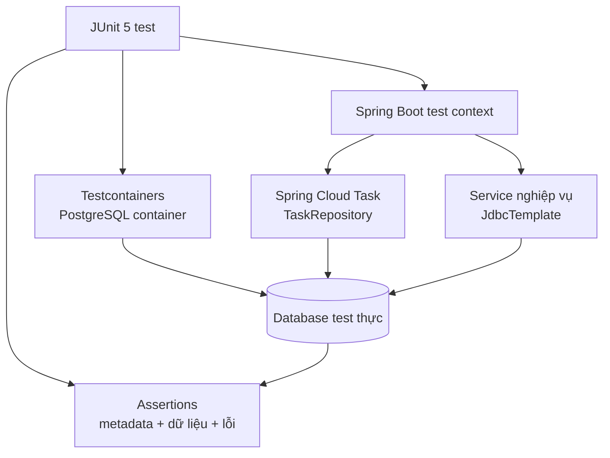
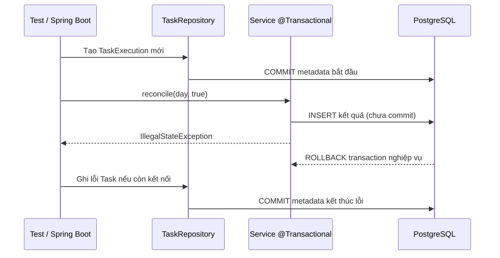

# Kiểm thử JDBC và schema với Testcontainers

Một ứng dụng **Spring Cloud Task** chạy hữu hạn thường ghi metadata của mỗi lần thực thi vào **`TaskRepository`**: tên task, thời điểm bắt đầu/kết thúc, mã thoát và tham số. Khi xử lý công việc theo lịch hoặc theo yêu cầu, ứng dụng còn đọc/ghi dữ liệu nghiệp vụ và đôi khi phối hợp với **Spring Batch**. Một bài kiểm thử chỉ mock `TaskRepository` hoặc dùng H2 có thể chạy xanh nhưng vẫn bỏ sót lỗi SQL, kiểu cột, sequence, transaction hoặc migration xảy ra trên PostgreSQL production.

Trong chương **Kiểm thử**, bài này hướng dẫn dùng **Testcontainers** tạo PostgreSQL thật, tạm thời, cho bài kiểm thử tích hợp Spring Cloud Task. Mục tiêu không chỉ là kiểm tra kết nối JDBC, mà còn xác minh **bảng metadata được tạo đúng**, một `TaskExecution` thật được ghi nhận, kết quả nghiệp vụ được commit, transaction rollback đúng lúc và lỗi cấu hình/schema được phát hiện sớm.

Sau bài học, bạn có thể:

- Phân biệt unit test, JDBC integration test, test vòng đời Task và test schema/migration.
- Dùng `PostgreSQLContainer` với JUnit 5 và `@DynamicPropertySource` hoặc `@ServiceConnection` để kết nối Spring Boot.
- Kiểm tra `TASK_EXECUTION`, `TASK_EXECUTION_PARAMS` và các ràng buộc quan trọng trên PostgreSQL.
- Xây dựng một test end-to-end ở cấp application context, kiểm tra cả metadata và dữ liệu nghiệp vụ.
- Hiểu vì sao một bài test có rollback ở phương thức `@Test` **không** kiểm chứng được commit của một tiến trình Task độc lập.
- Kiểm thử lỗi, idempotency, chạy lại và schema được quản lý bằng Flyway/Liquibase; thiết kế CI có container runtime an toàn.

## 1. Tại sao test JDBC bằng database thật?

Spring Cloud Task làm việc với bảng metadata thông qua JDBC khi có `DataSource` phù hợp. Các vấn đề có thể không lộ ra ở unit test hay database thay thế:

| Vấn đề | Mock/H2 có thể bỏ sót | PostgreSQL qua Testcontainers kiểm tra được |
| --- | --- | --- |
| Cú pháp SQL | `ON CONFLICT`, kiểu ép dữ liệu, hàm PostgreSQL | SQL thật của driver và database mục tiêu |
| Kiểu dữ liệu | `BIGINT`, `TIMESTAMP`, giới hạn `VARCHAR`, `NUMERIC` | Kiểu cột, precision và constraint đúng nền tảng |
| ID thực thi | Bộ sinh ID/sequence có thể khác | Cơ chế sinh `TASK_EXECUTION_ID` của schema PostgreSQL |
| Transaction | Commit/rollback giả lập khác hành vi JDBC | Giao dịch thật với `PlatformTransactionManager` và driver PostgreSQL |
| Schema | Test tự tạo bảng “gần giống” production | DDL/migration đúng phiên bản và kiểm tra lệch schema |
| Concurrency | Mock không có tranh chấp khóa | Unique constraint, lock, retry trên database thật |
| Khởi động | Context mock repository vẫn lên | Startup thực sự truy cập đúng DB/schema và ghi metadata |

**Testcontainers không phải database mô phỏng**: nó chạy PostgreSQL trong container, nhưng test vẫn có tính cô lập và có thể tạo mới database cho từng lớp/bộ test. Port host được map **động**, không cần phụ thuộc PostgreSQL cài sẵn tại `localhost:5432`.



**Ranh giới:** Testcontainers giúp xác minh tương tác với **một database thật**, nhưng chưa thay thế kiểm thử mạng/Kubernetes CronJob, secret rotation, hệ thống message bên ngoài, performance production hoặc khôi phục khi máy bị mất điện.

## 2. Chọn đúng mức kiểm thử

| Mức | Mục tiêu | Nên dùng |
| --- | --- | --- |
| **Unit test** | Parse `business-date`, tính toán thuần, quy tắc lỗi | JUnit + mock; chạy nhanh, không Docker |
| **JDBC repository integration** | SQL, constraint, transaction, kiểu dữ liệu | `JdbcTemplate` + PostgreSQL Testcontainers |
| **Task lifecycle integration** | Framework tạo/kết thúc `TaskExecution` khi runner thực thi | `@SpringBootTest` + PostgreSQL Testcontainers + repository thật |
| **Schema/migration test** | DDL đầy đủ, bảng metadata, column/sequence/index, tương thích phiên bản | Container mới + Flyway/Liquibase hoặc script DDL chính thức |
| **Launch/process test** | Mã thoát Java, ngắt tiến trình, truyền CLI, timeout | Chạy executable JAR trong **process khác** với database container |
| **Platform E2E** | Job/Pod thực tế, retry, resource limits, logging | Môi trường Kubernetes/launcher thử nghiệm |

Một test `@SpringBootTest` chạy `ApplicationRunner` trong **JVM của test** có thể xác minh vòng đời Task và JDBC metadata; nó **không tự kiểm tra** mã thoát OS khi chạy `java -jar` hoặc cách Kubernetes restart container. Đừng gộp các mức kiểm thử thành một kết luận “đã test production”.

## 3. Trước khi viết test: chọn phiên bản nhất quán

Ví dụ trong bài sử dụng **Java 17+, Spring Boot 3.x, Spring Batch/JDBC tương thích và Spring Cloud Task 3.x**, kết hợp **JUnit 5** và **Testcontainers 1.x**. Đây là **họ phiên bản minh họa**, không phải yêu cầu tự chọn bản bất kỳ trong mỗi họ. Dùng Spring Cloud BOM tương thích với Boot mà dự án thực sự sử dụng.

Trong `pom.xml` đã có Spring Boot parent/dependency management, Spring Cloud BOM và `spring-boot-maven-plugin`, các dependency có thể là:

```xml
<dependencies>
    <!-- Chạy ứng dụng Spring Cloud Task và JDBC -->
    <dependency>
        <groupId>org.springframework.cloud</groupId>
        <artifactId>spring-cloud-starter-task</artifactId>
    </dependency>
    <dependency>
        <groupId>org.springframework.boot</groupId>
        <artifactId>spring-boot-starter-jdbc</artifactId>
    </dependency>
    <dependency>
        <groupId>org.postgresql</groupId>
        <artifactId>postgresql</artifactId>
        <scope>runtime</scope>
    </dependency>

    <!-- Test -->
    <dependency>
        <groupId>org.springframework.boot</groupId>
        <artifactId>spring-boot-starter-test</artifactId>
        <scope>test</scope>
    </dependency>
    <dependency>
        <groupId>org.testcontainers</groupId>
        <artifactId>junit-jupiter</artifactId>
        <scope>test</scope>
    </dependency>
    <dependency>
        <groupId>org.testcontainers</groupId>
        <artifactId>postgresql</artifactId>
        <scope>test</scope>
    </dependency>
</dependencies>
```

**Lưu ý về Testcontainers 2.x:** Hệ tọa độ Maven của một số module đã thay đổi; ví dụ PostgreSQL 2.x có artifact `org.testcontainers:testcontainers-postgresql` thay cho `org.testcontainers:postgresql` của dòng 1.x. Không trộn cú pháp hoặc dependency của hai dòng; hãy để BOM quản lý phiên bản và đối chiếu module tương ứng. Tương tự, khi chuyển lên Spring Boot 4.x/Spring Cloud Task mới, kiểm tra lại API và tên starter trước khi sao chép.

### Điều kiện hạ tầng

Máy phát triển hoặc CI runner phải có **container runtime mà Testcontainers truy cập được**, quyền khởi động container và khả năng tải image PostgreSQL. Docker Desktop/Docker Engine là lựa chọn thường gặp; trên CI có thể là runtime được hỗ trợ của tổ chức. Không giả định `mvn test` sẽ chạy được trên môi trường không cấp quyền container.

Không đặt password production trong test. Username/password của container test là **dữ liệu thử nghiệm**, được tạo riêng và bị hủy khi test hoàn tất.

## 4. Hiểu schema `TaskRepository` trước khi kiểm thử

Spring Cloud Task cung cấp **schema DDL theo từng loại database**. Với JDBC repository thông thường:

| Thành phần | Vai trò |
| --- | --- |
| `TASK_EXECUTION` | Lưu `TASK_EXECUTION_ID`, `TASK_NAME`, `START_TIME`, `END_TIME`, `EXIT_CODE` và metadata kết thúc |
| `TASK_EXECUTION_PARAMS` | Lưu các đối số đầu vào của một lần chạy |
| `TASK_SEQ` / cơ chế cấp ID theo phiên bản | Cấp ID lần thực thi; chi tiết có thể khác theo database/version |
| `TASK_TASK_BATCH` | Liên kết một TaskExecution với JobExecution của Spring Batch khi tích hợp được bật |
| `TASK_LOCK` | Dùng cho tính năng single-instance trong những phiên bản/cấu hình hỗ trợ |

**Không tự viết một bảng `TASK_EXECUTION` rút gọn** chỉ gồm ba cột rồi coi như schema đúng. Framework có thể truy cập thêm sequence/table, các cột khác hoặc bảng tham số khi khởi động; test sẽ không phản ánh production nếu DDL không khớp release của Spring Cloud Task.

Property quan trọng:

```properties
spring.cloud.task.initialize-enabled=true
```

Khi bật, Spring Cloud Task có thể khởi tạo schema trên một `DataSource` phù hợp theo cơ chế hỗ trợ. Nó tiện để kiểm tra **“framework có thể tạo bảng và lưu TaskExecution trên PostgreSQL sạch hay không”**. Trong môi trường production, thường đặt `false` và chuẩn bị schema bằng Flyway/Liquibase trước.

Nếu có **nhiều `DataSource`**, không mặc định cơ chế tự khởi tạo chọn được datasource metadata; cần chỉ rõ `TaskConfigurer` và chiến lược migration. Test phải dùng **cùng topology và transaction manager** như cấu hình production nếu mục tiêu là kiểm thử lựa chọn datasource.

## 5. Ứng dụng mẫu: một Task ghi dữ liệu nghiệp vụ

Để minh họa vòng đời, tạo một ứng dụng `reconcile-task` gồm hai phần:

1. `ApplicationRunner` lấy `--business-date=YYYY-MM-DD` và tùy chọn `--simulate-rollback`.
2. Service JDBC ghi một kết quả đối soát theo ngày vào PostgreSQL, với **khóa duy nhất** để tránh ghi lặp khi retry.

### 5.1. Bảng nghiệp vụ dùng riêng cho bài test

File `src/test/resources/sql/business-schema.sql`:

```sql
CREATE TABLE IF NOT EXISTS reconciliation_result (
    business_date DATE PRIMARY KEY,
    total_amount NUMERIC(18, 2) NOT NULL,
    source_count INTEGER NOT NULL
);
```

Đây là **schema nghiệp vụ thử nghiệm**, không thay thế DDL Spring Cloud Task. Khi cần kiểm tra production migration, hãy dùng **migration thật** tạo bảng này thay vì chỉ dựa trên SQL ở `src/test/resources`.

### 5.2. Service JDBC có giao dịch và idempotency

Tạo `src/main/java/com/example/reconcile/ReconciliationService.java`:

```java
package com.example.reconcile;

import java.math.BigDecimal;
import java.sql.Date;
import java.time.LocalDate;

import org.springframework.jdbc.core.JdbcTemplate;
import org.springframework.stereotype.Service;
import org.springframework.transaction.annotation.Transactional;

@Service
public class ReconciliationService {
    private final JdbcTemplate jdbc;

    public ReconciliationService(JdbcTemplate jdbc) {
        this.jdbc = jdbc;
    }

    @Transactional
    public void reconcile(LocalDate day, boolean simulateRollback) {
        jdbc.update("""
            INSERT INTO reconciliation_result
                (business_date, total_amount, source_count)
            VALUES (?, ?, ?)
            ON CONFLICT (business_date) DO NOTHING
            """,
            Date.valueOf(day),
            new BigDecimal("1500000.00"),
            2
        );

        if (simulateRollback) {
            throw new IllegalStateException("Loi mo phong rollback");
        }
    }
}
```

Trong ví dụ, `ON CONFLICT (business_date) DO NOTHING` và `PRIMARY KEY` khiến **retry cùng ngày** không tạo hai kết quả đã commit. Giá trị tổng 1.500.000 là số minh họa, không phải thuật toán đối soát thực tế. Để tái tính khi dữ liệu nguồn thay đổi, cần thiết kế version hoặc quy trình reprocess riêng.

`@Transactional` có hiệu lực khi service được gọi **qua Spring bean proxy**. Nếu code tự `new ReconciliationService(...)`, lời gọi nội bộ qua `this` hoặc dùng sai transaction manager, test có thể cho kết quả khác kỳ vọng.

### 5.3. Ứng dụng Spring Cloud Task

Tạo `src/main/java/com/example/reconcile/ReconcileTaskApplication.java`:

```java
package com.example.reconcile;

import java.time.LocalDate;
import java.util.List;

import org.springframework.boot.ApplicationArguments;
import org.springframework.boot.ApplicationRunner;
import org.springframework.boot.SpringApplication;
import org.springframework.boot.autoconfigure.SpringBootApplication;
import org.springframework.cloud.task.configuration.EnableTask;
import org.springframework.context.annotation.Bean;

@SpringBootApplication
@EnableTask
public class ReconcileTaskApplication {

    public static void main(String[] args) {
        SpringApplication.run(ReconcileTaskApplication.class, args);
    }

    @Bean
    ApplicationRunner runReconciliation(ReconciliationService service) {
        return args -> {
            List<String> values = args.getOptionValues("business-date");
            if (values == null || values.size() != 1
                    || values.get(0) == null || values.get(0).isBlank()) {
                throw new IllegalArgumentException(
                    "Can dung --business-date=YYYY-MM-DD"
                );
            }

            LocalDate date = LocalDate.parse(values.get(0));
            boolean fail = args.containsOption("simulate-rollback");
            service.reconcile(date, fail);
        };
    }
}
```

Ở đường thành công, khi `ApplicationRunner` kết thúc, Spring Cloud Task có thể cập nhật `TaskExecution` với thời điểm kết thúc và mã thoát. Ở đường lỗi, exception trong runner khiến ứng dụng thất bại và framework cố cập nhật metadata lỗi. Nếu `ApplicationContext` không khởi động thành công hoặc database mất kết nối, có thể **không có record hoàn tất**; đây là phần cần kiểm thử thêm.

**Không gọi `System.exit(...)` trong `ApplicationRunner`**: làm vậy có thể giết JVM của JUnit test hoặc bỏ qua callback cập nhật metadata. Nếu production cần truyền exit code cho launcher, xử lý riêng ở ranh giới `main`/Spring Boot exit lifecycle và kiểm thử bằng **process test**.

## 6. Kiểm thử tích hợp với `@Testcontainers` + `@DynamicPropertySource`

Phần này dùng **JUnit 5, Spring Boot Test và PostgreSQLContainer**. Container static có vòng đời gắn với class test; Testcontainers cấp URL, username và password **sau khi container được khởi động**, không cần cổng cố định.

Tạo `src/test/java/com/example/reconcile/TaskRepositoryPostgresTest.java`:

```java
package com.example.reconcile;

import static org.junit.jupiter.api.Assertions.assertEquals;
import static org.junit.jupiter.api.Assertions.assertNotNull;

import java.sql.Date;
import java.util.Map;

import org.junit.jupiter.api.Test;
import org.springframework.beans.factory.annotation.Autowired;
import org.springframework.boot.test.context.SpringBootTest;
import org.springframework.jdbc.core.JdbcTemplate;
import org.springframework.test.context.DynamicPropertyRegistry;
import org.springframework.test.context.DynamicPropertySource;
import org.testcontainers.containers.PostgreSQLContainer;
import org.testcontainers.junit.jupiter.Container;
import org.testcontainers.junit.jupiter.Testcontainers;

@Testcontainers
@SpringBootTest(
    classes = ReconcileTaskApplication.class,
    webEnvironment = SpringBootTest.WebEnvironment.NONE,
    args = "--business-date=2026-11-24",
    properties = {
        "spring.cloud.task.name=reconcileIntegrationTest",
        "spring.cloud.task.initialize-enabled=true",
        "spring.cloud.task.closecontextEnabled=false",
        "spring.sql.init.mode=always",
        "spring.sql.init.schema-locations=classpath:sql/business-schema.sql"
    }
)
class TaskRepositoryPostgresTest {

    @Container
    static final PostgreSQLContainer<?> POSTGRES =
        new PostgreSQLContainer<>("postgres:16-alpine")
            .withDatabaseName("task_it");

    @DynamicPropertySource
    static void datasource(DynamicPropertyRegistry registry) {
        registry.add("spring.datasource.url", POSTGRES::getJdbcUrl);
        registry.add("spring.datasource.username", POSTGRES::getUsername);
        registry.add("spring.datasource.password", POSTGRES::getPassword);
    }

    @Autowired
    JdbcTemplate jdbc;

    @Test
    void taskExecutionHasStartEndAndSuccessExitCode() {
        Map<String, Object> row = jdbc.queryForMap("""
            SELECT TASK_EXECUTION_ID, START_TIME, END_TIME, EXIT_CODE
            FROM TASK_EXECUTION
            WHERE TASK_NAME = ?
            ORDER BY TASK_EXECUTION_ID DESC
            LIMIT 1
            """, "reconcileIntegrationTest");

        assertNotNull(row.get("TASK_EXECUTION_ID"));
        assertNotNull(row.get("START_TIME"));
        assertNotNull(row.get("END_TIME"));
        assertEquals(0, ((Number) row.get("EXIT_CODE")).intValue());
    }

    @Test
    void businessResultWasCommitted() {
        Integer count = jdbc.queryForObject("""
            SELECT COUNT(*)
            FROM reconciliation_result
            WHERE business_date = ?
            """,
            Integer.class,
            Date.valueOf("2026-11-24")
        );

        assertEquals(1, count);
    }

    @Test
    void taskSchemaTablesExist() {
        Integer tableCount = jdbc.queryForObject("""
            SELECT COUNT(*)
            FROM information_schema.tables
            WHERE table_schema = current_schema()
              AND table_name IN (
                'task_execution', 'task_execution_params'
              )
            """, Integer.class);

        assertEquals(2, tableCount);
    }
}
```

### Vì sao test này đo được điều cần đo?

1. `@Container` và `@Testcontainers` quản lý PostgreSQL thật cho class test.
2. `@DynamicPropertySource` cấp `spring.datasource.*` cho Spring Boot từ thông tin **port/credentials thực tế của container**. Không có kết nối đến database production.
3. `@SpringBootTest(args = ...)` khởi tạo application context và thực thi `ApplicationRunner` với một ngày nghiệp vụ hợp lệ.
4. `spring.cloud.task.initialize-enabled=true` cho phép thử cơ chế tạo **schema Task** trên PostgreSQL trống; `spring.sql.init.schema-locations` tạo **bảng nghiệp vụ thử nghiệm**.
5. `spring.cloud.task.closecontextEnabled=false` giữ context mở để Spring Test sử dụng, thay vì để Spring Cloud Task đóng nó ngay khi runner kết thúc.
6. Sau khi runner hoàn tất và framework cập nhật metadata, test đọc JDBC trực tiếp để xác minh **`TASK_EXECUTION` đã có mốc đầu/cuối và mã thành công**.
7. Một test riêng kiểm tra kết quả nghiệp vụ đã ghi, tức là kiểm tra **tác động thật** chứ không chỉ kiểm tra rằng runner được gọi.

**Lưu ý thực thi:** Khi test khởi động ứng dụng thật, `ApplicationRunner` chạy **trong lúc Spring context được nạp**, trước các phương thức `@Test`. Vì thế phải cấp đầu vào hợp lệ ngay trong `@SpringBootTest(args=...)`. Đừng viết một test method với `assertThrows` rồi kỳ vọng bắt được lỗi runner đã xảy ra **trước khi phương thức test bắt đầu**.

### Vì sao không dùng `@Transactional` trên lớp test này?

Nếu gắn `@Transactional` vào `@Test`, Spring Test có thể tự rollback transaction **của test method** khi test kết thúc. Nhưng `ApplicationRunner` đã chạy trong giai đoạn startup, bên ngoài transaction của test method, và service có transaction riêng. Vì vậy `@Transactional` trên test method **không làm các commit của runner tự rollback**.

Test này dùng **PostgreSQLContainer tạm thời và schema riêng** để dọn dữ liệu bằng cách hủy container, tránh phụ thuộc rollback của test method. Với nhiều test cùng context, cần bảo đảm chúng không ghi đè cùng khóa nghiệp vụ hoặc chạy song song không có kiểm soát.

## 7. Kiểm thử schema: đừng chỉ hỏi “bảng có tồn tại không?”

Một bảng có thể tồn tại nhưng vẫn **không đúng schema mà framework cần**. Bổ sung những kiểm tra sau:

| Kiểm tra | Ví dụ câu hỏi | Vì sao quan trọng |
| --- | --- | --- |
| Tên bảng và schema | Có `TASK_EXECUTION` và `TASK_EXECUTION_PARAMS` ở schema mong đợi không? | Sai `search_path` hoặc table prefix khiến framework không tìm thấy bảng. |
| Kiểu cột | `TASK_EXECUTION_ID` là `BIGINT`, `EXIT_CODE` là kiểu số phù hợp? | Sai kiểu có thể chỉ lỗi khi ghi dữ liệu lớn. |
| Khả năng cấp ID | Hai lần chạy có ID riêng, không bị trùng? | Sequence/table sinh ID cần đúng DDL và cơ chế đồng thời. |
| Vòng đời | `START_TIME` và `END_TIME` được lưu? | Xác minh callback của Spring Cloud Task thực sự ghi metadata. |
| Tham số | Các đối số có được ghi theo schema/giới hạn thực tế? | Liên quan truy vết và nguy cơ lộ secret qua metadata. |
| Versioned migration | Schema vừa tạo trên DB trống có khớp script đã triển khai? | Tránh test chạy xanh vì init tự động nhưng production dùng DDL khác. |
| Quyền database | User runtime có thể SELECT/INSERT/UPDATE cần thiết nhưng không cần superuser? | Phát hiện lỗi quyền khi chạy production. |

Ví dụ kiểm tra loại cột qua `information_schema`:

```sql
SELECT
    column_name,
    data_type,
    is_nullable
FROM information_schema.columns
WHERE table_schema = current_schema()
  AND table_name = 'task_execution'
  AND column_name IN (
      'task_execution_id', 'task_name',
      'start_time', 'end_time', 'exit_code'
  )
ORDER BY column_name;
```

Nếu ứng dụng cấu hình `spring.cloud.task.tablePrefix`, tên bảng đã khác mặc định; mọi câu SQL kiểm tra phải theo prefix/schema thực tế. **Không sửa schema trực tiếp dựa trên suy đoán**, mà lấy DDL từ artifact/phiên bản Spring Cloud Task đang dùng.

### Kiểm tra tham số lần chạy

Spring Cloud Task có thể lưu đối số truyền cho ứng dụng trong `TASK_EXECUTION_PARAMS`. Ví dụ:

```sql
SELECT p.TASK_EXECUTION_ID, p.TASK_PARAM
FROM TASK_EXECUTION_PARAMS p
JOIN TASK_EXECUTION t
  ON t.TASK_EXECUTION_ID = p.TASK_EXECUTION_ID
WHERE t.TASK_NAME = 'reconcileIntegrationTest'
ORDER BY p.TASK_EXECUTION_ID;
```

Hãy xác nhận trong môi trường test có tham số `--business-date=2026-11-24` khi dùng cơ chế truyền arguments tương ứng. **Không dùng câu SQL này để khẳng định mọi property đều tự được lưu**: cách lấy arguments phụ thuộc luồng khởi chạy và framework. Không đưa password/token vào command-line arguments vì chúng có thể xuất hiện trong metadata, lịch sử shell và log.

## 8. Kiểm thử schema được quản lý bằng Flyway/Liquibase

Bài test ở phần trước đặt `spring.cloud.task.initialize-enabled=true` để kiểm tra **khả năng init trên database trống**. Nhưng nếu production có migration, đó **chưa phải bài test production schema**.

Với profile test migration, nên:

1. Khởi động PostgreSQLContainer **mới/sạch**.
2. Chạy **chính những migration dùng ở production**: Flyway, Liquibase hoặc script SQL kiểm soát phiên bản, bao gồm DDL TaskRepository đúng release và DDL nghiệp vụ.
3. Đặt `spring.cloud.task.initialize-enabled=false`.
4. Khởi động ứng dụng/task và kiểm tra nó tạo/cập nhật được `TaskExecution` bằng **schema đã migration**.
5. Kiểm tra sau migration không có drift, missing column, sequence lỗi hoặc sai prefix/permissions.

Một cấu hình test sử dụng Flyway **khi dự án đã có Flyway và driver phù hợp**:

```yaml
spring:
  cloud:
    task:
      initialize-enabled: false
  flyway:
    enabled: true
    locations: classpath:db/migration
```

Ở đây `db/migration` phải chứa **migration thật** (đã được dự án kiểm soát), không chỉ bảng nghiệp vụ demo. Flyway có thể thực thi migration khi Spring context khởi động trước khi repository/runner thao tác bảng, với điều kiện dependency, auto-configuration và quan hệ khởi tạo được cấu hình đúng cho phiên bản hiện tại.

**Không bật cả hai cơ chế init schema và migration một cách vô tình**, vì có thể tạo bảng hai lần hoặc che giấu lỗi schema thiếu. Với các bài test migration, nên để `spring.sql.init.mode=never` nếu không dùng SQL initializer riêng.

### Test thất bại có chủ đích khi thiếu schema

Một negative test hữu ích: tạo PostgreSQLContainer **không chạy init DDL**, đặt `spring.cloud.task.initialize-enabled=false` và khởi động một Task dùng JDBC. Kết quả mong đợi là **startup hoặc ghi TaskExecution thất bại**, chứ không âm thầm chuyển sang repository in-memory rồi báo xanh.

Khi test trường hợp **context không thể khởi động**, không dùng một `@SpringBootTest` bình thường rồi kỳ vọng phương thức `@Test` được gọi. Có thể khởi tạo ứng dụng **theo chương trình** trong test với một context/database tách biệt và dùng `assertThrows`, hoặc dùng test hỗ trợ kiểm tra context failure phù hợp. Không chạy negative test làm mất schema của lớp test chính.

## 9. Kiểm thử retry và idempotency

Một công việc cùng ngày được scheduler chạy lại thường tạo **`TaskExecution` mới**, nhưng không nên ghi hai kết quả nghiệp vụ.

Với ứng dụng mẫu, retry `--business-date=2026-11-24` đi qua `ON CONFLICT DO NOTHING`. Vì `business_date` là primary key của `reconciliation_result`, ta kỳ vọng:

| Lần chạy | TaskExecution | Dữ liệu nghiệp vụ |
| --- | --- | --- |
| Lần 1 | Metadata mới, kết thúc thành công | Thêm một dòng cho 2026-11-24 |
| Retry cùng ngày | Metadata mới, kết thúc thành công nếu không lỗi | **Vẫn một dòng** cho 2026-11-24 |
| Lần chạy ngày khác | Metadata mới | Thêm một dòng cho ngày mới |

Để kiểm thử **hai lần startup thực sự**, khởi động hai context/process ứng dụng với cùng container database và cùng identifying business input, thay vì chỉ gọi `service.reconcile(...)` hai lần trong một context. Test cần xác nhận cả **số TaskExecution tăng** lẫn **số dòng kết quả không tăng**.

### Gợi ý test khởi động lại bằng SpringApplicationBuilder

Khi đã có container và schema từ bài test trước, có thể khởi động **một context thứ hai** theo chương trình:

```java
// Đặt đoạn này trong một phương thức @Test của lớp Testcontainers,
// nơi POSTGRES đã được khởi động và schema đã sẵn sàng.
try (var context = new org.springframework.boot.builder.SpringApplicationBuilder(
        ReconcileTaskApplication.class)
        .web(org.springframework.boot.WebApplicationType.NONE)
        .properties(
            "spring.datasource.url=" + POSTGRES.getJdbcUrl(),
            "spring.datasource.username=" + POSTGRES.getUsername(),
            "spring.datasource.password=" + POSTGRES.getPassword(),
            "spring.cloud.task.name=reconcileIntegrationTest",
            "spring.cloud.task.initialize-enabled=false",
            "spring.cloud.task.closecontextEnabled=false",
            "spring.sql.init.mode=never"
        )
        .run("--business-date=2026-11-24")) {
    // ApplicationRunner đã chạy trong SpringApplication.run(...).
}
```

Sau đó truy vấn:

```sql
SELECT COUNT(*)
FROM TASK_EXECUTION
WHERE TASK_NAME = 'reconcileIntegrationTest';

SELECT COUNT(*)
FROM reconciliation_result
WHERE business_date = DATE '2026-11-24';
```

Khi so sánh trong test, hãy đọc **số TaskExecution trước và sau lần startup thứ hai** để assert tăng `1`, thay vì hardcode số lượng tổng từ một database có thể đã chứa các lần chạy khác. Số dòng nghiệp vụ cho ngày đó phải giữ nguyên `1`. Điều này chứng minh **metadata lưu từng lần chạy** nhưng **nghiệp vụ được bảo vệ trước retry**.

**Lưu ý về context cache:** Nếu bạn dùng nhiều `@SpringBootTest` khác nhau, Spring Test có thể cache/reuse context. Mỗi context startup không tương đương mỗi phương thức `@Test`. Nếu cần kiểm tra *mỗi lần launch*, phải tạo một tiến trình/context mới hoặc thiết kế fixture rõ ràng, không giả định mỗi test method tự khởi chạy Task lại.

## 10. Kiểm thử rollback và lỗi runner

Ví dụ `--simulate-rollback` khiến service insert dữ liệu rồi ném `IllegalStateException` khi transaction còn mở. Nếu transaction manager đúng, **dòng nghiệp vụ của ngày lỗi không được commit**. Nhưng Spring Cloud Task có thể vẫn ghi một `TaskExecution` thất bại vì metadata Task nằm trong giao dịch vòng đời riêng.



**Để kiểm thử đường lỗi, không nạp `@SpringBootTest(args = "--simulate-rollback")` rồi kỳ vọng phương thức `@Test` sẽ assert được**: ApplicationRunner có thể làm context startup thất bại **trước khi test method được gọi**.

Thay vào đó, dùng một test driver khởi động context theo chương trình, bắt exception, rồi query database container từ kết nối đã tồn tại. Ví dụ **khung test** (cần đặt trong lớp có container, `JdbcTemplate` và schema test):

```java
assertThrows(Exception.class, () ->
    new SpringApplicationBuilder(ReconcileTaskApplication.class)
        .web(WebApplicationType.NONE)
        .properties(
            "spring.datasource.url=" + POSTGRES.getJdbcUrl(),
            "spring.datasource.username=" + POSTGRES.getUsername(),
            "spring.datasource.password=" + POSTGRES.getPassword(),
            "spring.cloud.task.name=reconcileIntegrationTest",
            "spring.cloud.task.initialize-enabled=false",
            "spring.sql.init.mode=never"
        )
        .run(
            "--business-date=2026-11-25",
            "--simulate-rollback"
        )
);

Integer rows = jdbc.queryForObject("""
    SELECT COUNT(*) FROM reconciliation_result
    WHERE business_date = DATE '2026-11-25'
    """, Integer.class);

assertEquals(0, rows);
```

Các import cần thêm ở khung test trên: `org.junit.jupiter.api.Assertions.assertThrows`, `org.springframework.boot.builder.SpringApplicationBuilder` và `org.springframework.boot.WebApplicationType`. Nếu test method tương tác với nhiều context/transaction, phải bảo đảm không có test khác đang xử lý cùng business date.

Muốn xác minh trạng thái lỗi Task, truy vấn `TASK_EXECUTION` của **lần khởi chạy mới**, kiểm tra `END_TIME` và `EXIT_CODE` khác `0` **nếu ứng dụng đã tạo được metadata và framework kịp ghi kết thúc**. Không khẳng định điều này được đảm bảo với mọi lỗi khởi động; đôi khi context chết trước khi repository sẵn sàng nên record không tồn tại.

### Nên test những trường hợp nào?

| Ca | Kỳ vọng nghiệp vụ | Kỳ vọng metadata |
| --- | --- | --- |
| Thành công | Commit dữ liệu ngày A | Có TaskExecution kết thúc mã `0` |
| Retry ngày A | Không tạo dòng trùng | Có TaskExecution **mới** |
| Exception trước commit | Rollback dữ liệu ngày B | TaskExecution lỗi nếu framework cập nhật được |
| Thiếu `--business-date` | Không ghi dữ liệu | Lỗi runner; metadata có thể ghi kết thúc lỗi |
| Sai PostgreSQL credentials | Không kết nối | Có thể không có TaskExecution vì context lỗi sớm |
| Schema Task thiếu và auto-init tắt | Không được ghi metadata | Startup/ghi repository lỗi có thể tái hiện |
| Schema có sai kiểu/thiếu column | Có thể fail khi ghi TaskExecution | Test phát hiện migration lệch DDL |
| Hai lần chạy đồng thời một ngày | Kết quả không trùng theo unique constraint | Hai lần chạy có ID riêng nếu cả hai tạo metadata |

**Không “sửa” test bằng cách nuốt exception** trong runner. Nếu ứng dụng đã thất bại, test phải nhìn thấy lỗi và kiểm tra rollback, thay vì ép mọi trường hợp trả mã thành công.

## 11. Khi có nhiều `DataSource` và Spring Batch

Trong sản xuất, có thể dùng một database cho metadata Spring Cloud Task, một database khác cho dữ liệu nghiệp vụ; thêm Spring Batch có thể có `JobRepository`/Step transaction manager riêng.

```text
Spring Cloud Task test
  ├─ taskMetadataDataSource -> TaskRepository -> TASK_EXECUTION
  ├─ businessDataSource     -> ReconciliationService -> reconciliation_result
  └─ batchDataSource       -> JobRepository -> BATCH_JOB_EXECUTION ...
```

Các bài test cần làm rõ:

1. `TaskConfigurer` trỏ **đúng datasource metadata** và manager của nó.
2. Service nghiệp vụ dùng `businessTransactionManager` tương ứng với kết nối đã cấp.
3. Spring Batch `JobRepository` dùng schema đúng và các `Step` chọn transaction manager phù hợp.
4. Việc rollback ở business DB **không rollback TaskExecution đã commit**, ngay cả khi task thất bại.

Với nhiều datasource, bạn có thể tạo **hai PostgreSQLContainer** hoặc dùng hai database/schema test được cách ly, rồi đăng ký từng tập property bằng `@DynamicPropertySource`. Không chỉ sử dụng một container chung cho mọi datasource nếu yêu cầu test là phát hiện **cấu hình trỏ nhầm database**.

**Với Spring Batch**, kiểm tra thêm `BATCH_JOB_INSTANCE`, `BATCH_JOB_EXECUTION`, `BATCH_STEP_EXECUTION`, `JobParameters`, khả năng restart và trạng thái checkpoint. `TaskExecution` là kết quả **cấp ứng dụng**, không thay `JobExecution` của Batch.

## 12. `@ServiceConnection`: lựa chọn thay thế gọn hơn

Từ **Spring Boot 3.1+**, Spring Boot có khả năng tạo **service connection details** từ Testcontainers, giảm nhu cầu tự khai báo URL/username/password.

Khi có dependency test `org.springframework.boot:spring-boot-testcontainers` và môi trường tương thích, có thể viết:

```java
import org.springframework.boot.testcontainers.service.connection.ServiceConnection;
import org.testcontainers.containers.PostgreSQLContainer;
import org.testcontainers.junit.jupiter.Container;
import org.testcontainers.junit.jupiter.Testcontainers;

@Testcontainers
@SpringBootTest(
    classes = ReconcileTaskApplication.class,
    args = "--business-date=2026-11-24"
)
class TaskWithServiceConnectionTest {

    @Container
    @ServiceConnection
    static PostgreSQLContainer<?> postgres =
        new PostgreSQLContainer<>("postgres:16-alpine");

    // @Test: kiểm tra TaskExecution và dữ liệu nghiệp vụ.
}
```

Đây là **mẫu thay thế phần cấp JDBC properties** của `@DynamicPropertySource`; test hoàn chỉnh vẫn cần schema/migration, cấu hình đóng context, dữ liệu nghiệp vụ và assertion. **Không dùng cả `@DynamicPropertySource` và `@ServiceConnection` để cấu hình cùng một DataSource mà chưa xác định precedence**.

So sánh:

| Cách | Ưu điểm | Khi nào nên chọn |
| --- | --- | --- |
| `@DynamicPropertySource` | Tường minh, linh hoạt cho nhiều datasource/custom property | Khi phải map nhiều URL/credential hoặc dùng Boot trước khi có service connections |
| `@ServiceConnection` | Ít boilerplate, Boot tự tạo connection details cho module được hỗ trợ | Boot 3.1+ và topology đơn giản với một PostgreSQL datasource |
| Testcontainers JDBC `jdbc:tc:...` | Gọn cho một số kiểu JDBC test | Khi muốn kiểm thử datasource mà không cần điều khiển container trực tiếp |

**Tương thích phiên bản là điều kiện bắt buộc.** Cách import, dependency và chức năng được hỗ trợ có thể thay đổi ở các bản Spring Boot lớn. Không nên coi các annotation là phép thay thế một-kèm-một cho toàn bộ logic startup của Spring Cloud Task.

## 13. Chạy kiểm thử trong CI/CD

Với class `TaskRepositoryPostgresTest` có tên kết thúc bằng `Test`, Maven Surefire mặc định thường nhận diện nó khi chạy:

```bash
./mvnw test
```

Trên Windows:

```powershell
.\mvnw.cmd test
```

Nếu đặt tên class `*IT`, Maven Surefire có thể **không tự chạy** lớp đó trong phase `test`; hãy cấu hình Maven Failsafe và chạy `verify` hoặc quy ước test suite tương ứng. Tránh báo “integration tests đã chạy” chỉ vì Maven kết thúc thành công khi class chưa được discovery.

### Checklist CI

- Runner có container runtime mà Testcontainers được phép sử dụng; tài nguyên CPU/memory đủ cho PostgreSQL và JVM.
- Có quyền tải image PostgreSQL từ registry được tổ chức cho phép; **pin image/version** tương ứng production hoặc phiên bản kiểm thử được phê duyệt.
- Không sử dụng database production hoặc username/password thật; CI container là tạm thời.
- Dùng database/schema **cô lập** và không tái sử dụng trạng thái từ lần chạy trước khi đang kiểm thử migration.
- Không cố định port 5432 trên host: lấy JDBC URL/port do Testcontainers cung cấp.
- Quản lý timeout khởi tạo container hợp lý; phân biệt lỗi Docker/registry với lỗi assertion SQL.
- Tập hợp test report/log khi thất bại nhưng **không đính kèm secret** hoặc dump toàn bộ environment.
- Hạn chế chạy song song các test cùng sửa một schema/container; nếu chạy parallel, chọn khóa dữ liệu và isolation phù hợp.
- Kiểm tra build thực sự đã chạy và đếm số test được discovery, không bỏ qua bằng `-DskipTests`.

Một quy trình thường dùng là **unit tests trước**, tiếp đến **Testcontainers JDBC/schema tests**, rồi mới đến các bài test có Kafka, Kubernetes hoặc môi trường staging. Database container trong CI là **công cụ kiểm tra tương thích**, không phải một phần của artifact sẽ được triển khai.

## 14. Những lỗi thường gặp khi kiểm thử

| Triệu chứng | Nguyên nhân có thể | Cách khắc phục |
| --- | --- | --- |
| `Could not find a valid Docker environment` | Runtime không chạy hoặc không cấp quyền | Kiểm tra Docker/CI runner và quyền truy cập; không thay bằng H2 để “chạy xanh”. |
| `Connection refused` đến `localhost:5432` | Test hardcode URL/port thay vì container mapping | Dùng `POSTGRES.getJdbcUrl()` / `@ServiceConnection`. |
| `relation "task_execution" does not exist` | Schema Task chưa init/migrate, datasource/schema sai | Kiểm tra `initialize-enabled`, DDL và `search_path`. |
| `TASK_SEQ` hoặc ID generator lỗi | Migration thiếu bảng/sequence theo phiên bản | Dùng DDL chính thức, kiểm thử cấp ID thật trên Postgres. |
| `NoUniqueBeanDefinitionException` khi nhiều datasource | `TaskConfigurer`/`JdbcTemplate` chưa chọn rõ | Dùng `@Qualifier`, bean manager tương ứng và test topology thật. |
| `@SpringBootTest` thất bại trước `@Test` | Runner yêu cầu tham số hoặc exception lúc startup | Cấp `args` hợp lệ; với negative test khởi tạo context theo chương trình. |
| Không thấy `END_TIME` ngay sau startup | Callback chưa hoàn tất, context/DB lỗi hoặc assertion đặt sai thời điểm | Chờ đúng mốc, kiểm tra event của framework và log; không `Thread.sleep` tùy ý để che race. |
| `@Transactional` trên test làm test “xanh” sai | Test method rollback nhưng runner startup đã commit transaction riêng | Kiểm tra dữ liệu **sau commit** bằng JDBC mới và fixture cô lập. |
| Test pass H2 nhưng fail Postgres | Sai dialect, dữ liệu/constraint khác | Dùng PostgreSQL Testcontainers cùng phiên bản được hỗ trợ. |
| Test chạy trùng và thay đổi số row | Reuse context/container hoặc chạy parallel | Dùng key khác nhau, fixture rõ và so sánh trước/sau. |
| Retry test tạo hai kết quả | Không có unique constraint/idempotency | Đặt ràng buộc và kiểm tra hai lần launch thực sự. |
| Spring Batch Job chạy ngoài ý muốn khi test | `spring.batch.job.enabled` hoặc auto-run | Tắt auto-run và khởi chạy Job có kiểm soát trong test. |

### Không lấy `@SpringBootTest` làm bằng chứng mã thoát hệ điều hành

`@SpringBootTest` chạy trong JVM của test runner. Nếu cần test `java -jar` trả non-zero khi có lỗi, thực hiện **process-level integration test** riêng bằng `ProcessBuilder` (hoặc công cụ được tổ chức hỗ trợ), truyền database URL/credential test qua environment, chờ tiến trình kết thúc với timeout và kiểm tra `exitValue()`.

Không đưa `System.exit(...)` trực tiếp vào đường chạy mà `@SpringBootTest` sẽ gọi, vì nó có thể chấm dứt toàn bộ JVM của Maven/JUnit. Cũng không nên cho process-level test dùng Docker/database production hoặc để lại process con chạy nền khi test thất bại.

## 15. Bài thực hành và câu hỏi tự kiểm tra

Hãy làm các bước trên **container PostgreSQL tạm thời**, không tác động database thật:

1. Dùng Testcontainers tạo PostgreSQL 16 và cấp datasource bằng `@DynamicPropertySource`. Vì sao không nên hardcode `localhost:5432`?
2. Bật `spring.cloud.task.initialize-enabled=true` trên DB trống; xác minh `TASK_EXECUTION`, `TASK_EXECUTION_PARAMS` và cơ chế cấp ID có thể hoạt động.
3. Chạy `@SpringBootTest` với `--business-date=2026-11-24`; kiểm tra `START_TIME`, `END_TIME`, `EXIT_CODE=0` và một dòng `reconciliation_result`.
4. Tạo lần startup thứ hai cho cùng ngày, kiểm tra **TaskExecution tăng thêm một** nhưng dữ liệu nghiệp vụ không nhân đôi.
5. Chạy `--simulate-rollback` cho một ngày khác trong context được tạo theo chương trình; vì sao bảng nghiệp vụ không được giữ lại dòng của ngày đó?
6. Tắt auto-init Task schema trên database sạch. Thiết kế negative test xác minh lỗi startup khi thiếu DDL.
7. Thêm migration Flyway thật và chạy test với `initialize-enabled=false`. Chứng minh schema production của bạn có thể phục vụ TaskRepository.
8. Nếu có hai datasource, tạo hai container hoặc database tách biệt. Cố tình gắn `TaskConfigurer` vào datasource sai và phân tích test nào sẽ phát hiện.
9. Thử `@ServiceConnection` trên một bản Spring Boot được hỗ trợ, so sánh với `@DynamicPropertySource` về độ rõ ràng/khả năng mở rộng.
10. Cấu hình CI chạy class `*Test` và `*IT` đúng phase; chứng minh báo cáo test có các JDBC/schema assertions thực sự được chạy.

**Câu hỏi ôn tập:**

- Testcontainers bổ sung điều gì mà mock `TaskRepository` hoặc H2 chưa bảo đảm?
- Vì sao không nên tự tạo một schema `TASK_EXECUTION` rút gọn rồi gọi đó là integration test?
- `spring.cloud.task.initialize-enabled=true` có kiểm thử được migration production không? Vì sao?
- Tại sao runner có thể chạy **trước phương thức `@Test`** của `@SpringBootTest`?
- `TaskExecution` nào thay đổi khi retry và khóa nào cần ổn định để tránh xử lý trùng?
- Gắn `@Transactional` lên test method có tự rollback dữ liệu runner đã ghi lúc startup không?
- Khi JVM bị kill trước khi cập nhật metadata, có thể kiểm thử toàn bộ hành vi đó chỉ bằng `@SpringBootTest` không?
- Khi dùng Spring Batch, vì sao phải kiểm tra `JobRepository` riêng với `TaskRepository`?

**Ghi nhớ:** Kiểm thử JDBC và schema cho **Spring Cloud Task** cần chạy với **database thật và DDL đúng phiên bản**. `Testcontainers` cho phép tạo PostgreSQL cô lập, cấp thông tin kết nối động và xác minh đồng thời **metadata `TaskExecution`** lẫn **dữ liệu nghiệp vụ đã commit**. Hãy kiểm thử các đường thành công, rollback, retry và schema migration riêng biệt; giữ các kiểm thử process/platform ở mức phù hợp để không nhầm test context thành một lần triển khai thực tế.

**Tài liệu tham khảo chính thức:**

- [Spring Boot — Testcontainers](https://docs.spring.io/spring-boot/reference/testing/testcontainers.html): `@ServiceConnection` và `@DynamicPropertySource`.
- [Testcontainers for Java — JUnit 5](https://java.testcontainers.org/test_framework_integration/junit_5/): `@Testcontainers`, `@Container` và vòng đời container.
- [Testcontainers — PostgreSQL Module](https://java.testcontainers.org/modules/databases/postgres/): `PostgreSQLContainer` và JDBC URL.
- [Spring Cloud Task — Task Repository Schema](https://docs.spring.io/spring-cloud-task/reference/appendix-task-repository-schema.html): các bảng/field metadata và liên kết Batch.
- [Spring Cloud Task — Features](https://docs.spring.io/spring-cloud-task/reference/features.html): `TaskRepository`, schema initialization, lifecycle và listener.
