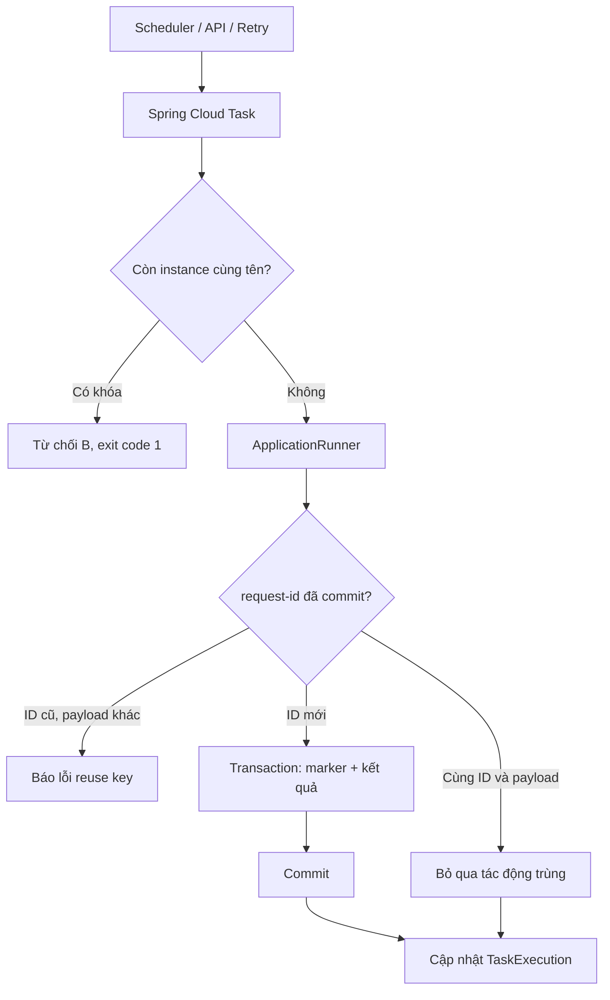

# Kiểm thử tranh chấp khóa và xử lý lặp

## 1. Bài toán và mục tiêu

Ứng dụng **Spring Cloud Task** chạy một công việc hữu hạn rồi kết thúc. Framework lưu lịch sử từng lần chạy trong **`TaskRepository`** dưới dạng `TaskExecution`: tên tác vụ, thời điểm bắt đầu/kết thúc, tham số, lỗi và mã thoát. Task có thể được khởi chạy từ scheduler, API, Kubernetes Job hoặc Spring Cloud Data Flow.

Khi có retry và nhiều tiến trình, phải phân biệt hai vấn đề:

- **Tranh chấp khóa:** Hai tiến trình cùng muốn chạy một task tại cùng thời điểm. Nếu tác vụ chỉ được có một instance đang chạy, tiến trình thứ hai phải bị chặn.
- **Xử lý lặp:** Cùng một yêu cầu nghiệp vụ được gửi lại sau khi lần trước đã hoàn tất, hoặc sau timeout/crash. Dù hai lần không chạy đồng thời, lần sau cũng không được tạo thêm hiệu ứng trùng.

**Khóa một instance không tự mang lại exactly-once. Idempotency mới ngăn hiệu ứng nghiệp vụ bị áp dụng lần hai.** Bài học thuộc chương **Kiểm thử** của module `SPRING_CLOUD_TASK`, nhằm xác minh đồng thời cả hai lớp bảo vệ.

Ví dụ xuyên suốt là `daily-report-task`: mỗi lệnh có `--request-id` và `--report-day`, và chỉ một kết quả báo cáo được ghi cho request ID ấy. Chúng ta sẽ:

1. Kiểm thử hai **JVM thực sự** cùng dùng một PostgreSQL và một tên task.
2. Chứng minh `single-instance-enabled=true` khiến tiến trình B bị từ chối khi A đang giữ khóa.
3. Kiểm tra lần chạy mới được phép thực thi sau khi A kết thúc.
4. Dùng **unique constraint + transaction** để chặn duplicate khi khóa bị tắt hoặc yêu cầu được retry tuần tự.
5. Phân biệt lỗi **trước commit** với lỗi **sau commit**.
6. Dùng JUnit 5, Testcontainers và SQL assertions để kiểm tra cạnh tranh ở tầng dữ liệu.
7. Hiểu tác động của TTL, process crash, kết nối DB, Spring Batch và Kubernetes scheduler.

## 2. Ba lớp bảo vệ và tiêu chí kiểm thử

| Lớp | Ngăn chặn | Không bảo đảm |
| --- | --- | --- |
| `spring.cloud.task.single-instance-enabled` | Hai tiến trình **cùng tên Task** đang hoạt động chồng nhau khi đều tham gia khóa chung. | Một request cũ không bị chạy lại **sau** khi khóa đã nhả. |
| Khóa nghiệp vụ/idempotency | Cùng một `request-id` không tạo hai kết quả database. | Không mặc nhiên chặn hai JVM đang cùng tải CPU/API trước bước ghi. |
| Scheduler `concurrencyPolicy`/rate limit | Hạn chế số lần khởi chạy đồng thời từ **scheduler đó**. | Trigger thủ công/nguồn khác và retry từ nhiều hệ thống. |



Ma trận test đề xuất:

| Mã | Bối cảnh | Kỳ vọng |
| --- | --- | --- |
| C1 | A và B cùng tên, cùng DB, cùng bật single-instance, chạy chồng | A vào runner; B không vào runner và exit `1`. |
| C2 | B khởi chạy **sau khi A hoàn tất** | B được chạy. |
| C3 | Khác tên hoặc không cùng DB | Khóa Task không chặn chéo; đây là sai cấu hình nếu bạn kỳ vọng chúng cạnh tranh. |
| D1 | Cùng request ID gọi hai lần tuần tự | Một kết quả; lần sau trả `created=false`. |
| D2 | Nhiều thread/JVM cùng request ID khi không dùng khóa Task | Unique constraint vẫn chỉ tạo một kết quả. |
| D3 | Lỗi trong DB transaction | Marker và kết quả cùng rollback; retry được phép tạo lại. |
| D4 | DB đã commit, runner báo lỗi sau đó | Retry không tạo kết quả lần hai. |
| D5 | Dùng lại request ID cho ngày báo cáo khác | Từ chối vì payload không khớp. |
| F1 | JVM bị kill/TTL hết hạn | Khôi phục có kiểm soát, không cho hai worker sống cùng ghi dữ liệu. |

**Không kết luận từ một dòng log hoặc exit code duy nhất.** Phải kết hợp dữ liệu bảng `TASK_LOCK`, `TASK_EXECUTION`, tiến trình/container và bảng nghiệp vụ.

## 3. Khóa JDBC của Spring Cloud Task

Spring Cloud Task có thể hạn chế chỉ một instance cho một tên task:

```yaml
spring:
  cloud:
    task:
      name: daily-report-task
      single-instance-enabled: true
      single-instance-lock-check-interval: 500
      single-instance-lock-ttl: 300000
```

Theo tài liệu Spring Cloud Task 3.2:

- Mặc định `single-instance-enabled=false`; phải bật trên **tất cả** các lần chạy cần tham gia cơ chế này.
- Khi A đang chạy, B có cùng tên task và cũng bật cơ chế này bị từ chối, với **mã thoát `1`**.
- Cần hai dependency Spring Integration: `spring-integration-core` và `spring-integration-jdbc`.
- Database phải có bảng **`TASK_LOCK`** theo script Spring Cloud Task. Không nhầm với `INT_LOCK` mặc định của một `JdbcLockRegistry` Spring Integration do ứng dụng tự dựng.
- `TaskRepository` lưu lịch sử; `TASK_LOCK` mới là dữ liệu điều phối khóa. `END_TIME IS NULL` không phải một mutex.

Hai thuộc tính thời gian ví dụ có đơn vị **mili giây**: khoảng kiểm tra `500` và TTL `300000` (5 phút). TTL quá thấp so với thời gian task chạy có thể khiến khóa hết hạn khi A còn xử lý. TTL quá cao làm retry sau crash phải chờ lâu hơn. Không mặc định built-in lock sẽ được gia hạn mãi mãi nếu không kiểm tra đúng cơ chế/phiên bản.

**Không kiểm thử cạnh tranh bằng hai H2 in-memory database:** mỗi JVM có database riêng. Hai JVM đồng thời mở cùng một H2 embedded file có thể lỗi do **khóa file H2** thay vì khóa nghiệp vụ của Task. Dùng PostgreSQL/MySQL server chung hoặc PostgreSQL Testcontainers.

## 4. Dự án Spring Boot mẫu

Ví dụ sử dụng **Java 17**, **Spring Boot 3.4.5**, **Spring Cloud 2024.0.2** và PostgreSQL. Khi đổi phiên bản, chọn release train Boot–Cloud tương thích và kiểm tra lại DDL TaskRepository.

```text
task-concurrency-test/
├── pom.xml
└── src/
    ├── main/
    │   ├── java/com/example/tasktest/
    │   │   ├── TaskTestApplication.java
    │   │   ├── OnceOnlyReportService.java
    │   │   └── DailyReportRunner.java
    │   └── resources/application.yml
    └── test/
        ├── java/com/example/tasktest/IdempotencyIntegrationTest.java
        └── resources/schema-business.sql
```

### 4.1. Maven `pom.xml`

```xml
<?xml version="1.0" encoding="UTF-8"?>
<project xmlns="http://maven.apache.org/POM/4.0.0"
         xmlns:xsi="http://www.w3.org/2001/XMLSchema-instance"
         xsi:schemaLocation="http://maven.apache.org/POM/4.0.0 https://maven.apache.org/xsd/maven-4.0.0.xsd">
    <modelVersion>4.0.0</modelVersion>

    <parent>
        <groupId>org.springframework.boot</groupId>
        <artifactId>spring-boot-starter-parent</artifactId>
        <version>3.4.5</version>
        <relativePath/>
    </parent>

    <groupId>com.example</groupId>
    <artifactId>task-concurrency-test</artifactId>
    <version>0.0.1-SNAPSHOT</version>

    <properties>
        <java.version>17</java.version>
    </properties>

    <dependencyManagement>
        <dependencies>
            <dependency>
                <groupId>org.springframework.cloud</groupId>
                <artifactId>spring-cloud-dependencies</artifactId>
                <version>2024.0.2</version>
                <type>pom</type>
                <scope>import</scope>
            </dependency>
        </dependencies>
    </dependencyManagement>

    <dependencies>
        <dependency>
            <groupId>org.springframework.cloud</groupId>
            <artifactId>spring-cloud-starter-task</artifactId>
        </dependency>
        <dependency>
            <groupId>org.springframework.boot</groupId>
            <artifactId>spring-boot-starter-jdbc</artifactId>
        </dependency>
        <dependency>
            <groupId>org.springframework.integration</groupId>
            <artifactId>spring-integration-core</artifactId>
        </dependency>
        <dependency>
            <groupId>org.springframework.integration</groupId>
            <artifactId>spring-integration-jdbc</artifactId>
        </dependency>
        <dependency>
            <groupId>org.postgresql</groupId>
            <artifactId>postgresql</artifactId>
            <scope>runtime</scope>
        </dependency>
        <dependency>
            <groupId>org.springframework.boot</groupId>
            <artifactId>spring-boot-starter-test</artifactId>
            <scope>test</scope>
        </dependency>
        <dependency>
            <groupId>org.testcontainers</groupId>
            <artifactId>junit-jupiter</artifactId>
            <scope>test</scope>
        </dependency>
        <dependency>
            <groupId>org.testcontainers</groupId>
            <artifactId>postgresql</artifactId>
            <scope>test</scope>
        </dependency>
    </dependencies>

    <build>
        <plugins>
            <plugin>
                <groupId>org.springframework.boot</groupId>
                <artifactId>spring-boot-maven-plugin</artifactId>
            </plugin>
        </plugins>
    </build>
</project>
```

`spring-integration-core` và `spring-integration-jdbc` phục vụ single-instance. Testcontainers/JUnit giúp test giao dịch trên PostgreSQL; **test hai JVM** vẫn cần một bài riêng ngoài JUnit transaction test.

### 4.2. Cấu hình `application.yml`

```yaml
spring:
  application:
    name: daily-report-task
  main:
    web-application-type: none
  datasource:
    url: ${TASK_DB_URL:jdbc:postgresql://localhost:5432/task_testing}
    username: ${TASK_DB_USER:task_user}
    password: ${TASK_DB_PASSWORD:}
  cloud:
    task:
      name: daily-report-task
      initialize-enabled: false
      single-instance-enabled: true
      single-instance-lock-check-interval: 500
      single-instance-lock-ttl: 300000
      closecontext-enabled: true
```

Trước khi chạy JAR ngoài test, cần có PostgreSQL database `task_testing` và user phù hợp; schema Spring Cloud Task (`TASK_EXECUTION`, `TASK_LOCK`, sequence và các bảng liên quan) phải được tạo bằng **script đúng phiên bản**, thông qua migration/DBA. `initialize-enabled=false` giữ ứng dụng không tự tranh DDL khi hai instance cùng khởi động.

Các biến `TASK_DB_URL`, `TASK_DB_USER`, `TASK_DB_PASSWORD` đến từ môi trường/secret manager. Không đưa mật khẩu vào mã nguồn hay tham số task vì `TaskRepository` có thể ghi lại tham số.

### 4.3. Schema nghiệp vụ PostgreSQL

Tạo hai bảng riêng **trong database thực hành mới** bằng migration/SQL client. Để tích hợp test có thể đặt cùng DDL trong `src/test/resources/schema-business.sql`:

```sql
CREATE TABLE processed_request (
    request_id VARCHAR(80) PRIMARY KEY,
    report_day DATE NOT NULL,
    created_at TIMESTAMPTZ NOT NULL DEFAULT CURRENT_TIMESTAMP
);

CREATE TABLE report_output (
    request_id VARCHAR(80) PRIMARY KEY
        REFERENCES processed_request(request_id),
    report_day DATE NOT NULL,
    generated_rows INTEGER NOT NULL,
    created_at TIMESTAMPTZ NOT NULL DEFAULT CURRENT_TIMESTAMP
);
```

Đây là **schema nghiệp vụ** chứ không phải schema của `TaskRepository`. Mỗi `request_id` có tối đa một marker và một kết quả. Với tác vụ thật, fingerprint của payload/ngày báo cáo cũng cần được đối chiếu khi gặp key đã tồn tại để không âm thầm chấp nhận hai yêu cầu khác nhau cùng ID.

### 4.4. Ứng dụng và service transactional

`TaskTestApplication.java`:

```java
package com.example.tasktest;

import org.springframework.boot.SpringApplication;
import org.springframework.boot.autoconfigure.SpringBootApplication;
import org.springframework.cloud.task.configuration.EnableTask;

@SpringBootApplication
@EnableTask
public class TaskTestApplication {

    public static void main(String[] args) {
        SpringApplication.run(TaskTestApplication.class, args);
    }
}
```

`OnceOnlyReportService.java`:

```java
package com.example.tasktest;

import java.sql.Date;
import java.time.LocalDate;

import org.springframework.jdbc.core.JdbcTemplate;
import org.springframework.stereotype.Service;
import org.springframework.transaction.annotation.Transactional;

@Service
public class OnceOnlyReportService {

    private final JdbcTemplate jdbc;

    public OnceOnlyReportService(JdbcTemplate jdbc) {
        this.jdbc = jdbc;
    }

    @Transactional
    public boolean writeOnce(
            String requestId, LocalDate day, boolean failBeforeCommit) {

        int inserted = jdbc.update(
                "INSERT INTO processed_request (request_id, report_day) "
                + "VALUES (?, ?) "
                + "ON CONFLICT (request_id) DO NOTHING",
                requestId, Date.valueOf(day));

        if (inserted == 0) {
            LocalDate existingDay = jdbc.queryForObject(
                    "SELECT report_day FROM processed_request "
                    + "WHERE request_id = ?",
                    (rs, row) -> rs.getDate(1).toLocalDate(),
                    requestId);
            if (!day.equals(existingDay)) {
                throw new IllegalArgumentException(
                        "request-id trùng nhưng report-day khác");
            }
            return false;
        }

        jdbc.update(
                "INSERT INTO report_output "
                + "(request_id, report_day, generated_rows) "
                + "VALUES (?, ?, ?)",
                requestId, Date.valueOf(day), 1);

        if (failBeforeCommit) {
            throw new IllegalStateException(
                    "Giả lập lỗi trước commit");
        }
        return true;
    }
}
```

Trong PostgreSQL, `INSERT ... ON CONFLICT (request_id) DO NOTHING` dùng ràng buộc khóa chính để tránh hai transaction tạo marker trùng. Nếu hai transaction cạnh tranh, một bên chờ bên kia hoàn tất rồi nhận kết quả tương ứng. Khi insert marker thành công, insert kết quả và marker cùng thuộc **một `@Transactional`**.

Các điều kiện đảm bảo:

1. `writeOnce(...)` được gọi **từ bean runner khác**, đi qua Spring transaction proxy. Tự gọi bằng `this.writeOnce(...)` từ cùng class có thể bỏ qua proxy.
2. `IllegalStateException` là runtime exception nên mặc định rollback transaction; cả marker và result đều không commit.
3. Khi đã commit, retry cùng ID/ngày trả `false` và không ghi thêm kết quả.
4. Cùng ID nhưng ngày khác bị từ chối. Với nhiều trường nghiệp vụ, lưu payload hash hoặc phiên bản request để so khớp.
5. Đảm bảo business effect này **nằm trong cùng PostgreSQL transaction**. Nếu gửi email/tiền/Kafka ngoài DB, rollback SQL không hoàn tác được side effect bên ngoài; cần outbox hoặc idempotency phía đích.

### 4.5. Runner có mốc đồng bộ để thử tranh chấp

`DailyReportRunner.java`:

```java
package com.example.tasktest;

import java.time.LocalDate;
import java.util.List;

import org.springframework.boot.ApplicationArguments;
import org.springframework.boot.ApplicationRunner;
import org.springframework.boot.autoconfigure.condition.ConditionalOnProperty;
import org.springframework.stereotype.Component;

@Component
@ConditionalOnProperty(
        name = "app.runner.enabled",
        havingValue = "true",
        matchIfMissing = true)
public class DailyReportRunner implements ApplicationRunner {

    private final OnceOnlyReportService service;

    public DailyReportRunner(OnceOnlyReportService service) {
        this.service = service;
    }

    private String required(ApplicationArguments args, String name) {
        List<String> values = args.getOptionValues(name);
        if (values == null || values.size() != 1) {
            throw new IllegalArgumentException(
                    "Cần đúng một tham số --" + name);
        }
        return values.get(0);
    }

    @Override
    public void run(ApplicationArguments args) throws Exception {
        String id = required(args, "request-id");
        LocalDate day = LocalDate.parse(required(args, "report-day"));
        String rawSeconds = args.containsOption("work-seconds")
                ? required(args, "work-seconds") : "0";
        int seconds = Integer.parseInt(rawSeconds);

        if (!id.matches("[A-Za-z0-9_-]{1,80}")
                || seconds < 0 || seconds > 120) {
            throw new IllegalArgumentException("Tham số không hợp lệ");
        }

        // Chỉ in sau khi Task đã đi vào ApplicationRunner.
        System.out.println("RUNNER_STARTED requestId=" + id);
        System.out.flush();

        try {
            Thread.sleep(seconds * 1000L);
        } catch (InterruptedException interrupted) {
            Thread.currentThread().interrupt();
            throw interrupted;
        }

        boolean created = service.writeOnce(
                id, day, args.containsOption("fail-in-transaction"));
        System.out.println("BUSINESS_DONE created=" + created);

        if (args.containsOption("fail-after-commit")) {
            throw new IllegalStateException(
                    "Giả lập lỗi sau khi database commit");
        }
    }
}
```

`RUNNER_STARTED` là **mốc đồng bộ**. Khi A in dòng này và đang `Thread.sleep()`, B được khởi chạy sẽ thực sự tranh khóa thay vì tình cờ đến sau khi A kết thúc.

Các cờ `fail-in-transaction` và `fail-after-commit` chỉ dành cho **thử nghiệm cô lập**; không để các công tắc giả lập lỗi bị người dùng production điều khiển.

## 5. Kiểm thử hai JVM trên một PostgreSQL

Yêu cầu tiền đề: Maven/Java 17, PostgreSQL server đang chạy, schema Task + bảng nghiệp vụ đã tạo, hai terminal có cùng cấu hình datasource và cùng `spring.cloud.task.name`.

Build JAR trong **dự án ví dụ**:

```bash
mvn clean package
```

### 5.1. C1: A chạy, B bị từ chối

**Terminal A:**

```bash
java -jar target/task-concurrency-test-0.0.1-SNAPSHOT.jar \
  --request-id=LOCK-A --report-day=2026-11-24 \
  --work-seconds=25
```

Chờ thấy:

```text
RUNNER_STARTED requestId=LOCK-A
```

**Terminal B**, khi A chưa kết thúc:

```bash
java -jar target/task-concurrency-test-0.0.1-SNAPSHOT.jar \
  --request-id=LOCK-B --report-day=2026-11-24 \
  --work-seconds=0
```

Kết quả theo tài liệu Spring Cloud Task: B bị từ chối do `daily-report-task` đang chạy, **exit code `1`**, và không in `RUNNER_STARTED requestId=LOCK-B`. A hoàn tất với mã thoát `0`, tạo bản ghi nghiệp vụ cho `LOCK-A` nhưng **chưa** cho `LOCK-B`.

**Không giả định instance B bị từ chối sẽ luôn có một bản ghi `TaskExecution` đầy đủ**: từ chối có thể xảy ra sớm hơn thời điểm lưu metadata. Phải kết hợp log, exit code và dữ liệu nghiệp vụ.

### 5.2. C2: B chạy được sau khi A kết thúc

Sau khi A hoàn tất và nhả khóa, chạy lại lệnh B. Lúc này B được vào runner và ghi `LOCK-B`. Như vậy phải xác minh được **cả trường hợp từ chối lẫn trường hợp được phép**; bài test mà B luôn thất bại có thể chỉ chứng minh DB lỗi.

### 5.3. Tạo overlap có kiểm soát bằng Bash

Thay vì `sleep 1` và hy vọng A đã chạy, đợi mốc từ log:

```bash
java -jar target/task-concurrency-test-0.0.1-SNAPSHOT.jar \
  --request-id=LOCK-A2 --report-day=2026-11-24 \
  --work-seconds=25 > a.log 2>&1 &
pid_a=$!

ready=false
for i in $(seq 1 100); do
  if grep -q "RUNNER_STARTED requestId=LOCK-A2" a.log; then
    ready=true
    break
  fi
  if ! kill -0 "$pid_a" 2>/dev/null; then break; fi
  sleep 0.2
done

if [ "$ready" != true ]; then
  echo "A chưa vào runner: setup test thất bại"
  wait "$pid_a"
  exit 2
fi

java -jar target/task-concurrency-test-0.0.1-SNAPSHOT.jar \
  --request-id=LOCK-B2 --report-day=2026-11-24 \
  --work-seconds=0 > b.log 2>&1
code_b=$?
wait "$pid_a"
code_a=$?
printf "A=%s B=%s\n" "$code_a" "$code_b"
```

Kỳ vọng `A=0`, `B=1` và log B có nguyên nhân **already running**. **Chỉ nhìn `B=1` chưa đủ** vì lỗi thiếu bảng, mất kết nối hoặc sai mật khẩu cũng có thể trả mã `1`. Nếu A không đạt mốc đồng bộ, xem test là *setup failed*, không phải test khóa thành công.

### 5.4. Cách chạy với PowerShell

Trên Windows, có thể dùng hai terminal: terminal đầu chạy A, đợi dòng `RUNNER_STARTED`, sau đó chạy B ở terminal còn lại. Nếu muốn lập trình hóa:

```powershell
$jar = (Resolve-Path ".\target\task-concurrency-test-0.0.1-SNAPSHOT.jar").Path
$a = Start-Process -FilePath "java" -PassThru -NoNewWindow -ArgumentList @("-jar", $jar, "--request-id=LOCK-A3", "--report-day=2026-11-24", "--work-seconds=25") -RedirectStandardOutput ".\a-out.log" -RedirectStandardError ".\a-err.log"

# Chờ tới khi a-out.log có RUNNER_STARTED trước khi chạy B.
for ($i = 0; $i -lt 100; $i++) {
    if (Select-String -Path ".\a-out.log" -Pattern "RUNNER_STARTED requestId=LOCK-A3" -Quiet -ErrorAction SilentlyContinue) { break }
    Start-Sleep -Milliseconds 200
}

& java -jar $jar --request-id=LOCK-B3 --report-day=2026-11-24 --work-seconds=0
$codeB = $LASTEXITCODE
Wait-Process -Id $a.Id
$a.Refresh()
$codeA = $a.ExitCode
"A=$codeA B=$codeB"
```

Đây là mẫu chạy; phải kiểm tra rằng log A **thực sự chứa** `RUNNER_STARTED` trước lệnh B (nếu không, bài test không hợp lệ), và đối chiếu log B với nguyên nhân tranh khóa.

## 6. SQL xác minh đúng cơ chế

### 6.1. Trạng thái khóa

Trong khi A đang chạy, kết nối **cùng PostgreSQL**:

```sql
SELECT LOCK_KEY, REGION, CLIENT_ID, CREATED_DATE
FROM TASK_LOCK;
```

Đây là bảng khóa của Spring Cloud Task. `LOCK_KEY` không nhất thiết chứa tên task nguyên văn; tránh đoán chủ sở hữu chỉ từ một chuỗi ID. Không xóa tay khóa khi một process có thể vẫn đang xử lý.

### 6.2. TaskExecution

```sql
SELECT TASK_EXECUTION_ID,
       TASK_NAME,
       START_TIME,
       END_TIME,
       EXIT_CODE,
       ERROR_MESSAGE
FROM TASK_EXECUTION
WHERE TASK_NAME = 'daily-report-task'
ORDER BY TASK_EXECUTION_ID DESC;
```

`TaskRepository` chứa lịch sử các lần chạy, không phải phương tiện điều phối khóa. `END_TIME IS NULL` có thể là task đang chạy **hoặc** task đã bị kill trước khi ghi kết quả cuối.

### 6.3. Hiệu ứng nghiệp vụ

```sql
SELECT request_id, report_day, generated_rows, created_at
FROM report_output
WHERE request_id IN ('LOCK-A', 'LOCK-B');

SELECT request_id, COUNT(*) AS occurrences
FROM report_output
GROUP BY request_id
HAVING COUNT(*) > 1;
```

Vì khóa chính là `request_id`, truy vấn tìm duplicate phải không có hàng. Nhưng **khóa chính không bảo vệ** nếu cùng yêu cầu được gán **hai request ID khác nhau**; phải giữ định danh idempotency ổn định xuyên mọi lần retry.

### 6.4. C3: cố ý tắt khóa để kiểm tra idempotency

Trong một test **khác**, đặt `--spring.cloud.task.single-instance-enabled=false` cho **cả hai** tiến trình, dùng **cùng** `--request-id=RACE-001` và cùng ngày, khởi chạy đồng thời.

```sql
SELECT COUNT(*) AS marker_count
FROM processed_request
WHERE request_id = 'RACE-001';

SELECT COUNT(*) AS output_count
FROM report_output
WHERE request_id = 'RACE-001';
```

Kỳ vọng cả hai đều là `1`, và log một tiến trình có thể ghi `created=true`, tiến trình còn lại `created=false`. Bài này chứng minh **unique constraint + transaction**, không phải khóa Task.

## 7. Kiểm thử xử lý lặp và trạng thái commit

### 7.1. D1: cùng request chạy tuần tự hai lần

```bash
java -jar target/task-concurrency-test-0.0.1-SNAPSHOT.jar \
  --request-id=RETRY-001 --report-day=2026-11-24

java -jar target/task-concurrency-test-0.0.1-SNAPSHOT.jar \
  --request-id=RETRY-001 --report-day=2026-11-24
```

Lần đầu log `BUSINESS_DONE created=true`; lần sau `BUSINESS_DONE created=false`. Có thể có **hai `TaskExecution`**, nhưng chỉ **một `report_output`**. Một lần chạy Task hợp lệ không đồng nghĩa tác vụ phải tạo hiệu ứng nghiệp vụ mới.

### 7.2. D3: lỗi **trước khi commit**

```bash
java -jar target/task-concurrency-test-0.0.1-SNAPSHOT.jar \
  --request-id=TX-FAIL-001 --report-day=2026-11-24 \
  --fail-in-transaction
```

`@Transactional` gom marker và result vào cùng giao dịch. Khi service ném `IllegalStateException`, kỳ vọng:

```sql
SELECT COUNT(*) FROM processed_request
WHERE request_id = 'TX-FAIL-001';

SELECT COUNT(*) FROM report_output
WHERE request_id = 'TX-FAIL-001';
```

Cả hai bằng `0`. Chạy lại cùng ID, bỏ cờ lỗi: lúc này transaction có thể commit thành công và hai bảng cùng có một hàng.

### 7.3. D4: lỗi **sau khi commit**

```bash
java -jar target/task-concurrency-test-0.0.1-SNAPSHOT.jar \
  --request-id=AFTER-COMMIT-001 --report-day=2026-11-24 \
  --fail-after-commit
```

Service đã commit trước khi runner ném ngoại lệ. Vì vậy **Task có thể báo thất bại, trong khi dữ liệu nghiệp vụ đã có**. Khi retry:

```bash
java -jar target/task-concurrency-test-0.0.1-SNAPSHOT.jar \
  --request-id=AFTER-COMMIT-001 --report-day=2026-11-24
```

Kỳ vọng `created=false` và `COUNT(*)=1` trong `report_output`. Đây là tình huống quan trọng nhất đối với workflow có retry: **Task failure không có nghĩa toàn bộ tác động đã rollback**.

### 7.4. D5: reuse ID với payload khác

Sau khi `RETRY-001` được ghi cho `2026-11-24`, thử cùng `request-id` nhưng `--report-day=2026-11-25`. Service phát hiện ID đã lưu thuộc ngày khác và ném `IllegalArgumentException`. Không âm thầm coi hai yêu cầu có nội dung khác nhau là cùng một thành công.

### 7.5. Mẫu sai: kiểm tra tồn tại rồi mới ghi

```java
if (!repository.existsByRequestId(requestId)) {
    createReportAndSendNotifications();
    repository.saveMarker(requestId);
}
```

Hai tiến trình có thể cùng đọc “chưa tồn tại” rồi cùng tạo báo cáo **trước khi** một bên ghi marker. `synchronized` trong Java chỉ bảo vệ một JVM. Dùng **unique constraint + atomic INSERT + transaction** trong database, và idempotency/outbox riêng nếu có side effect ngoài DB.

## 8. JUnit 5 + Testcontainers: thử tranh chấp tại database

Kiểm thử process ở phần 5 xác minh **khóa single-instance của framework**. Để kiểm tra độc lập unique constraint và rollback, dùng **PostgreSQL Testcontainers** và cho nhiều thread gọi service cùng một lúc.

### 8.1. Chuẩn bị test

Tạo `src/test/resources/schema-business.sql` với DDL hai bảng `processed_request` và `report_output` đã nêu ở phần 4.3. Mỗi test suite dùng PostgreSQL container **mới** nên có thể khởi tạo schema một lần qua SQL initializer.

`@DynamicPropertySource` thay datasource URL bằng URL của PostgreSQL container. Trong test service, tắt runner nghiệp vụ bằng `app.runner.enabled=false` để Spring Boot context không đòi `--request-id`; tắt khóa Task để kiểm chứng idempotency không phụ thuộc vào single-instance.

### 8.2. `IdempotencyIntegrationTest.java`

```java
package com.example.tasktest;

import static org.assertj.core.api.Assertions.assertThat;
import static org.junit.jupiter.api.Assertions.assertThrows;

import java.time.LocalDate;
import java.util.UUID;
import java.util.concurrent.Callable;
import java.util.concurrent.CountDownLatch;
import java.util.concurrent.ExecutorService;
import java.util.concurrent.Executors;
import java.util.concurrent.Future;
import java.util.concurrent.TimeUnit;

import org.junit.jupiter.api.Test;
import org.springframework.beans.factory.annotation.Autowired;
import org.springframework.boot.test.context.SpringBootTest;
import org.springframework.jdbc.core.JdbcTemplate;
import org.springframework.test.context.DynamicPropertyRegistry;
import org.springframework.test.context.DynamicPropertySource;
import org.testcontainers.containers.PostgreSQLContainer;
import org.testcontainers.junit.jupiter.Container;
import org.testcontainers.junit.jupiter.Testcontainers;

@Testcontainers
@SpringBootTest(properties = {
        "app.runner.enabled=false",
        "spring.cloud.task.closecontext-enabled=false",
        "spring.cloud.task.single-instance-enabled=false",
        "spring.cloud.task.initialize-enabled=true",
        "spring.sql.init.mode=always",
        "spring.sql.init.schema-locations=classpath:schema-business.sql"
})
class IdempotencyIntegrationTest {

    @Container
    static final PostgreSQLContainer<?> db =
            new PostgreSQLContainer<>("postgres:16-alpine");

    @DynamicPropertySource
    static void databaseProperties(DynamicPropertyRegistry registry) {
        registry.add("spring.datasource.url", db::getJdbcUrl);
        registry.add("spring.datasource.username", db::getUsername);
        registry.add("spring.datasource.password", db::getPassword);
    }

    @Autowired
    OnceOnlyReportService service;

    @Autowired
    JdbcTemplate jdbc;

    private int count(String table, String id) {
        return jdbc.queryForObject(
                "SELECT COUNT(*) FROM " + table + " WHERE request_id = ?",
                Integer.class, id);
    }

    @Test
    void sameRequestSequentiallyCreatesOneResult() {
        String id = "seq-" + UUID.randomUUID();
        LocalDate day = LocalDate.of(2026, 11, 24);

        assertThat(service.writeOnce(id, day, false)).isTrue();
        assertThat(service.writeOnce(id, day, false)).isFalse();
        assertThat(count("processed_request", id)).isEqualTo(1);
        assertThat(count("report_output", id)).isEqualTo(1);
    }

    @Test
    void twoThreadsRaceButOnlyOneCreatesResult() throws Exception {
        String id = "race-" + UUID.randomUUID();
        LocalDate day = LocalDate.of(2026, 11, 24);
        CountDownLatch start = new CountDownLatch(1);

        Callable<Boolean> attempt = () -> {
            start.await();
            return service.writeOnce(id, day, false);
        };

        ExecutorService pool = Executors.newFixedThreadPool(2);
        try {
            Future<Boolean> a = pool.submit(attempt);
            Future<Boolean> b = pool.submit(attempt);
            start.countDown();

            long createdCount = 0;
            if (a.get(20, TimeUnit.SECONDS)) createdCount++;
            if (b.get(20, TimeUnit.SECONDS)) createdCount++;

            assertThat(createdCount).isEqualTo(1);
            assertThat(count("processed_request", id)).isEqualTo(1);
            assertThat(count("report_output", id)).isEqualTo(1);
        } finally {
            pool.shutdownNow();
        }
    }

    @Test
    void failureBeforeCommitRollsBackAndRetrySucceeds() {
        String id = "rollback-" + UUID.randomUUID();
        LocalDate day = LocalDate.of(2026, 11, 24);

        assertThrows(IllegalStateException.class,
                () -> service.writeOnce(id, day, true));
        assertThat(count("processed_request", id)).isZero();
        assertThat(count("report_output", id)).isZero();

        assertThat(service.writeOnce(id, day, false)).isTrue();
        assertThat(count("report_output", id)).isEqualTo(1);
    }

    @Test
    void reuseRequestIdWithDifferentPayloadFails() {
        String id = "mismatch-" + UUID.randomUUID();
        LocalDate day = LocalDate.of(2026, 11, 24);

        assertThat(service.writeOnce(id, day, false)).isTrue();
        assertThrows(IllegalArgumentException.class,
                () -> service.writeOnce(id, day.plusDays(1), false));
        assertThat(count("report_output", id)).isEqualTo(1);
    }
}
```

**Giới hạn và lưu ý:**

- Cần Docker engine hoạt động để Testcontainers kéo image PostgreSQL; test này **không** phải unit test thuần.
- `@Container` dùng chung trong lớp giúp các test truy cập cùng database của test suite; mỗi test tạo ID riêng để tránh phụ thuộc thứ tự.
- `@SpringBootTest` bật Spring context; `app.runner.enabled=false` chỉ tắt runner mẫu. `spring.cloud.task.closecontext-enabled=false` tránh Task chủ động đóng context trong lúc test.
- `spring.cloud.task.initialize-enabled=true` và `spring.sql.init.mode=always` chỉ nên dùng với **database test mới**. Trong production, schema cần migration, không khởi tạo cạnh tranh.
- Không đặt `@Transactional` lên test method nếu cần quan sát commit thật giữa các thread. `@Transactional` của **service** mới là phần được thử.
- Hàm `count(...)` chỉ nhận tên bảng **hằng số do test sở hữu**; không dùng nối chuỗi tên bảng từ input người dùng trong ứng dụng thật.
- Bài này thử **data idempotency**, không chứng minh built-in lock đã chạy. Dùng phần 5 để kiểm tra hai JVM.

Chạy trong project mẫu:

```bash
mvn -Dtest=IdempotencyIntegrationTest test
```

**Không chỉ dựa vào một lần chạy thành công.** Trong CI nên chạy các test race nhiều lần có kiểm soát, dùng timeout hợp lý và thu logs/schema nếu có lỗi. Không thực hiện “stress test vô hạn” làm quá tải PostgreSQL hoặc container host.

## 9. Process crash, TTL và trạng thái không chắc chắn

### 9.1. Dừng cưỡng bức JVM

Trong **môi trường thử nghiệm cô lập**, tạo một task đang giữ khóa rồi dừng tiến trình cưỡng bức để mô phỏng JVM crash. Quan sát:

1. Có bản ghi `TaskExecution` còn `END_TIME IS NULL` dù process đã chết không?
2. `TASK_LOCK` còn metadata khóa không và thời điểm nào một instance mới được chạy lại?
3. Nếu tiến trình cũ bị kill **trước commit**, DB có rollback và retry tạo được kết quả không?
4. Nếu tiến trình cũ bị kill **sau commit**, retry cùng `request-id` có bỏ qua thay vì ghi trùng không?
5. Có trạng thái “không chắc đã commit” khi connection lỗi giữa lúc xác nhận transaction không?

**Không bảo đảm `@FailedTask`, `@AfterTask` hoặc một shutdown hook sẽ chạy khi process nhận `SIGKILL`/OOM kill.** Không dùng `END_TIME IS NULL` để kết luận process còn sống; phải đối chiếu scheduler/pod/process status.

**Không xóa tay dòng `TASK_LOCK`** để “cho retry chạy” khi chưa xác định chắc chắn chủ sở hữu cũ đã dừng. Làm vậy có thể tạo hai worker hoạt động đồng thời. Nếu muốn giảm thời gian chờ sau crash, đặt TTL có kiểm soát, nhưng phải tránh TTL hết hạn trong khi task khỏe mạnh còn đang chạy.

### 9.2. Lỗi database và transaction outcome không chắc chắn

Một tình huống khó: PostgreSQL đã commit nhưng kết nối đứt **trước khi client nhận được phản hồi**. Client có thể không biết transaction thành công hay thất bại. Vì vậy:

- Không coi exception kết nối là bằng chứng chắc chắn **chưa có dữ liệu**.
- Retry với **cùng request ID** và để unique constraint xác định kết quả.
- Ghi log `requestId`, timestamp và trạng thái process nhưng không ghi credential.
- Nếu side effect nằm ngoài database, cần outbox/idempotency ở đích và bước reconciliation.

Kiểm tra sự cố mạng chỉ ở test/staging; không ngắt kết nối hoặc kill database production để thử tính năng.

### 9.3. Những giới hạn của TTL

| Cấu hình TTL | Rủi ro |
| --- | --- |
| Ngắn hơn thời gian chạy hợp lệ | A vẫn xử lý nhưng khóa hết hạn; B có thể vào, gây chạy chồng. |
| Rất dài | Sau crash, một yêu cầu mới có thể bị chặn lâu. |
| Không được đồng bộ giữa các node | Hành vi khó dự báo, tăng rủi ro false rejection và overlap. |

Hãy chọn TTL dựa trên thời lượng **p99**, timeout, quy tắc gia hạn khóa **thực sự được phiên bản hỗ trợ**, và khả năng retry an toàn. `JdbcLockRegistry` có API gia hạn trong các phiên bản Spring Integration, nhưng không suy diễn ứng dụng đã tự dùng API đó nếu chưa kiểm chứng.

## 10. Khi chạy Spring Batch và Kubernetes Job/CronJob

Trong ứng dụng tích hợp Spring Batch, cần tách:

| Tầng | Metadata/cơ chế | Câu hỏi cần kiểm thử |
| --- | --- | --- |
| Spring Cloud Task | `TASK_EXECUTION`, `TASK_LOCK` | Có ngăn hai **Task cùng tên** chồng nhau? Mã thoát có đúng? |
| Spring Batch | `BATCH_JOB_INSTANCE`, `BATCH_JOB_EXECUTION`, `BATCH_STEP_EXECUTION` | Cùng Job và identifying `JobParameters` có restart đúng quy tắc? |
| Nghiệp vụ | `processed_request`, unique key, outbox | Retry có tạo kết quả trùng hoặc side effect ngoài transaction? |
| Kubernetes `CronJob` | `concurrencyPolicy: Forbid` | Lịch mới có tránh chạy chồng cùng CronJob? |
| Kubernetes `Job` | `backoffLimit`, `restartPolicy`, Pod status | Retry sau Pod lỗi có xử lý trùng hoặc mất việc? |

`JobParameters` định danh `JobInstance` trong Spring Batch. Một `JobInstance` đã hoàn tất không thể tùy ý chạy lại với đúng bộ identifying parameters; trong khi restart một Job thất bại phải tuân thủ checkpoint của Batch. Điều này **không thay thế** idempotency nếu một lệnh nghiệp vụ được gán `JobParameters` mới mỗi lần retry.

Nếu `JobLauncher` chạy bất đồng bộ, runner có thể trả về trước khi Batch Job hoàn tất; khóa single-instance Task có thể bị nhả **quá sớm**. Kiểm thử phải chờ Batch Job kết thúc và chuyển trạng thái thất bại lên mã thoát Task khi yêu cầu. Với `spring-cloud-task-batch` có thể cấu hình `fail-on-job-failure` tùy phiên bản.

`concurrencyPolicy: Forbid` chỉ bảo vệ lịch do **cùng CronJob** quản lý, không ngăn API khác tạo Job hoặc một task khác tên dùng chung bảng nghiệp vụ. Cần phối hợp scheduler, khóa Task và unique constraint.

## 11. Sai lầm thường gặp

| Hiện tượng | Nguyên nhân có thể | Hướng xử lý |
| --- | --- | --- |
| B exit `1` nhưng không do khóa | Sai datasource, thiếu schema, lỗi startup | Kiểm tra thông báo `already running`, JDBC URL và log gốc. |
| B vẫn vào runner khi A đang chạy | Khác task name, database/schema khác nhau hoặc một bên tắt khóa | Kiểm tra cấu hình hiệu lực **cả hai** process. |
| H2 báo file đang được mở | H2 embedded chặn process khác | Dùng PostgreSQL/MySQL server để kiểm thử khóa phân tán thực sự. |
| `TASK_LOCK` không tồn tại | Thiếu migration Task schema | Dùng DDL chính thức đúng phiên bản Spring Cloud Task. |
| Retry tạo dữ liệu lần hai | Mỗi lần retry sinh request ID mới | Giữ `requestId` ổn định của **lệnh nghiệp vụ**. |
| Hai JVM cùng thấy `exists=false` | Race “check then insert” | Chuyển sang unique constraint và atomic insert/upsert. |
| Có marker nhưng không có kết quả | Không gom hai thao tác vào transaction hoặc proxy không chạy | Kiểm tra `@Transactional`, transaction manager và self-invocation. |
| Task báo lỗi dù dữ liệu đã tạo | Lỗi xảy ra sau khi commit | Retry idempotent; đừng xóa marker chỉ vì Task thất bại. |
| Dùng lại ID nhưng ngày khác bị bỏ qua | Không so khớp payload | Lưu payload hash hoặc kiểm tra trường định danh. |
| Test concurrency lúc đúng lúc sai | B không chắc khởi chạy trong khi A đang chạy | Đợi `RUNNER_STARTED` hoặc dùng barrier; không chỉ `sleep` cố định. |
| Retry bị khóa lâu sau crash | TTL lớn hoặc tiến trình cũ chưa nhả | Xác minh process, TTL, tình trạng DB trước khi recovery. |
| Spring Batch Job chạy trùng | New JobParameters, launcher bất đồng bộ, retry ngoài Task | Kiểm tra JobInstance, trạng thái Step và idempotency. |

## 12. Checklist kiểm thử trước khi release

1. **Cô lập:** Database chỉ dành cho test và có schema đúng version.
2. **Tối thiểu hai JVM:** Một unit test không đủ chứng minh JDBC lock xuyên process.
3. **Thật sự overlap:** Có mốc `RUNNER_STARTED`, timeout và cơ chế dọn process.
4. **Cùng DB/tên:** Kiểm tra JDBC URL, namespace, profile, `single-instance-enabled` ở cả A và B.
5. **Bị từ chối đúng lý do:** B exit `1` và log có thông báo khóa, không phải lỗi startup.
6. **Được phép sau khi nhả:** Có bài C2 xác nhận B chạy được sau A.
7. **Dữ liệu nghiệp vụ:** Assert `COUNT(*)`, unique constraint, transaction commit/rollback.
8. **Dedupe:** Giữ request ID ổn định giữa retry và phát hiện sai payload khi trùng ID.
9. **Hai loại lỗi:** Kiểm tra trước commit và sau commit.
10. **Crash/fault:** Có thử nghiệm TTL, DB unavailable và kết quả không chắc chắn trong staging.
11. **Quan sát:** Thu log, exit code, `TaskExecution`, bảng khóa, Pod/Job status và bảng nghiệp vụ.
12. **Bảo mật:** Không đưa password/token vào dòng lệnh, log hay dữ liệu Task params.

## 13. Bài tập

### Bài tập 1: Hai JVM

Chạy A với `--work-seconds=25`. Khi A in `RUNNER_STARTED`, khởi chạy B cùng tên task. Ghi nhận mã thoát và log của cả hai, sau đó thử lại B khi A đã kết thúc. Giải thích vì sao một lỗi kết nối DB không phải bằng chứng khóa hoạt động.

### Bài tập 2: Unique constraint

Chạy hai lần cùng `request-id=RETRY-EXERCISE`; kiểm tra chỉ một `report_output`. Thử cùng ID với ngày khác và giải thích vì sao hệ thống phải báo lỗi.

### Bài tập 3: Trước và sau commit

Với ID `TX-EXERCISE`, tạo lỗi `--fail-in-transaction`, truy vấn database rồi retry. Với ID `AFTER-EXERCISE`, tạo lỗi `--fail-after-commit`, kiểm tra dữ liệu còn lại rồi retry. So sánh hai trường hợp cùng có Task exit code lỗi nhưng kết quả nghiệp vụ khác nhau.

### Bài tập 4: Task có Spring Batch

Giả sử task nhập 100.000 đơn hàng dùng Spring Batch, được Kubernetes CronJob kích hoạt. Hãy thiết kế test cho `JobParameters`, restart/skip/retry, bảo vệ concurrency, unique key trên bảng đơn hàng và cách đối chiếu `TaskExecution` ↔ `JobExecution`.

### Câu hỏi ôn tập

1. Vì sao khóa single-instance không ngăn một request cũ chạy lại sau khi Task đã kết thúc?
2. Hai dependency Spring Integration nào cần cho tính năng single-instance?
3. `TASK_LOCK` và `TASK_EXECUTION` giải quyết hai bài toán nào?
4. Làm thế nào để bảo đảm A đang giữ khóa trước khi kiểm thử B?
5. Vì sao H2 in-memory không phù hợp để kiểm chứng khóa giữa hai JVM?
6. Vì sao `SELECT exists` rồi `INSERT` tạo race condition?
7. Unique constraint và `@Transactional` phối hợp để bảo vệ dữ liệu như thế nào?
8. Có thể xảy ra trường hợp Task thất bại nhưng database đã commit không?
9. Vì sao ID của yêu cầu phải giữ nguyên qua retry?
10. Khi phối hợp Spring Batch, cần xem thêm những trạng thái nào?

**Ghi nhớ:** Kiểm thử **tranh chấp khóa** phải dùng các tiến trình Spring Cloud Task độc lập trên **cùng database JDBC**, rồi đối chiếu log và exit code. Kiểm thử **xử lý lặp** phải dựa trên unique constraint, transaction và request ID ổn định để bảo vệ dữ liệu kể cả sau crash/retry. Hai lớp bảo vệ bổ sung nhau; không dùng một mã thoát hay một hàng `TaskExecution` làm bằng chứng duy nhất.

## Tài liệu tham khảo

- [Spring Cloud Task 3.2 — Features: Restricting Spring Cloud Task Instances](https://docs.spring.io/spring-cloud-task/reference/3.2/features.html): `single-instance-enabled`, Spring Integration và mã thoát do tranh khóa.
- [Spring Cloud Task 3.2 — Task Repository Schema](https://docs.spring.io/spring-cloud-task/reference/3.2/appendix-task-repository-schema.html): các bảng `TASK_LOCK` và `TASK_EXECUTION`.
- [Spring Integration 6.2 — JDBC Lock Registry](https://docs.spring.io/spring-integration/reference/6.2/jdbc/lock-registry.html): cơ chế `JdbcLockRegistry`, TTL và khóa xuyên JVM.
- [Spring Framework — Using `@Transactional`](https://docs.spring.io/spring-framework/reference/data-access/transaction/declarative/annotations.html): transaction proxy và rollback.
- [Spring Boot — Testcontainers](https://docs.spring.io/spring-boot/reference/testing/testcontainers.html): `@DynamicPropertySource` và database test.
- [Spring Batch — Configuring a Job](https://docs.spring.io/spring-batch/reference/job/configuring-job.html): JobInstance, identifying JobParameters và restart.
