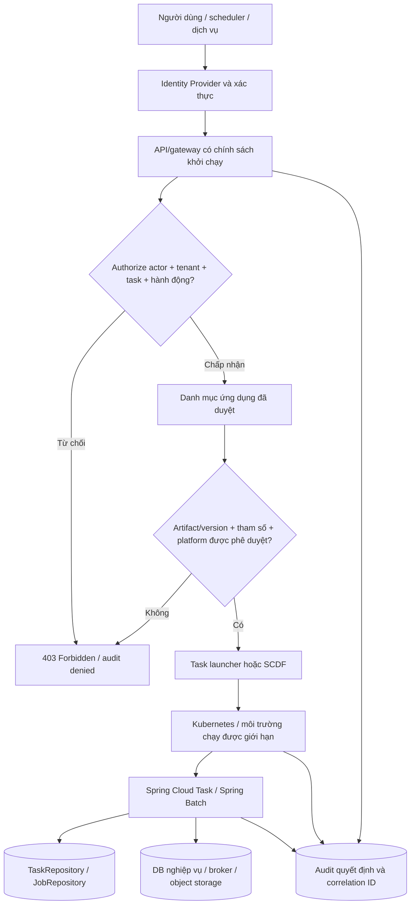
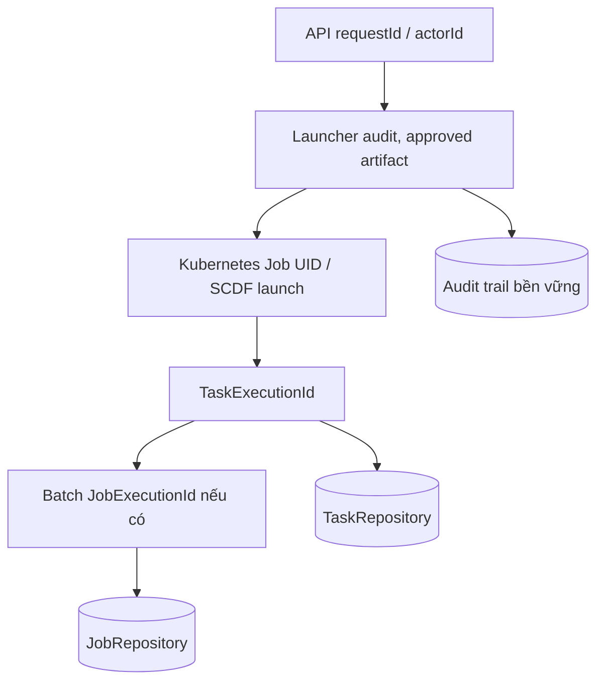

# Giới hạn quyền khởi chạy và lựa chọn ứng dụng được phép

## Mục tiêu và bối cảnh

**Spring Cloud Task** dùng để chạy ứng dụng có thời gian sống hữu hạn: khởi động, thực hiện công việc, lưu `TaskExecution` và kết quả/mã thoát vào `TaskRepository`, rồi kết thúc. Một tác vụ có thể chạy theo lịch, yêu cầu từ API, CLI, Kubernetes Job/CronJob hoặc qua **Spring Cloud Data Flow (SCDF)**; có thể kết hợp **Spring Batch** để thực thi Job/Step. Vì một lần khởi chạy có thể đọc dữ liệu khách hàng, gọi đối tác, ghi cơ sở dữ liệu hoặc tạo chi phí hạ tầng, **quyền khởi chạy Task là một quyền có tác động thực sự**, không đơn thuần là quyền xem lịch sử.

Tình huống: doanh nghiệp có hai ứng dụng đã được kiểm duyệt:

- `daily-settlement`: chốt số liệu cho một tenant/ngày, ghi giao dịch tài chính.
- `invoice-export`: xuất báo cáo với quyền đọc một phần dữ liệu.

Người dùng A chỉ được phép xuất báo cáo cho tenant `shop-42`. Nếu hệ thống cho A gọi một API như `POST /tasks/launch?image=<bất-kỳ-image>&args=<bất-kỳ-args>`, người dùng có thể chọn ứng dụng chốt tiền, thay `spring.datasource.url` hoặc yêu cầu deployer gắn quyền khác. **Chặn ở giao diện người dùng không đủ**; mọi đường khởi chạy cần được kiểm soát ở phía server và nền tảng thực thi.

Sau bài này, bạn sẽ có thể:

1. Phân biệt **xác thực người gọi**, **quyền tạo/khởi chạy/lên lịch**, **ứng dụng được duyệt** và **phạm vi dữ liệu**.
2. Giới hạn vai trò của SCDF, tránh cấp mọi quyền cho một người dùng đã đăng nhập.
3. Thiết kế **allowlist** theo tên Task, artifact/version/digest và tenant; không nhận đường dẫn JAR/Docker image do caller tùy ý chỉ định.
4. Xây một API kích hoạt Task có kiểm tra quyền server-side, tham số kiểu dữ liệu rõ ràng, **deny-by-default**.
5. Giới hạn quyền **Kubernetes service account**, image, namespace, Pod security và quyền truy cập DB/secret.
6. Kiểm thử các tình huống vượt quyền, thay argument, bypass scheduler, Composed Task và tra cứu metadata.

> **Lưu ý phạm vi:** Spring Cloud Task là framework ghi nhận và chạy tác vụ, **không tự cung cấp một bộ phân quyền người dùng cho mọi lời gọi khởi chạy**. Bài phân tích các lớp bảo vệ thường dùng khi kết hợp Spring Security, SCDF 2.11.x và Kubernetes. Cần kiểm tra tính năng, endpoint, vai trò và cấu hình cụ thể theo phiên bản đang triển khai; những bảng danh mục/allowlist trong ví dụ là **chính sách do ứng dụng tự xây**, không phải property có sẵn của Spring Cloud Task.

## 1. Mô hình đe dọa: ai có thể khiến mã nào được chạy?



Mô hình gồm **nhiều điểm kiểm soát**, không chỉ một điều kiện `isAuthenticated()`:

| Câu hỏi | Kiểm soát chính | Ví dụ chính sách |
| --- | --- | --- |
| **Ai yêu cầu?** | OAuth2/OIDC, workload identity, token hợp lệ | Chỉ tài khoản nhân viên hoặc service account đáng tin cậy |
| **Được làm gì?** | RBAC: quyền xem, tạo definition, khởi chạy, schedule, xóa | Vai trò `task-launcher` không có quyền đăng ký artifact |
| **Được chạy app nào?** | Catalog allowlist, tên app/Task definition, artifact đã duyệt | Chỉ `invoice-export`, không chạy `daily-settlement` |
| **Trên tenant/dataset nào?** | ABAC/bộ kiểm tra quyền nghiệp vụ | A chỉ được gọi trên `shop-42` |
| **Được truyền gì?** | Input schema/allowlist tham số | `business-date` hợp lệ; cấm `--spring.*` tùy ý |
| **Chạy bằng danh tính hạ tầng nào?** | Kubernetes RBAC, service account, admission policy | Pod không được nâng quyền, mount hostPath hoặc dùng service account đặc quyền |
| **Đọc/ghi những gì?** | IAM, DB grants, NetworkPolicy, secret scope | `invoice-export` chỉ có `SELECT` vào bảng báo cáo |
| **Ai đã khởi chạy, khi nào, kết quả gì?** | Audit + TaskExecution + process/Job status | Actor, policy decision, workflow ID, image digest và exit code |

**Deny by default**: khi không xác định được actor, tenant, ứng dụng, artifact hoặc cấu hình an toàn, từ chối. Không coi việc người dùng **biết tên Job** hoặc **biết TaskExecution ID** là bằng chứng có quyền.

## 2. Phân biệt các kiểu quyền trong SCDF

**Spring Cloud Data Flow** cung cấp server, Dashboard/Shell và REST API để đăng ký Task app, tạo Task definition, khởi chạy và lên lịch. SCDF bảo vệ endpoint bằng các vai trò; tài liệu **SCDF 2.11.3** mô tả:

| Vai trò SCDF | Nhóm hành động được mô tả |
| --- | --- |
| `ROLE_VIEW` | Xem danh sách/trạng thái/metadata |
| `ROLE_CREATE` | Tạo đối tượng, ví dụ Task definitions |
| `ROLE_DEPLOY` | Deploy ứng dụng và **launch Task** |
| `ROLE_SCHEDULE` | Tạo lịch thực thi Task |
| `ROLE_MODIFY` | Sửa đổi trạng thái/cấu hình theo endpoint tương ứng |
| `ROLE_DESTROY` | Xóa đối tượng |
| `ROLE_MANAGE` | Endpoint quản trị/management |

**Đây là các quyền theo loại endpoint, không phải tự động có luật “user A chỉ chạy Task X”.** Một người có `ROLE_DEPLOY` vẫn phải chịu một **chính sách chọn Task/tenant** do hệ thống triển khai nếu doanh nghiệp cần phân quyền đến mức từng ứng dụng.

### 2.1. Cảnh báo mặc định OAuth2 của SCDF

Theo [SCDF 2.11.3 – Customizing Authorization](https://docs.spring.io/spring-cloud-dataflow/docs/2.11.3/reference/htmlsingle/#configuration-security-customizing-authorization), cấu hình được tài liệu mô tả **gán tất cả vai trò cho người dùng OAuth2 đã đăng nhập theo mặc định**, nếu không thiết lập ánh xạ quyền tương ứng. **Bật đăng nhập không đủ để áp dụng least privilege**.

SCDF hỗ trợ ánh xạ OAuth scopes hoặc group claims từ IdP sang vai trò Data Flow. Ví dụ minh họa với provider ID `uaa` — chỉ phù hợp khi hệ thống thực sự sử dụng provider ấy và scopes đã cấp đúng trong IdP:

```yaml
spring:
  cloud:
    dataflow:
      security:
        authorization:
          provider-role-mappings:
            uaa:
              map-oauth-scopes: true
              role-mappings:
                ROLE_CREATE: dataflow.create
                ROLE_DEPLOY: dataflow.deploy
                ROLE_DESTROY: dataflow.destroy
                ROLE_MANAGE: dataflow.manage
                ROLE_MODIFY: dataflow.modify
                ROLE_SCHEDULE: dataflow.schedule
                ROLE_VIEW: dataflow.view
```

Đây là **mẫu cấu trúc mapping**; không phải cấu hình IdP/OAuth hoàn chỉnh. Khi bật scope mapping, tài liệu yêu cầu cung cấp mapping cho **cả bảy vai trò**. Provider ID khác `uaa` phải đổi nhánh tương ứng; token phải được validate issuer/audience và các claims theo cấu hình bảo mật đúng môi trường. Có thể map group claims nếu IdP cung cấp nhóm thay cho scopes.

**Ví dụ phân quyền dự kiến:**

| Principal | Quyền mong muốn | Không được |
| --- | --- | --- |
| `auditor` | `ROLE_VIEW` | Create, launch, schedule, delete |
| `scheduler-bot` | `ROLE_SCHEDULE` theo quy trình điều phối | Đăng ký image/JAR tùy ý, quản trị server |
| `operator` | `ROLE_VIEW`, `ROLE_DEPLOY` khi đã duyệt | `ROLE_CREATE`/`ROLE_DESTROY`/đăng ký artifact nếu không cần |
| `release-manager` | Quyền tạo/cập nhật definition/artifact theo change control | Khởi chạy dữ liệu tài chính trái phạm vi được cấp |
| `platform-admin` | Quyền quản trị cần thiết, có MFA/audit | Không dùng token admin cho scheduler hàng ngày |

Đây là **ma trận đề xuất**, không phải người dùng/vai trò SCDF tự sinh. Đừng suy rằng `ROLE_SCHEDULE` trên API SCDF đã kiểm soát mọi cách launch Task; nếu dịch vụ có quyền gọi `ROLE_DEPLOY` hoặc tự tạo Kubernetes Job, phải bảo vệ **các đường khác**.

### 2.2. Chặn đường bypass

Phân quyền nên áp dụng **ở server** cho REST API/Shell/Dashboard, không chỉ ẩn nút “Launch” trong UI. Nếu xây một API nội bộ với rule “chỉ chạy Task được phép”, nhưng vẫn để người dùng gọi **SCDF REST trực tiếp** bằng token `ROLE_DEPLOY`, họ có thể đi vòng qua API và bypass allowlist.

Giải pháp kiến trúc:

- Chỉ **trusted launcher service** được quyền gọi SCDF launch API hoặc Kubernetes Job create API.
- Người dùng gọi **API nghiệp vụ có xác thực**; API tự kiểm tra actor, tenant, task key và arguments trước khi gọi launcher.
- SCDF Server hạn chế network ingress/identity; Dashboard/admin/shell qua đường riêng với quyền phù hợp.
- Scheduler automation dùng **machine identity**/service principal riêng, có thể audit và revoke; không tái sử dụng mật khẩu/token admin.
- Người có khả năng trực tiếp tạo Job/Pod trên cluster cần được kiểm soát tương đương quyền launch Task; không cho họ tự vượt qua gateway.

## 3. Chỉ cho chạy những ứng dụng đã được duyệt

### 3.1. Đăng ký ứng dụng trong SCDF không tự tạo allowlist theo người dùng

SCDF có **App Registry**: một tên ứng dụng `task` liên kết tới resource URI, ví dụ Maven artifact hoặc Docker image. Shell cho phép:

```text
dataflow:> app register --name invoice-export --type task --uri docker:registry.example.internal/tasks/invoice-export:2.3.1

dataflow:> task create invoice-export-prod --definition "invoice-export"

dataflow:> task launch invoice-export-prod
```

Đây là **cú pháp minh họa trong SCDF Shell**, giả sử ứng dụng đã được build, scan, phê duyệt và có quyền registry. Không dùng một ví dụ `app register` như quy trình để mọi người tự thêm ứng dụng. Theo [SCDF – Registering and Launching Task Applications](https://docs.spring.io/spring-cloud-dataflow/docs/2.11.3/reference/htmlsingle/#spring-cloud-dataflow-task-applications), SCDF liên kết tên app với URI, Task definition tham chiếu app, còn `task launch` dùng definition để khởi chạy.

**Cần hai hàng rào riêng:**

1. **Quy trình duyệt/đăng ký**: chỉ release pipeline hoặc người quản trị có thẩm quyền được thêm phiên bản app mới vào registry. Không import catalog khổng lồ chưa review hoặc dùng `--force` thay URI của app đang được tin cậy nếu không có change control.
2. **Quy trình duyệt/khởi chạy**: actor chỉ được chạy **task definition** nằm trong danh sách được phép của họ, trên tenant/platform được phép, và với **phiên bản đã duyệt**.

Không coi `App Registry` đã đăng ký một app là bằng chứng tất cả người có `ROLE_DEPLOY` đều được chạy app đó ở mọi tenant. **Bảng allowlist dưới đây là policy ứng dụng do bạn sở hữu**.

### 3.2. Danh mục allowlist minh họa

| Khóa yêu cầu từ caller | Task definition SCDF cho phép | Artifact được duyệt | Principal/phạm vi | Tác động |
| --- | --- | --- | --- | --- |
| `invoice-export` | `invoice-export-prod` | `invoice-export:2.3.1`, digest/sbom đã kiểm duyệt | `reporting-operator`, tenant được cấp | Đọc dữ liệu và ghi CSV |
| `daily-settlement` | `settlement-prod` | `settlement:5.2.0`, digest đã kiểm duyệt | `finance-operator`, tenant được cấp | Ghi giao dịch |
| `nightly-rebuild` | `rebuild-prod` | artifact riêng, chỉ khi có change ticket | `platform-admin` có phê duyệt bổ sung | Tác động rộng, cần audit chặt |
| Tên bất kỳ khác | Không có | Không có | Bất kỳ caller thông thường | **TỪ CHỐI** |

**Danh sách cứng theo tên không đủ** nếu tên có thể trỏ tới artifact mới: tag `:latest` hoặc version bị overwrite tạo nguy cơ *time-of-check to time-of-use*. Kubernetes cho phép pin **image digest `image@sha256:...`**, vì digest định danh nội dung image bất biến. Với Maven artifact, pin version trong kho **không cho overwrite**, kiểm chứng checksum/signature/SBOM và kiểm soát quyền publish. Khi launch, đảm bảo definition/registry hiện tại vẫn trỏ đến artifact đã duyệt; không chỉ kiểm tra ở thời điểm tạo allowlist.

Nếu dùng **Composed Task Runner** của SCDF, phải review **mọi node** và mọi cách override của child, không chỉ cho phép tên composed Task cha. Một composed task có thể dẫn tới nhiều image/định danh runtime khác nhau.

### 3.3. Điều kiện cấp phép không thể chỉ dựa vào tên

Một yêu cầu chỉ hợp lệ khi đồng thời thỏa:

```text
canLaunch(actor, request) =
    actor đã xác thực
    AND actor có quyền launch
    AND appKey nằm trong catalog được duyệt
    AND artifact/version/digest đang được duyệt
    AND actor có quyền với tenant/dataset
    AND action đúng môi trường/platform/namespace
    AND input đúng schema và giới hạn
    AND quota/concurrency/approval cho phép
```

Đây là **quy tắc chính sách minh họa**, không phải expression được Spring Cloud Task nhận trực tiếp. Nếu thiếu một điều kiện, từ chối; ghi audit quyết định nhưng không ghi secret/payload nhạy cảm.

## 4. Tách quyền “chọn ứng dụng” khỏi “chọn tham số”

**Spring Boot ưu tiên command-line properties `--...` cao hơn biến môi trường và `application.yml` theo cấu hình mặc định.** Nếu API nhận một chuỗi `arguments` tùy ý rồi chuyển vào Task launcher, người dùng có thể thay các thuộc tính hạ tầng, ví dụ:

| Chuỗi caller không nên tự chỉ định | Nguy cơ |
| --- | --- |
| `--spring.datasource.url=...` | Chuyển `TaskRepository` hoặc DB nghiệp vụ sang nơi khác |
| `--spring.datasource.username=...` / `--spring.datasource.password=...` | Lạm dụng credential, lộ bí mật trên process list/metadata |
| `--spring.profiles.active=...` | Chọn profile cấu hình ngoài phạm vi |
| `--spring.config.location=...` / `--spring.config.import=...` | Chuyển nguồn cấu hình cho JVM |
| `--spring.cloud.task.single-instance-enabled=false` | Vô hiệu hóa hạn chế chạy đồng thời nếu framework cho phép ghi đè |
| `--spring.cloud.task.parent-execution-id=...` | Giả mạo quan hệ Task cha–con trong metadata |
| `--management.endpoints.web.exposure.include=*` | Tăng mặt tấn công nếu task có HTTP management endpoint |
| `deployer.<task>.*` / `app.<task>.*` do SCDF nhận khi launch | Có thể thay platform/namespace/resource/ứng dụng theo cơ chế deployer |

**Không thể giải quyết đầy đủ bằng một blacklist vài tiền tố.** Spring Boot và SCDF có nhiều alias/nguồn config, plugin/deployer properties mở rộng và cơ chế import file. Giải pháp tốt hơn là **chỉ nhận DTO có các trường nghiệp vụ đã xác định**, map sang một tập option cố định do server tạo, và giới hạn nguồn config hạ tầng do deployment cung cấp.

Ví dụ API công khai chấp nhận:

```json
{
  "taskKey": "invoice-export",
  "tenantId": "shop-42",
  "businessDate": "2026-11-23"
}
```

Nó **không** chấp nhận `image`, `artifactUri`, `command`, `arguments` dạng chuỗi, `properties`, `serviceAccountName`, `namespace`, `volumeMount` hoặc `secretRef`. Server tự tạo chính xác:

```text
--tenant-id=shop-42
--business-date=2026-11-23
```

Có thể giới hạn `tenantId` theo danh mục ID/regex, `businessDate` trong khoảng được phép, quota chạy/ngày, và kiểm tra **ý định nghiệp vụ** theo idempotency key. Đừng nối giá trị input vào shell command; truyền dưới dạng danh sách argument cho launcher/deployer phù hợp.

**Ghi nhớ:** `TASK_EXECUTION_PARAMS` có thể lưu arguments của Task. Không gửi access token, mật khẩu hoặc dữ liệu cá nhân nguyên văn qua CLI; giảm rủi ro lộ dữ liệu ngay từ bước thiết kế request.

## 5. Ví dụ server-side: xác thực, phân quyền và allowlist

Một kiến trúc tốt là cung cấp **API hẹp để yêu cầu chạy Task**, đặt trước SCDF/Kubernetes. Endpoint này là một ứng dụng Spring Boot có Spring Security, **không phải chính Spring Cloud Task headless** (Task thường không chạy HTTP server). Nó có thể được gọi bởi người dùng đã login hoặc scheduler có token dịch vụ.

### 5.1. Cấu hình method security

Spring Security cho phép bảo vệ method bằng `@PreAuthorize` sau khi bật `@EnableMethodSecurity`. Mẫu dưới sử dụng OAuth2 Resource Server với JWT; nó giả định hệ thống đã cấu hình issuer/JWK, token validation, TLS và network policy:

```java
package com.example.launcher;

import org.springframework.context.annotation.Bean;
import org.springframework.context.annotation.Configuration;
import org.springframework.security.config.Customizer;
import org.springframework.security.config.annotation.method.configuration.EnableMethodSecurity;
import org.springframework.security.config.annotation.web.builders.HttpSecurity;
import org.springframework.security.web.SecurityFilterChain;

@Configuration
@EnableMethodSecurity
public class ApiSecurityConfiguration {

    @Bean
    SecurityFilterChain taskApiSecurity(HttpSecurity http) throws Exception {
        http.authorizeHttpRequests(auth -> auth
                    .anyRequest().authenticated())
                .oauth2ResourceServer(oauth -> oauth
                    .jwt(Customizer.withDefaults()));
        return http.build();
    }
}
```

Đoạn code này cần dependency Spring Security, OAuth2 Resource Server và cấu hình identity provider hợp lệ. `@EnableMethodSecurity` **không được bật mặc định chỉ nhờ starter Security**. Không coi method security là đủ nếu có endpoint khác gọi trực tiếp adapter hoặc nếu SCDF vẫn công khai.

Trong ứng dụng API thuần stateless Bearer token, cần **đánh giá CSRF theo cách xác thực thực sự** (cookie/session hay header) trước khi quyết định cấu hình. Không vô hiệu hóa CSRF trên web UI dùng cookie chỉ vì ví dụ này dùng JWT.

### 5.2. Service kiểm tra quyền và catalog trước khi launch

Ví dụ code Java dưới đây mô tả **lớp policy/ứng dụng**, không áp đặt một `TaskLauncher` cụ thể. `AuthorizedTaskPort` là adapter do dự án triển khai để gọi SCDF/Kubernetes **bằng định danh cố định** sau khi xác minh artifact. `TenantPermissionService` phải được triển khai thực sự dựa vào principal, tenant và vai trò; **không** được dùng một triển khai `return true` trong production.

```java
package com.example.launcher;

import java.time.LocalDate;
import java.util.Map;

import org.springframework.http.HttpStatus;
import org.springframework.security.access.AccessDeniedException;
import org.springframework.security.access.prepost.PreAuthorize;
import org.springframework.security.core.Authentication;
import org.springframework.stereotype.Service;
import org.springframework.web.bind.annotation.*;
import org.springframework.web.server.ResponseStatusException;

record LaunchRequest(
        String taskKey,
        String tenantId,
        LocalDate businessDate) {}

record ApprovedTask(
        String definitionName,
        String expectedArtifactDigest) {}

record LaunchReceipt(String requestId) {}

interface TenantPermissionService {
    boolean mayLaunch(
            Authentication actor, String tenantId, String taskKey);
}

interface AuthorizedTaskPort {
    // Adapter chỉ nhận definition đã duyệt + trường nghiệp vụ.
    // Phải kiểm tra registry artifact hiện tại trùng expectedDigest.
    String launch(
            ApprovedTask approved,
            String tenantId,
            LocalDate businessDate,
            String requestedBy);
}

@Service
class ApprovedTaskService {

    // Minh họa: digest phải thay bằng checksum thật đã phê duyệt.
    private static final Map<String, ApprovedTask> CATALOG = Map.of(
            "invoice-export",
            new ApprovedTask("invoice-export-prod", "sha256:APPROVED_EXPORT_DIGEST"),
            "daily-settlement",
            new ApprovedTask("settlement-prod", "sha256:APPROVED_SETTLEMENT_DIGEST")
    );

    private final TenantPermissionService tenantPermission;
    private final AuthorizedTaskPort launcher;

    ApprovedTaskService(
            TenantPermissionService tenantPermission,
            AuthorizedTaskPort launcher) {
        this.tenantPermission = tenantPermission;
        this.launcher = launcher;
    }

    @PreAuthorize("hasAuthority('SCOPE_tasks.launch')")
    public LaunchReceipt requestLaunch(LaunchRequest req, Authentication actor) {
        if (req == null || req.taskKey() == null
                || req.tenantId() == null
                || req.businessDate() == null) {
            throw new ResponseStatusException(HttpStatus.BAD_REQUEST);
        }

        ApprovedTask approved = CATALOG.get(req.taskKey());
        if (approved == null) {
            // Không tiết lộ app nội bộ có tồn tại ở catalog khác không.
            throw new AccessDeniedException("Task không được phép");
        }
        if (!tenantPermission.mayLaunch(
                actor, req.tenantId(), req.taskKey())) {
            throw new AccessDeniedException("Không được phép trên tenant");
        }

        // Đây là nơi cần thêm validation khoảng ngày, quota,
        // idempotency key và approval nếu nghiệp vụ yêu cầu.
        String requestId = launcher.launch(
                approved, req.tenantId(),
                req.businessDate(), actor.getName());

        return new LaunchReceipt(requestId);
    }
}

@RestController
@RequestMapping("/api/tasks")
class ApprovedTaskController {

    private final ApprovedTaskService service;

    ApprovedTaskController(ApprovedTaskService service) {
        this.service = service;
    }

    @PostMapping("/launch")
    @ResponseStatus(HttpStatus.ACCEPTED)
    LaunchReceipt launch(
            @RequestBody LaunchRequest request, Authentication actor) {
        return service.requestLaunch(request, actor);
    }
}
```

**Cách đọc đúng ví dụ:**

- `@PreAuthorize` kiểm tra scope `tasks.launch` nếu token được Spring Security ánh xạ thành `SCOPE_tasks.launch`. **Scope này là quy ước riêng của gateway**, không phải `dataflow.deploy` hay một vai trò tự sinh của SCDF.
- `CATALOG` là allowlist theo **request key**, ánh xạ tới definition cố định. Chuỗi `APPROVED_*_DIGEST` là **placeholder**, phải thay bằng digest thực do release pipeline phê duyệt.
- `TenantPermissionService` và `AuthorizedTaskPort` là **hợp đồng cần được hiện thực hóa**. Đoạn code không tự deploy Task cho tới khi dự án cung cấp bean adapter an toàn.
- `AuthorizedTaskPort` phải kiểm tra **definition hiện tại** trỏ tới artifact/digest được duyệt, chọn namespace/service account từ cấu hình server, chỉ truyền `tenantId`/`businessDate` đã kiểm tra, và từ chối khi catalog/registry không khớp.
- Chỉ kiểm tra scope ở service là **điều kiện cần**, không thay validation input, tenant-level authorization, quota hoặc isolation. Đường gọi ngoài service, như SCDF REST, cũng phải bị hạn chế.
- Với API ngoài production, nên sử dụng DTO có bean validation (`@NotBlank`, `@NotNull`, `@Pattern`), kiểm tra không có trường ngoài ý muốn, CSRF/identity phù hợp, rate limit và lỗi phản hồi không tiết lộ thông tin nhạy cảm. Validation ở đây để đơn giản hóa **trình tự kiểm soát quyền**.

**Không** nối `req.taskKey()` trực tiếp vào lệnh `java -jar`/Docker URI; không lắp `req.tenantId()` vào một shell string. Chính adapter phải dùng tham số dạng danh sách và chỉ nhận resource từ catalog được duyệt.

## 6. Kiểm soát khởi chạy trong Kubernetes: RBAC không phải image allowlist

Khi Task chạy trên Kubernetes, có **hai service account khác nhau về trách nhiệm**:

- **Launcher/SCDF deployer identity**: tài khoản có khả năng **tạo/quan sát Kubernetes Job hoặc Pod**.
- **Runtime Task Pod identity**: tài khoản mà **ứng dụng Java bên trong Pod** dùng khi cần gọi Kubernetes API (nếu có).

Phân tách hai danh tính này để một Task không tự nhiên có quyền tạo Pod/Job khác hoặc đọc secret của hệ thống. Với đa số Spring Cloud Task chỉ cần DB và broker, runtime Pod **không cần Kubernetes API token**.

### 6.1. Ví dụ Role hẹp cho launcher tạo Kubernetes Job

Chỉ dành cho kiến trúc có **trusted controller trực tiếp tạo Kubernetes Job** trong namespace `batch-workloads`. Trong SCDF một số deployer dùng Pod API thay vì Job API, nên phải điều chỉnh quyền đúng loại resource của platform; không áp dụng máy móc quyền Job cho SCDF.

```yaml
apiVersion: v1
kind: ServiceAccount
metadata:
  name: approved-task-launcher
  namespace: batch-workloads
---
apiVersion: rbac.authorization.k8s.io/v1
kind: Role
metadata:
  name: approved-task-job-launch
  namespace: batch-workloads
rules:
  - apiGroups: ["batch"]
    resources: ["jobs"]
    verbs: ["create", "get", "list", "watch"]
---
apiVersion: rbac.authorization.k8s.io/v1
kind: RoleBinding
metadata:
  name: approved-task-job-launch-binding
  namespace: batch-workloads
subjects:
  - kind: ServiceAccount
    name: approved-task-launcher
    namespace: batch-workloads
roleRef:
  kind: Role
  name: approved-task-job-launch
  apiGroup: rbac.authorization.k8s.io
```

**Cảnh báo bảo mật:** một principal có `create jobs` tuy không có quyền `get secrets` vẫn có thể tạo Pod dùng `secretKeyRef` hoặc `serviceAccountName`, và có thể thực thi **image bất kỳ** nếu cluster cho phép. Vì vậy **RBAC ở mức “create jobs” không đủ để thực thi allowlist image/secret/serviceAccount**. Cần trusted launcher cấp phát manifest từ template đã duyệt **kết hợp admission policy** và hạn chế mọi đường tạo workload khác.

Các nhóm điều kiện admission thường cần:

- Chỉ chấp nhận image từ **registry được duyệt và digest được duyệt**.
- Chỉ cho `serviceAccountName` của Task runtime đã xét quyền; chặn hostPath/privileged/container capabilities vượt chuẩn.
- Hạn chế namespace, volume/Secret refs, service type, security context và network exposure.
- Đặt `ResourceQuota`/`LimitRange` để một caller không tạo quá nhiều CPU/memory/Pod.
- Áp dụng Kubernetes **Pod Security Standards** (baseline hoặc restricted tùy workload), admission để thực thi policy và `NetworkPolicy`/egress phù hợp.

Kubernetes có [ValidatingAdmissionPolicy](https://kubernetes.io/docs/reference/access-authn-authz/validating-admission-policy/) bằng CEL, stable từ v1.30; cũng có admission webhook/policy engine tùy cluster. Policy phải áp dụng đúng **resource thực sự được tạo** (Pod, Job PodTemplate hoặc controller khác), không chỉ một cấp dễ bị bỏ qua. Dùng `failurePolicy: Fail` và binding có `Deny` khi policy bắt buộc; thử các trường hợp bypass trước khi bật production.

### 6.2. Pod của Task chạy với quyền tối thiểu

Một phần template Pod an toàn tham khảo:

```yaml
spec:
  template:
    spec:
      serviceAccountName: settlement-task-runtime
      automountServiceAccountToken: false
      restartPolicy: Never
      securityContext:
        runAsNonRoot: true
        seccompProfile:
          type: RuntimeDefault
      containers:
        - name: task
          image: registry.example.internal/tasks/settlement@sha256:REPLACE_WITH_APPROVED_DIGEST
          securityContext:
            allowPrivilegeEscalation: false
            readOnlyRootFilesystem: true
            capabilities:
              drop: ["ALL"]
          resources:
            requests:
              cpu: "200m"
              memory: "256Mi"
            limits:
              cpu: "1"
              memory: "1Gi"
```

Đây là **đoạn `spec` của Kubernetes Job**, không phải manifest đầy đủ. Cần tạo `settlement-task-runtime`, thay image digest placeholder, cấp quyền volume cho output/temp directory nếu app cần ghi file và kiểm tra UID trong image thực sự chạy non-root. Với `readOnlyRootFilesystem`, dùng `emptyDir`/PVC phù hợp cho vùng ghi cần thiết, không mở lại quyền root chỉ để xử lý lỗi cấu hình.

**Không cấp token Kubernetes API khi không cần.** Nếu Task cần đọc một ConfigMap, cân nhắc mount file do deployer cung cấp thay vì cấp quyền `list/get` rộng toàn namespace. Nếu cần đọc secret, dùng secret store/volume với đúng phạm vi và rotation policy; không in secret vào log.

### 6.3. Pin image digest và kiểm soát nguồn artifact

`invoice-export:2.3.1` là **tag**, có thể bị thay trỏ tới bytes khác nếu registry cho overwrite. `image@sha256:<digest>` gắn chính xác nội dung image mà runtime sẽ chạy; [Kubernetes Images](https://kubernetes.io/docs/concepts/containers/images/) khuyên dùng digest để bảo đảm version không thay giữa các Pod. **Digest không tự chứng minh image an toàn**: vẫn phải scan vulnerabilities, xác minh provenance/signature/SBOM và chỉ cho release pipeline đáng tin cậy xuất bản artifact.

## 7. Không để Task tự nâng quyền sau khi được khởi chạy

Quyền của **launcher** và quyền của **Task đang chạy** là hai miền độc lập. Một Job được khởi chạy hợp lệ vẫn có thể gây thiệt hại nếu Pod/ứng dụng có quyền dữ liệu quá rộng.

### 7.1. Hạn chế quyền cơ sở dữ liệu của `TaskRepository`

Spring Cloud Task cần ghi metadata vòng đời vào `TaskRepository`: `TASK_EXECUTION`, `TASK_EXECUTION_PARAMS` và các bảng liên quan tùy tính năng/phiên bản. Khi chạy cùng Spring Batch, `JobRepository` dùng các bảng `BATCH_JOB_*`, `BATCH_STEP_*` và `ExecutionContext`. Khi cho phép `single-instance-enabled`, ứng dụng có thể cần quyền ghi vào bảng khóa JDBC.

Các danh tính DB nên tách:

| Tài khoản | Quyền tối thiểu | Không nên có |
| --- | --- | --- |
| `task-repository-runtime` | DML cần thiết trên bảng/sequence Task schema đã migration | `CREATE/DROP TABLE` trên toàn database, tài khoản DBA |
| `batch-repository-runtime` | DML cần thiết trên bảng/sequence Batch schema | Quyền quản trị DB rộng ngoài repository |
| `invoice-export-reader` | `SELECT` trên view/bảng của tenant/report cho phép | `UPDATE/DELETE` bảng thanh toán |
| `settlement-writer` | `INSERT/UPDATE` đúng bảng nghiệp vụ và quyền đọc cần thiết | Quyền ghi vào mọi tenant/tables |
| `schema-migration` | DDL/migration theo pipeline đã duyệt | Không dùng làm credential chạy task hàng ngày |

**Một datasource duy nhất** có thể khiến Task code và business code cùng sử dụng một tài khoản quyền rộng. Với rủi ro cao, tách `DataSource`/transaction manager/repository và identity, bảo đảm Spring Cloud Task trỏ đúng metadata DB thông qua cấu hình phù hợp. Mọi đường truy cập dữ liệu đa tenant phải được kiểm soát cả trong query/row-level security (nếu dùng), không tin `tenantId` người dùng truyền mà bỏ qua kiểm tra.

Để tránh một Task tự sửa lịch sử hay thực thi lệnh migration tùy ý, chỉ cấp quyền cần thiết. Tuy nhiên, **không phủ nhận quyền DML mà framework thực sự cần**: hạn chế thiếu quyền sẽ làm task không ghi được exit code/status, khiến giám sát sai. Kiểm tra schema và grant theo **phiên bản thư viện** đang dùng thay vì đoán danh sách bảng cố định.

### 7.2. Giữ bí mật bên ngoài command line và catalog

Ví dụ cấu hình Boot/Cloud Task trong container:

```yaml
spring:
  application:
    name: settlement-task
  main:
    web-application-type: none
  datasource:
    url: ${TASK_DB_URL}
    username: ${TASK_DB_USER}
    password: ${TASK_DB_PASSWORD}
  cloud:
    task:
      initialize-enabled: false
```

Ứng dụng lấy các biến từ deployment/secret store được cấp quyền phù hợp. `initialize-enabled: false` trong ví dụ giả định schema đã được tạo bằng migration ở ngoài runtime. Không gửi mật khẩu vào `--spring.datasource.password`, không đặt secret trong JobParameters/Task arguments, URL, image tag, tên Kubernetes Job hoặc `exitMessage`.

Không chỉ tránh log mật khẩu: Spring Cloud Task có thể lưu **arguments** trong `TASK_EXECUTION_PARAMS`. Những giá trị nhạy cảm được truyền nhầm có thể còn trong database lâu hơn Pod, rồi được truy vấn bởi người có quyền xem lịch sử. Kiểm soát quyền đọc metadata và giảm retention/ẩn dữ liệu phù hợp với pháp lý.

### 7.3. Chặn thay đổi cấu hình Spring Boot từ input nghiệp vụ

Sau khi server đã hạn chế chỉ truyền `--business-date=...` và `--tenant-id=...`, Task vẫn nên **tự validate**:

- Dùng `ApplicationArguments.getOptionValues(...)`, từ chối thiếu/nhân đôi tham số quan trọng.
- Parse `LocalDate` và kiểm tra kỳ ngày không vượt giới hạn được phép.
- Xác minh tenant/workflow context và business key trước khi ghi.
- Không tự coi giá trị `spring.cloud.task.parent-execution-id` từ caller là bằng chứng quyền của workflow cha.

Trong trường hợp yêu cầu “không dùng option CLI để ghi đè cấu hình ứng dụng”, Spring Boot có:

```java
public static void main(String[] args) {
    SpringApplication app =
            new SpringApplication(SettlementTaskApplication.class);
    app.setAddCommandLineProperties(false);
    app.run(args);
}
```

Đây là **một lựa chọn kiến trúc**, không phải bắt buộc: Spring Boot không đưa `--...` thành property source trong `Environment`, nhưng `ApplicationArguments` vẫn có thể đọc được ở runner. **Hệ quả:** cả `--spring.profiles.active=...` và các option Boot khác cũng **không còn ghi đè cấu hình qua CLI**. Nếu dùng SCDF/launcher phụ thuộc vào tham số cấu hình Boot, phải kiểm chứng trước. Đồng thời, cơ chế này **không** chặn các nguồn ưu tiên khác như environment, Java system properties, config import; nó cũng không thay quyền launch server-side.

## 8. Scheduler, composed task và thao tác chạy lại phải dùng cùng policy

### 8.1. Scheduler là một người gọi có quyền

Một scheduler có thể không có giao diện đăng nhập nhưng có thể khởi chạy **hàng trăm lần mỗi ngày**. Cần cấp **machine identity** riêng theo ứng dụng/mục đích; một bot lên lịch báo cáo không nên có khả năng chốt giao dịch tài chính hoặc thay image.

Ví dụ phân quyền đề xuất:

| Nguồn yêu cầu | Cho phép | Từ chối |
| --- | --- | --- |
| `report-cron-bot` | Khởi chạy `invoice-export-prod` theo lịch, đúng tenant nhóm báo cáo | Đăng ký app, tùy ý chọn artifact hoặc chạy `settlement-prod` |
| `finance-scheduler` | `settlement-prod` trong cửa sổ đối soát được duyệt | Tạo Kubernetes Pod đặc quyền hoặc thay DB URL |
| `incident-operator` | Retry một execution thuộc tenant được giao, có mã ticket | Dùng wildcard để chạy mọi app, xóa history |
| `platform-release-bot` | Phát hành version artifact đã scan/duyệt | Tự ý chạy Job nghiệp vụ ngoài pipeline/quyền triển khai |

SCDF tách `ROLE_SCHEDULE` khỏi `ROLE_DEPLOY`; nhưng mô hình này là **quyền thao tác endpoint**, nên một scheduler được quyền tạo schedule vẫn cần policy business-level chọn đúng definition/platform/arguments. Nếu có CronJob độc lập với SCDF, nó **không chịu SCDF roles**: quyền tạo/sửa CronJob và service account của controller phải được kiểm soát riêng.

### 8.2. Composed Task: kiểm tra toàn bộ đồ thị

Một **Composed Task Runner** có thể khởi chạy các child app bằng DSL, ví dụ:

```text
extract-task && validate-task && publish-task
```

Allowlist chỉ chứa `my-approved-flow` **chưa đủ** nếu người dùng có thể sửa definition/DLS, override `composedTaskArguments` hay đổi phiên bản một child. Trước khi approve flow:

1. Resolve **tất cả task applications/node** mà flow sẽ gọi; kiểm tra artifact/version/digest của từng node.
2. Xác minh **người gọi có quyền trên toàn bộ tập hành động và tenant**, không chỉ node đầu.
3. Cấm sửa DSL/definition sau approval khi chưa review lại; phát hiện thay đổi URI/image/tag.
4. Kiểm soát các option của **Composed Task Runner** chuyển xuống child (arguments, app/deployer properties).
5. Khi retry một child, dùng **cùng business idempotency key** và xác minh child còn trong policy; không dùng `TaskExecutionId` mới làm bằng chứng được phép.

Quan hệ `parentExecutionId` trong `TaskRepository` chỉ là metadata truy vết **ai điều phối ai**, không phải token xác thực. Gắn `spring.cloud.task.parent-execution-id=123` không tự cấp quyền thay cha hay truy cập dữ liệu của tenant khác.

### 8.3. Retry không được trở thành đường vòng vượt quyền

Yêu cầu “chạy lại TaskExecution 789” cũng cần xác thực caller, kiểm tra **app hiện tại còn được phê duyệt**, tenant, artifact, policy hiện hành và giới hạn retry. Không đơn thuần đọc args cũ từ `TASK_EXECUTION_PARAMS` rồi chạy lại nguyên xi vì:

- Bản ghi có thể chứa cấu hình hạ tầng đã bị thu hồi.
- Artifact có thể đã bị phát hiện lỗ hổng và không còn được phép chạy.
- Caller hiện tại có thể không còn quyền ở tenant ấy.
- Retry có thể tạo tác động nghiệp vụ trùng hoặc vượt mức quota.

Cần phân biệt **“replay cùng dữ liệu hợp lệ”** và **“khởi chạy một phiên bản cũ không còn đáng tin cậy”**. Khi cần tái hiện lỗi, có thể triển khai vào sandbox cách ly, dữ liệu ẩn danh và approval rõ ràng thay vì mở lại quyền production.

## 9. Chống lạm dụng tài nguyên và tần suất khởi chạy

Một actor có quyền launch vẫn có thể gây **từ chối dịch vụ** hoặc chi phí lớn bằng cách tạo hàng nghìn task hợp lệ. Bởi vậy:

- Rate limit ở gateway theo actor, tenant, task key; có quota theo ngày và **số execution đang chạy**.
- Giới hạn CPU/memory/ephemeral storage, `activeDeadlineSeconds`/timeout, concurrency và retry budget ở launcher/Kubernetes.
- Đặt `ResourceQuota` và `LimitRange` trên namespace dành cho Task.
- Dùng `single-instance-enabled` khi nghiệp vụ không cho nhiều Task cùng tên chạy song song, nhưng **không coi đó là bảo vệ idempotency**. Các Task chạy tuần tự vẫn có thể ghi trùng.
- Từ chối input quá lớn, mốc thời gian nằm ngoài SLA, biểu thức cron do người dùng tự do nhập hoặc “chạy lại toàn bộ lịch sử” khi chưa được duyệt.
- Xử lý idempotency bằng business key `(tenantId, businessDate, operation)`, `UNIQUE` và cơ chế xác nhận side effect ở DB/broker.

Rate limit và quota phải được thực thi ở **lớp kiểm soát chung** cho mọi launcher. Giới hạn đặt riêng trong UI không chặn một caller dùng REST API hoặc scheduler khác.

## 10. Audit: truy lại ai yêu cầu Task, app nào đã chạy và kết quả gì

`TaskRepository` ghi **TaskExecution**, nhưng không tự ghi đầy đủ “người nào đã ủy quyền”, “policy version nào cho phép” hoặc “artifact digest nào đã được duyệt”. Vì vậy cần **audit riêng** ở gateway/launcher.

Bảng dữ liệu audit tham khảo:

| Trường | Ví dụ | Lưu ý |
| --- | --- | --- |
| `requestId` | `req-20261124-0001` | Correlation ID do server sinh; không tin caller tự đặt |
| `actorId` | `user-123` / `scheduler-bot` | Mã định danh không nhạy cảm |
| `action` | `LAUNCH_TASK` | Phân biệt CREATE/LAUNCH/SCHEDULE/RETRY/DELETE |
| `requestedTaskKey` | `invoice-export` | Khóa public đã kiểm tra |
| `approvedDefinition` | `invoice-export-prod` | Tên SCDF Task definition nội bộ |
| `artifactDigest` | `sha256:...` | Digest artifact thực được thực thi |
| `tenantId` | `shop-42` | Có kiểm soát phân quyền dữ liệu |
| `policyDecision` | `ALLOW` hoặc `DENY` | Lý do gọn, không lộ secret |
| `policyVersion` | `policy-2026-11-24` | Biết rule nào có hiệu lực |
| `platformExecutionRef` | Kubernetes Job UID hoặc SCDF launch ID | Liên kết launcher tới runtime |
| `taskExecutionId` | `12345` nếu đã tạo | Có thể chưa có khi fail bootstrap |
| `exitCode` | `0`/`1`/`NULL` | Chỉ có khi thực thi đã chốt |

### 10.1. Liên kết nhưng không đánh đồng các ID



Một lần yêu cầu có thể thất bại trước khi TaskRepository tạo bản ghi; **audit phải có ngay từ bước quyết định policy**. Ngược lại, một số Task có thể được launcher ngoài gateway khởi chạy nếu chính sách mạng/RBAC chưa khóa; dashboard cần báo cảnh báo **TaskExecution không có requestId/actorId hợp lệ**.

Không ghi nguyên access token, request headers, mật khẩu hay toàn bộ args vào audit. Áp dụng quyền đọc/audit log retention, bất biến/append-only phù hợp quy định nội bộ. Với log thất bại, có thể ghi exception type và correlation ID thay vì toàn bộ PII.

## 11. Bài tập kiểm thử phân quyền và ngăn bypass

Dưới đây là **ma trận test đề xuất** cho một triển khai có gateway trước SCDF và Kubernetes. Giá trị `ALLOW/DENY` là **kỳ vọng của chính sách mẫu**, không phải hành vi tự động của Spring Cloud Task.

| # | Caller và yêu cầu | Kỳ vọng | Vì sao |
| ---: | --- | --- | --- |
| 1 | `reporting-operator`, `invoice-export`, tenant được cấp | **ALLOW** | Đúng scope + app + tenant + digest |
| 2 | Cùng user nhưng `daily-settlement` | **DENY** | Không có quyền app tài chính |
| 3 | User chỉ có `ROLE_VIEW` của SCDF gọi `task launch` | **DENY** | Launch cần quyền deploy phù hợp |
| 4 | User login nhưng chưa map roles, trên cấu hình SCDF mặc định dễ cấp mọi role | **CẦN PHÁT HIỆN/LỖI POLICY** | Xác thực không đồng nghĩa phân quyền tối thiểu |
| 5 | Payload có `taskKey=unknown-app` | **DENY** | App không thuộc allowlist |
| 6 | Payload có `image=public-registry/unknown:latest` | **DENY** | API không nhận image từ caller |
| 7 | Payload có `--spring.datasource.url=...` | **DENY** | Không chấp nhận args tùy ý |
| 8 | Payload có `--spring.profiles.active=debug` | **DENY** | Không cho đổi profile runtime |
| 9 | User `shop-42` yêu cầu tenant `shop-43` | **DENY** | Kiểm tra quyền dữ liệu/ABAC |
| 10 | App được duyệt đổi image tag sang digest khác | **DENY** | Artifact không còn trùng bản được duyệt |
| 11 | Actor có scope launch nhưng cố POST SCDF trực tiếp | **DENY** | Network/SCDF identity không cho bypass |
| 12 | Actor cố tạo Kubernetes Job tùy ý trong namespace | **DENY** | Kubernetes RBAC không cấp trực tiếp; admission bảo vệ |
| 13 | Caller được phép nhưng vượt quota thực thi | **DENY/429 theo API** | Giới hạn tài nguyên và rate limit |
| 14 | Scheduler dùng token đã hết hạn hoặc sai audience | **DENY** | Bắt buộc xác thực token |
| 15 | Flow cha hợp lệ nhưng có child app chưa duyệt | **DENY** | Phải xét toàn bộ graph |
| 16 | Retry TaskExecution cũ có artifact đã bị thu hồi | **DENY hoặc chuyển sandbox có phê duyệt** | Không dùng lịch sử thay authorization hiện tại |

### 11.1. Test tích hợp nên chứng minh điều gì?

1. **Authentication**: token invalid/expired/wrong audience bị từ chối; không có đường anonymous để launch.
2. **Authorization**: người có quyền VIEW không thể gọi CREATE/DEPLOY/SCHEDULE; người có LAUNCH không thể tự đăng ký app mới.
3. **Application allowlist**: sửa tên, ký tự Unicode gần giống, phiên bản, URI và image digest đều bị đối chiếu **canonical** trước khi gọi launcher.
4. **Tenant authorization**: thử gọi tài nguyên tenant khác; không tin tenant lấy từ URL/JSON nếu token không có quyền.
5. **Argument validation**: truyền field ngoài schema, các key `spring.*`, `deployer.*`, dấu cách/lệnh shell, duplicate key, ngày sai/ngoài phạm vi; không cái nào đi tới launcher.
6. **Bypass**: gọi thẳng SCDF REST và Kubernetes API bằng identity người dùng; phải bị chặn theo chính sách.
7. **Runtime policy**: thử workload không được duyệt, elevated serviceAccount, privileged/hostPath và namespace khác; phải bị admission từ chối.
8. **Audit**: mọi yêu cầu ALLOW/DENY đều có `requestId`, actor, policy version; request được chấp nhận có đường liên kết tới TaskExecution.
9. **Failure early**: Task fail trước khi có TaskExecution vẫn giữ launch audit + Kubernetes process/log; không tạo lịch sử giả.
10. **Side effects**: chạy lại cùng business key không tạo ghi trùng; đảm bảo transaction và khóa dữ liệu độc lập với authorization.

Chỉ thực hiện test tấn công/bypass **trong môi trường thử nghiệm được cấp quyền**, không dùng token production hoặc gửi payload nguy hiểm vào hệ thống thật để “xem thử có chặn không”.

## 12. Những sai lầm phổ biến và cách sửa

| Sai lầm | Hệ quả | Cách sửa |
| --- | --- | --- |
| Bật OAuth login rồi nghĩ SCDF mặc định đã least privilege | Người đăng nhập có thể nhận nhiều role hơn mong đợi | Kiểm tra scope/group mappings theo phiên bản và test DENY |
| UI ẩn nút Launch nhưng REST API vẫn mở | Người dùng có thể gọi API trực tiếp | Kiểm tra server-side authorization và network |
| Chỉ kiểm tra tên Task definition | Definition bị thay URI/tag hoặc app của tenant khác được launch | Pin artifact/digest, tenant + environment policy |
| Cho caller gửi `arguments`/`properties` tự do | Ghi đè `spring.*` và deployer config | Chỉ nhận DTO nghiệp vụ, adapter tạo args cố định |
| Cho release user và operator dùng chung token admin | Không phân biệt ai gây tác động, khó thu hồi quyền | Tách principal/role/audit; dùng credentials ngắn hạn |
| Kubernetes Role có `create jobs` rồi coi là sandbox hoàn chỉnh | Có thể tạo image/Pod template có quyền cao | Admission để ràng image/SA/volume/securityContext |
| Task Pod dùng service account của launcher | Task code có thể tạo thêm Pod/Job | Tách runtime identity, không mount token nếu không cần |
| Dùng `:latest` thay digest được duyệt | Nội dung image thay đổi dù tên không đổi | Pin digest + chứng minh provenance |
| Mọi tenant dùng chung DB credential quyền ghi toàn hệ | Một Task có thể sửa dữ liệu tenant khác | Tách DB grants, RLS/tenant validation và secret scopes |
| Chỉ ghi `TaskExecution.exitCode`, không audit actor | Không biết ai yêu cầu hoặc duyệt chạy | Audit gateway trước khi launch và correlation IDs |
| Cho retry mà không xét quyền hiện tại | Chạy lại app/tenant/artifact đã bị thu hồi | Reauthorize toàn bộ trước mỗi attempt |
| Coi `single-instance-enabled` là authorization | Không kiểm tra ai được phép chạy hoặc tenant | RBAC/ABAC tại gateway; khóa chỉ giải quyết concurrency |

## 13. Bài tập tình huống

**Tình huống A — Quyền launch và quyền chọn app.** Một operator có `ROLE_DEPLOY` của SCDF, nhưng doanh nghiệp chỉ cho chạy `invoice-export-prod`. Họ cố launch `settlement-prod` bằng SCDF Shell. SCDF `ROLE_DEPLOY` đã đủ để bảo vệ đúng mức ứng dụng chưa?

**Trả lời:** Chưa. Vai trò SCDF bảo vệ **nhóm endpoint**, không tự cung cấp policy theo từng tenant/artifact của tổ chức. Cần allowlist server-side (trusted launcher, custom policy, tách SCDF instance/platform hoặc cơ chế tương đương) và chặn bypass SCDF REST.

**Tình huống B — Không có quyền đọc Secret nhưng có quyền tạo Job.** Một service account có `create jobs`, không có `get secrets`. Có thể coi rằng nó không tạo workload dùng Secret bất kỳ không?

**Trả lời:** Không. Quyền tạo workload có thể cho phép tham chiếu `secretKeyRef` hoặc service account có quyền cao trong PodTemplate. Cần admission policy, template cố định, identity tách biệt và hạn chế quyền tạo Job.

**Tình huống C — Thay version sau khi được duyệt.** Catalog cho phép `invoice-export:2.3.1`, nhưng cùng tag trong registry đã trỏ sang image mới. Hệ thống kiểm tra tên/version và vẫn launch. Rủi ro là gì?

**Trả lời:** Kiểm tra theo tag không bảo đảm bytes được thực thi. Pin image digest, kiểm chứng supply chain, từ chối nếu registry/definition hiện tại khác bản đã phê duyệt.

**Tình huống D — Tham số CLI.** User chỉ có quyền xuất báo cáo, nhưng API nhận `--spring.datasource.url=jdbc:...` và truyền nguyên chuỗi sang launcher. Vấn đề gì?

**Trả lời:** Các option `--...` có thể ghi đè Spring Boot configuration mặc định. User có thể chuyển hướng repository hoặc truy cập nhầm dữ liệu. API chỉ nhận field nghiệp vụ typed, server tự dựng args và deployment kiểm soát hạ tầng.

**Tình huống E — Retry một lần chạy cũ.** `TaskExecution 123` từng được chạy hợp lệ, nhưng artifact giờ đã bị thu hồi vì lỗ hổng bảo mật. User còn quyền launch `taskKey` và yêu cầu “retry execution 123”. Có tự chạy lại args/image cũ không?

**Trả lời:** Không. Phải tái xác thực actor, tenant, artifact, policy và hạn mức ở **thời điểm retry**; chỉ chạy image được duyệt hiện tại, hoặc phục vụ điều tra bằng sandbox có phê duyệt.

**Tình huống F — Composed Task.** `reporting-flow` được duyệt, nhưng một child của graph bị sửa thành `settlement-task` quyền ghi tài chính. Có đủ kiểm tra tên flow cha?

**Trả lời:** Không. Phải đánh giá **toàn đồ thị và các child app**, đảm bảo các definition/URI bị thay đổi đều phải review lại; input `composedTaskArguments` không được ghi đè chính sách.

## 14. Checklist triển khai an toàn

- [ ] Có **một đường launch đáng tin cậy**; SCDF REST và Kubernetes API không cho người dùng/bot thường bypass policy.
- [ ] Xác thực OAuth2/OIDC/workload identity đúng issuer/audience, TLS và hạn dùng token; tách principal cho scheduler, operator và admin.
- [ ] Kiểm tra SCDF scope/group role mappings; không mặc định người đăng nhập đều có bảy role.
- [ ] Tách VIEW, CREATE, DEPLOY, SCHEDULE, DESTROY, MANAGE, MODIFY; grant least privilege và kiểm thử DENY.
- [ ] Có **catalog allowlist** theo task key + definition + artifact/version/digest + tenant + environment/platform, mặc định từ chối.
- [ ] Chỉ release pipeline được đăng ký/thay artifact; không cho operator dùng `--force`/URI tự do.
- [ ] API chỉ nhận DTO nghiệp vụ, không nhận image/JAR URI, shell command, arbitrary arguments hay deployer properties.
- [ ] Kiểm tra `business-date`, tenant, idempotency, quota và quyền dataset trên server **và** validate lại trong Task.
- [ ] Runtime service account tách với launcher, hạn chế Kubernetes API token, RBAC/NetworkPolicy/Pod Security/admission.
- [ ] Admission kiểm soát image digest, namespace, service account, Secret refs, volume/hostPath, privilege và tài nguyên.
- [ ] DB grant tách metadata Task/Batch và nghiệp vụ; schema migration chạy bằng credential riêng, không dùng DBA runtime.
- [ ] Không đưa secret/PII vào CLI, TaskExecution parameters, log, tracing tags hoặc audit.
- [ ] Mọi launch/deny/schedule/retry có request ID, actor, policy decision/version, artifact digest và correlation tới TaskExecution.
- [ ] Composed Task kiểm tra **tất cả child applications**; retry phải kiểm tra policy hiện hành.
- [ ] Giám sát launch bất thường, resource quota, 403, bypass attempt, sai digest, TaskExecution không có audit và side effects trùng.
- [ ] Thực hiện các test từ chối và escalation trên môi trường được cấp quyền trước production; review định kỳ khi SCDF/Kubernetes nâng phiên bản.

## 15. Tài liệu tham khảo chính thức

1. [Spring Cloud Data Flow 2.11.3 – Customizing Authorization](https://docs.spring.io/spring-cloud-dataflow/docs/2.11.3/reference/htmlsingle/#configuration-security-customizing-authorization): bảy vai trò, OAuth scope/group mappings và cảnh báo mặc định cấp tất cả role cho user OAuth đã đăng nhập.
2. [Spring Cloud Data Flow – Registering Task Applications](https://docs.spring.io/spring-cloud-dataflow/docs/2.11.3/reference/htmlsingle/#spring-cloud-dataflow-task-applications): App Registry, Task definition, resource URI và khởi chạy Task.
3. [Spring Cloud Data Flow – Launching a Task](https://docs.spring.io/spring-cloud-dataflow/docs/2.11.3/reference/htmlsingle/#spring-cloud-dataflow-task-launching-tasks): `task launch`, application/deployer properties và command-line arguments.
4. [Spring Security – Method Security](https://docs.spring.io/spring-security/reference/servlet/authorization/method-security.html): `@EnableMethodSecurity`, `@PreAuthorize` và kiểm tra quyền ở service.
5. [Spring Boot – Externalized Configuration](https://docs.spring.io/spring-boot/reference/features/external-config.html): độ ưu tiên CLI `--...` và các nguồn cấu hình.
6. [Spring Cloud Task – Features](https://docs.spring.io/spring-cloud-task/reference/features.html): Task lifecycle, TaskExecution và quản lý repository.
7. [Spring Cloud Task – Task Repository Schema](https://docs.spring.io/spring-cloud-task/reference/appendix-task-repository-schema.html): `TASK_EXECUTION` và `TASK_EXECUTION_PARAMS`.
8. [Kubernetes – Using RBAC Authorization](https://kubernetes.io/docs/reference/access-authn-authz/rbac/): Role/RoleBinding, quyền ServiceAccount theo namespace.
9. [Kubernetes – Service Accounts](https://kubernetes.io/docs/concepts/security/service-accounts/): runtime/launcher identity và least privilege.
10. [Kubernetes – Validating Admission Policy](https://kubernetes.io/docs/reference/access-authn-authz/validating-admission-policy/): admission validation, policy bindings, `Deny`/`failurePolicy`.
11. [Kubernetes – Images](https://kubernetes.io/docs/concepts/containers/images/): immutable digest so với mutable tag và chính sách pull.
12. [Kubernetes – Pod Security Standards](https://kubernetes.io/docs/concepts/security/pod-security-standards/): non-root, privilege escalation, volume và capability restrictions.
13. [Spring Cloud Data Flow – Composed Tasks](https://dataflow.spring.io/docs/feature-guides/batch/composed-task/): các ứng dụng con được CTR điều phối trong graph.

**Nguyên tắc ghi nhớ:** **Quyền được gọi API không tự đồng nghĩa quyền chạy mọi Task, quyền chọn image hoặc quyền thay cấu hình.** Bảo mật khởi chạy đòi hỏi **actor hợp lệ + action được phép + ứng dụng/artifact đã duyệt + tenant/phạm vi hợp lệ + hạ tầng được giới hạn + audit đầy đủ**. Spring Cloud Task ghi lịch sử thực thi; chính lớp điều phối và nền tảng phải quyết định **ai được chạy cái gì và với quyền nào**.
