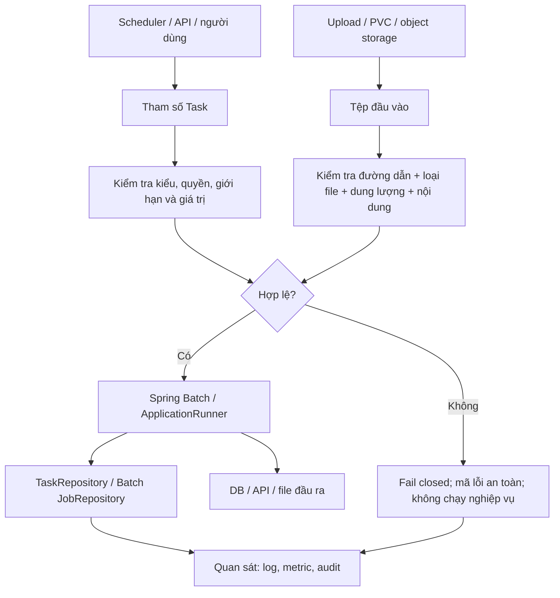

# Kiểm tra tệp, đường dẫn và dữ liệu đầu vào trong Spring Cloud Task

## 1. Vấn đề bảo mật của một ứng dụng chạy hữu hạn

**Spring Cloud Task** giúp xây dựng ứng dụng Spring Boot chạy trong thời gian hữu hạn, theo dõi mỗi lần thực thi qua `TaskRepository` và `TaskExecution`. Task có thể chạy bằng lệnh, theo lịch qua Kubernetes Job/Spring Cloud Data Flow hoặc theo một yêu cầu từ hệ thống khác. Nhiều Task nhận tham số như ngày báo cáo, mã khách hàng, đường dẫn tệp CSV hay vị trí đối tượng trên object storage; một số Task gọi **Spring Batch** để xử lý theo lô.

Giả sử Task `invoice-import` được phép đọc file trong `/data/import`:

```text
java -jar invoice-import.jar \
  --import.path=inbox/invoices-2026-11-24.csv \
  --import.business-date=2026-11-24
```

Nếu ứng dụng lấy `import.path` từ đầu vào rồi ghép đường dẫn mà không kiểm tra, một người điều khiển tham số hoặc file có thể:

- Dùng `../../` để truy cập file ngoài thư mục được cấp phép.
- Đưa đường dẫn tuyệt đối hoặc liên kết tượng trưng (symbolic link) nhằm đọc file cấu hình, khóa hoặc token.
- Cấp file quá lớn, CSV có bản ghi bất thường, ZIP bomb hoặc payload sai định dạng làm cạn RAM/CPU/disk.
- Truyền ID không thuộc tenant được phép, ngày nghiệp vụ ngoài phạm vi, hoặc tham số SQL có thể thay đổi truy vấn.
- Đưa secret trực tiếp qua CLI; Spring Cloud Task lưu lại **đối số khởi chạy** trong metadata, làm tăng nguy cơ rò rỉ.
- Khiến Task ghi lỗi kèm toàn bộ nội dung file/đường dẫn/stack trace vào kho log và thông điệp vận hành.

Bài thuộc chương **Bảo mật**, với mục tiêu: kiểm tra **đầu vào**, kiểm soát **đường dẫn**, giới hạn **nội dung file**, bảo vệ **TaskRepository/Batch metadata** và thiết lập các lớp an toàn khi chạy Task trên Kubernetes hoặc nền tảng khác.

> Nguyên tắc: đầu vào đến từ CLI, API, scheduler, message broker, object storage, file upload, biến môi trường không đáng tin cậy hoặc tệp lưu trữ ngoài đều phải được xem là **dữ liệu chưa tin cậy**, ngay cả khi không có giao diện web công khai.

## 2. Mô hình ranh giới tin cậy



| Biên tin cậy | Đầu vào điển hình | Quyết định an toàn |
| --- | --- | --- |
| Hệ điều phối → Task | `--import.path`, `--business-date`, `--tenant-id` | Chấp nhận key được định nghĩa, một giá trị đúng kiểu, kiểm tra quyền và miền giá trị |
| Filesystem/object storage → Task | File CSV, JSON, ZIP, object key | Thư mục/bucket cho phép, định dạng nội dung, giới hạn dung lượng và số bản ghi |
| Task → DB | ID, filter, sort, tên bảng | Prepared statement, allowlist tên cột và phân quyền DB tối thiểu |
| Task → external API | URL đích, webhook, object download | Chỉ các host/scheme được phép, chặn SSRF, timeout và giới hạn redirect |
| Task → metadata/quan sát | Arguments, JobParameters, `exitMessage`, log | Không đưa secret và dữ liệu nhạy cảm; dùng ID tham chiếu, mã lý do ổn định |

Các bước kiểm tra nên xảy ra **trước khi nghiệp vụ ghi dữ liệu**. Nhưng `onTaskStartup` hay `ApplicationRunner` không nhất thiết diễn ra trước mọi thao tác ở giai đoạn Spring Boot bootstrap: nếu các bean đã kết nối hoặc ghi dữ liệu khi tạo context, validation quá muộn. Hãy thiết kế bean initialization ít tác dụng phụ, kiểm tra cấu hình sớm và chỉ chạy nghiệp vụ sau khi đầu vào hợp lệ.

## 3. Hợp đồng tham số: chỉ nhận điều đã định nghĩa

Một Task nên công bố hợp đồng rõ ràng:

| Tham số | Kiểu / điều kiện | Giá trị hợp lệ | Bị từ chối |
| --- | --- | --- | --- |
| `import.path` | Đường dẫn **tương đối**, tối đa 200 ký tự, đuôi `.csv` | `inbox/day-2026-11-24.csv` | `/etc/passwd`, `../private.csv`, chuỗi rỗng |
| `import.business-date` | ISO `yyyy-MM-dd`; đúng ngày lịch | `2026-11-24` | `2026-02-30`, `yesterday` |
| `import.tenant` | Mã trong tập được cấp quyền | `billing-north` | Mã tenant không thuộc quyền của principal |
| `import.mode` | Enum | `validate` hoặc `commit` | `execute-shell`, giá trị không biết |
| `import.max-rows` | Số nguyên dương có giới hạn | `10000` | `-1` hoặc `9999999999` |
| `import.file-id` (ưu tiên) | ID bất biến trong manifest nội bộ | `f_74da...` | URL/file path tùy ý chưa được cấp phép |

Nếu đầu vào chỉ cần chọn một file đã biết, giải pháp tốt hơn việc nhận đường dẫn là cho phép **mã file/manifest ID** rồi ánh xạ mã đó tới nơi lưu thực qua database có phân quyền. Khi đó ứng dụng không cần dùng chuỗi người dùng làm đường dẫn trực tiếp.

### 3.1. Parse CLI có kiểm soát

Spring Boot cung cấp `ApplicationArguments`. Ví dụ các tham số ở trên được truyền ở dạng `--import.path=...`, `--import.business-date=...`. Khi đọc, phải kiểm tra **thiếu option, trùng option, option không có giá trị** và lỗi định dạng trước khi truy cập file.

```java
import java.time.LocalDate;
import java.time.format.DateTimeParseException;
import java.util.List;
import org.springframework.boot.ApplicationArguments;

public record ImportRequest(
        String relativePath, LocalDate businessDate) {

    public static ImportRequest parse(ApplicationArguments args) {
        String inputPath = one(args, "import.path");
        String dateText = one(args, "import.business-date");
        LocalDate date;

        try {
            date = LocalDate.parse(dateText);
        } catch (DateTimeParseException ex) {
            throw new IllegalArgumentException(
                "INVALID_BUSINESS_DATE: cần yyyy-MM-dd");
        }

        // Ví dụ chính sách nghiệp vụ; phải điều chỉnh cho dự án thật.
        if (date.isBefore(LocalDate.of(2020, 1, 1))
                || date.isAfter(LocalDate.of(2100, 12, 31))) {
            throw new IllegalArgumentException(
                "BUSINESS_DATE_OUT_OF_RANGE");
        }

        return new ImportRequest(inputPath, date);
    }

    private static String one(ApplicationArguments args, String name) {
        List<String> values = args.getOptionValues(name);
        if (values == null || values.size() != 1
                || values.get(0) == null || values.get(0).isBlank()) {
            throw new IllegalArgumentException(
                "INVALID_PARAMETER: " + name);
        }
        return values.get(0);
    }
}
```

**Không log `args.getSourceArgs()` nguyên vẹn.** Spring Cloud Task có thể lưu arguments vào `TASK_EXECUTION_PARAMS`. Ngay cả khi sau đó validation báo lỗi, tham số đã có thể được lưu ở tầng metadata. Không dùng `--db.password=...`, `--api.token=...` hoặc presigned URL chứa chữ ký làm CLI input; dùng Secret manager, Kubernetes Secret, workload identity và đường cấp credential phù hợp.

### 3.2. Cấu hình môi trường cũng phải được kiểm tra

Tách hai khái niệm:

- **Cấu hình đáng tin của triển khai** như thư mục cho phép `/data/import`, database URL đã cấp, danh sách bucket/host được phép: do DevOps/IaC quản lý và chỉ người được ủy quyền sửa.
- **Đầu vào mỗi lần chạy** như ngày, loại file, file ID hoặc tenant: cần parse/validate và xác minh quyền.

Nếu ai đó có quyền sửa deployment, ConfigMap hay Secret tùy ý thì họ có thể thay cả “thư mục cho phép”; code kiểm tra đường dẫn không thay thế chính sách RBAC và quản trị cấu hình. Đối với hệ thống nhiều tenant, phải kiểm tra tenant của yêu cầu **với quyền của người/định danh gọi Task**, không chỉ kiểm tra chuỗi tenant đúng regex.

## 4. Directory traversal: không đủ nếu chỉ normalize()

`Path.normalize()` là thao tác **từ vựng** trên đường dẫn; nó không truy cập filesystem và không biết symbolic link đang trỏ tới đâu. Ví dụ:

```text
Thư mục cho phép : /data/import
Người dùng nhập  : ../../etc/shadow
Ghép ngây thơ     : /data/import/../../etc/shadow
Sau normalize     : /etc/shadow
```

Ngay cả khi không có `..`, đường dẫn `inbox/latest.csv` có thể là symbolic link tới file nằm **ngoài** `/data/import`. Vì vậy thiết kế cần nhiều lớp:

1. Chỉ nhận **đường dẫn tương đối** theo hợp đồng; từ chối path tuyệt đối, drive prefix hoặc ký tự không được phép.
2. Từ chối các segment `.`, `..` và path bất thường; không dùng tên file do người dùng cấp để quyết định quyền.
3. Ghép vào thư mục root **cố định từ cấu hình đáng tin**, sau đó `normalize()` và kiểm tra `Path.startsWith(root)` **theo segment** (không dùng `String.startsWith("/data/import")`).
4. Gọi `toRealPath()` trên root và file đã tồn tại để giải quyết symbolic link; bảo đảm real path file vẫn nằm dưới real path root.
5. Kiểm tra file thường, khả năng đọc, đuôi được phép, dung lượng. Mở và đọc theo giới hạn thực tế.
6. Kết hợp **quyền filesystem và volume read-only**. Check-then-open vẫn có race condition; nếu directory bị đối thủ có quyền ghi đổi giữa hai thao tác, phải dùng cơ chế mở file theo directory handle an toàn hoặc kiến trúc staging cô lập.

`Path.startsWith(Path)` so sánh cấu trúc path theo segment, khác với so chuỗi. Ví dụ `/data/import-malicious` **không phải** con của `/data/import` khi so sánh bằng `Path.startsWith(Path)`.

### 4.1. Ví dụ SafeInputFile: kiểm tra path và giới hạn số byte

Đoạn dưới dùng Java 17+. Ví dụ chỉ xử lý file CSV nhỏ tối đa **10 MiB**, hỗ trợ tên file dạng ASCII `folder/file.csv`, cố ý từ chối symbolic link thoát khỏi root. Đây là tầng **kiểm soát file đầu vào**, không phải một bộ parser CSV hoàn chỉnh.

```java
package com.example.invoice;

import java.io.IOException;
import java.io.InputStream;
import java.nio.file.Files;
import java.nio.file.InvalidPathException;
import java.nio.file.LinkOption;
import java.nio.file.Path;
import java.nio.file.StandardOpenOption;

public final class SafeInputFile {

    private static final int MAX_BYTES = 10 * 1024 * 1024;
    private final Path trustedRoot;

    public SafeInputFile(Path configuredRoot) throws IOException {
        // Cấu hình root đến từ triển khai đáng tin; root phải tồn tại.
        this.trustedRoot = configuredRoot.toRealPath();
        if (!Files.isDirectory(trustedRoot)) {
            throw new IllegalArgumentException(
                "IMPORT_ROOT_NOT_DIRECTORY");
        }
    }

    public byte[] readCsv(String rawRelativePath) throws IOException {
        if (rawRelativePath == null
                || rawRelativePath.length() > 200
                || !rawRelativePath.matches(
                    "[A-Za-z0-9][A-Za-z0-9._/-]*")
                || rawRelativePath.contains("//")
                || rawRelativePath.endsWith("/")) {
            throw new IllegalArgumentException("INVALID_FILE_PATH");
        }

        final Path relative;
        try {
            relative = Path.of(rawRelativePath);
        } catch (InvalidPathException ex) {
            throw new IllegalArgumentException("INVALID_FILE_PATH");
        }

        if (relative.isAbsolute()) {
            throw new IllegalArgumentException("ABSOLUTE_PATH_NOT_ALLOWED");
        }

        for (Path segment : relative) {
            String name = segment.toString();
            if (name.equals(".") || name.equals("..")
                    || name.startsWith(".")) {
                throw new IllegalArgumentException("INVALID_PATH_SEGMENT");
            }
        }

        if (!relative.getFileName().toString().endsWith(".csv")) {
            throw new IllegalArgumentException("UNSUPPORTED_FILE_TYPE");
        }

        Path candidate = trustedRoot.resolve(relative).normalize();
        if (!candidate.startsWith(trustedRoot)) {
            throw new IllegalArgumentException("FILE_OUTSIDE_ALLOWED_ROOT");
        }

        // Giải quyết symlink trên path hiện tại; file phải tồn tại.
        Path realFile = candidate.toRealPath();
        if (!realFile.startsWith(trustedRoot)
                || !Files.isRegularFile(
                    realFile, LinkOption.NOFOLLOW_LINKS)) {
            throw new IllegalArgumentException("UNSAFE_FILE_TARGET");
        }

        if (Files.size(realFile) > MAX_BYTES) {
            throw new IllegalArgumentException("FILE_TOO_LARGE");
        }

        // NOFOLLOW_LINKS giúp tránh theo symlink ở thành phần file cuối
        // nếu bị thay đổi giữa các thao tác, tùy filesystem provider.
        try (InputStream in = Files.newInputStream(
                realFile,
                StandardOpenOption.READ,
                LinkOption.NOFOLLOW_LINKS)) {
            byte[] data = in.readNBytes(MAX_BYTES + 1);
            if (data.length > MAX_BYTES) {
                throw new IllegalArgumentException("FILE_TOO_LARGE");
            }
            return data;
        }
    }
}
```

**Điểm mạnh:** chỉ chấp nhận tên ASCII hạn chế, chỉ file `.csv`, ngăn `..`/absolute path, kiểm tra canonical real path để phát hiện symlink thoát thư mục, giới hạn kích thước **cả trước lẫn trong khi đọc**.

**Giới hạn cần biết:**

- `toRealPath()` và `Files.newInputStream(...)` là **hai thao tác**, vẫn có rủi ro TOCTOU (*time of check to time of use*) nếu bên không tin cậy được phép đổi các thư mục trung gian/target đồng thời. `NOFOLLOW_LINKS` ở lần mở cuối không đóng mọi race ở thư mục cha. Môi trường an toàn cần root không thể bị người dùng không tin cậy sửa, file được chuyển sang staging do ứng dụng quản lý, hoặc thao tác relative-to-directory-handle (ví dụ `SecureDirectoryStream` khi provider hỗ trợ).
- `readNBytes` giới hạn lượng dữ liệu đưa vào bộ nhớ nhưng 10 MiB vẫn cần dự trù heap. File rất lớn nên xử lý streaming có **giới hạn tổng byte, kích thước record và số dòng**, không gọi `Files.readAllBytes` không giới hạn.
- Kiểm tra extension không chứng minh file thực sự là CSV hợp lệ; nội dung cần được kiểm tra ở tầng parser/schema.
- File có thể được đổi trong lúc xử lý nếu nguồn được phép ghi; cân nhắc upload vào vùng **quarantine**, kiểm tra virus/file, tạo bản copy bất biến với tên do server cấp, rồi chỉ worker đọc bản snapshot.
- Regex intentionally chỉ nhận ký tự ASCII. Hệ thống cần tên Unicode phải có chính sách normalization, encoding và danh sách ký tự được phép rõ ràng; đừng tự “mở rộng” bằng một regex tùy tiện.

### 4.2. Đưa validator vào Spring Cloud Task

```java
package com.example.invoice;

import java.nio.charset.CharacterCodingException;
import java.nio.ByteBuffer;
import java.nio.charset.CodingErrorAction;
import java.nio.charset.StandardCharsets;
import java.nio.file.Path;

import org.springframework.boot.ApplicationRunner;
import org.springframework.boot.SpringApplication;
import org.springframework.boot.autoconfigure.SpringBootApplication;
import org.springframework.cloud.task.configuration.EnableTask;
import org.springframework.context.annotation.Bean;

@SpringBootApplication
@EnableTask
public class InvoiceImportTaskApplication {

    public static void main(String[] args) {
        SpringApplication.run(InvoiceImportTaskApplication.class, args);
    }

    @Bean
    SafeInputFile safeInputFile() throws Exception {
        return new SafeInputFile(Path.of("/data/import"));
    }

    @Bean
    ApplicationRunner importInvoices(SafeInputFile safeInput) {
        return args -> {
            ImportRequest request = ImportRequest.parse(args);
            byte[] bytes = safeInput.readCsv(request.relativePath());

            // Chặn các chuỗi UTF-8 sai trước khi gửi vào CSV parser.
            String csv;
            try {
                csv = StandardCharsets.UTF_8.newDecoder()
                    .onMalformedInput(CodingErrorAction.REPORT)
                    .onUnmappableCharacter(CodingErrorAction.REPORT)
                    .decode(ByteBuffer.wrap(bytes))
                    .toString();
            } catch (CharacterCodingException ex) {
                throw new IllegalArgumentException("INVALID_UTF8");
            }

            // Điểm tích hợp CSV parser + row validation riêng.
            // Không ghi dữ liệu nghiệp vụ trước khi validate cần thiết.
            System.out.println(
                "Validated UTF-8 input for " + request.businessDate());
            // Import service sẽ xử lý csv theo schema và transaction.
        };
    }
}
```

Hai lớp `ImportRequest` và `SafeInputFile` từ các mục trên cần nằm trong cùng module/package. Lớp minh họa cố tình chưa ghi DB và chưa tự nhận `csv` là dữ liệu hợp lệ. Thay phần cuối bằng parser có giới hạn và dịch vụ nhập dữ liệu theo transaction/idempotency. Nếu nguồn là CSV nhiều GB, không nên chuyển toàn bộ thành `String`; áp dụng parser streaming và quota trên từng bản ghi.

## 5. Kiểm tra nội dung: extension và MIME type không đủ

Đổi đuôi `payload.exe` thành `invoices.csv` **không** làm nội dung thành CSV. Header `Content-Type` do client khai báo cũng có thể bị giả mạo. Kiểm tra loại file nên dùng nhiều lớp:

| Kiểm tra | Mục đích | Giới hạn |
| --- | --- | --- |
| Extension allowlist | Từ chối loại file không được hỗ trợ ngay từ đầu | Có thể bị giả mạo |
| File signature/magic bytes (nếu định dạng có) | Phát hiện một số trường hợp đổi đuôi | Không đủ một mình; CSV không có magic number đáng tin |
| Parser chuyên dụng | Xác minh cấu trúc thực tế, quotes, delimiters, encoding | Phải giới hạn số dòng/độ dài, chống tài nguyên bị khai thác |
| Schema nghiệp vụ | Kiểm tra tên cột, kiểu, dải giá trị, tham chiếu tenant | Cần chính sách cụ thể, không chỉ parse thành công |
| Quota | Chặn file quá lớn, quá nhiều bản ghi, quá nhiều lỗi | Cần thực thi khi đọc, không chỉ dựa vào file size metadata |
| Scanner/sandbox theo mức rủi ro | Hạn chế file độc hại từ nguồn ngoài | Không thay thế quyền truy cập hay parser an toàn |

### 5.1. Ví dụ CSV với Apache Commons CSV

Đây là **đoạn minh họa parser** sau khi đã được `SafeInputFile` kiểm tra và giải mã UTF-8; cần thêm dependency `org.apache.commons:commons-csv` ở phiên bản đã pin/test phù hợp với dự án. Không tự dùng `line.split(",")` vì giá trị CSV có thể chứa dấu phẩy được quote hoặc xuống dòng bên trong một record.

```java
import java.io.IOException;
import java.io.StringReader;
import java.util.List;

import org.apache.commons.csv.CSVFormat;
import org.apache.commons.csv.CSVParser;

public final class InvoiceCsvValidator {
    private static final int MAX_ROWS = 50_000;
    private static final int MAX_ID_LENGTH = 64;

    public static int validate(String csvText) throws IOException {
        try (CSVParser parser = CSVFormat.RFC4180.builder()
                .setHeader()
                .setSkipHeaderRecord(true)
                .get()
                .parse(new StringReader(csvText))) {

            if (!parser.getHeaderNames().equals(
                    List.of("invoice_id", "customer_id", "amount_cents"))) {
                throw new IllegalArgumentException("INVALID_CSV_HEADER");
            }

            int count = 0;
            for (var record : parser) {
                if (++count > MAX_ROWS || record.size() != 3) {
                    throw new IllegalArgumentException("CSV_LIMIT_EXCEEDED");
                }
                String invoiceId = record.get("invoice_id");
                String customerId = record.get("customer_id");

                if (invoiceId.isBlank()
                        || invoiceId.length() > MAX_ID_LENGTH
                        || customerId.isBlank()
                        || customerId.length() > MAX_ID_LENGTH) {
                    throw new IllegalArgumentException("INVALID_ROW_DATA");
                }
                final long amount;
                try {
                    amount = Long.parseLong(record.get("amount_cents"));
                } catch (NumberFormatException ex) {
                    throw new IllegalArgumentException("INVALID_AMOUNT");
                }
                if (amount < 0 || amount > 100_000_000_000L) {
                    throw new IllegalArgumentException("AMOUNT_OUT_OF_RANGE");
                }
                // Chưa insert: kiểm tra tenant, trùng ID, business date
                // và mọi bất biến nghiệp vụ trước bước ghi chính thức.
            }
            return count;
        }
    }
}
```

**Các giả thiết:** file CSV phải có đúng ba cột theo thứ tự; số tiền lưu dưới dạng **số nguyên cents**, tránh lỗi dấu thập phân; CSV library đang dùng hỗ trợ API builder `get()`. Đây là bước **validate** chứ chưa ghi dữ liệu. Nếu file lớn hơn mức ví dụ 10 MiB, dùng `Reader` streaming với giới hạn bộ nhớ, số dòng, độ dài record và số bytes đọc.

Các giới hạn cần bổ sung khi sản xuất:

- Giá trị `invoice_id`/`customer_id` chỉ nên cho phép charset/format được hệ thống định nghĩa (ví dụ ID không phải văn bản tự do).
- Kiểm tra `invoice_id` có trùng trong file hay DB không; trong lưu trữ DB nên có unique constraint theo business key.
- Kiểm tra `customer_id` thuộc **tenant/đơn vị được phép**; không coi ID đúng format là được truy cập.
- Có thể cần chống bản ghi nhiều dòng/field quá lớn; một số phiên bản Spring Batch `FlatFileItemReader` có cơ chế giới hạn record length/lines, nhưng phải xác nhận version và giữ cấu hình giới hạn phù hợp.
- Giới hạn lỗi: với Batch skip, đặt `skipLimit` rõ ràng; tránh tự bỏ qua vô hạn vì dữ liệu độc hại hoặc sai định dạng.

## 6. File nén, JSON, XML và nội dung gây cạn tài nguyên

Nếu Task nhận ZIP/TAR, không chỉ kiểm tra tên file nén. Kẻ tấn công có thể nhúng:

- **Zip Slip**: entry `../../secrets/token` hoặc absolute path khi giải nén; nếu ghép entry vào thư mục đích không kiểm tra, có thể ghi ngoài vùng cho phép.
- **Zip bomb**: tệp nén nhỏ mở rộng thành hàng chục GB dữ liệu; cạn disk/CPU/RAM.
- Archive có rất nhiều entry, entry tên rất dài, nested archives hoặc symlink khiến quota bị vượt.
- File trùng tên hoặc dữ liệu không đúng định dạng gây overwrite.

**Chính sách khuyến nghị:** không nhận file nén nếu nghiệp vụ chỉ cần CSV. Nếu bắt buộc hỗ trợ, kiểm soát tổng số entry, tổng số byte giải nén thực tế, kích thước từng file, thời gian xử lý và tỉ lệ nén; không tin hoàn toàn các kích thước ghi trong archive header. Khi ghi file giải nén, dùng root cố định và `normalize()`/`startsWith(Path)`, thêm kiểm tra symlink và quy tắc tạo file không overwrite. Xử lý symlink/hardlink entry phụ thuộc loại archive và thư viện: không giả định `ZipInputStream` đơn giản đã phát hiện đầy đủ metadata độc hại.

```text
Kiểm tra một archive trước khi cho phép ghi:

1. Phải đúng loại archive được phép.
2. Số entry tối đa (ví dụ 100).
3. Mỗi entry là tên tương đối, không chứa "." / ".." segment.
4. Đích ghi không ra ngoài staging root; không theo symlink.
5. Giới hạn số byte giải nén từng entry và tổng thể.
6. Không ghi đè file ngoài danh sách được cấp phép.
7. Tệp thành phần phải được kiểm tra format và schema lần nữa.
8. Chỉ publish/move kết quả sau khi tất cả bước validate thành công.
```

Với XML, cấu hình parser **không cho DTD/external entity** để chống XXE và entity expansion; với JSON, tránh polymorphic deserialization không giới hạn và các đối tượng lồng quá sâu. **Spring Batch Security Considerations** mô tả file từ lưu trữ ngoài vẫn là dữ liệu chưa tin cậy, và các reader hiện đại có default protections theo version; không tắt các giới hạn chỉ để file “đọc được”.

## 7. Đường dẫn từ URL, object storage và SSRF

Khi đầu vào là `https://...` hoặc `s3://bucket/key`, rủi ro thay đổi từ filesystem sang **quyền đọc mạng**:

| Dữ liệu nhận | Điều cần kiểm tra |
| --- | --- |
| URL HTTPS | Chỉ scheme HTTPS, allowlist host và port; không cho user tự chỉ định IP/localhost/metadata service |
| Redirect | Giới hạn hoặc tắt redirect; nếu cho redirect, phải kiểm tra **mỗi đích** chứ không chỉ URL ban đầu |
| DNS | Cân nhắc DNS rebinding, địa chỉ nội bộ/link-local và kết nối thực; dùng egress policy |
| Object key | Bucket nằm trong allowlist, key thuộc prefix/tenant được phép, không dựa vào tên file để xác thực quyền |
| Signed URL | Chữ ký là credential; không lưu toàn bộ URL vào TaskExecution arguments, errorMessage hoặc log |
| Download | Timeout, max response size, limit redirect, kiểm tra checksum/ETag khi phù hợp |

**Tốt nhất:** user đưa `fileId`/`objectId`, Task tra manifest nội bộ có phân quyền để xác định bucket/key và thông tin checksum. Chỉ cho Task đi ra đúng endpoint qua network policy; không trao khả năng truy cập URL tùy ý. Nếu có redirect hoặc resource thay đổi giữa lần đọc, phải đối chiếu danh tính đối tượng đã duyệt.

## 8. Kiểm soát SQL và dữ liệu nghiệp vụ

Một giá trị string đọc được từ file **không bao giờ được ghép trực tiếp vào SQL**. Ví dụ sai:

```java
// Không làm: trường input có thể thay đổi cú pháp SQL.
String sql = "SELECT * FROM invoice WHERE customer_id = '"
    + customerId + "'";
```

Ví dụ dùng Spring `JdbcTemplate` với bind parameter:

```java
Long count = jdbcTemplate.queryForObject(
    "SELECT COUNT(*) FROM invoice " +
    "WHERE customer_id = ? AND business_date = ?",
    Long.class,
    customerId,
    java.sql.Date.valueOf(businessDate)
);
```

Đối với tên cột, tên bảng hoặc `ORDER BY`, bind parameter **không** thay thế được định danh SQL. Chỉ dùng **allowlist trong code** ánh xạ từ enum đầu vào sang tên cột đã biết; không ghép chuỗi tùy ý của người dùng.

Đầu vào cần được kiểm tra cả **quyền** và **tính toàn vẹn nghiệp vụ**:

- Tenant của bản ghi phải thuộc phạm vi định danh thực thi.
- `businessDate` phải hợp lệ theo lịch nghiệp vụ, không chỉ đúng ISO format.
- ID không trùng trong cùng batch và không xung đột với dữ liệu đã được commit.
- Tiền tệ, giới hạn số tiền và dấu âm phải theo hợp đồng; đừng để tràn `long` hoặc làm tròn ngoài ý muốn.
- Nếu Task chạy lại sau thất bại, unique constraint/idempotency key bảo vệ dữ liệu trước việc xử lý trùng.

**CSV formula injection:** Nếu hệ thống **xuất** dữ liệu đã nhập sang bảng tính, những giá trị bắt đầu bằng `=`, `+`, `-` hoặc `@` có thể bị ứng dụng spreadsheet diễn giải thành công thức. Cần chính sách escape/sanitize riêng ở **điểm xuất**; không tự biến giá trị gốc trong kho nghiệp vụ thành chuỗi khác nếu không có quy tắc lưu trữ rõ ràng.

## 9. Spring Batch: Resource và restart không được phá vỡ kiểm tra

Nếu Task dùng Spring Batch, `FlatFileItemReader` sẽ đọc `Resource` đã cấu hình, rồi map từng record. Spring Batch **không thay ứng dụng quyết định file nào được phép đọc**. Tốt nhất:

1. Validate **fileId/path**, quyền truy cập, file type, size và snapshot **trước khi tạo Resource cho Step**.
2. Truyền Resource đã được kiểm soát tới reader (tránh tạo reader trực tiếp từ CLI path).
3. Giữ `strict=true` nếu file bắt buộc tồn tại; fail thay vì lặng lẽ tiếp tục không có dữ liệu.
4. Cấu hình encoding UTF-8, tokenizer/line mapper nghiêm ngặt, giới hạn số dòng/record và skip limit.
5. Giữ JobParameters/ExecutionContext ổn định khi restart; không biến một JobInstance cũ thành dữ liệu khác mà metadata vẫn coi là cùng lượt chạy.
6. Sử dụng transaction chunk phù hợp và unique constraint ở DB; batch restart không tự rollback những side effect ngoài transaction.

Ví dụ ý tưởng cấu hình reader (tên API/đường import có thể khác theo Spring Batch 5 và 6):

```java
// Phác thảo: "validatedResource" đã được xác minh quyền, nội dung
// và thuộc một snapshot ổn định trước khi chuyển cho Spring Batch.
new FlatFileItemReaderBuilder<InvoiceRow>()
    .name("invoiceReader")
    .resource(validatedResource)
    .encoding("UTF-8")
    .strict(true)
    .lineMapper(validatedLineMapper)
    .saveState(true)
    .build();
```

**Đây là đoạn cấu hình minh họa**, không phải lớp Java đầy đủ. Với file/record không đáng tin cậy, phải xác nhận giới hạn buffer/độ dài record cụ thể trong bản Spring Batch đang sử dụng. `saveState(true)` hỗ trợ checkpoint cho reader thích hợp; nếu file bị đổi giữa các lần restart, checkpoint có thể chỉ vào dữ liệu khác. Dùng checksum/ETag/manifest bất biến và kiểm tra lại khi restart.

### 9.1. Batch skip không phải cơ chế bỏ qua dữ liệu độc hại

`skipLimit=100` có thể phù hợp khi một phần dữ liệu lỗi được phép bỏ qua theo nghiệp vụ, nhưng **không** có nghĩa parser có thể nhận tệp vô hạn hoặc cho phép file không đạt validation đầu vào. Kiểm tra quota kích thước và phạm vi trước khi thực thi; phân loại lỗi cấu trúc/file quá lớn là **fail fast**, không đưa vào danh sách skip cho từng dòng.

### 9.2. Lỗi Batch phải được phản ánh tới Task

Spring Batch Job có `BatchStatus.FAILED` không nhất thiết làm `TaskExecution.exitCode` khác 0 nếu tầng Task không được thông báo. Với tích hợp Spring Cloud Task Batch được hỗ trợ, có thể dùng:

```yaml
spring:
  cloud:
    task:
      batch:
        fail-on-job-failure: true
```

Hoặc nếu ứng dụng tự gọi Job, kiểm tra `JobExecution.status` và phát tín hiệu thất bại theo chính sách. Đừng để Kubernetes Job/scheduler coi một lần nhập dữ liệu không đạt validation là thành công vì code bắt lỗi rồi trả về bình thường.

## 10. Kubernetes Job: hạn chế quyền truy cập file và secrets

Khi chạy trên Kubernetes, gắn volume đầu vào chỉ đọc, chạy non-root và tách vùng tạm đầu ra. Ví dụ **đoạn `spec.template.spec`** của Job đã có PVC và Secret:

```yaml
spec:
  template:
    spec:
      restartPolicy: Never
      automountServiceAccountToken: false
      securityContext:
        runAsNonRoot: true
        runAsUser: 10001
      containers:
        - name: invoice-import-task
          image: registry.example.com/batch/invoice-import:1.0.0
          args:
            - "--import.path=inbox/invoices-2026-11-24.csv"
            - "--import.business-date=2026-11-24"
          volumeMounts:
            - name: input-files
              mountPath: /data/import
              readOnly: true
            - name: scratch
              mountPath: /tmp
          env:
            - name: SPRING_DATASOURCE_PASSWORD
              valueFrom:
                secretKeyRef:
                  name: invoice-task-db
                  key: password
          securityContext:
            allowPrivilegeEscalation: false
            readOnlyRootFilesystem: true
            capabilities:
              drop:
                - ALL
          resources:
            requests:
              cpu: "250m"
              memory: "512Mi"
            limits:
              cpu: "1"
              memory: "1Gi"
      volumes:
        - name: input-files
          persistentVolumeClaim:
            claimName: invoice-import-input
        - name: scratch
          emptyDir:
            sizeLimit: 512Mi
```

**Đây không phải manifest `Job` hoàn chỉnh**: còn thiếu `apiVersion`, `kind`, metadata và các giá trị database khác. PVC phải được provision và mount theo quyền read-only phù hợp; việc `volumeMounts.readOnly=true` chỉ làm mount của container đó read-only, **không tự khiến mọi nơi khác cùng volume không thể ghi**. Cần kiểm tra cách chia sẻ PVC và quyền của các Pod khác, đặc biệt khi nguồn file được đưa vào cùng lúc worker đang đọc.

Những biện pháp bổ sung:

- **Không mount `hostPath`** hoặc thư mục hệ thống của node cho file đầu vào nếu không có lý do được duyệt.
- Dùng Pod Security standards, seccomp profile, image pinning và RBAC tối thiểu.
- Dùng network policy chỉ cho Task truy cập DB, broker, object store cần thiết; không để tự gọi endpoint bất kỳ.
- Tách identity cho tải dữ liệu và thực thi nghiệp vụ; tài khoản DB chỉ được đọc/ghi bảng cần thiết, không có quyền schema admin.
- Đặt `activeDeadlineSeconds`, CPU/memory limit và quota scratch để giảm tác động của file độc hại làm Task chạy lâu hoặc cạn tài nguyên.
- Nếu Task bị SIGKILL, cleanup/listener có thể không chạy; dùng staging, expiry và runbook thay vì trông chờ `finally` luôn chạy.

## 11. TaskRepository, log và dữ liệu nhạy cảm

Spring Cloud Task có thể lưu **arguments** trong metadata, cùng `exitMessage` và `errorMessage`. Spring Batch cũng lưu JobParameters và ExecutionContext trong JobRepository. Vì vậy không coi chúng là vùng bí mật tự động được mã hóa hoặc không thể truy cập.

| Nơi lưu | Không nên ghi | Nên ghi |
| --- | --- | --- |
| CLI arguments / `TASK_EXECUTION_PARAMS` | Password, token, private URL, raw PII, nội dung file | File ID, ngày, mã tác vụ không nhạy cảm |
| Batch `JobParameters` | API key, database password, payload khách hàng | Business key/manifest ID được phân quyền |
| Batch `ExecutionContext` | Hàng triệu bản ghi, secret, blob nhạy cảm | Checkpoint nhỏ, offset, file ID và checksum |
| `exitMessage` | Stack trace, mật khẩu, path nhạy cảm, SQL đầy đủ | Mã ngắn như `INVALID_INPUT` hoặc `FILE_TOO_LARGE` |
| Log | Raw file, nguyên arguments, exception chứa token | TaskExecution ID, error category, số dòng lỗi, trace ID |
| Alert/metric labels | Filename, tenant/customer ID, execution ID, raw message | `task_name`, `environment`, `outcome`, `error_class` hữu hạn |

Ví dụ `TaskExecutionListener` ghi **mã lỗi cố định** để người vận hành phân loại, không in lại dữ liệu đầu vào:

```java
import org.springframework.cloud.task.listener.TaskExecutionListener;
import org.springframework.cloud.task.repository.TaskExecution;
import org.springframework.stereotype.Component;

@Component
public class InputErrorListener implements TaskExecutionListener {
    @Override
    public void onTaskStartup(TaskExecution execution) {
    }

    @Override
    public void onTaskFailed(
            TaskExecution execution, Throwable error) {
        if (error instanceof IllegalArgumentException) {
            execution.setExitMessage("INVALID_INPUT");
        }
    }

    @Override
    public void onTaskEnd(TaskExecution execution) {
        // Không ghi đè exitMessage của nhánh thất bại.
    }
}
```

**Giới hạn:** lỗi `IOException` hoặc lỗi validation được framework bọc trong exception khác có thể không thuộc `IllegalArgumentException` ở lớp ngoài. Production nên dùng **exception type riêng** (`InvalidInputException`) và mapping thống nhất, tránh coi mọi `IllegalArgumentException` của logic nội bộ đều là lỗi người dùng. `errorMessage` có thể vẫn chứa stack trace của Throwable mà Spring Cloud Task ghi khi Task thất bại; vì vậy cần phân quyền truy cập repository, giữ nội dung thông điệp của exception an toàn và xử lý lộ dữ liệu ở log/monitoring.

## 12. Ma trận kiểm thử đầu vào xấu

Hãy dùng **filesystem và database thử nghiệm**, tuyệt đối không chạy case traversal hoặc symlink trong môi trường chứa secret thật.

| Ca | Đầu vào / tình huống | Kết quả kỳ vọng |
| --- | --- | --- |
| 1 | `inbox/invoices.csv` bên dưới root | Được mở nếu file có thật, đúng loại và size |
| 2 | `../../private.csv` | Từ chối do segment traversal |
| 3 | `/etc/passwd` hoặc đường dẫn Windows `C:\\Windows\\...` | Từ chối path tuyệt đối/định dạng không hợp lệ |
| 4 | `inbox/../private.csv` | Từ chối `..` kể cả normalize có thể vẫn trong root |
| 5 | `inbox/latest.csv` symlink ra ngoài root | Từ chối sau `toRealPath()` |
| 6 | File được thay bằng symlink trong lúc kiểm tra | Không có đường đọc ngoài root nếu staging/permission chắc chắn; thử race riêng với kiến trúc phù hợp |
| 7 | File trên 10 MiB | Từ chối theo size hoặc giới hạn khi đọc |
| 8 | File 1 KiB nhưng CSV hàng triệu record logic/giải nén quá lớn | Parser/quota chặn, không sử dụng tài nguyên không giới hạn |
| 9 | Dữ liệu UTF-8 sai hoặc header sai | Từ chối `INVALID_UTF8` / `INVALID_CSV_HEADER` |
| 10 | Ngày `2026-02-30`, số âm hoặc amount vượt giới hạn | Từ chối trước khi ghi DB |
| 11 | Tenant đúng định dạng nhưng không có quyền | Từ chối authorization, không dựa trên regex |
| 12 | Job retry sau khi ghi một phần | Không ghi trùng nhờ idempotency/unique constraint |
| 13 | ZIP entry `../../outside.txt` hoặc zip bomb | Từ chối nếu có hỗ trợ archive; nếu không thì từ chối toàn bộ ZIP |
| 14 | URL tới host nội bộ/metadata service | Từ chối bằng allowlist, egress policy và kiểm soát redirect |
| 15 | Secret trong CLI hay JobParameters | Không được chấp nhận bởi quy tắc triển khai; kiểm tra metadata/log không chứa secret |

### 12.1. Ví dụ unit test kiểm tra traversal

```java
import static org.junit.jupiter.api.Assertions.*;

import java.nio.file.Files;
import java.nio.file.Path;
import org.junit.jupiter.api.Test;
import org.junit.jupiter.api.io.TempDir;

class SafeInputFileTest {
    @TempDir Path root;

    @Test
    void acceptsSmallFileWithinRoot() throws Exception {
        Files.createDirectories(root.resolve("inbox"));
        Files.writeString(
            root.resolve("inbox/invoices.csv"),
            "invoice_id,customer_id,amount_cents\nA1,C1,100\n");
        var reader = new SafeInputFile(root);
        assertTrue(reader.readCsv("inbox/invoices.csv").length > 0);
    }

    @Test
    void rejectsTraversalAndAbsolutePath() throws Exception {
        var reader = new SafeInputFile(root);
        assertThrows(IllegalArgumentException.class,
            () -> reader.readCsv("../private.csv"));
        assertThrows(IllegalArgumentException.class,
            () -> reader.readCsv("/etc/private.csv"));
        assertThrows(IllegalArgumentException.class,
            () -> reader.readCsv("inbox/../private.csv"));
    }
}
```

Thử symlink cần quyền tạo liên kết của OS/filesystem; khi không hỗ trợ, test nên được **skip có giải thích** thay vì giả vờ đã kiểm chứng. Với TOCTOU cần test/integration cấp filesystem cùng cách deploy thật. Không cố chứng minh code an toàn khỏi mọi race chỉ bằng một unit test.

### 12.2. Checklist trước khi vận hành

- [ ] Chỉ nhận trường đầu vào cần thiết, có type/range/length/enum và quyền theo tenant.
- [ ] Nguồn file sử dụng opaque file ID hoặc root cố định đã cấp quyền; không nhận path/URL tùy ý.
- [ ] Path kiểm tra relative, segments, normalize, real path và symlink; parent directory không ghi được từ bên không tin cậy.
- [ ] File có giới hạn dung lượng **khi đọc**, số dòng, độ dài record, số trường và parser phù hợp.
- [ ] Quarantine/snapshot/scan được sử dụng theo mức độ rủi ro; không xử lý tệp đang bị thay đổi đồng thời.
- [ ] SQL dùng bind parameters; tên bảng/cột động dùng allowlist; mọi thao tác ghi có giao dịch/idempotency.
- [ ] Không có secret trong CLI, `TaskExecution.arguments`, JobParameters, ExecutionContext hoặc logs.
- [ ] K8s Job chạy non-root, mount đầu vào read-only, có giới hạn tài nguyên và quyền DB tối thiểu.
- [ ] Lỗi validation làm Task/Batch/scheduler nhận trạng thái thất bại, không bị “nuốt” thành exit code 0.
- [ ] Có test đầu vào xấu, test retry/restart và runbook xử lý dữ liệu đã ghi dở.

## 13. Bài tập thực hành

**Bài 1 — Threat model:** Liệt kê các biên tin cậy của Task nhập CSV từ một PVC, chạy theo lịch Kubernetes. Xác định ai có quyền sửa tham số, PVC, Secret, TaskRepository và output DB. Với mỗi biên, đề xuất một lớp phòng thủ.

**Bài 2 — Kiểm tra đường dẫn:** Mở rộng `SafeInputFile` cho root do cấu hình đáng tin cậy truyền vào. Viết test cho path tuyệt đối, traversal, symlink ra ngoài root, tên dài, file không tồn tại, file quá lớn. Giải thích hạn chế `normalize()` và `toRealPath()`.

**Bài 3 — CSV parser:** Tạo file CSV có header sai, dấu phẩy trong chuỗi được quote, amount âm, dòng trùng, UTF-8 lỗi và một record quá dài. Sửa validator để từ chối đúng trường hợp mà không in raw record ra log.

**Bài 4 — Spring Batch:** Đọc CSV bằng `FlatFileItemReader`, bật strict mode và giới hạn độ dài record. Mô phỏng thất bại sau 100 dòng, restart cùng JobInstance; dùng business key và unique constraint để chứng minh không ghi trùng.

**Bài 5 — Tham số nhạy cảm:** Cho một ví dụ Task trước đây truyền API token bằng `--api-token=...`. Thiết kế lại cách cấp credential qua Secret/workload identity, kiểm tra TaskRepository/JobRepository và sửa log để không còn leak.

**Bài 6 — Container hardening:** Đưa Task lên Kubernetes Job với volume input read-only, runAsNonRoot và readOnlyRootFilesystem. Thử ghi vào `/data/import`; thao tác phải bị từ chối. Kiểm tra `/tmp` được cấp quota riêng và Pod không cần API token.

**Bài 7 — Object store:** Thay `import.path` bằng `import.file-id`, lưu manifest gồm tenant, bucket/key, checksum và trạng thái virus scan. Mô tả kiểm tra quyền trước download, giới hạn byte thực tải và xác minh checksum trước import.

### Câu hỏi tự đánh giá

1. Vì sao một Task không mở HTTP endpoint vẫn phải kiểm tra mọi input?
2. `Path.normalize()` có tự phát hiện symbolic link ngoài thư mục được phép không?
3. Vì sao `Path.startsWith(Path)` an toàn hơn so sánh prefix bằng chuỗi?
4. Kiểm tra `Files.size` trước khi đọc đã đủ chống file quá lớn chưa?
5. Vì sao `Content-Type: text/csv` và đuôi `.csv` không chứng minh nội dung hợp lệ?
6. Tại sao không nên truyền password qua CLI dù Task chạy trong Kubernetes riêng?
7. `FlatFileItemReader.strict=true` có thay thế validation của domain schema và quyền truy cập không?
8. Job retry sau khi ghi 400 dòng cần những điều kiện gì để tránh ghi trùng?
9. Vì sao cần phân biệt lỗi validation (không nên retry mù) với lỗi kết nối tạm thời?
10. Khi nào nên từ chối toàn bộ ZIP thay vì cố xử lý nội dung?

**Tiêu chí hoàn thành:** Bạn xây được chuỗi kiểm tra từ tham số tới file thật và dữ liệu nghiệp vụ, giải thích được traversal/symlink/TOCTOU, giới hạn tài nguyên, tránh lộ dữ liệu trong metadata, truyền lỗi đúng ra Task/scheduler và kiểm chứng bằng các bài test âm tính cùng kiểm thử restart.

## Tài liệu tham khảo chính thức

- [OWASP — Path Traversal Prevention Cheat Sheet](https://cheatsheetseries.owasp.org/cheatsheets/Path_Traversal_Prevention_Cheat_Sheet.html): ưu tiên file ID/allowlist và phòng ngừa traversal.
- [OWASP — File Upload Cheat Sheet](https://cheatsheetseries.owasp.org/cheatsheets/File_Upload_Cheat_Sheet.html): extension allowlist, file type, giới hạn kích thước, lưu ngoài vùng công khai, scanner và zip bomb.
- [Java 21 — Path API](https://docs.oracle.com/en/java/javase/21/docs/api/java.base/java/nio/file/Path.html): `normalize()`, `startsWith(Path)` và `toRealPath()`.
- [Java 21 — Files API](https://docs.oracle.com/en/java/javase/21/docs/api/java.base/java/nio/file/Files.html): `newInputStream`, `isRegularFile`, file attributes và symlink.
- [Java 21 — SecureDirectoryStream API](https://docs.oracle.com/en/java/javase/21/docs/api/java.base/java/nio/file/SecureDirectoryStream.html): thao tác file tương đối với directory handle để giảm race khi được hỗ trợ.
- [Spring Cloud Task — Features](https://docs.spring.io/spring-cloud-task/reference/features.html): TaskExecution arguments, exit code và lifecycle.
- [Spring Cloud Task — Repository Schema](https://docs.spring.io/spring-cloud-task/docs/current/reference/html/): `TASK_EXECUTION_PARAMS` và metadata Task.
- [Spring Batch — Security Considerations](https://docs.spring.io/spring-batch/reference/security.html): input không tin cậy, giới hạn parser và nguy cơ secret trong JobParameters.
- [Spring Batch — FlatFileItemReader](https://docs.spring.io/spring-batch/reference/readers-and-writers/flat-files/file-item-reader.html): strict mode, tokenizer và parse exception.
- [Kubernetes — Volumes](https://kubernetes.io/docs/concepts/storage/volumes/): read-only mounts và giới hạn của chúng.
