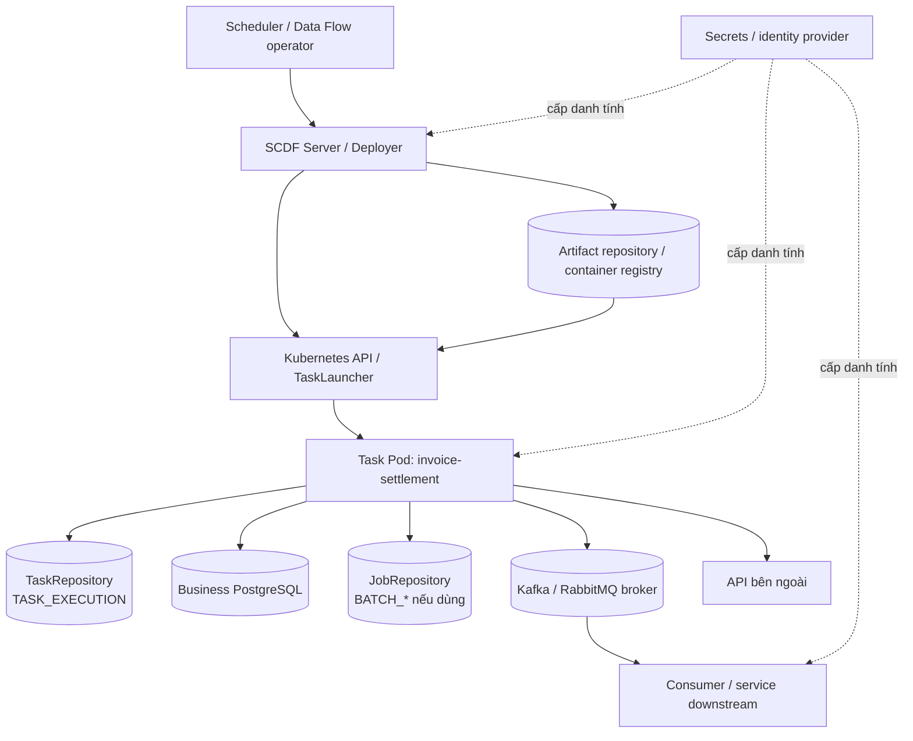

# Bảo vệ broker, kho artifact và kênh kết nối

## Mục tiêu học tập

Sau bài học, bạn có thể:

- Xác định các **ranh giới tin cậy** trong ứng dụng **Spring Cloud Task** chạy hữu hạn: tiến trình Task, message broker, kho artifact/container registry, Spring Cloud Data Flow/Deployer, cơ sở dữ liệu và dịch vụ bên ngoài.
- Phân biệt **mã hóa đường truyền**, **xác thực danh tính**, **phân quyền** và **tính toàn vẹn artifact**; giải thích vì sao chỉ bật HTTPS/TLS chưa đủ.
- Cấu hình kết nối Spring Cloud Stream tới Kafka bằng `SASL_SSL`, truststore và quyền tối thiểu; nêu phương án tương đương với RabbitMQ.
- Bảo vệ chuỗi cung ứng: kiểm soát quyền publish/pull, xác thực nguồn image/JAR, pin digest, lưu SBOM và thực thi quy trình kiểm tra trước khi deploy.
- Sử dụng Kubernetes Secret, ServiceAccount, `imagePullSecrets` và NetworkPolicy có kiểm soát, không rò rỉ credential qua tham số dòng lệnh, log hoặc metadata Task.
- Bảo vệ JDBC, REST API và kênh kết nối giữa manager/worker trong ứng dụng có Spring Batch/remote partitioning.
- Thiết kế rotation, giám sát, xử lý sự cố và kiểm thử âm tính để bảo đảm **kết nối sai danh tính hoặc sai quyền phải bị từ chối**.

> **Ngữ cảnh:** Đây là bài thuộc chương **Bảo mật** của module **SPRING_CLOUD_TASK**. Spring Cloud Task tạo ứng dụng Spring Boot có thời gian chạy hữu hạn, lưu lần chạy và kết quả trong `TaskRepository`. Task có thể được kích hoạt theo lịch hoặc theo yêu cầu, tích hợp Spring Batch và phát sự kiện qua Spring Cloud Stream. Khi chạy trên Docker/Kubernetes hoặc qua Spring Cloud Data Flow, việc bảo vệ không chỉ là một mật khẩu database mà còn gồm **broker, đường tải artifact, kết nối mạng và các danh tính hạ tầng**.

## 1. Tình huống: một Task kết nối nhiều hệ thống

Giả sử ứng dụng `invoice-settlement-task` chạy mỗi đêm:

1. Bộ điều phối khởi chạy image đã đăng ký trong kho container nội bộ.
2. Task đọc danh sách hóa đơn từ PostgreSQL nghiệp vụ.
3. Task ghi `TASK_EXECUTION`/`TASK_EXECUTION_PARAMS` vào `TaskRepository`.
4. Sau khi xử lý, ứng dụng phát `SettlementCompleted` qua Kafka; một consumer nhận sự kiện và cập nhật báo cáo.
5. Nếu xử lý bằng Spring Batch, manager/worker còn dùng `JobRepository` và có thể được cấp phát qua Deployer.
6. Task kết thúc và trả exit code cho Docker/Kubernetes Job.

Chỉ cần một thành phần bị cấu hình thiếu bảo vệ:

- Broker không có authentication: tiến trình trái phép có thể gửi sự kiện giả hoặc đọc dữ liệu trong topic.
- Artifact registry cho phép ghi từ tài khoản không kiểm soát: image Task có thể bị thay thế trước lúc scheduler chạy.
- JDBC kết nối không kiểm tra hostname: ứng dụng có thể gửi credential và dữ liệu tới máy chủ không đáng tin cậy.
- Task nhận secret qua `--password=...`: mật khẩu có thể được lưu trong `TASK_EXECUTION_PARAMS` hoặc xuất hiện ở danh sách tiến trình.
- Worker được quyền tạo Pod không giới hạn: tài khoản bị chiếm có thể triển khai workload vượt phạm vi được cấp.

Bảo mật vì thế cần **phòng thủ theo lớp**, bảo vệ cả dữ liệu, quyền điều khiển và artifact.

### Ba mục tiêu bảo mật

| Mục tiêu | Câu hỏi cần trả lời | Ví dụ kiểm soát |
| --- | --- | --- |
| **Bí mật (confidentiality)** | Ai có thể đọc payload/credential? | TLS, Secret, phân quyền topic, hạn chế log và retention. |
| **Toàn vẹn (integrity)** | Ai có thể sửa event, image hoặc kết quả Task? | ACL, ký image, pin digest, quyền database, kiểm tra schema. |
| **Sẵn sàng (availability)** | Lỗi kết nối/rotation có khiến Task không thể kết thúc không? | Timeout, retry giới hạn, alert, kiểm soát quota, quy trình dự phòng. |

**Nguyên tắc:** Kết nối được mã hóa nhưng dùng chung tài khoản admin vẫn nguy hiểm; artifact được ký nhưng runner có quyền đọc secret không liên quan vẫn gây rủi ro. Không coi một biện pháp thay thế các biện pháp khác.

## 2. Sơ đồ ranh giới tin cậy



Đường trên sơ đồ **không mặc nhiên được TLS hoặc xác thực**. Mỗi mũi tên phải có một quyết định bảo mật rõ ràng:

| Kênh | Danh tính bên gọi | Biện pháp tối thiểu cần xem xét |
| --- | --- | --- |
| Operator → SCDF API | Người dùng/automation account | HTTPS, OIDC/OAuth2 hoặc auth được hỗ trợ, RBAC theo thao tác. |
| SCDF/Deployer → Kubernetes API | ServiceAccount hoặc workload identity | Token ngắn hạn khi có thể, RBAC theo namespace và loại resource. |
| Platform → registry/artifact store | Pull identity | Registry authentication, TLS, quyền pull, xác thực integrity. |
| Task → `TaskRepository` | DB user chỉ cho metadata Task | JDBC TLS xác minh máy chủ, quyền bảng/sequence cần thiết. |
| Task → business DB | DB user nghiệp vụ | Tài khoản riêng, quyền bảng tối thiểu, TLS, transaction. |
| Task → Kafka/RabbitMQ | Producer/consumer identity | TLS, SASL/mTLS hoặc cơ chế phù hợp, ACL topic/queue/vhost. |
| Task/worker → Batch JobRepository | Identity của Batch | Cùng repository được phép truy cập, TLS, quyền metadata đúng. |
| Task → API ngoài | Workload identity/service credential | HTTPS kiểm tra hostname, token scope hẹp, timeout. |

Nếu ứng dụng không dùng Spring Cloud Stream, **không bắt buộc phải có broker**. Nếu không dùng Spring Cloud Data Flow, artifact và Kubernetes vẫn cần được bảo vệ nhưng không phải cấu hình SCDF.

## 3. Threat model: ai có thể gây tác động?

Một bài kiểm tra bảo mật hữu ích bắt đầu từ tác nhân, tài sản và đường tấn công thay vì từ danh sách biến môi trường.

| Rủi ro | Điểm yếu | Tác động | Phòng vệ |
| --- | --- | --- | --- |
| Đọc trộm event | Broker không dùng TLS hoặc ACL quá rộng. | Lộ hóa đơn, tham số nghiệp vụ hoặc thông tin lỗi. | TLS + auth + ACL + loại bỏ dữ liệu nhạy cảm. |
| Giả mạo sự kiện hoàn tất | Producer dùng chung credential admin; topic ai cũng ghi được. | Consumer tin vào một kết quả chưa xảy ra. | Producer riêng, quyền Write theo topic, schema/signature khi cần. |
| Thay thế image/JAR | Kho artifact cho phép ghi đè bản phát hành hoặc dùng tag không kiểm soát. | Task chạy code lạ với quyền DB/secret hiện có. | Release immutable, chữ ký/provenance, pin digest, review. |
| Credential bị lộ | Secret trong Git, CLI, Docker layer, log hoặc `TaskExecution`. | Chiếm tài khoản broker/DB/API. | Secret manager, cấp lúc chạy, masking, rotation. |
| Đánh cắp token Kubernetes | Pod tự mount ServiceAccount token không cần thiết. | Khả năng gọi Kubernetes API ngoài ý muốn. | `automountServiceAccountToken: false` khi không cần, RBAC tối thiểu. |
| Truy cập mạng ngoài phạm vi | Pod cho phép egress tới mọi địa chỉ. | Exfiltration hoặc kết nối endpoint giả. | NetworkPolicy, egress gateway, DNS/TLS verification. |
| Lạm dụng relaunch Task | Người dùng có quyền launch/override không cần thiết. | Chạy lại thanh toán, đổi runtime properties, tốn tài nguyên. | Authz/RBAC, kiểm soát arguments/deploy properties, audit. |
| Từ chối dịch vụ | Retry broker vô hạn, nhiều Pod/pool, DLQ đầy. | Tắc pipeline, hết quota hoặc kết nối DB. | Rate limit, retry budget, alert, quota. |

Ranh giới ưu tiên theo mức độ thiệt hại: một Task có quyền gửi tiền hoặc ghi sổ cái cần bảo vệ nghiêm hơn Task chỉ tổng hợp số liệu. Nhưng cả hai đều không nên truy cập broker bằng tài khoản cluster admin.

## 4. Bảo vệ broker: bốn lớp cơ bản

Đối với Kafka hoặc RabbitMQ, cần tách bốn câu hỏi:

1. **Transport security:** dữ liệu truyền trên mạng có được mã hóa bằng TLS, có kiểm tra chứng chỉ và hostname của broker không?
2. **Authentication:** broker nhận diện kết nối thuộc workload nào (SASL, mTLS, username/password hoặc cơ chế khác)?
3. **Authorization:** workload được đọc/ghi **topic, group, exchange, queue hoặc vhost** nào?
4. **Operational controls:** ai tạo/xóa topic, xem DLQ, đổi quyền; lưu payload bao lâu và có alert thất bại không?

TLS bảo vệ đường truyền và giúp kiểm tra danh tính máy chủ. Nhưng **TLS không tự phân quyền topic**. SASL xác thực client nhưng **không tự chứng minh client chỉ được đọc topic đúng mục đích**. ACL cần được cấu hình phía broker hoặc hệ thống quản trị tương ứng.

### Ví dụ phân quyền cho một Task

| Tài khoản | Quyền cần | Không cần |
| --- | --- | --- |
| `settlement-producer` | Ghi `settlement-events` và metadata/describe cần thiết cho client. | Đọc mọi topic, tạo/xóa topic, quản trị cluster. |
| `settlement-projection` | Đọc `settlement-events` trong consumer group được cấp, ghi DLQ nếu thiết kế cần. | Ghi topic nghiệp vụ gốc tùy tiện, đọc topic payroll. |
| `broker-operator` | Tạo topic/ACL, vận hành broker theo vai trò. | Dùng làm credential của container Task. |
| `task-auditor` | Đọc log/metrics/audit đã lọc. | Truy cập payload nguyên bản khi không cần. |

Một số binder có cơ chế tự tạo topic/queue hoặc tạo DLQ. Khi bật **quyền tối thiểu**, những chức năng tự tạo hạ tầng có thể thất bại. Nên chuẩn bị topic/ACL bằng pipeline hạ tầng được quản lý, rồi để ứng dụng chỉ cần quyền vận hành thực tế.

## 5. Ví dụ Kafka: `SASL_SSL` và truststore

Spring Cloud Stream Kafka binder cho phép truyền các thiết lập client bảo mật qua `spring.cloud.stream.kafka.binder.configuration`. Tài liệu chính thức minh họa `security.protocol=SASL_SSL`.

Ví dụ `application.yml` cho **một Kafka binder**:

```yaml
spring:
  cloud:
    stream:
      bindings:
        settlementEvents-out-0:
          destination: settlement-events
          content-type: application/json
      kafka:
        binder:
          brokers:
            - kafka-1.internal.example:9093
            - kafka-2.internal.example:9093
          auto-create-topics: false
          configuration:
            security.protocol: SASL_SSL
            sasl.mechanism: SCRAM-SHA-512
            sasl.jaas.config: ${KAFKA_SASL_JAAS_CONFIG}
            ssl.truststore.location: /etc/task-certs/kafka-truststore.p12
            ssl.truststore.password: ${KAFKA_TRUSTSTORE_PASSWORD}
            ssl.truststore.type: PKCS12
            ssl.endpoint.identification.algorithm: HTTPS
```

**Giả định:** Broker đã thiết lập SCRAM-SHA-512, listener TLS, certificate chain hợp lệ và ACL cho tài khoản producer. File truststore được mount **read-only** từ hạ tầng bảo mật; secret `KAFKA_SASL_JAAS_CONFIG` chứa cấu hình JAAS tương ứng và được cung cấp lúc chạy, không commit vào Git.

Ví dụ giá trị của một cấu hình JAAS **không chứa credential thật**:

```text
org.apache.kafka.common.security.scram.ScramLoginModule required username="<user>" password="<secret>";
```

Dòng trên chỉ để nhận biết định dạng của Kafka client; không dán credential thật vào `application.yml`, `docker run ... -e` được lưu trong shell history, bài tập hay ticket.

### Vì sao phải hiểu từng thuộc tính?

| Thuộc tính | Tác dụng | Lưu ý |
| --- | --- | --- |
| `brokers` | Danh sách broker bootstrap. | Danh tính hostname phải khớp chứng chỉ TLS. |
| `security.protocol: SASL_SSL` | Dùng SASL trên kết nối TLS. | Tránh dùng `SASL_PLAINTEXT` ở môi trường bảo vệ dữ liệu. |
| `sasl.mechanism: SCRAM-SHA-512` | Chọn cơ chế SASL đã cấu hình ở broker. | Không tự đổi mechanism nếu server không hỗ trợ. |
| `sasl.jaas.config` | Đưa credential/login module cho client Kafka. | Phải bảo vệ như secret; không log nguyên văn. |
| `ssl.truststore.location` | Kho CA/chứng chỉ tin cậy. | Mount đúng file, đủ quyền đọc cho user không root. |
| `ssl.endpoint.identification.algorithm: HTTPS` | Bật cơ chế kiểm tra hostname chuẩn của Kafka client. | Không tắt verification để “sửa nhanh” lỗi chứng chỉ. |
| `auto-create-topics: false` | Giảm phụ thuộc quyền tự tạo topic trong runtime. | Topic và ACL phải được provision trước. |

**Lưu ý version:** Spring Boot/Spring Cloud Stream có thể thay đổi đường bind hoặc cấu trúc cấu hình ở các release. Các key chấm như `security.protocol` nằm trong map Kafka client properties; kiểm tra tại runtime và tài liệu đúng phiên bản trước khi triển khai.

### Kafka ACL cần những gì?

Với một topic đã tồn tại, account producer thường cần quyền Write (và các quyền Describe/metadata tùy triển khai), consumer cần quyền Read trên topic và quyền phù hợp cho consumer group. Nếu Kafka DLQ được bật, tài khoản có thể cần quyền Produce tới **DLQ topic**. Hạn chế wildcard topic/group và quyền quản trị.

Đừng để Task tự tạo topic trên production bằng credential admin chỉ để giải quyết lỗi ACL. Hãy tách provisioning infrastructure khỏi quyền của tiến trình chạy hữu hạn.

### Hai Kafka cluster hoặc hai binder

Khi ứng dụng dùng nhiều binder, không đặt cùng một `sasl.jaas.config`/truststore ở cấu hình global rồi giả định mọi cluster có cùng quyền. Định nghĩa binder-specific environment/config và credential theo từng cluster, mỗi cluster có ACL riêng.

Nhận diện broker bằng hostname + CA phù hợp; chỉ đổi `brokers` mà vẫn giữ truststore/credential của môi trường khác có thể khiến xác thực thất bại, và **thất bại đó là bảo vệ cần thiết**, không phải lý do để tắt TLS.

## 6. Ví dụ RabbitMQ: TLS, vhost và quyền queue

Spring Cloud Stream Rabbit binder sử dụng `ConnectionFactory` của Spring Boot, nên các thiết lập kết nối RabbitMQ thường đi qua prefix `spring.rabbitmq.*`.

Cấu hình minh họa:

```yaml
spring:
  rabbitmq:
    host: rabbit.internal.example
    port: 5671
    username: ${RABBITMQ_USER}
    password: ${RABBITMQ_PASSWORD}
    virtual-host: /settlement
    ssl:
      enabled: true
      validate-server-certificate: true
      verify-hostname: true

  cloud:
    stream:
      bindings:
        settlementEvents-out-0:
          destination: settlement.events
```

**Điều kiện:** RabbitMQ có TLS listener và chứng chỉ đáng tin cậy; ứng dụng được cấu hình trust material tương ứng (JVM truststore hoặc cơ chế SSL bundle được client/release hỗ trợ). Đừng chỉ cấu hình `enabled: true` rồi bỏ qua việc client có tin đúng CA hay không.

RabbitMQ có nhiều ranh giới quyền:

- **vhost**: cô lập không gian exchange/queue.
- **configure**: khai báo/thay đổi exchange/queue phù hợp pattern.
- **write**: publish vào exchange phù hợp.
- **read**: consume từ queue phù hợp.

Nếu binder được phép tự khai báo exchange/queue, quyền `configure` có thể cần thiết. Với yêu cầu bảo mật chặt, nên chuẩn bị hạ tầng một cách chủ động và chỉ cấp những pattern quyền thật sự bắt buộc.

**Không so sánh ACL Kafka với quyền Rabbit theo phép một–một**: Kafka định hướng topic/group và ACL resources; Rabbit có vhost/exchange/queue và semantics cấp quyền riêng. Cần kiểm thử âm tính trên broker thật, không chỉ kiểm tra `application.yml`.

## 7. Bảo mật payload, event và DLQ

Dù broker đã dùng TLS, dữ liệu nằm **trong broker** và DLQ vẫn có thể bị người có quyền đọc xem. Những payload nhạy cảm có thể bị ghi lại trong log hoặc công cụ quản trị.

Ví dụ **không nên phát**:

```json
{
  "eventType": "SettlementCompleted",
  "customerFullName": "Example Person",
  "paymentCardNumber": "<redacted>",
  "accessToken": "<never-publish>"
}
```

Ví dụ **tối giản hơn**:

```json
{
  "eventId": "settlement:2026-11-24:apac:completed:v1",
  "eventType": "SettlementCompleted",
  "eventVersion": 1,
  "businessKey": "2026-11-24:apac",
  "processedCount": 1250
}
```

Payload tối giản không tự giải quyết tính đúng đắn của event. Consumer vẫn cần xác thực nguồn theo broker identity, kiểm tra schema/event version và dùng `eventId` để chống redelivery gây xử lý trùng.

Với **Task lifecycle event**, Spring Cloud Task có thể phát `TaskExecution` qua kênh `task-events` khi tích hợp Spring Cloud Stream phù hợp được bật. `TaskExecution` có thể chứa arguments và thông điệp lỗi; không mặc định dữ liệu này an toàn để publish cho mọi consumer. Tương tự, sự kiện Spring Batch có thể chứa metadata Job/Step hoặc thông tin nhạy cảm trong `ExecutionContext`.

### Khi nào cần mã hóa payload ở tầng ứng dụng?

TLS bảo vệ **trên đường truyền**, không ngăn broker operator có quyền hoặc một consumer được cấp nhầm ACL đọc payload. Với dữ liệu yêu cầu bảo mật cao, có thể cân nhắc:

- Chỉ gửi ID tham chiếu và để consumer đọc thông tin nhạy cảm qua API có authz riêng.
- Mã hóa có chọn lọc trường dữ liệu bằng cơ chế quản lý khóa đã được thiết kế và kiểm thử.
- Ký hoặc xác minh thông điệp ở tầng ứng dụng khi mô hình tin cậy giữa producer/broker/consumer yêu cầu.
- Phân nhóm topic theo mức phân loại dữ liệu, retention và quyền đọc riêng.
- Giới hạn DLQ, replay endpoint và dashboard để không trở thành kênh rò rỉ.

Đừng tự viết thuật toán mã hóa hoặc lưu private key trong JAR. Sử dụng thư viện chuẩn, KMS/secret manager và quy trình rotation.

## 8. Lỗi gửi broker không được che giấu kết quả Task

Giả sử nghiệp vụ đã commit, nhưng gửi sự kiện thất bại. Cách xử lý phụ thuộc **tính bắt buộc của event**:

| Loại event | Mức độ ưu tiên | Chiến lược hợp lý |
| --- | --- | --- |
| Thông báo quan sát *best-effort* | Có thể tái tạo từ `TaskRepository`. | Log an toàn, metrics/alert và reconciliation. |
| Event nghiệp vụ kích hoạt công đoạn tiếp theo | Không được mất ý định gửi sau commit. | Transactional outbox, dispatcher, retry bền vững, consumer idempotent. |
| Event kiểm toán bắt buộc | Cần bằng chứng không bị thay đổi tùy tiện. | Kho audit đã phân quyền, retention, integrity và quy trình xử lý lỗi. |

Một đoạn code có vấn đề:

```java
try {
    streamBridge.send("settlementEvents-out-0", event);
} catch (Exception ex) {
    log.error("Publish failed", ex);
    // Chỉ log rồi return có thể khiến Task báo thành công sai.
}
```

`StreamBridge.send(...)` có thể trả kết quả cho biết message được đường gửi nội bộ chấp nhận; **không coi boolean đó là chứng nhận tất cả consumer đã nhận**. Tùy binder, gửi có thể bất đồng bộ, lỗi từ producer/broker xảy ra sau lời gọi.

Nếu cần độ tin cậy giữa database nghiệp vụ và broker, một mẫu phổ biến là ghi **outbox row trong cùng transaction JDBC** với kết quả nghiệp vụ, sau đó dispatcher phát và đánh dấu đã gửi. Dispatcher có thể crash sau khi broker nhận message nhưng trước khi cập nhật outbox, vì vậy **duplicate vẫn có thể xảy ra**. Consumer phải xử lý idempotent.

`TaskRepository`, Kafka/RabbitMQ và database nghiệp vụ thường có **transaction độc lập**. Bật TLS cho cả ba không thay đổi điều này; bảo mật transport và tính nguyên tử nghiệp vụ là hai vấn đề khác nhau.

## 9. Kho artifact: một ranh giới bảo mật khác broker

Spring Cloud Data Flow/Deployer hoặc pipeline triển khai có thể tham chiếu đến:

- **Docker/OCI image** trong container registry, ví dụ `registry.example.internal/tasks/settlement:1.4.0`.
- **JAR/Maven artifact** trong Maven repository, ví dụ định danh `maven://...` khi nền tảng/Deployer hỗ trợ.
- Nguồn object storage hay artifact location được Deployer tương ứng hỗ trợ.

Nguy cơ ở đây là **chuỗi cung ứng phần mềm**: image/JAR được tải về và chạy với quyền của Task, truy cập database, broker và secret. Một artifact độc hại có thể lợi dụng toàn bộ quyền này ngay cả khi broker/DB đã có TLS chuẩn.

### Các nguyên tắc bảo vệ kho

| Kiểm soát | Mục đích |
| --- | --- |
| TLS tới registry/artifact store | Không để đường tải bị nghe lén/sửa nội dung bởi proxy không đáng tin cậy. |
| Xác thực người publish | Chỉ CI/release pipeline được xuất bản artifact hợp lệ. |
| Xác thực người pull | Chỉ workloads/namespaces được cấp quyền tải private image/JAR. |
| Không cho ghi đè release | Version đã phát hành có nội dung không thay đổi. |
| Pin image digest | Deploy đúng byte image đã phê duyệt, không phụ thuộc tag bị đổi. |
| Chữ ký và provenance | Kiểm tra nguồn, quy trình build và integrity theo chính sách. |
| SBOM, scan dependency/image | Biết thành phần được đưa vào runtime và lỗ hổng cần xử lý. |
| Allowlist registry/repository | Tránh tải nhầm artifact từ kho không được phê duyệt. |
| Phê duyệt deployment properties | Tránh dùng artifact hợp lệ nhưng cấp quyền/secret vượt mức cần thiết. |

**TLS không chứng minh JAR là an toàn**: nó chỉ giúp xác minh endpoint và bảo vệ nội dung trên đường truyền theo trust config. **Tag image cũng không tự chứng minh immutable** nếu registry vẫn cho phép ghi đè tag.

### Ví dụ pin digest

Thay vì chỉ có:

```yaml
image: registry.example.internal/tasks/settlement:latest
```

production nên ưu tiên tham chiếu đã được phê duyệt và pin digest:

```yaml
image: registry.example.internal/tasks/settlement@sha256:<sha256-digest-thuc-te>
```

Chuỗi `<sha256-digest-thuc-te>` là placeholder **không chạy trực tiếp**; cần thay bằng digest thật (64 ký tự hex) lấy từ registry/bản phát hành đã xác minh. Khi pin digest, runtime tải đúng image theo digest; việc kiểm tra chữ ký và provenance vẫn phải được thực hiện bởi pipeline/policy phù hợp, vì **pin digest đơn thuần không nói ai đã build image**.

### JAR/Maven repository

Với môi trường dùng `maven://group:artifact:version` (định dạng cụ thể tùy Spring Cloud Deployer/SCDF release), hãy:

- Tránh version thay đổi được như snapshot cho production nếu không có chính sách quản lý rõ.
- Chỉ dùng repo có TLS/certificate trust và xác thực.
- Hạn chế CI account `publish`, tách khỏi account runtime `read-only`.
- Kiểm tra checksum/chữ ký/bản ghi build provenance theo chính sách.
- Không để username/password của Maven repository trong URI hoặc log triển khai.
- Đảm bảo worker artifact trong remote partitioning cũng được kiểm soát như artifact manager.

Đường `maven://` không phải mặc định được mọi runtime Kubernetes hiểu giống nhau; cần dùng đúng artifact resolution do Deployer đang chạy hỗ trợ. Không dùng một JAR không rõ nguồn chỉ vì SCDF chấp nhận đăng ký URI.

## 10. Kubernetes `imagePullSecrets` và identity kéo image

Với private container registry, Kubernetes hỗ trợ `imagePullSecrets` ở Pod spec. Đây là credential **để kubelet/node lấy image**, không đồng nghĩa ứng dụng bên trong Pod được quyền dùng credential đó để đăng nhập broker.

Đoạn YAML minh họa trong `Job`:

```yaml
apiVersion: batch/v1
kind: Job
metadata:
  name: settlement-once
  namespace: batch-workloads
spec:
  template:
    spec:
      restartPolicy: Never
      imagePullSecrets:
        - name: settlement-registry-pull
      containers:
        - name: settlement
          image: registry.example.internal/tasks/settlement:1.4.0
          imagePullPolicy: IfNotPresent
```

Giả định Secret `settlement-registry-pull` loại phù hợp đã tồn tại **trong cùng namespace**. Ví dụ dùng tag để dễ đọc; bản release thực nên pin digest hoặc dùng chính sách xác thực image đã phê duyệt.

`imagePullSecrets` không bảo vệ ứng dụng nếu registry cấp quyền write cho chính credential pull; hãy phân quyền **pull riêng**. Một số cluster hỗ trợ cơ chế credential provider/workload identity cho image pull; khi đó chính sách có thể khác `imagePullSecrets` thủ công.

### Các danh tính không nên dùng chung

| Danh tính | Phạm vi |
| --- | --- |
| Registry pull identity | Chỉ pull những image cần thiết. |
| Kafka producer identity | Chỉ write các topic được phép. |
| RabbitMQ publisher identity | Chỉ publish exchange trong vhost được chỉ định. |
| TaskRepository DB user | Quyền cần thiết cho bảng/sequence Task. |
| Business DB user | Quyền cần thiết cho dữ liệu nghiệp vụ. |
| Kubernetes ServiceAccount | Chỉ quyền API cần dùng, có thể không cần token trong Task Pod. |
| SCDF operator/release account | Quản lý định nghĩa/launch hoặc publish theo phân quyền. |

Nếu một secret bị lộ, tách danh tính giúp giảm **blast radius** và hỗ trợ rotation độc lập. Không dùng một tài khoản `admin` để đồng thời đăng nhập registry, broker và database.

## 11. Quản lý Secret: cung cấp lúc chạy, không nhúng vào image

Các nơi **không nên** đặt credential:

- `application.yml` được commit, `Dockerfile ENV`, `ARG` dùng trong quá trình build, hoặc layer của image.
- CLI `--spring.datasource.password=...`, `--spring.cloud.stream.kafka...password=...`.
- `TASK_EXECUTION_PARAMS`, `JobParameters`, `ExecutionContext` hoặc event payload.
- Log startup/dump environment, exception có chứa URI với user:password.
- Ticket support, screenshot màn hình SCDF, message DLQ.
- File truststore/private key được copy cố định vào image phát hành.

Kubernetes Secret có thể được cấp làm env var hoặc file mount. Ví dụ **rút gọn** dùng Secret refs:

```yaml
apiVersion: batch/v1
kind: Job
metadata:
  name: settlement-secure
  namespace: batch-workloads
spec:
  template:
    spec:
      serviceAccountName: settlement-runner
      automountServiceAccountToken: false
      restartPolicy: Never
      containers:
        - name: settlement
          image: registry.example.internal/tasks/settlement:1.4.0
          env:
            - name: TASK_DB_PASSWORD
              valueFrom:
                secretKeyRef:
                  name: settlement-runtime-secrets
                  key: task-db-password
            - name: KAFKA_SASL_JAAS_CONFIG
              valueFrom:
                secretKeyRef:
                  name: settlement-runtime-secrets
                  key: kafka-jaas
          volumeMounts:
            - name: broker-ca
              mountPath: /etc/task-certs
              readOnly: true
      volumes:
        - name: broker-ca
          secret:
            secretName: settlement-broker-ca
```

Đây là manifest minh họa. Cần bổ sung `imagePullSecrets` nếu registry private yêu cầu, các giá trị kết nối khác, quyền securityContext, resources và NetworkPolicy theo môi trường. Các Secret phải được cấp/đồng bộ trước khi Job bắt đầu.

**Quan trọng về `automountServiceAccountToken: false`:** Chỉ dùng nếu **Task Pod không cần trực tiếp gọi Kubernetes API**. Spring Cloud Data Flow Server/Deployer mới là bên thường cần quyền tạo Job/Pod; một Task nghiệp vụ thông thường không cần mang token API server. Nếu Task đóng vai trò manager tự dùng Kubernetes TaskLauncher, phải xem xét lại quyền và cách cấp danh tính.

### Mount Secret khác env var như thế nào?

- Env var thường chỉ được cấp khi process bắt đầu; thay giá trị Secret trong Kubernetes **không tự làm môi trường của JVM đang chạy thay đổi**.
- Secret volume có thể được kubelet cập nhật theo cơ chế và độ trễ của nó; nhưng client Java cũng phải **reload/reconnect** thì mới sử dụng chứng chỉ/credential mới.
- Cả env và file Secret đều có thể bị code trong container đọc; người có quyền thực thi code trong Pod có thể lấy chúng. Kubernetes Secret không tự bảo vệ khỏi workload đã bị xâm nhập.
- Không cấp quyền `get/list/watch secrets` rộng cho ServiceAccount của Task chỉ vì Task dùng `secretKeyRef`; kubelet là thành phần gắn Secret phù hợp vào Pod.
- Cần mã hóa dữ liệu Secret at rest, RBAC và quản lý vòng đời theo chính sách cluster; Secret không phải một “két an toàn tuyệt đối”.

**Không in toàn bộ `env` hoặc `/proc/*/environ` khi debug**, vì các biến mật khẩu có thể xuất hiện trong output/log.

## 12. Bảo vệ kết nối JDBC tới TaskRepository và JobRepository

Spring Cloud Task lưu metadata thực thi trong database. Các bảng như `TASK_EXECUTION`, `TASK_EXECUTION_PARAMS` và cấu trúc cấp ID có thể chứa thời gian, thông điệp lỗi và đối số dòng lệnh. Spring Batch có `BATCH_JOB_EXECUTION`, `BATCH_STEP_EXECUTION` và context có thể chứa thông tin điều phối.

Ba yêu cầu cơ bản:

1. **TLS có xác minh certificate chain và hostname**, không chỉ mã hóa “best effort”.
2. **Tài khoản riêng và quyền tối thiểu**, phân biệt repository Task, Batch và database nghiệp vụ khi phù hợp.
3. **Schema migration và backup/retention** được quản lý ngoài runtime Task; không cấp quyền DDL cao cho worker nếu không cần.

Ví dụ JDBC URL PostgreSQL có kiểm tra hostname:

```yaml
spring:
  datasource:
    url: "jdbc:postgresql://task-db.internal.example:5432/taskdb?sslmode=verify-full&sslrootcert=/etc/task-certs/postgres-ca.crt"
    username: ${TASK_DB_USER}
    password: ${TASK_DB_PASSWORD}
  cloud:
    task:
      initialize-enabled: false
```

`sslmode=verify-full` của PostgreSQL JDBC được dùng khi muốn xác minh cả certificate chain lẫn tên máy chủ. Cần mount CA được tin cậy, cấp quyền đọc file, cấu hình server TLS và dùng hostname khớp SAN chứng chỉ.

**Không coi `sslmode=require` tương đương `verify-full` cho yêu cầu chống giả mạo máy chủ**; các mode có semantics khác nhau theo driver. Với MySQL, SQL Server hoặc database khác, phải dùng thuộc tính TLS của driver tương ứng, không sao chép tham số PostgreSQL.

### Tách DataSource khi cần

Nếu Task truy cập cả nghiệp vụ và metadata, dùng `@Qualifier`/`TaskConfigurer` phù hợp để chỉ rõ `taskDataSource`. Không mặc định bean `@Primary` sẽ chọn đúng mọi đường kết nối.

| Nguồn | Quyền thường cần | Không nên có |
| --- | --- | --- |
| `taskDataSource` | Đọc/ghi metadata Task, dùng sequence/ID generator. | Quyền ghi bảng thanh toán. |
| `batchDataSource` nếu tách | Đọc/ghi bảng Batch theo JobRepository. | Quyền quản trị cluster database. |
| `businessDataSource` | Chỉ các bảng/nghiệp vụ cần cho Task. | Quyền xem mật khẩu/secret hệ thống. |

Nếu remote partitioning dùng manager/worker, cần cấu hình cùng `JobRepository` chia sẻ theo kiến trúc; phân quyền hẹp nhưng đủ cho worker cập nhật `StepExecution`. Không tạo database riêng cho từng Pod rồi kỳ vọng manager đọc được Step status.

### Không log SQL parameter nhạy cảm

Khi bật debug logging của JDBC, ORM hoặc HTTP client, có nguy cơ in trực tiếp giá trị bind parameter. Ở production, kiểm soát log level, masking và truy cập log. Thậm chí `ERROR_MESSAGE` lưu trong TaskRepository cũng cần retention và quyền SELECT hạn chế.

## 13. Kết nối REST/API: xác minh server và giới hạn token

Task có thể gọi API thanh toán, cấu hình hoặc quản lý data. Với HTTP client:

- Dùng **HTTPS** và hostname verification; không cài `TrustAll`/`NoopHostnameVerifier` để vượt qua lỗi chứng chỉ.
- Tách token theo môi trường và quyền `scope`/audience cần thiết.
- Đặt connect/read/response timeout và retry budget; request nhạy cảm phải có idempotency key khi có khả năng gửi lại.
- Không truyền bearer token bằng query string hoặc log `Authorization`.
- Kiểm soát redirect, proxy và DNS: không đưa credential tới endpoint khác domain ngoài chính sách.
- Dùng mTLS khi mô hình tin cậy yêu cầu, nhưng vẫn cần kiểm tra phân quyền API.
- Theo dõi mã `401`/`403` riêng với `429`/`5xx`: lỗi quyền không nên retry vô hạn.

### Spring Boot SSL bundles

Spring Boot cung cấp **SSL bundles** (theo release hỗ trợ) để mô tả truststore/keystore bằng `spring.ssl.bundle.*`. Ví dụ một trust bundle:

```yaml
spring:
  ssl:
    bundle:
      pem:
        partner-api:
          truststore:
            certificate: "file:/etc/task-certs/partner-api-ca.pem"
```

Bundle không tự động áp dụng cho **mọi** HTTP client, driver JDBC và binder. Thành phần client phải được cấu hình sử dụng bundle đó hoặc dùng trust material tương đương theo API của release. Không nhầm “đã khai báo CA trong YAML” với “mọi kết nối đều đang xác minh CA này”.

Với ứng dụng không mở web server, `server.ssl.*` chỉ phục vụ server side nếu có embedded HTTP server; nó không bảo vệ tự động kết nối **outbound** tới broker/database.

## 14. NetworkPolicy: kiểm soát egress của Pod

Ngay cả khi dùng TLS, một Pod bị xâm nhập vẫn có thể tìm cách kết nối endpoint không cần thiết nếu egress cho phép mọi nơi. Kubernetes `NetworkPolicy` có thể áp dụng quy tắc **allowlist kết nối mạng L3/L4** nếu CNI của cluster hỗ trợ enforcement.

Ví dụ phần chính sách giới hạn **Pod có label `app=settlement-task`** chỉ được kết nối tới Kafka và PostgreSQL có label tương ứng **trong cùng namespace**:

```yaml
apiVersion: networking.k8s.io/v1
kind: NetworkPolicy
metadata:
  name: settlement-egress
  namespace: batch-workloads
spec:
  podSelector:
    matchLabels:
      app: settlement-task
  policyTypes:
    - Egress
  egress:
    - to:
        - podSelector:
            matchLabels:
              app: kafka-broker
      ports:
        - protocol: TCP
          port: 9093
    - to:
        - podSelector:
            matchLabels:
              app: task-postgres
      ports:
        - protocol: TCP
          port: 5432
```

**Giới hạn ví dụ:** Trong nhiều kiến trúc, Kafka/PostgreSQL là **dịch vụ ngoài namespace/ngoài cluster** nên `podSelector` như trên **không khớp**. Cần dùng `namespaceSelector` kết hợp `podSelector` hoặc giải pháp egress gateway/firewall cho endpoint bên ngoài. Bài không giả định cluster thực của người học có labels này.

Ngoài ra:

- NetworkPolicy không kiểm tra tên DNS/TLS certificate; nó không thay thế hostname verification và authentication.
- Khi Pod được chọn bởi một egress policy, những đích không được cho phép có thể bị chặn, bao gồm **DNS**, registry metadata, API hoặc dịch vụ quan sát nếu chưa thêm rule cần thiết.
- Image pulling thường do kubelet/node thực hiện, không đơn giản là egress của chính Task Pod theo NetworkPolicy trên.
- `podSelector` trong một policy chỉ chọn Pod trong **namespace của chính policy**.
- Cần kiểm thử rằng CNI thực sự thực thi chính sách; chỉ tạo YAML mà không có enforcement là chưa bảo vệ.

### Nguyên tắc allowlist, không mở 0.0.0.0/0 để “sửa lỗi”

Khi kết nối broker thất bại sau khi bật NetworkPolicy, hãy kiểm tra DNS, route, port và Pod labels. Đừng vội thêm rule egress tới mọi địa chỉ. Một quy tắc quá rộng có thể xóa bỏ toàn bộ giá trị của phân đoạn mạng.

Đồng thời, với broker cần mở thêm đường kết nối tới **các broker được trả trong metadata**, không chỉ bootstrap broker. Kafka client có thể kết nối tới nhiều broker host/port sau bootstrap; điều này phải được tính trong firewall/egress.

## 15. Bảo vệ SCDF, Deployer và quyền khởi chạy

Nếu dùng **Spring Cloud Data Flow** hoặc Spring Cloud Deployer, người được phép tạo/sửa Task Definition hay deployment properties có thể ảnh hưởng **artifact nào được chạy và dưới identity nào**.

Biện pháp cần xem xét:

1. Bảo vệ Data Flow API/Dashboard/Shell bằng HTTPS và hệ thống xác thực được hỗ trợ; ưu tiên tài khoản cá nhân hoặc automation account thay vì chia sẻ admin.
2. Phân quyền tách **xem lịch sử**, **đăng ký artifact**, **launch/relaunch**, **destroy/cleanup**, **quản trị cấu hình**.
3. Kiểm soát URI/image cho Task Definition; chỉ cho artifact từ registry/repository đã phê duyệt.
4. Xác minh image integrity/provenance và giới hạn runtime property override theo chính sách.
5. Hạn chế những người có thể thay đổi `deployment properties`, ServiceAccount, namespace, resource quota, secret references và volume mounts.
6. Dùng Kubernetes RBAC cho Deployer/SCDF Server: chỉ các loại resource, namespace, tên/label cần thiết; không cấp `cluster-admin` cho TaskLauncher để tiện thử nghiệm.
7. Theo dõi audit log: ai đăng ký bản artifact nào, ai launch với arguments gì, ai đổi image, ai cleanup/relaunch.

**Một quyền “chỉ launch Task” có thể tác động nghiệp vụ thật**. Với Task chuyển tiền, relaunch cùng `businessDate` có thể tạo tác động trùng nếu nghiệp vụ chưa idempotent; bảo vệ quyền launch cũng là bảo vệ dữ liệu.

### Manager/worker remote partitioning

Trong nhánh Spring Cloud Task có cơ chế `DeployerPartitionHandler`, manager có thể gọi `TaskLauncher` để tạo nhiều worker. Khi đó:

- Manager được quyền deploy trong phạm vi worker cần thiết, nhưng không được tạo Pod tùy ý ở mọi namespace.
- Worker image phải được pin, xác minh provenance và dùng profile/arguments đúng.
- Worker nhận credential **phục vụ phân vùng**, không sao chép toàn bộ môi trường chứa secret của manager.
- Manager và worker cần truy cập chung JobRepository khi kiến trúc yêu cầu, nhưng có thể có quyền DB/secret khác nhau.
- Giới hạn `maxWorkers`, Pod quota, pool kết nối để giảm nguy cơ tải quá mức.
- Không dùng worker artifact từ URI do người dùng không đáng tin cậy nhập vào mà không kiểm tra nguồn, version và quyền.

Remote partitioning bằng Deployer là tính năng **phụ thuộc phiên bản**; không mặc định class/API có trong mọi release Spring Cloud Task mới.

## 16. Container hardening bổ sung

Broker/registry/TLS sẽ kém ý nghĩa nếu workload có thể dễ dàng đọc secret hoặc chạy quyền quá cao. Với Docker/Kubernetes:

| Biện pháp | Lợi ích | Giới hạn/điều kiện |
| --- | --- | --- |
| Chạy không root | Giảm quyền khi code bị khai thác. | Phải cấp quyền đọc artifact/truststore và ghi thư mục cần thiết. |
| `readOnlyRootFilesystem: true` | Giảm khả năng sửa image filesystem. | JVM/thư viện cần thư mục tmp writable riêng nếu thực sự ghi file. |
| `allowPrivilegeEscalation: false` | Hạn chế tăng quyền trong container. | Không thay thế RBAC hoặc quản lý kernel. |
| Drop Linux capabilities | Giảm quyền hệ điều hành. | Cần kiểm tra thư viện/agent dùng capabilities nào. |
| `seccompProfile: RuntimeDefault` | Dùng profile syscall mặc định có giới hạn. | Phụ thuộc runtime hỗ trợ; phải test. |
| `automountServiceAccountToken: false` | Không đưa Kubernetes API token vào Pod khi không cần. | Không áp dụng cho manager cần trực tiếp dùng API. |
| CPU/memory limits | Giới hạn tiêu thụ tài nguyên. | OOM/timeout cần được xử lý và Task phải có idempotency. |

Ví dụ `securityContext` cho Task Pod:

```yaml
spec:
  automountServiceAccountToken: false
  securityContext:
    runAsNonRoot: true
    runAsUser: 10001
    seccompProfile:
      type: RuntimeDefault
  containers:
    - name: settlement
      image: registry.example.internal/tasks/settlement:1.4.0
      securityContext:
        allowPrivilegeEscalation: false
        readOnlyRootFilesystem: true
        capabilities:
          drop: ["ALL"]
      volumeMounts:
        - name: tmp
          mountPath: /tmp
  volumes:
    - name: tmp
      emptyDir: {}
```

Đây là **Pod spec rút gọn**, cần lồng trong manifest Job/CronJob. Thư mục `/tmp` dùng writable volume; có thể cần giới hạn kích thước hoặc cấu hình thư mục tạm khác. Nếu Kafka binder cần copy truststore hoặc thư viện tạo file tạm, phải biết vị trí ghi và cấp writable volume phù hợp, không quay lại chạy toàn bộ filesystem writable không kiểm soát.

## 17. Xoay vòng credential và certificate mà không làm hỏng Task

Spring Cloud Task có thời gian chạy hữu hạn nên có ưu thế: một lần chạy mới có thể đọc **credential mới** khi Pod được tạo. Nhưng vẫn có thách thức:

- Task dài nhiều giờ có thể giữ Kafka/JDBC connection tới lúc secret cũ hết hạn.
- Worker manager và các worker mới có thể dùng **hai thế hệ credential** nếu rotation diễn ra giữa job.
- Broker/database có thể cần khoảng thời gian chấp nhận đồng thời credential cũ và mới.
- Truststore mới cần được mount và client reload/reconnect; đổi Secret object không bảo đảm JVM đang chạy đã nhận.
- Registry credential rotation có thể làm Pod mới báo `ImagePullBackOff` dù Pod đang chạy vẫn ổn.

### Quy trình rotation gợi ý

1. Xác định thành phần sở hữu secret, phạm vi quyền và thời hạn hết hạn.
2. Cấp credential/chứng chỉ mới bằng hệ thống quản lý secret được phê duyệt.
3. Kiểm tra CA chain, SAN hostname, protocol/cipher và ACL mới bằng workload test.
4. Cho giai đoạn chuyển tiếp có kiểm soát nếu hệ thống hỗ trợ hai credential đồng thời.
5. Khởi chạy lại Task/worker cần thiết hoặc reload client theo chức năng được release hỗ trợ.
6. Quan sát kết nối, publish/consume, DB query, image pull, exit status và metadata Task.
7. Thu hồi credential cũ sau khi xác nhận toàn bộ workload đã chuyển đổi.
8. Ghi audit ai đã rotation, vào thời điểm nào và hệ thống nào đã được xác minh.

**Không làm lộ secret khi chẩn đoán rotation**: tránh `kubectl get secret -o yaml` trong log hoặc chia sẻ terminal output. Có thể kiểm tra sự tồn tại và tham chiếu Secret bằng cơ chế không in nội dung secret.

### Failure mode quan trọng

Nếu certificate hết hạn hoặc Kafka ACL mới thiếu quyền, Task có thể lỗi trước khi runner chạy hoặc khi ghi event cuối. Không vì deadline batch mà sửa nhanh bằng `ssl.endpoint.identification.algorithm=""`, `TrustAll` hoặc chuyển `SASL_PLAINTEXT`: những cách này vô hiệu hóa kiểm tra danh tính hoặc mã hóa đường truyền.

## 18. Giám sát và dấu hiệu tấn công

Bảo vệ chủ động cần kèm khả năng phát hiện **lỗi quyền và truy cập khác thường**.

| Tín hiệu | Điều có thể đang xảy ra | Hướng điều tra |
| --- | --- | --- |
| Kafka `SaslAuthenticationException` | Sai credential, mechanism, user bị khóa hoặc rotation chưa đồng bộ. | Kiểm tra secret reference, broker listener, auth logs; không in password. |
| Kafka `TopicAuthorizationException` | Thiếu ACL hoặc producer đang truy cập sai topic. | Kiểm tra principal, topic, role và config binding. |
| TLS handshake/certificate error | CA không đúng, chứng chỉ hết hạn, hostname không khớp. | Kiểm tra chain, SAN, thời gian, truststore và proxy. |
| RabbitMQ `ACCESS_REFUSED` | User không có quyền vhost/exchange/queue hoặc credential sai. | Audit Rabbit user/vhost permissions và topology. |
| Registry `401/403` | Pull identity hết hạn hoặc không được cấp scope. | Kiểm tra imagePullSecrets, registry permissions. |
| Kubernetes `ImagePullBackOff` | Image không tồn tại, sai credential, registry/TLS/network lỗi. | Xem Pod events, registry status và artifact digest. |
| JDBC authentication/SSL failure | DB user/CA/hostname không đúng. | Kiểm tra cấu hình riêng Task/Batch/business DB. |
| Bất thường ở `TASK_EXECUTION_PARAMS` | Truyền secret qua args hoặc bị launch ngoài quy tắc. | Soát quyền launch, tham số, log và audit. |
| Tăng số lượng Task launch | Lạm dụng relaunch, schedule trùng hoặc retry loop. | SCDF audit, Kubernetes Jobs, hạn mức và business idempotency. |
| Consumer DLQ tăng | Payload độc hại/sai schema, lỗi quyền hay downstream lỗi. | Kiểm tra nguồn, event ID, broker/consumer logs. |

**Không kết luận mọi authentication failure đều là tấn công.** Chứng chỉ hết hạn, đổi quyền/secret sai hoặc clock lệch cũng gây lỗi. Nhưng các dấu hiệu phải được ghi audit và có alert theo ngưỡng phù hợp để phát hiện sớm cả sai cấu hình lẫn hành vi bất thường.

### Bảo vệ log và metadata

- Không ghi username/password, token, JAAS config, private key, truststore password.
- Không ghi payload/headers nhạy cảm hoặc toàn bộ `ApplicationArguments` khi không cần.
- Hạn chế truy vấn `TASK_EXECUTION_PARAMS`, `TASK_EXECUTION.ERROR_MESSAGE` và Batch `ExecutionContext`.
- Áp retention, masking, phân quyền truy cập log tập trung và DLQ.
- Gắn `executionId`, `jobExecutionId`, correlation ID để truy vết nhưng tránh dùng ID làm thông tin xác thực.

## 19. Kiểm thử bảo mật từ chối đúng lỗi

Một cấu hình bảo mật tốt cần chứng minh cả **đường thành công** lẫn **đường sai bị chặn**. Không chỉ xem Task có thể publish hoặc đọc database một lần rồi đánh dấu hoàn tất.

### Ma trận kiểm thử

| Tình huống trên dev/test | Kỳ vọng | Nguồn xác minh |
| --- | --- | --- |
| CA + hostname broker đúng | Kafka/Rabbit kết nối và thực hiện hành động được cấp. | Broker auth logs, client log, metrics. |
| CA không tin cậy hoặc hostname sai | TLS handshake bị từ chối. | Exception TLS, broker/ingress logs. |
| Producer dùng credential consumer-only | Gửi topic không được phép thất bại. | Broker ACL/error metric. |
| Producer thiếu quyền tạo topic | Không tự tạo topic; publish chỉ thành công khi topic đã có. | Infrastructure provisioning, auth logs. |
| Registry pull credential hợp lệ | Pod lấy đúng image đã phê duyệt. | Events, digest, signature policy. |
| Registry credential sai | Image pull bị từ chối; **không chạy image khác thay thế**. | `kubectl describe pod`, registry logs. |
| Task DB user không có quyền đọc bảng nghiệp vụ | Query trái quyền bị từ chối. | SQL permission error. |
| Pod bị chặn egress không cho phép | Không kết nối được endpoint ngoài allowlist. | NetworkPolicy enforcement, CNI logs. |
| Secret rotation | Task mới dùng secret mới; secret cũ bị thu hồi sau chuyển tiếp. | Kết nối có quyền và logs an toàn. |
| Broker down khi Task xử lý xong | Không tuyên bố phát event thành công nếu policy bắt buộc. | Outbox/alert, Task/process status. |
| Worker bị kill giữa Batch Step | Không mất khả năng xác minh trạng thái và retry an toàn. | JobRepository, TaskRepository, logs/container exit. |

Dùng môi trường thử nghiệm riêng. Không thử sai mật khẩu liên tục trên production gây khóa tài khoản, không thu hồi credential đang dùng của hệ thống thật chỉ để tạo lỗi và không scan hàng loạt endpoint ngoài phạm vi được phép.

### Kiểm tra bằng thông tin không nhạy cảm

Một số lệnh quan sát Kubernetes:

```bash
# Xem Pod status và event, không in Secret data.
kubectl -n batch-workloads get pods -l app=settlement-task
kubectl -n batch-workloads describe pod <pod-name>

# Xem ServiceAccount và quyền, không đòi quyền đọc Secret.
kubectl -n batch-workloads get serviceaccount settlement-runner
kubectl auth can-i create jobs \
  --as=system:serviceaccount:batch-workloads:settlement-runner \
  -n batch-workloads
```

`<pod-name>` là placeholder. Lệnh `kubectl auth can-i --as=...` yêu cầu người chạy có quyền impersonation phù hợp; nếu không, hãy dùng cơ chế review quyền được tổ chức cho phép thay vì xin cluster-admin chỉ để chạy lệnh.

Nếu `settlement-runner` là **Task Pod thông thường không dùng Kubernetes API**, kết quả `create jobs` nên là **no**. Còn SCDF/Deployer ServiceAccount có thể cần quyền tạo Job/Pod nhưng chỉ trong namespace/mức quyền đã thiết kế.

### Kiểm tra TLS mà không hạ tiêu chuẩn

- Xác minh DNS và SAN/CN từ chứng chỉ broker/database; dùng hostname thật, không thay bằng IP nếu certificate không có IP SAN.
- Kiểm tra file CA được mount đúng đường dẫn và có quyền đọc cho UID của process.
- Kiểm tra đồng hồ/container, thời hạn `notBefore/notAfter` của certificate.
- Kiểm tra Kafka `security.protocol`, mechanism và truststore **cùng khớp** server.
- Không dùng tùy chọn bỏ kiểm tra certificate hoặc hostname làm giải pháp lâu dài.

## 20. Ứng phó khi credential hoặc artifact bị xâm phạm

Một sự cố có thể bắt đầu từ cảnh báo registry, broker ACL hoặc phát hiện secret trong log/Git. Quy trình ưu tiên **cô lập, bảo toàn bằng chứng, giảm tác động và phục hồi bằng bản phát hành đáng tin cậy**.

1. **Xác định phạm vi:** secret nào, Task/worker nào, topic/database/API nào, image digest nào có thể bị ảnh hưởng.
2. **Hạn chế tác động:** vô hiệu hóa credential bị lộ theo quy trình phối hợp để tránh dừng nhầm toàn hệ thống; hạn chế launch/egress nếu cần và được phép.
3. **Bảo toàn bằng chứng:** lưu audit event, image digest, timestamp, task execution ID, JobExecution ID, log đã lọc; không sửa metadata Task/Batch để “che lỗi”.
4. **Thu hồi và cấp mới:** rotate broker/DB/API/registry credentials, trust material hoặc signing keys theo mức độ xâm phạm.
5. **Khôi phục artifact:** xây lại từ source, dependency và pipeline đáng tin cậy, quét/kiểm tra chữ ký, publish bản immutable mới.
6. **Đối soát dữ liệu:** kiểm tra các Job/Task từng chạy với image/identity bị ảnh hưởng, xác minh bản ghi nghiệp vụ và sự kiện được publish.
7. **Tái triển khai có kiểm soát:** chỉ mở quyền/kết nối cần thiết, kiểm tra đường thành công và đường từ chối.
8. **Hậu kiểm:** thu hẹp ACL, cải thiện scanning, rotation, alert và thời gian lưu audit.

**Không chỉ restart container** khi phát hiện image hoặc credential bị xâm phạm. Nếu Task đã thực hiện thao tác nghiệp vụ, cần xác minh hậu quả trong database, broker và API ngoài trước khi chạy lại.

## 21. Checklist trước khi đưa Task lên production

### Broker

- [ ] Dùng TLS, kiểm tra hostname và CA; không có `SASL_PLAINTEXT`/`TrustAll` trong production.
- [ ] Tài khoản riêng cho producer/consumer, ACL theo topic/queue/vhost và group.
- [ ] Tạo topic/DLQ bằng pipeline quản trị; không cấp quyền admin cho Task.
- [ ] Hạn chế payload nhạy cảm, retention, quyền xem DLQ và quy trình replay.
- [ ] Có retry/bảo đảm giao nhận phù hợp và consumer idempotent.

### Artifact và deployment

- [ ] Artifact chỉ đến từ registry/repository được phê duyệt, dùng HTTPS và quyền pull tối thiểu.
- [ ] Version release immutable, pin digest, xác minh chữ ký/provenance và SBOM theo chính sách.
- [ ] Quyền publish và pull tách biệt; không chạy artifact từ URI tùy ý.
- [ ] SCDF/Deployer có authz/RBAC, audit hành động launch/relaunch và resource quotas.
- [ ] Worker artifact/profiles không thừa quyền hoặc sao chép secret từ manager.

### Kết nối và runtime

- [ ] JDBC/HTTP/Kafka/Rabbit dùng TLS với xác minh danh tính máy chủ.
- [ ] Credentials cấp khi chạy bằng Secret/workload identity; không có secret trong CLI/log/Task metadata.
- [ ] Tách quyền TaskRepository, Batch JobRepository và database nghiệp vụ.
- [ ] Pod chạy không root, không tự mount Kubernetes API token nếu không cần.
- [ ] Egress/ingress được giới hạn, NetworkPolicy đã kiểm tra enforcement.
- [ ] Có quy trình rotation và test chứng chỉ hết hạn, ACL bị từ chối, registry pull fail.
- [ ] Log/metric/audit không rò rỉ secret và còn đủ thời gian để điều tra sự cố.

## 22. Bài tập thực hành

### Bài tập 1 — Vẽ trust boundary

Vẽ kiến trúc Task → TaskRepository, Task → Kafka, Task → API thanh toán, SCDF/Deployer → registry. Với từng mũi tên, chỉ ra danh tính client, cơ chế TLS, quyền tối thiểu và nơi lưu audit. Nêu rủi ro khi cùng một admin account được dùng cho tất cả.

### Bài tập 2 — Kafka quyền tối thiểu

Dùng Kafka cluster **test** đã có listener `SASL_SSL` và topic `settlement-events`. Cấu hình producer với SCRAM, truststore và quyền Write/Describe cần thiết. Thử publish với account consumer-only; xác nhận broker từ chối, không thay quyền bằng admin hoặc tắt authentication.

### Bài tập 3 — RabbitMQ vhost

Tạo vhost test riêng và các user publisher/consumer có quyền giới hạn. Kiểm tra publisher không thể consume từ queue nhạy cảm. Thử sai CA hoặc hostname và giải thích lỗi TLS khác lỗi thiếu quyền vhost.

### Bài tập 4 — Secret và metadata Task

Viết một Task nhận `--business-date` và đọc mật khẩu JDBC qua Secret. Chạy rồi truy vấn `TASK_EXECUTION_PARAMS`; chứng minh không có password trong arguments. Thử một cách cố ý đưa password qua CLI trên môi trường cô lập, giải thích vì sao phải loại bỏ cách này.

### Bài tập 5 — Image integrity

Tạo hai image khác nhau có cùng tag trong registry test. Giải thích nguy cơ khi deploy bằng tag; thay bằng digest từ release đã phê duyệt và thực hiện bước xác minh signature/provenance theo công cụ của tổ chức. Chứng minh digest không đổi khi tag bị cập nhật.

### Bài tập 6 — NetworkPolicy âm tính

Trong namespace test có CNI hỗ trợ NetworkPolicy, tạo Pod Task và một endpoint giả ngoài allowlist. Áp dụng policy giới hạn egress; xác minh kết nối ngoài bị chặn còn Kafka/DB được phép. Nếu DNS cũng bị chặn, sửa rule DNS cụ thể thay vì mở toàn bộ egress.

### Bài tập 7 — Rotation

Trên môi trường test, thay credential Kafka/JDBC qua Secret, chạy Task mới và kiểm tra nó dùng secret mới. Kiểm tra hành vi Task đang chạy với kết nối cũ và điều kiện thu hồi credential cũ. Viết checklist không làm mất dữ liệu khi rollout.

### Bài tập 8 — Incident drill

Giả lập một image Task không được phê duyệt bị đưa vào registry test. Lập báo cáo gồm image digest, tài khoản publish, các TaskExecution/JobExecution có thể bị ảnh hưởng, topic được truy cập và hành động thu hồi. Phân biệt chứng cứ kỹ thuật với giả định chưa xác minh.

## Ghi nhớ

- Bảo vệ Spring Cloud Task là bảo vệ **cả đường dữ liệu và đường điều khiển**: broker, artifact, SCDF/Deployer, TaskRepository, Batch JobRepository và API bên ngoài.
- **TLS, authentication và authorization là ba lớp khác nhau**. Cần kiểm tra certificate/hostname và quyền tối thiểu, không chỉ kết nối thành công.
- Với Kafka, `SASL_SSL` và `spring.cloud.stream.kafka.binder.configuration` cho phép cấu hình bảo mật client; với RabbitMQ, TLS và quyền vhost/exchange/queue có cơ chế riêng.
- **Artifact có thể bị thay thế ngay cả khi kết nối broker an toàn**. Pin digest, release immutable, provenance, signature verification và quyền registry là lớp bảo vệ thiết yếu.
- **Secret không được nằm trong CLI arguments, image hoặc log**; các bảng Task/Batch metadata cũng phải được coi là dữ liệu có giới hạn truy cập.
- NetworkPolicy, Kubernetes RBAC, ServiceAccount, imagePullSecrets và container hardening giúp giảm phạm vi tác động nhưng không thay thế xác thực application-level.
- Khi xảy ra lỗi kết nối/chứng chỉ, **không tắt xác minh TLS** để ép Task chạy. Khôi phục an toàn cần xác định nguyên nhân, rotation đúng quy trình và đối soát kết quả nghiệp vụ.

## Tài liệu tham khảo

- [Spring Cloud Task — Reference](https://docs.spring.io/spring-cloud-task/reference/)
- [Spring Cloud Task — Spring Cloud Stream Integration](https://docs.spring.io/spring-cloud-task/reference/stream.html)
- [Spring Cloud Stream — Kafka Binder Security Configuration](https://docs.spring.io/spring-cloud-stream/reference/kafka/kafka-binder/security-config.html)
- [Spring Cloud Stream — Kafka Binder Configuration Options](https://docs.spring.io/spring-cloud-stream/reference/kafka/kafka-binder/config-options.html)
- [Spring Cloud Stream — RabbitMQ Binder Properties](https://docs.spring.io/spring-cloud-stream/reference/rabbit/rabbit_overview/binder-properties.html)
- [Spring Boot — SSL Bundles](https://docs.spring.io/spring-boot/reference/features/ssl.html)
- [Spring Cloud Data Flow — Documentation](https://dataflow.spring.io/docs/)
- [Kubernetes — Secrets](https://kubernetes.io/docs/concepts/configuration/secret/)
- [Kubernetes — Network Policies](https://kubernetes.io/docs/concepts/services-networking/network-policies/)
- [Kubernetes — Security Checklist](https://kubernetes.io/docs/concepts/security/security-checklist/)
- [Docker — Build Security](https://docs.docker.com/build/building/secrets/)
