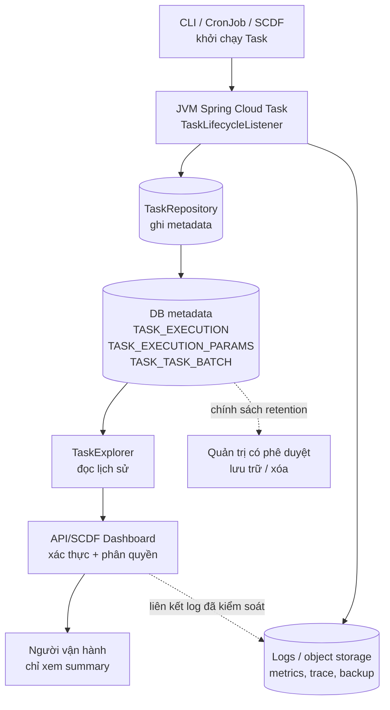
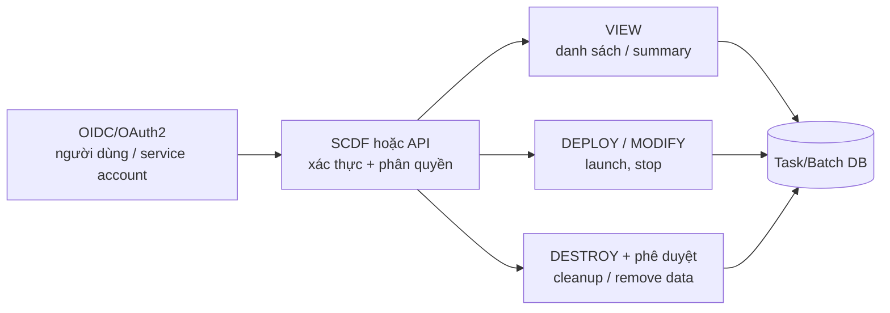
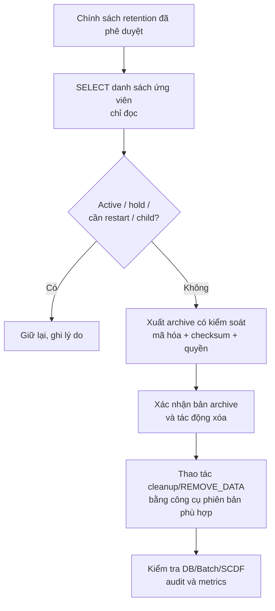

# Quyền truy cập lịch sử thực thi và chính sách lưu dữ liệu

## Mục tiêu bài học

Trong chương **Bảo mật** của mô-đun **Spring Cloud Task**, bài học này tập trung vào dữ liệu được tạo ra **sau mỗi lần ứng dụng Spring Boot hữu hạn chạy xong**: ai được xem, ai được thay đổi, lưu bao lâu và xóa thế nào để vừa bảo vệ thông tin vừa không làm hỏng khả năng vận hành. Đây là phần thiết yếu khi Task chạy theo lịch hoặc theo yêu cầu, theo dõi trạng thái và kết quả trong `TaskRepository`, xử lý lỗi, hoặc phối hợp với Spring Batch và Spring Cloud Data Flow.

Học xong, bạn có thể:

- Nhận diện các trường và bảng metadata Spring Cloud Task có khả năng chứa dữ liệu nhạy cảm.
- Phân biệt **quyền của tiến trình ghi metadata**, **quyền xem lịch sử**, **quyền điều phối** và **quyền xóa**.
- Thiết kế kiểm soát truy cập nhiều lớp: database, API, Spring Cloud Data Flow, logs, backup và môi trường triển khai.
- Trình bày kết quả cho người vận hành qua **DTO/view tối thiểu**, tránh trả thẳng `TaskExecution` hoặc stack trace.
- Đặt một **chính sách retention** có phân loại, căn cứ thời hạn, chủ sở hữu, ngoại lệ legal hold và kiểm soát xóa.
- Phân biệt dọn tài nguyên chạy Task với xóa dữ liệu lịch sử; hiểu tác động đến child Task và Spring Batch Job.
- Viết truy vấn **chỉ đọc** để kiểm tra lịch sử/candidate trước khi lưu trữ hoặc xóa.
- Kiểm thử phân quyền, rò rỉ tham số, thời hạn lưu, khôi phục và khả năng restart.

## 1. Tình huống: một báo cáo vận hành có thể làm lộ bí mật

Giả sử ứng dụng `rental-reconcile` của một nền tảng cho thuê chạy hàng đêm, nhận ngày nghiệp vụ, mã đối tác và cấu hình kết nối. Mỗi lần chạy tạo `TaskExecution` với thời gian, mã kết thúc và thông tin lỗi. Khi tác vụ thất bại, nhóm hỗ trợ yêu cầu được xem kết quả để tìm nguyên nhân.

Một cách làm thiếu an toàn là cấp cho tất cả nhân viên quyền `SELECT *` trên mọi bảng `TASK_` hoặc trả JSON nguyên trạng của `TaskExecution` qua endpoint HTTP. Điều đó có thể để lộ:

- Chuỗi tham số dòng lệnh, ví dụ `--partnerId=...` hoặc, nếu thiết kế sai, `--password=...`.
- `ERROR_MESSAGE` chứa một phần stack trace, URL kết nối, đường dẫn, tên bảng, thông tin exception hoặc các giá trị dữ liệu nghiệp vụ.
- `EXIT_MESSAGE` do code ứng dụng đặt, đôi khi chứa thông điệp do hệ thống bên ngoài trả về.
- Mã định danh bên ngoài, quan hệ parent/child, thông tin khi nào tổ chức chạy tác vụ nào.
- Các tham số, execution context và thông tin lỗi **Spring Batch** nếu Job được liên kết.

Nhóm vận hành vẫn cần biết **Task nào thất bại, lúc nào, có nên retry không**. Nhưng họ không mặc nhiên cần xem arguments nguyên bản, toàn bộ exception hoặc dữ liệu của một khách hàng/đối tác khác.

**Mục tiêu bảo mật:** cung cấp **đúng dữ liệu cho đúng vai trò trong đúng thời hạn**, đồng thời giữ đủ bằng chứng để đối chiếu kết quả và phục hồi sau sự cố.

## 2. Lịch sử được lưu ở đâu?

Spring Cloud Task dùng `TaskRepository` để ghi một lần chạy, và `TaskExplorer` để truy vấn các bản ghi. Đây là **API lưu trữ và tra cứu metadata**, không phải một hệ thống phân quyền người dùng hoàn chỉnh.



### 2.1. Những bảng quan trọng

| Bảng | Dữ liệu | Mức nhạy cảm cần lưu ý |
| --- | --- | --- |
| `TASK_EXECUTION` | ID, tên Task, start/end time, exit code/message, error message, parent/external ID | `ERROR_MESSAGE`, `EXIT_MESSAGE` và mối liên hệ vận hành có thể nhạy cảm |
| `TASK_EXECUTION_PARAMS` | `TASK_EXECUTION_ID` và `TASK_PARAM`: arguments của lần chạy | **Cao** nếu ứng dụng truyền PII, mã đối tác hoặc secret trong CLI |
| `TASK_TASK_BATCH` | Liên kết `TASK_EXECUTION_ID` ↔ `JOB_EXECUTION_ID` | Bộc lộ quan hệ với metadata Batch; quan trọng khi xóa |
| `TASK_LOCK` | Lock cho chức năng single-instance | Không phải lịch sử báo cáo; xóa tùy tiện có thể phá cơ chế điều phối |
| `TASK_SEQ` và đối tượng sequence tương đương | Sinh ID metadata ở một số database/version | **Không phải bản ghi lịch sử**; không xóa để áp retention |

Trong schema Task mặc định, `TASK_EXECUTION` có các cột như `START_TIME`, `END_TIME`, `EXIT_CODE`, `EXIT_MESSAGE`, `ERROR_MESSAGE`, `EXTERNAL_EXECUTION_ID` và `PARENT_TASK_EXECUTION_ID`. Tài liệu schema ghi các trường text `EXIT_MESSAGE`, `ERROR_MESSAGE` và `TASK_PARAM` có giới hạn độ dài trong DDL chuẩn; **giới hạn độ dài không đồng nghĩa đã được làm sạch hoặc mã hóa**.

**Không được giả định một cột `ERROR_MESSAGE` trống có nghĩa chương trình chắc chắn chạy tốt.** Có lỗi xảy ra trước khi TaskRepository khởi tạo, hoặc JVM bị kill trước khi hoàn tất callback. Luôn xem cả `EXIT_CODE`, `END_TIME`, log và trạng thái scheduler/container.

### 2.2. Spring Batch làm tăng phạm vi dữ liệu cần bảo vệ

Khi Task chạy Spring Batch Job, lịch sử còn có:

| Nhóm bảng | Nội dung thường gặp |
| --- | --- |
| `BATCH_JOB_INSTANCE` | Tên Job, định danh JobInstance |
| `BATCH_JOB_EXECUTION` | Mỗi lần thử Job, `STATUS`, `EXIT_CODE`, `EXIT_MESSAGE` |
| `BATCH_JOB_EXECUTION_PARAMS` | Các `JobParameters`, có thể chứa thông tin nghiệp vụ |
| `BATCH_STEP_EXECUTION` | Số lượng read/write/skip, trạng thái Step |
| `BATCH_JOB_EXECUTION_CONTEXT`, `BATCH_STEP_EXECUTION_CONTEXT` | State/checkpoint để restart; nội dung tùy reader/writer |
| `TASK_TASK_BATCH` | Bảng nối giữa một lượt Task và các JobExecution |

**Checkpoint và JobParameters không phải nơi lưu bí mật.** Một reader hoặc step tự đưa token vào `ExecutionContext` sẽ làm token tồn tại trong repository, có thể xuất hiện trong màn hình tra cứu chi tiết và backup.

### 2.3. Những nơi khác cũng giữ “lịch sử”

Ngoài database, metadata có thể được sao chép đến:

- **Spring Cloud Data Flow UI/REST API:** danh sách TaskExecution, arguments, exit message, logs và liên kết JobExecution.
- **Kubernetes/Docker:** Pod/Job spec, `args`, container termination status, events và logs.
- **CI/CD và scheduler:** câu lệnh launch, tham số, kết quả kiểm thử hoặc file log.
- **Quan sát:** log aggregation, tracing, APM, alert payload, SIEM.
- **Backup/snapshot/export:** bản sao database, file CSV, báo cáo gửi email.

Xóa một bản ghi khỏi database chính **không tự xóa** mọi bản sao nói trên. Chính sách retention phải chỉ ra nơi nào còn bản sao, có thể xóa theo thời hạn nào và ai chịu trách nhiệm.

## 3. Phân loại dữ liệu trước khi cấp quyền

### 3.1. Ma trận phân loại minh họa

| Nhóm | Ví dụ | Ai thường cần? | Cách hiển thị |
| --- | --- | --- | --- |
| **Thông tin vận hành tối thiểu** | `taskExecutionId`, `taskName`, start/end time, `exitCode` | Nhân sự vận hành trực ca | Summary đã lọc theo phạm vi |
| **Thông tin chẩn đoán** | Mã lỗi, nhóm nguyên nhân, correlation ID | On-call kỹ thuật được cấp quyền | Error code đã chuẩn hóa, không chứa secret |
| **Thông tin hạn chế** | Raw `TASK_PARAM`, stack trace, Batch parameters/context | Nhóm điều tra có phê duyệt cụ thể | Truy cập có ghi audit, giới hạn thời gian |
| **Dữ liệu nhạy cảm cao** | Token, mật khẩu, thông tin khách hàng không cần thiết cho metadata | **Không nên lưu trong metadata** | Không ghi vào arguments/exception |
| **Dữ liệu kiểm toán** | Ai xem, ai xuất, ai xóa, tại sao xóa | Bộ phận được giao kiểm toán | Log bất biến/chống sửa phù hợp |

**Không quyết định mức độ nhạy cảm chỉ dựa vào tên trường.** `EXIT_MESSAGE` là text do ứng dụng đặt: một triển khai có thể ghi “3 files imported”, triển khai khác lại ghi nguyên URL có token. `taskName` tưởng vô hại nhưng có thể tiết lộ quy trình nghiệp vụ khi kết hợp các thời điểm chạy.

### 3.2. Hợp đồng dữ liệu của một Task an toàn

Ví dụ tham số được phép:

```bash
java -jar rental-reconcile.jar \
  --businessDate=2026-11-23 \
  --partnerKey=partner-42 \
  --requestId=req-7f92
```

`partnerKey` chỉ là định danh **không chứa bí mật** và vẫn có thể được phân loại hạn chế theo tổ chức. `requestId` dùng để liên kết log, không phải token xác thực.

Không làm như sau:

```bash
# KHÔNG NÊN: credential bị lộ trong process args, scheduler và TaskRepository.
java -jar rental-reconcile.jar \
  --dbPassword=actual-secret \
  --apiToken=actual-token
```

Mẫu trên chứa **giá trị giả minh họa**, không phải secret thật. Đừng tái sử dụng định dạng này để truyền credential trong môi trường thực tế.

Nên cấu hình credential qua cơ chế secret của nền tảng: Kubernetes Secret/CSI driver, Vault, secret manager của cloud hoặc giải pháp tương đương. Khi dùng environment variables, vẫn cần kiểm soát quyền xem Pod spec/debug, process environment, crash dump và logs; biến môi trường **không tự bảo đảm bí mật tuyệt đối**.

## 4. Quyền nào được xem lịch sử, quyền nào được xóa?

**Nguyên tắc least privilege:** chỉ cấp quyền cần thiết cho một hành động cụ thể. Quyền xem TaskExecution **không đồng nghĩa** được khởi chạy Task, dừng Task, xuất log nguyên bản hoặc xóa metadata.

### 4.1. Ma trận vai trò minh họa

| Vai trò | Xem summary | Xem lỗi đã làm sạch | Xem raw args/logs | Launch/stop | Xóa metadata |
| --- | --- | --- | --- | --- | --- |
| Người dùng nghiệp vụ | Chỉ các lượt được phân công | Không hoặc chỉ mã lỗi | Không | Theo quy trình được cấp | Không |
| `task-observer` / vận hành | Theo phạm vi dự án | Có, nếu được phép | Không mặc định | Không mặc định | Không |
| `task-operator` | Theo phạm vi dự án | Có | Chỉ khi nhiệm vụ cần | Có thể launch/stop | Không mặc định |
| `incident-responder` | Theo ticket/sự cố | Có | Chỉ theo phê duyệt có thời hạn | Có thể, tùy quy trình | Không mặc định |
| `retention-admin` | Phạm vi cần quản trị | Có | Chỉ mức cần cho phê duyệt | Không bắt buộc | **Có điều kiện, audit đầy đủ** |
| `db-migration-admin` | Theo nhiệm vụ hạ tầng | Có thể truy cập cấp thấp | Đặc quyền DB, kiểm soát riêng | Không mặc định | Thao tác schema theo change process |

Đây là **vai trò ví dụ do hệ thống tự định nghĩa**, không phải role mặc định mà Spring Cloud Task cung cấp. Một người có thể mang nhiều vai trò nhưng vẫn cần giới hạn phạm vi dữ liệu và lưu dấu truy cập.

### 4.2. Ngăn quyền nguy hiểm đi theo quyền đọc

Một tài khoản chỉ xem lịch sử không nên có:

- `DELETE`/`UPDATE` trên `TASK_EXECUTION`, `TASK_EXECUTION_PARAMS` hoặc `BATCH_`.
- Quyền gọi endpoint xóa TaskExecution hoặc thao tác cleanup của SCDF.
- Quyền lấy credential từ Kubernetes Secret hay secret store.
- Quyền xem tất cả namespace/tenant, nếu họ chỉ phụ trách một nhóm.
- Quyền xuất toàn bộ bản ghi raw arguments ra tệp không kiểm soát.

**Đọc summary qua view/API** tốt hơn cấp quyền đọc trực tiếp tất cả bảng metadata.

## 5. Lớp bảo vệ thứ nhất: database

### 5.1. Tách tài khoản ứng dụng và tài khoản quan sát

Một thiết kế phổ biến có các tài khoản khác nhau:

| Principal DB | Quyền cần xem xét | Không nên có |
| --- | --- | --- |
| `task_runtime` | `SELECT`, `INSERT`, `UPDATE` cần cho TaskRepository, quyền sequence/schema cần thiết | Không có `DROP TABLE` hay quyền quản trị toàn DB |
| `batch_runtime` | Quyền tối thiểu với các bảng `BATCH_` và sequence tương ứng | Không toàn quyền sang dữ liệu đối tác |
| `task_history_viewer` | `SELECT` trên view summary đã kiểm soát | Không đọc nguyên `TASK_EXECUTION_PARAMS` hoặc `ERROR_MESSAGE` |
| `retention_service` | Quyền thực hiện quy trình archive/cleanup được phê duyệt | Không DDL đặc quyền không cần thiết |
| `schema_migrator` | DDL theo migration kiểm soát | Không dùng làm user runtime lâu dài |

**Lưu ý:** Các quyền chính xác phụ thuộc database, cách Spring Cloud Task sinh ID, cấu hình `TaskConfigurer`, tính năng `single-instance-enabled` và tích hợp Spring Batch. Một số nhánh cần quyền ghi vào bảng lock/sequence. **Kiểm tra truy vấn thực tế của phiên bản sử dụng**, không copy `GRANT` từ một ví dụ sang production mà không test.

### 5.2. Ví dụ PostgreSQL: chỉ cho xem summary

Giả sử DBA đã tạo các vai trò `task_history_viewer` và schema `task_meta` chứa bảng Task; schema `ops` dành cho view báo cáo. Ví dụ **minh họa, do DBA triển khai sau review**:

```sql
-- Chạy với tài khoản quản trị phù hợp; đây là mã cấu hình mẫu.
CREATE SCHEMA IF NOT EXISTS ops;

CREATE OR REPLACE VIEW ops.task_execution_summary AS
SELECT
    task_execution_id,
    task_name,
    start_time,
    end_time,
    exit_code,
    CASE
        WHEN end_time IS NULL THEN 'NOT_FINISHED'
        ELSE 'FINISHED'
    END AS execution_phase
FROM task_meta.task_execution;

GRANT USAGE ON SCHEMA ops TO task_history_viewer;
GRANT SELECT ON ops.task_execution_summary TO task_history_viewer;
```

View **không chọn `ERROR_MESSAGE`, `EXIT_MESSAGE` hay `TASK_PARAM`**. Vì tài khoản chỉ đọc view, họ không cần quyền `SELECT` trực tiếp trên bảng nguồn. Cần kiểm tra quyền của **view owner**, quyền bảng underlying, quyền truy cập schema và hành vi RLS theo đúng PostgreSQL version.

**Cảnh báo multi-tenant:** view ở trên **chưa lọc theo tenant**. Nó chỉ phù hợp khi toàn bộ người có vai trò xem được các execution trong cùng phạm vi. Nếu mỗi khách hàng/chương trình phải tách biệt, cần **kiểm tra quan hệ TaskExecution → tenant** ở lớp service hoặc cơ chế database được thiết kế và test chặt chẽ. `TASK_EXECUTION` mặc định **không có cột tenant ID**; không thể suy rằng mọi `taskName` là tenant ID an toàn.

### 5.3. Không dùng tài khoản DBA cho ứng dụng Task

Ứng dụng chỉ cần ghi metadata và chạy nghiệp vụ không nên được cấp `SUPERUSER`, `db_owner` hoặc quyền tạo/xóa schema toàn cục. Trong production:

1. Chạy migration `TASK_`/`BATCH_` bằng tài khoản có quyền riêng.
2. Tắt việc tự khởi tạo schema nếu đã dùng migration có kiểm soát, ví dụ `spring.cloud.task.initialize-enabled=false`; Spring Batch cũng cần cấu hình tương ứng.
3. Dùng account runtime chỉ có quyền đọc/ghi bảng cần thiết, với credential được luân phiên và lưu tại secret store.
4. Dùng kết nối TLS, network restrictions, backup mã hóa và quyền đọc snapshot riêng.

Nếu có **nhiều DataSource**, phải cấu hình đúng kho metadata bằng `TaskConfigurer` và Batch repository tương ứng; phân quyền trên một DataSource trong khi Task ghi vào DB khác không tạo ra bảo vệ thực tế.

## 6. Lớp bảo vệ thứ hai: API và UI tra cứu

Spring Cloud Task bản thân là thư viện hạ tầng `TaskRepository`/`TaskExplorer`. Nó **không tự gắn OAuth2, RBAC hay lọc tenant cho mọi lệnh `TaskExplorer.getTaskExecution(...)`**. Nếu bạn dựng REST API lịch sử, chính ứng dụng API phải xác thực và phân quyền người gọi.

### 6.1. Trả DTO tối thiểu thay cho toàn bộ `TaskExecution`

Ví dụ Spring Boot 3.x và Spring Security 6.x (hệ thống **đọc lịch sử**, không phải chính Task CLI):

```java
package com.example.taskops;

import java.time.LocalDateTime;

public record TaskRunSummary(
        long executionId,
        String taskName,
        LocalDateTime startedAt,
        LocalDateTime endedAt,
        Integer exitCode) {
}
```

```java
package com.example.taskops;

import org.springframework.cloud.task.repository.TaskExecution;
import org.springframework.cloud.task.repository.TaskExplorer;
import org.springframework.http.HttpStatus;
import org.springframework.security.access.prepost.PreAuthorize;
import org.springframework.web.bind.annotation.GetMapping;
import org.springframework.web.bind.annotation.PathVariable;
import org.springframework.web.bind.annotation.RequestMapping;
import org.springframework.web.bind.annotation.RestController;
import org.springframework.web.server.ResponseStatusException;

@RestController
@RequestMapping("/ops/task-executions")
public class TaskHistoryController {

    private final TaskExplorer taskExplorer;

    public TaskHistoryController(TaskExplorer taskExplorer) {
        this.taskExplorer = taskExplorer;
    }

    @PreAuthorize("hasAuthority('SCOPE_task.history.read')")
    @GetMapping("/{id}")
    public TaskRunSummary getSummary(@PathVariable long id) {
        TaskExecution execution = taskExplorer.getTaskExecution(id);
        if (execution == null) {
            throw new ResponseStatusException(HttpStatus.NOT_FOUND);
        }

        // Production multi-tenant: phai kiem tra quyen tren
        // business owner/tenant cua execution TRUOC KHI tra DTO.
        return new TaskRunSummary(
                execution.getExecutionId(),
                execution.getTaskName(),
                execution.getStartTime(),
                execution.getEndTime(),
                execution.getExitCode());
    }
}
```

**Điều kiện để đoạn mã an toàn và hoạt động:**

- Bật `@EnableMethodSecurity` và cấu hình **Spring Security OAuth2 Resource Server** hoặc cơ chế authentication đáng tin cậy khác; chỉ gắn `@PreAuthorize` mà không thiết lập authentication/security filter chain là **chưa đủ**.
- Mã scope `SCOPE_task.history.read` là **quy ước ứng dụng**, không phải scope Spring Cloud Task mặc định.
- Cấu hình bean `TaskExplorer` đọc đúng datasource/schema và account đọc, không tự thêm `@EnableTask` vào dịch vụ API chỉ để truy vấn.
- Mã minh họa chưa có **tenant authorization**, **pagination**, **rate limiting**, **audit truy cập** hay quy tắc legal hold; phải bổ sung trước khi triển khai dùng chung nhiều tenant.
- Nếu execution không thuộc phạm vi người gọi, thường nên trả `404` hoặc `403` theo thiết kế chống lộ sự tồn tại; nhất quán với chính sách API.
- **Không trả nguyên đối tượng `TaskExecution`** hoặc properties map chứa arguments/errors trực tiếp trong JSON response.

### 6.2. Các giới hạn khi hiển thị mã lỗi

Người vận hành có thể cần một thông điệp dễ hiểu. Thay vì `ERROR_MESSAGE` chứa stack trace, ứng dụng nên tạo **error category/code** an toàn như:

```json
{
  "executionId": 812,
  "taskName": "rental-reconcile",
  "status": "FAILED",
  "errorCode": "PARTNER_TIMEOUT",
  "requestId": "req-7f92"
}
```

Đây là **DTO đề xuất**, không phải schema response mặc định của Spring Cloud Task. `errorCode` nên do logic nghiệp vụ kiểm soát, không copy nguyên `exception.getMessage()` hoặc request URL. Log chi tiết dùng correlation ID và quyền truy cập riêng.

## 7. Spring Cloud Data Flow: xem lịch sử khác với xóa lịch sử

Spring Cloud Data Flow (SCDF) cung cấp UI/REST để xem TaskExecution, JobExecution và thực hiện các thao tác điều phối. **Quyền truy cập SCDF phải được kiểm tra riêng** với quyền DB của Task.

Tài liệu SCDF 2.x mô tả các role REST tiêu biểu:

| Role SCDF | Ý nghĩa chung |
| --- | --- |
| `ROLE_VIEW` | Xem trạng thái, danh sách và chi tiết qua REST/UI |
| `ROLE_CREATE` | Tạo định nghĩa ứng dụng/task |
| `ROLE_DEPLOY` | Deploy/launch nhiệm vụ |
| `ROLE_MODIFY` | Thay đổi trạng thái một số tài nguyên |
| `ROLE_DESTROY` | Thao tác xóa/hủy tài nguyên |
| `ROLE_SCHEDULE` | Tạo/quản lý lịch |
| `ROLE_MANAGE` | Management endpoints |

**Các role và endpoint mapping phụ thuộc SCDF version và cấu hình security.** Không đồng nhất `ROLE_VIEW` với một RBAC đã lọc tenant hoặc ẩn arguments: trong SCDF UI, màn hình chi tiết TaskExecution có thể hiển thị **Task Arguments, Exit Message, logs và Batch Job links**. Người có quyền xem vẫn có thể nhìn thấy metadata nhạy cảm nếu bạn đã lưu nó ở đó.

### 7.1. Phân tách hành động theo độ rủi ro



Không nên cấp `ROLE_DESTROY` cho mọi người có `ROLE_VIEW` chỉ để họ “tự dọn lịch sử”. Quy trình xóa cần phê duyệt riêng, kiểm tra thời hạn và ghi lại hành động.

**Tách REST/API khỏi mạng công khai:** TLS, identity provider, giới hạn IP/network, service account với scope hẹp, audit mọi export và hành động quản trị. Dashboard có xác thực **không thay thế** bảo mật database, logs hoặc các bản sao metadata.

## 8. Thiết kế chính sách lưu dữ liệu (retention)

**Retention** không chỉ là “xóa các dòng cũ hơn 90 ngày”. Một chính sách tốt trả lời:

1. Lưu **loại dữ liệu nào** và mục đích gì?
2. Ai là **data owner** và **data steward**?
3. Dữ liệu được lưu ở những nơi nào: DB, logs, backup, object store, scheduler?
4. Thời hạn “hot”, “archive” và “xóa cuối cùng” là bao lâu?
5. Dựa vào mốc thời gian nào: `END_TIME`, kết thúc nghiệp vụ, đóng sổ, hay hoàn thành nghĩa vụ kiểm toán?
6. Có **legal hold**, khiếu nại đang xử lý, điều tra sự cố hoặc nhu cầu restart Job hay không?
7. Ai có quyền duyệt và chạy xóa? Làm thế nào kiểm tra, ghi log và rollback nếu thao tác sai?

### 8.1. Ví dụ bảng thời hạn — **không phải quy định pháp luật**

| Nhóm | Tầng vận hành | Ví dụ thời hạn nội bộ | Điều kiện trước khi xóa |
| --- | --- | --- | --- |
| Task summary thành công | DB nóng | 90 ngày | Không có điều tra/khóa nghiệp vụ còn mở |
| Task thất bại và exception metadata | DB nóng | 180 ngày | Sự cố đóng, không còn nhu cầu restart |
| Log chi tiết có kiểm soát | Log aggregation | 30 ngày | Đã tạo bản tổng kết sự cố khi cần |
| Job/Step ExecutionContext | Batch JobRepository | Giữ đến khi JobInstance không còn cần restart, cộng thời hạn được duyệt | Có quyết định không restart hoặc đã archive đủ dữ liệu |
| Audit hành động xem/xóa | Kho audit riêng | Theo chính sách audit và rủi ro tổ chức | Không đang legal hold |
| Backup/snapshot | Backup storage | Theo vòng đời backup được phê duyệt | Có quy trình expiry và xử lý yêu cầu xóa tương ứng |

Các con số `30/90/180 ngày` chỉ là **ví dụ để dạy cách thiết kế**, không phải thời hạn bắt buộc của Spring Cloud Task hay bất kỳ luật cụ thể nào. Tổ chức phải xác định thời hạn theo dữ liệu thực tế, yêu cầu hợp đồng, kiểm toán, an ninh và pháp lý tại nơi hoạt động.

### 8.2. “Tắt quyền truy cập” khác “xóa dữ liệu”

Ba hành động riêng biệt:

| Hành động | Mục đích | Dữ liệu còn tồn tại không? |
| --- | --- | --- |
| **Giảm quyền xem** | Ngăn người không cần thiết nhìn chi tiết | Còn trong DB |
| **Archive** | Chuyển khỏi tầng DB nóng, lưu có kiểm soát để tra cứu khi được duyệt | Còn trong kho lưu trữ |
| **Delete/purge** | Loại khỏi các nơi lưu theo chính sách được phê duyệt | Cần xét DB chính, replica, export, backup, logs |

Đừng gọi archive là “xóa vĩnh viễn”. Nếu phải đáp ứng một yêu cầu xóa có hiệu lực, xem xét bản sao và vòng đời backup với nhóm bảo mật/pháp lý thay vì tuyên bố DB chính đã `DELETE` thì mọi dữ liệu biến mất.

### 8.3. Phân loại theo kết quả chạy

- **Task `EXIT_CODE=0`, `END_TIME` đã có:** có thể là ứng viên retention sau khi đối chiếu kết quả nghiệp vụ.
- **Task thất bại:** có thể cần giữ lâu hơn để điều tra hoặc retry, nhưng không mặc định giữ vô hạn.
- **Task `END_TIME IS NULL`:** không tự coi là đã kết thúc; có thể đang chạy, bị kill hoặc lỗi trước callback cuối.
- **Child Task của composed task:** cần xem cả parent và graph; xóa child riêng có thể phá truy vết.
- **Spring Batch Job `FAILED` hoặc `STOPPED`:** cần kiểm tra khả năng restart từ JobRepository trước khi dọn context hoặc JobExecution.

**Không dùng riêng `EXIT_CODE=0` để chọn xóa**. Có Task được framework coi thành công nhưng dữ liệu nghiệp vụ cần reconciliation/audit bổ sung, hoặc Task chưa hoàn tất việc công bố kết quả ngoài database.

## 9. Chuẩn bị danh sách ứng viên lưu trữ/xóa — chỉ đọc

Ví dụ PostgreSQL, **không thay đổi dữ liệu**, để xem các Task có `END_TIME` và đã kết thúc hơn 180 ngày:

```sql
SELECT
    TASK_EXECUTION_ID,
    TASK_NAME,
    START_TIME,
    END_TIME,
    EXIT_CODE
FROM task_meta.task_execution
WHERE END_TIME IS NOT NULL
  AND END_TIME < CURRENT_TIMESTAMP - INTERVAL '180 days'
ORDER BY END_TIME, TASK_EXECUTION_ID
LIMIT 100;
```

**Đây chỉ là candidate list cho review**, không phải điều kiện xóa an toàn. Nó chưa kiểm tra:

- Legal hold, ticket đang mở, kế hoạch audit hoặc điều tra bảo mật.
- Child/parent TaskExecution và trạng thái các child.
- Batch JobInstance còn phải restart hay chưa.
- Khả năng export/restore và thông tin dùng làm correlation ID trong logs.
- Dữ liệu còn cần cho đối soát kế toán hoặc hợp đồng.

Không chuyển truy vấn này thành `DELETE FROM ... WHERE ...` chỉ bằng cách thay từ `SELECT`.

### 9.1. Kiểm tra quan hệ parent–child

Với schema mặc định có `PARENT_TASK_EXECUTION_ID`:

```sql
SELECT
    parent.TASK_EXECUTION_ID AS PARENT_ID,
    child.TASK_EXECUTION_ID AS CHILD_ID,
    child.TASK_NAME,
    child.END_TIME,
    child.EXIT_CODE
FROM task_meta.task_execution parent
JOIN task_meta.task_execution child
  ON child.PARENT_TASK_EXECUTION_ID = parent.TASK_EXECUTION_ID
WHERE parent.TASK_EXECUTION_ID = 812
ORDER BY child.TASK_EXECUTION_ID;
```

Thay `812` bằng ID parent thực tế. Không xóa parent rồi để các child/links mồ côi. Ngược lại, SCDF có thể yêu cầu thao tác **ở parent** và tự xóa dữ liệu child theo logic hệ thống.

### 9.2. Kiểm tra Batch jobs đang được liên kết

```sql
SELECT
    link.TASK_EXECUTION_ID,
    link.JOB_EXECUTION_ID,
    job.STATUS AS JOB_STATUS,
    job.EXIT_CODE AS JOB_EXIT_STATUS
FROM task_meta.task_task_batch AS link
JOIN batch_meta.batch_job_execution AS job
  ON job.JOB_EXEC_ID = link.JOB_EXECUTION_ID
WHERE link.TASK_EXECUTION_ID = 812;
```

Đây là **ví dụ với hai schema PostgreSQL** `task_meta` và `batch_meta`. Thay bằng schema/table prefix thực tế; ứng dụng có thể lưu Task và Batch trong hai database khác nhau, khi đó không thể JOIN trực tiếp mà phải dùng API hoặc xuất báo cáo từ hai kho.

Nếu một `JobExecution` liên quan còn `STARTED`, `FAILED` hoặc `STOPPED` và tổ chức dự kiến restart, **không xóa tùy tiện `BATCH_JOB_EXECUTION_CONTEXT` hoặc `BATCH_STEP_EXECUTION_CONTEXT`**. Xóa checkpoint có thể làm mất khả năng tiếp tục một JobInstance.

### 9.3. Thống kê trước khi thực hiện chính sách

```sql
SELECT
    TASK_NAME,
    COUNT(*) AS TOTAL_EXECUTIONS,
    MIN(END_TIME) AS OLDEST_END_TIME,
    MAX(END_TIME) AS NEWEST_END_TIME
FROM task_meta.task_execution
WHERE END_TIME IS NOT NULL
GROUP BY TASK_NAME
ORDER BY TOTAL_EXECUTIONS DESC;
```

Thống kê này cho thấy các Task tạo nhiều metadata, giúp xây chính sách archive theo tần suất. **Không in raw `TASK_PARAM` hoặc `ERROR_MESSAGE` ra dashboard phổ thông** chỉ để đo số bản ghi.

## 10. Phân biệt cleanup tài nguyên với xóa metadata trong SCDF

Tài liệu Spring Cloud Data Flow 2.x mô tả endpoint quản lý TaskExecution có hai hành động quan trọng:

| Hành động | Ý nghĩa | Rủi ro |
| --- | --- | --- |
| `CLEANUP` | Dọn tài nguyên triển khai của Task trên platform (tùy implementation) | Có thể ảnh hưởng tài nguyên/log Pod phục vụ điều tra |
| `REMOVE_DATA` | Xóa metadata TaskExecution và **có thể cả metadata Batch Job liên kết** khỏi persistence store | **Có thể làm mất lịch sử, checkpoint và khả năng restart** |

SCDF cho phép thực hiện từng hành động hoặc kết hợp theo API/UI của phiên bản. Dọn một Pod đã kết thúc **không tự đồng nghĩa** xóa database TaskRepository. Xóa một task definition cũng **không mặc định** xóa mọi execution history (tùy có bật tùy chọn cleanup hay không).

### 10.1. Đặc biệt với composed task parent–child

Trong các nhánh SCDF được tài liệu mô tả, xóa dữ liệu qua `REMOVE_DATA` phải dùng **TaskExecution ID của parent**; chọn child trực tiếp có thể trả `400 Bad Request`. Xóa parent có thể kéo theo xóa lịch sử child và Job data liên quan.

Vì vậy, trước khi người vận hành xác nhận “xóa một lượt Task cũ”, phải hiển thị:

1. Parent TaskExecution ID.
2. Số child TaskExecutions bị ảnh hưởng.
3. Số Batch JobExecutions và StepExecutions liên quan.
4. Trạng thái restart/điều tra/legal hold.
5. Danh sách export/backup và ảnh hưởng ngoài database.

**Không tự động gọi `REMOVE_DATA` chỉ vì một dòng đã hết 90 ngày**. Thiết kế một bước approval hoặc workflow đối soát tác động trước khi dọn.

### 10.2. Thứ tự xử lý retention an toàn



Đây là **quy trình quản trị đề xuất**, không phải một workflow retention có sẵn được Spring Cloud Task tự chạy. Spring Cloud Task **không có một thuộc tính phổ quát `spring.cloud.task.retention-days`** tự áp dụng cho toàn bộ metadata, logs và backup. Đừng bịa hoặc triển khai một property như vậy.

### 10.3. Không khuyên chạy SQL `DELETE` trực tiếp trong bài học

Không nên hướng dẫn người học `DELETE FROM TASK_EXECUTION WHERE END_TIME < ...` như thao tác mặc định vì có thể bỏ qua quan hệ `TASK_TASK_BATCH`, `TASK_EXECUTION_PARAMS`, child Task, các bảng Spring Batch và chính sách archive.

Nếu môi trường không dùng SCDF và phải xây retention service riêng, cần thiết kế:

- Transaction/lock phù hợp với DB đang dùng; không xóa Task còn chạy.
- Thứ tự xóa theo foreign key, Batch metadata, child/parent đã được kiểm chứng bằng schema thực tế.
- Batch processing nhỏ để tránh lock/redo log quá lớn, có khả năng tiếp tục nếu quá trình bị dừng.
- Export trước khi purge, kiểm tra count/checksum và snapshot có thể restore.
- Audit bằng identity người duyệt, người chạy, tập ID, số bản ghi, policy version và thời gian.
- Dry-run/preview **bắt buộc**, có khả năng rollback giao dịch khi phù hợp.

Phương án này cần QA riêng trên database và phiên bản framework thực tế; một vài câu `DELETE` trong tài liệu không thể thay thế kiểm thử toàn bộ đường đi.

## 11. Mẫu chính sách retention có thể áp dụng trong dự án

Một tài liệu policy ngắn nên có cấu trúc:

| Trường chính sách | Ví dụ cần điền |
| --- | --- |
| `policyId` | `TASK-HISTORY-RETENTION-v1` |
| Owner | Nhóm nền tảng dữ liệu, người phụ trách phê duyệt |
| Phạm vi | `rental-reconcile` và các Task cùng pipeline |
| Loại dữ liệu | Task summary, params, error details, Batch metadata, logs, exports |
| Phân loại | Internal / restricted / sensitive |
| Thời gian lưu nóng | Theo bảng retention được duyệt |
| Thời gian archive | Theo mục đích kiểm toán/khôi phục |
| Mốc tính hạn | `END_TIME` hoặc mốc nghiệp vụ được định nghĩa |
| Ngoại lệ | Incident, legal hold, failed/restartable Job, ongoing dispute |
| Quyền đọc | Nhóm/role nào đọc được summary, lỗi, raw metadata |
| Quyền xóa | Workflow approval, service account riêng, audit |
| Xác minh | Dry-run, count, checksum, báo cáo sau cleanup, restore test |
| Backup | Retention backup, quyền truy cập, lịch hết hạn bản sao |
| Rà soát | Ví dụ mỗi quý hoặc khi thay đổi yêu cầu pháp lý |

Không dùng thời hạn xóa được ghi trong ví dụ thay cho tư vấn pháp lý/chính sách dữ liệu của tổ chức. Nếu dữ liệu liên quan thông tin cá nhân, giao dịch tài chính, tranh chấp hoặc nghĩa vụ lưu chứng từ, tham vấn nhóm tuân thủ trước khi quyết định thời hạn và ngoại lệ.

### 11.1. Phân tách thông tin chẩn đoán trước khi hết hạn

Nếu operations chỉ cần biết “lỗi kết nối đối tác” chứ không cần raw stack trace, một mô hình tốt là:

- Ghi `errorCode` đã chuẩn hóa vào bảng nghiệp vụ/quan sát riêng, gắn `taskExecutionId` hoặc correlation ID.
- Giữ raw stack trace trong log hạn chế quyền và có retention ngắn hơn nếu chính sách cho phép.
- Khi incident đóng, lưu biên bản/kết quả điều tra an toàn, không phải sao chép toàn bộ raw arguments.
- Sau đó archive/purge metadata theo workflow phê duyệt, vẫn giữ đủ bằng chứng tổng hợp được yêu cầu.

Đừng cố “sanitize bằng cách xóa vài chuỗi mật khẩu” rồi coi metadata đã không nhạy cảm. Đầu vào và exception có thể chứa PII hoặc token theo nhiều định dạng. **Giảm thu thập từ nguồn** là tuyến phòng thủ tốt hơn.

## 12. Mã hóa, truyền tải và quản lý secrets

### 12.1. Mã hóa ở các lớp khác nhau

| Tầng | Biện pháp | Điều không được suy ra |
| --- | --- | --- |
| Kết nối DB | TLS, xác minh chứng chỉ, network policy | TLS **không mã hóa** dữ liệu ở đĩa |
| Lưu trữ DB/backup | Encryption at rest, KMS, quản lý khóa | Encryption at rest **không thay thế** phân quyền truy vấn |
| SCDF UI/REST và API tự xây | HTTPS/TLS, OIDC/OAuth2, RBAC | HTTPS **không lọc** trường `TASK_PARAM` |
| Secret store | Vault/Kubernetes Secret/Cloud Secret Manager, rotation | Secret trong environment vẫn có thể bị đọc bởi principal đặc quyền |
| Logs và export | Redaction, hạn chế quyền, encryption, thời hạn | Xóa bản ghi DB **không xóa** logs đã xuất |

**Kubernetes Secret** được mã hóa base64 trong manifest/API representation, không có nghĩa mặc định đã được mã hóa mạnh ở mọi nơi lưu. Cần bật encryption at rest của cluster phù hợp, RBAC, namespace isolation và secret injection an toàn theo nền tảng.

### 12.2. Ví dụ config không chứa password nguyên văn

```yaml
spring:
  application:
    name: rental-reconcile
  datasource:
    url: "${TASK_DB_URL}"
    username: "${TASK_DB_USERNAME}"
    password: "${TASK_DB_PASSWORD}"
  cloud:
    task:
      initialize-enabled: false
```

Các biến môi trường phải được cấp qua secret store/deployment platform. **Không commit file `.env` thật hoặc Helm values chứa credential vào Git**. Nếu dùng secrets đã cấp sai vào một lượt Task, cần luân phiên credential và kiểm tra xem nó từng đi vào arguments, metadata, logs hoặc backup hay chưa.

## 13. Kiểm thử quyền truy cập và chính sách lưu dữ liệu

Chính sách không có hiệu lực nếu không được kiểm thử. Tách thành **authorization tests**, **data exposure tests** và **retention tests**.

### 13.1. Ma trận kiểm thử authorization

| Tình huống | Kết quả mong đợi |
| --- | --- |
| Không đăng nhập gọi API lịch sử | `401 Unauthorized` (với API cấu hình authentication chuẩn) |
| Đăng nhập nhưng thiếu scope `task.history.read` | `403 Forbidden` |
| Có scope, truy vấn Task thuộc phạm vi được phép | `200 OK` và DTO summary an toàn |
| Có scope nhưng truy vấn Task tenant khác | `403` hoặc `404` theo thiết kế, **không lộ dữ liệu** |
| Viewer gọi endpoint cleanup/delete | Bị từ chối |
| `retention-admin` chưa có phê duyệt | Không thể purge |
| DB role viewer thử `SELECT` raw `TASK_EXECUTION_PARAMS` | Không được phép nếu thiết kế chỉ cấp view |
| DBA/migration role bị dùng làm credential runtime | Test/audit phải báo vi phạm cấu hình |

Đối với Spring Security, có thể dùng `MockMvc`, `@WithMockUser` hoặc OAuth2 test support tương ứng để kiểm tra authorization. **Mock user test không chứng minh hệ thống OAuth2 thật hoạt động**; bổ sung integration test với issuer/claims và chính sách scope thật ở staging.

### 13.2. Thử lỗi có thông tin nhạy cảm giả

Trong môi trường cô lập, đưa một **chuỗi sentinel giả** (không phải secret thật) qua một đường lỗi:

```text
SENTINEL_DO_NOT_LEAK_7F92
```

Sau đó kiểm tra sentinel có xuất hiện trong:

1. HTTP summary API.
2. `TASK_EXECUTION_PARAMS` và `TASK_EXECUTION.ERROR_MESSAGE`.
3. `BATCH_JOB_EXECUTION_PARAMS` / execution context (nếu có Batch).
4. SCDF dashboard/export, application logs và alert payload.
5. Báo cáo audit/CSV được tải về.

Nếu sentinel xuất hiện ở nơi người dùng không được xem, **sửa đường thu thập/hiển thị và quyền truy cập**, không chỉ xóa một log trong test. Sentinel cho phép kiểm thử đường rò rỉ mà không sử dụng credential thật.

### 13.3. Thử retention trong staging

Một vòng kiểm thử mẫu:

1. Tạo dữ liệu Task **giả** đã kết thúc, dữ liệu lỗi, một parent có children, một Batch Job `FAILED` còn khả năng restart và một Task có `END_TIME = NULL`.
2. Chạy **candidate selection chỉ đọc** theo policy.
3. Xác minh `END_TIME = NULL`, legal hold, parent/child liên quan và Batch restartable không bị đưa nhầm vào tập xóa.
4. Thực hành archive đến bucket/database test đã hạn chế quyền; kiểm tra count, checksum, truy xuất phục hồi.
5. Chạy quy trình cleanup **chỉ trong staging** sau khi có phê duyệt test.
6. Đối chiếu cả Task tables, Batch tables, SCDF API và các bản sao.
7. Thử restore một mẫu dữ liệu, xác minh quyền xem vẫn đúng sau restore.
8. Lưu báo cáo số liệu và log audit để chứng minh chính sách được áp dụng.

**Không thử purge hoặc đổi quyền DB trực tiếp trên production** như một bước học tập.

## 14. Những sai lầm thường gặp

| Sai lầm | Hậu quả | Cách tránh |
| --- | --- | --- |
| Cho cả nhóm operations `SELECT *` bảng Task | Lộ raw arguments, error stack | View/DTO chỉ trả trường cần thiết |
| Ghi token vào `--apiKey=...` | Lộ qua CLI, TaskRepository, logs | Secret store và injection có kiểm soát |
| Đặt message lỗi nguyên bản vào `exitMessage` | Rò PII/URL/token tới dashboard | Error code đã chuẩn hóa |
| Nghĩ `TaskExplorer` tự kiểm tra tenant | API bị IDOR, người dùng đọc dữ liệu của tenant khác | Resource-level authorization bằng ownership mapping |
| Nhầm `ROLE_VIEW` là quyền xem đã redacted | SCDF UI có thể hiện params/logs | Kiểm tra response thật và kiểm soát nguồn dữ liệu |
| Dùng tài khoản DB migration làm runtime | Ứng dụng có đặc quyền DDL không cần thiết | Tách tài khoản và cấp quyền tối thiểu |
| Đặt retention mặc định “7 năm” cho mọi bảng | Lưu quá lâu hoặc không đúng yêu cầu | Phân loại, phê duyệt thời hạn theo dữ liệu |
| Xóa `TASK_EXECUTION` bằng SQL trực tiếp | Mồ côi params, Batch links, child tasks | SCDF/remove_data phù hợp hoặc dịch vụ retention đã test |
| Dọn Pod rồi nghĩ đã xóa lịch sử | DB, logs, backup vẫn còn | Theo dõi lifecycle từng kho |
| Xóa Batch context khi Job đang `FAILED` | Mất checkpoint/restart | Kiểm tra nhu cầu restart trước purge |
| Dùng `END_TIME IS NULL` làm điều kiện xóa | Có thể xóa Task đang chạy hoặc vừa bị kill | Điều tra tình trạng trước khi lưu trữ |
| Chỉ xóa DB chính khi có yêu cầu xóa dữ liệu | Bản sao ở export/backup/logs vẫn tồn tại | Chính sách xóa xuyên các kho theo nghĩa vụ phù hợp |
| Không ghi audit hành động xóa | Không thể chứng minh ai đã xóa và vì sao | Approval ID, actor, timestamp, policy version, danh sách ID |
| Mặc định backup đồng nghĩa có thể restore | Backup lỗi/thiếu quyền/không cùng phiên bản | Test restore định kỳ trong môi trường an toàn |

## 15. Checklist vận hành và tự đánh giá

### 15.1. Checklist trước khi mở quyền xem lịch sử

- [ ] Đã xác định dữ liệu trong `TASK_EXECUTION`, `TASK_EXECUTION_PARAMS`, `TASK_TASK_BATCH` và Batch metadata.
- [ ] Không có credential được truyền qua CLI/JobParameters hoặc ghi trong `exitMessage`.
- [ ] Đã tách quyền runtime, viewer, operator, incident response, retention và migration.
- [ ] API/SCDF được xác thực; scope/role và phạm vi tenant/project được kiểm thử.
- [ ] Dashboard và export chỉ hiện trường cần thiết cho từng vai trò.
- [ ] DB có TLS, encryption at rest/backup theo yêu cầu và network isolation.
- [ ] Có retention matrix theo loại dữ liệu và mốc tính hạn rõ ràng.
- [ ] Có ngoại lệ legal hold, ongoing incident, Task đang chạy và Batch restart.
- [ ] Quy trình cleanup phân biệt tài nguyên platform với metadata và có dry-run/approval.
- [ ] Đã thử archive, count/checksum, restore và xác nhận ảnh hưởng xóa ở staging.
- [ ] Có audit cho việc xem dữ liệu nhạy cảm, export và purge.
- [ ] Logs/backup/export có vòng đời riêng, không ngầm dựa vào xóa DB nóng.

### 15.2. Câu hỏi tự đánh giá

**1. Người có quyền xem `TaskExecution.exitCode` có nên tự động được xem `TASK_PARAM` không?**

> Không. `TASK_PARAM` là arguments gốc và có thể chứa dữ liệu nhạy cảm. Hãy tách quyền xem summary khỏi quyền chẩn đoán thô.

**2. Vì sao `TaskExplorer` không thay thế authorization?**

> Nó là API truy vấn metadata. Ứng dụng/API phải tự xác thực và kiểm tra resource-level ownership; `TaskExecutionId` không phải bằng chứng người gọi có quyền xem.

**3. `CLEANUP` của SCDF có luôn xóa lịch sử trong database không?**

> Không. `CLEANUP` liên quan tài nguyên triển khai; `REMOVE_DATA` mới là thao tác xóa dữ liệu lịch sử theo API SCDF và có thể ảnh hưởng metadata Batch liên kết.

**4. Một Task đã `EXIT_CODE=0` và kết thúc 200 ngày trước có thể xóa ngay không?**

> Chưa chắc. Cần kiểm tra chính sách đã duyệt, legal hold, kết quả nghiệp vụ, quan hệ parent/child, liên kết Batch, archive và các bản sao.

**5. Xóa `BATCH_STEP_EXECUTION_CONTEXT` của một Job lỗi có rủi ro gì?**

> Có thể mất state/checkpoint cần để restart đúng JobInstance và Step, khiến tác vụ phải xử lý lại hoặc không restart được.

**6. `TASK_EXECUTION.ERROR_MESSAGE` không chứa token nhưng Kubernetes logs chứa token — đã đáp ứng yêu cầu bảo mật chưa?**

> Chưa. Phải đánh giá tất cả các nơi lưu: DB, process args, logs, APM, dashboard, export và backup, không chỉ bảng Task.

**7. Nên dùng một role `task_history_viewer` có quyền trên mọi tenant?**

> Không mặc định. Nếu dữ liệu được phân vùng theo tenant, cần kiểm tra quyền truy cập ở từng tài nguyên và thiết kế SQL/view/RLS hoặc service phù hợp; schema Task mặc định không có tenant ID.

**8. Tại sao thời hạn giữ Task/Batch metadata có thể khác thời hạn log chi tiết?**

> Mục đích khác nhau: metadata hỗ trợ truy vết/restart, log hỗ trợ chẩn đoán chi tiết. Retention theo loại dữ liệu giúp giảm rủi ro mà vẫn giữ điều kiện vận hành được phê duyệt.

**9. Khi có yêu cầu xóa dữ liệu, vì sao phải nghĩ tới backup?**

> Vì backup có thể chứa bản sao dữ liệu đã bị xóa ở DB chính. Cần quy định hết hạn và phương pháp kiểm soát/khôi phục bản sao phù hợp, không hứa rằng một lệnh `DELETE` xóa mọi bản sao ngay lập tức.

## Ghi nhớ

- **Lịch sử Spring Cloud Task là dữ liệu cần phân quyền**, không chỉ các con số trạng thái. `TASK_PARAM`, `ERROR_MESSAGE`, `EXIT_MESSAGE` và metadata Batch có thể nhạy cảm.
- **Quyền xem, điều phối và xóa phải tách biệt.** `TaskRepository`/`TaskExplorer` không tự thay OAuth2, RBAC, database grants hay kiểm tra tenant.
- **Hiển thị ít nhất có thể** qua view/DTO, không trả raw arguments/stack trace cho mọi người vận hành.
- **Retention phải dựa trên phân loại, mục đích, thời hạn và ngoại lệ đã duyệt**, không phải một truy vấn `DELETE` theo tuổi bản ghi.
- **`CLEANUP` tài nguyên khác `REMOVE_DATA` lịch sử**; việc xóa Task có thể kéo theo child và Spring Batch Job, ảnh hưởng restart.
- **DB, logs, backups, exports và SCDF UI** là các kho/đường truy cập khác nhau, phải được bảo vệ và áp chính sách đồng bộ.
- **Kiểm thử phân quyền và khôi phục** quan trọng không kém kiểm thử chức năng; mọi thay đổi retention phải có dry-run, approval và audit.

## Tài liệu tham khảo

1. [Spring Cloud Task — Task Repository Schema (TASK_EXECUTION, PARAMS, TASK_TASK_BATCH, TASK_LOCK)](https://docs.spring.io/spring-cloud-task/reference/3.2/appendix-task-repository-schema.html)
2. [Spring Cloud Task — Features: TaskRepository, TaskExplorer, DataSource, table prefix](https://docs.spring.io/spring-cloud-task/reference/3.3/features.html)
3. [Spring Cloud Data Flow — Reference: Reviewing Task Executions, Task Execution Detail, Cleanup/REMOVE_DATA](https://docs.spring.io/spring-cloud-dataflow/docs/current/reference/htmlsingle/index.html)
4. [Spring Cloud Data Flow — TaskExecutionController Javadoc: cleanup và remove task data](https://docs.spring.io/spring-cloud-dataflow/docs/current/api/org/springframework/cloud/dataflow/server/controller/TaskExecutionController.html)
5. [Spring Cloud Data Flow — Security và phân quyền REST (ROLE_VIEW, ROLE_DESTROY, ...)](https://docs.spring.io/spring-cloud-dataflow/docs/current/reference/htmlsingle/)
6. [Spring Batch 5.2 — Configuring a Job: restartability](https://docs.spring.io/spring-batch/reference/5.2/job/configuring.html)
7. [Spring Security — Method Security: `@EnableMethodSecurity`, `@PreAuthorize`](https://docs.spring.io/spring-security/reference/servlet/authorization/method-security.html)
8. [Spring Security — OAuth2 Resource Server JWT](https://docs.spring.io/spring-security/reference/servlet/oauth2/resource-server/jwt.html)
9. [Kubernetes — Secrets: bảo vệ credential](https://kubernetes.io/docs/concepts/configuration/secret/)
10. [OWASP — Logging Cheat Sheet: tránh dữ liệu nhạy cảm trong logs](https://cheatsheetseries.owasp.org/cheatsheets/Logging_Cheat_Sheet.html)
