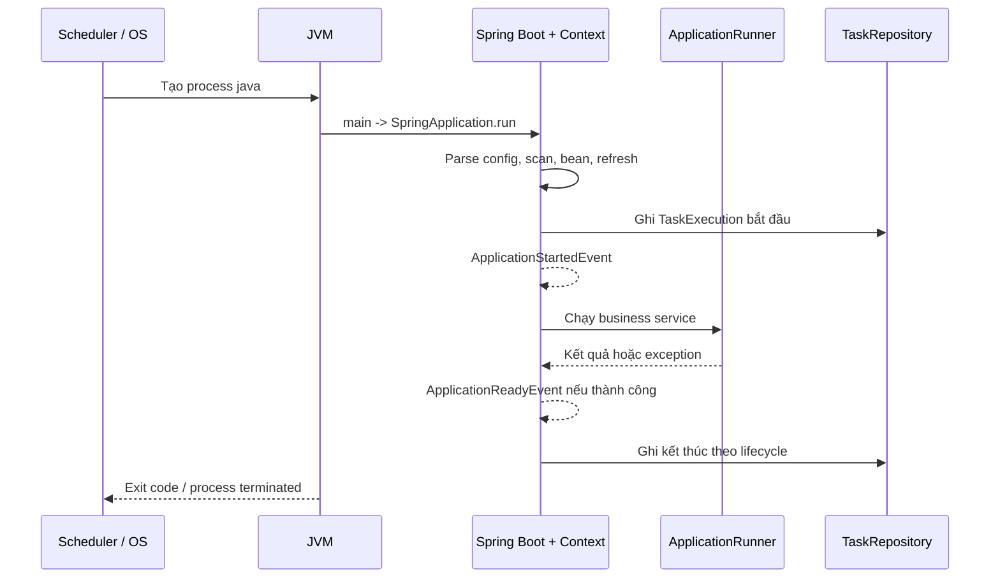
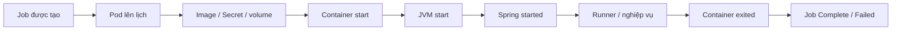

# Đo chi phí khởi động JVM và ApplicationContext

## 1. Vì sao thời gian khởi động quan trọng với Spring Cloud Task?

**Spring Cloud Task** giúp xây dựng ứng dụng Spring Boot có thời gian thực thi hữu hạn: khởi động, nhận tham số, gọi business service, ghi metadata qua `TaskRepository` rồi kết thúc. Ứng dụng có thể được chạy bằng `java -jar`, cron, Kubernetes CronJob, workflow engine hoặc khi phối hợp với Spring Batch. Mỗi lần chạy từ một JVM mới thường phải **khởi JVM và dựng một `ApplicationContext` mới**.

Đối với dịch vụ HTTP chạy hàng tuần, chi phí khởi động được phân bổ trên rất nhiều request. Với task chỉ xử lý 100 ms, thời gian nạp class, tạo bean, cấu hình JDBC và khởi repository có thể lại chiếm phần lớn **tổng thời gian hoàn thành một yêu cầu**. Điều này ảnh hưởng trực tiếp tới SLA, CPU, memory peak, thời gian giữ Pod và chi phí khi có hàng nghìn lần chạy ngắn.

**Ví dụ giả định, không phải benchmark thật:**

| Pha | Thời gian |
| --- | ---: |
| Tạo JVM và bootstrap Spring/TaskRepository | 1.200 ms |
| Xử lý nghiệp vụ | 100 ms |
| Đóng context/JVM và flush log | 150 ms |
| **Tổng wall time từ phía launcher** | **1.450 ms** |

Trong ví dụ này, nghiệp vụ chỉ chiếm khoảng 7% tổng thời gian. Muốn tối ưu có căn cứ phải **tách chi phí JVM, context, runner và shutdown**; nếu chỉ nhìn log `Started ... in ... seconds` có thể bỏ qua thời gian trước `main`, trong runner hoặc sau khi context sẵn sàng.

**Mục tiêu bài:** biết xây dựng phép đo lặp lại về thời gian khởi động JVM và `ApplicationContext` cho một Spring Cloud Task, tìm bean/pha chậm, đối chiếu với `TaskExecution` và thời gian Kubernetes Job, rồi đánh giá các hướng tối ưu/nâng cấp **mà không đánh đổi tính đúng đắn hoặc khả năng retry**.

## 2. Ranh giới đo: mỗi loại thời gian nói lên điều gì?

| Chỉ số | Mốc bắt đầu/kết thúc | Dụng cụ đo |
| --- | --- | --- |
| **Scheduler-to-complete** | Yêu cầu launch Job → Job hoàn tất | Scheduler, Kubernetes Job status/events |
| **Process wall time** | Shell/parent gọi chương trình `java` → process thoát | GNU `time`, PowerShell `Stopwatch` |
| **JVM/bootstrap** | VM được tạo, nạp class, code trước và trong `main` | JFR và Java logs |
| **Spring started** | Spring Boot bắt đầu → `ApplicationStartedEvent`, sau context refresh và **trước runner** | `getTimeTaken()` của event |
| **Business runner** | Ngay trước → sau service/`ApplicationRunner` | `System.nanoTime()`/timer |
| **Spring ready** | Spring Boot bắt đầu → `ApplicationReadyEvent`, **sau runner** | `getTimeTaken()` của event |
| **TaskExecution lifetime** | `TASK_EXECUTION.START_TIME` → `END_TIME` | `TaskExplorer` hoặc SQL |
| **Shutdown** | Cleanup, flush, đóng JVM | Wall time, shutdown log, JFR |

Spring Boot phát `ApplicationStartedEvent` sau khi refresh `ApplicationContext` nhưng trước khi chạy các `ApplicationRunner`/`CommandLineRunner`; `ApplicationReadyEvent` được phát sau các runner. Vì vậy, với Spring Cloud Task, **`application.ready.time` có thể bao gồm cả thời gian thực thi nghiệp vụ**, chứ không phải chỉ chi phí dựng context.

`TaskExecution.START_TIME` cũng **không phải thời điểm JVM ra đời**. Spring Cloud Task ghi metadata bắt đầu khi lifecycle đã đạt tới pha nhất định, trước runner nhưng sau nhiều bước bootstrap. Khoảng `END_TIME - START_TIME` có thể rất ngắn ngay cả khi quá trình tạo JVM/context lâu.



Sơ đồ là **mô hình khái niệm**; thời điểm chính xác của các task listener, commit và đóng context còn phụ thuộc phiên bản. Nếu runner ném exception, `ApplicationReadyEvent` có thể không được phát. Nếu JVM bị `kill -9`, metadata có thể thiếu `END_TIME`. Luôn thu cả log và exit code.

```text
T_wall ≈ T_process_bootstrap + T_spring_bootstrap
       + T_business + T_shutdown
```

Đây là mô hình phân tích, **không phải phép cộng trực tiếp** những mốc lấy từ các đồng hồ khác nhau. `ApplicationStartedEvent.getTimeTaken()` tính thời gian từ mốc nội bộ của `SpringApplication`, không bao gồm mọi thao tác trước `main`. Muốn đo riêng một đoạn, phải dùng **một nguồn đồng hồ nhất quán tại hai đầu đoạn đó**.

## 3. Ứng dụng Spring Cloud Task mẫu để tạo baseline

Ví dụ dùng Java 17+, Spring Boot/Spring Cloud Task phiên bản tương thích theo BOM, H2 in-memory và một runner có thời gian mô phỏng điều chỉnh được. H2 giúp học cách đo nhưng **không đại diện độ trễ PostgreSQL, TLS hoặc mạng trong production**.

### 3.1. Dependencies Maven

```xml
<!-- Project cần Spring Boot parent/BOM và Spring Cloud BOM tương thích. -->
<dependencies>
    <dependency>
        <groupId>org.springframework.cloud</groupId>
        <artifactId>spring-cloud-starter-task</artifactId>
    </dependency>
    <dependency>
        <groupId>com.h2database</groupId>
        <artifactId>h2</artifactId>
        <scope>runtime</scope>
    </dependency>
</dependencies>
```

### 3.2. `application.yml`

```yaml
spring:
  application:
    name: startup-cost-app
  main:
    web-application-type: none
  datasource:
    driver-class-name: org.h2.Driver
    url: jdbc:h2:mem:startup_cost;DB_CLOSE_DELAY=-1
    username: sa
    password: ""
  cloud:
    task:
      name: startup-cost-task
      initialize-enabled: true

app:
  demo:
    work-ms: 100
```

`initialize-enabled: true` phù hợp cho **H2 lab mới**, khi thư viện có script schema tương ứng. Mỗi lần `java -jar` tạo JVM mới, đồng thời tạo một H2 `mem:` mới: thời gian khởi tạo bảng được tính trong startup. Production thường cần **CSDL bền vững, schema đã migration** và `initialize-enabled: false`.

### 3.3. Log thời gian started, ready và nghiệp vụ

Tạo `src/main/java/com/example/startup/StartupCostApplication.java`:

```java
package com.example.startup;

import java.time.Duration;
import org.springframework.beans.factory.annotation.Value;
import org.springframework.boot.ApplicationRunner;
import org.springframework.boot.SpringApplication;
import org.springframework.boot.autoconfigure.SpringBootApplication;
import org.springframework.boot.context.event.ApplicationReadyEvent;
import org.springframework.boot.context.event.ApplicationStartedEvent;
import org.springframework.cloud.task.configuration.EnableTask;
import org.springframework.context.annotation.Bean;
import org.springframework.context.event.EventListener;

@EnableTask
@SpringBootApplication
public class StartupCostApplication {
    public static void main(String[] args) {
        SpringApplication.run(StartupCostApplication.class, args);
    }

    @EventListener
    public void started(ApplicationStartedEvent event) {
        System.out.printf("BOOT_STARTED_MS=%s%n", millis(event.getTimeTaken()));
    }

    @EventListener
    public void ready(ApplicationReadyEvent event) {
        System.out.printf("BOOT_READY_MS=%s%n", millis(event.getTimeTaken()));
    }

    @Bean
    ApplicationRunner runOnce(@Value("${app.demo.work-ms:100}") long workMs) {
        return args -> {
            if (workMs < 0 || workMs > 30_000) {
                throw new IllegalArgumentException(
                        "app.demo.work-ms phải từ 0 đến 30000");
            }
            long t0 = System.nanoTime();
            try {
                Thread.sleep(workMs); // Mô phỏng nghiệp vụ, chỉ dành cho lab.
            } finally {
                System.out.printf("BUSINESS_MS=%.3f%n",
                        (System.nanoTime() - t0) / 1_000_000.0);
            }
        };
    }

    private static String millis(Duration duration) {
        return duration == null ? "unavailable"
                : Long.toString(duration.toMillis());
    }
}
```

`BOOT_STARTED_MS` được đo đến mốc context refresh xong, **trước runner**; nó còn chứa các bước bootstrap Spring chứ không thuần là thời gian một lần gọi `refresh()`. `BOOT_READY_MS` được đo **sau runner**. `BUSINESS_MS` là một đoạn do ta tự gắn mốc `System.nanoTime()` trong JVM. Hiệu giữa hai sự kiện Boot còn có thể chứa các callback/overhead khác, **không nhất thiết bằng chính xác BUSINESS_MS**.

### 3.4. Chạy hai mức tải để kiểm tra cách đo

Giả sử executable JAR mang tên `target/startup-cost-task.jar`:

```bash
java -jar target/startup-cost-task.jar --app.demo.work-ms=0
java -jar target/startup-cost-task.jar --app.demo.work-ms=1000
```

| Mốc | `work-ms=0` | `work-ms=1000` |
| --- | --- | --- |
| `BOOT_STARTED_MS` | Không gồm runner | Vẫn không gồm runner |
| `BUSINESS_MS` | Gần 0 | Xấp xỉ 1.000 ms, có sai số hệ điều hành |
| `BOOT_READY_MS` | Thường gần started hơn | Thường tăng tương ứng thời gian runner |
| Process wall | Startup/cleanup có tỷ trọng cao | Thêm thời gian công việc mô phỏng |

Đây chỉ là **dự đoán xu hướng**; `Thread.sleep(1000)` không bảo đảm hoàn tất đúng 1000,000 ms. Dùng cùng một JDK, cấu hình, chế độ logging và dữ liệu cho cả hai lần để giảm nhiễu.

## 4. Đo wall-clock time từ bên ngoài JVM

Hai mốc `BOOT_STARTED_MS` và `BOOT_READY_MS` chưa bao trùm tất cả thời gian từ lúc hệ điều hành tạo process đến lúc JVM tắt. Vì vậy phải có thêm **wall time bên ngoài** để đánh giá đúng tổng chi phí một task ngắn.

### 4.1. Linux/macOS và Windows

Với Linux có **GNU time**:

```bash
/usr/bin/time -f 'WALL_S=%e USER_CPU_S=%U SYS_CPU_S=%S MAX_RSS_KB=%M EXIT=%x' \
  java -jar target/startup-cost-task.jar --app.demo.work-ms=0
```

Đây là cú pháp riêng GNU `time`; macOS/BSD có các tùy chọn khác. `WALL_S` đo thời gian thực tế đã trôi qua; `USER_CPU_S` và `SYS_CPU_S` đo CPU time. Task đợi DB, DNS hoặc bị CPU throttling có thể có **wall time cao nhưng CPU time thấp**.

Trong **Windows PowerShell**:

```powershell
$jar = "target/startup-cost-task.jar"
$stopwatch = [System.Diagnostics.Stopwatch]::StartNew()
& java -jar $jar --app.demo.work-ms=0
$exitCode = $LASTEXITCODE
$stopwatch.Stop()
"WALL_MS={0:N1} EXIT={1}" -f $stopwatch.Elapsed.TotalMilliseconds, $exitCode
```

`Stopwatch` đo thời gian gọi process từ shell; nó tính cả JVM, Spring, runner, shutdown và overhead lệnh shell. **Luôn kiểm tra exit code**, không gộp các lần khởi động thất bại vào phân bố thời gian thành công mà không nêu rõ.

### 4.2. Đo lặp lại 20 lần và tính p50/p95

Một lần chạy có thể chịu ảnh hưởng antivirus, OS page cache, network, JDBC, logging, áp lực CPU hoặc tần suất GC. Mẫu PowerShell 5.1 dưới đây chạy 20 **JVM mới**, ghi output mỗi lần vào file riêng và báo p50/p95 của các lần thành công:

```powershell
$jar = "target/startup-cost-task.jar"
$logDir = Join-Path (Get-Location) "bench-logs"
New-Item -ItemType Directory -Path $logDir -Force | Out-Null

$samples = @(
    for ($i = 1; $i -le 20; $i++) {
        $logFile = Join-Path $logDir ("run-{0:00}.log" -f $i)
        $watch = [System.Diagnostics.Stopwatch]::StartNew()
        & java -jar $jar --app.demo.work-ms=0 *> $logFile
        $exitCode = $LASTEXITCODE
        $watch.Stop()
        [pscustomobject]@{
            Run = $i
            ExitCode = $exitCode
            WallMs = [math]::Round($watch.Elapsed.TotalMilliseconds, 1)
        }
    }
)

$samples | Export-Csv "bench-results.csv" -NoTypeInformation -Encoding UTF8
$passed = @($samples | Where-Object { $_.ExitCode -eq 0 } | Sort-Object WallMs)
if ($passed.Count -eq 0) { throw "Không có lần chạy thành công" }

$p50 = $passed[[math]::Ceiling($passed.Count * 0.50) - 1].WallMs
$p95 = $passed[[math]::Ceiling($passed.Count * 0.95) - 1].WallMs
$stats = $passed | Measure-Object -Property WallMs -Minimum -Maximum -Average
"SUCCESS={0}/{1} P50={2}ms P95={3}ms AVG={4:N1}ms" -f $passed.Count, $samples.Count, $p50, $p95, $stats.Average
```

Đoạn trên chạy thử qua shell và redirect log nên **chi phí ghi log cũng nằm trong wall time**. Giữ giống nhau cách ghi log, output và điều kiện database khi so baseline/candidate. Công bố thêm số lần lỗi và min/max; một kết quả p95 chỉ từ 20 mẫu có độ bất định đáng kể, vì vậy với quyết định có tác động lớn cần tăng số mẫu và kiểm tra độ ổn định.

**Không nhầm OS warm cache với JVM warm-up:** chạy `java -jar` 20 lần tạo **20 JVM khác nhau**. OS filesystem cache, cache image và DB có thể ấm dần, nhưng JIT state của JVM trước không tự truyền sang JVM mới. Ghi rõ chế độ cold/warm của môi trường, không gọi đây là “warm JVM”.

## 5. Dùng ApplicationStartup để tìm bean/pha chậm

Spring Framework cung cấp `ApplicationStartup` và các `StartupStep` để theo dõi quá trình tạo context. Spring Boot hỗ trợ `BufferingApplicationStartup`; Spring Framework hỗ trợ `FlightRecorderApplicationStartup` để ghi event vào **Java Flight Recorder (JFR)**. Hai lựa chọn này dùng để **phân tích nguyên nhân**, không thay phép đo wall time.

### 5.1. BufferingApplicationStartup

Nếu muốn ghi startup steps vào bộ nhớ, thay **method `main`** ở mục 3 bằng phiên bản sau:

```java
import org.springframework.boot.SpringApplication;
import org.springframework.boot.context.metrics.buffering.BufferingApplicationStartup;

public static void main(String[] args) {
    SpringApplication app = new SpringApplication(StartupCostApplication.class);
    app.setApplicationStartup(new BufferingApplicationStartup(2048));
    app.run(args);
}
```

Đây là đoạn thay thế `main`, **không tạo một class/method `main` thứ hai**. Tham số `2048` là dung lượng buffer cho startup events, không phải thời gian mili giây. Buffer quá nhỏ có thể không giữ đủ step; buffer quá lớn sẽ tốn thêm bộ nhớ.

Khi bổ sung **Spring Boot Actuator**, cấu hình `BufferingApplicationStartup` và có HTTP endpoint quản trị được bật, `/actuator/startup` có thể trả timeline. Nhưng ứng dụng Spring Cloud Task thường có `spring.main.web-application-type: none` và **thoát ngay sau công việc**, nên không thể mặc định truy cập endpoint HTTP sau khi task kết thúc. Nếu cần thu startup timeline của tiến trình ngắn, hãy xuất dữ liệu trong vòng đời process hoặc ưu tiên JFR. Không mở cổng Actuator production chỉ để benchmark nếu chưa có yêu cầu bảo mật rõ ràng.

### 5.2. FlightRecorderApplicationStartup và JFR

Để ghi sự kiện Spring startup và JVM, có thể thay `main` bằng biến thể **chỉ bật profiling khi có system property**:

```java
import org.springframework.boot.SpringApplication;
import org.springframework.core.metrics.jfr.FlightRecorderApplicationStartup;

public static void main(String[] args) {
    SpringApplication app = new SpringApplication(StartupCostApplication.class);
    if (Boolean.getBoolean("profile.startup")) {
        app.setApplicationStartup(new FlightRecorderApplicationStartup());
    }
    app.run(args);
}
```

Với JDK có JFR:

```bash
java -Dprofile.startup=true \
  -XX:StartFlightRecording:filename=startup-cost.jfr,settings=profile,dumponexit=true \
  -jar target/startup-cost-task.jar --app.demo.work-ms=0

jfr summary startup-cost.jfr
```

Mở file bằng **Java Mission Control** để xem class loading, allocation, GC, CPU và các Spring startup steps. Tùy chọn `-XX:StartFlightRecording` phải nằm **trước `-jar`**; `dumponexit=true` đặc biệt hữu ích cho task tồn tại rất ngắn vì không cần chờ một thời lượng recording cố định. Đổi tên file cho mỗi lần chạy song song, tránh ghi đè, phân quyền file trace vì có thể chứa dữ liệu môi trường.

**Không để bật profiling khi báo số liệu tối ưu cuối cùng.** JFR và việc in log có overhead. Hãy dùng trace tìm nguyên nhân, áp dụng một thay đổi, tắt profiler rồi đo lại nhiều mẫu wall time.

### 5.3. Application startup metrics của Spring Boot

Khi dùng Micrometer/Actuator và cấu hình metrics phù hợp, Spring Boot có thể cung cấp:

| Metric | Mốc đo | Cách dùng đúng |
| --- | --- | --- |
| `application.started.time` | Tới `ApplicationStartedEvent`, **trước runner** | Xem thời gian Spring Boot khởi động/context |
| `application.ready.time` | Tới `ApplicationReadyEvent`, **sau runner** | So thời gian đến trạng thái ready, có thể gồm nghiệp vụ |

Metric không thay process wall time. Với task dừng sau vài giây, hệ thống metrics kiểu **pull/scrape** có thể không kịp thu được dữ liệu trước khi Pod biến mất. Có thể dùng structured log, cơ chế xuất số liệu qua collector hoặc đẩy metrics phù hợp, nhưng phải kiểm tra flush khi JVM đóng và không để telemetry làm treo task. Không bật web server chỉ để expose metrics nếu điều đó làm thay đổi đáng kể chi phí đang đo.

## 6. Khi triển khai Kubernetes Job: thêm chi phí tạo Pod

Trên Kubernetes, tổng thời gian từ lúc scheduler kích hoạt tới khi Job hoàn tất có thể lớn hơn **rất nhiều** wall time của `java` vì còn scheduling Pod, kéo image, mount volume, tạo container, cấp Secret và cập nhật controller.



| Khoảng trễ | Nguồn quan sát | Khi nào cần tối ưu |
| --- | --- | --- |
| Job → Pod scheduled | Kubernetes events, `PodScheduled` | Node autoscaling, quota, scheduler backlog |
| Pod → container running | Pod `containerStatuses` và events | Image pull, registry, volume, Secrets |
| Container → Spring started | JVM/JFR và `BOOT_STARTED_MS` | Class loading, scan, bean/DB init |
| Spring started → ready | `BOOT_READY_MS` và business timer | Service, JDBC, Batch Step, lazy bean |
| Ready → process terminated | Container timestamps và shutdown logs | Thread nền, connection close, flush |
| Pod termination → Job condition | Job controller status/events | Retry, condition cập nhật bất đồng bộ |

Ví dụ kiểm tra Kubernetes trong **namespace thử nghiệm**:

```bash
kubectl -n batch-lab get job startup-cost-job -o yaml
kubectl -n batch-lab get pods -l batch.kubernetes.io/job-name=startup-cost-job -o wide
kubectl -n batch-lab describe pod <pod-name>
kubectl -n batch-lab logs pod/<pod-name> -c task --timestamps
kubectl -n batch-lab get pod <pod-name> -o yaml
```

Trong Pod YAML, xem `status.startTime`, `containerStatuses[*].state.running.startedAt`, `state.terminated.finishedAt`, `exitCode` và `reason`. Khi timestamps đến từ các node/host khác nhau, phải tính đến đồng bộ đồng hồ; không lấy chênh vài mili giây giữa timestamp của hai máy làm kết luận profiler chính xác.

Ví dụ nếu image pull chiếm 18 giây còn `BOOT_STARTED_MS` là 700 ms, tối ưu một bean 50 ms không giải quyết phần chờ lớn nhất. Ngược lại, khi Pod xuất hiện ngay và Spring started chậm, cần điều tra JVM/context. Nếu Kubernetes Job retry, hãy phân tích **từng Pod/JVM attempt**; mỗi attempt có thể có một `TaskExecution` khác.

## 7. Đối chiếu với TaskRepository và dữ liệu nghiệp vụ

`TaskRepository` giúp kiểm tra vòng đời của một lần chạy, **không phải profiler JVM**. Với **PostgreSQL** và schema Task mặc định:

```sql
SELECT TASK_EXECUTION_ID,
       TASK_NAME,
       START_TIME,
       END_TIME,
       EXIT_CODE,
       ROUND(
           EXTRACT(EPOCH FROM (END_TIME - START_TIME)) * 1000, 1
       ) AS task_lifetime_ms
FROM TASK_EXECUTION
WHERE TASK_NAME = 'startup-cost-task'
  AND END_TIME IS NOT NULL
ORDER BY TASK_EXECUTION_ID DESC;
```

Đây là SQL theo dialect **PostgreSQL**, không mặc định chạy nguyên trạng trên H2/MySQL/Oracle. `TaskExecution` có thể không có `END_TIME` nếu tiến trình đang chạy hoặc bị kill đột ngột; không lấy `CURRENT_TIMESTAMP` thay cho thời gian kết thúc rồi coi như thành công.

| Nguồn | Chứng minh điều gì? | Không chứng minh điều gì? |
| --- | --- | --- |
| `TASK_EXECUTION` | Thời gian và trạng thái theo lifecycle Spring Cloud Task | JVM đã bắt đầu từ lúc nào trước khi ghi metadata |
| `ApplicationStartedEvent` | Spring Boot đã refresh context | Business runner đã hoàn tất |
| `ApplicationReadyEvent` | Boot đã qua runner trong đường thành công | Báo cáo/đơn hàng thực sự đúng và đủ |
| Stopwatch bên ngoài | Toàn bộ wall time của một lời gọi process | Bean nào là nút thắt |
| JFR trace | Các pha JVM/Spring và overhead khi profiling | SLA không có instrumentation |
| Kubernetes Job/Pod | Độ trễ deployer/container và trạng thái hạ tầng | Thời gian chỉ riêng `ApplicationContext` |

Nếu nhiều lần chạy benchmark trong một database, hãy cấp một `requestKey`/run ID **không nhạy cảm** để liên kết log, `TaskExecution` và kết quả nghiệp vụ. Không lấy `TASK_EXECUTION_ID` làm idempotency key vì retry tạo ID mới; không cho password/token vào CLI hoặc metadata chỉ để thuận tiện truy vết.

## 8. Quy trình benchmark có thể lặp lại

Một phép đo có ích phải kiểm soát được điều kiện chạy, không chỉ so sánh hai dòng log `Started ... in ... seconds` của hai môi trường khác nhau.

### 8.1. Chuẩn bị baseline và biến thử nghiệm

1. **Cố định artifact:** ghi version/commit của source, hash JAR/image và cấu hình build. Không benchmark một JAR development với một image release đã bật tối ưu khác.
2. **Cố định runtime:** ghi JDK vendor/version, flags JVM, GC, heap, OS, số CPU/CPU quota, memory limit, profile, timezone và log level.
3. **Cố định database:** sử dụng cùng loại/version DB, driver, schema/migration, tài khoản, dữ liệu mẫu, network và trạng thái khởi tạo. Không so một ứng dụng dùng H2 `mem:` với ứng dụng dùng PostgreSQL qua mạng rồi cho rằng chênh lệch hoàn toàn do Spring.
4. **Cố định workload:** cùng số lượng item, file/manifest, business parameters và hành vi đọc/ghi. Nếu lần sau bỏ qua dữ liệu do idempotency, phải phân biệt số đo “không còn việc để làm” với số đo xử lý thật.
5. **Tách deployment khỏi process:** đo local `java -jar` cho JVM/context; đo Kubernetes Job end-to-end cho startup của hạ tầng. Không gộp hai câu hỏi.
6. **Đo đủ mẫu:** thu exit code, p50, p95, min/max, số lần lỗi, timeouts và phân bố startup/runner. Có thể dùng các đợt thử riêng cho cold OS/image cache và warm OS/image cache.
7. **Thay một yếu tố mỗi lần:** ví dụ lazy initialization, loại dependency, đổi JDK hoặc cấu hình image. Không đổi cả JDK, Spring Boot, pool DB và số CPU cùng lúc rồi quy kết nguyên nhân.
8. **Kiểm tra đúng đắn sau thử:** TaskExecution, trạng thái lỗi, kết quả nghiệp vụ, idempotency, khả năng restart Spring Batch và hành vi scheduler vẫn đúng.

### 8.2. Bảng kết quả mẫu và cách đọc

**Các số trong bảng sau hoàn toàn giả định; đây không phải kết quả benchmark đã chạy.**

| Thử nghiệm | Wall p50 | Wall p95 | Boot started p50 | Business p50 | Lỗi |
| --- | ---: | ---: | ---: | ---: | ---: |
| Baseline, work=0 | 1.480 ms | 1.750 ms | 1.030 ms | 1 ms | 0/20 |
| Baseline, work=1000 | 2.500 ms | 2.820 ms | 1.040 ms | 1.001 ms | 0/20 |
| Loại dependency không cần, work=0 | 1.180 ms | 1.360 ms | 790 ms | 1 ms | 0/20 |
| Lazy init, work=0 | 1.280 ms | 1.540 ms | 720 ms | 140 ms | 0/20 |

Trong bảng giả định, lazy initialization làm `Boot started` nhanh hơn nhưng chuyển một phần công việc tạo bean sang lúc runner chạm tới bean nên `Business` tăng. Nếu chỉ nói “Spring started nhanh hơn 30%” mà **wall p95 cải thiện rất ít**, có thể bạn chỉ **dời chi phí**, không giảm nhiều tổng thời gian.

Đừng so sánh `p50` của baseline với `p95` của candidate rồi kết luận. Giữ cùng tiêu chí thống kê và so sánh sai số đo. Các task có deadline hoặc lịch chạy dày thường cần ưu tiên **p95/p99**, không chỉ trung bình.

### 8.3. Tiêu chí chấp nhận cải tiến

Trước thử nghiệm, đội ngũ có thể định nghĩa các tiêu chí **minh họa**:

- `p95` process wall khi `work-ms=0` giảm ít nhất 15% trên cùng môi trường đo, với số mẫu đủ và không tăng lỗi.
- `p95` khi chạy **nghiệp vụ thật** không xấu đi; không chỉ đẹp hơn ở `ApplicationStartedEvent`.
- Memory peak, connection time, deadlock, số lần timeout hoặc `TaskExecution` chưa hoàn tất không tăng.
- TaskRepository vẫn lưu đúng lịch sử; Spring Batch vẫn restart đúng Job instance/Step nếu được tích hợp.

Ngưỡng 15% là **ví dụ cách đặt tiêu chí**, không phải chuẩn bắt buộc của Spring Cloud Task. Trong thực tế, quyết định dựa trên SLA, chi phí và mức biến động thống kê của hệ thống.

## 9. Tối ưu sau khi đã xác định nút thắt

### 9.1. Tránh tạo bean và hạ tầng không cần thiết

| Hướng cải tiến | Khi nào phù hợp | Điều phải kiểm tra |
| --- | --- | --- |
| `spring.main.web-application-type: none` | Task không phục vụ HTTP | Không có web server/endpoint nào cần giữ |
| Giảm dependency starter không dùng | JFR cho thấy nhiều class/auto-config dư | Không loại TaskRepository, JDBC, transaction, Spring Batch cần thiết |
| Thu hẹp component scan | Scan toàn monolith dù task chỉ dùng vài service | Các bean thực tế, listener và cấu hình Task vẫn được phát hiện |
| Không truy vấn mạng nặng trong constructor/`@PostConstruct` | Thời gian init bean chậm | Công việc bắt buộc vẫn chạy và lỗi được báo đúng khi chuyển vị trí |
| Tối ưu kết nối DB | Pha startup chờ DNS/TLS/connection pool | Không dùng chung connection sai, không tắt xác thực/TLS để tăng tốc |
| Chuẩn bị schema từ migration | Mỗi lần start vô tình kiểm tra/tạo DDL | Schema thực tế đã tồn tại và tương thích với đúng version |

**Không vô hiệu hóa TaskRepository hoặc khóa đồng thời chỉ để giảm thời gian khởi động** nếu chúng thuộc yêu cầu kiểm toán và vận hành. Một job nhanh hơn nhưng không còn metadata để điều tra hay có thể chạy chồng không phải cải tiến hợp lệ.

### 9.2. Lazy initialization có thể chỉ chuyển chi phí sang runner

Spring Boot có cấu hình:

```yaml
spring:
  main:
    lazy-initialization: true
```

Lazy initialization trì hoãn việc tạo bean tới lúc thực sự cần. Trong task một mục đích, `ApplicationRunner` có thể dùng hầu hết các bean quan trọng ngay lập tức, nên lợi ích tổng wall time nhỏ hơn lợi ích thấy ở mốc `ApplicationStartedEvent`. Ngoài ra, bean cấu hình sai có thể chỉ báo lỗi **khi nghiệp vụ bắt đầu** thay vì lúc startup.

Hãy đo cả `Boot started`, `Boot ready`, `Business`, wall p95 và tính đúng đắn. Đừng bật lazy init trên production chỉ vì một dòng log `Started` nhanh hơn.

### 9.3. JVM flags, AOT và Native Image

Nếu JFR cho thấy nhiều thời gian bị tiêu thụ bởi class loading, reflection, parsing cấu hình hoặc khởi JVM, các lựa chọn cần đánh giá:

| Kỹ thuật | Lợi ích có thể có | Đánh đổi |
| --- | --- | --- |
| Chọn JDK/GC/heap/flags theo dữ liệu | Có thể cải thiện startup, memory footprint | Flags tối ưu startup có thể giảm throughput khi xử lý lâu |
| **Spring AOT** | Di chuyển một phần xử lý configuration sang build time | Pipeline build khác, cần kiểm thử bean/profiles tương thích |
| **GraalVM Native Image** | Có thể khởi động nhanh và dùng ít bộ nhớ hơn | Build phức tạp, hạn chế reflection/dynamic proxies/resources |
| Gom nhiều item vào một task hữu hạn | Giảm số lần khởi JVM trên cùng tổng dữ liệu | Một task dài hơn cần checkpoint, transaction và restart |

Native Image **không** biến một ứng dụng tùy ý thành bản native tương thích ngay lập tức. Với Spring Cloud Task, Spring Batch, JDBC driver, reflection và thư viện bên thứ ba, cần kiểm tra compatibility/reachability metadata, xử lý lỗi và schema. Nếu dùng Spring Batch, không được để cải tiến startup làm mất khả năng resume đúng checkpoint.

### 9.4. Tối ưu phần triển khai trên Kubernetes

Nếu độ trễ lớn nhất nằm **trước container started**, xem lại image size/layer, cache image, registry, pull credentials, service account, quota, node startup, Secret/volume và scheduling. Chỉnh bean Spring nhanh hơn 50 ms không thể khắc phục một lần image pull mất 20 giây.

Nếu CPU limit quá thấp, JVM có thể bị throttling ngay trong class loading; nếu memory limit quá thấp, `OOMKilled` có thể khiến task mất `END_TIME`. Đo sử dụng tài nguyên thực rồi cấu hình requests/limits hợp lý; đặt `activeDeadlineSeconds` dựa trên **toàn bộ Job latency p95/p99**, không chỉ thời gian runner.

## 10. Chẩn đoán một số kết quả bất thường

| Triệu chứng | Nguyên nhân có thể | Đo và điều tra |
| --- | --- | --- |
| `BOOT_STARTED_MS` cao, `BUSINESS_MS` thấp | Quá nhiều bean/auto-config, nạp class, DB initialization | JFR/`ApplicationStartup`, JDBC logs, dependency graph |
| Boot started nhanh nhưng wall không giảm | Chi phí chuyển sang runner hoặc shutdown | So Boot ready, Business, wall, shutdown |
| Boot ready chậm nhưng Boot started bình thường | Runner/Batch Job/service chậm | Timer service/Step, SQL/network latency |
| Wall cao hơn Boot time nhiều | JVM trước Boot, log/cleanup hoặc process overhead | Stopwatch, JFR, CPU time |
| Kubernetes chậm hơn chạy local cùng JAR | Image pull, scheduling, quota, volume, node | Pod/Job events, container timestamps |
| Lần đầu chậm, lần sau nhanh | OS cache, DB/network cache, antivirus | Thử cold/warm environment; mỗi JAR là JVM mới |
| `TaskExecution` ngắn nhưng `java -jar` lâu | Metadata bắt đầu sau nhiều bước bootstrap | Process wall so với Boot started và task lifetime |
| Không có `BOOT_READY_MS` | Runner/listener lỗi; context chưa thành công | Exit code, `ApplicationFailedEvent`, TaskRepository |
| `TaskExecution.END_TIME` rỗng | Task đang chạy, process kill hoặc lỗi ghi metadata | Pod/JVM, DB, log, kết quả nghiệp vụ |
| p50 tốt nhưng p95 xấu | CPU contention, GC, DB timeout, image pull | Profiling theo từng pha, p95, events |
| Profiling làm task chậm | JFR/metrics/logging overhead | Tắt profiler rồi đo lại với cùng môi trường |
| Nâng cấp nhanh hơn do DB thay đổi | H2 vs PostgreSQL, schema/caching khác | Benchmark cùng RDBMS/version/network |

Trong một lần chạy lỗi, có thể có `ApplicationStartedEvent` nhưng **không có `ApplicationReadyEvent`**. Đây chưa phải bằng chứng context tạo lỗi: các runner chạy **sau started**, và lỗi từ business service cũng có thể chặn sự kiện ready.

## 11. Gắn đo startup vào kiểm thử và quy trình nâng cấp

### 11.1. Regression benchmark

Một quy trình CI hoặc performance lab có thể:

1. Build executable JAR đúng profile/runtime; xác minh database test có schema `TASK_*` tương ứng.
2. Chạy `java -jar` như **process con**, thu wall time/exit code và log các mốc. Nếu đo ở Kubernetes, thu thêm Job/Pod scheduling và startup.
3. Xác minh `TaskExecution` có ID/tên/`START_TIME`/`END_TIME`/`EXIT_CODE` phù hợp, rồi đối soát dữ liệu nghiệp vụ.
4. Lặp lại nhiều lần, tính p50/p95 và tỷ lệ lỗi, so với baseline cùng điều kiện.
5. Nếu chậm, thu JFR/`ApplicationStartup` trên một nhóm mẫu để phân tích. Sau khi sửa, **tắt profiler** rồi đo lại.

Shared CI runner có thể nhiễu đến mức chênh vài chục mili giây không đáng tin. Với mục tiêu hiệu năng nghiêm túc, nên dùng runner đo ổn định, chấp nhận khoảng biến thiên và theo dõi xu hướng qua nhiều lần.

### 11.2. Khi nâng cấp Spring Boot, Spring Cloud Task và JDK

Checklist trước khi công bố bản mới:

- Kiểm tra **compatibility matrix** giữa Spring Boot, Spring Cloud release train, Spring Cloud Task, Spring Batch (nếu có), JDBC driver và JDK.
- Kiểm tra DDL, sequence, migration và quyền của `TaskRepository`; không tự sửa bảng metadata chỉ để test chạy được.
- Kiểm thử đường thành công và lỗi của runner, lifecycle listener, mã thoát, metadata đầu/cuối.
- Nếu task gọi Spring Batch Job: kiểm tra Job/Step execution, identifying `JobParameters`, checkpoint và restart sau lỗi.
- Nếu chạy theo lịch hoặc Kubernetes: kiểm tra startup ảnh hưởng tới cron overlap, `activeDeadlineSeconds`, backoff và quota.
- So sánh p50/p95 cả startup và tổng wall, không so riêng log `Started` của các phiên bản khác nhau.
- Nếu dùng AOT/native: kiểm thử dynamic configuration, reflection, resources, driver và kết quả nghiệp vụ.

**Nguyên tắc:** một nâng cấp làm số đo context đẹp hơn nhưng khiến DB timeout, mất TaskExecution hoặc gây xử lý trùng **không được xem là tối ưu thành công**.

## 12. Bài thực hành tự kiểm tra

1. Phân biệt process wall time, `ApplicationStartedEvent.getTimeTaken()`, `ApplicationReadyEvent.getTimeTaken()` và `TASK_EXECUTION.END_TIME - START_TIME`. Chỉ số nào nhìn thấy chi phí trước khi gọi `main`?
2. Chạy demo với `--app.demo.work-ms=0` và `--app.demo.work-ms=1000`. Ghi `BOOT_STARTED_MS`, `BOOT_READY_MS`, `BUSINESS_MS`; giải thích xu hướng và những phần không trùng nhau.
3. Đo ít nhất 20 JVM riêng bằng GNU `time` hoặc PowerShell. Tính p50/p95, công bố cả exit code và lý do không nên chọn lần chạy nhanh nhất làm baseline.
4. Bật `FlightRecorderApplicationStartup` và ghi JFR trên lab. Tìm các event nạp class, GC và khởi bean; vì sao phải tắt profiler khi đo kết quả tối ưu cuối?
5. So `spring.main.lazy-initialization=false` và `true`. Nếu `BOOT_STARTED_MS` giảm nhưng `BUSINESS_MS` tăng, cần kiểm tra thêm những chỉ số nào?
6. Dùng PostgreSQL truy vấn lifetime từ `TASK_EXECUTION`; giải thích vì sao lifetime không bằng thời gian hệ điều hành tạo và đóng JVM.
7. Một Kubernetes Job mất 18 giây kéo image, còn Boot started chỉ 700 ms. Bạn sẽ ưu tiên tối ưu tầng nào và cần những event/log nào?
8. Một Spring Batch Job xử lý 3 phút, còn Spring context startup mất 1 giây. Hãy đề xuất timer cho bước chunk/Step để không nhầm processing time với startup.
9. Khi nâng cấp JDK/Spring Cloud Task, cần cố định những thông số nào để phép so p95 công bằng? Những test metadata/restart nào phải vượt qua?
10. Thiết kế dashboard theo `taskName`/artifact version/JDK gồm wall p50/p95, started/ready time, runner time, số lần lỗi, database connection latency, retry và Kubernetes Pod startup latency.

Sau bài này, bạn cần **đo đúng ranh giới chi phí**: Spring Cloud Task ghi lịch sử một lần thực thi, Spring Boot cung cấp lifecycle events/`ApplicationStartup`, JVM/JFR giúp tìm nguyên nhân runtime, còn scheduler/Kubernetes bổ sung độ trễ hạ tầng. Chỉ tối ưu khi **wall time và p95 thực sự cải thiện**, đồng thời dữ liệu nghiệp vụ, TaskRepository và khả năng retry vẫn an toàn.

## 13. Tài liệu tham khảo

- [Spring Boot — SpringApplication và ApplicationStartup](https://docs.spring.io/spring-boot/reference/features/spring-application.html): thứ tự `ApplicationStartedEvent`/`ApplicationReadyEvent`, lazy initialization và `BufferingApplicationStartup`.
- [Spring Boot — Application Startup Metrics](https://docs.spring.io/spring-boot/reference/actuator/metrics.html): `application.started.time` và `application.ready.time`.
- [Spring Boot — Actuator startup endpoint](https://docs.spring.io/spring-boot/api/rest/actuator/startup.html): timeline và `StartupStep`.
- [Spring Framework — FlightRecorderApplicationStartup Javadoc](https://docs.spring.io/spring-framework/docs/current/javadoc-api/org/springframework/core/metrics/jfr/FlightRecorderApplicationStartup.html): tích hợp Spring startup steps với Java Flight Recorder.
- [Spring Boot — GraalVM Native Images](https://docs.spring.io/spring-boot/reference/packaging/native-image/introducing-graalvm-native-images.html): ưu điểm và giới hạn của native image/AOT.
- [Spring Cloud Task — Features](https://docs.spring.io/spring-cloud-task/reference/features.html): vòng đời của task và việc ghi TaskExecution.
- [Kubernetes — Jobs](https://kubernetes.io/docs/concepts/workloads/controllers/job/): trạng thái Pod/Job, retry và deadline khi triển khai task.

**Lưu ý:** Các số thời gian trong bảng chỉ mang tính minh họa, không phải benchmark đã chạy. Trước khi quyết định nâng cấp, hãy đo trên đúng JDK/Spring/RDBMS/deployer của dự án, đủ mẫu và cùng điều kiện; đồng thời xác minh kết quả nghiệp vụ, trạng thái task và khả năng chạy lại sau lỗi.
