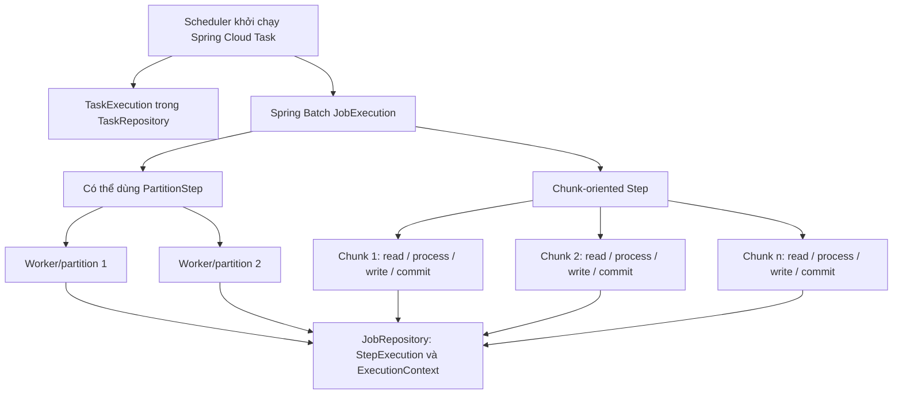
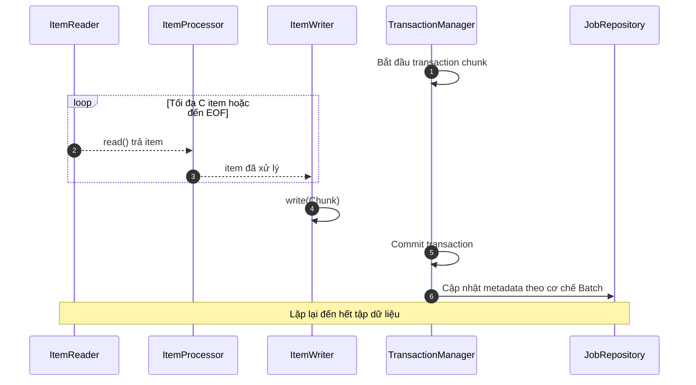
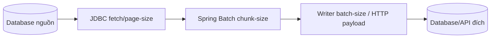

# Lựa chọn kích thước dữ liệu, chunk và mức song song trong Spring Cloud Task

## 1. Tại sao phải tối ưu cả ba tham số?

Một ứng dụng **Spring Cloud Task** có thời gian chạy hữu hạn có thể nhập tệp, đối soát giao dịch, tổng hợp báo cáo hoặc kích hoạt **Spring Batch job**. Khi dữ liệu tăng từ vài nghìn lên hàng triệu bản ghi, cách chia dữ liệu, số bản ghi mỗi lần commit và số worker chạy đồng thời quyết định tốc độ, RAM, tải database và khả năng phục hồi sau lỗi.

Ví dụ một tác vụ `daily-settlement` cần xử lý 2,4 triệu giao dịch trước 06:00 sáng. Có ba câu hỏi khác nhau:

1. **Kích thước dữ liệu:** mỗi lần chạy xử lý toàn bộ 2,4 triệu bản ghi, từng ngày, từng merchant hay một snapshot cố định? Một bản ghi lớn bao nhiêu byte khi lưu và khi được nạp vào JVM?
2. **Kích thước chunk:** Spring Batch nên đọc/xử lý/ghi bao nhiêu item trước một lần commit? Một transaction chứa 50, 200 hay 1.000 item?
3. **Mức song song:** có bao nhiêu chunk, step, partition hoặc **worker Task** được thực hiện đồng thời để rút ngắn thời gian?

Ba tham số tác động lẫn nhau nhưng **không phải cùng một thông số**. Tăng `chunk-size` có thể giảm overhead commit nhưng tăng thời gian giữ transaction và lượng item trong bộ nhớ. Tăng worker có thể giảm thời gian nếu tải còn dư, nhưng cũng có thể gây nghẽn database, quota API hoặc ổ đĩa.

Bài thuộc chương **Tối ưu và nâng cấp**, trong module `SPRING_CLOUD_TASK`, giải thích phương pháp đo, lựa chọn và nâng cấp an toàn các giá trị này khi tác vụ có `TaskRepository`, Spring Batch `JobRepository`, lịch chạy và yêu cầu retry/idempotency.

Sau bài học, bạn có thể:

- Phân biệt số dòng, tổng dung lượng input, kích thước item trong heap, chunk, page, fetch size và partition.
- Ước lượng số transaction, nhu cầu bộ nhớ và ngân sách tài nguyên của nhiều worker.
- Cấu hình chunk step trong Spring Batch 5.x và một `Partitioner` chia dữ liệu không chồng lấn.
- So sánh xử lý tuần tự, đa luồng, local partitioning và remote partitioning qua nhiều Spring Cloud Task.
- Thiết kế benchmark có kiểm soát trước khi nâng `chunk-size` hoặc `maxWorkers`.
- Quan sát `BatchStatus`, `StepExecution`, `TaskExecution`, lỗi rollback, OOM và tác dụng phụ lặp.
- Triển khai thay đổi từng bước, kiểm thử restart và có cách rollback khi nâng cấp framework.

## 2. Spring Cloud Task và Spring Batch quản lý các ranh giới khác nhau

**Spring Cloud Task** theo dõi **một lần thực thi ứng dụng** bằng `TaskExecution`: tên tác vụ, thời gian bắt đầu/kết thúc, mã thoát, lỗi. Framework không tự chia một tệp 10 GiB thành chunk, không tự chọn số worker và không tự gán transaction cho từng item nghiệp vụ.

**Spring Batch** cung cấp cơ chế *chunk-oriented processing*: `ItemReader` đọc item, `ItemProcessor` xử lý nếu có, `ItemWriter` ghi một nhóm item; transaction thường commit sau mỗi chunk. `JobRepository` lưu `JobExecution` và `StepExecution`, các count và `ExecutionContext` phục vụ restart.



Một lần chạy ứng dụng có thể thực hiện **hàng nghìn chunk** nhưng vẫn chỉ có **một `TaskExecution`** của tiến trình. Khi dùng remote partitioning bằng các worker Spring Cloud Task riêng, mỗi worker có thể có `TaskExecution` của chính nó; các `StepExecution` phân vùng lại được quản lý trong `JobRepository` dùng chung.

| Khái niệm | Phạm vi | Ví dụ |
| --- | --- | --- |
| `TaskExecution` | Một lần khởi chạy ứng dụng Task | `daily-settlement` hôm nay |
| `JobExecution` | Một lần chạy Spring Batch job | `settlementJob` cho ngày D |
| `StepExecution` | Một lần chạy step/phân vùng | `settleStep:partition3` |
| **Chunk** | Nhóm item ở ranh giới commit | 200 giao dịch một transaction |
| **Attempt retry** | Lần gọi lại sau một lỗi | API gateway được thử lại 3 lần |
| **Worker** | Thread/process/Pod thực hiện phần việc | 8 worker Task đồng thời |

Không dùng `TaskExecution.executionId` làm khóa chống ghi trùng giao dịch: mỗi lần khởi chạy lại thường nhận ID mới, trong khi khóa nghiệp vụ vẫn là cùng một merchant, kỳ đối soát hoặc giao dịch.

## 3. Phân biệt đúng các loại “kích thước”

Cùng một file có thể có nhiều con số rất khác nhau:

| Thông số | Mô tả | Có nhất thiết bằng chunk size? |
| --- | --- | --- |
| Tổng **item count** `N` | Số bản ghi logic cần xử lý | Không |
| Tổng **input bytes** | Dung lượng CSV/JSON/DB snapshot | Không |
| **In-memory item size** `b` | Heap và object giữ lại cho một item khi đọc/xử lý | Không |
| `chunk-size` / commit interval `C` | Số item trước một lần commit của step | Chính là nút chỉnh chunk |
| JDBC **fetch size** | Gợi ý cho JDBC driver lấy bao nhiêu dòng mỗi đợt | Không |
| JDBC **page size** | Số dòng trong một truy vấn phân trang | Không |
| Writer **batch size** | Số câu SQL/request gom thành một lần gửi xuống đích | Không bắt buộc |
| Partition count `K` | Số phân vùng logic, có `ExecutionContext` riêng | Không |
| Concurrent workers `P` | Số phần việc cùng hoạt động | Không |

Ví dụ một file CSV **nén** 1,5 GiB có thể giải nén thành 8 GiB; một bản ghi dài 200 byte trên đĩa có thể chiếm nhiều hơn trong heap do chuỗi, collection, buffer và object headers. Vì vậy **không lấy kích thước file chia cho chunk-size để ước lượng RAM**.

### 3.1. Chọn kích thước tập dữ liệu trước khi chọn chunk

Trước hết xác định **đơn vị nghiệp vụ có thể xử lý lại**:

- Theo ngày kế toán `businessDate` để tránh đếm trùng kỳ.
- Theo merchant hoặc khách hàng nếu cần điều phối độc lập.
- Theo khoảng ID hoặc khóa phân vùng không giao nhau.
- Theo một snapshot/input version bất biến để dữ liệu không đổi giữa các lần restart.

Nên xác định một **watermark/snapshot** hoặc điều kiện truy vấn ổn định. Nếu đang xử lý bảng mà dữ liệu liên tục thêm/sửa, phân trang bằng `OFFSET` không nhất thiết giữ được tập item nhất quán giữa các truy vấn hoặc các lần retry.

Một số quy tắc:

1. Tập dữ liệu cần **giới hạn rõ** và không tự mở rộng vô hạn trong lúc chạy.
2. Chọn khóa nghiệp vụ và cận phân vùng sao cho không thiếu/trùng bản ghi.
3. Đo cả **item count** lẫn phân phối kích thước lớn nhất, không chỉ số trung bình.
4. Xác định đầu ra cuối cần persist trước khi Task báo thành công.
5. Có đường chạy bù cho dữ liệu đến muộn hoặc kỳ bị lỡ.

## 4. Chunk-oriented processing và ranh giới transaction

Spring Batch đọc item từ `ItemReader`, xử lý qua `ItemProcessor` nếu được cấu hình và chuyển một `Chunk` tới `ItemWriter`. Theo mô hình phổ biến, sau khi xử lý đủ **commit interval** item hoặc đến cuối dữ liệu, transaction được commit.



Sơ đồ tóm tắt luồng logic, không mô tả chính xác mọi callback SQL nội bộ của Batch. `ItemProcessor` có thể **lọc item** bằng cách trả về `null`. Fault-tolerant step có thể **retry/skip** và rollback, nên số lượng item thực tế được ghi không bắt buộc bằng số lần `read()`.

### 4.1. Tác động của chunk nhỏ

Với `C=1`, mỗi item thường đi qua một transaction:

- Ưu điểm: ranh giới commit nhỏ, lượng item chờ xử lý ít, rollback không ảnh hưởng nhiều item.
- Nhược điểm: nhiều lần begin/commit, nhiều thao tác ghi metadata, round trip và chi phí transaction log; throughput có thể thấp.

### 4.2. Tác động của chunk lớn

Với `C=1.000`, mỗi transaction có thể chứa nhiều item:

- Ưu điểm: giảm overhead commit và có cơ hội batch JDBC hiệu quả hơn.
- Nhược điểm: item/buffer giữ trong bộ nhớ nhiều hơn; transaction tồn tại lâu, lock và rollback có thể tốn kém; lỗi ở cuối chunk có thể khiến nhiều công việc phải thực hiện lại.

**Không có giá trị chunk tối ưu áp dụng cho mọi workload.** Giá trị phù hợp là giá trị cho throughput tốt **trong giới hạn RAM, transaction time, độ trễ downstream, rủi ro rollback và yêu cầu restart**.

## 5. Ước lượng số lần commit và ngân sách thời gian

Trong một step tuần tự, không lỗi, không retry/skip và mỗi item được xử lý một lần, có thể ước lượng số chunk:

\[
  Q \approx \left\lceil \frac{N}{C} \right\rceil
\]

Trong đó `N` là tổng số item và `C` là chunk-size. Đây là ước lượng số nhóm dữ liệu cần commit, **không phải cam kết `COMMIT_COUNT` bằng đúng `Q`**: Spring Batch có thể có transaction bổ sung, commit cuối hoặc rollback tùy cấu hình.

Ví dụ `N=2.400.000` item:

| Chunk size `C` | Số chunk lý thuyết `ceil(N/C)` |
| ---: | ---: |
| 25 | 96.000 |
| 100 | 24.000 |
| 400 | 6.000 |
| 1.000 | 2.400 |

Giả sử **chi phí cố định để commit mỗi chunk** được đo là 12 ms, thì overhead lý thuyết cho `C=400` là:

\[
  6.000 \times 0{,}012s = 72s
\]

Với `C=100`, overhead lý thuyết là `24.000 × 0,012s = 288s`. Những con số này **chỉ để minh họa**, không bao gồm đọc/ghi/lock/GC/network, và chi phí commit thực tế không nhất thiết là hằng số.

### 5.1. Đo chứ không chọn chỉ bằng công thức

Tăng chunk từ 100 lên 400 có thể giảm overhead ở workload nhỏ, nhưng nếu writer tạo SQL lock lâu hoặc dịch vụ đích chỉ nhận tối đa 200 item/request, chunk 400 có thể chậm hơn và tăng lỗi. Dữ liệu rất lệch kích thước còn khiến một chunk chứa vài bản ghi cực lớn chiếm nhiều RAM hơn nhiều chunk bình thường.

Nên thu thập:

- Thời gian **đọc**, **xử lý**, **ghi**, **commit** và **rollback** (khi có instrument).
- Số `READ_COUNT`, `WRITE_COUNT`, `FILTER_COUNT`, `SKIP_COUNT`, `COMMIT_COUNT`, `ROLLBACK_COUNT`.
- Heap peak, native/container memory, GC pauses, DB lock wait, WAL/redo log pressure.
- Số lỗi retryable, độ trễ p95/p99 của downstream.
- Thời gian toàn Job và toàn Task, bao gồm bootstrap và shutdown.

## 6. Ước lượng bộ nhớ theo chunk và mức đồng thời

Một công thức **ước lượng đỉnh tối thiểu của dữ liệu đang giữ** cho các chunk đang xử lý là:

\[
  M_{\text{items}} \approx P \times C \times b
\]

Trong đó:

- `P`: số chunk có thể được giữ/xử lý đồng thời trên **cùng giới hạn bộ nhớ**.
- `C`: chunk-size.
- `b`: số byte trung bình **giữ lại trong bộ nhớ** cho mỗi item (không phải kích thước file).
- `M_items`: chỉ là phần bộ nhớ item/buffer, **chưa tính** reader cache, writer buffer, thread stacks, JVM heap metadata, direct memory hay container overhead.

Ví dụ `P=8`, `C=200` và mỗi item cùng các object liên quan giữ khoảng `32KiB`:

\[
  M_{\text{items}} \approx 8 \times 200 \times 32KiB = 50MiB
\]

50MiB **không phải** memory limit đủ cho worker. JVM còn dùng heap chung, metaspace, buffer I/O, connection pool, thread stack, file tmpfs và dữ liệu lớn bất thường. Với remote partitioning, `P` cần xét **theo mỗi Pod/JVM** khi tính limit Pod; còn tổng RAM của cụm tăng theo số worker.

### 6.1. Tại sao không đặt `-Xmx` bằng memory limit?

Một container có `memory.limit=1Gi` không nên tự động đặt `-Xmx1g`. Heap chỉ là một phần memory. Cần dành chỗ cho native/off-heap, cache và JVM overhead; theo version JVM có thể dùng `-XX:MaxRAMPercentage` hoặc `-Xmx` được thử nghiệm cụ thể.

Nếu sử dụng `emptyDir.medium: Memory`, file tạm trên tmpfs cũng có thể bị tính vào memory container. Tăng chunk/parallelism khi RAM chưa dư có thể gây `OOMKilled` và khiến `TaskExecution` chưa kịp có `endTime`.

### 6.2. Kích thước trung bình che giấu data skew

Nếu 99% item là 2 KiB nhưng 1% chứa payload 5 MiB, một chunk 200 item có thể chứa nhiều record lớn bất thường. Cần đo **p95/p99/max retained bytes**, không chỉ trung bình; đặt giới hạn payload và cân nhắc lưu blob lớn ở object storage, chỉ giữ reference trong chunk.

## 7. Cấu hình chunk trong Spring Batch 5.x

Đoạn minh họa dưới đây dùng API **Spring Batch 5.x** kết hợp Spring Boot và Spring Cloud Task tương thích. Spring Batch **6.x** có thay đổi ở API cấu hình step/transaction; **không copy nguyên snippet 5.x khi nâng lên 6.x** mà chưa đối chiếu release notes.

### 7.1. App configuration có giá trị mặc định rõ ràng

```yaml
spring:
  application:
    name: settlement-worker
  main:
    web-application-type: none
  cloud:
    task:
      name: daily-settlement
  datasource:
    url: ${TASK_DB_URL}
    username: ${TASK_DB_USER}
    password: ${TASK_DB_PASSWORD}
app:
  batch:
    chunk-size: 200
    max-workers: 4
```

`app.batch.chunk-size` và `app.batch.max-workers` là **thuộc tính tự định nghĩa của ứng dụng**, **không phải** tính năng auto-tuning do Spring Cloud Task cung cấp. Phải có code đọc chúng và validate. Các biến datasource cần được cấp từ secret manager/runtime; không đưa mật khẩu vào source hoặc CLI.

Nếu chỉ có một database dùng chung cho Task và Batch, database cần **hai nhóm schema metadata** theo đúng phiên bản, cộng với bảng nghiệp vụ riêng. Cấu hình nhiều `DataSource` yêu cầu chỉ định rõ nguồn dành cho `JobRepository` và `TaskRepository`.

### 7.2. Một Job/Step mẫu có chunk-size cấu hình được

Đoạn sau là một ví dụ có thể dùng để học API trong dự án Spring Boot + Batch 5.x. Reader dùng danh sách nhỏ để dễ quan sát và **không phải reader restartable cho production**.

```java
import java.util.List;

import org.springframework.batch.core.Job;
import org.springframework.batch.core.Step;
import org.springframework.batch.core.job.builder.JobBuilder;
import org.springframework.batch.core.repository.JobRepository;
import org.springframework.batch.core.step.builder.StepBuilder;
import org.springframework.batch.item.ItemReader;
import org.springframework.batch.item.ItemWriter;
import org.springframework.batch.item.support.ListItemReader;
import org.springframework.beans.factory.annotation.Value;
import org.springframework.context.annotation.Bean;
import org.springframework.context.annotation.Configuration;
import org.springframework.transaction.PlatformTransactionManager;

@Configuration(proxyBeanMethods = false)
public class SettlementBatchConfiguration {

    @Bean
    Job settlementJob(JobRepository repository, Step settlementStep) {
        return new JobBuilder("settlementJob", repository)
            .start(settlementStep)
            .build();
    }

    @Bean
    Step settlementStep(
            JobRepository repository,
            PlatformTransactionManager transactionManager,
            ItemReader<String> settlementReader,
            ItemWriter<String> settlementWriter,
            @Value("${app.batch.chunk-size:200}") int chunkSize) {

        if (chunkSize < 1 || chunkSize > 10_000) {
            throw new IllegalArgumentException(
                "chunk-size phải nằm trong 1..10000");
        }

        return new StepBuilder("settlementStep", repository)
            .<String, String>chunk(chunkSize, transactionManager)
            .reader(settlementReader)
            .writer(settlementWriter)
            .build();
    }

    @Bean
    ItemReader<String> settlementReader() {
        return new ListItemReader<>(
            List.of("TX-01", "TX-02", "TX-03",
                    "TX-04", "TX-05", "TX-06"));
    }

    @Bean
    ItemWriter<String> settlementWriter() {
        return items -> {
            for (String item : items) {
                // Chỉ in để minh họa; không phải writer nghiệp vụ thật.
                System.out.println("Processed " + item);
            }
        };
    }
}
```

Ứng dụng Spring Boot chính có thể khai báo `@SpringBootApplication`, `@EnableTask` và `SpringApplication.run(...)`; dự án cần `spring-boot-starter-batch`, `spring-cloud-starter-task`, driver JDBC và schema metadata tương thích. Một Job bean có thể được Boot tự launch khi `spring.batch.job.enabled=true` và auto-configuration phù hợp.

Với 6 item và `chunk-size=2`, đường chạy không lỗi có khoảng ba chunk xử lý. Với `chunk-size=200`, toàn bộ sáu item nằm trong một chunk. Đây chỉ là phép quan sát ranh giới commit; `System.out.println` **không rollback được** nếu transaction thất bại, vì thế không phải mô hình writer an toàn cho dữ liệu thật.

**Giới hạn của ví dụ:** `ListItemReader` ở đây không lưu vị trí đọc để khôi phục sau crash, còn `ItemWriter` chỉ in ra stdout. Khi triển khai thật, dùng `JdbcPagingItemReader`/`JdbcCursorItemReader`, `FlatFileItemReader` hoặc reader phù hợp cùng writer có transaction/idempotency, theo đúng schema và quy tắc restart.

### 7.3. Thử một vài cấu hình

```bash
java -jar settlement-task.jar --app.batch.chunk-size=2
java -jar settlement-task.jar --app.batch.chunk-size=3
java -jar settlement-task.jar --app.batch.chunk-size=6
```

Nếu bạn dùng Spring Boot Batch runner nhận JobParameters, phân biệt `--app.batch.chunk-size=...` (Boot property) với các chuỗi không có tiền tố `--` do runner có thể hiểu là **JobParameters**. Mọi lần khởi chạy lại có thể tạo một `TaskExecution` khác nếu repository hoạt động.

Đừng chọn chunk từ sáu bản ghi thử nghiệm rồi áp vào 2,4 triệu bản ghi production. Cần benchmark với dữ liệu đại diện.

## 8. Chunk-size không phải JDBC fetch size hay writer batch size

Nhiều hệ thống có ít nhất ba lớp buffer:



Ví dụ:

- JDBC fetch-size = 500: một gợi ý tối ưu việc lấy dòng, phụ thuộc driver và loại cursor.
- Spring Batch chunk-size = 200: ranh giới commit sau khi step xử lý một nhóm item.
- JDBC batch-size = 100: writer có thể gửi hai đợt SQL trong cùng một chunk 200 item, tùy cách xây writer.

Ba con số có thể khác nhau. **Không có quy tắc chunk = fetch-size = writer-batch-size.**

Với `JdbcPagingItemReader`, `pageSize` điều chỉnh kích thước trang SQL; với `JdbcCursorItemReader`, `fetchSize` có thể ảnh hưởng cách driver đệm dòng. Một số driver cần cấu hình transaction/autocommit cụ thể để thực sự stream. Hãy đo heap và query count trước khi khẳng định reader đang streaming.

### 8.1. Vì sao OFFSET thường kém ở trang sâu?

Truy vấn `LIMIT ... OFFSET ...` trên dữ liệu lớn có thể phải duyệt nhiều dòng trước khi tới trang sâu, đồng thời dễ chịu ảnh hưởng khi tập dữ liệu thay đổi. Với nguồn có khóa ổn định và index thích hợp, **keyset pagination** hoặc partition range có thể hiệu quả hơn.

Ví dụ truy vấn đọc khoảng ID của một partition:

```sql
SELECT id, merchant_id, amount
FROM settlement_source
WHERE id >= :minIdInclusive
  AND id < :maxIdExclusive
ORDER BY id;
```

Hai tham số `:minIdInclusive`/`:maxIdExclusive` là bind parameters từ JDBC reader. Query thực tế cần index phù hợp và snapshot/cận dữ liệu đã chốt để tránh đọc lệch khi source thay đổi.

## 9. Bốn cách tăng mức song song

| Phương án | Nơi chạy | Điểm mạnh | Rủi ro/giới hạn |
| --- | --- | --- | --- |
| **Step tuần tự** | Một step trên một thread | Đơn giản, dễ restart, ít tranh chấp | Chậm với tập dữ liệu lớn |
| **Multi-threaded / local chunking** | Nhiều thread trong một JVM, tùy API/version Batch | Tận dụng nhiều CPU trong Pod | Thread safety, thứ tự item, transaction boundary, heap chung |
| **Local partitioning** | Nhiều `StepExecution` ở cùng JVM | Mỗi partition có `ExecutionContext` riêng; reader/writer có thể tách | Tất cả cùng dùng RAM/CPU của một JVM |
| **Remote partitioning** | Nhiều JVM/Pod worker | Cô lập tài nguyên, scale theo platform | Chi phí startup, shared repository, giao tiếp, idempotency |

**Không mặc định cách nhiều thread trong Spring Batch 5.x có cùng semantics với local chunking của Batch 6.x.** Spring Batch 6 bổ sung mô hình local chunking và thay đổi API xử lý song song; phải đọc tài liệu đúng dòng phiên bản, đặc biệt về **thread-bound transactions** và tính an toàn của reader/processor/writer.

### 9.1. Tại sao không tăng thread pool vô hạn?

Nếu nhiều chunk/partition cùng đọc DB, mỗi worker có thể giữ connection, lock, buffer và transaction riêng. Tăng concurrency từ 8 lên 32 có thể khiến:

- DB connection pool cạn và các thread chờ nhau.
- Bảng đích cạnh tranh khóa, số rollback/deadlock tăng.
- Downstream API gặp `429 Too Many Requests`.
- Heap tăng theo số chunk đang giữ cùng lúc.
- Pod bị CPU throttling hoặc `OOMKilled`.
- Thời gian toàn Job **tăng** thay vì giảm.

Chọn **concurrency theo nút thắt đo được**, không chỉ theo số core hoặc số item.

## 10. Phân vùng logic và số worker thực chạy

Trong partitioning, **partition count `K`** và **concurrent workers `P`** không nhất thiết bằng nhau.

Giả sử `K=32` partition nhưng `P=8` worker, mỗi worker có thể nhận các partition kế tiếp khi tài nguyên trống. Tùy implementation của `PartitionHandler` và TaskLauncher, cách phân phối, queue và giới hạn đồng thời khác nhau.

Trong Spring Cloud Task remote partitioning với `DeployerPartitionHandler`, có thể đặt số worker tối đa bằng API như:

```java
// Ví dụ rút gọn: handler đã được xây đúng constructor
// và kết nối với TaskLauncher, JobExplorer, TaskRepository.
handler.setMaxWorkers(8);
```

Lời gọi trên **không tự tạo partition**; `Partitioner` và cấu hình manager step vẫn quyết định có bao nhiêu `StepExecution` được tạo. Số worker còn bị giới hạn bởi quota/namespace/deployer và tài nguyên thực tế.

### 10.1. Ví dụ `Partitioner` tạo các khoảng không trùng nhau

Ví dụ Spring Batch 5.x dưới đây chia dải ID `[0, 10000)` theo `gridSize`, sinh `ExecutionContext` cho từng phân vùng:

```java
import java.util.LinkedHashMap;
import java.util.Map;

import org.springframework.batch.core.partition.support.Partitioner;
import org.springframework.batch.item.ExecutionContext;
import org.springframework.context.annotation.Bean;
import org.springframework.context.annotation.Configuration;

@Configuration(proxyBeanMethods = false)
public class RangePartitionConfig {

    @Bean
    Partitioner settlementRangePartitioner() {
        return gridSize -> {
            if (gridSize <= 0) {
                throw new IllegalArgumentException(
                    "gridSize phải > 0");
            }

            long begin = 0;
            long endExclusive = 10_000;
            long total = endExclusive - begin;
            long block = (total + gridSize - 1L) / gridSize;

            Map<String, ExecutionContext> result =
                new LinkedHashMap<>();

            for (int i = 0; i < gridSize; i++) {
                long min = begin + i * block;
                if (min >= endExclusive) {
                    break;
                }
                long max = Math.min(endExclusive, min + block);

                ExecutionContext context = new ExecutionContext();
                context.putLong("minIdInclusive", min);
                context.putLong("maxIdExclusive", max);
                result.put("workerStep:partition" + i, context);
            }
            return result;
        };
    }
}
```

Với `gridSize=4`, các khoảng sẽ là:

| Partition | `minIdInclusive` | `maxIdExclusive` | Phạm vi |
| --- | ---: | ---: | --- |
| 0 | 0 | 2500 | `[0, 2500)` |
| 1 | 2500 | 5000 | `[2500, 5000)` |
| 2 | 5000 | 7500 | `[5000, 7500)` |
| 3 | 7500 | 10000 | `[7500, 10000)` |

Đây là **mô hình học tập**, giả sử ID và ranh giới ổn định. Trong production, nếu ID thưa hoặc phân phối dữ liệu không đều, bốn khoảng ID bằng nhau **không có nghĩa bốn khoảng có số item/công việc ngang nhau**. Cần dùng histogram, bảng định tuyến hoặc danh sách workload được chuẩn bị trước.

### 10.2. Data skew và partition quá nhỏ

Nếu một merchant có 80% tổng giao dịch còn các merchant khác có 20%, chia theo bốn merchant có thể khiến ba worker rảnh trong khi một worker chạy rất lâu (*straggler*). Tạo nhiều partition nhỏ hơn số worker có thể hỗ trợ phân phối linh hoạt, nhưng mỗi partition thêm metadata, startup/giao tiếp và checkpoint overhead.

Nên cân bằng:

- **Đủ partition** để worker không bị đói việc khi workload lệch.
- **Không quá nhiều partition** khiến overhead và database repository lớn.
- Một partition phải có **phạm vi dữ liệu rõ, restartable và idempotent**.

## 11. Giới hạn thực tế: CPU, RAM, I/O, DB pool và API quota

### 11.1. CPU-bound hay I/O-bound?

| Nút thắt | Dấu hiệu | Hướng điều chỉnh |
| --- | --- | --- |
| CPU-bound (nén, hash, tính toán) | CPU sử dụng cao, ít thời gian đợi I/O | Cân nhắc song song tới ngưỡng core/CPU quota |
| Database read-bound | Query latency tăng, số connection bão hòa | Index/query/fetch-size, giảm contention, giới hạn worker |
| Database write-bound | Lock wait, WAL/redo, commit latency tăng | Tối ưu writer/batch size, giảm chunk transaction dài |
| API-bound | `429`, `503`, p95 latency tăng theo concurrency | Rate limit, backoff + jitter, giảm số worker |
| Memory-bound | GC pause cao, `OOMKilled`, heap gần trần | Giảm chunk/parallelism, stream dữ liệu, tăng headroom có kiểm chứng |
| Scratch/storage-bound | `No space left on device`, eviction | Dọn file tạm, tăng ephemeral capacity phù hợp, dùng object storage |

Tăng `chunk-size` và `maxWorkers` đồng thời trong lần thử đầu tiên làm khó xác định tham số nào tạo cải thiện hoặc suy giảm.

### 11.2. Ngân sách connection pool

Nếu một JVM có 8 worker thực hiện transaction JDBC song song, database pool size phải đủ cho các kết nối đang hoạt động **cộng kết nối cần thiết cho hạ tầng khác**. Nhưng đặt pool = 100 chỉ để “chắc chắn đủ” có thể vượt giới hạn DB khi có 20 Pod.

Ví dụ:

```text
20 Pod × pool max 10 connections = tối đa 200 connections
```

Phải tính thêm manager, `TaskRepository`, `JobRepository`, giám sát và ứng dụng khác. Pool size, transaction concurrency và DB max connections phải được thiết kế **toàn hệ thống**. Với remote workers, mỗi Pod có pool riêng; 8 worker process không chia sẻ một Hikari pool của manager.

### 11.3. Chunk lớn và lock duration

Chunk càng lớn thì transaction có thể kéo dài hơn, giữ lock lâu hơn, tăng rollback cost và timeout. Nếu writer gọi API bên ngoài trong cùng transaction DB, transaction **không tự mở rộng** đến hệ thống đích: khi rollback database, yêu cầu API đã gửi không chắc được hoàn tác.

Nên tách giao dịch ngắn, dùng outbox hoặc idempotency key khi cần phối hợp bên ngoài; không hứa “exactly once” chỉ vì chunk được commit.

## 12. Thiết kế benchmark có kiểm soát

Một quy trình benchmark tốt cho Task hữu hạn phải đo **runtime, tính đúng dữ liệu, tài nguyên, khả năng retry/restart**, không chỉ số item/giây.

### 12.1. Cố định những yếu tố ảnh hưởng

Trước khi so sánh, giữ cố định:

- Cùng phiên bản Spring Boot, Spring Cloud Task, Spring Batch và JDK.
- Cùng input snapshot, số item, kích thước item, tỷ lệ bản ghi lỗi.
- Cùng DB engine, schema, index, query plan, pool và dữ liệu đã được reset.
- Cùng Kubernetes requests/limits, node class, quota và image.
- Cùng writer/API mock hoặc cùng hệ thống đích được giới hạn tải tương đương.
- Cùng timeout/retry và chính sách skip/rollback.

Khởi động JVM đầu tiên có thể chậm vì class loading và warm-up; chạy nhiều lượt để nhìn độ biến động, không quyết định chỉ từ một lần.

### 12.2. Thử từng trục một

Với baseline `chunk=100`, `workers=1`, đầu tiên khảo sát chunk:

| Lượt | Chunk | Workers | Điều cần đo |
| --- | ---: | ---: | --- |
| A | 50 | 1 | Runtime, commits, heap/GC, lock wait |
| B | 100 | 1 | Baseline so sánh |
| C | 200 | 1 | Trade-off throughput/rollback/memory |
| D | 500 | 1 | Có xuất hiện buffer, lock hoặc GC tăng? |
| E | 1000 | 1 | Có vượt ngưỡng an toàn hoặc lợi ích bão hòa? |

Chọn 1–2 giá trị chunk khả thi, rồi khảo sát concurrency:

| Lượt | Chunk | Workers | Điều cần xem |
| --- | ---: | ---: | --- |
| F | 200 | 1 | Thời gian tuần tự |
| G | 200 | 2 | Scaling efficiency, DB pool |
| H | 200 | 4 | Throughput, CPU/lock wait |
| I | 200 | 8 | Có giảm thêm runtime hay bắt đầu bão hòa? |

Các số trên **không phải cấu hình tối ưu mặc định**; chúng chỉ là ma trận thử nghiệm. Nếu mỗi item rất lớn, các giá trị 500/1000 có thể không an toàn. Giới hạn phạm vi thử dựa trên số đo ban đầu và resource budget.

### 12.3. Metric nên ghi ở cùng một bảng

| Metric | Lý do |
| --- | --- |
| Tổng duration `TaskExecution` | Đo cả bootstrap, Batch, shutdown |
| Duration `JobExecution` và từng `StepExecution` | Tách thời gian nghiệp vụ theo step |
| Items/sec, bytes/sec | Phản ánh throughput theo đơn vị thật |
| `COMMIT_COUNT`, `ROLLBACK_COUNT`, `READ_COUNT`, `WRITE_COUNT` | Phân biệt tối ưu transaction với lỗi/retry |
| CPU throttling, memory peak, GC pause | Phát hiện chi phí tính toán và OOM |
| DB pool active/wait, lock wait, SQL latency | Phát hiện bão hòa database |
| API rate-limit, p95/p99, số retry | Phát hiện tăng concurrency gây quá tải downstream |
| Thời gian partition chậm nhất/nhanh nhất | Phát hiện data skew |
| Số bản ghi thiếu/trùng và số lần retry an toàn | Chứng minh tính đúng đắn |

### 12.4. Thước đo hiệu quả song song

Có thể tính speedup và efficiency gần đúng:

\[
S(P) = \frac{T(1)}{T(P)}, \qquad E(P) = \frac{S(P)}{P}
\]

Nếu `T(1)=40 phút`, `T(4)=14 phút`, thì `S(4)≈2,86` và `E(4)≈0,71`. Tăng worker từ 4 lên 8 **không bảo đảm** thời gian còn 7 phút: startup, phần tuần tự, lock và overhead điều phối có thể chiếm tỷ trọng lớn.

Ngoài hiệu năng, đặt **SLO**: ví dụ “99% kỳ báo cáo hoàn tất trước 06:00 với memory peak dưới 70% limit và không có trùng bản ghi”. Cấu hình nhanh nhất trong một lần thử nhưng thường xuyên tạo `OOMKilled` không phải cấu hình tốt.

## 13. Quan sát qua `JobRepository` và `TaskRepository`

### 13.1. Đọc kết quả từng step/chunk qua metadata Batch

Với schema JDBC phổ biến của Spring Batch:

```sql
SELECT JOB_EXECUTION_ID,
       STEP_NAME,
       STATUS,
       READ_COUNT,
       WRITE_COUNT,
       FILTER_COUNT,
       READ_SKIP_COUNT,
       PROCESS_SKIP_COUNT,
       WRITE_SKIP_COUNT,
       COMMIT_COUNT,
       ROLLBACK_COUNT,
       START_TIME,
       END_TIME
FROM BATCH_STEP_EXECUTION
ORDER BY JOB_EXECUTION_ID DESC, STEP_EXECUTION_ID;
```

Các count là **tổng theo step execution**, không phải timeline chi tiết từng chunk. Muốn đo latency p95 của chunk hoặc phân phối item size, cần instrument `ChunkListener`, Micrometer/observability hoặc hệ thống metric riêng. Không suy luận “mọi commit đều xử lý chính xác C item” chỉ từ `COMMIT_COUNT`.

### 13.2. Đọc lịch sử Task

```sql
SELECT TASK_EXECUTION_ID,
       TASK_NAME,
       START_TIME,
       END_TIME,
       EXIT_CODE,
       EXIT_MESSAGE,
       ERROR_MESSAGE
FROM TASK_EXECUTION
WHERE TASK_NAME = 'daily-settlement'
ORDER BY TASK_EXECUTION_ID DESC;
```

`TaskRepository` cho phép so sánh các lượt chạy trong thời gian dài nhưng **không tự chứa chunk-size, số worker, SQL latency** trừ khi ứng dụng ghi bổ sung metric/config snapshot. Hãy log một cấu hình tuning có thể truy vết theo `executionId`: artifact version, `chunk-size`, `worker-count`, input snapshot ID và giới hạn tài nguyên.

### 13.3. Phân biệt lỗi metadata với lỗi nghiệp vụ

Nếu một worker bị kill vì OOM trước khi cập nhật `TaskExecution` hoặc `StepExecution`, bản ghi có thể thiếu `END_TIME`. Cần xem platform process/Pod status, GC log và dữ liệu đích, không kết luận “job chưa xử lý gì”.

Nếu `JobExecution` có `BatchStatus.FAILED` nhưng ứng dụng Task vẫn báo mã thoát 0, hãy kiểm tra cơ chế lan truyền kết quả Batch, ví dụ cấu hình tích hợp `spring.cloud.task.batch.fail-on-job-failure` ở phiên bản hỗ trợ. Một benchmark chỉ nhìn mã thoát process có thể vô tình tính lượt lỗi là hoàn thành nhanh.

## 14. Retry, rollback, restart và idempotency khi thay đổi chunk

Thay đổi `chunk-size` có thể thay đổi **số item nằm trong một lần rollback**. Ví dụ lỗi writer xuất hiện ở item thứ 199 trong chunk 200: cả transaction chunk có thể rollback, và framework có thể thực hiện lại một phần công việc theo cấu hình fault tolerance. Nếu writer đã gọi một API ngoài, các side effect đó có thể không rollback.

### 14.1. Retry có giới hạn

Không retry vô hạn cùng một exception. Cần:

- Phân biệt lỗi tạm thời (timeout, deadlock đã rollback, `503`) với lỗi cố định (đầu vào sai).
- Đặt số attempts, backoff tăng dần và jitter ở tầng phù hợp.
- Không ngủ trong transaction dài đang giữ lock.
- Bảo đảm replay cùng item/chunk an toàn.
- Tính **tổng** số attempts qua Spring Retry, Batch retry và scheduler Task relaunch.

### 14.2. Restart theo `JobInstance`

Spring Batch phân biệt `JobInstance` bằng tên job và **identifying `JobParameters`**. Khi restart một job thất bại, dùng lại identity nghiệp vụ phù hợp để framework dựa trên checkpoint. Tự thêm UUID mới vào identifying parameters trên mỗi lần chạy lại có thể tạo job instance khác và xử lý toàn bộ dữ liệu từ đầu.

Thay đổi chunk-size **giữa những lần restart của cùng một job** có thể làm thay đổi ranh giới checkpoint. Reader/writer cần hỗ trợ restart đúng semantics; trước khi áp lên job dở dang, kiểm thử với source/step tương tự và xem tài liệu version đang dùng.

Đối với reader đọc file hoặc dữ liệu biến động, cần lưu vị trí/khóa có thể khôi phục; một `ListItemReader` demo không phải lựa chọn production cho job restartable.

### 14.3. Khóa nghiệp vụ ổn định

Một giao dịch nên được nhận diện bằng `transactionId` hoặc tổ hợp `merchantId` + `businessDate` + `operation` tùy contract. **Không dùng `TaskExecution.executionId`, `StepExecution.id` hoặc số thứ tự partition** làm idempotency key vì chúng có thể thay đổi sau retry/relaunch/repartition.

Nếu làm việc với API ngoài, dùng idempotency key phía đối tác nếu hỗ trợ và đối soát trạng thái sau timeout. Database unique constraint/upsert cũng giúp tránh ghi trùng; nhưng nó không biến nhiều database và API ngoài thành một transaction atomic.

## 15. Khi nâng cấp Spring Batch, API và hành vi song song có thể đổi

Bài này minh họa cấu hình `new StepBuilder(...).<I,O>chunk(chunkSize, transactionManager)` theo **Spring Batch 5.x**. Ở dòng **Spring Batch 6.x**, API configuration và các khả năng song song thay đổi; tài liệu 6.x mô tả `StepBuilder.chunk(int)` cùng cách chỉ định transaction manager và hỗ trợ local chunking khác trước.

### 15.1. Tránh sao chép `throttleLimit` từ ví dụ cũ

Một số hướng dẫn Spring Batch cũ dùng:

```java
// Ví dụ lịch sử, KHÔNG sao chép nguyên sang dự án mới.
stepBuilder.taskExecutor(taskExecutor)
           .throttleLimit(8);
```

`throttleLimit` đã bị **deprecated từ Spring Batch 5.0**; ở các dòng mới cần xem cơ chế quản lý concurrency/queue theo phiên bản. Đừng dùng một API cũ chỉ để “đặt 8 worker” mà không kiểm soát queue capacity, datasource pool và tính thread-safe.

### 15.2. Checklist trước khi nâng version

1. **Khóa bộ phiên bản tương thích**: Spring Boot, Spring Cloud Task, Spring Batch, Spring Cloud Deployer và JDK. Không nâng một phần tùy ý.
2. Đọc release notes của **đúng phiên bản đích**, nhất là API `StepBuilder`, reader/writer và cơ chế multi-threading.
3. Kiểm tra metadata schema và migration của `JobRepository`/`TaskRepository`; backup trước khi thay đổi.
4. Chạy unit/slice/integration tests trên DBMS tương tự production.
5. Thử restart job đang dở, fault tolerance, partitioning và idempotency.
6. So sánh benchmark cũ/mới trên **cùng input và quota**.
7. Rollout thử nghiệm với số worker thấp, quan sát metric; chuẩn bị rollback artifact/config và kế hoạch xử lý schema tương thích.

Không dựa vào câu “chunk size 200 là nhanh nhất” của phiên bản cũ nếu runtime, GC, driver hoặc transaction semantics đã đổi.

## 16. Quy trình chọn giá trị sản xuất theo từng bước

Một quy trình đề xuất cho tác vụ xử lý hàng triệu giao dịch:

### Bước 1 — Xác định correctness trước performance

Chốt ngày nghiệp vụ, snapshot, định danh giao dịch, ranh giới phân vùng và cách xử lý dữ liệu đến muộn. Có unique constraint/idempotency key cho output.

### Bước 2 — Đo workload theo kích thước thật

Ghi `N`, tổng bytes, p95/p99 item size, tỷ lệ item lỗi, kích thước output/scratch, số truy vấn và API call. Phân biệt data skew giữa merchants/ID ranges.

### Bước 3 — Chạy baseline tuần tự

Bắt đầu với chunk nhỏ hoặc trung bình theo đo thử (ví dụ 100), một worker, datasource pool đủ dùng. Ghi duration, throughput, memory, GC và counts.

### Bước 4 — Tuning chunk trước

Thử 50/100/200/500 trong giới hạn bộ nhớ, transaction latency và downstream. Chọn điểm cân bằng throughput với rollback cost; không tối ưu theo commits/sec đơn lẻ.

### Bước 5 — Tăng song song có kiểm soát

Tăng từ 1→2→4→8 worker; quan sát DB pool, CPU throttling, API rate-limit, JVM heap và partition skew. Dừng tăng khi efficiency thấp hoặc vi phạm SLO/quota.

### Bước 6 — Kiểm tra fault recovery

Gây lỗi giả lập ở cuối chunk, timeout DB, worker kill và restart. Xác nhận không thiếu/trùng dữ liệu, không retry vô hạn, Task/Batch metadata được đối chiếu.

### Bước 7 — Cố định cấu hình có thể truy vết

Ghi version artifact/JDK/schema, chunk-size, workers, input snapshot và thông số resource đi cùng metrics của mỗi lần benchmark. Quản lý chúng bằng configuration/version control; không dùng các biến đổi bí mật khó kiểm toán.

### Bước 8 — Rollout theo giai đoạn

Chạy canary trên dữ liệu nhỏ hoặc merchant thử nghiệm, sau đó tăng số worker/tập dữ liệu. Có tiêu chí rollback khi memory, lỗi dữ liệu hoặc p95 runtime xấu đi.

## 17. Ma trận sự cố thường gặp

| Triệu chứng | Nguyên nhân khả dĩ | Hướng xử lý |
| --- | --- | --- |
| Chunk càng lớn càng chậm | Transaction giữ lock lâu, writer quá tải, GC tăng | Giảm chunk, đo commit/lock/memory |
| `COMMIT_COUNT` cao nhưng throughput thấp | Chunk quá nhỏ hoặc mỗi commit có round trip lớn | Tăng chunk từng bước, tối ưu writer/DB |
| Pod `OOMKilled` sau khi tăng workers | Nhiều chunk/buffer cùng tồn tại; heap/native vượt limit | Giảm concurrency/chunk, streaming, tăng headroom được kiểm chứng |
| 8 worker không nhanh hơn 4 | DB/API/CPU quota bị bão hòa; partition lệch | Xem bottleneck, giới hạn worker, cân bằng phân vùng |
| `BATCH_STEP_EXECUTION` tăng rất nhanh | Quá nhiều partition nhỏ hoặc restart lặp | Tăng kích thước partition, kiểm tra retry budget |
| Các worker xử lý trùng item | Ranh giới phân vùng chồng lấn hoặc nguồn thay đổi | Dùng cận half-open, snapshot và key nghiệp vụ |
| Job restart đọc sai vị trí | Reader không restartable hoặc checkpoint không ổn định | Dùng reader phù hợp, kiểm thử restart và JobParameters |
| `READ_COUNT` khác `WRITE_COUNT` | Filter/skip, writer semantics hoặc lỗi nghiệp vụ | Xem filter/skip counts, đối chiếu output |
| Task có mã 0 nhưng Batch job `FAILED` | Lỗi Batch chưa lan tới Task | Kiểm tra runner và `fail-on-job-failure` theo version |
| Task không có `END_TIME` | Kill cưỡng bức, DB mất kết nối | Đối chiếu Pod/Job log và dữ liệu đích |
| Tăng `fetch-size` nhưng không giảm query count | Nhầm fetch size với page size/chunk | Kiểm tra driver, reader và SQL thực tế |
| Nhiều retry làm API bị giới hạn tốc độ | Retry tại Batch, HTTP client và scheduler cùng hoạt động | Tính tổng attempts, backoff/jitter, rate limit |

## 18. Bài tập thực hành

**Bài tập 1 — Ước lượng chunk.** Một step cần xử lý 1.000.000 item, `chunk-size=250`. Trong điều kiện không lỗi, có bao nhiêu chunk lý thuyết? Nếu tăng lên 500, số chunk thay đổi thế nào?

**Bài tập 2 — Ngân sách RAM.** Một JVM xử lý đồng thời 6 chunk, mỗi chunk 300 item; mỗi item cùng buffer giữ khoảng 20KiB. Ước lượng phần bộ nhớ item và giải thích vì sao chưa thể dùng kết quả này làm memory limit của container.

**Bài tập 3 — Partition và worker.** Manager tạo 40 partition, nhưng deployer giới hạn 5 worker. Có bắt buộc có 40 Pod hoạt động đồng thời không? Metadata nào mô tả các partition?

**Bài tập 4 — Tính đúng khi restart.** Một chunk đã gọi API thanh toán thành công nhưng database rollback. Khi chạy lại, yêu cầu có thể bị gọi lần nữa. Bạn sẽ dùng cơ chế nào để tránh thanh toán trùng?

**Bài tập 5 — Benchmark.** Test `chunk=500, workers=8` nhanh hơn baseline, nhưng `ROLLBACK_COUNT` và timeout API đều tăng mạnh. Bạn có nên triển khai ngay không? Hãy đề xuất thêm các metric cần kiểm tra.

**Bài tập 6 — Nâng cấp.** Dự án dùng Spring Batch 5.x có `throttleLimit`. Khi nâng lên dòng 6.x, tại sao cần kiểm tra lại API, concurrency semantics và phép đo hiệu năng thay vì chỉ sửa lỗi biên dịch?

**Gợi ý đáp án:**

1. `ceil(1.000.000/250)=4.000`; với 500 là `2.000` chunk lý thuyết.
2. `6 × 300 × 20KiB = 36.000KiB ≈ 35,16MiB`, chưa tính native/heap khác, cache và bất thường.
3. Không; 40 partition có thể được xử lý theo nhiều đợt. `StepExecution`/`ExecutionContext` trong `JobRepository` mô tả partition.
4. Dùng idempotency key ổn định theo giao dịch, tra trạng thái đích và xử lý retry có kiểm soát.
5. Chưa; cần so lỗi thực, p95 latency, dữ liệu trùng/thiếu, memory, tải DB, mức sử dụng quota và chi phí retry.
6. Vì API và mô hình thực thi/transaction có thể đổi; còn phải kiểm thử thread safety, checkpoint, throughput và restart.

## 19. Checklist triển khai và nâng cấp

- [ ] Xác định rõ **input snapshot**, số item, tổng bytes và kích thước item trong memory.
- [ ] Phân biệt `chunk-size`, `fetch-size`, `page-size`, writer batch-size và partition count.
- [ ] Chunk đủ nhỏ để có headroom RAM, transaction ngắn và rollback chấp nhận được.
- [ ] Có baseline một worker và benchmark thay đổi **một tham số mỗi lần**.
- [ ] Mức song song không vượt CPU/quota, DB pool, API rate limit và memory limit.
- [ ] Reader/processor/writer an toàn theo mô hình concurrency và phiên bản Batch thực tế.
- [ ] Partition không chồng lấn; dữ liệu nguồn có định danh/snapshot ổn định.
- [ ] Batch `JobRepository` và Task `TaskRepository` được truy vấn để đo trạng thái thật.
- [ ] Task/Batch lỗi được truyền thành kết quả đúng cho scheduler.
- [ ] Có retry có giới hạn, backoff, restart và idempotency ở writer/API.
- [ ] Đã thử OOM, DB timeout, worker kill và khôi phục cùng `JobInstance`.
- [ ] Có kế hoạch migration schema và kiểm thử khi đổi Spring Batch/Task/Boot/JDK.
- [ ] Ghi lại artifact version, dữ liệu test, chunk và workers cùng kết quả benchmark.
- [ ] Rollout có canary, alert và tiêu chí rollback định lượng.

## 20. Tổng kết và tài liệu tham khảo

**Kích thước dữ liệu, chunk và mức song song là ba quyết định khác nhau nhưng phụ thuộc nhau.** Spring Cloud Task quản lý lifecycle của ứng dụng; Spring Batch quản lý chunk transaction, step/partition và checkpoint. Tăng chunk thường giảm overhead commit nhưng có thể tăng memory/lock/rollback cost; tăng worker giúp phân phối tải nhưng có thể làm quá tải database và API. Partition count lớn hơn concurrency cho phép điều phối linh hoạt, đổi lại thêm overhead và yêu cầu dữ liệu phân vùng ổn định.

Đừng có một con số “chuẩn” cho mọi dự án. **Phương pháp đáng tin cậy là: bảo đảm correctness và idempotency → đo workload thật → benchmark tuần tự → tinh chỉnh chunk → tăng song song có giới hạn → kiểm thử lỗi/restart → rollout và theo dõi.** Khi nâng cấp Spring Batch, phải đối chiếu API, schema và semantics song song của đúng phiên bản thay vì sao chép cấu hình cũ.

**Tài liệu chính thức để đối chiếu theo phiên bản đang dùng:**

- [Spring Batch — Chunk-oriented Processing](https://docs.spring.io/spring-batch/reference/step/chunk-oriented-processing.html)
- [Spring Batch — Commit Interval](https://docs.spring.io/spring-batch/reference/step/chunk-oriented-processing/commit-interval.html)
- [Spring Batch 5.2 — Scaling and Parallel Processing](https://docs.spring.io/spring-batch/reference/5.2/scalability.html)
- [Spring Batch 6 — Scaling and Local Chunking](https://docs.spring.io/spring-batch/reference/scalability.html)
- [Spring Batch — Job/Step Domain and Metadata](https://docs.spring.io/spring-batch/reference/domain.html)
- [Spring Batch — Configuring a Step and Transactions](https://docs.spring.io/spring-batch/reference/step/chunk-oriented-processing/configuring.html)
- [Spring Cloud Task — Features, TaskExecution and TaskRepository](https://docs.spring.io/spring-cloud-task/reference/features.html)
- [Spring Cloud Task — Remote Partitioning](https://docs.spring.io/spring-cloud-task/docs/current/reference/html/)
