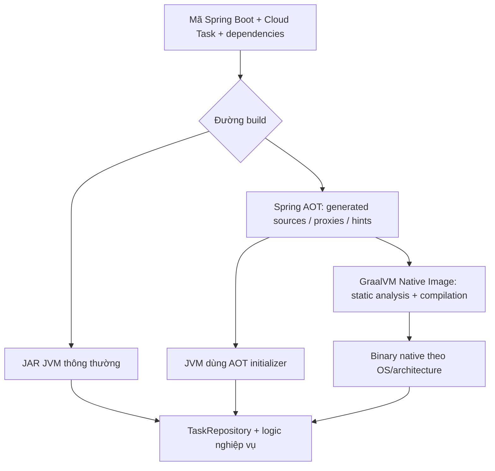

# Đánh giá Spring AOT và GraalVM Native Image

## 1. Tại sao cần đánh giá AOT/native cho Spring Cloud Task?

Trong chương **Tối ưu và nâng cấp** của **Spring Cloud Task**, mục tiêu không đơn thuần là tạo ra một file thực thi nhỏ hơn JAR. Chúng ta cần quyết định liệu **Spring Ahead-of-Time (AOT)** và **GraalVM Native Image** có thật sự cải thiện một ứng dụng Spring Boot **chạy hữu hạn**: khởi động, xử lý yêu cầu hoặc dữ liệu theo lô, ghi `TaskExecution` vào `TaskRepository`, trả mã thoát rồi kết thúc.

Giả sử một hệ thống chạy 20.000 tác vụ nhỏ mỗi ngày. Mỗi task chỉ xử lý dữ liệu trong 2 giây nhưng cần nhiều giây để JVM và Spring Context khởi động. Khi số lần khởi chạy tăng, phần thời gian và bộ nhớ dành cho khởi động trở thành chi phí đáng kể. Native image có thể **khởi động nhanh hơn và dùng ít bộ nhớ hơn** so với tiến trình JVM thông thường. Ngược lại, một job chạy liên tục 3 giờ có thể không được lợi nhiều từ vài giây startup nhưng vẫn phải trả giá cho **build native tốn tài nguyên**, đặc thù tương thích thư viện và quy trình release phức tạp hơn.

Đây là **bài đánh giá kỹ thuật**, không phải lời khuyên “chuyển tất cả Spring Cloud Task sang native”. Ta cần cân nhắc cả:

- **Hiệu năng:** cold start, thời gian từ lúc scheduler yêu cầu đến khi hoàn tất, RSS/peak memory, throughput, CPU và thời gian chờ database.
- **Độ đúng:** lifecycle `TaskExecution`, tham số, transaction, exception/exit code, listener, repository và idempotency khi retry.
- **Tương thích:** JDBC driver, Spring Batch, reflection, proxy, resource, serializer và các integration Spring Cloud khác.
- **Vận hành:** kích thước image, thời gian build CI, khả năng tái tạo artifact, observability, bảo mật và rollback.
- **Tính linh hoạt cấu hình:** các bean/profile/condition được quyết định tại build time hay runtime.

Sau bài này, bạn có thể:

1. Phân biệt Spring AOT với GraalVM Native Image và việc chạy Java JAR trên JVM.
2. Nhận biết những loại task hữu hạn thường hưởng lợi và những trường hợp không đáng chuyển.
3. Chuẩn bị một POC build native bằng Maven hoặc Gradle với phiên bản tương thích.
4. Khắc phục thiếu `RuntimeHints`, reflection, resource và proxy mà không thêm bừa cấu hình toàn cục.
5. Kiểm thử TaskRepository, Spring Batch, listener, mã thoát và lỗi startup dưới native.
6. Thiết kế benchmark công bằng, đặt tiêu chí chấp nhận và triển khai từng bước có đường quay về JVM.

> **Lưu ý phiên bản:** Hỗ trợ AOT/native phụ thuộc chặt vào bộ **JDK/GraalVM, Spring Boot, Spring Framework, Spring Cloud Task, Spring Batch và thư viện bên thứ ba**. Không lấy cấu hình của một bản bất kỳ rồi coi là áp dụng cho mọi release. Ví dụ dưới đây diễn tả hướng thực hành theo Spring Boot 3.x/4.x và Native Build Tools ở mức khái niệm; hãy khóa bộ phiên bản tương thích trước khi chạy build.

## 2. Phân biệt ba cách chạy ứng dụng

| Cách triển khai | Điều diễn ra khi build | Điều diễn ra khi chạy | Đặc điểm |
| --- | --- | --- | --- |
| **JVM/JAR thông thường** | Biên dịch Java, đóng gói JAR và dependency | JVM tải lớp, Spring xử lý bean/auto-configuration động | Linh hoạt, dễ debug, tương thích thư viện rộng |
| **Spring AOT chạy trên JVM** | Sinh code/bytecode và runtime hints cho cấu trúc Spring Context | JVM chạy với initializer đã được AOT sinh ra, vẫn là tiến trình Java | Kiểm tra/khai thác AOT mà chưa cần biên dịch native |
| **GraalVM Native Image** | Spring AOT rồi GraalVM phân tích reachable code và tạo executable native cho OS/CPU cụ thể | Chạy file native, không cần cài JVM ở runtime | Startup/RSS thường có lợi, nhưng giới hạn dynamic behavior và build nặng hơn |

**Spring AOT không đồng nghĩa GraalVM Native Image**:

- **Spring AOT** dịch nhiều phần xử lý cấu hình động của Spring sang cấu trúc được sinh **trước khi chạy**.
- **GraalVM Native Image** phân tích ứng dụng theo mô hình *closed world* rồi biên dịch thành file executable cụ thể cho nền tảng.
- Khi build Spring Boot native, **AOT là bước bắt buộc** để Spring Context có đủ metadata cho native image.
- Có thể dùng **AOT-processed JVM** làm bước kiểm tra trung gian; nó không chứng minh mọi reflection/resource đều sẽ hoạt động trong binary native.



**Cùng một yêu cầu nghiệp vụ** phải có hành vi tương đương giữa ba đường: xử lý đúng số bản ghi, lưu `TaskExecution` đúng, thông báo lỗi đúng và không tạo side effect trùng khi retry. Khác biệt về tốc độ startup không cho phép thay đổi kết quả nghiệp vụ.

## 3. Cơ chế AOT: những gì được cố định từ lúc build?

Ứng dụng Spring Boot trên JVM thường khám phá bean, phân tích auto-configuration và tạo proxy động khi khởi động. Trong chế độ AOT, Spring xử lý cấu trúc bean sớm hơn và sinh những thành phần mà native compiler hiểu được.

Tài liệu Spring Boot mô tả những nhóm output của AOT:

- **Java sources** cung cấp cấu trúc khởi tạo bean đã được sinh.
- **Bytecode** cho proxy và những thành phần cần thiết.
- **Runtime hints** cho reflection, resources, serialization, JDK proxy và các thao tác không thể suy ra chỉ bằng phân tích tĩnh.

### Closed-world và điều kiện tạo bean

Trong native image, **classpath và cấu trúc bean về cơ bản cố định ở build time**. Điều này ảnh hưởng trực tiếp đến:

| Mẫu thiết kế trên JVM | Rủi ro khi AOT/native | Hướng đánh giá |
| --- | --- | --- |
| `@Profile("prod")` tạo các bean khác với `dev` | AOT xử lý tập bean theo điều kiện lúc build | Đồng bộ build environment hoặc build artifact riêng cho từng tập bean |
| `@ConditionalOnProperty` quyết định có bean hay không | Đổi property ở runtime không tạo lại bean đã bị loại tại build time | Chốt giá trị condition khi AOT, kiểm thử profile/flag |
| `Class.forName(...)` theo cấu hình động | Lớp không reachable có thể bị loại | Dùng API tường minh hoặc đăng ký hints phù hợp |
| Load implementation từ plugin/JAR mới lúc chạy | Native image có classpath cố định | Chọn plugin cố định ở build, hoặc giữ JVM nếu cần module động |
| Tạo proxy/reflect tùy ý ở runtime | Thiếu metadata/proxy native | Kiểm tra AOT compatibility và bổ sung `RuntimeHints` |
| Scan resource theo wildcard/đường dẫn JAR | Resource không được đóng gói hoặc URL protocol không khả dụng | Đăng ký resource hints và test đọc file thật |
| Dùng thư viện native/JNI, mã hóa, locale/timezone đặc biệt | Binary phụ thuộc nền tảng và metadata | Kiểm tra hỗ trợ thư viện, hệ điều hành, charset và TLS |

**Không phải mọi property runtime đều bị cố định.** Ví dụ `--business-date=2026-11-24`, `--request-id=...` hoặc giá trị truy vấn là **dữ liệu được đọc khi chạy**, không nhất thiết thay đổi bean graph. Ngược lại, property làm xuất hiện/biến mất một bean qua `@ConditionalOnProperty` thường phải được quyết định khi AOT.

### Ví dụ phân biệt cấu hình

```java
@Bean
@ConditionalOnProperty(
        name = "feature.audit.enabled",
        havingValue = "true")
AuditPublisher auditPublisher() {
    return new AuditPublisher();
}
```

Nếu AOT build khi `feature.audit.enabled=false`, đừng mặc định truyền `--feature.audit.enabled=true` lúc chạy native sẽ tạo ra Bean `AuditPublisher`. Cách vận hành phù hợp hơn có thể là giữ một bean ổn định và bật/tắt **hành vi bên trong bean** bằng giá trị runtime (khi an toàn), hoặc build hai artifact theo cấu hình được phép.

Trong thực tế, **bí mật và kết nối database** vẫn phải đọc từ môi trường runtime theo cơ chế Boot hỗ trợ; không đưa mật khẩu vào quy trình AOT để “đóng băng” cấu hình. Bước AOT cần có cấu hình **đủ ổn định để phân tích bean**, nhưng không nên truy cập hoặc chụp dữ liệu bí mật thật.

## 4. Khi nào chuyển sang native có ý nghĩa?

| Dạng workload Spring Cloud Task | Tiềm năng | Điều cần chứng minh |
| --- | --- | --- |
| Task rất ngắn, chạy hàng nghìn lần/ngày | **Cao** nếu startup chiếm tỷ trọng lớn | Giảm startup/chi phí tổng, không tăng lỗi metadata |
| Function/on-demand task bị ràng buộc thời gian phản hồi | **Có thể cao** | End-to-end latency bao gồm cả queue/container scheduling |
| Task bị giới hạn bộ nhớ trong container nhỏ | **Có thể cao** | Giảm peak RSS mà không làm throughput giảm mạnh |
| Spring Batch chạy hàng giờ | **Thường thấp hơn về startup** | Lợi ích bộ nhớ/tài nguyên và runtime dài hạn có đủ bù chi phí build? |
| Job có JDBC/ORM/JSON/resource động | **Cần POC kỹ** | Hints đủ, migration đúng, kết quả nghiệp vụ giống JVM |
| Ứng dụng nạp plugin/script/JAR mới lúc runtime | **Rủi ro cao** | Có chấp nhận thay kiến trúc hoặc giữ JVM? |
| Task hiếm khi chạy, build/release liên tục | **Chưa chắc đáng** | Chi phí CI, image storage, debug/rollback có vượt lợi ích? |

Một ước lượng đơn giản: nếu Task chạy `T_total = T_startup + T_business + T_shutdown`, native chỉ giảm phần startup nhưng **database query vẫn phải chạy và mạng vẫn có độ trễ**. Chẳng hạn startup giảm từ 4 giây còn 0,5 giây sẽ rất đáng kể với task nghiệp vụ 1 giây, nhưng ít ảnh hưởng tỷ lệ với job nghiệp vụ 4 giờ. Đây là **ví dụ giả định**, không phải số đo được bảo đảm bởi GraalVM.

Với hệ thống chạy theo lịch, phải đo **thời gian từ scheduler request đến kết quả cuối**, không chỉ dòng log “Started … in X seconds”. Nếu Kubernetes phải chờ pull image 30 giây, tiết kiệm 3 giây startup JVM có thể không cải thiện SLA đáng kể. Ngược lại, binary nhỏ và RSS thấp có thể giúp pod scheduling/concurrency, nhưng cũng phải đo chứ không suy diễn.

## 5. Điều kiện tiên quyết cho một POC đáng tin

Trước khi viết cấu hình native, ghi lại **hợp đồng đang chạy của bản JVM**:

1. **Nền tảng:** phiên bản JDK, OS, kiến trúc CPU (`linux/amd64`, `linux/arm64`...), base image, môi trường build và runtime.
2. **Phiên bản Spring:** Spring Boot, Framework, Cloud Task, Spring Batch (nếu có), Spring Cloud Stream/Data Flow/deployer (nếu có).
3. **Dependency bên thứ ba:** JDBC driver, Jackson, ORM, Flyway/Liquibase, TLS, HTTP clients, serialization, queue và native libraries.
4. **Nguồn cấu hình:** profile, `@ConditionalOnProperty`, secret injection, resource files và thay đổi config giữa môi trường.
5. **Luồng Task:** `ApplicationRunner`/`CommandLineRunner`, listener, timeout, mã thoát, `TaskRepository` và cách đóng Spring Context.
6. **Tiêu chí nghiệp vụ:** số bản ghi đọc/ghi, idempotency, checkpoint Spring Batch, lỗi có thể retry/không thể retry.
7. **Pipeline:** có builder đủ CPU/RAM/disk để build native, có Docker/Buildpacks hoặc GraalVM toolchain và CI runner phù hợp.

Chọn một **Task nhỏ nhưng đại diện**: có `TaskRepository` dùng PostgreSQL, nhận argument, thực hiện truy vấn JDBC và một đường lỗi có kiểm soát. Sau khi POC tối thiểu PASS mới thêm Spring Batch, Streams và các integration phức tạp. Không bắt đầu bằng task nặng nhất chứa mọi plugin nếu mục tiêu là xác định rủi ro từng lớp.

### Tính tương thích là giả thuyết phải kiểm tra

Spring Boot, Spring Cloud Task và Spring Batch có hỗ trợ AOT/native ở các phiên bản phù hợp, nhưng **không đồng nghĩa toàn bộ tổ hợp thư viện của một ứng dụng được bảo đảm hoạt động**. Nếu một driver hoặc SDK bên thứ ba dùng reflection chưa được đăng ký, native build vẫn có thể thành công trong khi **đường logic hiếm gặp** thất bại lúc chạy.

Tạo bảng kiểm từng dependency theo version, đường code thực sự gọi đến và trạng thái kiểm thử. Nếu không có cách khắc phục an toàn cho một thư viện quan trọng, **giữ JVM** là lựa chọn hợp lý.

## 6. Ứng dụng mẫu Spring Cloud Task để làm đường chuẩn

Ví dụ sau mô phỏng một task hữu hạn nhận `--business-date`, dùng JDBC để đếm bản ghi và trả kết quả. Nó có thể được xây cho JVM trước, rồi dùng **cùng logic** khi build native.

```java
package com.example.nativepoc;

import java.time.LocalDate;
import java.util.List;

import org.slf4j.Logger;
import org.slf4j.LoggerFactory;
import org.springframework.boot.ApplicationRunner;
import org.springframework.boot.SpringApplication;
import org.springframework.boot.autoconfigure.SpringBootApplication;
import org.springframework.cloud.task.configuration.EnableTask;
import org.springframework.context.annotation.Bean;
import org.springframework.jdbc.core.JdbcTemplate;

@SpringBootApplication
@EnableTask
public class SettlementTaskApplication {
    private static final Logger log =
            LoggerFactory.getLogger(SettlementTaskApplication.class);

    public static void main(String[] args) {
        SpringApplication.run(SettlementTaskApplication.class, args);
    }

    @Bean
    ApplicationRunner settlementRunner(JdbcTemplate jdbc) {
        return args -> {
            List<String> values = args.getOptionValues("business-date");
            if (values == null || values.size() != 1) {
                throw new IllegalArgumentException(
                        "Cần --business-date=yyyy-MM-dd");
            }

            LocalDate date = LocalDate.parse(values.get(0));
            Long count = jdbc.queryForObject(
                    """
                    SELECT COUNT(*)
                    FROM payment_event
                    WHERE business_date = ?
                    """,
                    Long.class,
                    java.sql.Date.valueOf(date));
            log.info("Ngày {}, số sự kiện: {}", date, count);

            if (args.containsOption("fail")) {
                throw new IllegalStateException(
                        "Lỗi giả lập sau khi đọc dữ liệu");
            }
        };
    }
}
```

Đây là **khung ứng dụng học tập**. Để chạy cần:

- Dependency `spring-cloud-starter-task`, `spring-boot-starter-jdbc` và driver PostgreSQL tương thích.
- Datasource, schema `TASK_EXECUTION` của Spring Cloud Task và bảng nghiệp vụ `payment_event`.
- Cách cấu hình/kiểm thử đóng context sau runner phù hợp phiên bản Task, để process hữu hạn thực sự thoát.
- Quy tắc kết quả nghiệp vụ; `COUNT(*)` đơn thuần chưa phải một tác vụ đối soát hoàn chỉnh.

**Không tự gọi `System.exit(0)` ngay trong runner** để làm task thoát nhanh: điều đó có thể cắt ngang callback/lưu metadata cuối hoặc flush telemetry. Muốn kiểm soát mã thoát tiến trình, dùng cơ chế Spring Boot/Cloud Task phù hợp và test ở ranh giới `java -jar`/native executable.

### Cấu hình runtime cơ bản

```yaml
spring:
  application:
    name: settlement-native-poc
  main:
    web-application-type: none
  datasource:
    url: jdbc:postgresql://postgres:5432/task_poc
    username: task_user
  cloud:
    task:
      name: settlement-native-poc
```

Mật khẩu được truyền qua secret/biến môi trường như `SPRING_DATASOURCE_PASSWORD`, không đưa vào mã nguồn hoặc binary. Cần tạo/migrate schema metadata phù hợp trước khi chạy. Việc có datasource khi runtime **không có nghĩa phải kết nối DB sản xuất trong giai đoạn AOT build**.

## 7. Build Native Image bằng Maven

Đối với dự án Maven sử dụng **`spring-boot-starter-parent`** và BOM Spring Cloud tương thích, Spring Boot có profile `native` để đơn giản hóa công việc AOT/native. Ví dụ **phần cấu hình plugin** cần thêm vào `pom.xml`:

```xml
<build>
    <plugins>
        <plugin>
            <groupId>org.springframework.boot</groupId>
            <artifactId>spring-boot-maven-plugin</artifactId>
        </plugin>
        <plugin>
            <groupId>org.graalvm.buildtools</groupId>
            <artifactId>native-maven-plugin</artifactId>
        </plugin>
    </plugins>
</build>
```

Đoạn này **không phải một `pom.xml` đầy đủ** và không tự chọn phiên bản cho bạn. Parent/BOM phải tương thích với Java, Boot, Cloud Task và native build tools đã được nhóm xác minh. Nếu **không dùng `spring-boot-starter-parent`**, bạn có thể phải cấu hình thêm `process-aot` và reachability-metadata cho plugin theo hướng dẫn riêng của bản Spring Boot đang dùng.

### Hai con đường build thường gặp

```bash
# Đường 1: GraalVM Native Build Tools tạo binary trên máy build.
# Yêu cầu toolchain GraalVM phù hợp đã được cài.
./mvnw -Pnative native:compile

# Đường 2: Spring Boot Buildpacks xây container native image.
# Yêu cầu container daemon/builder phù hợp.
./mvnw -Pnative spring-boot:build-image
```

Trên Windows, wrapper Maven thường dùng `mvnw.cmd` thay vì `./mvnw`; máy build native cần toolchain/OS/architecture phù hợp. Đường 2 thường thuận tiện trong CI nếu dùng Buildpacks, nhưng **Docker/daemon và builder image cũng phải tương thích**.

Kết quả đường 1 là executable **native cho nền tảng build tương ứng**; kết quả đường 2 là **container image native**, không nhất thiết là một file JAR. Chỉ copy binary từ Linux AMD64 sang môi trường ARM64 sẽ không tự chạy được.

### Cấu hình AOT build không giống runtime secret

Nếu ứng dụng có `@ConditionalOnProperty` làm thay đổi danh sách bean, giá trị điều kiện cần được thiết lập **ở bước process-aot**. Khi runtime muốn thay đổi giá trị ấy để “thêm bean mới”, native image có thể không có bean đó. Đừng truyền password thật vào plugin chỉ vì muốn AOT thành công. Thiết kế lại điều kiện cho phù hợp hoặc dùng cấu hình build riêng không chứa secret.

## 8. Build Native Image bằng Gradle

Với Gradle, tài liệu Spring Boot hướng dẫn áp dụng plugin **`org.graalvm.buildtools.native`** bên cạnh Spring Boot plugin. Ví dụ **phần plugins** (version được quản lý/khóa trong build của dự án):

```groovy
plugins {
    id 'java'
    id 'org.springframework.boot'
    id 'io.spring.dependency-management'
    id 'org.graalvm.buildtools.native'
}
```

Đây là **snippet cấu trúc**, không phải file `build.gradle` hoàn chỉnh: build thực cần khai báo version hoặc plugin management tương ứng, repositories, dependency và toolchain.

Các lệnh thường gặp:

```bash
# Sinh và dùng output AOT trong quá trình native build.
./gradlew nativeCompile

# Build container image với native image qua Spring Boot Buildpacks.
./gradlew bootBuildImage
```

Plugin native của GraalVM tích hợp với `processAot` khi dùng Spring Boot plugin tương thích. Kiểm tra artifact output và build log; **không coi `gradle build` thông thường là đã tạo native executable**. Với Windows sử dụng `gradlew.bat`/PowerShell theo môi trường.

Không cần chạy cả Maven lẫn Gradle trong một dự án chỉ để đánh giá native. Chọn đúng hệ build hiện có; hai đoạn trên nhằm cho thấy những **đường thực hiện tương ứng**.

## 9. Kiểm tra AOT trên JVM trước khi biên dịch native

Native compilation có thể tốn nhiều thời gian và bộ nhớ. Spring Boot cho phép chạy **AOT-generated code trên JVM** như bước kiểm tra trung gian nếu artifact đã được build chứa AOT output.

Ví dụ sau khi dùng `-Pnative` và đóng gói JAR có AOT assets với cấu hình Maven tương ứng:

```bash
java -Dspring.aot.enabled=true -jar target/settlement-task.jar \
  --business-date=2026-11-24
```

`target/settlement-task.jar` chỉ là **tên minh họa**; dùng path thực tế được build của dự án. Nếu JAR chưa chứa AOT-generated initializer, bật property ở runtime không tạo ra AOT code từ không khí. Cũng cần phân biệt JVM startup và native startup khi benchmark.

Ba tầng kiểm chứng nên được làm theo thứ tự:

1. **JVM bình thường:** baseline nghiệp vụ và metadata.
2. **JVM chạy AOT output:** kiểm tra cấu trúc bean/profile và khởi tạo context theo code sinh trước.
3. **Native executable:** kiểm tra full path, tài nguyên, reflection, DB, TLS và behavior thực tế sau static analysis.

Một test PASS ở bước 2 **tăng độ tin cậy** nhưng **không chứng minh** native chắc chắn PASS: một số vấn đề reachability/proxy/serialization chỉ xuất hiện sau khi biên dịch thành binary.

## 10. RuntimeHints: khi reflection và resource không tự hoạt động

GraalVM phân tích tĩnh những lớp/method reachable từ entry point. Nếu ứng dụng gọi reflection hoặc load classpath resource bằng tên động, native compiler có thể không biết cần giữ những thứ đó.

Triệu chứng thực tế thường thấy:

- JVM đọc được tệp JSON/SQL/template trong `src/main/resources` nhưng native báo không tìm thấy resource.
- Jackson hoặc một thư viện mapping báo không tạo được đối tượng do thiếu constructor/field reflection.
- Thư viện gọi `Class.forName`, `ServiceLoader` hoặc dynamic proxy nhưng implementation cần thiết không được bao gồm.
- Reflection được gọi chỉ trên **đường lỗi** hiếm gặp, build và happy path native đều PASS nhưng failure path mới phát hiện lỗi.

**Đừng thêm hints cho cả package bằng wildcard lớn một cách mù quáng**. Hãy xác định đúng class/resource bị thiếu và chọn API hints tối thiểu.

### 10.1. Ví dụ đăng ký resource cần dùng tại runtime

Giả sử `WindowProcessor` đọc một file `rules/reconciliation.json` đã được đóng gói trong classpath. Trong native image, bạn có thể khai báo rõ:

```java
import org.springframework.aot.hint.RuntimeHints;
import org.springframework.aot.hint.RuntimeHintsRegistrar;
import org.springframework.context.annotation.Configuration;
import org.springframework.context.annotation.ImportRuntimeHints;

final class ReconciliationRuntimeHints implements RuntimeHintsRegistrar {
    @Override
    public void registerHints(RuntimeHints hints, ClassLoader classLoader) {
        hints.resources().registerPattern("rules/reconciliation.json");
    }
}

@Configuration(proxyBeanMethods = false)
@ImportRuntimeHints(ReconciliationRuntimeHints.class)
class ReconciliationHintsConfiguration {
}
```

Mẫu code chỉ đăng ký **resource hint**, không tự tạo file `rules/reconciliation.json`. Tệp phải thực sự nằm trong classpath của dự án. Nó không thay thế việc cấu hình externalized file path hoặc volume mount khi tài liệu/luật nghiệp vụ được tải **ngoài binary**.

### 10.2. Binding object cần reflection

Nếu cần deserialize một kiểu JSON do ứng dụng định nghĩa từ message hoặc file, có thể dùng annotation `@RegisterReflectionForBinding` với Spring:

```java
import org.springframework.aot.hint.annotation.RegisterReflectionForBinding;
import org.springframework.context.annotation.Configuration;

@Configuration(proxyBeanMethods = false)
@RegisterReflectionForBinding(SettlementPayload.class)
class SettlementBindingHints {
}

record SettlementPayload(String orderId, long amountInCents) {}
```

**Lưu ý về code Java:** ví dụ dùng record không có modifier `public` để có thể đặt cùng file với class cấu hình trong package phù hợp. Nếu muốn công khai kiểu `SettlementPayload` cho package khác sử dụng, hãy đưa nó vào file `SettlementPayload.java` riêng.

Không đăng ký reflection tràn lan cho mọi entity, trừ khi thực sự cần. Spring Boot/Spring Framework và nhiều starter tạo sẵn hints; chỉ thêm custom hint cho khoảng trống được chứng minh qua test.

### 10.3. Test cho custom RuntimeHints

Spring Framework cung cấp `RuntimeHintsPredicates` để kiểm chứng hint trong unit test:

```java
import static org.assertj.core.api.Assertions.assertThat;

import org.junit.jupiter.api.Test;
import org.springframework.aot.hint.RuntimeHints;
import org.springframework.aot.hint.predicate.RuntimeHintsPredicates;

class ReconciliationRuntimeHintsTest {
    @Test
    void includesReconciliationResource() {
        RuntimeHints hints = new RuntimeHints();
        new ReconciliationRuntimeHints().registerHints(
                hints, getClass().getClassLoader());
        assertThat(RuntimeHintsPredicates.resource()
                .forResource("rules/reconciliation.json")).accepts(hints);
    }
}
```

Unit test hints xác nhận **đã khai báo**, nhưng không đủ để chứng minh resource có mặt trong binary hoặc Jackson deserialize thành công. Thêm **native integration test** chạy đúng đường code và kiểm tra kết quả.

## 11. Spring Cloud Task có những điểm cần xác minh riêng

Với Spring Cloud Task, native image phải giữ đúng vòng đời của **một lần TaskExecution**, không chỉ chạy được `main`:

| Điểm kiểm chứng | Vì sao quan trọng? | Test tối thiểu |
| --- | --- | --- |
| `@EnableTask`/auto-configuration | AOT phải sinh được cấu trúc bean Task đúng | Bắt đầu một lần chạy, không thiếu bean |
| `TaskRepository`/schema JDBC | Metadata cần tồn tại qua process mới | `START_TIME`, `END_TIME`, `EXIT_CODE` được cập nhật |
| `ApplicationRunner`/`CommandLineRunner` | Đây là trọng tâm công việc hữu hạn | Runner nhận tham số và chỉ chạy đúng số lần |
| `TaskExecutionListener` | Callback có thể quyết định exit message/side effect | `onTaskStartup`, `onTaskEnd`, `onTaskFailed` theo đường phù hợp |
| Tham số `spring.cloud.task.name` | Dùng để định danh metadata và chính sách single-instance | Không nhầm tên Task, Task ID và request ID |
| `spring.cloud.task.external-execution-id` | Liên kết với scheduler/container | Có thể đọc lại ID ngoài khi đã gắn |
| Mã thoát OS | Scheduler thường dựa vào process status | Success 0, failure khác 0 theo hợp đồng |
| `single-instance-enabled` | Condition có thể cần được bật lúc AOT build | Thử hai tiến trình cùng tên cạnh tranh lock |

Một số lỗi khởi tạo context xảy ra **trước khi TaskExecution được tạo**, vì vậy database có thể **không có bản ghi** dù native executable đã được hệ điều hành gọi. Do đó mọi test nên thu process exit status và log runtime, không chỉ SQL.

### Ví dụ SQL đối chiếu hai đường JVM/native

```sql
SELECT TASK_EXECUTION_ID,
       TASK_NAME,
       START_TIME,
       END_TIME,
       EXIT_CODE,
       EXIT_MESSAGE,
       ERROR_MESSAGE
FROM TASK_EXECUTION
WHERE TASK_NAME = 'settlement-native-poc'
ORDER BY TASK_EXECUTION_ID DESC
LIMIT 20;
```

Hai lần chạy trên JVM và native **không được dùng chung TaskExecutionId**, vì mỗi lần chạy là một execution độc lập. So sánh **hành vi**, không đòi metadata ID/timestamp giống hệt.

Khi thao tác với repository ở native, chú ý cả driver JDBC, datasource pool, transaction manager, SQL schema initialization và đường xử lý exception. Một binary có thể startup rất nhanh nhưng thất bại khi kết nối DB, làm tổng thời gian kết thúc còn **dài hơn** do network timeout.

## 12. Trường hợp đặc biệt: single-instance trong AOT/native

Spring Cloud Task có `spring.cloud.task.single-instance-enabled=true` để hạn chế hai task **cùng tên** chạy đồng thời trong điều kiện sử dụng lock và repository phù hợp. Theo tài liệu Spring Cloud Task, khi dùng tính năng này với native image, **phải bật ở lúc process-aot** vì nó ảnh hưởng đến bean/condition được sinh.

Ví dụ phần `spring-boot-maven-plugin` khai báo thêm một execution AOT dành cho bản single-instance:

```xml
<plugin>
    <groupId>org.springframework.boot</groupId>
    <artifactId>spring-boot-maven-plugin</artifactId>
    <executions>
        <execution>
            <id>process-aot</id>
            <goals>
                <goal>process-aot</goal>
            </goals>
            <configuration>
                <jvmArguments>
                    -Dspring.cloud.task.single-instance-enabled=true
                </jvmArguments>
            </configuration>
        </execution>
    </executions>
</plugin>
```

**Quan trọng:** Property đang sử dụng thực tế là `spring.cloud.task.single-instance-enabled`. Một số đoạn **văn bản mô tả** trong tài liệu Spring Cloud Task dùng chữ `single-step-instance-enabled` nhưng **đoạn cấu hình Maven trong cùng tài liệu sử dụng `single-instance-enabled`**; hãy tuân theo property chính thức được tài liệu hóa và xác nhận bằng integration test. Đừng copy typo vào production build mà không thử.

Ngoài điều kiện build-time, tính năng còn cần các dependency lock của Spring Integration và datasource phù hợp theo version (ví dụ `spring-integration-core`, `spring-integration-jdbc`). Cấu hình build native **không thay thế** việc bật/kiểm tra chính sách lúc chạy và không tạo mutex toàn hệ thống một cách kỳ diệu.

Test tối thiểu:

1. Khởi chạy hai binary/native container **cùng `spring.cloud.task.name`** với lock store chia sẻ.
2. Cho lần đầu giữ Task đủ lâu; khởi chạy lần hai trong lúc lần đầu còn hoạt động.
3. Xác minh lần hai bị ngăn hoặc nhận mã lỗi phù hợp với bản Spring Cloud Task.
4. Sau khi lần đầu kết thúc, thử chạy lại và kiểm tra lock được giải phóng/TTL hoạt động.
5. Thử crash/kill để phát hiện trạng thái lock treo; không tự sửa metadata nếu chưa xác nhận nguyên nhân.

Single-instance **không phải idempotency nghiệp vụ**: hai lần chạy tuần tự cùng tên vẫn có thể ghi trùng dữ liệu nếu writer không có khóa riêng.

## 13. Khi ứng dụng có Spring Batch

Spring Batch khiến bài đánh giá native **phức tạp hơn** một task chỉ có một runner:

- `JobRepository`/`TaskRepository` cần đúng datasource và schema; không nhầm `TaskExecution` với `JobExecution`.
- `JobParameters` định danh phải ổn định qua retry để restart cùng `JobInstance`.
- `ItemReader`, `ItemProcessor`, `ItemWriter`, `ItemStream` có thể dùng serializer, resource, SpEL và reflection khác nhau.
- `ExecutionContext` được lưu/đọc qua repository cần tương thích kiểu dữ liệu và serializer khi chuyển phiên bản/artifact.
- Một batch job có thể chạy thành công nhưng Task/process thoát lỗi ở bước khác; phải kiểm tra kết quả ở cả hai lớp.
- Remote partitioning/worker native đòi mọi worker dùng contract, schema và version tương thích; không tự giả định một native worker giống JVM worker trong từng resource/driver.

### Ma trận Batch cần kiểm thử

| Ca | JVM baseline | AOT JVM | Native |
| --- | --- | --- | --- |
| Job nhỏ hoàn tất | Ghi số dòng và trạng thái `COMPLETED` | Tương đương JVM | Tương đương JVM |
| Step chunk fail ở giữa | Ghi `FAILED`, checkpoint | Checkpoint đúng | Checkpoint đúng |
| Restart cùng identifying parameters | `JobExecution` mới cùng `JobInstance` khi hợp lệ | Hành vi giữ nguyên | Hành vi giữ nguyên |
| Reader đọc resource/CSV/JSON | Đọc đúng charset/format | Đọc đúng | Đọc đúng, resource/hints đủ |
| Writer gọi API ngoài | Idempotency key ổn định | Không gửi trùng | Không gửi trùng |
| Batch status → Task exit code | Truyền lỗi theo policy | Không đổi | Không đổi |

Nếu code dùng `RunIdIncrementer` hoặc timestamp **định danh** mới trên mỗi lần retry, đó là vấn đề **đúng đắn Spring Batch**, không phải do native. Cần sửa chính sách restart trên JVM trước rồi mới so sánh native.

Đặc biệt, không đánh giá native chỉ bằng cách chạy job happy path 10 bản ghi. Phải test đường đọc/ghi của mỗi loại resource, restart sau lỗi và deserialize `ExecutionContext` từ metadata đã lưu bởi phiên bản được hỗ trợ.

## 14. Khác biệt về lifecycle, shutdown và observability

Task native vẫn phải đi qua các mốc kết thúc phù hợp để Spring Cloud Task ghi `END_TIME`/`EXIT_CODE`. Trong container:

1. Scheduler yêu cầu workload.
2. Nền tảng cấp container/process.
3. Native executable bắt đầu, khởi tạo Spring Context.
4. `ApplicationRunner` thực thi nghiệp vụ.
5. Task listener/repository ghi nhận kết thúc nếu có thể.
6. Tiến trình trả status cho runtime.

**Không tự kết luận binary đã thành công chỉ vì startup log rất nhanh.** Nếu bị `SIGKILL`, thiếu credential hoặc repository không khả dụng, metadata có thể không được tạo/đóng. Các lỗi này phải được kiểm tra từ runtime, log và kết quả nghiệp vụ.

### Metrics trong task ngắn

Một native task có thể hoàn tất **trước chu kỳ Prometheus scrape hoặc OTLP exporter flush**. Khi startup ngắn hơn, rủi ro thiếu metrics theo cơ chế pull còn cao hơn. Đừng đánh giá hiệu quả bằng một dashboard bị thiếu mẫu rồi coi những Task không có metric là không chạy.

Theo dõi đồng thời:

- `TaskRepository`: `TASK_EXECUTION_ID`, `START_TIME`, `END_TIME`, `EXIT_CODE`.
- `spring.cloud.task` và `spring.cloud.task.runner` timers khi instrumentation và exporter hoạt động.
- Runtime: Pod start/finish, peak RSS, CPU, mã thoát và lý do kill.
- Domain audit: dữ liệu đã xử lý đủ, số lần retry và duplicate count.

Nếu exporter không flush đủ trước shutdown, cần chọn pipeline thích hợp cho job hữu hạn (push/collector, log bền vững, reconcile TaskRepository), thay vì giữ JVM sống nhân tạo chỉ để chờ scrape mà không đánh giá chi phí.

## 15. Thiết kế benchmark công bằng

### 15.1. Đo cùng một workload

Muốn biết native có đáng dùng hay không, phải giữ cố định:

- Cùng **businessDate/input snapshot**, số bản ghi và schema database.
- Cùng transaction semantics, số kết nối, timeout, phương thức retry và batch/chunk size.
- Cùng CPU/memory limits, container architecture, vùng mạng và phiên bản service ngoài.
- Cùng bản application logic và compatible dependency; chỉ đổi cách build/chạy.
- Cùng trạng thái tài nguyên nền tảng, cùng cách đo cold/warm cache; ghi rõ ngoại lệ.

**Không so sánh** JVM chạy trong laptop với native chạy trong Kubernetes production, rồi kết luận chênh lệch do AOT.

### 15.2. Những thước đo quan trọng

| Chỉ số | Đơn vị | Đo như thế nào? | Tác động đến quyết định |
| --- | --- | --- | --- |
| `cold_start_ms` | ms | Từ process start đến app/runner bắt đầu | Quan trọng cho task nhỏ và on-demand |
| `end_to_end_ms` | ms | Từ scheduler yêu cầu đến kết quả nghiệp vụ cuối | Thể hiện lợi ích người dùng thật |
| `task_duration_ms` | ms | Từ lifecycle Task/TaskRepository hoặc timer phù hợp | So sánh phạm vi framework, không gồm queue |
| `business_duration_ms` | ms | Đo trong service nghiệp vụ | Phát hiện native làm chậm/tăng tốc xử lý thật |
| `peak_rss_mib` | MiB | Runtime/cgroup/OS metrics | Chi phí node/giới hạn Pod |
| `cpu_seconds` | CPU-s | Runtime metrics | Chi phí tài nguyên và throughput |
| `artifact_size_mib` | MiB | Kích thước JAR + runtime hoặc container native | Ảnh hưởng distribution/pull/storage |
| `native_build_minutes` | phút | CI build từng commit/release | Chi phí phát triển và release |
| `pass_rate` | % | Test nghiệp vụ, Batch, TaskRepository, lỗi | Điều kiện **bắt buộc** trước tối ưu |

Đo **nhiều lượt chạy**, báo ít nhất median/P95 và tỉ lệ lỗi; tách cold start (chưa warm cache) khỏi warm restart. Với sample nhỏ, percentile dễ nhiễu. Đối với benchmark latency, dùng cùng cách lấy mốc ở cả JVM và native để tránh so khác phạm vi.

### 15.3. Bộ kết quả giả định để tập cách đọc

| Chỉ số | JVM (giả định) | Native (giả định) | Cách diễn giải |
| --- | ---: | ---: | --- |
| Median startup | 2.800 ms | 240 ms | Native giảm đáng kể phần khởi động |
| P95 end-to-end | 16,0 s | 13,7 s | Lợi ích tổng ít hơn tỷ lệ giảm startup |
| Peak RSS | 260 MiB | 115 MiB | Có thể tăng số job trên một node |
| Thời gian build CI | 2 phút | 11 phút | Chi phí phát hành cao hơn |
| Pass rate nghiệp vụ | 100% | 100% | Điều kiện tối thiểu trước rollout |

**Tất cả các số trên hoàn toàn minh họa**, không phải số đo một phiên bản GraalVM/Spring Cloud Task hay kết quả benchmark thực tế. Trong dự án, thay chúng bằng số liệu từ môi trường kiểm thử tương đương và lưu script/manifest để tái lập.

Một tiêu chí chấp nhận có thể là: native phải giữ **100% kết quả nghiệp vụ và metadata tương đương**, giảm P95 end-to-end ít nhất một ngưỡng nhóm tự đặt, giảm peak RSS đáng kể, và không làm chi phí build/vận hành vượt ngân sách. Nếu không đạt, giữ JVM hoặc cải thiện query/transaction trước khi tối ưu startup.

## 16. Kiểm thử đúng đắn trước khi tối ưu số đo

### Test matrix khuyến nghị

| Kịch bản | Cần kiểm tra | Rủi ro AOT/native riêng |
| --- | --- | --- |
| Chạy thành công | `TaskExecution` có start/end/exit code, nghiệp vụ đúng | Thiếu bean/initializer/runtime resource |
| Tham số sai | Process báo lỗi, không tạo side effect | Reflection/validation/locale khác |
| JDBC bị ngắt lúc startup | Có lỗi rõ ràng, không giả định TaskExecution luôn tồn tại | Driver/SSL/TLS metadata và native library |
| DB mất kết nối lúc kết thúc | Đối chiếu dữ liệu đã commit, retry an toàn | Shutdown/transaction trên native |
| Listener thất bại | Exit code và log không che lỗi gốc | Proxy/hints/exception mapping |
| Spring Batch restart | JobInstance/JobExecution/checkpoint đúng | Serialization và resource của reader/writer |
| Task single-instance | Hai process cùng tên không chạy chồng | Build-time conditional bean và JDBC lock |
| File classpath JSON/template | Đọc đúng nội dung | Thiếu resource hint |
| Json/SDK serialize/deserialize | Đúng type và dữ liệu | Thiếu reflection/serializer hint |
| Kill cưỡng bức | Runtime báo lỗi, metadata có thể chưa đóng | Không có callback Java dù JVM hay native |
| Scheduler retry | Không trùng kết quả nghiệp vụ | Không có exactly-once do native |

### Một test case đáng ưu tiên

1. Khởi chạy JVM cho kỳ `2026-11-24` với dữ liệu test bất biến.
2. Đọc `TASK_EXECUTION` sau khi tiến trình kết thúc và lưu số dòng nghiệp vụ đã xử lý.
3. Reset môi trường test hoặc dùng kỳ độc lập tương đương; chạy native cùng logic.
4. So sánh số bản ghi, checksum/tổng tiền, số lỗi và exit code, **không so sánh ID/timestamp tuyệt đối**.
5. Thử đường `--fail` và DB outage; xác nhận native không bất ngờ báo thành công.
6. Đo performance khi tất cả assertions đã PASS.

Với job có side effect bên ngoài, dùng sandbox/mock server hoặc idempotency key để không tạo giao dịch thật trong lúc benchmark. Nếu một lần chạy thất bại giữa chừng, đánh giá **dữ liệu đã commit** trước khi retry và so sánh hai đường JVM/native.

### AOT JVM test và native test

Tài liệu Spring Boot khuyến nghị giữ phần lớn unit/integration tests trên JVM để build nhanh, sau đó chạy thêm native test vào các chỗ dễ khác biệt. Có thể tận dụng `spring.aot.enabled=true` cho artifact đã sinh AOT như bước sàng lọc. Nhưng một vòng **native executable test** vẫn là bắt buộc nếu muốn xác nhận production native đúng.

## 17. Phân tích lỗi build và lỗi runtime

| Dấu hiệu | Khả năng nguyên nhân | Hướng điều tra |
| --- | --- | --- |
| `process-aot` không tạo được bean graph | Condition/profile, bean registration động, version không tương thích | Kiểm tra startup AOT logs, điều kiện tạo bean, classpath |
| Native compile fail thiếu class/reflection | Dependency/metadata chưa hỗ trợ | Kiểm tra stack trace, version, reachability metadata, custom hints |
| Binary chạy nhưng báo `ClassNotFoundException` | Class chỉ được load động nên bị loại khỏi image | Thay dynamic load hoặc đăng ký lớp/hints cụ thể |
| Không đọc được file resource | File không nằm trong binary hoặc chưa có resource hint | Kiểm tra classpath và `RuntimeHintsRegistrar` |
| Deserialize JSON thất bại trên native | Constructor/field type chưa có binding hints | Dùng `@RegisterReflectionForBinding` hoặc hints tối thiểu |
| Không kết nối PostgreSQL/TLS | Driver, datasource, certificate, network, secret | So sánh runtime config, SSL/trust store và log |
| `@Profile` đổi runtime nhưng bean không thay | Bean graph được xử lý ở AOT build | Đồng bộ build environment hoặc thiết kế lại condition |
| Single-instance chỉ có trên JVM | Feature không được bật khi `process-aot` | Kiểm tra AOT JVM args và cấu hình lock |
| Native startup nhanh nhưng SLA không cải thiện | Pod pull/image network/DB chiếm phần lớn | Đo end-to-end thay vì startup log |
| Missing TaskExecution | Context fail trước khi framework tạo metadata | Xem process exit status/runtime logs, DB |
| Task bị kill nhưng không có metric end | Export/flush chưa diễn ra hoặc callback không chạy | Đối chiếu runtime, TaskRepository và business audit |
| Bản native mới không restart được Batch cũ | Không tương thích schema/serializer/JobParameters | Đóng băng hoặc migration metadata, test restart cross-version |

### Không sửa lỗi bằng cách tắt bừa AOT condition

Nếu thiếu resource/hints, giải pháp đúng thường là **xác định chính xác đường code cần giữ**. Đừng đổi tất cả bean thành eager initialization hoặc đăng ký toàn bộ package cho reflection chỉ để “build xanh”: điều đó có thể tăng size, giảm lợi ích native và che khuất dependency không được hỗ trợ.

Tương tự, không bỏ listener/TaskRepository để binary chạy nhanh hơn. Làm vậy biến bài benchmark thành so sánh **hai ứng dụng khác chức năng**, không chứng minh native cải thiện Spring Cloud Task tương đương.

## 18. Chiến lược triển khai và rollback

Một rollout thận trọng:

1. **Giữ JVM baseline** ở pipeline và container image hiện tại, có khả năng phát hành lại nhanh.
2. **Tạo POC native** cho một task nhỏ nhưng có đầy đủ đường database và lỗi.
3. **Kiểm tra tương thích** tất cả thư viện phụ, profile/build-time conditions và runtime hints.
4. **Chạy test tương đương** trên JVM, AOT JVM và native; xác nhận metadata và kết quả.
5. **Benchmark có kiểm soát**, lập bảng startup/latency/RSS/CPU/build cost và độ đúng.
6. **Canary:** chỉ dùng native cho một nhóm request/tenant/kỳ ít rủi ro có thể tái lập; không song song ghi cùng business window với JVM.
7. **Theo dõi telemetry gap**, số lần retry, lỗi deserialize, TaskRepository và JobRepository.
8. **Mở rộng từng bước** khi đạt SLO, vẫn giữ artifact JVM để rollback.
9. **Rollback** bằng cách chuyển launcher/deployer về artifact JVM đã biết tốt, không xóa lịch sử Task/Batch và không tự reset trạng thái nghiệp vụ.

### Khi hai artifact cùng tồn tại

JVM và native có thể xử lý cùng loại yêu cầu nhưng **không được phân phối trùng cùng khóa nghiệp vụ**. Dùng request ID/window key ổn định, policy idempotency và khóa/lease chung. Nếu có Spring Batch JobRepository dùng chung, phải bảo đảm hai bản app đồng ý về Job name, identifying JobParameters, schema và serialization trước khi cho phép restart chéo.

Ghi vào audit mỗi attempt: application version, build mode (`jvm`/`native`), artifact digest, request ID, TaskExecution ID, JobExecution ID (nếu có), platform ID và kết quả nghiệp vụ. Đó là bằng chứng cần thiết khi sự cố chỉ xảy ra ở binary native.

## 19. Bài tập thực hành và tiêu chí quyết định

**Bài A — tính lợi ích startup:** Một task xử lý 1,5 giây, JVM cần 3 giây khởi động, native cần 0,4 giây. Bỏ qua thời gian shutdown/queue, tổng thời gian hai đường là bao nhiêu? Vì sao tỷ lệ giảm end-to-end thấp hơn tỷ lệ giảm startup?

**Bài B — phân loại property:** Phân biệt `--business-date=...` (runtime dữ liệu), `feature.audit.enabled` dùng trong `@ConditionalOnProperty` (bean graph) và `SPRING_DATASOURCE_PASSWORD` (runtime secret). Property nào cần xác định lúc AOT build và property nào tuyệt đối không nên đóng vào binary?

**Bài C — resource hints:** Giả sử `rules/reconciliation.json` đọc được trên JVM nhưng không thấy trong binary. Viết `RuntimeHintsRegistrar` đăng ký đúng resource, thêm unit test `RuntimeHintsPredicates` và chạy một native process test có đọc file thực.

**Bài D — listener và exit code:** Task native đọc dữ liệu xong rồi listener end ném exception. Vì sao không thể kết luận dữ liệu nghiệp vụ chưa ghi? Thiết kế kiểm tra TaskRepository, process status và idempotency trước retry.

**Bài E — Spring Batch restart:** Lần đầu JobExecution FAILED sau khi commit 40 chunk. Lần thứ hai đổi từ JVM sang native. Những giá trị `JobParameters`/`ExecutionContext`/serializer nào phải giữ tương thích để có thể restart đúng JobInstance?

**Bài F — single-instance:** Tạo native image khi build-time `single-instance-enabled=false` nhưng bật runtime `true`; vì sao feature có thể không hoạt động? Kiểm tra AOT config và test hai process cùng tên/lock store.

**Bài G — benchmark:** Đo ít nhất 20 lần chạy JVM và native với cùng dữ liệu/CPU/memory. So sánh median/P95 end-to-end, peak RSS, CI build time và tỷ lệ kết quả đúng. Đưa ra quyết định có triển khai native không, kèm lý do.

### Câu hỏi tự kiểm tra

1. Spring AOT tạo những loại output nào và vì sao GraalVM cần chúng?
2. Vì sao một native image không thể tải tùy ý một JAR plugin mới vào classpath khi đang chạy?
3. Mọi property `--spring.*` có bị cố định lúc AOT build không? Hãy đưa hai phản ví dụ.
4. Vì sao `@ConditionalOnProperty` và `@Profile` cần kiểm tra đặc biệt?
5. `RuntimeHintsRegistrar` và `@RegisterReflectionForBinding` giải quyết những loại vấn đề gì?
6. Vì sao thử AOT output trên JVM chưa đủ để khẳng định native runtime đúng?
7. Khi một Task dùng PostgreSQL và TaskRepository, những dữ liệu nào phải kiểm tra sau khi chạy native?
8. Vì sao exit status của native process và `TASK_EXECUTION.EXIT_CODE` có thể không đồng nhất khi startup hoặc repository gặp lỗi?
9. Vì sao startup giảm mạnh chưa chắc làm end-to-end SLA cải thiện đáng kể?
10. Nếu Job Batch cũ dùng serializer khác với bản native mới, rủi ro khi restart là gì?
11. Khi build native có `spring.cloud.task.single-instance-enabled`, tại sao cấu hình thời điểm `process-aot` quan trọng?
12. Vì sao phải giữ đường rollback về JVM dù POC native đã chạy happy path thành công?

## 20. Tài liệu tham khảo

- [Spring Boot — Introducing GraalVM Native Images](https://docs.spring.io/spring-boot/reference/packaging/native-image/introducing-graalvm-native-images.html): phân biệt JVM/native, closed-world và Spring AOT.
- [Spring Boot — Developing a Native Application](https://docs.spring.io/spring-boot/how-to/native-image/developing-your-first-application.html): đường build Maven/Gradle và Buildpacks.
- [Spring Boot — Testing Native Applications](https://docs.spring.io/spring-boot/how-to/native-image/testing-native-applications.html): kiểm thử AOT JVM và native.
- [Spring Boot — Advanced Native Images](https://docs.spring.io/spring-boot/reference/packaging/native-image/advanced-topics.html): RuntimeHints, reflection, resources và limitations.
- [Spring Boot Maven Plugin — Ahead-of-Time Processing](https://docs.spring.io/spring-boot/maven-plugin/aot.html).
- [Spring Boot Gradle Plugin — Ahead-of-Time Processing](https://docs.spring.io/spring-boot/gradle-plugin/aot.html).
- [Spring Cloud Task — Features, Single Instance Usage for Spring AOT and Native Compilation](https://docs.spring.io/spring-cloud-task/reference/features.html).
- [Spring Cloud Task — Task Execution and Batch Integration](https://docs.spring.io/spring-cloud-task/reference/batch.html).
- [Spring Framework — Ahead-of-Time Optimizations](https://docs.spring.io/spring-framework/reference/core/aot.html).

**Ghi nhớ:** Với **Spring Cloud Task hữu hạn**, native image đáng được thử khi chi phí startup/bộ nhớ có ảnh hưởng lớn đến SLA và chi phí. **Spring AOT** chuẩn bị bean graph/hints ở build time; **GraalVM** tạo binary native với hạn chế closed-world. Chỉ chọn native khi **TaskRepository, listener, mã thoát, Spring Batch/checkpoint, idempotency và kết quả nghiệp vụ** đều được kiểm thử tương đương trên JVM và native; lợi ích cold start/RSS phải được đo cùng toàn bộ chi phí build, release và rollback.
