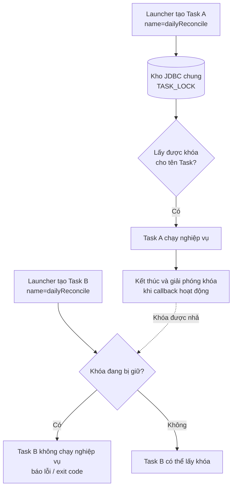
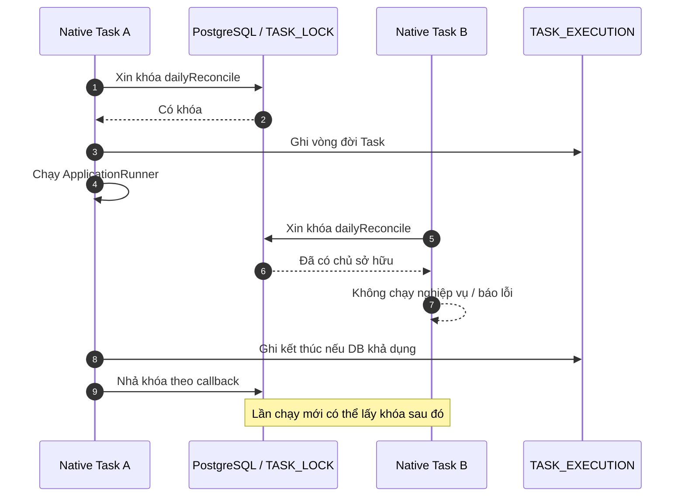

# Cấu hình khóa một phiên bản thực thi khi biên dịch native

Trong **Spring Cloud Task**, ứng dụng chạy hữu hạn thường được scheduler hoặc một bộ điều phối khởi động để nhập dữ liệu, đối soát doanh thu, xuất báo cáo rồi ghi kết quả vào **`TaskRepository`**. Một vấn đề thường gặp là **hai tiến trình cùng chạy một Task**: lịch trước chưa xong nhưng lịch sau đã tới, người vận hành bấm chạy thủ công, hoặc Kubernetes/launcher retry khi chưa chắc tiến trình cũ đã dừng. Nếu cùng cập nhật dữ liệu nghiệp vụ, chúng có thể tranh chấp tài nguyên hoặc ghi trùng kết quả.

Spring Cloud Task có tính năng **single instance** để hạn chế **chỉ một lần thực thi đang hoạt động cho cùng tên Task tại một thời điểm**, dựa trên cơ chế khóa dùng chung. Khi đóng gói thành **GraalVM Native Image**, bạn cần lưu ý thêm một điểm: Spring Boot **Ahead-of-Time (AOT)** phân tích và quyết định nhiều điều kiện tạo bean **ngay khi build**. Vì vậy, không thể chỉ bật khóa bằng biến môi trường sau khi đã biên dịch native rồi chắc chắn tính năng sẽ xuất hiện.

Bài thuộc chương **Tối ưu và nâng cấp** tập trung vào việc **bật single-instance tại bước `process-aot`**, chuẩn bị kho khóa JDBC, tạo native executable và kiểm chứng hai tiến trình cạnh tranh. Bài cũng phân biệt khóa theo tên Task với khóa idempotency nghiệp vụ, cũng như các vấn đề TTL, crash, retry và triển khai bản mới.

Sau bài này, bạn có thể:

- Giải thích tính năng `spring.cloud.task.single-instance-enabled`, phạm vi khóa và các giới hạn của nó.
- Cấu hình đúng **Spring Integration JDBC**, `TASK_LOCK` và `TaskRepository` dùng chung.
- Thiết lập Maven `spring-boot:process-aot` với **JVM argument ở build time** để đưa tính năng khóa vào native image.
- Phân biệt build-time configuration và runtime configuration trong Spring Boot AOT.
- Chạy kiểm tra cạnh tranh hai native process/JVM process, quan sát mã thoát và metadata.
- Lựa chọn TTL/check interval hợp lý, xử lý khóa tồn dư và triển khai nâng cấp an toàn.

## 1. “Một phiên bản thực thi” có nghĩa là gì?

Ở đây **single instance** nghĩa là **không cho hai lần chạy đồng thời với cùng `spring.cloud.task.name`** nếu các tiến trình cùng tham gia cơ chế khóa. Đây là quy tắc theo **tên logic của Task**, *không* phải “chỉ được chạy JAR phiên bản 1.0” hay “mỗi ngày chỉ được thực thi đúng một lần”.

Ví dụ:

| Tiến trình | Tên Task | Kho khóa | Hành vi mong muốn |
| --- | --- | --- | --- |
| A | `dailyReconcile` | PostgreSQL `taskdb` | Chạy và giữ khóa trong khi làm việc. |
| B | `dailyReconcile` | Cùng PostgreSQL `taskdb` | Bị từ chối nếu A vẫn đang giữ khóa hợp lệ. |
| C | `exportInvoices` | Cùng PostgreSQL `taskdb` | Có thể chạy vì **tên Task khác**. |
| D | `dailyReconcile` | Một database **khác** | Có thể không thấy khóa của A; **không có bảo vệ toàn cục**. |

Theo tài liệu Spring Cloud Task, mặc định **`spring.cloud.task.single-instance-enabled=false`**. Khi bật và phát hiện Task cùng tên đã chạy, lần khởi chạy sau thất bại; tài liệu mô tả mã thoát **`1`** cho tình huống này.

### Khóa theo Task name, không theo ngày nghiệp vụ

Giả sử:

```text
Task name: dailyReconcile
Run A: --business-date=2026-11-24
Run B: --business-date=2026-11-25
```

Hai lần chạy dùng **cùng tên Task**, nên tính năng single-instance thường chỉ cho **một trong hai** hoạt động đồng thời, dù hai ngày nghiệp vụ khác nhau. Nếu cần song song an toàn theo từng ngày hoặc tenant, hãy thiết kế cơ chế **khóa theo business key** riêng, hoặc tách logic đặt tên/partition theo quy tắc được kiểm soát; đừng cho rằng `single-instance-enabled` tự khóa theo `business-date`.

Ngược lại, sau khi A đã kết thúc và giải phóng khóa, B có thể chạy. Single-instance **không lưu dấu “ngày đã xử lý”** và **không tự ngăn** một retry của công việc đã commit. Tính chất *at most one active process per task name* khác hoàn toàn với *idempotency*.



Sơ đồ mô tả **ý nghĩa đồng thời**, không phải đảm bảo thứ tự nội bộ trong mọi phiên bản. Nếu tiến trình bị kill hoặc kho JDBC lỗi, phải đối chiếu trạng thái lock và hạ tầng thay vì suy đoán khóa luôn được dọn sạch.

## 2. Khóa được triển khai ở đâu?

Spring Cloud Task sử dụng listener **`SingleInstanceTaskListener`** để tạo khóa dựa trên tên Task. Lớp này nhận `DataSource` hoặc `LockRegistry` của **Spring Integration**, và được tích hợp vào vòng đời Task khi tính năng được bật.

Để dùng cơ chế khóa JDBC được tài liệu chính thức mô tả, cần bổ sung hai dependency:

```xml
<dependency>
    <groupId>org.springframework.integration</groupId>
    <artifactId>spring-integration-core</artifactId>
</dependency>
<dependency>
    <groupId>org.springframework.integration</groupId>
    <artifactId>spring-integration-jdbc</artifactId>
</dependency>
```

Đây là những dependency **bổ sung**, không thay thế `spring-cloud-starter-task` hoặc JDBC driver. Spring Integration JDBC cung cấp cơ chế lưu khóa dựa trên database, để **nhiều JVM/container có thể nhìn cùng một khóa** khi chúng chia sẻ đúng kết nối và schema.

### Bảng `TASK_LOCK`

Trong schema Spring Cloud Task có bảng **`TASK_LOCK`** phục vụ tính năng này. Tài liệu schema mô tả các cột cơ bản:

| Cột | Vai trò |
| --- | --- |
| `LOCK_KEY` | Giá trị khóa do cơ chế lock registry quản lý. |
| `REGION` | Không gian/nhóm khóa. |
| `CLIENT_ID` | Định danh của đối tượng giữ khóa theo implementation. |
| `CREATED_DATE` | Thời điểm khóa được tạo/ghi nhận. |

**Không tự tạo bảng rút gọn theo mô tả trên.** Hãy dùng **DDL chính thức của đúng phiên bản Spring Cloud Task và database** đang triển khai. Khi đặt `spring.cloud.task.initialize-enabled=false` ở production, migration phải tạo sẵn cả các bảng Task metadata cần thiết **và `TASK_LOCK`** trước khi có tiến trình giữ khóa.

Đừng nhầm `TASK_LOCK` với `TASK_EXECUTION`:

- `TASK_EXECUTION` ghi **lịch sử mỗi lần chạy**, có thể tồn tại lâu dài để truy vết.
- `TASK_LOCK` phục vụ **điều phối quyền chạy đồng thời**, có thể có hoặc không có bản ghi ở thời điểm truy vấn.
- Một `TaskExecution` đã hoàn tất **không nên bị coi là khóa đang giữ** chỉ vì vẫn còn trong bảng lịch sử.

### Vì sao phải dùng chung datasource?

Nếu manager/worker/native executable A kết nối `taskdb_A` còn executable B kết nối `taskdb_B`, cả hai có thể lấy được khóa của **database riêng** và cùng chạy. Ngay cả khi JDBC URL chỉ khác schema/search path, việc đặt bảng khóa ở hai schema khác nhau cũng có thể khiến chúng không thấy nhau.

Với ứng dụng có **nhiều `DataSource`**, cần kiểm tra `TaskConfigurer`, `TaskRepository` và nguồn JDBC mà listener/lock registry sử dụng. `@Primary` trên datasource nghiệp vụ không phải bằng chứng đã chọn đúng kho metadata. Hãy test bằng **hai tiến trình thật** trỏ vào cùng database/schema dự kiến.

## 3. Tại sao native image phải bật khóa ở build time?

Spring Boot thông thường trên JVM có thể quyết định nhiều bean theo `@ConditionalOnProperty` khi ứng dụng khởi động. Nhưng trong **Spring AOT**, framework phân tích context trước, sinh mã khởi tạo và metadata để GraalVM biên dịch. Một số quyết định **bean nào tồn tại** được chốt trong **giai đoạn build**, nên không thể trông đợi bật một tính năng tạo bean hoàn toàn mới bằng property chỉ truyền lúc chạy native binary.

Ví dụ không an toàn:

```text
Build native image khi single-instance-enabled=false
    ↓
Bean/đường cấu hình khóa không được đưa vào AOT graph
    ↓
Chạy ./daily-reconcile --spring.cloud.task.single-instance-enabled=true
    ↓
Không thể mặc định rằng native binary có đầy đủ cơ chế khóa
```

Vì vậy, tài liệu Spring Cloud Task yêu cầu **bật tính năng single-instance khi chạy `process-aot`**, bằng JVM system property:

```text
-Dspring.cloud.task.single-instance-enabled=true
```

Đây là **JVM argument cho tiến trình tạo AOT metadata**, **không phải JVM argument truyền vào native executable**. Native binary không chạy dưới một JVM thông thường, nên cú pháp `-D...` trong plugin có tác dụng **ở build time**.

Sau khi build, bạn vẫn nên cung cấp **`single-instance-enabled: true` trong cấu hình runtime** để ý định vận hành nhất quán và các thuộc tính không làm thay đổi bean graph được bind đúng. **Không xem runtime toggle là cách bật/tắt tùy ý một tính năng AOT đã được phân tích với giá trị khác.**

### Lưu ý quan trọng về tên property trong tài liệu

Trong một số bản tham khảo Spring Cloud Task, đoạn văn của mục *Single Instance Usage for Spring AOT And Native Compilation* ghi **`spring.cloud.task.single-step-instance-enabled`**, nhưng **snippet Maven ngay bên dưới**, bảng configuration properties và `TaskProperties` dùng **`spring.cloud.task.single-instance-enabled`**.

**Tên cần sử dụng trong bài này là `spring.cloud.task.single-instance-enabled` (không có `step`).** Đây là property tương ứng với `TaskProperties#setSingleInstanceEnabled(...)` và cơ chế khóa theo Task name. Trước khi nâng cấp major version, hãy xác minh lại trong configuration metadata của release bạn thực sự sử dụng.

| Giai đoạn | Cấu hình | Mục tiêu |
| --- | --- | --- |
| **AOT build** | `-Dspring.cloud.task.single-instance-enabled=true` trong `process-aot.jvmArguments` | Cho AOT thấy tính năng khóa và sinh bean graph tương ứng. |
| **Native runtime** | `spring.cloud.task.single-instance-enabled=true` trong YAML/env | Giữ chính sách chạy single-instance nhất quán khi thực thi. |
| **Metadata JDBC** | DDL `TASK_LOCK` và các bảng Task | Các tiến trình chia sẻ trạng thái lock. |
| **Ứng dụng nghiệp vụ** | Khóa idempotency theo request/ngày | Chặn tác động lặp khi retry sau commit. |

## 4. Chuẩn bị một ứng dụng Task để thử nghiệm

Ta xây dựng một chương trình `daily-reconcile-native` chỉ chạy hữu hạn và chờ một khoảng thời gian ngắn để quan sát khóa. Đây là **demo kiểm thử đồng thời**, không phải logic đối soát sản xuất.

### 4.1. Các dependency chính

Trong dự án Maven đã có **Spring Boot parent/dependency management, Spring Cloud BOM tương thích và Java runtime được hỗ trợ**, thêm:

```xml
<dependencies>
    <dependency>
        <groupId>org.springframework.cloud</groupId>
        <artifactId>spring-cloud-starter-task</artifactId>
    </dependency>
    <dependency>
        <groupId>org.springframework.boot</groupId>
        <artifactId>spring-boot-starter-jdbc</artifactId>
    </dependency>
    <dependency>
        <groupId>org.springframework.integration</groupId>
        <artifactId>spring-integration-core</artifactId>
    </dependency>
    <dependency>
        <groupId>org.springframework.integration</groupId>
        <artifactId>spring-integration-jdbc</artifactId>
    </dependency>
    <dependency>
        <groupId>org.postgresql</groupId>
        <artifactId>postgresql</artifactId>
        <scope>runtime</scope>
    </dependency>
</dependencies>
```

**Không hardcode phiên bản từng dependency** nếu Spring Boot/Spring Cloud BOM đã quản lý chúng. Native Image còn cần môi trường GraalVM Native Image hoặc công cụ container build native được Spring Boot hỗ trợ. Việc chạy ứng dụng JAR bằng JVM **không đồng nghĩa đã kiểm tra thành công bản native**.

### 4.2. Cấu hình runtime

Ví dụ `src/main/resources/application.yml`:

```yaml
spring:
  application:
    name: daily-reconcile-native
  main:
    web-application-type: none
  cloud:
    task:
      name: dailyReconcile
      single-instance-enabled: true
      initialize-enabled: false
      closecontextEnabled: true
      single-instance-lock-ttl: 3600000
      single-instance-lock-check-interval: 500
```

Chú ý các lựa chọn:

- `name: dailyReconcile` định danh **phạm vi khóa**; mọi instance cần dùng **cùng tên**.
- `single-instance-enabled: true` bật kiểm tra lock ở runtime, đồng nhất với build-time `-D`.
- `initialize-enabled: false` giả định migration PostgreSQL đã có `TASK_EXECUTION`, `TASK_LOCK` và các bảng liên quan.
- `closecontextEnabled: true` yêu cầu đóng context khi công việc hoàn tất theo cơ chế Spring Cloud Task, hữu ích để tiến trình hữu hạn thực sự kết thúc.
- `single-instance-lock-ttl: 3600000` là **3.600.000 ms = 1 giờ** trong ví dụ; phải chỉnh theo thời lượng task và chiến lược phục hồi.
- `single-instance-lock-check-interval: 500` là **500 ms**, cấu hình nhịp kiểm tra lock theo implementation; không phải thông số retry nghiệp vụ.



Sơ đồ trình bày quan hệ giữa các thành phần; **thứ tự chính xác của ghi metadata và lấy/nhả lock tùy callback framework và phiên bản**. Đừng dùng sơ đồ để suy đoán rằng lần bị từ chối luôn có hay luôn không có bản ghi TaskExecution.

### 4.3. Ví dụ `ApplicationRunner`

File `src/main/java/com/example/task/NativeReconcileApplication.java`:

```java
package com.example.task;

import java.time.LocalDate;
import java.util.List;
import java.util.concurrent.TimeUnit;

import org.springframework.boot.ApplicationArguments;
import org.springframework.boot.ApplicationRunner;
import org.springframework.boot.SpringApplication;
import org.springframework.boot.autoconfigure.SpringBootApplication;
import org.springframework.cloud.task.configuration.EnableTask;
import org.springframework.context.annotation.Bean;

@SpringBootApplication
@EnableTask
public class NativeReconcileApplication {

    public static void main(String[] args) {
        SpringApplication.run(NativeReconcileApplication.class, args);
    }

    @Bean
    ApplicationRunner reconcileRunner() {
        return args -> {
            LocalDate businessDate = LocalDate.parse(
                requiredOption(args, "business-date")
            );
            long holdMs = optionalHoldMs(args);

            System.out.printf(
                "Bat dau ngay %s; hold=%d ms%n",
                businessDate, holdMs
            );

            // Chi de quan sat hai instance tranh khoa.
            // Production thay bang service co transaction va idempotency.
            TimeUnit.MILLISECONDS.sleep(holdMs);

            System.out.println("Da hoan tat demo");
        };
    }

    private static String requiredOption(
            ApplicationArguments args, String name) {
        List<String> values = args.getOptionValues(name);
        if (values == null || values.size() != 1
                || values.get(0) == null || values.get(0).isBlank()) {
            throw new IllegalArgumentException(
                "Can dung mot --" + name + "=..."
            );
        }
        return values.get(0);
    }

    private static long optionalHoldMs(ApplicationArguments args) {
        if (!args.containsOption("demo-hold-ms")) {
            return 0L;
        }
        long value = Long.parseLong(
            requiredOption(args, "demo-hold-ms")
        );
        if (value < 0 || value > 120_000) {
            throw new IllegalArgumentException(
                "demo-hold-ms phai trong khoang 0..120000"
            );
        }
        return value;
    }
}
```

Ứng dụng cố ý **giữ thời gian xử lý tối đa hai phút** khi có `--demo-hold-ms`, giúp bạn chạy song song trong hai terminal. Trong thực tế, **không giữ transaction nghiệp vụ mở** chỉ để thử khóa, không dùng `Thread.sleep` thay cơ chế đồng bộ dữ liệu, và không cho rằng `single-instance` đã đảm bảo một khoản tiền chỉ được ghi đúng một lần.

## 5. Cấu hình Maven cho Spring AOT và native build

Đây là phần **cốt lõi** của bài. Theo hướng dẫn Spring Cloud Task, trong `spring-boot-maven-plugin` cần có execution `process-aot` và truyền **JVM argument đúng**:

```xml
<build>
    <plugins>
        <plugin>
            <groupId>org.springframework.boot</groupId>
            <artifactId>spring-boot-maven-plugin</artifactId>
            <executions>
                <execution>
                    <id>process-aot</id>
                    <goals>
                        <goal>process-aot</goal>
                    </goals>
                    <configuration>
                        <jvmArguments>
                            -Dspring.cloud.task.single-instance-enabled=true
                        </jvmArguments>
                    </configuration>
                </execution>
            </executions>
        </plugin>
        <plugin>
            <groupId>org.graalvm.buildtools</groupId>
            <artifactId>native-maven-plugin</artifactId>
        </plugin>
    </plugins>
</build>
```

Đây là **đoạn build plugins**, không phải `pom.xml` hoàn chỉnh. Bạn còn cần Spring Boot parent, Spring Cloud BOM, Java/GraalVM versions tương thích, các dependency ở phần trước và cấu hình artifact. Nếu parent/plugin đã khai báo một execution `process-aot` qua Maven profile `native`, hãy **gộp cấu hình vào execution đó** thay vì tạo nhiều execution AOT có tác dụng khác nhau.

### Điều nào xảy ra ở build time?

1. Maven biên dịch Java và chạy mục tiêu **`spring-boot:process-aot`** theo cấu hình build.
2. JVM chạy công cụ AOT nhận **`-Dspring.cloud.task.single-instance-enabled=true`**.
3. Spring AOT phân tích BeanFactory/conditions để sinh mã nguồn và metadata khởi tạo cho native image.
4. GraalVM Native Image biên dịch ứng dụng đã được xử lý AOT thành executable.
5. Khi executable khởi chạy, nó dùng cấu hình **runtime** cho database, tên task, TTL và tham số nghiệp vụ trong phạm vi được AOT hỗ trợ.

Trong trường hợp build bằng `native` profile của Spring Boot parent, có thể sử dụng:

```bash
./mvnw -Pnative native:compile
```

Lệnh này **chỉ mang tính minh họa** cho dự án đã khai báo Native Build Tools đúng cách và có GraalVM toolchain sẵn. Tùy Spring Boot version, cấu hình Maven và mục tiêu build, tổ chức có thể dùng `./mvnw -Pnative package` hoặc `spring-boot:build-image` với Cloud Native Buildpacks. Hãy đối chiếu tài liệu Maven Plugin của **phiên bản Boot hiện tại** thay vì áp dụng một câu lệnh cho mọi dự án.

Trên Windows, wrapper thường là `mvnw.cmd`:

```powershell
.\mvnw.cmd -Pnative native:compile
```

Native executable được tạo cho **hệ điều hành và kiến trúc CPU mục tiêu** (hoặc theo toolchain/container build tương ứng). Không mặc định một file native build trên Windows có thể chạy trực tiếp trong container Linux. Nếu phát hành image Kubernetes, hãy build bằng công cụ phù hợp Linux/runtime của image.

### Không truyền bí mật production vào bước AOT

Trong `process-aot`, JVM argument **chỉ bật cấu trúc tính năng**. Không đưa password, token hoặc JDBC credential production vào `<jvmArguments>` của `pom.xml`. Database runtime nên được cấp thông qua environment/secret store lúc container thực sự chạy.

Native Image có giả định **closed world**: classpath và những bean được đưa vào image có các ràng buộc về khả năng thay đổi runtime. Nếu profile hoặc property quyết định sự tồn tại của bean, hãy đảm bảo các lựa chọn đó đã được tính đến trong AOT build. Những property thông thường chỉ ảnh hưởng giá trị vận hành **mà không đổi bean graph** vẫn có thể được cấp khi chạy.

## 6. Truyền thông tin JDBC khi chạy native executable

Với Spring Boot datasource mặc định, có thể cấp thông số PostgreSQL bằng biến môi trường:

| Spring property | Biến môi trường |
| --- | --- |
| `spring.datasource.url` | `SPRING_DATASOURCE_URL` |
| `spring.datasource.username` | `SPRING_DATASOURCE_USERNAME` |
| `spring.datasource.password` | `SPRING_DATASOURCE_PASSWORD` |

Ví dụ trên Linux/macOS, **trong môi trường thử nghiệm**:

```bash
export SPRING_DATASOURCE_URL="jdbc:postgresql://127.0.0.1:5432/taskdb"
export SPRING_DATASOURCE_USERNAME="task_app"
# SPRING_DATASOURCE_PASSWORD duoc cap boi secret manager.

./target/daily-reconcile-native \
  --business-date=2026-11-24 \
  --demo-hold-ms=30000
```

Tên file `./target/daily-reconcile-native` là ví dụ: **kiểm tra tên executable thật** trong thư mục `target` sau khi build. Một số môi trường tạo đuôi `.exe` hoặc tên theo `artifactId`.

Điều kiện quan trọng: **hai tiến trình trong bài test phải dùng cùng URL JDBC, schema, cấu hình lock và `spring.cloud.task.name`**. Nếu một tiến trình dùng H2 in-memory, nó không thể khóa tiến trình PostgreSQL khác dù cả hai đều bật property single-instance.

### Quản lý schema PostgreSQL

Ở production, cấu hình `spring.cloud.task.initialize-enabled=false` phải đi cùng migration đã chuẩn bị bảng `TASK_EXECUTION`, `TASK_EXECUTION_PARAMS`, `TASK_LOCK` và những bảng cần thiết khác **đúng DDL của release**. Quyền người dùng runtime phải đủ cho các thao tác JDBC/locking thực tế, nhưng không nên cấp quyền `SUPERUSER`.

Có thể kiểm tra metadata sau khi chạy:

```sql
SELECT
    TASK_EXECUTION_ID,
    TASK_NAME,
    START_TIME,
    END_TIME,
    EXIT_CODE
FROM TASK_EXECUTION
WHERE TASK_NAME = 'dailyReconcile'
ORDER BY TASK_EXECUTION_ID DESC
LIMIT 20;
```

Và truy vấn bảng khóa **chỉ để quan sát**:

```sql
SELECT
    LOCK_KEY,
    REGION,
    CLIENT_ID,
    CREATED_DATE
FROM TASK_LOCK
ORDER BY CREATED_DATE DESC;
```

Lưu ý **bảng khóa có thể trống sau khi Task hoàn thành bình thường**. Một hàng trong `TASK_LOCK` không phải là bằng chứng duy nhất tiến trình còn chạy: cần xem owner thực tế, thời điểm tạo, TTL, log và trạng thái container. Không xóa row khóa tùy tiện chỉ để một task có thể chạy lại.

## 7. Thí nghiệm quan trọng: hai tiến trình cùng tên

Để kiểm tra **hành vi khóa thực sự**, cần có hai tiến trình độc lập cùng kết nối PostgreSQL test. Có thể bắt đầu bằng **JAR trên JVM** để kiểm chứng database/schema, sau đó chạy **native executable** với cùng bộ điều kiện.

### 7.1. Thí nghiệm trên JVM

Sau khi đóng gói JAR (tên file ví dụ):

**Terminal A**:

```bash
java -jar target/daily-reconcile-native-0.0.1-SNAPSHOT.jar \
  --business-date=2026-11-24 \
  --demo-hold-ms=60000
```

Chờ log xác nhận A đã vào runner, tức khóa đã có cơ hội được lấy. Sau đó mở **Terminal B**, vẫn dùng **cùng env JDBC**:

```bash
java -jar target/daily-reconcile-native-0.0.1-SNAPSHOT.jar \
  --business-date=2026-11-24 \
  --demo-hold-ms=1000
echo $?
```

Với single-instance đã cấu hình và database lock hoạt động, B **không được chạy song song phần nghiệp vụ** trong khi A đang giữ khóa. Tài liệu Spring Cloud Task mô tả lỗi “Task with name ... is already running” và mã thoát tiến trình **1** cho tình huống bị chặn. Hãy quan sát thêm cách implementation/version của bạn phát ngoại lệ và cập nhật TaskExecution.

**Sau khi A kết thúc**, chạy lại B; khi khóa đã được giải phóng đúng vòng đời, lần chạy mới sẽ có thể thực thi. Bước này giúp phân biệt **bị từ chối do xung đột tạm thời** với **lỗi cấu hình JDBC hoặc khóa tồn dư**.

### 7.2. Thí nghiệm trên native executable

Sau khi build native **có `-Dspring.cloud.task.single-instance-enabled=true` tại `process-aot`**, làm tương tự:

**Terminal A**:

```bash
./target/daily-reconcile-native \
  --business-date=2026-11-24 \
  --demo-hold-ms=60000
```

**Terminal B**, khi A đang giữ khóa:

```bash
./target/daily-reconcile-native \
  --business-date=2026-11-24 \
  --demo-hold-ms=1000
echo $?
```

Kỳ vọng **native** có cùng hành vi loại trừ đồng thời như bản JVM; nếu JVM chặn đúng nhưng native không chặn, **kiểm tra bước `process-aot` và bean graph**, không chỉ nhìn `application.yml` runtime.

Trên PowerShell, mã thoát của chương trình vừa chạy được xem bằng `$LASTEXITCODE`:

```powershell
.\target\daily-reconcile-native.exe --business-date=2026-11-24 --demo-hold-ms=1000
$LASTEXITCODE
```

Không thực hiện thí nghiệm giữ khóa hoặc kill process trên production. Dùng một database test, task name riêng và dữ liệu nghiệp vụ giả để tránh ảnh hưởng tiến trình đang chạy.

### Ma trận kiểm thử bắt buộc

| Ca kiểm thử | Điều kiện | Điều nên xác minh |
| --- | --- | --- |
| **JVM vs JVM** | Hai JAR cùng tên, cùng DB, cùng bật single-instance | Không có hai runner cùng thực thi đồng thời. |
| **Native vs Native** | Hai native binary cùng tên, cùng DB | Hành vi khóa đúng sau AOT build. |
| **JVM vs Native** | Một JAR và một native binary cùng tên, cùng DB | Hai kiểu artifact **cùng dùng một cơ chế lock**. |
| **Khác tên** | Hai Task name khác nhau, cùng DB | Có thể cùng chạy nếu không còn giới hạn khác. |
| **Khác database** | Hai task cùng tên nhưng DB độc lập | Minh họa khóa không có tính toàn cục khi không chia sẻ store. |
| **Chạy lại sau hoàn tất** | Instance trước kết thúc và nhả khóa | Instance tiếp theo có thể được chạy. |
| **Lỗi runner** | Instance đang giữ khóa ném exception | Kiểm tra giải phóng khóa, exit code và Task metadata. |
| **Crash/`SIGKILL`** | Instance giữ khóa bị kill trong test | Kiểm tra stale lock/TTL; không giả định callback đã chạy. |

Trong pipeline nâng cấp, test thêm **bản ứng dụng cũ và mới** cùng tên Task, cùng kho khóa. Nếu hai bản build sử dụng schema hoặc thuật toán lock khác nhau, khả năng loại trừ cần được xác minh trước khi rollout đồng thời.

## 8. TTL và khoảng kiểm tra: chỉnh thế nào?

Spring Cloud Task có hai property:

| Property | Mô tả được công bố | Điểm cần lưu ý |
| --- | --- | --- |
| `spring.cloud.task.single-instance-lock-ttl` | Thời gian tối đa mà một lần chạy có thể giữ khóa, tính bằng **mili giây**. | TTL quá ngắn có thể khiến khóa hết hạn khi tiến trình cũ **vẫn còn chạy**. |
| `spring.cloud.task.single-instance-lock-check-interval` | Khoảng cách giữa các lần kiểm tra khóa, tính bằng **mili giây**. | Không phải độ trễ retry Job hay chu kỳ scheduler. |

Tài liệu configuration properties của các bản Spring Cloud Task công bố `single-instance-lock-check-interval` mặc định **500 ms**, còn TTL mặc định tương ứng **`Integer.MAX_VALUE` mili giây** nếu không cấu hình riêng. `Integer.MAX_VALUE ms` xấp xỉ **24,85 ngày**, không phải “mãi mãi”.

### Chọn TTL theo thời lượng thực tế

Giả sử Task bình thường mất 10–20 phút và **giới hạn xử lý/timeout thật** là 40 phút. Trong bài test có thể đặt TTL **60 phút** để có biên an toàn:

```yaml
spring:
  cloud:
    task:
      single-instance-enabled: true
      single-instance-lock-ttl: 3600000
      single-instance-lock-check-interval: 500
```

Nhưng **TTL không phải bảo đảm tiến trình sẽ tự dừng sau đúng 60 phút**. Nếu worker vẫn chạy khi quyền sở hữu lock hết hiệu lực, một tiến trình khác có thể được phép lấy khóa tùy implementation và sinh ra xử lý đồng thời. Vì vậy, cần **timeout ở cấp launcher/Kubernetes**, kiểm soát worker treo, và bảo vệ dữ liệu nghiệp vụ bằng transaction/idempotency.

Ngược lại, TTL quá dài khiến lock tồn dư sau một crash có thể cản trở lần chạy hợp lệ tiếp theo. Với quy trình có độ dài thay đổi, hãy đo p95/p99 và thời gian tối đa, quyết định TTL cùng runbook xử lý stale lock; kiểm thử lại khi thay đổi version Spring Integration/JDBC lock registry.

### Không tự xóa `TASK_LOCK` để “sửa nhanh”

Nếu task mới không chạy vì báo đã có cùng tên:

1. Xác định tên Task và database/schema của cả hai tiến trình.
2. Kiểm tra `TASK_EXECUTION`, log và tiến trình/Pod có còn đang xử lý không.
3. Xem `TASK_LOCK`, thời gian tạo, cấu hình TTL và nguyên nhân giữ khóa.
4. Chỉ can thiệp vào lock nếu đã xác minh không còn owner hợp lệ, có quy trình dọn khóa của tổ chức và hiểu cơ chế `LockRegistry` hiện hành.
5. Ghi audit, thử lại theo giới hạn và kiểm tra idempotency nghiệp vụ.

**Xóa thủ công khóa đang còn chủ sở hữu** có thể cho phép hai tác vụ xử lý đồng thời, đúng điều single-instance được thiết kế để ngăn.

## 9. Khóa không thay thế idempotency, transaction hay giới hạn hạ tầng

| Cơ chế | Điều nó giải quyết | Điều nó **không** tự giải quyết |
| --- | --- | --- |
| **Single-instance lock** | Giảm khả năng chạy đồng thời hai instance cùng Task name, cùng kho khóa | Chống retry tuần tự của một nghiệp vụ đã commit; khóa theo ngày/request. |
| **Transaction JDBC** | Commit/rollback một đơn vị dữ liệu trong database | Không tự bao trùm từ đầu đến cuối tiến trình; không rollback email/API đã gửi. |
| **Unique constraint / idempotency key** | Ngăn ghi trùng một yêu cầu logic đã xử lý | Không giới hạn tổng số worker/CPU đang khởi chạy. |
| **Scheduler/Kubernetes concurrency policy** | Quy định số Job/Pod được chạy đồng thời theo quy tắc nền tảng | Không thay thế kiểm tra uniqueness trong database khi có launch thủ công hoặc hệ khác. |
| **TaskRepository / TaskExplorer** | Ghi và truy vấn `TaskExecution` | Không đảm bảo một record thiếu `END_TIME` nghĩa là worker còn sống. |

Ví dụ quan trọng:

```text
Run 1:
  Lấy khóa dailyReconcile
  Ghi doanh thu cho 2026-11-24 -> COMMIT
  Nhả khóa khi kết thúc

Run 2 (retry cùng ngày, sau đó):
  Lấy khóa dailyReconcile thành công
  Nếu vẫn cộng doanh thu một lần nữa -> DỮ LIỆU TRÙNG
```

Ở đây **single-instance hoạt động đúng** vì không có hai run đồng thời, nhưng nghiệp vụ vẫn sai. Cần dùng khóa `tenant + businessDate + version`, unique constraint, thao tác ghi xác định, outbox/deduplication đối với thông điệp ngoài database và kiểm soát quy trình reprocess.

### Nếu Spring Cloud Task chứa Spring Batch Job

Một Task có thể chạy nhiều `JobExecution`/`StepExecution` trong Spring Batch. Khóa single-instance **chặn cạnh tranh ở cấp ứng dụng Task name**, không thay thế:

- Khóa `JobInstance` dựa trên **Job name + identifying JobParameters**.
- Checkpoint/restart từng `StepExecution` của `JobRepository`.
- Transaction/chunk commit và idempotency trong nghiệp vụ.
- Điều phối nhiều manager/worker khi dùng remote partitioning.

Nếu cần chạy đồng thời nhiều Batch Job cho các khoảng dữ liệu không chồng lấn, single-instance ở cấp tên Task có thể **giảm throughput**. Hãy quyết định mức độ song song phù hợp thay vì bật khóa rộng rồi cố phá khóa bằng thay tên tùy tiện.

## 10. Những vấn đề đặc thù khi nâng cấp và triển khai native

### 10.1. Build-time và runtime phải tương thích

Giả sử image version `v1` build với single-instance tắt, `v2` build với tính năng bật, rồi rollout kiểu blue/green:

- `v2` có thể tham gia cơ chế khóa.
- `v1` **không nhất thiết tham gia**, nên hai bản vẫn có nguy cơ cùng chạy.
- Cùng tên Task, cùng DB không cứu được khi một bản **không sử dụng listener khóa**.

Vì vậy, khi bật khóa cho hệ thống đang hoạt động, hãy nâng cấp **có kế hoạch**, tránh chạy chồng nhiều artifact khác chính sách; kiểm thử phối hợp JVM/native và v1/v2 trước khi tin rằng lock bảo vệ toàn bộ rollout.

### 10.2. Thay đổi schema và thư viện

Khi nâng Spring Cloud Task, Spring Integration JDBC, PostgreSQL driver hoặc Spring Boot:

1. Kiểm tra **compatibility matrix** của Spring Boot/Spring Cloud release train và GraalVM.
2. Đối chiếu DDL `TASK_LOCK`/`TASK_EXECUTION` và chính sách migration.
3. Kiểm tra transaction manager và cách chọn `DataSource` khi có nhiều database.
4. Build lại **native image** (không trộn AOT output cũ với binary mới).
5. Test hai tiến trình cạnh tranh trên **cùng database đã migration**.
6. Xác minh lỗi khóa, exit code, startup time, kết thúc task, idempotency và stale-lock recovery.

Không nên cho chương trình bản cũ và bản mới **tự đồng thời sửa schema** trên production. Dùng migration được kiểm soát, backup và kế hoạch rollback.

### 10.3. Tối ưu startup không đồng nghĩa tối ưu việc giữ khóa

Native executable có thể giảm startup time và memory footprint so với JVM trong một số workload, nhưng **latency kết nối database**, contention, thao tác lock và thời gian xử lý vẫn phụ thuộc hạ tầng. Task chạy 20 phút không nhanh hơn 20 phút chỉ vì phần khởi động được biên dịch native.

Đo riêng:

| Mốc | Đo để biết |
| --- | --- |
| Launcher yêu cầu khởi động | Độ trễ queue/deploy trước khi container chạy |
| Process start → Task start | Chi phí startup + kết nối database |
| Lock acquisition → business start | Tranh chấp/khởi tạo lock |
| Business start → commit | Thời lượng nghiệp vụ |
| Commit → `TaskExecution.END_TIME` | Chi phí hoàn tất và ghi metadata |
| Process exit | Mã thoát OS mà scheduler nhận |

Nếu có nhiều native task chạy cùng lúc trên một DB, tăng pool connection không giải quyết xung đột **cùng một task name**: lock sẽ cố ý từ chối/giới hạn một tiến trình.

## 11. Bảng lỗi và cách xử lý

| Triệu chứng | Nguyên nhân có thể | Bước kiểm tra |
| --- | --- | --- |
| Bản JVM chặn trùng nhưng native không chặn | Không bật property khi `process-aot`, AOT bean graph khác runtime | Xem Maven execution và build log, build lại native, test hai process. |
| Báo thiếu bean Spring Integration/`LockRegistry` | Thiếu `spring-integration-core` hoặc `spring-integration-jdbc`, version không tương thích | Kiểm tra dependency tree/BOM và auto-configuration tương ứng. |
| SQL báo `TASK_LOCK` không tồn tại | Schema chưa migration, sai database/schema/prefix | Dùng DDL chính thức và kiểm tra JDBC URL, search path. |
| Cả hai instance đều chạy dù có lock | Khác `task.name`, khác DB/schema hoặc một bản không bật khóa | Ghi lại tên task hiệu lực, datasource và build-time config của từng binary. |
| Instance thứ hai bị từ chối với mã lỗi | Đang có task cùng tên giữ khóa | Đây có thể là hành vi đúng; không retry liên tục khi task cũ chưa kết thúc. |
| Khóa còn sau khi JVM chết | Không thực thi callback nhả lock; TTL còn hiệu lực | Đối chiếu Pod/process, `TASK_LOCK`, TTL và runbook stale lock. |
| Hai tiến trình cùng chạy sau thời gian dài | TTL hết hạn trước khi owner thực sự kết thúc hoặc cấu hình khác nhau | Tăng/điều chỉnh TTL theo timeout và tăng bảo vệ nghiệp vụ. |
| Native fail nhưng JVM chạy | AOT hints, reflection/dynamic proxy/driver, profile build khác runtime | Đọc lỗi native build, kiểm tra GraalVM reachability metadata và profile AOT. |
| Pod đã Succeeded nhưng `END_TIME` trống | Lỗi ghi metadata hoặc callback không hoàn thành | Tra log DB, mã OS và TaskRepository; không tự sửa bảng cho “xanh”. |
| Retry tuần tự gây dữ liệu trùng | Single-instance chỉ ngăn **đồng thời**, không ngăn xử lý lại | Bổ sung business idempotency key và transaction thích hợp. |

### Vì sao không nên chỉ kiểm tra biến môi trường?

Một người vận hành có thể thấy:

```text
SPRING_CLOUD_TASK_SINGLE_INSTANCE_ENABLED=true
```

trong container và kết luận đã an toàn. Với native image, biến này **không chứng minh quá trình AOT đã đưa bean khóa vào binary**. Cần chứng cứ từ cấu hình build và kiểm thử cạnh tranh trên artifact thật. Tương tự, chỉ nhìn `TASK_LOCK` có một hàng không chứng minh mọi phiên bản ứng dụng đã tham gia cơ chế lock.

## 12. Checklist kiểm thử trước khi phát hành

Trong môi trường thử nghiệm có PostgreSQL và quy trình build native tương thích:

1. **Xác nhận build:** có `spring-cloud-starter-task`, Spring Integration Core/JDBC và JDBC driver, Spring Boot/Cloud/BOM/GraalVM hỗ trợ nhau.
2. **Xác nhận AOT:** `process-aot` nhận `-Dspring.cloud.task.single-instance-enabled=true`, không dùng tên property `single-step-instance-enabled`.
3. **Xác nhận runtime:** mọi instance có cùng `spring.cloud.task.name`, cùng JDBC URL/schema và `single-instance-enabled=true`.
4. **Xác nhận DDL:** có `TASK_LOCK` và các bảng metadata Task đúng schema version; user JDBC có quyền thực sự cần.
5. **Thử JVM cạnh tranh:** A giữ khóa, B cùng tên bị từ chối; sau khi A kết thúc, B có thể chạy.
6. **Thử native cạnh tranh:** hai native binary có cùng hành vi, mã thoát/metadata được đối chiếu.
7. **Thử mixed-mode:** bản JVM và native cùng tên cùng DB phải loại trừ lẫn nhau.
8. **Thử khi lỗi:** runner ném exception; kiểm tra release lock, thông tin TaskExecution và hành vi lần chạy kế tiếp.
9. **Thử crash/TTL:** kill một instance test, xác minh khôi phục theo thiết kế; không xóa bảng khóa tùy tiện.
10. **Thử retry nghiệp vụ:** cùng business date được khởi chạy sau khi khóa nhả nhưng không tạo kết quả trùng.
11. **Thử upgrade:** binary cũ/mới, migration schema và rollback deployment có quy trình chống chạy chồng.
12. **Thu thập chứng cứ:** build version, task name, lock table/schema, exit code, TaskExecution ID, Pod/process status và business key.

Không cần chạy test native trên **mọi commit nhỏ** nếu chi phí quá cao, nhưng trước khi phát hành thay đổi về bean graph, datasource, schema hoặc cơ chế lock, cần có **integration test thực sự trên artifact native**, không chỉ `@SpringBootTest` dùng JVM.

## 13. Bài thực hành và câu hỏi ôn tập

Thực hành trên **PostgreSQL test**, không dùng database production:

1. Chạy hai JAR cùng `spring.cloud.task.name` nhưng `single-instance-enabled=false`. Ghi nhận hai runner có thể thực thi đồng thời.
2. Bật `single-instance-enabled=true` và thêm hai dependency Spring Integration. Lặp lại thí nghiệm; giải thích vì sao instance thứ hai bị từ chối.
3. Đổi tên Task B thành `exportInvoices`, giữ cùng database. Giải thích tại sao hai tiến trình có thể cùng chạy.
4. Cho hai instance cùng tên dùng **hai schema PostgreSQL khác nhau**. Vì sao tính năng single-instance không còn bảo vệ cùng một miền khóa?
5. Cấu hình `process-aot` với đúng `-Dspring.cloud.task.single-instance-enabled=true`, build native image và thử hai native process.
6. Build thử một bản native **không bật** property trong AOT. Giữ runtime YAML bật. So sánh kết quả với binary build đúng.
7. Cho instance A kết thúc bình thường, đọc `TASK_LOCK` trước và sau. Tại sao một row có thể biến mất mà `TASK_EXECUTION` lịch sử vẫn còn?
8. Giả lập instance bị kill trong test và quan sát behavior theo TTL. Làm sao xác minh chắc chắn tiến trình cũ đã dừng trước khi can thiệp khóa?
9. Dùng `--business-date=2026-11-24` cho hai lần chạy tuần tự. Vì sao single-instance không ngăn ngày đó bị xử lý lại, và cần khóa nghiệp vụ nào?
10. Lên kế hoạch nâng cấp `v1` JVM sang `v2` native: làm cách nào bảo đảm hai bản đều tuân thủ khóa khi rollout và khi rollback?

**Câu hỏi ôn tập:**

- `spring.cloud.task.single-instance-enabled` khóa theo **tên Task** hay theo `TaskExecution ID`?
- Vì sao chỉ đặt property runtime chưa đủ khi build native image đã chốt bean graph?
- `-Dspring.cloud.task.single-instance-enabled=true` trong Maven `process-aot` được JVM nào sử dụng?
- Vai trò của `spring-integration-jdbc` và bảng `TASK_LOCK` là gì?
- `single-instance-lock-ttl` quá ngắn hoặc quá dài gây rủi ro gì?
- Vì sao hai native executable cùng tên nhưng kết nối hai database khác nhau vẫn có thể chạy cùng lúc?
- Khóa single-instance có giải quyết idempotency và restart của Spring Batch không?
- Trong bản hướng dẫn có chỗ ghi `single-step-instance-enabled`; property nào là đúng trong configuration metadata?

**Ghi nhớ:** Để **khóa một lần thực thi đồng thời theo tên Task** khi biên dịch **GraalVM Native Image**, cần **bật `spring.cloud.task.single-instance-enabled=true` ngay ở `spring-boot:process-aot`**, bổ sung Spring Integration JDBC, chuẩn bị bảng `TASK_LOCK` và bảo đảm mọi tiến trình dùng **cùng tên Task, cùng kho khóa JDBC**. Khi chạy, giữ cấu hình runtime nhất quán và **luôn bổ sung idempotency nghiệp vụ**: single-instance ngăn cạnh tranh đồng thời, không thay thế kiểm soát retry hoặc những lần xử lý đã commit.

**Tài liệu tham khảo chính thức:**

- [Spring Cloud Task — Features: Restricting Task Instances và Spring AOT/Native](https://docs.spring.io/spring-cloud-task/reference/features.html).
- [Spring Cloud Task — SingleInstanceTaskListener API](https://docs.spring.io/spring-cloud-task/docs/current/apidocs/org/springframework/cloud/task/configuration/SingleInstanceTaskListener.html).
- [Spring Cloud Task — Task Repository Schema](https://docs.spring.io/spring-cloud-task/reference/appendix-task-repository-schema.html): bảng `TASK_LOCK`.
- [Spring Cloud — Configuration Properties](https://docs.spring.io/spring-cloud/docs/current/reference/html/configprops.html): `single-instance-enabled`, `single-instance-lock-ttl`, `single-instance-lock-check-interval`.
- [Spring Boot Maven Plugin — AOT Processing](https://docs.spring.io/spring-boot/maven-plugin/aot.html): `process-aot`, `jvmArguments` và native profile.
- [Spring Boot — GraalVM Native Images](https://docs.spring.io/spring-boot/reference/packaging/native-image/introducing-graalvm-native-images.html): phân tích ahead-of-time và giới hạn bean graph.
