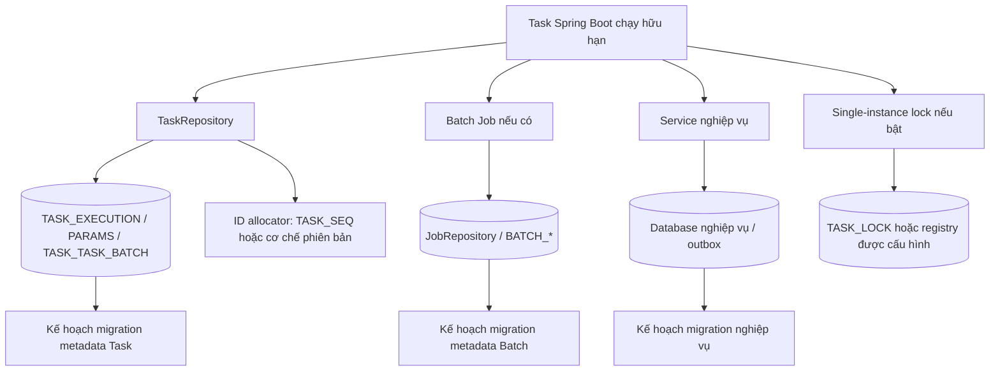
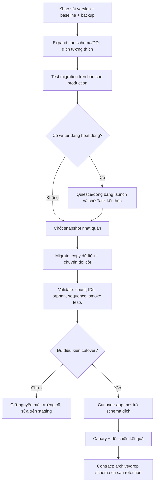

# Thay đổi schema, DDL và kế hoạch chuyển đổi dữ liệu

## Mục tiêu bài học

**SPRING_CLOUD_TASK (Spring Cloud Task)** giúp xây dựng ứng dụng Spring Boot chạy **hữu hạn**: nhận tham số, thực hiện công việc rồi kết thúc, ghi thời điểm và kết quả vào `TaskRepository`. Các Task có thể được gọi theo lịch, theo yêu cầu hoặc chạy Spring Batch Job, và có thể được triển khai qua nhiều JVM/container dùng chung cơ sở dữ liệu.

Ở chương **Tối ưu và nâng cấp**, thay đổi cấu trúc database không chỉ là chạy một lệnh `ALTER TABLE`. Khi nâng cấp Spring Cloud Task, đổi database, đổi tiền tố bảng hoặc chuyển dữ liệu lịch sử, ta cần bảo toàn **ID thực thi, mối liên kết Batch, khả năng tạo execution mới và bằng chứng kết thúc của các Task đang chạy**. Một migration thiếu bảng hoặc sai bộ cấp ID có thể khiến ứng dụng khởi động thất bại, ghi đè ID hoặc làm dashboard hiểu sai lịch sử.

Bài học này hướng dẫn một **kế hoạch chuyển đổi dữ liệu có thể kiểm chứng**: xác định schema thực tế và phiên bản, chuẩn bị DDL qua migration tool, chuyển dữ liệu theo thứ tự, thử nghiệm, cắt chuyển ứng dụng, kiểm tra sau triển khai và phục hồi khi có sự cố.

Sau khi học, bạn có thể:

- Phân biệt metadata Spring Cloud Task, Spring Batch, bảng khóa và dữ liệu nghiệp vụ.
- Đọc đúng DDL theo **release Spring Cloud Task và database dialect** đang chạy, thay vì sao chép DDL từ một bài viết khác phiên bản.
- Hiểu vai trò của `TASK_EXECUTION`, `TASK_EXECUTION_PARAMS`, `TASK_TASK_BATCH`, bảng khóa và bộ cấp `TASK_EXECUTION_ID`.
- Lập inventory, snapshot/backup, bảng đối chiếu phiên bản và kế hoạch đóng băng writer trước khi copy.
- Thực hiện **expand → migrate → validate → cut over → contract**, biết trường hợp nào cần downtime hoặc cơ chế đồng bộ thay đổi trong lúc copy.
- Di chuyển metadata sang schema/database mới, bảo toàn ID và thiết lập lại sequence/table cấp ID an toàn.
- Dùng Flyway hoặc Liquibase để quản lý DDL, không để nhiều JVM Task cạnh tranh tạo/chỉnh bảng ở startup.
- Kiểm chứng sau migration bằng SQL, test JAR thật, Spring Batch restart, lock/concurrency và khôi phục theo runbook.

## 1. Schema nào đang được thay đổi?

Một ứng dụng Spring Cloud Task có thể truy cập **nhiều vùng dữ liệu** khác nhau:

| Vùng dữ liệu | Bảng hoặc đối tượng điển hình | Trách nhiệm | Khi migrate cần chú ý |
| --- | --- | --- | --- |
| **Spring Cloud Task metadata** | `TASK_EXECUTION`, `TASK_EXECUTION_PARAMS`, `TASK_TASK_BATCH`, đối tượng cấp ID như `TASK_SEQ`. | Lưu lịch sử mỗi lần chạy Task và liên kết Job. | ID, thời gian, mã thoát, tham số, bảng phụ, tên cột/prefix. |
| **Khóa single-instance** | `TASK_LOCK` trong appendix Task; một số hạ tầng Spring Integration có bảng registry như `INT_LOCK`. | Ngăn hai instance cùng tên Task chạy đồng thời khi cơ chế khóa được bật. | Table/region/TTL theo phiên bản, chủ sở hữu còn sống; không copy khóa mù. |
| **Spring Batch metadata** | `BATCH_JOB_INSTANCE`, `BATCH_JOB_EXECUTION`, `BATCH_STEP_EXECUTION`, `BATCH_JOB_EXECUTION_CONTEXT` và các sequence. | Trạng thái JobInstance, JobExecution, StepExecution, checkpoint/restart. | Migration Batch độc lập, `VERSION` optimistic locking, execution context, identifying JobParameters. |
| **Dữ liệu nghiệp vụ** | `daily_report`, `order_export`, outbox, file hoặc message broker. | Kết quả thật của tác vụ. | Khóa nghiệp vụ, giao dịch, chống nhân đôi khi retry. |
| **Điều phối nền tảng** | Scheduler execution, Kubernetes Job/Pod, SCDF deployment metadata. | Launch, retry, timeout, trạng thái tài nguyên. | Launch ID không đồng nhất `TaskExecution ID`; giữ correlation. |

**Không dùng một DDL chung cho cả năm vùng.** `TaskRepository` và Spring Batch `JobRepository` có những migration/schema riêng; bảng khóa còn phụ thuộc cơ chế registry tích hợp và phiên bản thư viện.



**Tình huống xuyên suốt:** hệ thống `daily-report-task` đang dùng PostgreSQL trong schema `public`. Nhóm vận hành muốn chuyển metadata Task sang schema `task_meta` và nâng cấp Spring Cloud Task. Họ vẫn muốn tra được các execution cũ, trong đó có các Task chứa Batch Job, đồng thời phải tiếp tục cấp ID không trùng sau khi chuyển.

## 2. Nguồn DDL đáng tin là phiên bản artifact đang triển khai

Tài liệu Spring Cloud Task có **Task Repository Schema appendix**, mô tả các bảng chính và có liên kết tới DDL mẫu của từng database. Mỗi release có thể khác tên cột, độ dài chuỗi, kiểu timestamp, khóa, index, cách cấp ID và cấu hình initializer. Vì thế phải xác định **cặp nguồn và đích** trước khi viết migration:

| Dữ liệu phải ghi lại | Ví dụ | Vì sao cần? |
| --- | --- | --- |
| Spring Boot và Java | Boot 3.x, Java 17/21. | Tương thích JDBC, auto-configuration và thư viện. |
| Spring Cloud release train | Tên release train từ BOM. | Xác định phiên bản Spring Cloud Task tương thích. |
| `spring-cloud-task-core` | Version **đã resolve**, không chỉ version trong tài liệu. | Đọc đúng DDL/API mà ứng dụng thật dùng. |
| Spring Batch | Version và module `spring-batch-core`. | Batch metadata/DDL có lifecycle riêng. |
| Spring Integration JDBC | Version nếu dùng `single-instance-enabled`. | Lock registry/schema/TTL thay đổi theo thư viện. |
| Database dialect | PostgreSQL, SQL Server, MySQL, Oracle… và version. | Kiểu dữ liệu, transaction DDL, sequence và online index khác nhau. |
| Cấu hình runtime | `TaskConfigurer`, table prefix, schema, `DataSource`, initializer. | Biết chính xác repository sẽ đọc/ghi bảng nào. |
| Thực trạng schema | DDL đã chạy, các index và custom constraint. | Không nhầm schema đang chạy với schema mẫu mặc định. |

### 2.1. Xác định dependency thật

Ví dụ cho dự án Maven:

```bash
mvn dependency:tree -Dincludes=org.springframework.cloud:*,org.springframework.batch:*,org.springframework.integration:*
mvn help:effective-pom
```

Các lệnh dùng để **khảo sát trong một dự án thật**, không được thực thi trong bước soạn bài. `dependency:tree` cho thấy version cuối được chọn sau BOM/override; `effective-pom` cho biết dependency management. Nếu dùng Gradle, dùng `dependencies` và `dependencyInsight` với `runtimeClasspath`.

Có thể kiểm tra các resource SQL **bên trong JAR đã resolve** bằng `jar tf` rồi xác định DDL thuộc phiên bản nào:

```bash
# Tên JAR chỉ là ví dụ. Thay bằng artifact spring-cloud-task-core thực.
jar tf spring-cloud-task-core-<version>.jar | grep -Ei 'schema|sql'

# Với Spring Batch, các script schema/migration
# thuộc module spring-batch-core theo version tương ứng.
jar tf spring-batch-core-<version>.jar | grep -Ei 'schema|migration'
```

Đây là câu lệnh khám phá **resource**, không khẳng định mọi release đều dùng cùng một đường dẫn hoặc luôn đóng gói schema vào một JAR giống nhau. Nguồn cuối cùng là **DDL đúng artifact/release**, release notes và schema đang tồn tại trong database.

### 2.2. Những trường Task thường gặp

Theo appendix Spring Cloud Task, bảng `TASK_EXECUTION` mô tả:

| Cột | Vai trò | Điểm migration cần kiểm tra |
| --- | --- | --- |
| `TASK_EXECUTION_ID` | Khóa định danh lượt Task, thường `BIGINT`. | **Không đổi/đánh số lại** nếu còn hệ thống dùng ID cũ. |
| `TASK_NAME` | Tên tác vụ, ví dụ `daily-report-task`. | Giới hạn độ dài, encoding và quy tắc resolve tên. |
| `START_TIME`, `END_TIME` | Thời điểm bắt đầu và kết thúc. | Độ chính xác, timezone/kiểu timestamp; `END_TIME` có thể null. |
| `EXIT_CODE` | Mã thoát Task do framework lưu. | Có thể null khi Task còn chạy/chưa hoàn tất. |
| `EXIT_MESSAGE`, `ERROR_MESSAGE` | Thông báo kết thúc hoặc lỗi. | Kích thước cột, encoding, dữ liệu nhạy cảm. |
| `LAST_UPDATED` | Thời điểm metadata được cập nhật. | Các bản ghi tạo trước cần giá trị hợp lệ cho ràng buộc. |
| `EXTERNAL_EXECUTION_ID` | ID của nền tảng ngoài khi được cấu hình. | Độ dài và cách liên kết scheduler/SCDF. |
| `PARENT_TASK_EXECUTION_ID` hoặc biến thể theo release | Liên kết lượt Task cha. | **So sánh chính xác tên cột** giữa schema cũ và mới. |

Thông số ở appendix nêu `TASK_NAME` thường tối đa 100 ký tự, `EXIT_MESSAGE`/`ERROR_MESSAGE` và `TASK_PARAM` khoảng 2.500 ký tự, `EXTERNAL_EXECUTION_ID` khoảng 250 ký tự. Đây là **tham khảo schema được tài liệu hóa**, không phải lời hứa mọi release, DDL thực tế và database đều có đúng độ dài đó.

Đặc biệt, tài liệu và DDL của các dòng phiên bản khác nhau từng có biến thể tên cột như `PARENT_EXECUTION_ID` so với `PARENT_TASK_EXECUTION_ID`; nếu thay bằng `SELECT *` hay chỉ rename bảng, một version có thể đọc sai hoặc không đọc được dữ liệu. Luôn liệt kê rõ **source column → target column** từ DDL đã kiểm chứng.

### 2.3. Các đối tượng ngoài bảng chính

- `TASK_EXECUTION_PARAMS` chứa `TASK_EXECUTION_ID` và `TASK_PARAM`. Đây có thể là command-line arguments nên phải kiểm soát **bí mật** khi backup/export hoặc chia sẻ dữ liệu migration.
- `TASK_TASK_BATCH` chứa `TASK_EXECUTION_ID` và `JOB_EXECUTION_ID` để nối Task với Batch. Không xóa các cặp này nếu còn nhu cầu đối chiếu Job; không suy rằng hai ID có cùng namespace.
- `TASK_LOCK` xuất hiện trong appendix của Spring Cloud Task, nhưng lock table thực tế còn phụ thuộc thư viện và cấu hình registry. Một hệ dùng Spring Integration JDBC có thể có `INT_LOCK`. Đừng tự động đổi tên `INT_LOCK` thành `TASK_LOCK`.
- `TASK_SEQ` hoặc đối tượng cấp ID tương đương phải được khảo sát kỹ. Một số dialect/release dùng **bảng làm sequence**, một số dùng **native database sequence**; câu lệnh `setval` của PostgreSQL không thể áp vào một bảng sequence.
- Các `BATCH_*_SEQ`, index `BATCH_*`, `VERSION` và execution context thuộc **Spring Batch**, phải có kế hoạch riêng. Spring Batch cung cấp migration SQL trong module `spring-batch-core`.

## 3. Phân loại thay đổi: không phải migration nào cũng giống nhau

| Loại thay đổi | Ví dụ | Mức rủi ro | Cách tiếp cận |
| --- | --- | --- | --- |
| **Additive** | Thêm index hoặc bảng sidecar phục vụ quan sát. | Thường thấp nếu online/không lock lớn. | Expand trước, deploy app tương thích, đo hiệu năng. |
| **Thay đổi kiểu/độ dài cột** | Timestamp precision, `VARCHAR` hoặc Unicode. | Trung bình/cao tùy engine và kích thước bảng. | Test conversion, backfill, lock/timeouts, rollback. |
| **Đổi tên cột hoặc tiền tố bảng** | `TASK_` → `OPS_TASK_`, schema `public` → `task_meta`. | Cao nếu app cũ/mới chạy song song. | DDL đích, copy, đối chiếu, cutover có kiểm soát. |
| **Đổi database/dialect** | PostgreSQL → SQL Server. | Cao. | Mapping type/timezone, sequence, identity, consistency, dữ liệu Batch. |
| **Nâng major Spring Batch** | DDL `BATCH_*` đổi, migration script mới. | Cao cho restart. | Áp migration Batch chính thức, kiểm thử Job restart. |
| **Tái cấu hình khóa** | `single-instance-enabled` với lock registry khác. | Cao khi có Task đang chạy. | Dừng/chốt các chủ khóa, xác minh TTL và schema. |
| **Xóa/archive lịch sử** | Xóa execution cũ để giảm dung lượng. | Cao nếu xóa nhầm liên kết/checkpoint. | Retention được phê duyệt, archive/restore/test, thứ tự FK. |

Một thay đổi có vẻ đơn giản như `ALTER TABLE TASK_EXECUTION RENAME TO OPS_TASK_EXECUTION` thực chất có thể làm app cũ không nhìn thấy repository, phá foreign key của `TASK_EXECUTION_PARAMS`, và khiến app mới cấp ID từ sequence cũ không phù hợp. Kế hoạch phải xét **toàn bộ dependency**, không chỉ một bảng.

## 4. Khảo sát trước migration: inventory và baseline

Trước khi chạy bất kỳ DDL nào, ghi lại một **baseline có thể đối chiếu**. Chọn maintenance window nếu có nhiều Task đang chạy hoặc `TaskRepository` được nhiều ứng dụng/SCDF server cùng sử dụng.

### 4.1. Xác định bảng và cấu trúc trên PostgreSQL

Ví dụ truy vấn **chỉ đọc** để liệt kê các bảng metadata trong schema nguồn:

```sql
SELECT table_schema, table_name
FROM information_schema.tables
WHERE table_schema = 'public'
  AND (
      table_name LIKE 'task_%'
      OR table_name LIKE 'batch_%'
      OR table_name LIKE 'int_%'
  )
ORDER BY table_name;
```

PostgreSQL thường chuẩn hóa tên không quote sang lowercase. Vì vậy truy vấn inventory dùng `task_%`, còn SQL minh họa khác có thể viết `TASK_EXECUTION` không quote; cả hai nói về cùng bảng nếu các đối tượng được tạo không dùng double quotes. Nếu hệ đã tạo tên có quote phân biệt hoa/thường, phải dùng **tên thật từ catalog**.

Liệt kê cột Task và kiểu/độ dài:

```sql
SELECT table_name,
       ordinal_position,
       column_name,
       data_type,
       character_maximum_length,
       is_nullable
FROM information_schema.columns
WHERE table_schema = 'public'
  AND table_name IN (
      'task_execution',
      'task_execution_params',
      'task_task_batch',
      'task_lock'
  )
ORDER BY table_name, ordinal_position;
```

Đừng kết luận thiếu bảng khóa là lỗi nếu single-instance không bật hoặc hạ tầng dùng registry khác. Cần đối chiếu runtime `TaskConfigurer`/`DataSource` và schema đã được quản trị.

### 4.2. Baseline số lượng, ID và trạng thái

```sql
SELECT COUNT(*) AS executions,
       MIN(TASK_EXECUTION_ID) AS min_id,
       MAX(TASK_EXECUTION_ID) AS max_id,
       COUNT(*) FILTER (WHERE END_TIME IS NULL) AS without_end_time,
       COUNT(*) FILTER (WHERE EXIT_CODE IS NULL) AS without_exit_code
FROM public.TASK_EXECUTION;

SELECT COUNT(*) AS parameter_rows
FROM public.TASK_EXECUTION_PARAMS;

SELECT COUNT(*) AS batch_link_rows
FROM public.TASK_TASK_BATCH;
```

`FILTER (WHERE …)` là cú pháp PostgreSQL; với database khác, dùng biểu thức `SUM(CASE WHEN … THEN 1 ELSE 0 END)` hoặc cú pháp phù hợp.

`END_TIME IS NULL` **không chứng minh** Task còn đang chạy; đó có thể là execution được tạo trước, JVM chết hoặc cập nhật metadata cuối thất bại. Phải đối chiếu scheduler/Pod/process trước khi đóng băng writer hoặc xóa lock.

### 4.3. Kiểm tra liên kết mồ côi

```sql
SELECT COUNT(*) AS orphan_params
FROM public.TASK_EXECUTION_PARAMS p
LEFT JOIN public.TASK_EXECUTION e
  ON e.TASK_EXECUTION_ID = p.TASK_EXECUTION_ID
WHERE e.TASK_EXECUTION_ID IS NULL;

SELECT COUNT(*) AS orphan_task_batch_links
FROM public.TASK_TASK_BATCH l
LEFT JOIN public.TASK_EXECUTION e
  ON e.TASK_EXECUTION_ID = l.TASK_EXECUTION_ID
WHERE e.TASK_EXECUTION_ID IS NULL;
```

Nếu Batch metadata nằm **cùng** database, có thể kiểm tra thêm `JOB_EXECUTION_ID` trong bảng `BATCH_JOB_EXECUTION`. Nếu Batch ở database khác, phải đối chiếu bằng hai truy vấn và logic ứng dụng; không thêm foreign key xuyên database khi engine không hỗ trợ.

Ghi kết quả baseline vào runbook/kho audit có giới hạn quyền, bao gồm thời điểm lấy snapshot, version artifact, checksum/schema dump và cấu hình datasource/prefix. **Không** copy giá trị `TASK_PARAM` hoặc `ERROR_MESSAGE` chứa bí mật vào ticket công khai.

## 5. Chọn công cụ và quản lý DDL

Trong production, thường dùng **Flyway** hoặc **Liquibase** để phiên bản hóa schema. Mỗi lần thay đổi nên có migration ID/version, người duyệt, precondition và phương án rollback/roll-forward.

Ví dụ cấu hình ứng dụng Task khi **schema do migration pipeline tạo trước**:

```yaml
# application-prod.yml
spring:
  application:
    name: daily-report-task
  datasource:
    url: ${TASK_DB_URL}
    username: ${TASK_DB_USER}
    password: ${TASK_DB_PASSWORD}
  cloud:
    task:
      name: daily-report-task
      initialize-enabled: false
      tablePrefix: TASK_
```

`spring.cloud.task.initialize-enabled=false` tắt việc Spring Cloud Task khởi tạo bảng tự động lúc startup. Nó **không** chạy migration thay bạn và **không** tắt `spring.batch.jdbc.initialize-schema` của Spring Batch hoặc DDL khóa JDBC do hạ tầng khác quản lý.

Nên để pipeline migration dùng **tài khoản DDL được kiểm soát**, còn ứng dụng Task chỉ có quyền DML cần thiết. Nếu nhiều Task/Pod được khởi động cùng lúc, không để chúng cạnh tranh tạo/alter cùng bảng metadata.

### Ví dụ tổ chức migration

```text
db/
  task/
    V101__create_task_repository_from_official_ddl.sql
    V102__create_task_query_indexes.sql
    V103__prepare_task_schema_cutover.sql
  batch/
    V201__apply_batch_release_migrations.sql
  runbooks/
    2026-11-task-schema-cutover.md
```

Đây là **cấu trúc mô phỏng**, không phải một bộ script có sẵn. Nội dung `V101` phải được tạo từ **DDL chính thức đúng version/dialect** và custom index/constraint đã kiểm chứng. Flyway/Liquibase không tự biết thay đổi tương thích với Spring Cloud Task hay không.

### Thêm index đọc mà không làm gián đoạn writer

Ví dụ chỉ nhằm tối ưu một query dashboard thường lọc theo tên và thời gian:

```sql
-- PostgreSQL: xem query plan/khóa bảng trước khi áp dụng.
CREATE INDEX CONCURRENTLY IF NOT EXISTS
    IDX_TASK_EXECUTION_NAME_START
ON public.TASK_EXECUTION (TASK_NAME, START_TIME);
```

**Cảnh báo:** PostgreSQL `CREATE INDEX CONCURRENTLY` **không được chạy bên trong transaction block**. Flyway thường chạy migration theo transaction khi có thể; migration chứa lệnh này phải được cấu hình **non-transactional** theo khả năng/version công cụ. Nó cũng có thể chạy lâu, để lại index invalid nếu gián đoạn. Không tạo index chỉ vì “nghe có vẻ nhanh hơn”: dùng `EXPLAIN (ANALYZE, BUFFERS)` trên bản sao dữ liệu và xem tác động tới tốc độ ghi Task.

## 6. Kế hoạch thay đổi schema: expand → migrate → cut over → contract

Một nguyên tắc an toàn cho thay đổi metadata có nhiều người dùng là **không phá cấu trúc cũ trước khi app mới được xác minh**.



| Giai đoạn | Mục tiêu | Điều kiện qua cổng |
| --- | --- | --- |
| **Prepare** | Chốt DDL, phạm vi app dùng DB, backup, rollback, lịch triển khai. | Khôi phục được bản backup trên môi trường thử. |
| **Expand** | Tạo schema/bảng/index đích, chưa xóa nguồn. | Migration DDL chạy qua staging, cấu trúc đích đúng artifact. |
| **Quiesce** | Dừng launch mới, đợi writer cũ kết thúc hoặc có phương án chuyển tiếp. | Không có Task/SCDF/service cũ đang ghi vào metadata nguồn. |
| **Migrate** | Copy dữ liệu và giữ nguyên ID, tham số, liên kết. | Copy nhất quán, không mất những commit cuối của Task. |
| **Validate** | So sánh số hàng/ID/hash, foreign key, sequence và API Task. | Báo cáo đối chiếu PASS. |
| **Cutover** | Chuyển `DataSource`/prefix và rollout app mới. | Canary launch và query metadata thật thành công. |
| **Contract** | Ngừng sử dụng schema cũ, archive sau retention. | Đã qua thời gian giám sát và không còn rollback phụ thuộc nguồn. |

Một giai đoạn “không downtime” chỉ khả thi khi **cả schema nguồn/đích cùng được cập nhật nhất quán** trong suốt quá trình chuyển. Spring Cloud Task không mặc nhiên dual-write metadata vào hai repository. Nếu không xây CDC/dual-write có chứng minh tính đúng đắn, cách đơn giản và an toàn hơn là **tạm dừng các lượt launch mới, đợi writer hiện tại kết thúc rồi chụp một snapshot chốt**.

### Đóng băng writer nghĩa là gì?

Không chỉ dừng một cron. Có thể còn:

- Kubernetes CronJob và Job đang chạy.
- Spring Cloud Data Flow server/TaskLauncher tạo trước `TaskExecution`.
- API vận hành khởi chạy thủ công.
- Manager/worker Spring Batch đang cập nhật metadata riêng.
- Một ứng dụng thứ hai dùng cùng `TaskRepository`.
- Task bị treo/timeout nhưng vẫn còn process hoặc transaction đang mở.

Chỉ khi đã xác định **toàn bộ tác nhân ghi** và thời điểm chốt nhất quán, mới được sao chép dữ liệu theo mô hình một lần. Nếu bỏ sót, Task cũ có thể ghi thêm hàng sau snapshot và sẽ mất khỏi đích.

## 7. Ví dụ chuyển bảng Task từ public sang task_meta

Tình huống minh họa: PostgreSQL chứa metadata trong `public.TASK_*`, ứng dụng sẽ chuyển sang `task_meta.TASK_*`. **Giả định bắt buộc** trước ví dụ:

1. Tất cả writer đã được quiesce và không ai tiếp tục tạo/cập nhật TaskExecution trong nguồn.
2. Schema đích đã được tạo từ DDL **đúng phiên bản đích**, bao gồm primary key, index, constraint và bộ cấp ID phù hợp.
3. Hai bên có các cột nêu trong SQL; các cột khác, nếu có, phải được xử lý theo bảng mapping riêng.
4. Đang thao tác trong **một PostgreSQL database**, có thể dùng transaction chung. Nếu là hai database khác nhau, cần một công cụ copy có snapshot/checkpoint và kế hoạch đối chiếu riêng.
5. Backup/snapshot đã được phục hồi thử ở staging; không chạy SQL dưới đây trực tiếp trên production chưa qua change review.

### 7.1. Tạo schema đích

```sql
-- Chỉ là bước tạo namespace. Chưa tạo bảng repository.
CREATE SCHEMA IF NOT EXISTS task_meta;

-- Sau đó áp DDL chính thức cho đúng Spring Cloud Task release
-- và PostgreSQL dialect để tạo task_meta.TASK_EXECUTION,
-- TASK_EXECUTION_PARAMS, TASK_TASK_BATCH, ID allocator, ...
-- Không dùng ví dụ ngắn trong bài này thay DDL đầy đủ của framework.
```

Đừng dùng `CREATE TABLE task_meta.TASK_EXECUTION AS SELECT ...` làm DDL repository production: cách đó không mang đầy đủ primary key, default, constraint, index, sequence/identity và quyền truy cập. Tương tự, `CREATE TABLE ... (LIKE ... INCLUDING ALL)` của PostgreSQL còn có thể giữ các thuộc tính/default tham chiếu sequence ở schema nguồn; phải đánh giá và sửa từng dependency nếu dùng.

### 7.2. Copy dữ liệu theo thứ tự phụ thuộc

Với **hai schema có cùng tên các cột** như trong ví dụ, có thể minh họa transaction copy bằng SQL liệt kê **tường minh**:

```sql
BEGIN;

-- 1) Bảng cha: giữ nguyên TASK_EXECUTION_ID.
INSERT INTO task_meta.TASK_EXECUTION (
    TASK_EXECUTION_ID,
    START_TIME,
    END_TIME,
    TASK_NAME,
    EXIT_CODE,
    EXIT_MESSAGE,
    ERROR_MESSAGE,
    LAST_UPDATED,
    EXTERNAL_EXECUTION_ID,
    PARENT_TASK_EXECUTION_ID
)
SELECT
    TASK_EXECUTION_ID,
    START_TIME,
    END_TIME,
    TASK_NAME,
    EXIT_CODE,
    EXIT_MESSAGE,
    ERROR_MESSAGE,
    LAST_UPDATED,
    EXTERNAL_EXECUTION_ID,
    PARENT_TASK_EXECUTION_ID
FROM public.TASK_EXECUTION;

-- 2) Bảng tham số tham chiếu TaskExecution.
INSERT INTO task_meta.TASK_EXECUTION_PARAMS (
    TASK_EXECUTION_ID, TASK_PARAM
)
SELECT TASK_EXECUTION_ID, TASK_PARAM
FROM public.TASK_EXECUTION_PARAMS;

-- 3) Quan hệ giữa TaskExecution và Batch JobExecution.
INSERT INTO task_meta.TASK_TASK_BATCH (
    TASK_EXECUTION_ID, JOB_EXECUTION_ID
)
SELECT TASK_EXECUTION_ID, JOB_EXECUTION_ID
FROM public.TASK_TASK_BATCH;

COMMIT;
```

**Đây không phải script phổ quát cho mọi version.** Nếu schema cũ có cột `PARENT_EXECUTION_ID`, mapping ví dụ phải thay expression nguồn thành `PARENT_EXECUTION_ID AS PARENT_TASK_EXECUTION_ID` **sau khi đối chiếu chính thức tên cột**; đừng tự đoán từ tài liệu. Nếu phiên bản cũ thiếu một cột khác, cần quyết định default/null và validation riêng.

Không chạy lệnh `INSERT` nguyên bảng nhiều triệu dòng mà không đo transaction duration, WAL, lock, dung lượng và khả năng rollback. Với volume lớn, dùng copy theo dải ID hoặc tool dữ liệu có checkpoint nhất quán, nhưng phải **đóng băng writer hoặc có CDC/dual-write đáng tin** để không làm mất cập nhật.

### 7.3. Nếu phải đổi tên cột trong quá trình copy

Ví dụ mapping có thể được định nghĩa trong tài liệu migration:

| Source release/schema | Target release/schema | Biến đổi |
| --- | --- | --- |
| `source.TASK_EXECUTION_ID` | `target.TASK_EXECUTION_ID` | Giữ nguyên ID. |
| `source.PARENT_EXECUTION_ID` (nếu có) | `target.PARENT_TASK_EXECUTION_ID` (nếu có) | Đổi tên khi version đích yêu cầu. |
| `source.START_TIME` | `target.START_TIME` | Xác minh timezone, precision và kiểu DB. |
| `source.ERROR_MESSAGE` | `target.ERROR_MESSAGE` | Đối chiếu kích thước; không truncate dữ liệu lỗi. |
| `source.TASK_PARAM` | `target.TASK_PARAM` | Giữ nguyên phục vụ audit nhưng kiểm soát dữ liệu nhạy cảm. |
| `source.JOB_EXECUTION_ID` | `target.JOB_EXECUTION_ID` | Giữ link nếu Batch repository/ID vẫn còn phù hợp. |

Nếu chuyển từ loại timestamp không có timezone sang loại có timezone, phải xác định cách **diễn giải thời gian cũ**. Không tự gán UTC cho dữ liệu cũ nếu thực tế ứng dụng từng ghi theo timezone máy chủ; nếu chưa chắc, lưu thông tin giả định và kiểm tra bằng các execution có timestamp đối chiếu được từ log nền tảng.

### 7.4. Vì sao không copy khóa đang giữ?

Nếu tính năng single-instance được bật, bảng khóa có thể chứa **chủ sở hữu và thời hạn** của các Task còn chạy. Copy thẳng lock rows sang database/schema mới có thể làm app mới tin rằng một Task đang giữ khóa trong khi process cũ đã chết, hoặc ngược lại.

Chỉ chuyển cấu hình/schema khóa khi đã xác nhận không còn chủ sở hữu hợp lệ, biết cách `LockRegistry`/`DefaultLockRepository` đang vận hành và có runbook TTL/cleanup của đúng thư viện. Nhiều trường hợp nên **tạo bảng khóa mới rỗng sau quiesce**, thay vì migrate các row runtime cũ. Không `DELETE FROM TASK_LOCK` hay `DELETE FROM INT_LOCK` một cách tự động khi production còn có Task đang chạy.

## 8. Đồng bộ bộ cấp TASK_EXECUTION_ID

Sau khi copy lịch sử, việc **cấp ID cho Task tiếp theo** phải bắt đầu **lớn hơn ID lớn nhất đã tồn tại**. Nếu không, lần khởi chạy đầu tiên sau cutover có thể trùng primary key hoặc cập nhật nhầm execution khi sử dụng ID được tạo trước.

Xác định high-water mark:

```sql
SELECT COALESCE(MAX(TASK_EXECUTION_ID), 0) AS max_task_execution_id
FROM task_meta.TASK_EXECUTION;
```

Đừng chỉ so số hàng; dữ liệu có thể có ID không liên tiếp do rollback, lỗi tạo trước, xóa theo retention hoặc migration cũ.

### 8.1. Nếu dùng native PostgreSQL sequence

**Chỉ trong trường hợp đã xác nhận** bộ cấp ID đích là một native sequence PostgreSQL tên `task_meta.task_seq`, và đã đóng băng mọi writer:

```sql
-- Ví dụ có điều kiện. Không chạy khi TASK_SEQ là một table.
-- is_called=false để nextval lần tới trả đúng max_id + 1.
SELECT setval(
    'task_meta.task_seq'::regclass,
    GREATEST(
        COALESCE(
            (SELECT MAX(TASK_EXECUTION_ID)
             FROM task_meta.TASK_EXECUTION),
            0
        ) + 1,
        1
    ),
    false
);
```

Nếu `TASK_SEQ` thực tế là **table** do framework/dialect sử dụng, `setval` không phù hợp. Phải đọc SQL của ID allocator trong đúng version và cập nhật row/sequence theo quy tắc của nó. Một số DB như SQL Server có cách dùng native `SEQUENCE` riêng; tài liệu Spring Cloud Task còn lưu ý nguy cơ deadlock khi nhiều Task cạnh tranh bảng sequence trên SQL Server. Không thực hiện `DROP TABLE TASK_SEQ` như một bước nâng cấp mặc định; đây là thay đổi DDL phá dữ liệu cần backup, xác định giá trị tiếp theo và maintenance window riêng.

### 8.2. Có cần giữ nguyên ID cũ không?

**Có, trong hầu hết migration metadata.** ID cũ có thể xuất hiện ở:

- `TASK_EXECUTION_PARAMS.TASK_EXECUTION_ID`.
- `TASK_TASK_BATCH.TASK_EXECUTION_ID`.
- `PARENT_TASK_EXECUTION_ID` của các lượt Task con.
- Tham số `spring.cloud.task.executionid` của tiến trình được launcher tạo trước.
- Dashboard, log, audit, link trong SCDF, báo cáo điều tra và các API ngoài.

Nếu bắt buộc re-key khi gộp hai database có ID trùng nhau, phải có **mapping table old namespace/ID → new ID** và cập nhật nhất quán **mọi reference**. Đồng thời xem các `JobExecution` và ID ngoài mà hệ thống khác đã lưu. Đây là migration cấp hệ thống, **không** chỉ chạy `UPDATE TASK_EXECUTION SET TASK_EXECUTION_ID = …`.

## 9. Đổi table prefix và schema đúng cách

Spring Cloud Task có property:

```properties
spring.cloud.task.tablePrefix=TASK_
```

Các bảng mặc định như `TASK_EXECUTION` và `TASK_EXECUTION_PARAMS` bắt đầu bằng `TASK_`. Tài liệu Spring Cloud Task cho phép dùng table prefix để thay tên nhóm bảng hoặc thêm tên schema nếu cần.

Ví dụ một cấu hình **minh họa** để truy cập bảng trong schema `task_meta`, cần xác nhận với `TaskConfigurer` thực tế:

```yaml
spring:
  cloud:
    task:
      initialize-enabled: false
      tablePrefix: "task_meta.TASK_"
```

Theo convention prefix, `task_meta.TASK_` + `EXECUTION` trở thành `task_meta.TASK_EXECUTION`. Tuy nhiên, các thành phần sử dụng tên bảng có thể khác nhau giữa version, và một custom `TaskConfigurer` có thể override config. **Phải smoke test** `TaskRepository`/`TaskExplorer` và xem SQL thực; không mặc định rằng chỉnh mỗi property sẽ tự di chuyển table hoặc tạo schema.

Nếu thay prefix thành `OPS_TASK_` trong **cùng** schema, phải tạo một bộ bảng DDL tương ứng (`OPS_TASK_EXECUTION`, `OPS_TASK_EXECUTION_PARAMS`, `OPS_TASK_TASK_BATCH`, allocator và các đối tượng liên quan theo version). Cơ chế single-instance lock và Spring Batch table prefix có thể cấu hình **riêng**, không suy rằng chúng tự theo đúng prefix của `TaskRepository`.

### Nhiều DataSource

Nếu ứng dụng có database nghiệp vụ và database metadata khác nhau:

- `TaskConfigurer` phải trỏ `TaskRepository` và `TaskExplorer` đến đúng `DataSource` và transaction manager của Task.
- Spring Batch có cấu hình `JobRepository`, `JobExplorer`, schema và transaction manager riêng.
- Lịch sử `TASK_TASK_BATCH` cần giữ ID `JOB_EXECUTION_ID` tương ứng kho Batch được sử dụng.
- Application profile, biến môi trường và kết nối từ scheduler/SCDF server phải cùng nhìn thấy repository mới theo thiết kế.

Tránh trạng thái **split-brain metadata**: một nửa Task viết `public.TASK_EXECUTION` trong khi dashboard đọc `task_meta.TASK_EXECUTION`, dẫn đến tưởng các lần chạy mới đã biến mất.

## 10. Đối chiếu dữ liệu trước khi cho Task mới chạy

Sau copy và **trước cutover**, thực hiện kiểm tra nhiều tầng, không chỉ đếm bảng:

### 10.1. Số hàng nguồn và đích

```sql
SELECT 'source_task' AS item, COUNT(*) AS row_count
FROM public.TASK_EXECUTION
UNION ALL
SELECT 'target_task', COUNT(*)
FROM task_meta.TASK_EXECUTION
UNION ALL
SELECT 'source_params', COUNT(*)
FROM public.TASK_EXECUTION_PARAMS
UNION ALL
SELECT 'target_params', COUNT(*)
FROM task_meta.TASK_EXECUTION_PARAMS
UNION ALL
SELECT 'source_links', COUNT(*)
FROM public.TASK_TASK_BATCH
UNION ALL
SELECT 'target_links', COUNT(*)
FROM task_meta.TASK_TASK_BATCH;
```

Nếu nguồn vẫn có writer đang chạy, số hàng có thể thay đổi giữa hai lệnh `COUNT(*)`. Đó là dấu hiệu **snapshot không cố định**, cần quay lại bước quiesce/chốt snapshot chứ không chọn tùy ý một số đếm rồi cho qua.

### 10.2. ID thiếu hoặc thừa

```sql
-- Các ID có ở nguồn nhưng không có ở đích.
SELECT TASK_EXECUTION_ID
FROM public.TASK_EXECUTION
EXCEPT
SELECT TASK_EXECUTION_ID
FROM task_meta.TASK_EXECUTION;

-- Các ID có ở đích nhưng không có ở nguồn.
SELECT TASK_EXECUTION_ID
FROM task_meta.TASK_EXECUTION
EXCEPT
SELECT TASK_EXECUTION_ID
FROM public.TASK_EXECUTION;
```

Hai tập này phải rỗng trong migration một-một giữ nguyên ID. Với migration có biến đổi/rút gọn/retention theo yêu cầu, tiêu chí đối chiếu phải được viết rõ **trước** khi chạy.

### 10.3. So sánh một số trường quan trọng

```sql
SELECT e.TASK_EXECUTION_ID
FROM public.TASK_EXECUTION e
JOIN task_meta.TASK_EXECUTION t
  ON t.TASK_EXECUTION_ID = e.TASK_EXECUTION_ID
WHERE e.TASK_NAME IS DISTINCT FROM t.TASK_NAME
   OR e.EXIT_CODE IS DISTINCT FROM t.EXIT_CODE
   OR e.START_TIME IS DISTINCT FROM t.START_TIME
   OR e.END_TIME IS DISTINCT FROM t.END_TIME
   OR e.EXIT_MESSAGE IS DISTINCT FROM t.EXIT_MESSAGE
ORDER BY e.TASK_EXECUTION_ID;
```

`IS DISTINCT FROM` là toán tử PostgreSQL so sánh có xử lý `NULL`. Ví dụ này so sánh các trường quan trọng, **không** thay kiểm tra toàn bộ các cột và tham số. Đối với bảng lớn, thực hiện kiểm chứng theo dải ID, hash/row-level checksum được thiết kế nhất quán và sample các execution có lỗi, parent, tham số hoặc Batch link.

### 10.4. Không có foreign key mồ côi mới

```sql
SELECT COUNT(*) AS orphan_params
FROM task_meta.TASK_EXECUTION_PARAMS p
LEFT JOIN task_meta.TASK_EXECUTION e
  ON e.TASK_EXECUTION_ID = p.TASK_EXECUTION_ID
WHERE e.TASK_EXECUTION_ID IS NULL;

SELECT COUNT(*) AS orphan_links
FROM task_meta.TASK_TASK_BATCH l
LEFT JOIN task_meta.TASK_EXECUTION e
  ON e.TASK_EXECUTION_ID = l.TASK_EXECUTION_ID
WHERE e.TASK_EXECUTION_ID IS NULL;
```

Kiểm tra thêm **parent Task ID** nếu hệ thống dùng task con, các execution được tạo trước nhưng chưa bắt đầu, và tham số có thể bị rút ngắn/truncated do giảm `VARCHAR`. Chỉ cho phép exceptions nếu runbook ghi nhận rõ lý do.

### 10.5. Kiểm tra tính liên tục của ID

Không có yêu cầu ID phải liên tiếp. Điều cần là **allocator không cấp lại bất kỳ ID đã dùng** và các foreign key/link cũ vẫn đúng. Sau khi cấu hình allocator theo version, khởi chạy một Task **canary** và kiểm tra ID mới lớn hơn high-water của snapshot nguồn. Không thực hiện canary khi app cũ vẫn có quyền ghi vào cùng kho nhưng dùng allocator khác.

## 11. Nếu dữ liệu ở hai database khác nhau

Khi chuyển PostgreSQL sang PostgreSQL **khác server** hoặc đổi sang một dialect khác, transaction `INSERT … SELECT …` xuyên hai database có thể không có. Cần chọn một phương án:

| Phương án | Khi phù hợp | Rủi ro/chú ý |
| --- | --- | --- |
| Dump/restore một lần sau quiesce | Dữ liệu vừa phải, downtime cho phép. | Restore schema/owner/sequence/privileges và loại bỏ object không tương thích. |
| ETL/copy theo dải ID | Dữ liệu lớn nhưng có thể quiesce hoặc đóng băng snapshot. | Checkpoint, thứ tự FK, đối chiếu tổng và từng dải. |
| CDC từ nguồn sang đích | Yêu cầu downtime rất ngắn, có đội vận hành CDC. | Đúng thứ tự update, xóa, transactions, backfill và cutover lag. |
| Dual-write ứng dụng | Chỉ khi tự xây và chứng minh được logic đồng bộ. | Lỗi ghi một trong hai kho, transaction phân tán, consistency/replay. |

Với **ETL theo dải**, một cấu trúc checkpoint minh họa:

```text
migration_name=task-metadata-cutover-2026-11
source_snapshot=<LSN hoặc thời điểm chốt nhất quán>
range_start_id=1
range_end_id=100000
copied_execution_rows=<count>
copied_params_rows=<count>
copied_batch_links=<count>
validated=true
```

Trình tự mỗi dải nên là: copy `TASK_EXECUTION` trước → copy tham số/liên kết tham chiếu → validate dải → commit checkpoint. Không tự coi `INSERT ... ON CONFLICT DO NOTHING` là “migration idempotent chuẩn”: nó có thể **che xung đột nội dung**, khiến target có cùng ID nhưng dữ liệu sai vẫn được bỏ qua. Khi retry một dải, so khớp nội dung hoặc báo conflict rõ ràng.

Nếu có CDC, **không cutover trước khi lag bằng 0** theo chính sách hệ thống và trước khi chặn writer nguồn tạo dữ liệu mới. Từng update `END_TIME`/`EXIT_CODE` phải đến đích theo đúng thứ tự. Đặc biệt, một Task được tạo trước có thể có row ban đầu và được cập nhật nhiều lần; copy chỉ giá trị đầu sẽ làm metadata đích vĩnh viễn “chưa hoàn tất”.

## 12. Nâng cấp Spring Batch metadata cùng lúc hay tách giai đoạn?

Nếu ứng dụng chạy Spring Batch, nên cân nhắc **tách migration Task và Batch thành hai cửa sổ** nếu không có lý do bắt buộc làm đồng thời. Spring Batch có bộ DDL và migration script riêng trong `spring-batch-core`, cùng chính sách restart phụ thuộc `JobInstance`, `JobExecution`, `StepExecution` và `ExecutionContext`.

| Hạng mục Spring Batch | Vì sao không được bỏ qua? |
| --- | --- |
| `BATCH_JOB_INSTANCE` và `JOB_KEY` | Xác định JobInstance theo identifying JobParameters. |
| `BATCH_JOB_EXECUTION` | Giữ lịch sử lần thử và trạng thái restart. |
| `BATCH_STEP_EXECUTION` | Giữ số lượng item/chunk, trạng thái Step và version optimistic locking. |
| `BATCH_*_EXECUTION_CONTEXT` | Chứa checkpoint/trạng thái cần để restart đúng vị trí. |
| `BATCH_JOB_EXECUTION_PARAMS` | Kiểu/dữ liệu tham số có thay đổi giữa các dòng phiên bản. |
| `BATCH_*_SEQ` | Tránh trùng ID của Job/Step sau cutover. |
| `TASK_TASK_BATCH` | Nối ID Task với JobExecution; giữ đúng kho Batch liên quan. |

**Không xóa ExecutionContext hoặc JobInstance “cũ quá”** trước khi xem Job nào có thể còn phải restart. Spring Batch dùng metadata này để xác định Job đã chạy, có được restart không, và cần tiếp tục từ đâu. Một Job thất bại có thể thành một Job hoàn toàn mới nếu lịch sử bị xóa không đúng cách, gây xử lý trùng.

Hãy áp migration script Batch **đúng đường nâng cấp phiên bản** và kiểm tra DDL cụ thể trong `org/springframework/batch/core/migration` của artifact tương ứng. Bảo toàn cột `VERSION` phục vụ optimistic locking; đừng tự reset về 0 để “tránh lỗi version” khi đang có update song song.

### Kiểm tra thử restart sau nâng cấp

1. Trên bản sao staging, tạo một Batch Job đọc/ghi 3 chunk với identifying `businessDate` cố định.
2. Cố ý cho Step thứ hai lỗi sau một checkpoint đã commit.
3. Ghi nhận `JobInstance ID`, `JobExecution ID` và nội dung `ExecutionContext`.
4. Áp migration Batch/Task tương ứng, khởi chạy lại với cùng identifying JobParameters.
5. Xác minh JobInstance vẫn là đối tượng logic cũ khi policy restart cho phép, JobExecution có ID mới, Step bắt đầu từ vị trí phù hợp và **không ghi trùng output**.
6. Tra `TASK_TASK_BATCH` để liên kết TaskExecution của mỗi lần chạy với đúng Batch JobExecution.

Đây là test **nghiệp vụ và repository**, không chỉ là smoke test “ứng dụng boot được”.

## 13. Rollout/cutover và khả năng rollback

Một bản release mới có thể biết schema mới, trong khi release cũ chỉ biết schema cũ. Không bảo đảm chúng cùng chạy được nếu đã rename/drop cột.

### Kế hoạch triển khai đề xuất

| Bước | Tác vụ | Người/phần chịu trách nhiệm | Gate |
| --- | --- | --- | --- |
| 1 | Chốt source/target version, target DDL, danh sách writer, retention và mapping cột. | Dev + DBA + vận hành. | Review kiến trúc PASS. |
| 2 | Backup/snapshot nguồn, thử restore và đo thời gian. | DBA. | Recovery thử PASS. |
| 3 | Tạo schema đích qua migration tool, kiểm tra quyền DML. | Pipeline/DBA. | DDL/permissions PASS. |
| 4 | Dừng lịch mới và xác nhận Task/Batch đang chạy đã kết thúc an toàn. | Scheduler owner. | Quiesce PASS. |
| 5 | Chốt snapshot, copy/transform dữ liệu, tạo allocator đích. | Migration runner. | Row/ID/link validation PASS. |
| 6 | Chuyển app/profile/TaskConfigurer/table prefix sang đích. | Release pipeline. | Chỉ một writer topology. |
| 7 | Launch canary, tra TaskExecution, Batch Job nếu có và kết quả nghiệp vụ. | QA + vận hành. | Canary PASS. |
| 8 | Bật dần lịch/traffic mới, theo dõi lỗi SQL, latency, ID, trạng thái. | Vận hành. | Monitoring PASS. |
| 9 | Archive/contract schema cũ **sau** cửa sổ rollback. | DBA + owner dữ liệu. | Phê duyệt xóa. |

Sau cutover, cần đặc biệt theo dõi:

- `relation does not exist` / `table not found` hoặc `column not found` do sai prefix/schema/version.
- `duplicate key` do allocator cấp lại ID.
- Foreign key violations trong tham số/liên kết Batch.
- Lock timeout/deadlock ở `TASK_SEQ` hoặc bảng khóa khi nhiều Task cùng khởi chạy.
- `TaskExecution` mới không xuất hiện tại nơi dashboard/SCDF tra cứu.
- `END_TIME`, `EXIT_CODE`, `ERROR_MESSAGE` không được cập nhật dù runner hoàn tất.
- Spring Batch restart mất checkpoint hoặc JobExecution không gắn TaskExecution.

### Rollback có điều kiện

**Trước khi app mới ghi bất kỳ row nào:** thường có thể quay lại app/profile cũ, giữ target schema nguyên trạng để điều tra.

**Sau khi app mới đã ghi:** không thể chỉ đổi JDBC URL về DB cũ rồi coi như không mất dữ liệu. Phải xác định các TaskExecution mới, link Batch, output nghiệp vụ và ID allocator, rồi lựa chọn:

- **Roll forward:** sửa schema/config đích, tiếp tục trên repository mới.
- **Rollback kèm reverse migration:** quiesce cả hai phía, copy các thay đổi mới về nguồn và validate tất cả ID/liên kết, rồi mới mở lại writer cũ.
- **Restore từ backup:** chỉ khi chấp nhận hoặc đã xử lý **mọi dữ liệu ghi sau snapshot**. Restore mù sẽ làm mất lịch sử mới.

Nếu một Task đã gửi email/webhook, rollback database **không đảo ngược side effect ngoài hệ thống**. Khi cần retry, phải dùng khóa idempotency hoặc outbox ở tầng nghiệp vụ.

## 14. Các rủi ro khó thấy khi nâng cấp

| Rủi ro | Dấu hiệu | Phòng tránh |
| --- | --- | --- |
| App cũ và mới cùng ghi hai schema | Dashboard thiếu execution; dữ liệu phân nhánh. | Quiesce/cutover một nguồn ghi rõ ràng, xác minh config thật. |
| Copy thiếu `TASK_EXECUTION_PARAMS` | Lịch sử không còn arguments. | Đếm/copy mọi bảng phụ và kiểm chứng bảo mật. |
| Bỏ `TASK_TASK_BATCH` | Không nối được Task với Batch JobExecution. | Copy liên kết và tra JobRepository đúng nguồn. |
| Sequence thấp hơn ID tối đa | Primary key violation khi Task mới chạy. | Chốt high-water, đặt allocator đúng implementation. |
| Tự thay tên cột theo docs không cùng release | SQL query fail, giá trị parent/external trống. | Diff DDL thực tế và mapping từng cột. |
| Bỏ `LAST_UPDATED` non-null khi copy | DB reject insert hoặc ứng dụng đọc sai. | Xác minh nullability và default. |
| Chuyển timezone/precision sai | Lệch duration hoặc thời điểm Task. | Giải thích timezone cũ, test với log thật. |
| Tăng index ở bảng lớn trong giờ cao điểm | Lock/timeout và Task startup chậm. | Online DDL khi dialect hỗ trợ, monitoring và maintenance. |
| Copy lock row của tiến trình cũ | Task mới bị từ chối hoặc chạy chồng. | Quiesce, tái thiết lập registry theo hướng dẫn version. |
| Batch execution context bị mất | Restart đọc sai checkpoint/ghi trùng. | Dùng migration Batch chính thức và restart test. |
| Đặt `initialize-enabled=false` quá sớm | Task fail vì bảng chưa tồn tại. | Migration pipeline chạy trước deploy. |
| Để initializer chạy sau cutover | Nhiều JVM cùng chỉnh DDL hoặc tạo bảng ngoài ý muốn. | Tắt initializer, quản trị schema bằng migration tool. |
| Backup chứa password trong `TASK_PARAM` | Rò rỉ bí mật vận hành. | Phân quyền, mã hóa, retention và redaction theo chính sách. |

## 15. Ma trận kiểm thử migration trước production

| Test | Cách thử trên staging | Tiêu chí đạt |
| --- | --- | --- |
| DDL cài mới | Chạy migration vào database rỗng đúng dialect. | Có đủ bảng, index, constraint, allocator mà app cần. |
| Migration từ dữ liệu thật | Restore bản sao production đã ẩn/mã hóa dữ liệu nhạy cảm, áp nâng cấp. | Không mất ID, cột hoặc hàng. |
| Tương thích release | Khởi chạy executable JAR version đích với profile mới. | Context và TaskRepository khởi tạo thành công. |
| Task thành công | Chạy `ApplicationRunner` thành công. | ID mới, start/end/exit code được lưu đúng. |
| Task lỗi | Runner ném ngoại lệ. | `ERROR_MESSAGE`/exit code được ghi khi DB còn hoạt động. |
| Cấp ID đồng thời | Launch nhiều Task cùng DB trong test. | Không trùng ID hoặc deadlock không chấp nhận được. |
| Param và external ID | Chạy Task có arguments và external execution ID mẫu. | Giá trị lưu/đọc đúng, không truncate. |
| Parent Task | Tạo Task con có parent execution ID. | Quan hệ cha-con đúng theo schema mới. |
| Task + Batch | Chạy Job thành công và thất bại. | `TASK_TASK_BATCH` liên kết đúng và Batch metadata toàn vẹn. |
| Batch restart | Dừng Step sau checkpoint rồi restart. | Restart đúng JobInstance, không nhân đôi dữ liệu nghiệp vụ. |
| Single instance lock | Bật khóa, chạy hai Task cùng tên gần nhau. | Hành vi khóa đúng theo registry mới. |
| Rollback diễn tập | Thử rollback trước/sau canary có dữ liệu mới. | Runbook khôi phục được, không mất lịch sử không chấp nhận được. |
| Index/query plan | Test các query dashboard, `TaskExplorer` và SCDF. | Latency/throughput trong SLO đã định. |
| Retention/archive | Đối chiếu dữ liệu cũ/đã archive. | Không ảnh hưởng Task/Batch còn restart được. |

Nên chạy **một kiểm thử cấp tiến trình thật** bằng `java -jar` trên schema mới, thay vì chỉ chạy repository unit test. Điều này kiểm tra cả cấu hình `DataSource`, profile, transaction manager, initializer, runner và cách Task hoàn tất.

## 16. Bài thực hành: chuyển metadata Task sang schema mới

**Bối cảnh:** `daily-report-task` dùng PostgreSQL. Metadata hiện nằm ở `public.TASK_*`; ứng dụng vừa được nâng version Spring Cloud Task và cần chuyển metadata sang `task_meta`. Trong một số lượt chạy cũ, Task đã khởi chạy Spring Batch Job. Hệ thống yêu cầu **giữ nguyên ID lịch sử** và không gián đoạn việc đối chiếu kết quả.

1. Ghi lại version Boot, Spring Cloud Task, Spring Batch, Spring Integration JDBC, PostgreSQL và `TaskConfigurer` của môi trường nguồn/đích.
2. Lấy DDL đúng phiên bản và chạy inventory `information_schema`; ghi tên cột thật, đặc biệt parent/external ID, sequence, foreign key và các bảng phụ.
3. Truy baseline số lượng execution/params/link, min/max ID, bản ghi thiếu `END_TIME` và các orphan links.
4. Backup toàn bộ metadata Task/Batch liên quan; diễn tập restore trên staging. Đảm bảo không export dữ liệu nhạy cảm ra nơi công khai.
5. Tạo schema `task_meta` và áp DDL mới bằng Flyway/Liquibase; dùng tài khoản migration riêng.
6. Tạm dừng scheduler/API launch, đợi các Task/Batch đang chạy kết thúc và xác nhận không còn writer metadata.
7. Copy theo thứ tự `TASK_EXECUTION` → `TASK_EXECUTION_PARAMS` → `TASK_TASK_BATCH`, có mapping cột nếu version thay đổi. Không copy lock runtime một cách mù.
8. Đối chiếu count, ID, parent, tham số và link Batch. Thiết lập lại ID allocator theo **loại sequence/table thật** để ID tiếp theo lớn hơn high-water.
9. Đổi profile/`tablePrefix`/`TaskConfigurer` của canary app; chạy một Task thành công, một Task lỗi và một Task có Batch Job.
10. So sánh `TaskExplorer` trước/sau, query SQL và log scheduler. Xác nhận dashboard/SCDF đọc đúng kho đích.
11. Bật lại lịch và theo dõi duplicate key, SQL errors, thời gian tạo `TaskExecution`, tỉ lệ Task có `END_TIME` và liên kết Batch.
12. Diễn tập rollback: nếu canary đã ghi execution mới, chứng minh cách giữ các row mới trước khi quay về nguồn. Chỉ archive/drop schema cũ sau khi hết cửa sổ rollback.

**Tiêu chí đạt:** không mất ID, tham số hoặc link Batch; app mới tạo execution không trùng; trạng thái Task/Batch vẫn tra cứu được; rollback/roll-forward có quy trình rõ; và chỉ duy nhất topology đã xác nhận còn quyền ghi vào repository chính thức sau cutover.

## 17. Tài liệu tham khảo

- [Spring Cloud Task — Task Repository Schema](https://docs.spring.io/spring-cloud-task/reference/appendix-task-repository-schema.html): bảng `TASK_EXECUTION`, `TASK_EXECUTION_PARAMS`, `TASK_TASK_BATCH`, khóa và lưu ý `TASK_SEQ` trên SQL Server.
- [Spring Cloud Task — Features: DataSource, Table Prefix, Initialization](https://docs.spring.io/spring-cloud-task/reference/features.html): `TaskConfigurer`, `spring.cloud.task.tablePrefix`, `spring.cloud.task.initialize-enabled` và execution ID được tạo trước.
- [Spring Cloud Task — Reference (lựa chọn release)](https://docs.spring.io/spring-cloud-task/reference/): chọn bản documentation đúng release thay vì dựa vào một đường dẫn current cho mọi hệ thống.
- [Spring Batch — Meta-Data Schema](https://docs.spring.io/spring-batch/reference/schema-appendix.html): `BATCH_*` tables, ID allocation, optimistic locking, archive và migration SQL trong `spring-batch-core`.
- [Spring Batch — Reference](https://docs.spring.io/spring-batch/reference/): `JobInstance`, `JobExecution`, `StepExecution`, JobParameters và restart.
- [Flyway — Documentation](https://documentation.red-gate.com/fd): quản lý versioned migrations, transactional/non-transactional migrations và validate.
- [Liquibase — Documentation](https://docs.liquibase.com/): changelog, preconditions, rollback và schema changes.
- [PostgreSQL — CREATE INDEX](https://www.postgresql.org/docs/current/sql-createindex.html): `CREATE INDEX CONCURRENTLY`, giới hạn transaction và xây dựng index online.
- [PostgreSQL — Sequence Manipulation](https://www.postgresql.org/docs/current/functions-sequence.html): `setval`, `nextval` và ý nghĩa tham số `is_called`.

Các SQL ví dụ dùng PostgreSQL để minh họa, **không phải DDL đầy đủ của Spring Cloud Task và chưa được chạy trên database thật trong bước soạn bài**. Mọi thay đổi production phải xuất phát từ DDL đúng version/dialect, được duyệt, thử trên bản sao dữ liệu và có backup/rollback đã diễn tập.

## Ghi nhớ

- **Schema Task là một tập bảng/ID allocator liên quan**, không chỉ `TASK_EXECUTION`. Giữ `TASK_EXECUTION_PARAMS`, `TASK_TASK_BATCH` và ID cũ nếu còn cần tra cứu lịch sử.
- DDL phải khớp **Spring Cloud Task artifact, Spring Batch release, database dialect và cấu hình repository** thực tế. Không dùng `CREATE TABLE AS SELECT` thay thế migration schema chuẩn.
- `initialize-enabled=false` chỉ tắt tự khởi tạo bảng Task; pipeline migration phải tạo schema trước. `tablePrefix` không tự rename/copy dữ liệu.
- **Quiesce mọi writer** trước snapshot nếu không có cơ chế CDC/dual-write nhất quán. Nếu Task cũ còn cập nhật `END_TIME` sau copy, metadata đích có thể mất kết quả cuối.
- **Bảo toàn ID và cập nhật bộ cấp ID đúng implementation** là điều kiện để Task mới không trùng lịch sử. Đừng dùng `setval` cho `TASK_SEQ` dạng table.
- Spring Batch có migration, JobRepository, execution context và chính sách restart riêng; xóa metadata cũ sai cách có thể làm mất checkpoint.
- Chỉ cutover sau khi đối chiếu count/ID/liên kết, smoke test JAR và chạy canary. Sau khi target có dữ liệu mới, rollback không còn chỉ là đổi lại JDBC URL.
- Một kế hoạch tốt gồm **backup thử phục hồi, bước triển khai, bước xác minh, cơ chế rollback/roll-forward và người chịu trách nhiệm**, không chỉ một tập lệnh SQL.
