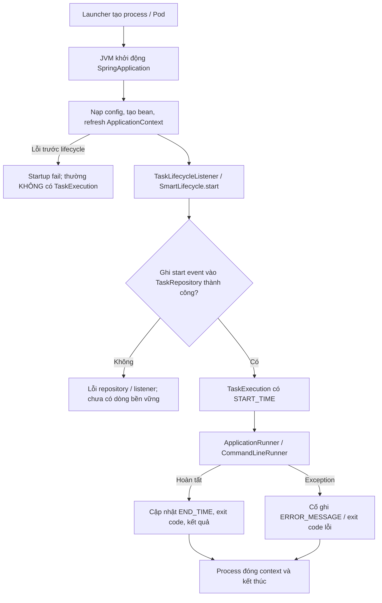
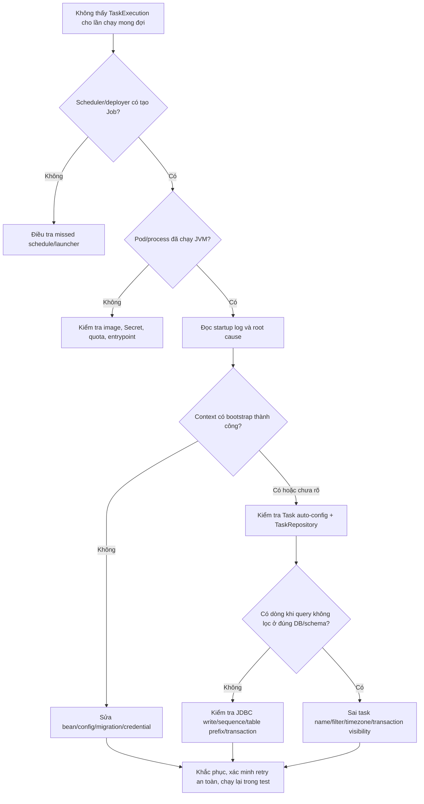
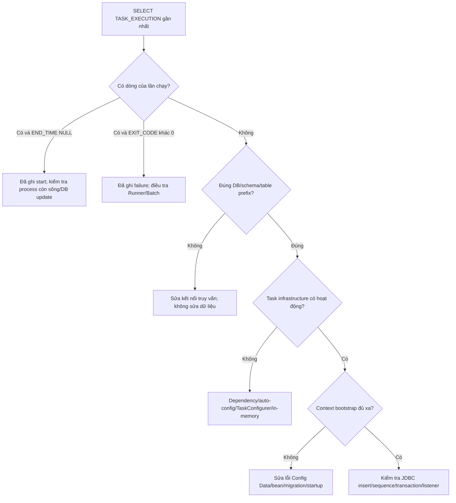

# Không có bản ghi TaskExecution sau khi ứng dụng khởi động lỗi

## 1. Hiện tượng: Job thất bại nhưng bảng TASK_EXECUTION không có dòng nào

**Spring Cloud Task** giúp xây dựng ứng dụng Spring Boot chạy trong thời gian hữu hạn, có thể chạy theo lịch hoặc theo yêu cầu, nhận tham số thực thi, ghi vòng đời vào `TaskRepository` và phối hợp với Spring Batch khi cần xử lý dữ liệu lớn. Với ứng dụng bình thường, mỗi lần chạy Task có một đối tượng `TaskExecution` chứa ID, tên Task, thời gian bắt đầu/kết thúc, mã thoát và thông tin lỗi.

Tuy nhiên, trong production có thể xảy ra tình huống:

```text
02:00:00  Kubernetes Job được tạo
02:00:03  Container khởi động Java
02:00:04  Spring Boot báo APPLICATION FAILED TO START
02:00:05  Container kết thúc với exit code khác 0
02:02:00  Operator truy vấn TASK_EXECUTION: không tìm thấy dòng mới
```

Điều này **không nhất thiết là bug của Spring Cloud Task**. Theo tài liệu vòng đời của framework, Task chỉ được ghi nhận sau khi `ApplicationContext` khởi tạo đủ để chạy cơ chế lifecycle. Nếu context không thể bootstrap, **không có TaskExecution mới được tạo**. Trường hợp khác, Task đã cố tạo dòng nhưng không ghi được database, hoặc dòng được lưu ở **một repository/schema khác** nơi người vận hành đang xem.

**Mục tiêu của bài học** thuộc chương **Chẩn đoán**:

- Hiểu chính xác điểm bắt đầu ghi `TaskExecution` so với startup của Spring Boot.
- Phân biệt lỗi **trước context**, lỗi **trong giai đoạn ghi start event**, và lỗi **sau khi Task đã bắt đầu**.
- Phân loại trường hợp không có dòng: chưa launch, process chưa chạy, auto-configuration tắt, repository in-memory, sai database/schema, lỗi JDBC, listener hoặc transaction.
- Dùng log, trạng thái scheduler/Pod, SQL và tín hiệu Spring Boot để xác định nguyên nhân mà không làm lộ credential.
- Tái hiện an toàn lỗi tạo bean so với lỗi `ApplicationRunner`; kiểm chứng sự khác biệt bằng test.
- Xây dựng giám sát và runbook phục hồi khi không thể dựa vào TaskRepository.

> **Kết luận nền tảng:** “Không tìm thấy TaskExecution” và “Task không được chạy” là hai nhận định **khác nhau**. Trước khi retry, phải xác minh process cũ đã thật sự dừng và dữ liệu nghiệp vụ có thể đã được commit hay chưa.

## 2. Vòng đời thực tế: bản ghi được tạo ở điểm nào?

### 2.1. Chuỗi sự kiện chính

Trong những phiên bản Spring Cloud Task dùng `TaskLifecycleListener`, lần thực thi được bắt đầu khi Spring Framework gọi `SmartLifecycle#start()` trong giai đoạn context startup, **trước** các `ApplicationRunner` và `CommandLineRunner`. Framework tạo `TaskExecution` rồi lưu start event vào `TaskRepository`. Khi các Runner hoàn thành hoặc thất bại qua đường xử lý bình thường, framework cố cập nhật kết quả cuối.



Sơ đồ là đường đi **điển hình** của ứng dụng Task một `ApplicationContext` và một `TaskRepository` hoạt động bình thường. Nó không cam kết callback hoặc transaction vẫn chạy khi process bị `SIGKILL`, mất điện, OOM hoặc database mất kết nối.

### 2.2. Những sự kiện Spring Boot cần phân biệt

| Mốc | Ý nghĩa | Có thể đã có TaskExecution? |
| --- | --- | --- |
| JVM được tạo | Java process đã bắt đầu | Chưa chắc, thường chưa |
| Đọc `application.yml`/Config Data | Nạp profile, biến môi trường, secret manager | Chưa, nếu lỗi ngay tại đây |
| Tạo bean và refresh context | Bind cấu hình, khởi tạo `DataSource`, listeners, migrations | Chưa nếu context bootstrap lỗi sớm |
| `SmartLifecycle#start()` của Task | Spring Cloud Task cố tạo start event | Có, **nếu ghi repository thành công** |
| `ApplicationStartedEvent` của Boot | Context đã được refresh, **trước** Runner | Thường đã có nếu Task được cấu hình đúng |
| `ApplicationRunner`/`CommandLineRunner` | Logic nghiệp vụ chạy | Thường đã có dòng start |
| `ApplicationReadyEvent` | Boot phát sự kiện sau khi Runner hoàn tất | Task có thể đã ghi kết quả cuối |
| `ApplicationFailedEvent` | Boot thông báo khởi động/chạy thất bại | **Không bảo đảm** có dòng Task; tùy thời điểm lỗi |

Một nuance quan trọng: `ApplicationFailedEvent` có thể xảy ra khi context chưa đủ để tạo `TaskLifecycleListener`, nên **nhìn thấy sự kiện này trong log không chứng minh repository đã ghi start event**. Nếu một Runner ném exception sau khi start event được lưu, việc ghi failure thường khả thi; nếu repository lại mất kết nối, vẫn có thể không thấy kết quả như mong đợi.

### 2.3. Vì sao làm việc trong @PostConstruct khác ApplicationRunner?

Không đặt nghiệp vụ quan trọng trong constructor, `@PostConstruct`, `InitializingBean#afterPropertiesSet()` hoặc callback tạo bean rồi kỳ vọng Spring Cloud Task luôn ghi kết quả của công việc đó.

```java
// Thiết kế rủi ro: nghiệp vụ có thể chạy khi context chưa sẵn sàng.
@PostConstruct
void importDataDuringBeanCreation() {
    importService.importOrders();
}
```

Nếu gọi `importOrders()` khi tạo bean và nó ném exception, context có thể fail **trước khi `TaskLifecycleListener` ghi start event**. Hơn nữa, nó có thể đã ghi một số dữ liệu nghiệp vụ trước khi lỗi: **không có TaskExecution không đồng nghĩa không có side effect**.

Đưa logic nghiệp vụ vào một `ApplicationRunner` hoặc `CommandLineRunner`, giữ giai đoạn bean construction cho việc tạo và validate thành phần cần thiết. Không phải tất cả startup validation đều chuyển được vào Runner: config/secret/schema cần thiết phải được xác minh sớm; điều quan trọng là **phân biệt thời điểm thất bại và nguồn theo dõi bên ngoài**.

## 3. Năm nhóm nguyên nhân của một “lần chạy không có TaskExecution”

### 3.1. Bảng phân loại theo điểm lỗi

| Nhóm | Ví dụ | Vì sao không có bản ghi? | Nguồn kiểm tra trước |
| --- | --- | --- | --- |
| **A. Chưa thực thi Java** | CronJob bỏ lịch, Pod Pending, image pull lỗi, entrypoint sai | Spring Boot chưa chạy | Scheduler, Job/Pod events, container status |
| **B. Context bootstrap fail** | Sai Config Data, secret thiếu, bean không tạo được, profile sai, Flyway lỗi | Chưa tới giai đoạn ghi Task start | Boot startup logs, root cause exception |
| **C. Không có Task infrastructure** | Thiếu starter, auto-configuration tắt, thiếu cấu hình kích hoạt đúng version | Không có `TaskLifecycleListener` được cấu hình như dự kiến | Dependency graph, auto-config report, bean definitions |
| **D. Không ghi được TaskRepository** | DB down, password sai, bảng/sequence thiếu, thiếu quyền, transaction lỗi | Ghi start event thất bại hoặc rollback | SQLState, JDBC logs, schema, quyền, network |
| **E. Có ghi nhưng đang xem sai nơi** | H2 in-memory, sai profile/DB/schema, custom table prefix, tên Task khác | Dòng tồn tại nhưng không ở DB/table/filter đang truy vấn, hoặc đã mất theo process | Effective datasource, repository config, SQL không lọc tên |

Với một hệ thống phức tạp, nhiều nguyên nhân có thể đồng thời xuất hiện. Ví dụ Secret bị thiếu làm Pod không start; bạn vừa không có log Java vừa không có TaskExecution. Hoặc lần chạy A được ghi vào DB development do profile sai, trong khi operator đang xem production.

### 3.2. Không nhầm “không có dòng” với “dòng không có END_TIME”

Ba hiện tượng rất khác nhau:

```text
Không có TASK_EXECUTION_ID mới
  -> chưa tạo dòng, ghi thất bại, hoặc xem nhầm repository

Có START_TIME, END_TIME = NULL
  -> đã có start event; có thể đang chạy hoặc đã chết bất thường

Có START_TIME, END_TIME và EXIT_CODE khác 0
  -> đã ghi kết quả thất bại, điều tra lỗi Runner/Batch/Task
```

Một dòng `END_TIME IS NULL` **không phải** bằng chứng process đang sống. Muốn biết thật sự đang chạy phải đối chiếu Pod/process ID, Job status và heartbeat/chunk progress nếu có.

## 4. Quy trình điều tra nhanh: từ bên ngoài đi vào ứng dụng



**Thứ tự tối ưu** là xác minh container thực sự chạy rồi mới truy vấn sâu vào repository. Nếu image pull thất bại, chỉnh database sẽ không giải quyết được gì.

### 4.1. Thu thập bốn định danh

Trước khi điều tra, ghi nhận:

1. **Request/correlation ID** của API, scheduler hoặc lịch dự kiến.
2. **Deployment/Job/Pod ID** của backend (nếu đã tạo).
3. **Artifact version hoặc image digest** thực sự được chạy.
4. **Task name** dự kiến và tên database/schema được cấu hình cho TaskRepository.

`TaskExecutionId` chỉ tồn tại khi framework ghi được dòng. Với tình huống bài học này, **không được phụ thuộc duy nhất vào TaskExecutionId** để truy vết lần chạy.

### 4.2. Hạn chế thao tác thay đổi khi điều tra

Không tự xóa bảng `TASK_EXECUTION`, không tự thêm dòng giả, không cấp quyền DBA tùy tiện và không thay password vào CLI để “thử nhanh”. Việc chẩn đoán nên ưu tiên **đọc trạng thái, log và metadata**; thay đổi cấu hình phải có môi trường test và quy trình phát hành phù hợp.

## 5. Kiểm tra lần chạy ở Kubernetes hoặc launcher

### 5.1. Trường hợp Job không bao giờ được tạo

Nếu Task chạy theo Kubernetes CronJob, kiểm tra:

```bash
kubectl -n batch-jobs get cronjob
kubectl -n batch-jobs describe cronjob orders-daily
kubectl -n batch-jobs get jobs
```

Một lần lịch bị bỏ qua do `suspend`, `concurrencyPolicy: Forbid`, `startingDeadlineSeconds` hoặc controller gặp sự cố có thể **không tạo Pod**. Khi không có process Java, không thể có bản ghi TaskExecution do chính lần chạy đó tạo.

Nếu hệ thống yêu cầu không mất kỳ dữ liệu, phải có **schedule ledger** hoặc danh sách kỳ dự kiến để đối chiếu; TaskRepository chỉ ghi các lần thực sự đi đến cơ chế Task.

### 5.2. Trường hợp Job có nhưng JVM chưa chạy

```bash
kubectl -n batch-jobs get pods
kubectl -n batch-jobs describe pod <pod-name>
kubectl -n batch-jobs logs <pod-name> --all-containers=true
```

Các ví dụ:

| Pod/container state hoặc event | Nguyên nhân thường gặp | Liên quan tới TaskExecution |
| --- | --- | --- |
| `ImagePullBackOff` | Image/tag sai, registry auth lỗi | Java chưa chạy → không có dòng |
| `CreateContainerConfigError` | Secret/ConfigMap key thiếu | Java chưa chạy → không có dòng |
| `Pending` | Quota, scheduling, PVC, node unavailable | Chưa chạy Java |
| `Error` sau start | Java hoặc entrypoint lỗi | Phải đọc log để biết đã đến Task lifecycle chưa |
| `OOMKilled` | Process thiếu bộ nhớ, có thể chết ở bất kỳ pha nào | Có thể không có dòng, có dòng mở hoặc có kết quả tùy thời điểm |
| `Completed` nhưng DB trống | Có thể dùng repository khác/in-memory hoặc Task auto-config không chạy | Kiểm tra DB/schema/config, đừng mặc định thành công |

Thay `<pod-name>` bằng tên thật; cần quyền Kubernetes phù hợp. Với Job có `restartPolicy: Never`, Pod lỗi có thể chỉ có trạng thái `Error` thay vì `CrashLoopBackOff` (thường gặp với container được restart trong cùng Pod).

### 5.3. Backend nhận launch không có nghĩa JVM chạy

`TaskLauncher.launch(...)` hoặc API Spring Cloud Data Flow có thể trả ID deployment ngay khi yêu cầu được chấp nhận, trước khi image pull, mở datasource hoặc Runner. Một lỗi network từ caller cũng có thể xảy ra sau khi backend đã nhận yêu cầu.

Khi lỗi launch không rõ kết quả, **không gửi lại cùng request vô hạn**. Kiểm tra ID triển khai, các Job/Pod đã tạo và khóa nghiệp vụ trước khi retry để tránh tạo hai Task cùng xử lý một kỳ dữ liệu.

## 6. Đọc log Spring Boot: tìm lỗi gốc, không chỉ dòng cuối

### 6.1. Dấu hiệu startup fail

```text
***************************
APPLICATION FAILED TO START
***************************

Description:
...
Action:
...
```

Thông báo này là kết quả xử lý thất bại startup của Spring Boot. Phần có giá trị nhất thường là:

- **Root cause** của chuỗi `Caused by:`, không chỉ exception bọc ngoài cùng.
- `BeanCreationException` hoặc `UnsatisfiedDependencyException` khi một bean/constructor lỗi.
- `ConfigDataResourceNotFoundException` / lỗi resolve import khi cấu hình không tải được.
- Lỗi JDBC/`SQLException` về kết nối, quyền hoặc bảng metadata.
- Lỗi Flyway/Liquibase khi migration không thành công.
- Lỗi class loading/Java runtime không tương thích.

Không nên suy đoán rằng mọi dòng `APPLICATION FAILED TO START` đều xảy ra sau `TaskLifecycleListener`; chúng cũng xuất hiện khi context chưa tạo xong.

### 6.2. Ma trận dấu hiệu–nguyên nhân

| Dấu hiệu | Gợi ý điểm lỗi | Hướng kiểm tra |
| --- | --- | --- |
| `Could not resolve placeholder` | Thiếu environment/config ở giai đoạn bind/bean | Secret reference, tên biến, profile |
| `Failed to bind properties` | Value sai kiểu hoặc thiếu ràng buộc | `@ConfigurationProperties`, enum, số nguyên, YAML |
| `BeanCreationException` | Constructor/`@PostConstruct` lỗi | Bean root cause, vòng phụ thuộc, external call sớm |
| `Connection refused` | DB chưa sẵn sàng/network | DNS, service, port, firewall, TLS |
| `password authentication failed` | Credential sai hoặc hết hạn | Rotation, IAM, secret version; không in password |
| `relation "TASK_EXECUTION" does not exist` | DDL/schema/table prefix không khớp | Migration, `search_path`, naming |
| `permission denied for table/sequence` | Role JDBC thiếu quyền | GRANT đúng nhu cầu; không cấp superuser |
| `FlywayValidateException` / migration failed | Schema history không khớp | Kiểm tra migration riêng, checksum, version |
| `NoSuchMethodError`/`ClassNotFoundException` | Dependency không tương thích | BOM Boot/Cloud/Task và JDK |
| `ApplicationRunner failed` | Lỗi sau startup context | Thường tìm thấy TaskExecution start nếu repository sẵn sàng |

Từ “gợi ý” rất quan trọng: ví dụ JDBC authentication fail có thể xảy ra trong bean construction **hoặc** lúc Runner mở kết nối; hai trường hợp có thể tạo metadata khác nhau.

### 6.3. Dùng debug có kiểm soát

Ở môi trường test có thể bật auto-configuration condition report:

```bash
java -jar target/diagnostic-task.jar --debug
```

`--debug` của Spring Boot giúp giải thích auto-configuration nào match hoặc không match. Không nhầm với **DEBUG toàn bộ HTTP/JDBC** và không bật logging mức cao cho secrets hoặc request headers trong production.

Khi thu thập log, che dữ liệu nhạy cảm trước khi chia sẻ: mật khẩu, bearer token, JDBC URL có thông tin xác thực, tên Secret nhạy cảm và tham số riêng tư.

## 7. Kiểm tra có thật sự bật Spring Cloud Task hay không

### 7.1. Dependency và auto-configuration

Dự án cần dependency Spring Cloud Task tương thích với Boot/Cloud BOM, ví dụ:

```xml
<dependency>
    <groupId>org.springframework.cloud</groupId>
    <artifactId>spring-cloud-starter-task</artifactId>
</dependency>

<dependency>
    <groupId>org.postgresql</groupId>
    <artifactId>postgresql</artifactId>
    <scope>runtime</scope>
</dependency>
```

Đây là fragment Maven, không phải `pom.xml` đầy đủ. Kiểm tra **dependency tree của bản build thật** để xác nhận có Task starter, JDBC driver và versions phù hợp. Nếu task chạy được bằng `java -jar` nhưng **không có hạ tầng Spring Cloud Task**, process vẫn có thể hoàn tất nghiệp vụ mà không ghi TaskExecution.

Ví dụ application entry point:

```java
import org.springframework.boot.SpringApplication;
import org.springframework.boot.autoconfigure.SpringBootApplication;
import org.springframework.cloud.task.configuration.EnableTask;

@SpringBootApplication
@EnableTask
public class DiagnosticTaskApplication {
    public static void main(String[] args) {
        SpringApplication.run(DiagnosticTaskApplication.class, args);
    }
}
```

Với starter và phiên bản hỗ trợ auto-configuration, việc bật Task có thể không bắt buộc viết `@EnableTask` riêng; ví dụ chỉ diễn đạt rõ mục tiêu. Không thêm annotation gây xung đột với cấu hình hiện có mà chưa kiểm tra release thực tế.

### 7.2. Có thể auto-configuration đã bị tắt

Tài liệu Spring Cloud Task liệt kê property:

```properties
spring.cloud.task.autoconfiguration.enabled=false
```

Đây là cấu hình **tắt** Task auto-configuration trong những version hỗ trợ. Nếu một profile dùng property này, ứng dụng vẫn có thể chạy Runner nhưng không có repository/listener của Task. Ngoài ra có thể loại trừ `SimpleTaskAutoConfiguration` bằng cấu hình auto-configuration exclusion.

Khi điều tra, kiểm tra effective configuration từ những nguồn hợp lệ (YAML, env, Config Data và CLI) thay vì chỉ mở một `application.yml` rồi kết luận property không được đặt ở đâu khác.

### 7.3. Chạy không có DataSource có thể dùng repository in-memory

Tài liệu `TaskConfigurer` mô tả lựa chọn **Map-based in-memory** khi không có `DataSource` thích hợp; tài liệu getting started ở một số version cũng dùng **embedded H2** để minh họa. Những dạng lưu trữ trong bộ nhớ hoặc database nhúng **không tương đương PostgreSQL production**.

Kết quả có thể là:

```text
Log: Started and completed a task
Process: exited normally
Operator: SELECT * FROM production.TASK_EXECUTION -> 0 rows
```

Không có gì mâu thuẫn nếu TaskRepository thực tế không phải `production`. Hãy kiểm tra cấu hình repository/`TaskConfigurer`, dependency H2 và datasource đang được tạo. H2 in-memory mất dữ liệu khi JVM kết thúc; cũng không thể lấy bản ghi từ Map repository của process đã chết.

### 7.4. TaskConfigurer tùy chỉnh

Nếu có bean `TaskConfigurer` riêng, framework có thể sử dụng repository/transaction manager khác với `spring.datasource` mà bạn đang nhìn. Đừng mặc định `TaskRepository` và database nghiệp vụ luôn chung một `DataSource`.

Trong ứng dụng nhiều datasource, phải xác định:

- Bean `TaskRepository` thực tế là implementation nào?
- `TaskConfigurer` cung cấp JDBC datasource/transaction manager nào?
- Có bean mang `@Primary` hoặc điều kiện auto-configuration nào đổi lựa chọn không?
- DDL và quyền của database đó đã sẵn sàng chưa?
- Người vận hành đang truy vấn đúng cluster/schema hay không?

Không cần in credential để trả lời những câu hỏi này; có thể ghi cấu hình đã được lọc hoặc dùng lệnh kiểm tra metadata DB.

## 8. Kiểm tra database và schema bằng SQL an toàn

Ví dụ sau minh họa **PostgreSQL**, với người dùng chỉ có quyền đọc metadata và bảng được phép. Thay tên database/schema theo triển khai thực tế; không copy các truy vấn đặc thù PostgreSQL sang Oracle/MySQL/SQL Server nguyên văn.

### 8.1. Xác minh mình đang kết nối tới đâu

```sql
SELECT current_database() AS database_name,
       current_schema() AS default_schema,
       current_user AS login_role,
       current_setting('search_path') AS search_path,
       CURRENT_TIMESTAMP AS database_time;
```

Đây là bước loại trừ **truy vấn nhầm DB/schema**, rất thường gặp khi có nhiều môi trường, nhiều datasource hoặc profile. Không in ra JDBC password/URL có token.

### 8.2. Kiểm tra sự tồn tại của bảng và sequence

```sql
SELECT to_regclass('public.task_execution') AS execution_table,
       to_regclass('public.task_execution_params') AS params_table,
       to_regclass('public.task_seq') AS task_sequence_object;
```

`to_regclass(...)` trả về `NULL` khi không tìm thấy relation được chỉ định. Đây là **kiểm tra tên** theo schema giả định `public`; có thể dùng schema khác hoặc `tablePrefix` đã tùy biến.

Một số DDL Spring Cloud Task lưu ID bằng sequence thật; một số hệ DB/version dùng bảng `TASK_SEQ` hoặc cơ chế khác. **Không tự tạo sequence mới bằng một câu `CREATE SEQUENCE` ngẫu nhiên** vì có thể làm trùng ID hoặc phá schema đúng phiên bản.

### 8.3. Đọc metadata mà không lọc Task name trước

```sql
SELECT TASK_EXECUTION_ID,
       TASK_NAME,
       START_TIME,
       END_TIME,
       EXIT_CODE,
       ERROR_MESSAGE
FROM TASK_EXECUTION
ORDER BY TASK_EXECUTION_ID DESC
LIMIT 30;
```

Đừng bắt đầu bằng:

```sql
SELECT *
FROM TASK_EXECUTION
WHERE TASK_NAME = 'orders-import'
  AND START_TIME >= CURRENT_TIMESTAMP - INTERVAL '5 minutes';
```

Query có filter có thể trả `0` dòng nếu tên Task đổi thành `Application`, timestamp khác timezone, log và database lệch giờ, hoặc bạn xem sau thời gian giới hạn. Hãy kiểm tra các hàng gần nhất **không lọc tên** ở DB đúng trước; sau đó mới khoanh vùng theo thời gian/correlation ID.

### 8.4. Truy vấn tên schema và quyền

```sql
SELECT table_schema, table_name
FROM information_schema.tables
WHERE lower(table_name) LIKE '%task%execution%'
ORDER BY table_schema, table_name;
```

```sql
SELECT has_table_privilege(
         current_user, 'public.task_execution', 'SELECT'
       ) AS can_read_task_execution,
       has_table_privilege(
         current_user, 'public.task_execution', 'INSERT'
       ) AS can_insert_task_execution;
```

Hai câu trên chỉ là **kiểm tra sơ bộ**, và phép kiểm tra quyền nên thực hiện sau khi xác nhận relation cần kiểm tra tồn tại. Cấp `INSERT` không đủ cho mọi hoạt động: Task cần quyền SELECT/UPDATE phù hợp và quyền sử dụng sequence/table phát ID, tùy DDL. Cần dùng service user tương ứng để test quyền, không chạy startup production bằng tài khoản superuser chỉ để làm lỗi biến mất.

### 8.5. Schema bị thiếu do tắt initialization

Ví dụ production hay dùng:

```yaml
spring:
  cloud:
    task:
      initialize-enabled: false
  batch:
    jdbc:
      initialize-schema: never
```

Điều này **giả định** migration đã tạo bảng Task và Batch. Nếu bảng chưa có, repository có thể lỗi khi tạo start event. Không sửa bằng cách bật schema initialization bừa bãi trên production; ưu tiên Flyway/Liquibase hoặc migration do release pipeline quản lý, với tài khoản DDL tách khỏi runtime.

## 9. Config ví dụ cho một Task có repository bền vững

```yaml
spring:
  application:
    name: orders-import
  main:
    web-application-type: none
  datasource:
    url: ${TASK_DB_URL:jdbc:postgresql://localhost:5432/taskdb}
    username: ${TASK_DB_USER:task_user}
    password: ${TASK_DB_PASSWORD}
  cloud:
    task:
      name: orders-import
      initialize-enabled: false
      closecontextEnabled: true
```

Điều kiện mẫu:

- PostgreSQL đã có schema `TASK_*` đúng release Spring Cloud Task đang dùng.
- Biến `TASK_DB_PASSWORD` được cấp qua Secret/secret manager, không truyền qua CLI.
- `task_user` có quyền đọc/ghi bảng và sequence cần thiết.
- Không có `TaskConfigurer` riêng trỏ TaskRepository sang database khác.
- `spring.cloud.task.name` được đặt rõ; không nhầm với tên Kubernetes Job hay `spring.application.name`.
- `closecontextEnabled=true` giúp context được đóng sau khi Task hoàn tất, **không bảo đảm có dòng start khi context đã fail sớm**.

Nếu deployment dùng Cloud Foundry/Kubernetes/SCDF hoặc nhiều datasource, các phần kết nối thực tế có thể khác. Phải đối chiếu properties với phiên bản đang triển khai, không mặc định mọi tổ hợp Boot/Cloud Task hỗ trợ cùng các flag.

## 10. Thí nghiệm: lỗi tạo bean so với lỗi trong ApplicationRunner

Mục tiêu là tạo **hai lỗi khác nhau** trong một ứng dụng Spring Cloud Task để quan sát thời điểm ghi `TaskExecution`. Thực hiện trong **database test riêng**, không dùng DB production.

### 10.1. Application entry point

```java
import org.springframework.boot.SpringApplication;
import org.springframework.boot.autoconfigure.SpringBootApplication;
import org.springframework.cloud.task.configuration.EnableTask;

@SpringBootApplication
@EnableTask
public class DiagnosticTaskApplication {
    public static void main(String[] args) {
        SpringApplication.run(DiagnosticTaskApplication.class, args);
    }
}
```

Để demo, dự án cần Spring Cloud Task starter, JDBC driver, database và migration tương thích. Tên JAR minh họa là `target/diagnostic-task.jar`; thay bằng tên build thực tế.

### 10.2. Tạo lỗi theo hai pha

```java
import org.springframework.boot.ApplicationRunner;
import org.springframework.boot.autoconfigure.condition.ConditionalOnProperty;
import org.springframework.context.annotation.Bean;
import org.springframework.context.annotation.Configuration;

@Configuration
public class FailureInjectionConfiguration {

    // Lỗi trong lúc tạo singleton bean: context chưa bootstrap xong.
    @Bean
    @ConditionalOnProperty(
            name = "lab.failure.phase", havingValue = "context")
    Object failWhileCreatingBean() {
        throw new IllegalStateException(
                "LAB_CONTEXT_FAILURE: tạo bean thất bại");
    }

    // Lỗi khi Runner chạy: Task start event thường đã được lưu.
    @Bean
    @ConditionalOnProperty(
            name = "lab.failure.phase", havingValue = "runner")
    ApplicationRunner failInsideRunner() {
        return args -> {
            throw new IllegalStateException(
                    "LAB_RUNNER_FAILURE: runner thất bại");
        };
    }

    @Bean
    @ConditionalOnProperty(
            name = "lab.failure.phase", havingValue = "none")
    ApplicationRunner successfulRunner() {
        return args -> System.out.println("LAB_TASK_COMPLETED");
    }
}
```

`@ConditionalOnProperty` dùng property điều khiển **chỉ cho bài test**, không để tính năng tạo lỗi tồn tại trong artifact production. Mã tạo bean ném exception khi singleton được khởi tạo; với cấu hình Spring mặc định không lazy, việc này xảy ra trong context startup.

### 10.3. Chạy ba trường hợp

```bash
# Ca 1: tạo bean lỗi trước khi context sẵn sàng
java -jar target/diagnostic-task.jar --lab.failure.phase=context

# Ca 2: Runner ném lỗi sau khi start event được ghi
java -jar target/diagnostic-task.jar --lab.failure.phase=runner

# Ca 3: hoàn tất bình thường
java -jar target/diagnostic-task.jar --lab.failure.phase=none
```

Sau mỗi lần chạy, đối chiếu **process exit code**, log startup và bảng `TASK_EXECUTION` trong đúng database. Nếu dùng shell Unix, có thể xem `echo $?` ngay sau lệnh; với PowerShell sử dụng `$LASTEXITCODE`.

### 10.4. Kỳ vọng khi repository hoạt động đúng

| Test case | Context khởi tạo? | Runner chạy? | Kỳ vọng TaskExecution | Process |
| --- | --- | --- | --- | --- |
| `phase=context` | Không hoàn tất | Không | **Thường không có dòng mới** | Thất bại |
| `phase=runner` | Có | Có, rồi ném exception | **Có dòng start**, thường cập nhật lỗi | Thất bại |
| `phase=none` | Có | Có, hoàn tất | Có start và end | Thành công |

Đây là **kỳ vọng theo tài liệu vòng đời**, không phải kết quả thực thi thực tế của bài viết. Nếu test 2 cũng không có dòng, hãy kiểm tra Task auto-configuration, `TaskConfigurer` và DB như phần 7–9; không kết luận Spring Cloud Task cố ý bỏ qua mọi exception.

### 10.5. Một phép đo rất có ích

Trước và sau mỗi lần chạy, lưu:

```sql
SELECT COUNT(*) AS total_execution_rows
FROM TASK_EXECUTION;
```

Ngoài số dòng, nên ghi thời điểm query và trích `TASK_EXECUTION_ID` mới nhất. `COUNT(*)` chỉ có ý nghĩa trong **database test không có worker khác chạy đồng thời**; production có nhiều Task cùng ghi nên cần correlation ID hoặc truy vấn theo khoảng thời gian/tên Task có xác minh.

## 11. Trường hợp lỗi trong TaskExecutionListener

### 11.1. onTaskStartup xảy ra trước khi lưu start event

Spring Cloud Task hỗ trợ `TaskExecutionListener` hoặc các annotation:

- `@BeforeTask`: trước khi lưu `TaskExecution` vào repository.
- `@AfterTask`: trước khi cập nhật trạng thái cuối.
- `@FailedTask`: khi có lỗi Task, trước `@AfterTask`.

Nếu listener `onTaskStartup` hoặc phương thức `@BeforeTask` ném exception, quá trình lưu start event **có thể bị gián đoạn trước khi dòng được commit**. Đây là một nhóm nguyên nhân đáng kiểm tra khi log báo context/Task startup lỗi nhưng `TASK_EXECUTION` trống.

### 11.2. Không làm I/O phức tạp trong onTaskStartup

Ví dụ thiết kế rủi ro:

```java
@BeforeTask
public void beforeTask(TaskExecution execution) {
    externalApi.mustRespondBeforeStart(); // mạng lỗi -> có thể chặn ghi Task
}
```

Vì callback diễn ra **trước** ghi start metadata, gọi API ngoài, đọc file lớn hoặc thay đổi nghiệp vụ tại đây làm tăng nguy cơ Task thất bại mà không có dòng lịch sử.

Nên để listener làm việc nhỏ, thuần kiểm tra/correlation không rò rỉ dữ liệu; phần nghiệp vụ chính nên ở Runner. Nếu một bước validate có thể lỗi trước khi ghi Task, cần **log và theo dõi launcher bên ngoài** để vẫn phát hiện thất bại.

### 11.3. Khi onTaskEnd thất bại

Nếu `onTaskEnd` hoặc thao tác cập nhật kết quả cuối lỗi, có thể **đã có start row** nhưng thiếu `END_TIME` hoặc thiếu thông tin lỗi. Đừng nhầm tình huống này với không có row.

Tài liệu Spring Cloud Task cũng mô tả quy tắc exit code riêng khi một `TaskExecutionListener` ném exception, khác với cách `ExitCodeExceptionMapper` xử lý exception Runner trong một số phiên bản. Vì vậy không dựa vào mỗi exit code để xác định chỗ hỏng; phải xem callback, log và dữ liệu DB.

## 12. Phân biệt lỗi TaskRepository và lỗi database nghiệp vụ

Một hệ thống có thể có:

```text
TaskRepository   -> DB task_metadata
JobRepository    -> DB batch_metadata
Business service -> DB orders
```

Nếu ứng dụng tạo bean `DataSource` nghiệp vụ ngay khi startup và không kết nối được, context có thể fail **trước khi TaskRepository ghi start event**, dù DB `task_metadata` vẫn khỏe.

Ngược lại, nếu context đã bootstrap, Task start event đã ghi vào `task_metadata`, sau đó Runner truy vấn `orders` và lỗi, `TaskExecution` thường được cập nhật thất bại nếu DB metadata còn sẵn.

### 12.1. So sánh ba lỗi JDBC

| Điểm phát sinh lỗi | Thời điểm | Dòng TaskExecution |
| --- | --- | --- |
| `DataSource` nghiệp vụ mở connection khi tạo bean | Trước Task lifecycle | Có thể **không có** |
| `TaskRepository` cần insert nhưng DB metadata read-only | Ngay lúc Task start | Có thể **không có** |
| Service nghiệp vụ lấy connection trong Runner và lỗi | Sau Task start | Thường **có start row**, trừ khi DB metadata cũng lỗi |

Do đó, để chẩn đoán, phân biệt JDBC URL/role/schema của từng datasource. Một lỗi `Connection refused` chỉ chứng minh **một kết nối** thất bại, không cho biết database nào nếu log không có thông tin đã được lọc an toàn.

### 12.2. Spring Batch cũng có JobRepository riêng

Nếu Task chứa Spring Batch Job, `JobRepository` lưu `JobExecution` và `StepExecution` trong `BATCH_*`. Tùy cách khởi tạo Batch infrastructure, lỗi chuẩn bị Batch metadata có thể khiến context fail sớm; hoặc Batch Job chạy sau Task start rồi mới lỗi.

Không lấy việc “không có JobExecution” làm bằng chứng “không có TaskExecution” hoặc ngược lại. Hãy xem **cả hai repository** và thứ tự startup/launch.

## 13. Quan sát lỗi trước khi TaskRepository sẵn sàng

### 13.1. Tại sao cần tín hiệu bên ngoài?

Nếu Task chết khi tạo bean, không nên chờ `TaskExecutionListener` của chính Task gửi cảnh báo: listener có thể chưa được tạo. Tín hiệu đáng tin hơn bao gồm:

- **Scheduler/deployer:** đã yêu cầu chạy, đã tạo resource hay bị từ chối?
- **Container runtime:** exit code, termination reason, OOMKilled, image pull.
- **Startup log:** root exception và error classification.
- **External job ledger:** kỳ dữ liệu dự kiến, attempt count, kết quả có được xác nhận?
- **Secret manager/database audit:** request auth, lỗi quyền, credential rotation.

Kết hợp các tín hiệu mới trả lời được cả câu hỏi “**Task có khởi chạy không?**” và “**Task có bắt đầu ghi metadata chưa?**”.

### 13.2. Bắt ApplicationFailedEvent sớm để log loại lỗi

Có thể đăng ký một listener với `SpringApplication` trước khi chạy, nhằm ghi **loại exception** khi startup thất bại:

```java
import org.springframework.boot.SpringApplication;
import org.springframework.boot.autoconfigure.SpringBootApplication;
import org.springframework.boot.context.event.ApplicationFailedEvent;
import org.springframework.context.ApplicationListener;

@SpringBootApplication
public class BootstrapFailureReporterApp {
    public static void main(String[] args) {
        SpringApplication app =
                new SpringApplication(BootstrapFailureReporterApp.class);

        app.addListeners(
                (ApplicationListener<ApplicationFailedEvent>) event -> {
                    Throwable failure = event.getException();
                    System.err.println(
                            "BOOT_STARTUP_FAILED_EXCEPTION_TYPE="
                            + failure.getClass().getName());
                });

        app.run(args);
    }
}
```

Đoạn code chỉ ghi **tên lớp exception**, không in message chứa URL có credential hoặc token. Sự kiện Boot phát khi lỗi được SpringApplication xử lý; nó không bắt được lỗi **trước khi JVM/Java main chạy** hoặc process bị kill cứng. Đây là kỹ thuật **bổ sung log**, không phải cách thay thế TaskRepository.

Nếu dự án đã có global error reporting, đừng thêm nhiều listener cùng in thông tin nhạy cảm. Và không đặt thao tác network bắt buộc trong failure listener: lúc startup lỗi, network/config có thể chính là thành phần gây sự cố.

### 13.3. Tên và correlation ID trước TaskExecution

Ví dụ log cấu trúc an toàn:

```json
{
  "event": "task-bootstrap-failed",
  "request_id": "run-2026-11-24-0200",
  "application": "orders-import",
  "artifact_version": "1.4.2",
  "phase": "application-context",
  "exception_type": "BeanCreationException",
  "task_execution_id": null
}
```

Đây là format **tự thiết kế**, không phải log mặc định của framework. `request_id` cần được cấp từ launcher trước khi JVM khởi động; khi TaskExecution chưa tồn tại thì giá trị `null` là đúng. Đừng chèn token hoặc password vào correlation ID.

## 14. Không có bản ghi vì tên Task hoặc bảng bị thay đổi

### 14.1. TaskNameResolver và tên mặc định

`TaskNameResolver` quyết định tên Task. Với cấu hình thường dùng:

```yaml
spring:
  application:
    name: orders-import
  cloud:
    task:
      name: orders-import
```

Nếu không đặt `spring.cloud.task.name`/`spring.application.name`, tên có thể mặc định kiểu `Application` tùy version. Người vận hành truy vấn:

```sql
SELECT *
FROM TASK_EXECUTION
WHERE TASK_NAME = 'orders-daily';
```

sẽ nhận `0` hàng nếu thực tế framework lưu `orders-import` hoặc `Application`. Vì vậy luôn kiểm tra các hàng mới nhất **không filter tên** rồi đối chiếu cấu hình name.

### 14.2. Table prefix và schema

Spring Cloud Task có property `spring.cloud.task.tablePrefix` (được mô tả trong tài liệu cấu hình) để đổi tiền tố bảng, bao gồm cả cách chỉ định schema trong một số thiết kế.

```properties
spring.cloud.task.tablePrefix=custom_
```

Khi đó repository có thể không sử dụng các tên bảng mặc định như `TASK_EXECUTION`. Việc thay prefix đòi hỏi **DDL phù hợp đã được chuẩn bị**; không đổi property trên môi trường production chỉ để tránh truy vấn đang trả rỗng.

Schema của PostgreSQL cũng có `search_path`: Task có thể ghi `app_task.task_execution` trong khi SQL tool mặc định tìm `public.task_execution`. Phải xác định **cả catalog/database, schema và table prefix**.

### 14.3. Dữ liệu không xuất hiện ngay do transaction

Một transaction chưa commit có thể khiến phiên SQL khác chưa nhìn thấy dòng. Khi điều tra realtime, không kết luận quá sớm trong khoảng startup; có thể poll lại sau khi giao dịch hoàn tất. Tuy nhiên, nếu process đã fail và DB rollback, đợi thêm cũng không tự tạo row.

Không dùng isolation `READ UNCOMMITTED` hoặc query không an toàn để “ép thấy” dữ liệu. Dùng transaction semantics chính xác và log JDBC transaction khi kiểm tra ở môi trường test.

## 15. Sơ đồ điều tra theo kết quả SQL



Một phiên kiểm tra tốt phải lưu **bằng chứng** tại mỗi nhánh: thời điểm, error class, datasource/schema, Job/Pod ID và artifact version. Nếu không có bằng chứng, đừng chỉ đổi property rồi thử lại trên production nhiều lần.

## 16. Checklist kiểm chứng repository khi nghi start event bị mất

### 16.1. Các điểm cần đối chiếu

| Hạng mục | Cần xác minh | Mẫu nguyên nhân |
| --- | --- | --- |
| `DataSource` | URL, DB, schema, role, pool config | Trỏ DB test hoặc database không tồn tại |
| JDBC driver | Driver đúng vendor/version | Driver class không load được |
| TLS | CA, hostname verification, truststore | TLS handshake fail khi startup |
| Secret | Key/namespace/path, rotation, thời hạn | Password cũ hoặc Secret chưa mount |
| Repository implementation | JDBC, Map, H2, custom configurer | Dữ liệu chỉ ở bộ nhớ |
| DDL | `TASK_EXECUTION`, params, `TASK_SEQ`/sequence đúng version | Bảng hoặc sequence thiếu |
| Quyền | SELECT/INSERT/UPDATE và quyền sequence cần thiết | `permission denied` |
| Transaction | TransactionManager và commit/rollback | Start write rollback |
| Task name | `TaskNameResolver`, `spring.cloud.task.name` | Filter sai tên |
| Table prefix | `spring.cloud.task.tablePrefix` | Query sai bảng |
| Task listener | `onTaskStartup` có throw exception? | Chặn ghi start |
| Version | Boot/Cloud/Task/SQL DDL tương thích | API, schema hoặc class mismatch |

### 16.2. Cấu hình log phục vụ test

Ở **môi trường test**, có thể nâng log cho các package Task và Spring JDBC:

```yaml
logging:
  level:
    org.springframework.cloud.task: DEBUG
    org.springframework.jdbc.core: DEBUG
    org.springframework.transaction: DEBUG
```

Đây là gợi ý **theo dõi luồng**; tên logger và thông tin được log có thể khác phiên bản. DEBUG/TRACE SQL có rủi ro phơi dữ liệu/parameters, nên không đưa tùy tiện lên production. Không bật toàn bộ logging JDBC bind values hoặc `Environment` khi có secrets.

### 16.3. Không dùng quyền DBA để che lỗi cấu hình

Nếu startup fail vì thiếu `INSERT` hoặc `USAGE` trên sequence, điều cần làm là **cấp đúng quyền** cho runtime role theo schema đã review. Không đổi `spring.datasource.username` sang superuser rồi coi vấn đề được giải quyết.

Tương tự, nếu thiếu `TASK_EXECUTION`, không sửa chữa bằng cách chạy đồng thời nhiều instance Task với quyền `CREATE TABLE`; dùng migration release pipeline có kiểm soát và schema DDL chính thức.

## 17. Sự cố secret hoặc Vault: lỗi xảy ra trước TaskExecution

Một Task có thể tải cấu hình từ Kubernetes Secret, `configtree:`, Spring Cloud Vault hoặc cloud secret manager **trước khi tạo đầy đủ context**.

Nếu volume mount chứa hai file tên `spring.datasource.username` và `spring.datasource.password`, Spring Boot có thể bind trực tiếp những tên property đó qua `configtree:`. Cấu hình nên viết như sau, **không tự tham chiếu property vào chính nó**:

```yaml
spring:
  config:
    import: "configtree:/run/secrets/task-db/"
  datasource:
    url: ${TASK_DB_URL}
```

Khi volume/secret bắt buộc không tồn tại, Config Data có thể báo lỗi trước khi TaskRepository tạo được metadata. Với Vault, auth role/token/TLS fail ở giai đoạn nạp cấu hình cũng có thể làm context bootstrap fail.

**Các kiểm tra an toàn:**

1. Secret và Pod ở cùng namespace (với Kubernetes Secret).
2. `secretKeyRef` key đúng hoặc volume mount đường dẫn đúng.
3. `ServiceAccount`/Vault role có quyền đúng secret path.
4. Không in Secret value/`System.getenv()` ra log.
5. Có cơ chế rotation và restart Task khi environment đã dùng credential cũ.

**Không cố “chữa” bằng cách đặt password trực tiếp ở argv** — tham số Task có thể bị ghi trong `TASK_EXECUTION_PARAMS` hoặc lộ qua hệ điều phối.

## 18. Thời điểm retry: phải xét dữ liệu nghiệp vụ đã commit

### 18.1. Không có start event vẫn có thể có side effect

Ví dụ:

```text
Context tạo bean importer
  -> @PostConstruct gọi API bên ngoài, thành công
  -> bước tạo bean kế tiếp ném exception
  -> TaskLifecycleListener chưa lưu TaskExecution
  -> Scheduler thấy Job FAILED và tự retry
  -> API bị gọi thêm lần nữa
```

Đây là một lý do quan trọng để **không đặt công việc nghiệp vụ trong bean initialization**, đồng thời phải có idempotency ở API/data layer dù TaskRepository chưa ghi lần chạy.

### 18.2. Quy tắc retry theo loại lỗi

| Loại lỗi | Có nên tự retry? | Điều kiện |
| --- | --- | --- |
| Image pull/Secret reference sai | Không retry dồn dập | Sửa cấu hình/deployment rồi mới chạy lại |
| Database tạm unavailable | Có thể, với backoff giới hạn | Xác minh process cũ đã dừng; database và quyền ổn định |
| Credential sai hoặc bị thu hồi | Chỉ sau khi sửa secret | Không gửi password qua CLI để test |
| Schema DDL thiếu/mismatch | Chỉ sau migration đúng version | Không tự tạo bảng ad hoc |
| `BeanCreationException` do code | Sau khi phát hành bản sửa | Ghim artifact version/digest |
| Runner exception do input không hợp lệ | Thường không retry tự động | Sửa đầu vào rồi mới chạy |
| Lỗi tạm trong Runner sau một số commit | Có thể, nếu idempotent | Đối soát checkpoint và side effects |
| Chưa biết process có tạo side effect không | **Tạm dừng retry** | Điều tra log, DB và hệ thống ngoài |

Không sử dụng `TaskExecutionId` làm khóa idempotency duy nhất: một business period có thể được thử lại với **TaskExecutionId khác**. Dùng khóa nghiệp vụ như `(source, businessDate, orderId)` hoặc một request ID bền vững.

### 18.3. Ví dụ ràng buộc nghiệp vụ

PostgreSQL:

```sql
CREATE TABLE imported_order_results (
    source_name VARCHAR(60) NOT NULL,
    business_date DATE NOT NULL,
    order_id BIGINT NOT NULL,
    processed_at TIMESTAMPTZ NOT NULL DEFAULT CURRENT_TIMESTAMP,
    PRIMARY KEY (source_name, business_date, order_id)
);
```

Writer có thể dùng upsert:

```sql
INSERT INTO imported_order_results (source_name, business_date, order_id)
VALUES (:source, :businessDate, :orderId)
ON CONFLICT (source_name, business_date, order_id)
DO NOTHING;
```

Đây là ví dụ **chống trùng record** trong PostgreSQL, không phải exactly-once cho HTTP/email/Kafka. Named parameters cần được bind qua `NamedParameterJdbcTemplate` hoặc API tương thích. Việc `DO NOTHING` bỏ qua trùng cũng cần kiểm tra nghiệp vụ: nếu nội dung cần cập nhật thì cần version/checksum và quy tắc hợp nhất dữ liệu.

## 19. Thực hành chẩn đoán bằng một kịch bản có nhiều tầng

### 19.1. Bối cảnh

Một `CronJob` tạo `orders-import` lúc 02:00, Task lấy mật khẩu PostgreSQL từ Kubernetes Secret. Runtime image vừa được nâng cấp nhưng chưa áp dụng DDL Task mới. Operator thấy Pod thất bại và không thấy bản ghi `TASK_EXECUTION`.

### 19.2. Lời giải điều tra mẫu

**Bước 1 — Xác nhận Job đã được tạo.**

```bash
kubectl -n batch-jobs get job orders-import-20261124
kubectl -n batch-jobs get pods
```

**Bước 2 — Xác định Java đã chạy chưa.** Nếu Pod báo `CreateContainerConfigError`, kiểm tra Secret/ConfigMap trước; nếu JVM đã in `APPLICATION FAILED TO START` thì chuyển sang startup log.

**Bước 3 — Đọc nguyên nhân đầu tiên.** Nếu root cause là `relation "TASK_EXECUTION" does not exist`, kiểm tra database/schema/prefix; nếu là `password authentication failed`, xem tình trạng rotation/role mà không lộ password.

**Bước 4 — Đối chiếu version.** Xem JAR/image digest, Spring Cloud Task version, SQL DDL version và migration state. Không lấy DDL từ một release cũ hơn chỉ vì tên bảng giống.

**Bước 5 — Sửa qua release pipeline.** Cập nhật migration/schema hoặc Secret/permission đúng quy trình. Không bật DDL admin quyền lớn cho mọi Job ngắn hạn.

**Bước 6 — Chạy thử trên môi trường test.** Xác minh một lần thành công và một lần Runner lỗi đều ghi metadata đúng, còn lỗi bean sớm không tạo row như kỳ vọng.

**Bước 7 — Kiểm tra idempotency trước khi retry production.** Nếu worker chưa thực hiện nghiệp vụ thì retry có thể an toàn hơn, nhưng phải có bằng chứng từ log và DB/hệ thống ngoài.

**Bước 8 — Cập nhật cảnh báo.** Thêm tín hiệu “Pod failed but no corresponding TaskExecution” và “expected business period missing”, để lỗi tương tự không chỉ được phát hiện khi người vận hành truy vấn thủ công.

## 20. Runbook khắc phục sự cố production

### 20.1. Thu thập bằng chứng

- Tên Task/Job, scheduled time và businessDate.
- Request ID, Kubernetes Job/Pod ID, container exit code và termination reason.
- Image digest, Java/Boot/Cloud Task version, profile và config nguồn.
- Stack trace đã lọc secret, root exception và thời điểm lỗi.
- Database/schema/table prefix của TaskRepository, kết quả truy vấn mới nhất.
- Trạng thái `TaskExecution` (nếu có), `JobExecution` (nếu có), dữ liệu đã commit.

### 20.2. Quy trình quyết định

1. **Chặn retry không kiểm soát** nếu có khả năng một instance cũ còn sống hoặc đã commit một phần.
2. **Xác minh tầng scheduler/deployer:** có Job và Pod thật chưa, image đã được chạy chưa?
3. **Phân loại lỗi trước/sau context:** đọc exception chính, không chỉ dòng summary.
4. **Kiểm tra Task infrastructure:** dependency, auto-config, TaskConfigurer, repository implementation.
5. **Kiểm tra đúng datasource/schema:** xác minh JDBC metadata và prefix, đọc bảng không lọc tên.
6. **Sửa đúng tầng:** cấu hình/secret, schema migration, quyền, code tạo bean, hoặc lỗi service trong Runner.
7. **Test fix trong môi trường tách biệt** bằng ba pha thành công/context failure/Runner failure.
8. **Đối soát dữ liệu nghiệp vụ** trước khi tạo execution mới.
9. **Chạy lại có correlation ID** và giới hạn retry/backoff, quan sát cả Pod/process lẫn `TaskExecution`.
10. **Lưu postmortem:** điểm mất tín hiệu, nguyên nhân, hành động và cách giám sát phòng ngừa.

### 20.3. Không nên làm

| Thao tác sai | Hậu quả |
| --- | --- |
| Tạo `TaskExecution` giả bằng SQL để “có lịch sử” | Metadata không khớp process và có thể gây báo cáo sai |
| Đổi password qua command-line args | Rò rỉ vào log, argv hoặc `TASK_EXECUTION_PARAMS` |
| Bật toàn bộ DEBUG/TRACE JDBC trên production | Có thể lộ SQL/parameters nhạy cảm |
| Xóa `TASK_SEQ` hoặc reset ID vì thiếu row | Nguy cơ trùng ID/hỏng khóa tham chiếu |
| Đổi `spring.cloud.task.name` để tìm đúng dashboard | Che nguyên nhân và thay phạm vi logic Task/locking |
| Retry ngay khi không thấy row | Có thể tạo process trùng hoặc lặp side effect |
| Dùng account DBA chạy Task để vượt lỗi quyền | Mở rộng quyền truy cập ngoài nhu cầu |
| Chỉ kiểm tra TaskRepository, bỏ qua scheduler | Không phát hiện Job chưa từng được tạo |

## 21. Giám sát: phát hiện lỗi bootstrap ngay cả khi không có TaskExecution

### 21.1. Các tín hiệu đề xuất

| Metric/sự kiện | Nguồn | Ý nghĩa |
| --- | --- | --- |
| `expected_task_runs` | Scheduler/ledger | Số kỳ lẽ ra phải chạy |
| `launched_jobs` | Deployer/Kubernetes | Số Job thực tế được tạo |
| `containers_started` | Kubernetes | Process có cơ hội khởi động |
| `bootstrap_failures` | Startup log/collector | Lỗi trước khi Task lifecycle ghi được |
| `task_executions_started` | TaskRepository hoặc exporter | Lần chạy đã có start row |
| `task_executions_ended` | TaskRepository hoặc exporter | Lần chạy đã có end row |
| `task_business_periods_completed` | Bảng ledger nghiệp vụ | Kỳ dữ liệu hoàn tất và được đối soát |

Các tên trên là **metric gợi ý tự xây**, không phải series mặc định của Spring Cloud Task hoặc Kubernetes. Backend cần định nghĩa cách tránh đếm trùng khi restart/retry.

### 21.2. Một cảnh báo quan trọng

Ví dụ quy tắc:

```text
Nếu scheduler đã tạo Job và Pod đã thất bại,
nhưng sau khoảng chờ hợp lý không có TaskExecution tương ứng:
  cảnh báo "BOOTSTRAP_OR_REPOSITORY_FAILURE"
  đính kèm Job ID, image digest và root exception type
```

Không hardcode ngưỡng vài giây cho mọi môi trường: Pod có thể Pending, image pull mất thời gian hoặc TaskRepository có độ trễ ghi. Cần SLA và window phù hợp.

Ngoài ra, với Task rất ngắn, Prometheus scrape có thể không bắt được metric trong process trước khi JVM thoát. **TaskRepository + Kubernetes events + log collector** thường là tổ hợp cần thiết để phát hiện lỗi sớm và bảo toàn lịch sử.

## 22. Ma trận kiểm thử trước khi triển khai

| Test | Cách mô phỏng trong môi trường riêng | Kết quả cần chứng minh |
| --- | --- | --- |
| Context bootstrap lỗi | Bean ném exception khi tạo | Process thất bại, thường **không có row mới** |
| Runner lỗi | `ApplicationRunner` ném exception | Có start row; exit failure nếu repository còn hoạt động |
| Chạy thành công | Runner hoàn tất | Có start, end, exit code 0 |
| Sai password Task DB | Secret thử nghiệm sai | Startup/repository lỗi, không in password |
| Thiếu bảng `TASK_EXECUTION` | Chưa migrate DB test | Lỗi rõ, không tự tạo DDL ad hoc |
| Thiếu quyền sequence | Role test không có quyền phù hợp | Lỗi quyền, không dùng DBA |
| DataSource in-memory | Chạy local không có DB ngoài | Hiểu vì sao DB production không có row |
| Auto-config bị tắt | `spring.cloud.task.autoconfiguration.enabled=false` | Ứng dụng không có Task metadata |
| Sai Task name | Đổi tên profile giữa hai lần | Query không lọc tìm thấy row khác tên |
| Sai schema/tablePrefix | Query table mặc định trong khi config đã đổi | Phát hiện đúng bảng thực tế |
| `@BeforeTask` ném exception | Listener test ném lỗi | Quan sát khả năng chặn lưu start |
| DB mất kết nối sau start | Ngắt mạng sau khi Runner bắt đầu | Có thể còn `END_TIME NULL`, cần đối soát |
| ImagePullBackOff | Dùng image không tồn tại trong test | Không có Java/TaskExecution |
| Pod OOMKilled | Giới hạn memory thấp trong test | Không mặc định có metadata cuối |
| Batch metadata lỗi | DDL Batch không tương thích | Phân biệt TaskRepository với JobRepository |
| Retry sau commit một phần | Làm lỗi ở giữa dữ liệu test | Không tạo bản ghi/side effect trùng |

Những thử nghiệm kill/DB outage/schema lỗi chỉ được chạy trên **namespace/database test riêng**. Bài học này cung cấp kế hoạch và code minh họa, **chưa khẳng định đã chạy thành công trên một phiên bản Spring Boot/Task cụ thể**.

## 23. Bài tập vận dụng

**Bài tập 1 — Xác định mốc.** Vẽ thứ tự `Config Data → bean creation → SmartLifecycle#start → ApplicationRunner → ApplicationReadyEvent`. Chỉ rõ những bước nếu thất bại sẽ thường không có TaskExecution.

**Bài tập 2 — Phân loại lỗi.** Một Pod báo `CreateContainerConfigError` do thiếu Secret; bảng `TASK_EXECUTION` trống. Giải thích vì sao đây không phải lỗi `TaskRepository.save(...)`.

**Bài tập 3 — Thí nghiệm hai pha.** Cài đặt `FailureInjectionConfiguration`, chạy `phase=context` và `phase=runner`. So sánh log, exit code và số row mới trong database test.

**Bài tập 4 — Sai repository.** Log ghi Task hoàn tất nhưng database production không có row. Lập checklist: H2, Map repository, `TaskConfigurer`, JDBC URL, profile, schema và `tablePrefix`.

**Bài tập 5 — Lỗi SQL.** PostgreSQL báo thiếu `TASK_EXECUTION` khi khởi động. Dùng `current_database()`, `current_schema()`, `to_regclass(...)` để xác định DDL/schema trước khi chạy migration.

**Bài tập 6 — Listener.** Một `@BeforeTask` gọi API ngoài rồi thất bại. Giải thích vì sao TaskExecution có thể không có và đề xuất chuyển logic sang Runner/thiết kế idempotent.

**Bài tập 7 — Sự kiện lỗi sớm.** Thêm `ApplicationFailedEvent` listener ghi tên exception, không in message có credential. Khi JVM bị kill trước main, listener có chạy không? Vì sao?

**Bài tập 8 — Batch.** JobRepository báo lỗi schema khi tạo Job/Step; TaskRepository lại không có dòng. Liệt kê trường hợp lỗi Batch có thể đến trước Task lifecycle và trường hợp nó đến sau start event.

**Bài tập 9 — Retry.** Task không có TaskExecution nhưng bean init đã gọi một API thành công trước khi context fail. Thiết kế idempotency key để scheduler retry mà không gọi trùng hiệu ứng.

**Bài tập 10 — Monitoring.** Đề xuất một cảnh báo cho `Pod Failed` nhưng không có TaskExecution, và một cảnh báo cho lịch dự kiến không tạo Pod. Giải thích vì sao hai cảnh báo không thể thay thế nhau.

**Bài tập 11 — Bảo mật.** Nếu người vận hành muốn bật `--debug`, cần hạn chế kiểu log nào để không lộ JDBC password và token? Đề xuất cách thu thập root cause an toàn.

**Bài tập 12 — Runbook.** Cho tình huống thiếu Secret, sai JDBC role, thiếu sequence và Runner exception. Xếp thứ tự các bước điều tra từ scheduler tới repository và phân biệt giải pháp cho từng lỗi.

## 24. Nguyên tắc cần nhớ

1. **Spring Cloud Task không thể bảo đảm ghi TaskExecution khi `ApplicationContext` bootstrap thất bại.** Đây là giới hạn vòng đời được tài liệu chính thức mô tả.
2. **Start event thường được ghi ở `SmartLifecycle#start()` trước Runner.** Vì thế lỗi Runner và lỗi tạo bean thường để lại dấu vết khác nhau.
3. **`ApplicationFailedEvent` không bảo đảm đã tồn tại TaskExecution** nếu lỗi xảy ra rất sớm.
4. **Không thấy row không có nghĩa process chưa từng chạy hoặc chưa tạo side effect.**
5. **Kiểm tra scheduler/deployer/Pod trước**, rồi mới tìm root exception, Task auto-configuration và JDBC repository.
6. **Không nhầm repository in-memory/H2 với DB production**; phải biết đúng `TaskConfigurer`, database, schema và table prefix.
7. **Không lọc quá sớm theo tên Task hoặc timestamp** khi xác minh có row hay không.
8. **Startup listeners và thao tác @PostConstruct có thể chặn việc tạo TaskExecution**; đặt nghiệp vụ chính trong Runner và thiết kế idempotency.
9. **Một dòng `END_TIME IS NULL` khác hoàn toàn với không có dòng**, và cũng không chắc nghĩa là process đang chạy.
10. **Retry chỉ an toàn sau khi đối soát process, metadata và dữ liệu nghiệp vụ**, đặc biệt khi lỗi xảy ra trước khi có TaskExecution.
11. **Bảo mật khi chẩn đoán**: không đưa secret vào CLI, `TASK_EXECUTION_PARAMS`, log, trace hoặc kênh chia sẻ lỗi.
12. **Giám sát bền vững cần nhiều nguồn**: kỳ dự kiến, Job/Pod, startup log, TaskRepository và JobRepository (nếu dùng Batch).

## Tài liệu tham khảo

- [Spring Cloud Task — Getting Started](https://docs.spring.io/spring-cloud-task/reference/getting-started.html): `ApplicationRunner`, TaskLifecycleListener và TaskRepository in-memory ở ví dụ demo.
- [Spring Cloud Task — Features and Lifecycle](https://docs.spring.io/spring-cloud-task/reference/features.html): thời điểm tạo TaskExecution, giới hạn khi context bootstrap lỗi, TaskConfigurer và listener.
- [Spring Cloud Task — Task Repository Schema](https://docs.spring.io/spring-cloud-task/reference/appendix-task-repository-schema.html): `TASK_EXECUTION`, `TASK_EXECUTION_PARAMS`, sequence và metadata liên quan.
- [Spring Cloud Task — DefaultTaskConfigurer API (3.0.4)](https://docs.spring.io/spring-cloud-task/docs/3.0.4/apidocs/org/springframework/cloud/task/configuration/DefaultTaskConfigurer.html): lựa chọn JDBC/Map repository, datasource và table prefix; đối chiếu API với phiên bản đang dùng.
- [Spring Boot — SpringApplication](https://docs.spring.io/spring-boot/reference/features/spring-application.html): thứ tự sự kiện Boot, `ApplicationStartedEvent`, Runner và `ApplicationFailedEvent`.
- [Spring Boot — Externalized Configuration](https://docs.spring.io/spring-boot/reference/features/external-config.html): Config Data, environment, profile và thứ tự nguồn property.
- [Spring Boot — Debugging Auto-Configuration](https://docs.spring.io/spring-boot/reference/using/auto-configuration.html): auto-configuration condition report và `--debug`.
- [Spring Boot — Logging](https://docs.spring.io/spring-boot/reference/features/logging.html): nhóm logger và kiểm soát mức log.
- [Spring Batch — Reference](https://docs.spring.io/spring-batch/reference/): phân biệt `JobRepository`, `JobExecution`, `StepExecution` và restart.
- [Kubernetes — Jobs](https://kubernetes.io/docs/concepts/workloads/controllers/job/): trạng thái Job/Pod, restart và các trường hợp không khởi chạy process.
- [Kubernetes — Secrets](https://kubernetes.io/docs/concepts/configuration/secret/): cung cấp secret, lỗi khi key không tồn tại và bảo vệ credential.
