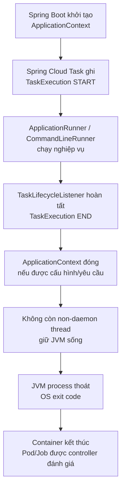
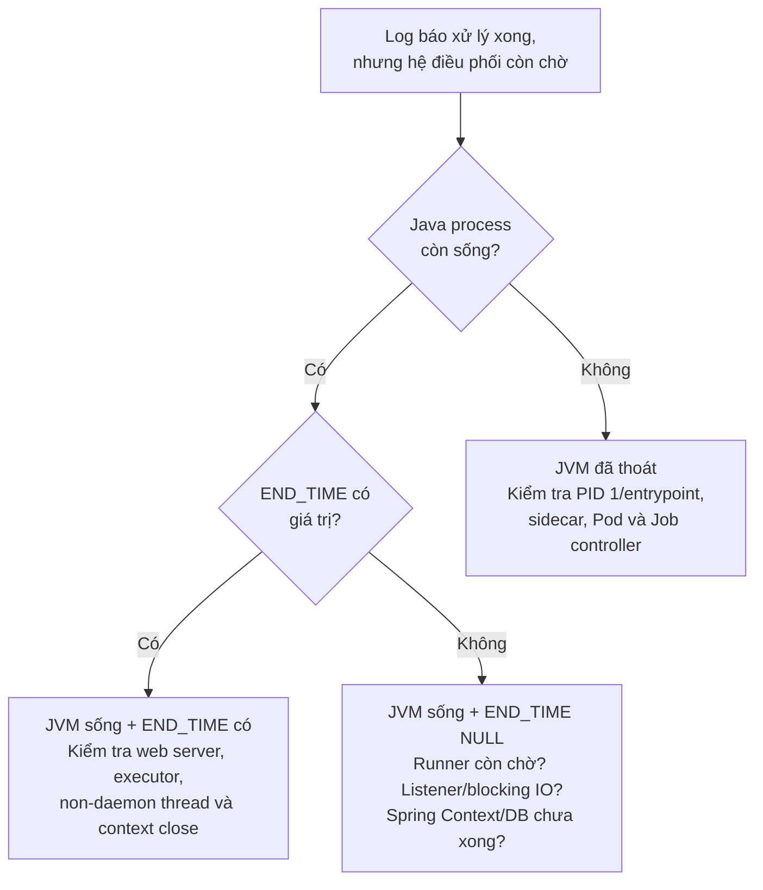

# Tác vụ chạy xong nhưng tiến trình không kết thúc

## Mục tiêu bài học

Trong chương **Chẩn đoán** của mô-đun **Spring Cloud Task**, bài học này giải quyết tình huống khó chịu trong vận hành: log nghiệp vụ báo **đã xử lý xong**, hoặc bản ghi `TaskExecution` đã có `END_TIME` và `EXIT_CODE=0`, nhưng lệnh `java -jar` vẫn chưa trả về dấu nhắc shell, container vẫn ở trạng thái `Running` và Kubernetes Job chưa `Complete`.

Đây không chỉ là vấn đề “dọn tài nguyên”. Trong hệ thống chạy theo lịch hoặc theo yêu cầu, tiến trình không thoát có thể làm **CronJob bỏ lỡ lượt mới**, chiếm CPU/bộ nhớ, giữ connection pool, vượt `activeDeadlineSeconds`, khiến scheduler đánh dấu timeout và gây retry không mong muốn. Ngược lại, ép JVM thoát quá sớm có thể làm mất cập nhật cuối của `TaskRepository`, cắt ngang một Spring Batch Job hoặc để dữ liệu nghiệp vụ dở dang.

Sau bài học, bạn có thể:

- Phân biệt **hoàn thành nghiệp vụ**, **kết thúc Spring Cloud Task**, **đóng ApplicationContext**, **JVM thoát** và **Kubernetes Job Complete**.
- Chia sự cố thành các trường hợp `END_TIME=NULL`, `END_TIME` đã có nhưng JVM còn sống, hoặc JVM đã thoát mà container/Job chưa hoàn tất.
- Hiểu tác dụng và giới hạn của `spring.cloud.task.closecontext-enabled=true` cùng `spring.main.web-application-type=none`.
- Phát hiện và xử lý các nguyên nhân thường gặp: web server, thread không phải daemon, executor/scheduler chưa dừng, `@Async` không được chờ, listener broker, tác vụ I/O bị chặn, callback shutdown và shell entrypoint sai.
- Lấy thread dump an toàn với `jcmd` hoặc `jstack`, đọc các stack thường gặp và phân biệt thread chờ bình thường với thread giữ tiến trình.
- Viết một ví dụ tái hiện lỗi và một phiên bản sửa có kiểm soát vòng đời `ExecutorService`/`ThreadPoolTaskExecutor`.
- Kiểm chứng mã thoát thật, `TaskExecution`, trạng thái Docker/Kubernetes và timeout mà **không che giấu lỗi bằng `System.exit(0)`**.
- Thiết kế smoke test chống treo cùng checklist điều tra dùng được trong môi trường phát triển, staging và sản xuất.

## 1. Đúng là “chạy xong” ở cấp nào?

Giả sử ứng dụng `nightlyRentalImport` nhận `--businessDate=2026-11-23`, nhập dữ liệu từ đối tác rồi in:

```text
2026-11-24T02:01:00 INFO Imported 120000 rental records
2026-11-24T02:01:00 INFO BUSINESS_COMPLETED
```

Sau đó terminal vẫn không trở về và Pod vẫn `Running`. Hai dòng log chỉ nói rằng **phương thức nghiệp vụ đã ghi thông điệp**, không chứng minh:

1. `ApplicationRunner`/`CommandLineRunner` cuối cùng đã return hay chưa.
2. Spring Cloud Task đã cập nhật `TASK_EXECUTION.END_TIME` hay chưa.
3. `ApplicationContext` đã đóng hay chưa.
4. Các **non-daemon threads** và tiến trình con đã ngừng hay chưa.
5. Tiến trình chính của container đã thoát với mã kết quả hay chưa.

### 1.1. Năm cột mốc phải tách riêng



Sơ đồ là **luồng mong đợi của một Task hữu hạn**. Trong thực tế:

- Context có thể được đóng tại thời điểm khác theo cấu hình và cơ chế JVM shutdown.
- Một số runner có thể **không return** vì đang chờ I/O, lock hoặc `Future.get()`.
- Task có thể ghi `END_TIME` nhưng một thread tự tạo vẫn chạy mãi.
- JVM có thể thoát nhưng **shell wrapper**, sidecar hoặc thành phần runtime khác vẫn giữ container/Pod hoạt động.

**Kết luận quan trọng:** `TaskExecution.EXIT_CODE=0` là một mảnh thông tin về **vòng đời Task**, không phải bằng chứng rằng **OS process đã kết thúc**. Muốn biết tiến trình thoát hay chưa, phải kiểm tra trực tiếp hệ điều hành/container.

### 1.2. Phân biệt bằng một bảng nhanh

| Tín hiệu | Chứng minh điều gì? | Không chứng minh điều gì? |
| --- | --- | --- |
| Log `BUSINESS_COMPLETED` | Một đường code đã in log này | Tất cả runner, thread, transaction và JVM đã hoàn tất |
| `TASK_EXECUTION.END_TIME` có giá trị | Spring Cloud Task đã ghi nhận lúc kết thúc lượt Task | JVM hoặc container đã dừng |
| `TASK_EXECUTION.EXIT_CODE=0` | Framework ghi nhận kết quả Task bằng 0 | Batch Job, dữ liệu nghiệp vụ và tiến trình hệ điều hành chắc chắn thành công |
| `ApplicationContext` đã close | Bean lifecycle của Spring đang/đã được xử lý | Thread tự tạo ngoài Spring đã ngừng |
| Shell lấy được `$?` sau `java -jar` | Tiến trình trực tiếp đã kết thúc | Không có shell wrapper khác giữ container; dữ liệu chắc chắn đúng |
| `Pod Succeeded` | Tất cả container được tính vào điều kiện hoàn thành Pod đã kết thúc thành công | Job nhiều Pod/lượt thử đã hoàn thành cuối cùng |
| `Job Complete` | Job controller đã công nhận Job thành công | Không còn dữ liệu lỗi nghiệp vụ bị logic bỏ sót |

## 2. Trước khi sửa: phân loại sự cố bằng hai câu hỏi

**Câu hỏi 1:** JVM của Task **còn sống thật** không?

**Câu hỏi 2:** `TASK_EXECUTION.END_TIME` **đã được ghi** chưa?



| Tình huống | Dấu hiệu | Nhóm nguyên nhân nên kiểm tra trước |
| --- | --- | --- |
| **A. Task đã kết thúc, JVM còn sống** | `END_TIME != NULL`, `java` chưa thoát | Thread không phải daemon, web server, scheduler, executor không shutdown, context chưa close |
| **B. Task chưa kết thúc** | `END_TIME IS NULL`, JVM còn sống | Runner đang block, nhiều runner chưa xong, `@Async` được chờ sai, network/DB deadlock, bean/listener cản trở vòng đời |
| **C. JVM đã thoát nhưng container/Job còn chờ** | Không còn Java PID, container hoặc Pod vẫn Running | Shell entrypoint giữ PID 1, sidecar thông thường chưa dừng, Pod khác chưa xong, controller đang reconcile |
| **D. Không có TaskExecution mới** | Process chạy hoặc lỗi nhưng repository không ghi dòng | Context fail trước lifecycle, `@EnableTask`/auto config, DataSource/schema, nhầm DB hoặc task name |

**Tình huống D không được xếp nhầm vào “Task đã hoàn tất”.** Spring Cloud Task chỉ ghi lifecycle khi context khởi tạo đủ để listener/repository hoạt động. Một lỗi startup trước đó có thể không có bất kỳ row mới nào.

## 3. Hiểu đúng cơ chế Spring Cloud Task

Spring Cloud Task ghi metadata qua `TaskLifecycleListener`. Theo tài liệu chính thức:

1. Trước khi chạy các bean `ApplicationRunner`/`CommandLineRunner`, Task tạo bản ghi bắt đầu.
2. Khi các runner đã hoàn tất hoặc ứng dụng thất bại theo đường lifecycle phù hợp, Task cập nhật `TaskExecution` và mã kết quả.
3. Nếu cần **đóng `ApplicationContext` sau khi runner và cập nhật repository đã xong**, bật:

```yaml
spring:
  cloud:
    task:
      closecontext-enabled: true
```

Thuộc tính đầy đủ là **`spring.cloud.task.closecontext-enabled`** và mặc định là `false` trong bảng cấu hình của các phiên bản được tham chiếu. Tài liệu có chỗ viết dạng Java property `spring.cloud.task.closecontextEnabled`; Spring Boot relaxed binding giúp chuyển đổi dạng kebab/camelCase theo cơ chế binding. **Nên dùng tên canonical ở bảng configuration properties của phiên bản dự án**; ở đây dùng dạng kebab.

### 3.1. Tác dụng chính của `closecontext-enabled=true`

Thuộc tính này yêu cầu listener đóng Spring ApplicationContext khi Task hoàn tất. Khi context đóng, Spring có cơ hội:

- Dừng `SmartLifecycle` beans.
- Gọi `@PreDestroy`/`DisposableBean` cho beans thích hợp.
- Shutdown executor/scheduler được **Spring quản lý**.
- Đóng connection pools, publisher hoặc client có lifecycle gắn với bean.

Điều này **thường giải quyết** hiện tượng Task đã ghi `END_TIME` nhưng context vẫn giữ một executor/scheduler đang chạy. Tài liệu Spring Cloud Task dùng chính ví dụ `TaskExecutor` làm tình huống cần bật thuộc tính.

### 3.2. Vì sao chỉ bật property vẫn có thể không đủ?

`ApplicationContext.close()` **không thể tự dừng mọi thread được tạo bằng `new Thread(...)` hoặc `Executors.newSingleThreadExecutor()` rồi không được quản lý/đóng**. Nếu thread không phải daemon ấy vẫn chạy vô hạn, JVM vẫn còn sống ngay cả khi TaskRepository đã được cập nhật và context được đóng.

Ngoài ra:

- Shutdown hook hoặc `@PreDestroy` có thể **bị chặn** vì I/O, lock hoặc đợi executor không kết thúc.
- Một service có thể tự tạo thread rồi **không giữ reference để shutdown**.
- Một thư viện bên ngoài có thể tạo runtime riêng, có cấu hình close/shutdown cần gọi thủ công.
- Một process chính không phải Java (ví dụ `sh`) có thể vẫn chạy sau khi Java đã thoát.

**`closecontext-enabled=true` là kiểm soát vòng đời Spring, không phải “kill toàn bộ JVM sau N giây”.**

### 3.3. Không nhầm `spring.task` và `spring.cloud.task`

| Prefix | Thuộc hệ thống | Dùng cho |
| --- | --- | --- |
| `spring.task.*` | Spring Boot/Spring Framework | Executor, scheduler và cấu hình thread pools |
| `spring.cloud.task.*` | Spring Cloud Task | TaskRepository, Task lifecycle, close context, Task name |
| `spring.batch.*` | Spring Boot/Spring Batch | Job launcher, Batch Job/Step và metadata |
| `spring.main.*` | Spring Boot | Loại ứng dụng, banner, behavior khởi động |

`spring.task.execution.*` hoặc `spring.task.scheduling.*` **không có tác dụng giống** `spring.cloud.task.closecontext-enabled`. Thay đổi thread pool size không giải quyết thread leak nếu thread ấy chưa bao giờ nhận shutdown.

## 4. Nguyên nhân 1: một Task CLI khởi động web server không cần thiết

Nếu classpath chứa web starter và không có cấu hình loại ứng dụng, Spring Boot có thể khởi chạy **Tomcat, Jetty hoặc WebFlux server**. Với ứng dụng CLI, điều này tạo các tài nguyên tồn tại lâu hơn runner.

Ví dụ:

```text
... Tomcat started on port 8080
... Started RentalImportApplication
... Imported records successfully
... TaskExecution END_TIME updated
... (java vẫn đang chạy)
```

**Cách sửa thích hợp cho Task không cung cấp HTTP API:**

```yaml
spring:
  main:
    web-application-type: none
  cloud:
    task:
      closecontext-enabled: true
```

Và trong Maven, chỉ giữ dependency `spring-boot-starter-web` hoặc `spring-boot-starter-webflux` nếu thật sự cần. Cần HTTP client **không đồng nghĩa** cần HTTP server; có thể dùng thư viện HTTP client phù hợp mà không mở port lắng nghe.

**Không dùng `server.port=-1` thay cho `spring.main.web-application-type=none` khi mục tiêu là Task phi web.** Tài liệu Spring Boot phân biệt rõ: `server.port=-1` tắt HTTP endpoint nhưng vẫn có thể tạo `WebApplicationContext`, trong khi `web-application-type=none` không khởi động embedded server.

### 4.1. Cách kiểm tra

1. Tìm log `Tomcat started`, `Netty started` hoặc thông báo tương tự.
2. Kiểm tra dependencies và giá trị runtime `spring.main.web-application-type`.
3. Nếu có Actuator HTTP, xác định rõ có cần server sống sau runner không. Một Task hữu hạn thường không cần Actuator HTTP server; metrics có thể được xuất bằng cơ chế khác được kiểm soát.
4. Sau khi đổi `web-application-type=none`, chạy smoke test với cùng tham số và đo **thời gian trả về của `java -jar`**, không chỉ nhìn log.

## 5. Nguyên nhân 2: thread không phải daemon vẫn chạy

Trong Java, JVM thông thường có thể kết thúc khi **không còn non-daemon threads**. Một thread `daemon=false` chạy mãi có thể giữ JVM sống dù method `main` và runner đã return.

Các nguồn thread thường gặp:

- `Executors.newSingleThreadExecutor()` hoặc `newScheduledThreadPool(...)` do code tự tạo.
- `new Thread(...)` với vòng lặp `while (true)`, `sleep`, `BlockingQueue.take()`.
- `Timer` không phải daemon.
- Scheduler, consumer hoặc background worker của thư viện chưa được shutdown.
- Một executor chịu trách nhiệm tải/đẩy dữ liệu nhưng không được đợi xong và không được đóng.

**Đừng đánh giá một thread đang `WAITING` hoặc `TIMED_WAITING` là lỗi chỉ dựa vào tên state.** Rất nhiều thread JVM bình thường (ví dụ GC, reference handling) cũng chờ; cần biết đó có phải daemon không, stack đang ở đâu và ai chịu trách nhiệm đóng nó.

### 5.1. Ví dụ có chủ đích tạo tiến trình không thoát

Đây là **ví dụ lỗi** để tái hiện trong môi trường dev; **không chạy trên production**:

```java
package com.example.taskdiagnostics;

import java.util.concurrent.Executors;
import java.util.concurrent.ScheduledExecutorService;
import java.util.concurrent.TimeUnit;

import org.springframework.boot.ApplicationRunner;
import org.springframework.boot.SpringApplication;
import org.springframework.boot.autoconfigure.SpringBootApplication;
import org.springframework.cloud.task.configuration.EnableTask;
import org.springframework.context.annotation.Bean;

@SpringBootApplication
@EnableTask
public class HangingTaskApplication {

    public static void main(String[] args) {
        SpringApplication.run(HangingTaskApplication.class, args);
    }

    @Bean
    ApplicationRunner importRunner() {
        return args -> {
            // LỖI CỐ Ý: executor KHÔNG phải Spring bean
            // và không có shutdown().
            ScheduledExecutorService heartbeat =
                Executors.newSingleThreadScheduledExecutor(r -> {
                    Thread thread = new Thread(r, "leaked-heartbeat");
                    thread.setDaemon(false);
                    return thread;
                });

            heartbeat.scheduleAtFixedRate(
                () -> { /* giả lập heartbeat */ },
                0, 1, TimeUnit.SECONDS);

            System.out.println("BUSINESS_COMPLETED");
        };
    }
}
```

Nếu Task tạo được repository và cập nhật kết quả, log có thể xuất `BUSINESS_COMPLETED` và `TASK_EXECUTION.END_TIME` có giá trị, nhưng **JVM vẫn sống** vì `leaked-heartbeat` là non-daemon thread chưa được shutdown.

**Đây là lỗi do code Java**, không phải lỗi của H2, Kubernetes hay một `JobExecution` chưa được commit.

### 5.2. Cách khắc phục ở mức thiết kế

- Nếu heartbeat **không cần thiết sau khi runner kết thúc**, không tạo nó.
- Nếu cần worker hữu hạn, **đợi `Future` hoàn tất** và shutdown executor.
- Nếu resource tồn tại theo ApplicationContext, **đăng ký làm bean có lifecycle rõ ràng**, ví dụ `@Bean(destroyMethod="shutdown")` hoặc `ThreadPoolTaskExecutor`.
- Nếu thư viện có `close()`/`stop()` riêng, gọi trong `@PreDestroy` hoặc cấu hình bean destruction phù hợp.
- Luôn đặt **timeout cho I/O** và quá trình dừng để tránh shutdown vô hạn.

**Không sửa bằng `thread.setDaemon(true)` như giải pháp mặc định**: daemon thread có thể bị JVM kết thúc bất ngờ khi các non-daemon threads biến mất, làm mất dữ liệu, message ACK hoặc flush cuối. Daemon chỉ phù hợp với công việc *không cần bảo đảm hoàn thành*.

## 6. Nguyên nhân 3: `@Async` và `Future` không được chờ đúng

Một anti-pattern phổ biến:

```java
@Override
public void run(ApplicationArguments args) {
    dataImportService.importAsync();
    log.info("BUSINESS_COMPLETED"); // CHƯA chắc import đã xong!
}
```

Ở đây `importAsync()` có thể chỉ **đặt việc vào executor**, không chờ xử lý xong. Hai kết quả đều nguy hiểm:

1. Runner return, Task ghi hoàn thành **quá sớm**, nhưng worker còn chạy và giữ JVM sống.
2. Bật `closecontext-enabled=true` khiến context shutdown **trong khi worker chưa hoàn tất**, có thể làm hủy công việc còn trong queue.

**Không dùng `closecontext-enabled=true` để che lỗi “fire-and-forget” khi kết quả async là một phần bắt buộc của nghiệp vụ.** Hãy chủ động đợi các tác vụ đó hoặc thiết kế một dịch vụ nền riêng nếu chúng phải chạy lâu dài.

### 6.1. Mẫu xử lý đồng bộ theo nghĩa nghiệp vụ

Ví dụ cấu hình một `ThreadPoolTaskExecutor` do Spring quản lý:

```java
package com.example.taskdiagnostics;

import java.util.concurrent.Future;
import java.util.concurrent.TimeUnit;
import java.util.concurrent.TimeoutException;

import org.springframework.boot.ApplicationRunner;
import org.springframework.context.annotation.Bean;
import org.springframework.context.annotation.Configuration;
import org.springframework.scheduling.concurrent.ThreadPoolTaskExecutor;

@Configuration(proxyBeanMethods = false)
public class ImportWorkerConfiguration {

    @Bean
    ThreadPoolTaskExecutor importExecutor() {
        ThreadPoolTaskExecutor executor = new ThreadPoolTaskExecutor();
        executor.setCorePoolSize(2);
        executor.setMaxPoolSize(2);
        executor.setQueueCapacity(10);
        executor.setThreadNamePrefix("import-worker-");
        executor.setWaitForTasksToCompleteOnShutdown(false);
        executor.setAwaitTerminationSeconds(10);
        return executor;
    }

    @Bean
    ApplicationRunner importRunner(ThreadPoolTaskExecutor importExecutor) {
        return args -> {
            Future<?> job = importExecutor.submit(() -> {
                // DEMO: công việc thật phải có timeout riêng cho
                // HTTP/JDBC/file và transaction/idempotency.
                System.out.println("IMPORT_WORKER_DONE");
            });

            try {
                job.get(60, TimeUnit.SECONDS); // chờ công việc thật
            } catch (TimeoutException timeout) {
                job.cancel(true);
                throw new IllegalStateException(
                    "Import worker vuot qua 60 giay", timeout);
            }

            System.out.println("BUSINESS_COMPLETED");
        };
    }
}
```

Mẫu này giả định chỉ **một** runner demo, không có runner khác tạo thread giữ JVM. Các bước quan trọng:

- `Future.get(...)` làm runner chỉ return khi worker đã hoàn tất hoặc lỗi/timeout được phát ra.
- Exception từ worker (ví dụ `ExecutionException`) **không bị nuốt**; Spring Boot có thể phản ánh failure.
- `ThreadPoolTaskExecutor` là Spring bean, nên shutdown được thực hiện khi context đóng.
- `awaitTerminationSeconds(10)` giúp giới hạn **thời gian đợi executor ngừng** trong shutdown. Giá trị này là cấu hình vận hành ví dụ, không phải timeout chung cho toàn Job.
- `job.cancel(true)` gửi tín hiệu interrupt, nhưng code I/O bên trong **phải hợp tác với interrupt/timeout**. Nó không bảo đảm giết được native/blocking operation.

Kết hợp với:

```yaml
spring:
  main:
    web-application-type: none
  cloud:
    task:
      closecontext-enabled: true
```

Nếu xử lý song song nhiều phần việc, cần **theo dõi và chờ tất cả Future**, chứ không chỉ Future đầu tiên. Đừng dùng `CompletableFuture.runAsync(...)` không quản lý rồi giả định `TaskLifecycleListener` sẽ đợi các future tự kết thúc.

### 6.2. Nếu dùng `ExecutorService` tự tạo

Với một pool cục bộ, quản lý vòng đời trong `try/finally`:

```java
ExecutorService pool = Executors.newFixedThreadPool(2);
try {
    Future<?> work = pool.submit(() -> doImport());
    work.get(60, TimeUnit.SECONDS);
} finally {
    pool.shutdown();
    if (!pool.awaitTermination(5, TimeUnit.SECONDS)) {
        pool.shutdownNow();
        if (!pool.awaitTermination(5, TimeUnit.SECONDS)) {
            throw new IllegalStateException(
                "Executor khong dung dung han");
        }
    }
}
```

Đây là **đoạn code minh họa đặt trong phương thức có `throws Exception`**, với imports `java.util.concurrent.*` và method `doImport()` do ứng dụng định nghĩa. `shutdownNow()` là **best effort**, không bảo đảm một công việc không hợp tác sẽ thực sự dừng; trong trường hợp đó cần sửa code/timeout nguồn I/O và xem xét biện pháp ở cấp tiến trình như một phương án cuối cùng có kiểm soát.

**Lưu ý:** Nếu `finally` ném exception trong quá trình shutdown, nó có thể che exception nghiệp vụ ban đầu. Với hệ thống production, nên lưu nguyên nhân chính, log lỗi shutdown riêng và quyết định exit status rõ ràng.

## 7. Nguyên nhân 4: scheduler, listener và kết nối nền

Một ứng dụng Task đôi khi kéo theo các thành phần được thiết kế cho **dịch vụ lâu dài**:

| Thành phần | Hiện tượng | Kiểm tra |
| --- | --- | --- |
| `@EnableScheduling` / `@Scheduled` | Scheduler tiếp tục kích hoạt công việc sau runner | Có thật sự cần lịch **bên trong** Task không? Có Spring-managed scheduler/close không? |
| `@KafkaListener` | Consumer container vẫn poll và giữ tài nguyên | Có thể dùng batch reader hữu hạn hoặc dừng listener container khi xong không? |
| `@RabbitListener` | AMQP listener tiếp tục chờ message | Nếu cần batch hữu hạn, có điều kiện kết thúc rõ ràng không? |
| `@Async` / `TaskExecutor` | Worker đang chạy hoặc queue chưa rỗng | Các future đã được await? Executor có destroy/shutdown? |
| `ThreadPoolTaskScheduler` | Scheduled tasks tiếp tục sống | Có bean lifecycle quản lý? Shutdown policy có phù hợp? |
| Web server/Actuator HTTP | JVM đang phục vụ request | Cấu hình `web-application-type=none` nếu là CLI |
| Tự tạo client/broker/connection pool | Thư viện background thread chưa được giải phóng | Gọi `close()/stop()` và thiết kế bean destruction |

**Không kết luận rằng mọi kết nối JDBC hoặc mọi Kafka client đều tự giữ JVM sống**. Tùy thư viện, một số worker thread là daemon hoặc được đóng khi context dừng. Cần **thread dump và log lifecycle** để chỉ ra đúng thread/resource đang ngăn tiến trình kết thúc.

### 7.1. Tránh lịch chạy kép

Nếu Task được kích hoạt bởi **Kubernetes CronJob**, **Spring Cloud Data Flow scheduler** hoặc cron bên ngoài, thường không nên vừa bật `@Scheduled` bên trong ứng dụng ấy. Điều này có thể:

- Biến ứng dụng thành dịch vụ chạy mãi.
- Tạo nhiều lần thực thi nghiệp vụ trong một `TaskExecution`, làm sai nghĩa của lịch sử.
- Gây chạy trùng khi scheduler ngoài launch một JVM mới trong khi JVM cũ vẫn còn.

Nếu yêu cầu thật sự là consumer/worker sống lâu, hãy tách thành **Spring Boot service hoặc Spring Cloud Stream application**, còn Spring Cloud Task dùng cho đơn vị công việc **hữu hạn**.

### 7.2. Shutdown bean đúng cách

Nếu một client do ứng dụng tự tạo cung cấp phương thức `close()`:

```java
@Bean(destroyMethod = "close")
ExternalClient externalClient() {
    return new ExternalClient(/* cấu hình an toàn */);
}
```

Đây là **mẫu phương thức cấu hình**, không phải một class Java độc lập: `ExternalClient` là placeholder cho SDK thực tế có method `close()`. Cần chọn đúng shutdown/close API của thư viện và chú ý thời gian đóng/flush, transaction, message ACK.

## 8. Nguyên nhân 5: runner thật sự chưa hoàn tất

Không phải trường hợp nào cũng là thread leak. Một runner có thể vẫn chạy dù log đã in `BUSINESS_COMPLETED` vì lệnh phía sau bị chặn:

```java
log.info("BUSINESS_COMPLETED");
future.get();               // có thể chờ vô hạn
publisher.flush();          // có thể chờ network nếu thiếu timeout
otherProcess.waitFor();     // có thể chờ process con mãi
```

Đây là mã minh họa các thao tác có thể block, **không phải code cần copy nguyên trạng**. Nếu `END_TIME IS NULL` mà JVM còn sống, ưu tiên kiểm tra:

1. Có bao nhiêu `ApplicationRunner` và `CommandLineRunner`? Một runner khác có thể chưa return.
2. Có lời gọi `Future.get()`, `CountDownLatch.await()`, `Thread.join()`, `Process.waitFor()` không timeout?
3. Có HTTP client, JDBC query, lock, file I/O hoặc broker flush đang chờ không?
4. Có deadlock giữa nhiều threads hoặc connection pool đã cạn?
5. Có exception trong listener hoặc việc ghi TaskRepository khiến lifecycle hoàn tất không?
6. `@PreDestroy`/`SmartLifecycle.stop()` có bị chờ trong quá trình shutdown không?

Không nên đặt `System.exit(0)` vào cuối runner khi còn `Future` chưa kết thúc; hành động đó chỉ **che lỗi thiết kế**, có thể cắt ngang dữ liệu và làm scheduler hiểu nhầm tác vụ thành công.

## 9. Chẩn đoán tại máy bằng tiến trình, thread dump và repository

Trước khi can thiệp, ghi lại **thời điểm chạy, version image/JAR, TaskExecutionId, tên Task, PID, mốc log cuối và các thay đổi cấu hình**. Không ghi raw secrets ra ticket chung.

### 9.1. Xác minh JVM còn chạy trên Linux

Trong một terminal khác:

```bash
ps -eo pid,ppid,stat,etime,comm | grep -E '(^ *PID|[j]ava)'
```

Để xem một tiến trình có PID đã biết:

```bash
ps -p 12345 -o pid,ppid,stat,etime,comm
```

Thay `12345` bằng PID thật. Cột `etime` cho biết thời gian sống của process. **Không cần in toàn bộ command line** chứa `--token`/`--password` để chứng minh process tồn tại.

Trên Windows PowerShell:

```powershell
Get-Process java | Select-Object Id, ProcessName, StartTime
Get-Process -Id 12345
```

Nếu `java` **không còn**, chuyển sang chẩn đoán shell wrapper/container/Pod (mục 11), đừng tiếp tục tìm thread dump của một JVM đã chết.

### 9.2. Lấy thread dump bằng `jcmd`

Với **JDK tương thích** và quyền truy cập JVM:

```bash
jcmd -l
jcmd 12345 Thread.print -l > task-thread-dump-1.txt
```

`jcmd` cần chạy ở **cùng máy/container namespace phù hợp**, có quyền user/attach tương ứng và thường nằm trong bản phân phối JDK; image `JRE`/distroless có thể không chứa công cụ. PID có thể khác giữa host và container. **`jcmd -l` có thể hiển thị arguments của tiến trình**, vì vậy chỉ thu thập trong phạm vi được cấp quyền và không chia sẻ nguyên văn khi arguments chứa thông tin hạn chế.

Để nhìn tiến triển thay vì chụp một ảnh:

```bash
jcmd 12345 Thread.print -l > task-thread-dump-1.txt
sleep 5
jcmd 12345 Thread.print -l > task-thread-dump-2.txt
```

Chụp hai lần giúp biết thread đang **tiến triển** hay chờ cùng một lock/I/O. Nếu tài liệu JDK của runtime khác, dùng `jcmd 12345 help Thread.print` để kiểm tra cú pháp và các tùy chọn được hỗ trợ.

Có thể dùng:

```bash
jstack -l 12345 > task-jstack.txt
```

với JDK có `jstack`. Các file thread dump **có thể chứa đường dẫn, class/method, chuỗi dữ liệu hoặc thông tin môi trường nhạy cảm**: lưu tại thư mục hạn chế quyền, chỉ chia sẻ bản đã rà soát.

### 9.3. Đọc thread dump đúng cách

| Dấu hiệu | Suy luận ban đầu | Điều cần xác minh |
| --- | --- | --- |
| `"leaked-heartbeat" ... daemon=false ... TIMED_WAITING` | Thread tự tạo tiếp tục chạy định kỳ | Đã gọi `shutdown`/`cancel` chưa? |
| `"http-nio-8080-..."` / `"reactor-http-..."` | Có web server hoặc client/Netty thread | Ứng dụng có mở HTTP server không? Cần kiểm tra stack và bean lifecycle |
| `"taskScheduler-..."` | Scheduler tiếp tục sống | Có `@Scheduled`? Executor do Spring quản lý không? |
| `"kafka-consumer-..."` / `"AMQP Connection..."` | Consumer/client còn chạy | Listener có được `stop`/`close` khi Task xong không? |
| `"main" ... FutureTask.get / CountDownLatch.await` | Runner chính đang chờ công việc khác | Có timeout và kết quả Future được xử lý không? |
| `"main" ... java.net.Socket...` | I/O mạng bị chặn | Connection/read timeout, downstream outage |
| `"main" ... ThreadPoolExecutor.awaitTermination` | Đang chờ executor shutdown | Worker nào không thoát, timeout có đúng không? |
| `"SpringContextShutdownHook" ... close` | Context đang shutdown sau signal/exit | Bean `@PreDestroy`/`stop` nào đang chặn? |
| `BLOCKED` trên cùng monitor ở nhiều dump | Có thể lock contention/deadlock | Xem owner, lock chain, `Found one Java-level deadlock` nếu có |

**Thread dump là bằng chứng, không phải chẩn đoán tự động.** Một thread daemon chờ queue có thể hoàn toàn bình thường. Cũng có trường hợp JVM chưa thoát vì **native thread/process** hoặc shutdown hook, cần phối hợp logs/metrics/runtime.

### 9.4. Lấy thread dump khi không có `jcmd`

Với HotSpot JVM trên Linux, trong môi trường được phép và có thể chấp nhận tác động:

```bash
kill -3 12345
```

`SIGQUIT` thường yêu cầu HotSpot in thread dump ra stderr/log của tiến trình **mà không kết thúc JVM**, nhưng hành vi phụ thuộc JVM/platform/thiết lập xử lý tín hiệu. **Không dùng `kill -9` như phương pháp lấy dump**; `SIGKILL` không cho JVM chạy shutdown hook hay ghi metadata cuối.

Nếu image không có công cụ và quyền debug không được cấp, dùng cơ chế JVM diagnostic/JFR đã cấu hình trong staging hoặc đề nghị người vận hành có quyền lấy dữ liệu. Không tự thay image production chỉ để gắn debugger.

## 10. Đọc `TaskRepository` để xác định Task đã kết thúc hay chưa

Với schema Spring Cloud Task mặc định, trên **database mà ứng dụng thực sự ghi metadata**, chạy SQL **chỉ đọc**:

```sql
SELECT
    TASK_EXECUTION_ID,
    TASK_NAME,
    START_TIME,
    END_TIME,
    EXIT_CODE,
    EXIT_MESSAGE,
    ERROR_MESSAGE
FROM TASK_EXECUTION
WHERE TASK_NAME = 'nightlyRentalImport'
ORDER BY TASK_EXECUTION_ID DESC;
```

`nightlyRentalImport` là tên minh họa. Tên thực tế có thể đến từ `spring.cloud.task.name` hoặc `spring.application.name` theo cấu hình. Khi nhiều lượt chạy chồng nhau, **không suy đoán TaskExecutionId chỉ từ bản ghi cuối**: đối chiếu thời gian, parent/external execution ID, container và request ID.

### 10.1. Diễn giải cặp `END_TIME` và `EXIT_CODE`

| `END_TIME` | `EXIT_CODE` | Java còn sống? | Cần kiểm tra gì? |
| --- | --- | --- | --- |
| Có | `0` | **Có** | Thread leak/web server/context còn mở; business correctness vẫn cần xác minh |
| Có | Khác `0` | **Có** | Task ghi lỗi nhưng resource hoặc shutdown giữ JVM |
| `NULL` | `NULL` hoặc chưa cập nhật | **Có** | Runner đang block, startup/lifecycle/DB ghi chưa xong |
| `NULL` | `NULL` | **Không** | JVM bị kill/crash hoặc lỗi trước khi cập nhật metadata |
| Có | `0` | **Không** | JVM có thể hoàn tất; xem container/Job layer nếu vẫn báo Running |

Spring Cloud Task cập nhật `END_TIME` theo vòng đời listener; **không nên tự sửa SQL `END_TIME` hoặc `EXIT_CODE` để làm cho Job “hoàn thành”** khi chưa hiểu process và dữ liệu nghiệp vụ.

### 10.2. Nếu Task chạy Spring Batch

`JobExecution` của Spring Batch có trạng thái riêng:

```sql
SELECT
    JOB_EXEC_ID,
    JOB_INST_ID,
    START_TIME,
    END_TIME,
    STATUS,
    EXIT_CODE
FROM BATCH_JOB_EXECUTION
ORDER BY JOB_EXEC_ID DESC;
```

Các tín hiệu có thể khác nhau:

- **Batch Job `COMPLETED`** nhưng Task/JVM vẫn sống: sau Batch còn runner hoặc thread background.
- **Batch Job `STARTED`** và Task `END_TIME=NULL`: có thể Job đang chạy, bị block hoặc listener đang chờ Job.
- **Batch Job `FAILED`** nhưng Task `EXIT_CODE=0`: cấu hình ánh xạ thất bại Batch sang Task/process có thể chưa đúng.
- **Batch Job `COMPLETED`** nhưng ứng dụng có consumer chạy mãi: việc đồng bộ kết quả nghiệp vụ và vòng đời process chưa được thiết kế phù hợp.

Nếu dùng tích hợp `spring-cloud-task-batch`, có thể đặt:

```yaml
spring:
  cloud:
    task:
      batch:
        fail-on-job-failure: true
```

Property này xử lý **mã thoát khi Batch Job thất bại**, **không phải thuốc chữa thread leak**. Khi bật, kiểm chứng cả JobExecution, TaskExecution và mã thoát thật của JVM/container với đúng phiên bản.

### 10.3. Một test nhanh phân biệt Task và JVM

1. Chạy JAR với tham số cố định trong môi trường dev.
2. Chờ log `BUSINESS_COMPLETED`.
3. Kiểm tra `END_TIME` đã được ghi hay chưa.
4. Xem JVM còn PID không.
5. Nếu `END_TIME` có và PID còn, lấy **thread dump ngay trước khi dừng**.
6. Nếu `END_TIME` rỗng, lấy thread dump để tìm runner/lock/blocking I/O; không bật `closecontext-enabled` một cách mù quáng.

Không cần tạo một listener tự ghi `EXIT_CODE=0` để “xác nhận” trạng thái: việc đó có thể che nguyên nhân.

## 11. Docker và Kubernetes: JVM thoát chưa chắc Job đã kết thúc

### 11.1. Container chỉ theo dõi đúng tiến trình chính

Dockerfile nên dùng **exec-form** để Java là tiến trình chính:

```dockerfile
FROM eclipse-temurin:21-jre
WORKDIR /app
COPY target/task-diagnostics-0.0.1-SNAPSHOT.jar /app/app.jar
ENTRYPOINT ["java", "-jar", "/app/app.jar"]
```

Tên JAR là **ví dụ**; điều chỉnh theo artifact thật và Java version phù hợp. Docker image `21-jre` thường **không có `jcmd`/`jstack`** vì đó là công cụ JDK; khi cần chẩn đoán, dùng staging/debug image có JDK hoặc công cụ runtime cho phép.

**Một entrypoint sai có thể giữ container sống dù Java đã thoát:**

```dockerfile
# KHÔNG NÊN: shell vẫn sống sau khi Java kết thúc.
ENTRYPOINT ["sh", "-c", "java -jar /app/app.jar; tail -f /dev/null"]
```

Hoặc shell script chạy Java dưới nền rồi chờ không đúng cách. Sửa sang exec-form hoặc dùng `exec java -jar /app/app.jar "$@"` ở cuối script sau bước chuẩn bị, và phải truyền tiếp arguments đúng cách.

### 11.2. Phân biệt `docker ps` và mã thoát thật

```bash
docker ps --filter "name=task-diagnostics"
docker logs task-diagnostics
docker inspect --format '{{.State.Running}}' task-diagnostics
docker inspect --format '{{.State.ExitCode}}' task-diagnostics
```

Các lệnh giả định container được tạo với tên `task-diagnostics` và **chưa xóa**. Nếu container đang `Running`, `State.ExitCode` chưa phải mã kết quả cuối của lần chạy hiện tại; không dùng một giá trị placeholder để kết luận Task thành công.

Nếu ứng dụng chạy với Java là PID 1 và image có JDK tools, trong môi trường thử nghiệm:

```bash
docker exec task-diagnostics jcmd 1 Thread.print -l
```

Lệnh này chỉ hoạt động nếu `jcmd` có mặt, attach được JVM và PID 1 thực sự là Java. Với image production tối giản, có thể phải chuẩn bị cơ chế thu thread dump từ trước; **không tự áp dụng lệnh debug có rủi ro trên production**.

### 11.3. Kubernetes Job: xem cả Pod, container và Job

```bash
kubectl get job rental-import-job
kubectl describe job rental-import-job
kubectl get pods -l batch.kubernetes.io/job-name=rental-import-job
kubectl logs job/rental-import-job -c task --timestamps
```

Các tên `rental-import-job` và `task` là minh họa; thay đúng Job/container thật. Khi Job có nhiều Pod do retry, `kubectl logs job/...` có thể **không thể hiện đầy đủ tất cả lượt thử**, phải lấy log theo từng Pod.

Xem Pod có một container chính:

```bash
kubectl get pod POD_NAME \
    -o jsonpath='{.status.containerStatuses[0].state.running.startedAt}'

kubectl get pod POD_NAME \
    -o jsonpath='{.status.containerStatuses[0].state.terminated.exitCode}'

kubectl get pod POD_NAME \
    -o jsonpath='{.status.containerStatuses[0].restartCount}'
```

Với container chưa `Terminated`, trường `exitCode` có thể rỗng. Nếu `restartPolicy=OnFailure`, xem thêm `lastState.terminated` và logs trước bằng `kubectl logs POD_NAME -c task --previous` khi được runtime giữ lại.

**Khi JVM còn sống và Pod vẫn Running:** tìm thread leak/web server/runner block.

**Khi Java PID không còn nhưng Pod vẫn Running:** kiểm tra `ENTRYPOINT`/PID 1, các container/sidecar thông thường còn sống và Pod lifecycle.

**Khi Pod đã Succeeded nhưng Job chưa Complete:** kiểm tra `completions`, `parallelism`, các Pod khác, reconciliation của Job controller và events; không quy hết cho Spring Cloud Task.

### 11.4. Timeout Kubernetes không thay thế xử lý gốc

Ví dụ:

```yaml
apiVersion: batch/v1
kind: Job
metadata:
  name: rental-import-job
spec:
  backoffLimit: 1
  activeDeadlineSeconds: 900
  template:
    spec:
      restartPolicy: Never
      containers:
        - name: task
          image: registry.example.com/rental-import:1.0.0
          args: ["--businessDate=2026-11-23"]
```

`activeDeadlineSeconds=900` giới hạn **thời gian toàn Job**, gồm các lần thử; nếu JVM treo lâu, Kubernetes có thể dừng Pod và đánh dấu Job `Failed` với lý do như `DeadlineExceeded`. **Đây là cơ chế phòng vệ**, không phải sửa được thread leak. Khi Pod bị kill, Spring Cloud Task có thể không cập nhật `END_TIME`/`EXIT_CODE` cuối, và những transaction đã commit không tự rollback toàn bộ.

Đặt timeout **bên trong ứng dụng** (HTTP/JDBC/reader/shutdown) đủ ngắn để có cơ hội ghi lỗi và thoát trước deadline ở cấp Job. Khi retry, cần idempotency; treo sau khi đã ghi thành công dữ liệu cũng có thể làm Job bị retry và tạo bản ghi trùng.

## 12. Tại sao không nên “sửa” bằng `System.exit(0)`?

Ví dụ không nên dùng:

```java
@Override
public void run(ApplicationArguments args) {
    service.importData();
    System.exit(0); // SAI: thoat truc tiep tu runner.
}
```

Hậu quả:

- Có thể bỏ qua cập nhật `TaskRepository`/`TaskLifecycleListener` mà framework thực hiện sau các runner.
- Không chờ writer, publisher, executor hoặc transaction nghiệp vụ còn chạy.
- Trả **mã `0`** ngay cả khi một Batch Job hoặc thread nền đang thất bại.
- Scheduler/Kubernetes có thể kết luận `Complete` và không retry, trong khi kết quả thật thiếu dữ liệu.

Spring Boot có hỗ trợ `ExitCodeGenerator`, `ExitCodeExceptionMapper` và pattern:

```java
System.exit(
    SpringApplication.exit(
        SpringApplication.run(MyTaskApplication.class, args)
    )
);
```

Đây là **mẫu API Spring Boot**, không phải khuyến nghị thay tất cả `main` trong Task bằng `System.exit`. Muốn dùng, phải bảo đảm:

1. Các runner/Batch Jobs thực sự đã xong và lỗi được ánh xạ thành exit code đúng.
2. Task lifecycle và repository đã cập nhật như mong đợi.
3. Đóng context và resource không cắt ngang công việc bắt buộc.
4. Kết quả hệ điều phối và metadata không bị lệch; đã kiểm chứng trên đúng phiên bản Spring Boot/Task.

**Ưu tiên sửa thread/resource lifecycle**. `System.exit` chỉ nên là quyết định có chủ đích ở **entry point**, sau khi kiểm tra hoàn tất công việc và mã thoát; không là cách che một background worker đang bị bỏ mặc.

## 13. Smoke test tự động phát hiện tiến trình treo

### 13.1. Smoke test Bash có timeout bên ngoài

Trên Linux có **GNU coreutils `timeout`**:

```bash
set +e
timeout --signal=TERM --kill-after=5s 30s \
    java -jar target/task-diagnostics-0.0.1-SNAPSHOT.jar \
    --businessDate=2026-11-23
exit_code=$?
set -e

case "$exit_code" in
  0)
    echo "PASS: process exited normally"
    ;;
  124)
    echo "FAIL: task did not exit within 30 seconds"
    exit 1
    ;;
  *)
    echo "FAIL: process returned exit code $exit_code"
    exit 1
    ;;
esac
```

`timeout` trả **124** khi hết thời gian theo thông lệ GNU (với tùy chọn/signal cụ thể có thể có mã khác như `137` sau khi bị kill). Mã 124 trong script này là **timeout của công cụ giám sát**, không phải bằng chứng ứng dụng chủ động trả mã 124. Nếu tiến trình bị kill sau timeout, **TaskRepository có thể chưa ghi kết quả cuối**.

Nếu test ở Windows, dùng cách quản lý subprocess/process timeout phù hợp PowerShell/JUnit `ProcessBuilder` thay vì giả định có GNU `timeout`.

**Đừng khởi chạy test treo và đợi vô hạn trong CI.** Sử dụng giới hạn thời gian, thu logs và thread dump trước khi tiến trình bị dừng nếu có thể.

### 13.2. Test có chủ đích chứng minh fix

Một bộ smoke test tối thiểu:

| Ca | Cấu hình/kịch bản | Kết quả cần assert |
| --- | --- | --- |
| A — Task thuần thành công | `web-application-type=none`, không tạo background worker | `RUNNER_RETURNED`; JVM tự thoát `0` trong giới hạn |
| B — Lỗi thread leak | Demo `leaked-heartbeat` không được shutdown | Runner return nhưng JVM vẫn sống; bên ngoài phát hiện timeout |
| C — Sửa thread leak | Dùng Spring-managed executor hoặc `shutdown()` có kiểm soát | JVM thoát đúng hạn, `END_TIME` có giá trị |
| D — Runner chờ network | Client giả lập timeout | Không treo vô hạn; exception đi ra ngoài và JVM trả nonzero |
| E — Batch Job thất bại | Spring Batch `FAILED` | Mã thoát Task/JVM phản ánh failure theo mapping đã kiểm chứng |
| F — Container entrypoint sai | Shell còn chạy sau Java | Phát hiện Java đã thoát nhưng container `Running` |
| G — Kubernetes deadline | Task cố tình ngủ quá SLA ở môi trường test | Job `Failed` vì deadline; không coi retry là thành công |

**Mục tiêu của smoke test là đo kết thúc của **process**, không chỉ kiểm tra log “Completed”.** Với dữ liệu thật, còn phải xác minh output/idempotency.

### 13.3. So sánh trước và sau thay đổi

Để chứng minh sửa lỗi:

1. Cố định bản JAR/image, cấu hình, dữ liệu đầu vào và namespace test.
2. Ghi `TaskExecutionId`, mốc `BUSINESS_COMPLETED` và `END_TIME`.
3. Ở bản lỗi, lấy thread dump và xác định non-daemon worker đang giữ JVM.
4. Áp fix có quản lý vòng đời; không chỉ tăng timeout.
5. Chạy lại cùng kịch bản hoặc cùng dữ liệu **đã tách biệt**; đo thời gian từ business completion đến process exit.
6. Xác minh không còn TaskExecution treo bất thường và exit code đúng.
7. Đánh giá các chỉ số nghiệp vụ, không để việc sửa shutdown làm mất dữ liệu.

## 14. Chẩn đoán nâng cao: shutdown bị kẹt

Một biến thể khó hơn: `spring.cloud.task.closecontext-enabled=true` đã có, nhưng JVM **vẫn không thoát** vì chính quá trình đóng context bị chặn:

- `@PreDestroy` chờ HTTP call không timeout.
- `SmartLifecycle.stop()` chờ một consumer thread hoặc callback không được gọi.
- `ThreadPoolTaskExecutor` đặt `waitForTasksToCompleteOnShutdown=true` nhưng worker không kết thúc.
- Connection pool hoặc publisher flush chờ network.
- Shutdown hook giữ lock mà worker khác đang chờ, dẫn tới deadlock.

Trong trường hợp này, thread dump thường chỉ ra `main` hoặc shutdown thread đang nằm trong `close()`, `awaitTermination()`, `join()` hay I/O. **Không nên tùy tiện đặt shutdown timeout thành 0 để cho tiến trình thoát “nhanh”**, vì có thể làm mất dữ liệu chưa flush.

Hướng xử lý theo thứ tự:

1. Xác định bean và method gây chờ từ **hai thread dumps**.
2. Kiểm tra timeout của resource thật: network, message ACK, flush và transaction.
3. Đảm bảo task đã hoàn tất **mọi side effect bắt buộc** trước khi runner return.
4. Quy định thời gian shutdown có giới hạn; dừng best-effort background resources.
5. Nếu hoạt động cleanup không quan trọng, chuyển nó ra khỏi critical path hoặc có chính sách retry riêng.
6. Chạy smoke test đường lỗi và khởi động lại để xác minh không mất khả năng restart.

### 14.1. Phân biệt `@PreDestroy` và JVM shutdown hook

`@PreDestroy` là callback của **Spring bean destruction** khi context đóng. JVM shutdown hook là một cơ chế của runtime Java. Chúng có thể tương tác nhưng **không bảo đảm thứ tự tuyệt đối phù hợp mọi thư viện**.

Đặc biệt, khi process bị `SIGKILL`/`kill -9` hoặc OOM kill, **không có bảo đảm** các callback hay shutdown hook kịp chạy. Vì vậy cần lưu checkpoint/dữ liệu trung gian có thể khôi phục và idempotency ở nghiệp vụ.

### 14.2. Virtual threads và những giới hạn mới

Với Java 21+, virtual threads mặc định là **daemon**, nên một virtual thread đơn lẻ không nhất thiết giữ JVM sống như platform non-daemon thread. Nhưng **điều đó không có nghĩa công việc virtual thread đã hoàn thành đúng** khi JVM thoát; các tác vụ chưa được chờ có thể bị bỏ dở.

Nếu dùng virtual-thread executor hoặc `StructuredTaskScope` (tùy JDK/API), vẫn phải **chờ kết quả và xử lý cancellation** theo hợp đồng nghiệp vụ. Thread dump `jcmd Thread.print` trên JDK mới có giới hạn/cách hiển thị riêng với virtual threads; xem tài liệu JDK của phiên bản đang chạy để chọn công cụ phù hợp.

## 15. Bảng lỗi thường gặp

| Triệu chứng | Nguyên nhân khả dĩ | Bằng chứng cần thu | Cách sửa |
| --- | --- | --- | --- |
| Log báo hoàn tất, `END_TIME` có, JVM sống | Context chưa close | Config runtime và thread dump | Bật `spring.cloud.task.closecontext-enabled=true` |
| Bật closecontext rồi vẫn sống | Thread tạo thủ công không shutdown | Non-daemon thread stack | Quản lý executor, `close()/shutdown()` |
| JVM vẫn mở port 8080 | Web starter khởi embedded server | Startup logs, PID và listening socket | `spring.main.web-application-type=none` |
| `@Scheduled` chạy đều sau runner | Task vô tình chứa scheduler lâu dài | Thread dump, scheduled logs | Tách service, tắt scheduling hoặc quản lý lifecycle |
| `@KafkaListener` tiếp tục poll | Listener container chưa dừng | Consumer thread/logs | Dừng listener/batch hóa công việc |
| `END_TIME=NULL`, JVM sống | Runner đang chờ `Future.get`/I/O | `main` stack và timing | Await có timeout, sửa I/O timeout/deadlock |
| `BUSINESS_COMPLETED` rồi shutdown kẹt | Bean `@PreDestroy` hoặc `SmartLifecycle.stop` block | Shutdown stack | Timeout, close resource đúng thứ tự |
| Batch `COMPLETED`, JVM còn chạy | Phần mềm nền ngoài Job | Batch metadata và thread dump | Kiểm soát thread và đóng context |
| Batch `FAILED`, Task `EXIT_CODE=0` | Chưa ánh xạ lỗi Batch tới Task | JobExecution, TaskExecution, JVM exit | `fail-on-job-failure` và smoke test |
| JVM đã dừng, Docker còn Running | Shell `tail -f`/wait không đúng | PID 1, `docker inspect` | Dockerfile exec-form |
| Java không còn, Pod còn Running | Sidecar hoặc container khác chưa kết thúc | `kubectl describe pod` và containerStatuses | Sửa lifecycle của container còn sống |
| Pod Failed nhưng `END_TIME=NULL` | JVM kill trước khi update repository | Pod reason, logs, SQL | Điều tra OOM/deadline; restart an toàn |
| `kubectl wait complete` timeout | Job chưa Complete, có thể Running/Failed | Job conditions và các Pods | Tách Job timeout khỏi JVM hang |
| Task treo chỉ ở production | Quota, network, DNS, connection pool, secrets | So sánh config, thread dump, metrics | Sửa tài nguyên/timeout, không tăng deadline mù quáng |
| Bật `thread.setDaemon(true)` thì hết treo | Công việc nền bị bỏ mặc | Missing writes/ACK/checkpoint | Quản lý lifecycle; không coi daemon là fix |
| Dùng `System.exit(0)` che lỗi | JVM bị ép thành công giả | Sai lệch TaskRepository và output | Sửa logic completion/exit code |

## 16. Runbook 15 phút đầu khi xảy ra sự cố

**Bước 1 — Xác định sự cố đang ở đâu.** Thu tên Task, execution ID, JAR/image version, thời điểm business completion, PID, Pod/Job name. Không sao chép credentials/arguments thô vào ticket.

**Bước 2 — Kiểm tra OS/container.** JVM còn sống không? Java có phải process chính không? Pod có bao nhiêu container, trạng thái container nào `Running`?

**Bước 3 — Kiểm tra TaskRepository.** `END_TIME` đã có chưa? `EXIT_CODE` là gì? Có nhầm database/schema hoặc lượt chạy khác không?

**Bước 4 — Thu thread dump và logs.** Ưu tiên hai dump cách nhau vài giây **trước** khi dừng tiến trình ở staging; trong production tuân thủ quyền và quy trình sự cố.

**Bước 5 — Kiểm tra cấu hình vòng đời.** `web-application-type`, `closecontext-enabled`, `@EnableScheduling`, `@KafkaListener`, thread pool shutdown, runner/async design.

**Bước 6 — Chọn biện pháp an toàn.** Nếu tác vụ vẫn xử lý nghiệp vụ, **không kill mù quáng**. Nếu đã kẹt, có cơ chế dừng/timeout được phê duyệt và xác minh dữ liệu đã commit.

**Bước 7 — Ngăn retry tạo trùng.** Tạm ngăn scheduler chạy chồng nếu được phép, áp khóa nghiệp vụ/idempotent upsert, xác nhận ngày dữ liệu.

**Bước 8 — Sửa nguyên nhân gốc và thử lại.** Đo process exit time thật, không chỉ log; đối chiếu Task/Batch metadata và kết quả nghiệp vụ.

## 17. Câu hỏi tự đánh giá

**1. `TASK_EXECUTION.END_TIME` đã có và `EXIT_CODE=0` nhưng `java -jar` chưa trở về. Có mâu thuẫn không?**

> Không. Spring Cloud Task ghi nhận việc hoàn tất vòng đời Task; một non-daemon thread hoặc web server vẫn có thể giữ JVM sống.

**2. Thuộc tính nào giúp đóng Spring ApplicationContext sau Task?**

> `spring.cloud.task.closecontext-enabled=true`. Nó đóng **bean/resource do context quản lý** sau khi Task hoàn tất, không tự giết thread thủ công nằm ngoài lifecycle.

**3. Vì sao `spring.main.web-application-type=none` phù hợp với Task CLI?**

> Vì nó không khởi động embedded HTTP server ngoài nhu cầu của một chương trình hữu hạn. `server.port=-1` không phải lựa chọn tương đương hoàn toàn.

**4. Runner gọi `@Async importAsync()` rồi return. Task báo hoàn tất có chứng minh import đã xong không?**

> Không. Runner có thể chỉ nộp công việc cho executor rồi kết thúc. Cần chờ `Future`/`CompletableFuture` phù hợp, xử lý lỗi và timeout.

**5. Bật `closecontext-enabled=true` nhưng thread `leaked-heartbeat` do `Executors.newSingleThreadScheduledExecutor()` tự tạo vẫn chạy. Vì sao?**

> Vì executor ấy không phải Spring bean được đóng; cần `shutdown`/`shutdownNow` có kiểm soát hoặc chuyển nó thành bean có lifecycle rõ ràng.

**6. Tại sao `jcmd Thread.print` có ích hơn chỉ xem `BUSINESS_COMPLETED`?**

> Nó cho biết thread nào đang chạy/chờ, trong method nào và lock nào liên quan, giúp xác định JVM giữ thread hay runner/shutdown đang bị chặn.

**7. Khi `END_TIME=NULL` nhưng JVM còn sống, nên lập tức gọi `System.exit(0)` không?**

> Không. Có thể runner chưa xong hoặc DB đang block; ép thoát `0` có thể mất dữ liệu và tạo thành công giả.

**8. Nếu JVM đã thoát nhưng Pod vẫn `Running`, điều tra ở đâu trước?**

> Kiểm tra PID 1/entrypoint, các container khác trong Pod và Job controller, thay vì tiếp tục sửa `TaskLifecycleListener`.

**9. Vì sao `activeDeadlineSeconds` chỉ là cơ chế phòng vệ?**

> Nó giúp Kubernetes dừng Job quá hạn, nhưng có thể kill JVM trước khi TaskRepository cập nhật và không rollback các tác động nghiệp vụ đã commit.

**10. Smoke test nào bắt được lỗi “Business complete nhưng process không thoát”?**

> Một **subprocess test có timeout** chạy executable JAR, đợi process exit và kiểm tra mã trả về, đồng thời đối chiếu metadata Task và kết quả nghiệp vụ.

## Ghi nhớ

- **Hoàn tất nghiệp vụ ≠ TaskExecution END ≠ ApplicationContext close ≠ JVM exit ≠ Kubernetes Job Complete.**
- `spring.cloud.task.closecontext-enabled=true` thường là cấu hình cần thiết khi executor/Spring bean giữ context; `spring.main.web-application-type=none` giúp loại embedded server không cần thiết.
- **Thread tự tạo nằm ngoài Spring lifecycle phải được shutdown riêng.** Bật closecontext hoặc chuyển thread thành daemon **không phải** phương án chắc chắn cho mọi trường hợp.
- Khi `END_TIME=NULL`, ưu tiên điều tra runner/I/O/lifecycle chưa hoàn tất; khi `END_TIME` đã có nhưng JVM sống, ưu tiên thread dump và resource cleanup.
- `jcmd <pid> Thread.print -l`, process state, `TaskRepository` và container status giúp khoanh vùng nguyên nhân mà không phải đoán.
- **Không gọi `System.exit(0)` ngay trong runner để chữa treo**: điều đó có thể cắt ngang listener, che lỗi và làm sai kết quả điều phối.
- Retry/timeout ở Kubernetes hoặc scheduler **không tự sửa thread leak**; cần idempotency, kết quả nghiệp vụ kiểm chứng được và smoke test đo **process exit thực sự**.

## Tài liệu tham khảo

1. [Spring Cloud Task — Features: Task lifecycle, closecontext-enabled, TaskRepository](https://docs.spring.io/spring-cloud-task/reference/3.3/features.html)
2. [Spring Cloud Task — Reference: Closing the Context và Task Properties](https://docs.spring.io/spring-cloud-task/docs/current/reference/htmlsingle/)
3. [Spring Cloud Task — TaskLifecycleListener API (vòng đời và close context)](https://docs.spring.io/spring-cloud-task/docs/current/apidocs/org/springframework/cloud/task/listener/TaskLifecycleListener.html)
4. [Spring Boot — Embedded Web Servers: Disabling the Web Server](https://docs.spring.io/spring-boot/how-to/webserver.html)
5. [Spring Boot — SpringApplication: runners, Application Exit và shutdown hooks](https://docs.spring.io/spring-boot/reference/features/spring-application.html)
6. [Spring Framework — ExecutorConfigurationSupport: shutdown và awaitTermination](https://docs.spring.io/spring-framework/docs/current/javadoc-api/org/springframework/scheduling/concurrent/ExecutorConfigurationSupport.html)
7. [Oracle JDK 21 — Diagnostic Tools: jcmd, Thread.print, thread dump](https://docs.oracle.com/en/java/javase/21/troubleshoot/diagnostic-tools.html)
8. [Oracle JDK 21 — jcmd Command](https://docs.oracle.com/en/java/javase/21/docs/specs/man/jcmd.html)
9. [Spring Cloud Task — Batch: liên kết JobExecution và TaskExecution, exit code](https://docs.spring.io/spring-cloud-task/reference/batch.html)
10. [Kubernetes — Jobs: backoff, activeDeadlineSeconds và trạng thái Job](https://kubernetes.io/docs/concepts/workloads/controllers/job/)
11. [Kubernetes — Pod Lifecycle: container states và restart behavior](https://kubernetes.io/docs/concepts/workloads/pods/pod-lifecycle/)
