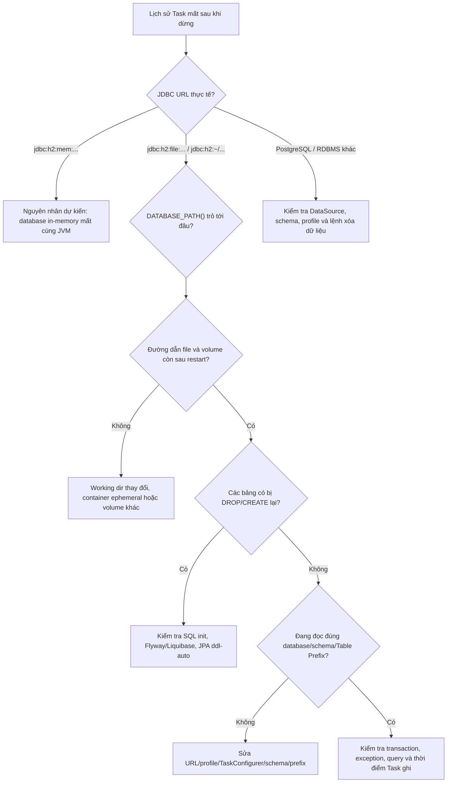

# Kho H2 mất dữ liệu sau khi tiến trình dừng

## 1. Hiện tượng: chạy Task thành công nhưng lịch sử biến mất

**Spring Cloud Task** là framework cho các ứng dụng Spring Boot có thời gian chạy hữu hạn: khởi động, xử lý công việc, ghi kết quả vào **`TaskRepository`** rồi kết thúc. Một `TaskExecution` thường mang tên Task, thời điểm bắt đầu/kết thúc, mã thoát và thông điệp; nếu ứng dụng gọi Spring Batch, `JobRepository` còn lưu trạng thái `JobExecution`/`StepExecution` để theo dõi và restart.

Giả sử bạn phát triển Task `invoice-import` để nhập hóa đơn theo ngày:

1. Chạy `java -jar invoice-import.jar --task.business-date=2026-11-24`.
2. Trong lúc Task đang chạy, H2 console hoặc câu truy vấn thấy một bản ghi ở `TASK_EXECUTION`.
3. Task hoàn tất, JVM kết thúc bình thường với mã `0`.
4. Chạy Task lần thứ hai hoặc mở một JVM khác thì thấy bảng rỗng, thiếu bảng, hoặc ID lại bắt đầu từ đầu.

Điều này **không mặc nhiên là lỗi của Spring Cloud Task**. Nếu `DataSource` dùng H2 **in-memory**, dữ liệu chỉ tồn tại trong bộ nhớ của JVM. Khi JVM dừng, database cũng biến mất. Mọi lần khởi động lại có thể tạo một database H2 mới cùng tên nhưng **khác vòng đời**.

**Mục tiêu của bài thuộc chương Chẩn đoán:** xác định liệu mất dữ liệu do H2 in-memory, đóng kết nối, file database ở sai vị trí, container storage không bền vững, tạo lại schema, chọn nhầm DataSource hay lỗi ghi metadata; kiểm chứng bằng JDBC URL và SQL; quyết định khi nào dùng H2 file và khi nào cần PostgreSQL hoặc RDBMS bền vững.

## 2. Cốt lõi: H2 có nhiều chế độ, không phải chế độ nào cũng lưu xuống đĩa

H2 là hệ quản trị quan hệ có chế độ **in-memory** và **file-based (embedded)**, ngoài ra còn có server mode. JDBC URL quyết định loại database đang mở.

| JDBC URL minh họa | Loại | Dữ liệu có còn sau khi JVM kết thúc? | Phạm vi truy cập |
| --- | --- | --- | --- |
| `jdbc:h2:mem:taskdb` | H2 in-memory **có tên** | **Không** | Những connection phù hợp trong cùng JVM/class loader |
| `jdbc:h2:mem:taskdb;DB_CLOSE_DELAY=-1` | H2 in-memory, giữ DB khi connection cuối đóng | **Không** | Trong đời JVM; không phải lưu xuống đĩa |
| `jdbc:h2:mem:` | H2 in-memory **không tên** | **Không** | Một database riêng theo connection |
| `jdbc:h2:file:./data/taskdb` | H2 file-based, **đường dẫn tương đối** | **Có, nếu** thư mục thực được giữ nguyên và ghi được | Mở file theo working directory của tiến trình |
| `jdbc:h2:file:/var/lib/task-repository/taskdb` | H2 file-based, **đường dẫn tuyệt đối Linux** | **Có, nếu** volume/file bền vững | Dữ liệu ở file trên filesystem đã cấu hình |
| `jdbc:h2:~/taskdb` | H2 file-based trong home directory | **Có, nếu** home directory giữ nguyên | Phụ thuộc user/home của tiến trình |
| `jdbc:h2:tcp://db-host/~/taskdb` | H2 server mode | Tùy database được server mở | Client kết nối đến H2 server, không phải bản sao in-memory của client |

**Dấu hiệu quan trọng:** `mem:` chỉ database trong bộ nhớ. Tùy H2 version, database file thường xuất hiện với hậu tố `.mv.db`. Không tự kết luận “H2 đã lưu trên đĩa” chỉ vì bạn thấy tên database giống nhau ở lần chạy tiếp theo.

### 2.1. Vì sao `DB_CLOSE_DELAY=-1` không cứu dữ liệu sau khi JVM dừng?

Thông thường, H2 có thể đóng **in-memory database** khi connection cuối đóng. Tham số `DB_CLOSE_DELAY=-1` giữ in-memory database tồn tại **cho đến khi JVM kết thúc** ngay cả khi pool đóng hết connection trong lúc JVM vẫn sống.

```text
JVM A khởi động
  -> mở jdbc:h2:mem:taskdb
  -> ghi TASK_EXECUTION ID=1
  -> đóng connection cuối
       -> DB_CLOSE_DELAY=0: DB in-memory có thể bị hủy ngay
       -> DB_CLOSE_DELAY=-1: DB còn trong bộ nhớ JVM A
  -> JVM A kết thúc
       -> cả hai trường hợp đều mất database in-memory

JVM B khởi động
  -> mở jdbc:h2:mem:taskdb
  -> tạo database MỚI cùng tên
  -> không có dữ liệu ID=1 của JVM A
```

**Không nhầm `DB_CLOSE_DELAY=-1` với persistence.** Tương tự, `DB_CLOSE_ON_EXIT=FALSE` chỉ thay đổi cách H2 tự đóng khi JVM thoát; nó **không biến database in-memory thành file-based**. Với database file-based, vô hiệu hóa auto-close còn có rủi ro dữ liệu không được đóng sạch nếu ứng dụng không gọi `SHUTDOWN` theo đúng quy trình. Không thêm các tham số này như một “bản vá” vô điều kiện.

### 2.2. Hai JVM cùng tên `taskdb` không có nghĩa dùng chung H2 memory

`jdbc:h2:mem:taskdb` ở JVM A và `jdbc:h2:mem:taskdb` ở JVM B là **hai database khác nhau**, dù chuỗi URL giống hệt. Nếu console H2 tự khởi chạy một JVM khác với Task, kết nối tới `mem:taskdb` từ console đó **không thể đọc database private trong JVM Task** chỉ vì trùng tên.

H2 có thể phục vụ in-memory DB qua TCP server chạy **trong JVM sở hữu database**, nhưng đó là cách triển khai khác với kết nối embedded mặc định. Nó cũng không làm dữ liệu sống sót sau khi server JVM dừng; không dùng để giải quyết bài toán lưu lịch sử lâu dài.

## 3. Cây quyết định chẩn đoán trong 5 bước



**Thứ tự thực tế:** ghi lại JDBC URL **đã được DataSource dùng** và `DATABASE_PATH()` trước khi thay đổi cấu hình. Một triệu chứng “bảng mới rỗng” có thể là hai lỗi khác nhau: **database cũ biến mất** hoặc **ứng dụng đang kết nối vào database mới**.

| Câu hỏi | Bằng chứng nên tìm | Không nên làm |
| --- | --- | --- |
| Có dùng H2 memory không? | `DataSource.getConnection().getMetaData().getURL()` | Đoán từ dependency `com.h2database:h2` |
| Đang dùng file H2 nào? | `CALL DATABASE_PATH();`; path và volume thực tế | Đoán từ tên file trong project |
| File có tồn tại giữa hai lần chạy? | Listing file `*.mv.db` và persistent volume | Xóa file/di chuyển khi DB đang mở |
| Có bảng Task không? | `INFORMATION_SCHEMA.TABLES`, `TASK_EXECUTION` | Tự tạo bảng sai phiên bản |
| TaskRepository dùng đúng DataSource? | `TaskConfigurer` khi nhiều DataSource, runtime config | Giả sử database nghiệp vụ = Task DB |
| Metadata có thật sự được ghi? | Log vòng đời, SQL readback, `EXIT_CODE`/`END_TIME` | Kết luận chỉ từ mã thoát Pod |

## 4. Spring Cloud Task chọn DataSource như thế nào?

Spring Cloud Task cần một **DataSource** để lưu kết quả của TaskExecution. Theo tài liệu chính thức:

- Với thiết lập phát triển tối giản, framework có thể dùng **H2 in-memory** để giúp khởi chạy dễ dàng. Phù hợp học và test, **không phù hợp lưu lịch sử sau JVM exit**.
- Nếu ứng dụng có **một DataSource** và DataSource đó được cấu hình qua các quy ước Spring Boot, Spring Cloud Task có thể dùng chính DataSource đó cho repository.
- Nếu ứng dụng có **nhiều DataSource**, cần xác định rõ DataSource dành cho TaskRepository thông qua cấu hình `TaskConfigurer` phù hợp; không mặc định nó sẽ dùng connection bạn đang kiểm tra ở code nghiệp vụ.
- Tên bảng mặc định thường dùng prefix `TASK_`, chẳng hạn `TASK_EXECUTION` và `TASK_EXECUTION_PARAMS`. Khi cấu hình `spring.cloud.task.table-prefix`, cần truy vấn **bảng tương ứng với prefix thực**.

### 4.1. Ví dụ H2 in-memory cho môi trường phát triển

```yaml
spring:
  application:
    name: invoice-import
  main:
    web-application-type: none
  datasource:
    driver-class-name: org.h2.Driver
    url: "jdbc:h2:mem:taskdb;DB_CLOSE_DELAY=-1"
    username: sa
    password: ""
  cloud:
    task:
      name: invoice-import
```

Với URL này, bạn có thể xem lịch sử khi **cùng JVM còn sống và dùng connection tới cùng in-memory DB**. Khi Task chạy xong và process thoát, lịch sử mất là **hành vi đúng của H2 memory**, không phải TaskRepository quên commit.

Để phân biệt lỗi khác, hãy ghi vào tài liệu vận hành chính xác rằng cấu hình trên là **dùng để test**, không bảo đảm retention. `DB_CLOSE_DELAY=-1` cũng không giúp hai Kubernetes Pod khác nhau chia sẻ dữ liệu.

### 4.2. Dùng H2 file-based khi cần giữ dữ liệu giữa các lần chạy trên một máy

Ví dụ cấu hình H2 file-based cho môi trường **dev/test chạy tuần tự trên một host**:

```yaml
spring:
  application:
    name: invoice-import
  main:
    web-application-type: none
  datasource:
    driver-class-name: org.h2.Driver
    url: "jdbc:h2:file:/var/lib/task-repository/taskdb"
    username: sa
    password: ""
  cloud:
    task:
      name: invoice-import
```

Các điều kiện bắt buộc để persistence hoạt động:

1. `/var/lib/task-repository` **tồn tại và ghi được** bởi user chạy container/JVM.
2. File và filesystem dưới `/var/lib/task-repository` **không bị xóa giữa hai lượt chạy**.
3. Lần sau dùng **cùng JDBC URL và cùng thư mục**. Nếu thay user/home/working directory hoặc khác mount path, đó có thể là database khác.
4. Schema `TASK_*` được khởi tạo/migration đúng một cách kiểm soát, không bị script/JPA drop lại.
5. Không có tiến trình H2 embedded khác đang mở **cùng một database file** theo cách không được hỗ trợ. File-based H2 không phải server DB cho nhiều Task pod concurrent.

Bạn có thể dùng URL tương đối `jdbc:h2:file:./data/taskdb` trong IDE, nhưng cần biết working directory của IDE và khi chạy JAR/container có thể khác nhau. Dùng **đường dẫn tuyệt đối** giảm khả năng trỏ nhầm file. `jdbc:h2:~/taskdb` cũng phụ thuộc user home: user trong IDE và user container có thể khác.

**Không khuyến nghị H2 file-based làm TaskRepository production nhiều replica/Pod.** Khi cần lịch sử bền vững, truy cập đồng thời và liên kết Spring Batch/Task giữa các JVM, chọn PostgreSQL hoặc database được hỗ trợ với backup, migration và chính sách vận hành.

## 5. Truy vấn H2 để xác minh database đang thực sự mở

Đây là bộ lệnh **chỉ đọc**; thực hiện qua `JdbcTemplate`, JDBC client hoặc H2 console đã kết nối **đúng database**:

```sql
-- Trả path file nếu H2 đang dùng file-based database.
-- Trả NULL đối với in-memory database.
CALL DATABASE_PATH();

-- Xem tên database/catalog và schema của kết nối hiện tại.
SELECT CURRENT_CATALOG() AS DB_NAME,
       CURRENT_SCHEMA() AS SCHEMA_NAME;

-- Tìm tên bảng Task thực tế trong schema hiện tại/được cấp quyền.
SELECT TABLE_SCHEMA, TABLE_NAME
FROM INFORMATION_SCHEMA.TABLES
WHERE TABLE_NAME LIKE 'TASK%'
ORDER BY TABLE_SCHEMA, TABLE_NAME;

-- Sau khi xác nhận đúng prefix và schema:
SELECT TASK_EXECUTION_ID,
       TASK_NAME,
       START_TIME,
       END_TIME,
       EXIT_CODE,
       EXIT_MESSAGE
FROM TASK_EXECUTION
ORDER BY TASK_EXECUTION_ID DESC;
```

**Cách đọc kết quả:**

- `DATABASE_PATH() = NULL`: connection đó đang dùng in-memory database; **không có file H2 để giữ lịch sử**.
- `DATABASE_PATH()` trả path: có một database file-based; phải kiểm tra **path ấy có được giữ trên volume bền vững không**.
- `TASK_EXECUTION` không tồn tại: có thể chưa chạy initializer/migration, đang ở sai schema, hoặc đang mở database mới. Không đồng nghĩa luôn do “mất dữ liệu”.
- Bảng có nhưng chỉ chứa lượt chạy hiện tại: có thể DB đã tạo mới, schema bị dọn, hoặc application đang dùng một DataSource khác.

Kết quả `DATABASE_PATH()` chỉ mô tả **connection đang truy vấn**. Nếu dự án có nhiều DataSource, truy vấn bằng `JdbcTemplate` dùng datasource nghiệp vụ có thể cho kết quả **khác** TaskRepository. Cần xác định đúng connection của TaskRepository theo `TaskConfigurer` và runtime config.

### 5.1. Log một lần JDBC URL nhưng không làm lộ secret

Khi debug, có thể log **loại database và URL đã được kiểm tra/sanitized**. Đoạn sau dùng `DataSource` thông thường, chỉ thích hợp khi nó chính là datasource TaskRepository:

```java
import javax.sql.DataSource;
import java.sql.Connection;
import java.sql.SQLException;
import org.slf4j.Logger;
import org.slf4j.LoggerFactory;
import org.springframework.boot.ApplicationRunner;
import org.springframework.context.annotation.Bean;
import org.springframework.context.annotation.Configuration;

@Configuration(proxyBeanMethods = false)
public class RepositoryConnectionDiagnostics {
    private static final Logger log =
        LoggerFactory.getLogger(RepositoryConnectionDiagnostics.class);

    @Bean
    ApplicationRunner logDbKind(DataSource dataSource) {
        return args -> {
            try (Connection connection = dataSource.getConnection()) {
                String product =
                    connection.getMetaData().getDatabaseProductName();
                String url = connection.getMetaData().getURL();

                // Đừng log JDBC URL đầy đủ ở môi trường không tin cậy:
                // URL có thể chứa username, password hoặc token.
                boolean isMemoryH2 =
                    url != null && url.startsWith("jdbc:h2:mem:");
                boolean isFileH2 =
                    url != null && (url.startsWith("jdbc:h2:file:")
                        || url.startsWith("jdbc:h2:~/")
                        || url.startsWith("jdbc:h2:./"));

                log.info("Task DB product={}, h2Memory={}, h2File={}",
                    product, isMemoryH2, isFileH2);
            } catch (SQLException ex) {
                log.error("Không xác định được loại Task DB", ex);
                throw ex;
            }
        };
    }
}
```

Không log `spring.datasource.password` hay toàn bộ `ApplicationArguments`. Khi JDBC URL chứa connection properties nhạy cảm, chỉ ghi cờ `h2Memory`/`h2File` và bản URL đã che bí mật; các log có thể được tập trung và giữ lâu hơn thời gian chạy Task.

**Giới hạn của ví dụ:** nếu có nhiều DataSource và `DataSource` được inject ở đây không phải nguồn của TaskRepository, kết luận về TaskRepository có thể sai. Cần cấu hình Bean tương ứng hoặc log bằng bộ quan sát repository đã được chọn đúng.

## 6. Thử nghiệm hai lần chạy để chứng minh vòng đời H2

Để tách riêng hành vi H2 khỏi cấu hình Spring Cloud Task, có thể dùng một chương trình JDBC rất nhỏ. Ví dụ dưới sử dụng **H2 2.x** qua dependency H2 được quản lý theo version của dự án. Chương trình tạo bảng đánh dấu và tăng số dòng mỗi lần được chạy.

```java
import java.sql.Connection;
import java.sql.DriverManager;
import java.sql.ResultSet;
import java.sql.Statement;

public class H2PersistenceProbe {
    public static void main(String[] args) throws Exception {
        if (args.length != 1 || !args[0].startsWith("jdbc:h2:")) {
            throw new IllegalArgumentException("Cần một H2 JDBC URL");
        }
        String url = args[0];

        try (Connection c = DriverManager.getConnection(url, "sa", "");
             Statement s = c.createStatement()) {
            s.executeUpdate(
                "CREATE TABLE IF NOT EXISTS DEMO_MARKER " +
                "(ID BIGINT GENERATED BY DEFAULT AS IDENTITY PRIMARY KEY)"
            );
            s.executeUpdate("INSERT INTO DEMO_MARKER DEFAULT VALUES");

            try (ResultSet rows =
                    s.executeQuery("SELECT COUNT(*) FROM DEMO_MARKER")) {
                rows.next();
                System.out.println("Rows now = " + rows.getLong(1));
            }
            try (ResultSet path =
                    s.executeQuery("SELECT DATABASE_PATH()")) {
                path.next();
                System.out.println("Database path = " + path.getString(1));
            }
        }
    }
}
```

Giả sử `H2PersistenceProbe.class` và `h2.jar` đã được chuẩn bị, trên **Linux/macOS** có thể gọi:

```bash
# Hai process khác nhau; database memory bị xóa khi mỗi JVM kết thúc.
java -cp ".:h2.jar" H2PersistenceProbe \
  "jdbc:h2:mem:probe;DB_CLOSE_DELAY=-1"
java -cp ".:h2.jar" H2PersistenceProbe \
  "jdbc:h2:mem:probe;DB_CLOSE_DELAY=-1"

# Hai process khác nhau; file-based DB giữ dữ liệu nếu path được giữ.
java -cp ".:h2.jar" H2PersistenceProbe \
  "jdbc:h2:file:./probe-data/taskdb"
java -cp ".:h2.jar" H2PersistenceProbe \
  "jdbc:h2:file:./probe-data/taskdb"
```

Kỳ vọng với **hai JVM được chạy lần lượt**:

| Chế độ | Lần thứ nhất | Lần thứ hai | `DATABASE_PATH()` |
| --- | --- | --- | --- |
| `mem:probe` | `Rows now = 1` | `Rows now = 1` | `null` |
| `file:./probe-data/taskdb` | `Rows now = 1` | `Rows now = 2` | Đường dẫn file |

Chạy trên Windows bằng classpath phân cách `;` thay vì `:` và điều chỉnh cách quote trong shell. Tạo thư mục `probe-data` có quyền ghi trước khi chạy; các lệnh trên **tạo dữ liệu trên filesystem hiện tại**, chỉ thực hiện trong khu vực test. Không gắn chương trình minh họa trực tiếp vào production hoặc dùng nó để ghi vào bảng `TASK_EXECUTION`.

**Vì sao test độc lập có ích?** Nếu probe file-based giữ dữ liệu nhưng TaskRepository vẫn mất, vấn đề có thể nằm ở Spring profile, DataSource/TaskConfigurer, schema init, quyền file hoặc volume. Nếu probe in-memory mất, đó là hành vi đã được H2 thiết kế.

### 6.1. Kiểm chứng trong Task thật

Sau khi kiểm tra H2 riêng, chạy **chính ứng dụng Spring Cloud Task** hai lượt với **cùng cấu hình**:

1. Trước lượt A, ghi JDBC URL thực tế và `CALL DATABASE_PATH()`.
2. Cho Task hoàn tất bình thường, kiểm tra `TaskExecution.exitCode`, trạng thái container và log lifecycle.
3. Dừng hẳn JVM; nếu dùng file-based, xác nhận file DB còn trên disk.
4. Lượt B dùng **cùng URL, cùng schema, cùng profile và cùng volume**.
5. Query `TASK_EXECUTION` sau lượt B. Nếu là file-based ổn định, lịch sử A và B phải còn, trừ khi một bước khác đã xóa/tạo lại schema.

Nếu Task bị `SIGKILL`, `OOMKilled` hoặc chết trước khi repository ghi trạng thái kết thúc, bản ghi TaskExecution (nếu đã được tạo) có thể còn `END_TIME=NULL`, `EXIT_CODE=NULL`. Điều đó khác với **toàn bộ database biến mất**; cần đối chiếu log, transaction và trạng thái điều phối.

## 7. Mất dữ liệu dù đang dùng file-based: tìm đúng nguyên nhân

### 7.1. Đường dẫn tương đối thay đổi

`jdbc:h2:file:./data/taskdb` được tính từ **working directory** hiện tại của tiến trình, không phải luôn từ thư mục chứa file JAR.

```text
Trong IDE:
  working dir = /workspace/invoice
  jdbc:h2:file:./data/taskdb
  -> /workspace/invoice/data/taskdb.mv.db

Trong Kubernetes:
  working dir = /app
  jdbc:h2:file:./data/taskdb
  -> /app/data/taskdb.mv.db

Hai đường dẫn khác nhau => hai database khác nhau.
```

Giải pháp: dùng `jdbc:h2:file:/var/lib/task-repository/taskdb`, mount thư mục đó vào đúng đường dẫn, bảo đảm user có quyền và **đọc `DATABASE_PATH()` để xác nhận**. Đừng di chuyển hoặc copy `*.mv.db` khi database đang mở; dùng backup/restore được H2 hỗ trợ hoặc tắt sạch tiến trình trước khi thao tác file.

### 7.2. Home directory của container khác với máy phát triển

`jdbc:h2:~/taskdb` mở database trong **home của OS user đang chạy**. Nếu IDE chạy bằng user `dev` còn container chạy bằng `taskuser`, hai home khác nhau. Một image với home không tồn tại/không ghi được có thể khởi động lỗi hoặc tạo database ở nơi không mong đợi tùy config.

Giải pháp: cấu hình path tuyệt đối trên volume rõ ràng, không phụ thuộc user home, và không ghi vào lớp image read-only.

### 7.3. Schema bị xóa rồi tạo lại

Database file vẫn tồn tại **không có nghĩa dữ liệu trong bảng được giữ** nếu ứng dụng thực hiện DDL phá hủy khi startup/shutdown.

Nguồn cần kiểm tra:

- `spring.jpa.hibernate.ddl-auto=create` hoặc `create-drop` khi có JPA/Hibernate. Spring Boot có thể chọn `create-drop` cho database embedded theo điều kiện auto-configuration nếu không có công cụ schema management. Tùy cấu hình entity, cách khởi tạo này có thể xóa/tạo lại các bảng mà JPA quản lý.
- `schema.sql`, `data.sql` hoặc script `DROP TABLE`/`TRUNCATE` chạy tự động bởi `spring.sql.init.*`.
- Flyway/Liquibase migration có lệnh `DROP`, clean hoặc reset của môi trường test; kiểm tra lịch sử migration.
- Test profile, `@DirtiesContext`, test fixtures hoặc code khởi động tự dọn dữ liệu.
- Task tables với prefix/schema khác khiến người dùng nhìn một bộ bảng mới.

Ví dụ cấu hình **cho môi trường đã quản lý schema bằng migration**:

```yaml
spring:
  sql:
    init:
      mode: never
  jpa:
    hibernate:
      ddl-auto: validate
  cloud:
    task:
      initialize-enabled: false
```

**Cảnh báo:** cấu hình này chỉ phù hợp khi bảng Task và mọi bảng JPA cần dùng **đã được tạo đúng**. Nếu ứng dụng không dùng JPA, không cần `spring.jpa.*`. `validate` không tự tạo bảng; `initialize-enabled=false` ngăn Spring Cloud Task tự tạo schema. Nếu chưa chuẩn bị DDL hoặc migration, ứng dụng sẽ báo thiếu bảng — đó là lỗi cấu hình, **không phải cách khắc phục mất dữ liệu**.

Không nên bật hai/ba cơ chế tự khởi tạo schema không được phối hợp. Với production, chọn **một chiến lược migration có version**, cấp quyền DDL tối thiểu và kiểm tra khi nâng cấp Spring Cloud Task.

### 7.4. H2 tự tạo database mới vì URL sai mà không báo

H2 file-based thường **tạo một database mới** nếu database theo URL chưa tồn tại. Do đó đánh máy sai `taskdb` thành `tasksdb` có thể tạo file rỗng và trông giống dữ liệu bị mất.

Trong **bước chẩn đoán chỉ mở database đã tồn tại**, thêm `;IFEXISTS=TRUE`:

```properties
# Chỉ dành cho lần kiểm tra / ứng dụng đã provision DB file.
spring.datasource.url=jdbc:h2:file:/var/lib/task-repository/taskdb;IFEXISTS=TRUE
```

Nếu file không tồn tại, H2 trả lỗi thay vì âm thầm tạo DB mới. **Không bật `IFEXISTS=TRUE` trong lần khởi tạo file-based database đầu tiên** trước khi có file; nó sẽ cố ý thất bại. Dùng như một guard cho môi trường đã được provision và có quy trình khởi tạo rõ.

### 7.5. Cấu hình nhiều DataSource hoặc profile khác nhau

`spring.profiles.active=dev` có thể trỏ tới `jdbc:h2:mem:taskdb`, trong khi `prod` trỏ PostgreSQL. Biến môi trường hoặc deployment properties có thể override `application.yml`. Trong ứng dụng nhiều nguồn dữ liệu, bean mà `JdbcTemplate` của bạn dùng **không nhất thiết** là bean của TaskRepository.

Đối chiếu:

1. Active profiles và nguồn config có độ ưu tiên cao (environment, CLI, Config Server, Kubernetes Secret/ConfigMap).
2. JDBC URL được đọc từ **DataSource thật**, không chỉ file YAML nguồn.
3. Bean TaskRepository/`TaskConfigurer` nếu có nhiều DataSource.
4. Tên schema, table prefix và quyền truy cập.
5. DB/session mà công cụ SQL và dashboard dùng, không chỉ DB ứng dụng.

Đừng log toàn bộ Spring Environment hoặc các Secret để chẩn đoán. Ghi bản sanitized của JDBC URL hoặc chỉ thông tin DB product, memory/file mode, schema và môi trường.

## 8. Kubernetes Job và filesystem không bền vững

Spring Cloud Task thường được chạy như một **Kubernetes Job**. Mỗi Pod có filesystem riêng; dữ liệu ghi trong **container writable layer** mất khi container/Pod bị thay thế. Volume `emptyDir` tồn tại trong **đời một Pod**, không phải lịch sử của mọi lần Kubernetes Job chạy lại.

| Vị trí H2 file | Có bền vững giữa Job/Pod mới? | Đánh giá |
| --- | --- | --- |
| `/tmp/taskdb` trong container writable layer | Không đáng tin cậy | Chỉ dữ liệu tạm |
| `emptyDir` tại `/data` | Không khi Pod bị xóa hoặc thay thế | Phù hợp scratch; **không** làm TaskRepository lịch sử |
| `hostPath` tại node cụ thể | Có thể trên **cùng node**, nhưng đổi node là mất khả năng tìm thấy file | Không khuyến nghị làm TaskRepository bền vững |
| PVC gắn tại `/var/lib/task-repository` | Có thể giữ file sau Pod thay thế theo storage/retain policy | Chỉ hợp lý cho test **một writer**, không phải giải pháp đồng thời rộng |
| PostgreSQL managed / cluster có backup | Bền vững độc lập Pod Task khi cấu hình đúng | Phù hợp production và nhiều Task instance |

Ví dụ **đoạn** cấu hình PVC cho một Kubernetes Job test với H2 file-based:

```yaml
# Trích từ spec của Job, không phải manifest hoàn chỉnh.
spec:
  template:
    spec:
      restartPolicy: Never
      containers:
        - name: invoice-import
          image: registry.example.com/batch/invoice-import:dev
          env:
            - name: SPRING_DATASOURCE_URL
              value: jdbc:h2:file:/var/lib/task-repository/taskdb
          volumeMounts:
            - name: task-repository-data
              mountPath: /var/lib/task-repository
      volumes:
        - name: task-repository-data
          persistentVolumeClaim:
            claimName: task-repository-dev-pvc
```

**Đây chỉ là ví dụ kiểm chứng một Pod/Job ở dev.** PVC phải tồn tại, mount được và còn dữ liệu giữa hai lần Job. Image phải có H2 driver, user có quyền ghi, tài nguyên và securityContext thích hợp. Kubernetes `ReadWriteOnce` **không phải khóa logic chống hai Task cùng mở H2 file**; cấu hình này **không an toàn để dùng cho nhiều replica/Job đồng thời**.

### 8.1. Tại sao PVC vẫn chưa đủ cho production?

Một PVC giúp **giữ file**, nhưng H2 file-based embedded dùng cơ chế file locking và không được thiết kế như một server database chung cho nhiều JVM trên nhiều node dùng cùng file. Nếu nhiều Kubernetes Job mở cùng file, bạn có thể gặp `Database may be already in use`, lỗi lock hoặc rủi ro filesystem phân tán tùy backend.

Đừng “khắc phục” lỗi lock bằng cách vô hiệu hóa kiểm tra file lock. Cần một **database server** có quản lý concurrency, backup, transactions và quyền truy cập ổn định. PostgreSQL là lựa chọn phổ biến cho `TaskRepository` và `JobRepository` trong môi trường nhiều worker.

## 9. Cấu hình TaskRepository bền vững bằng PostgreSQL

Trong môi trường production, chuyển TaskRepository khỏi H2 in-memory sang PostgreSQL hoặc RDBMS được thư viện hỗ trợ. Ví dụ `application.yml` nhận credentials từ environment/Secret, dùng migration đã triển khai:

```yaml
spring:
  application:
    name: invoice-import
  main:
    web-application-type: none
  datasource:
    driver-class-name: org.postgresql.Driver
    url: "jdbc:postgresql://task-db.internal:5432/task_metadata"
    username: task_app
    # Đọc từ biến SPRING_DATASOURCE_PASSWORD được cấp an toàn.
  sql:
    init:
      mode: never
  cloud:
    task:
      name: invoice-import
      initialize-enabled: false
```

Các điều kiện để ví dụ hoạt động:

1. Dependency PostgreSQL JDBC driver đã nằm trong JAR và version tương thích với Spring Boot/Spring Cloud Task.
2. Database `task_metadata`, user `task_app` và bảng `TASK_*` đã được provision/migration theo DDL của đúng phiên bản Spring Cloud Task.
3. `SPRING_DATASOURCE_PASSWORD` được cấp bằng Secret manager/Kubernetes Secret (hoặc phương thức an toàn khác), không đặt password trong CLI arguments hay log.
4. Mọi lần chạy Task dùng **cùng database và schema**; nếu nhiều DataSource, `TaskConfigurer` phải chọn đúng TaskRepository.
5. Có retention, backup/restore, TLS và quyền SQL tối thiểu; quan sát connection pool và lỗi datasource.

Đối với Spring Batch, `JobRepository` có **bộ bảng `BATCH_*` riêng**. Nếu Job Batch cần restart, việc mất H2 in-memory không chỉ làm mất `TaskExecution` mà còn mất JobExecution/StepExecution và checkpoint. Sử dụng DB bền vững và migration cho **cả TaskRepository lẫn JobRepository**; không giả định chuyển mỗi bảng Task là đủ.

### 9.1. Không phải cứ gắn Postgres là lịch sử cũ tự xuất hiện

Chuyển `spring.datasource.url` từ H2 in-memory sang PostgreSQL tạo một **repository mới**. Những TaskExecution chỉ từng tồn tại trong RAM của JVM cũ **không thể tự chuyển** sang database mới sau khi JVM đã kết thúc.

Nếu cần dữ liệu lịch sử trước đó:

- Kiểm tra có backup/snapshot/export trước khi JVM cũ thoát hay không.
- Nếu là H2 file-based, làm backup/restore qua công cụ H2 được hỗ trợ và lên kế hoạch chuyển dữ liệu/schema có đối chiếu.
- Nếu chỉ là H2 memory và JVM đã dừng, dữ liệu RAM đã mất; chỉ có thể phục dựng một phần từ **log, scheduler, broker, trace hoặc báo cáo nghiệp vụ** nếu chúng còn được lưu bên ngoài.
- Không tự gán lại `TASK_EXECUTION_ID` cũ vào DB mới nếu chưa có kế hoạch migration, sequence và toàn vẹn các khóa ngoại.

## 10. Cách kiểm chứng sau khi sửa cấu hình

### 10.1. Checklist hai lần chạy trên cùng database

Thực hiện trên môi trường test trước:

1. **Xác nhận cấu hình**: runtime JDBC URL, schema, table prefix và DataSource TaskRepository.
2. **Xác nhận chế độ**: nếu H2, chạy `CALL DATABASE_PATH()`; nếu PostgreSQL, đối chiếu host/database/schema kết nối thực (không log secret).
3. **Chạy A thành công**: ghi `TaskExecutionId=A`, thời điểm, mã thoát và bằng chứng metadata đã commit.
4. **Dừng hẳn process A**: đừng chỉ đóng connection rồi để JVM sống nếu mục tiêu là test persistence qua restart.
5. **Chạy B với cùng repository**: ghi `TaskExecutionId=B`.
6. **Query lại bảng**: phải còn cả bản ghi A và B; không yêu cầu ID tăng liên tục không có lỗ, chỉ cần không bị thay thế/mất.
7. **Đối chiếu hạ tầng**: nếu Kubernetes, kiểm tra Pod A đã bị xóa nhưng DB ngoài Pod vẫn còn dữ liệu.
8. **Thử đường lỗi**: runner ném exception, process kill, database tạm mất kết nối; xem bản ghi còn gì và mô tả giới hạn chính xác.

Truy vấn đọc lịch sử:

```sql
SELECT
    TASK_EXECUTION_ID,
    TASK_NAME,
    START_TIME,
    END_TIME,
    EXIT_CODE,
    CASE
        WHEN ERROR_MESSAGE IS NULL THEN 'NO'
        ELSE 'YES'
    END AS HAS_ERROR
FROM TASK_EXECUTION
WHERE TASK_NAME = 'invoice-import'
ORDER BY TASK_EXECUTION_ID DESC;
```

Không in `ERROR_MESSAGE` vào dashboard công khai: nó có thể chứa stack trace hoặc dữ liệu nội bộ; tương tự, `TASK_EXECUTION_PARAMS` có thể chứa arguments không nên lộ. Cần bảo đảm lịch sử được giữ theo chính sách retention và quyền truy cập.

### 10.2. Ma trận kết quả kỳ vọng

| Kịch bản | Database sau khi process A dừng | Kết quả ở lần B | Nguyên nhân / ghi chú |
| --- | --- | --- | --- |
| H2 `mem:taskdb` | Không còn trong JVM cũ | DB mới; lịch sử cũ vắng mặt | Thiết kế in-memory |
| H2 `mem:taskdb;DB_CLOSE_DELAY=-1` | Không còn sau JVM exit | DB mới; lịch sử cũ vắng mặt | Delay chỉ bảo vệ khi connection đóng trong JVM còn sống |
| H2 file + path ổn định trên host | File còn | Lịch sử A và B còn nếu schema không bị xóa | Thích hợp test một JVM/host, truy cập tuần tự |
| H2 file + working dir thay đổi | File cũ còn ở nơi khác | Mở file mới, trông giống “mất dữ liệu” | Trỏ sai path |
| H2 file trên `emptyDir` | Pod xóa thì file mất | Job/Pod mới không có lịch sử | Storage ephemeral |
| H2 file trên PVC + Job tuần tự | File thường còn | Có thể giữ lịch sử | Không giải quyết contention nhiều writer |
| PostgreSQL chung | DB độc lập JVM/Pod | A và B cùng có trong repository | Đảm bảo đúng datasource, migration, backup |
| File/Postgres có `DROP TABLE` khi startup | DB có thể tồn tại nhưng bảng reset | Lịch sử mất hoặc schema thay đổi | Lỗi chính sách khởi tạo/migration |
| JVM bị kill giữa Task | Repository có thể có bản ghi `END_TIME=NULL` | Có thể truy vết từ DB bền vững | Trạng thái chưa cập nhật khác với DB biến mất |

## 11. Runbook: “H2 mất dữ liệu” trong môi trường thật

Khi nhận báo cáo “TaskExecution biến mất”, làm theo thứ tự sau:

**Bước 1 — Khoanh vùng triệu chứng.** Có phải bảng `TASK_EXECUTION` không tồn tại, bảng rỗng, chỉ thiếu một lần chạy, hay truy vấn đang ở database/schema khác? Ghi thời gian và Task name.

**Bước 2 — Xác nhận vòng đời process.** Task có kết thúc JVM chưa? Đây có phải Kubernetes Job retry tạo Pod khác? H2 memory trong hai Pod không chia sẻ dữ liệu, dù cùng JDBC URL `mem:taskdb`.

**Bước 3 — Xác nhận DataSource thực.** Kiểm tra active profile, environment override, `TaskConfigurer` nếu có nhiều DataSource. Dùng `CALL DATABASE_PATH()` trên đúng kết nối H2; kiểm tra table prefix.

**Bước 4 — Kiểm tra file/volume.** Nếu file-based, xác định absolute path, mount và quyền. Không xóa/di chuyển/copy database đang mở. Nếu pod/file không còn, tìm backup và log.

**Bước 5 — Kiểm tra schema initialization.** Xác nhận `spring.cloud.task.initialize-enabled`, `spring.sql.init.*`, JPA `ddl-auto`, migration và các script DDL. Phân biệt bảng “mới được tạo lại” với database “mới”.

**Bước 6 — Kiểm tra Task lifecycle.** Nếu chỉ một record thiếu, tìm startup failure, DB exception, rollback hoặc process kill trước khi repository ghi. Đối chiếu Pod/container exit code và log; đừng kết luận chỉ từ `TaskExecution.exitCode`.

**Bước 7 — Khôi phục có kiểm soát.** Với file database: backup trước, đóng các kết nối phù hợp, dùng phương pháp H2 hỗ trợ. Với DB memory đã mất: không hứa phục hồi không có backup; đối chiếu nguồn chứng cứ bên ngoài.

**Bước 8 — Ngăn tái phát.** Cấu hình DB bền vững, migration có kiểm soát, smoke test hai lần chạy, monitoring last-success, backup/restore drill và alert khi datasource trỏ nhầm H2 memory trong production.

### Chẩn đoán nhanh theo lỗi nhìn thấy

| Log/triệu chứng | Nguyên nhân khả dĩ | Hành động |
| --- | --- | --- |
| `Table "TASK_EXECUTION" not found` | Schema chưa init, profile sai, bảng khác prefix hoặc DB mới | Xác nhận URL/schema/DDL; không tự tạo sai bảng |
| Chạy A thấy dòng, chạy B thấy ID lại từ đầu | H2 mem mới hoặc file database mới | Kiểm tra `DATABASE_PATH()` và working dir |
| `Database may be already in use` | Hai JVM tranh chấp cùng H2 file | Không tắt lock; dùng DB server dùng chung |
| Không ghi được `*.mv.db` | Volume read-only, thiếu quyền/ổ đĩa | Kiểm tra filesystem, runAsUser và quota |
| File `.mv.db` có nhưng bảng rỗng | Kết nối nhầm file/schema hoặc script reset | Truy vấn path và migration history |
| H2 console không thấy TaskExecution khi JVM Task chạy | Console đang ở JVM khác hoặc DB khác | Chọn đúng nguồn, không coi tên `mem:` là chia sẻ |
| `END_TIME` trống | Task crash/kill hoặc update kết thúc lỗi | Tra process/Pod, transaction và log |
| Mất cả Batch restart metadata | JobRepository cũng ở H2 memory | Chuyển cả Task/Batch metadata tới DB bền vững |
| H2 trên PVC nhưng chạy nhiều Pod thất bại | File lock và giới hạn embedded concurrency | Dùng PostgreSQL hoặc DB server phù hợp |

## 12. Bài tập thực hành

### Bài 1 — Chứng minh in-memory không bền vững

Chạy chương trình `H2PersistenceProbe` hai lượt bằng `jdbc:h2:mem:probe` và `jdbc:h2:mem:probe;DB_CLOSE_DELAY=-1`. Ghi số dòng ở mỗi lượt. Giải thích vì sao `DB_CLOSE_DELAY=-1` không giữ được lịch sử sau JVM exit.

### Bài 2 — Chuyển sang H2 file-based

Trên máy dev, tạo thư mục ghi được rồi chạy hai lượt với `jdbc:h2:file:./probe-data/taskdb`. Ghi `DATABASE_PATH()` và file `*.mv.db`. Đổi working directory, chạy lại cùng URL tương đối và giải thích vì sao có thể mở một database khác.

### Bài 3 — Chẩn đoán TaskRepository

Viết một Task Spring Cloud Task có runner đơn giản. Trước mỗi lần chạy, ghi database mode đã che secret; sau mỗi lần, query `TASK_EXECUTION`. So sánh H2 memory và H2 file. Nếu dự án có hai DataSource, bổ sung cấu hình `TaskConfigurer` để chứng minh repository dùng nguồn đã chọn.

### Bài 4 — Kubernetes Job hai lượt

Cho Task chạy thành hai Job riêng:

- Trường hợp A: H2 file trong `emptyDir`.
- Trường hợp B: H2 file trên một PVC kiểm thử, **chỉ một Job hoạt động tại một thời điểm**.

So sánh lịch sử sau Pod bị xóa và ghi rõ giới hạn của PVC. Không thử mở cùng H2 embedded file đồng thời từ nhiều Pod.

### Bài 5 — Tìm nguyên nhân database mới

Một ứng dụng dùng `jdbc:h2:file:./data/taskdb` và mỗi deployment có working directory khác. Bằng `DATABASE_PATH()`, xác định đường dẫn thực. Đề xuất cách dùng path tuyệt đối và `IFEXISTS=TRUE` trong bước kiểm tra sau khi database đã được provision.

### Bài 6 — Schema và Spring Batch

Cho một Task gọi Spring Batch Job và lưu metadata vào H2 memory. Thực hiện một lần Job thất bại giữa chừng rồi khởi động lại. Giải thích vì sao `JobRepository` không có checkpoint cũ và tại sao “chạy lại từ đầu” có thể tạo dữ liệu trùng. Thiết kế migration sang PostgreSQL, business key và idempotency.

### Bài 7 — Khôi phục và cảnh báo

Tạo một kịch bản không có `TaskExecution` mới sau lịch chạy 01:00. Viết runbook kiểm tra scheduler/Pod, datasource, log và TaskRepository. Thiết kế alert missed schedule độc lập với metric lỗi, vì Task không được khởi chạy sẽ không tự phát sự kiện thất bại.

### Tự đánh giá

1. `jdbc:h2:mem:taskdb` và `jdbc:h2:mem:taskdb;DB_CLOSE_DELAY=-1` khác nhau ở thời điểm nào?
2. Vì sao hai JVM cùng kết nối `jdbc:h2:mem:taskdb` không tự nhìn thấy dữ liệu nhau?
3. `DATABASE_PATH()` trả `NULL` nói lên điều gì?
4. Vì sao H2 file ở `./data` có thể “mất” dữ liệu sau khi chuyển từ IDE sang Docker dù file cũ vẫn còn?
5. `ttlSecondsAfterFinished` của Kubernetes Job có làm mất dữ liệu PostgreSQL không? Còn H2 lưu trong container layer thì sao?
6. Nếu file `.mv.db` còn nhưng `TASK_EXECUTION` trống, ngoài file path cần kiểm tra những cấu hình schema nào?
7. Khi nào `spring.cloud.task.initialize-enabled=false` là đúng? Điều gì xảy ra khi bảng chưa được migration?
8. Vì sao TaskRepository và JobRepository phải bền vững khi cần restart Spring Batch?
9. Một TaskExecution có `END_TIME=NULL` có chứng minh database đã mất không?
10. Vì sao backup, truy vết theo TaskExecutionId và idempotency đều cần trong vận hành an toàn?

**Tiêu chí hoàn thành:** Bạn chỉ ra chính xác hành vi của H2 in-memory, xác minh mode bằng JDBC URL/`DATABASE_PATH()`, làm thử hai JVM liên tiếp, phát hiện sai path/schema/profile/container volume, cấu hình file H2 đúng trong test và biết chuyển TaskRepository/JobRepository sang một database bền vững khi chạy thực tế.

## Tài liệu tham khảo chính thức

- [Spring Cloud Task — Features / DataSource](https://docs.spring.io/spring-cloud-task/reference/features.html): H2 in-memory mặc định cho phát triển, tùy chỉnh DataSource và TaskConfigurer.
- [Spring Cloud Task — Task Repository Schema](https://docs.spring.io/spring-cloud-task/reference/appendix-task-repository-schema.html): các bảng metadata và yêu cầu khởi tạo schema.
- [Spring Cloud Task — TaskRepositoryInitializer API](https://docs.spring.io/spring-cloud-task/docs/current/apidocs/org/springframework/cloud/task/repository/support/TaskRepositoryInitializer.html): `spring.cloud.task.initialize-enabled`.
- [H2 — Features, In-Memory Databases](https://h2database.com/html/features.html): mode `mem`, file-based, `DB_CLOSE_DELAY` và vòng đời kết nối.
- [H2 — Database URL Cheat Sheet](https://h2database.com/html/cheatSheet.html): URL `mem`, `file`, `~/` và server mode.
- [H2 — DATABASE_PATH() Function](https://h2database.com/html/functions.html): kiểm tra đường dẫn thực của file database.
- [H2 — Commands / SET DB_CLOSE_DELAY](https://h2database.com/html/commands.html): thời gian đóng database khi connection cuối ngắt.
- [Spring Boot — Database Initialization](https://docs.spring.io/spring-boot/how-to/data-initialization.html): `spring.sql.init.mode`, `spring.jpa.hibernate.ddl-auto` và chiến lược schema.
- [Kubernetes — Ephemeral Volumes](https://kubernetes.io/docs/concepts/storage/ephemeral-volumes/): dữ liệu tạm của Pod và khác biệt với PersistentVolume.
- [Kubernetes — Persistent Volumes](https://kubernetes.io/docs/concepts/storage/persistent-volumes/): PVC/PV và các access mode.
- [Spring Batch — Reference Documentation](https://docs.spring.io/spring-batch/reference/): JobRepository, restart và metadata Step.
