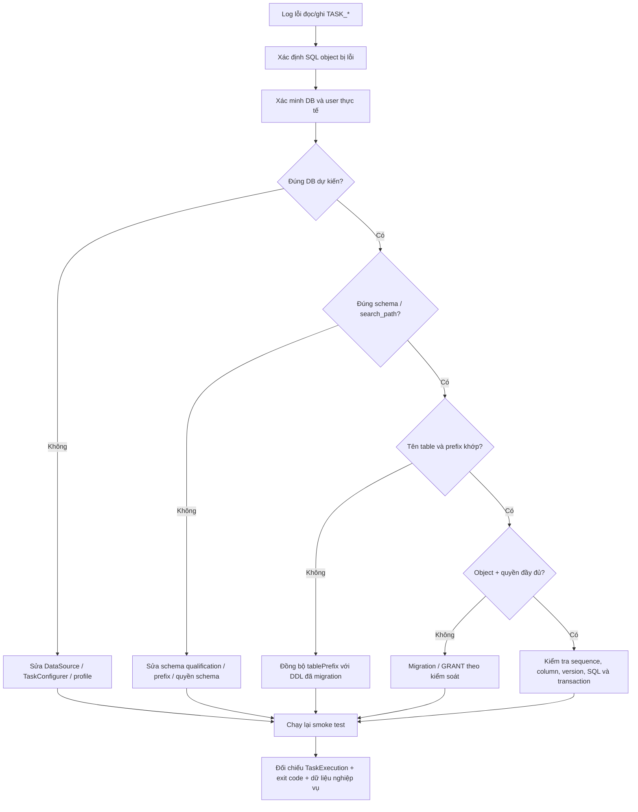
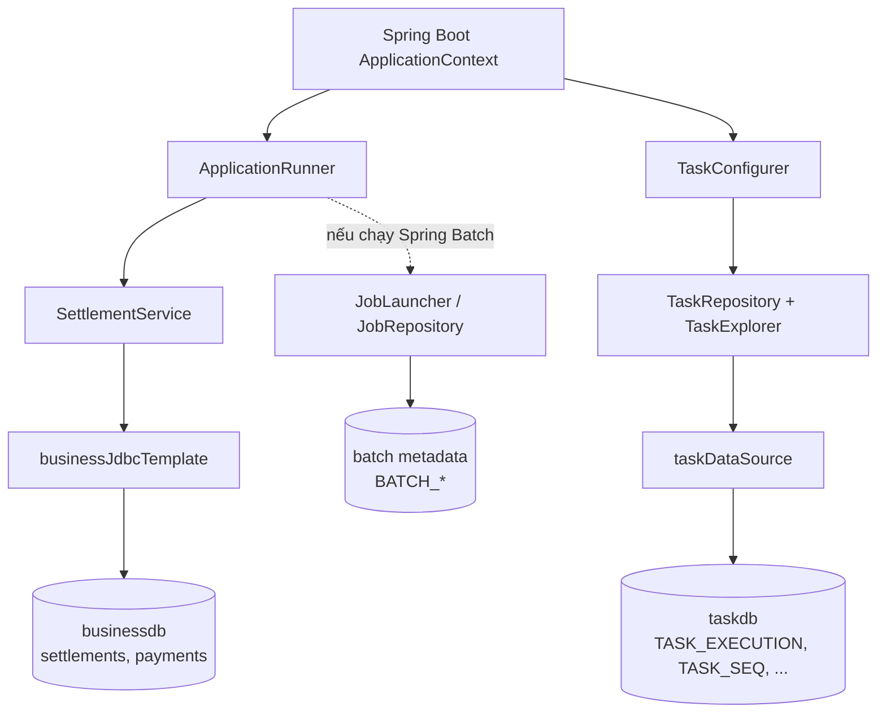

# Thiếu bảng, sai `tablePrefix` hoặc sai `DataSource`

## Mục tiêu học tập

Sau bài học, bạn có thể:

- Phân biệt ba nguyên nhân thường bị nhầm khi Spring Cloud Task không ghi được `TaskExecution`: **bảng metadata chưa tồn tại**, **tiền tố bảng (`tablePrefix`)/schema không khớp** và **`TaskRepository` dùng nhầm `DataSource`**.
- Nhận diện các lỗi JDBC như `relation "task_execution" does not exist`, `Table ... doesn't exist`, `permission denied` và lỗi tạo/cấp `executionId`; tránh kết luận chỉ từ một dòng stack trace.
- Dùng truy vấn **read-only** để kiểm tra database, schema, `search_path`, bảng, sequence và quyền của đúng tài khoản runtime.
- Giải thích chính xác tác động của `spring.cloud.task.table-prefix`, `spring.cloud.task.initialize-enabled`, Spring Boot SQL initializer và migration Flyway/Liquibase.
- Cấu hình TaskRepository trỏ đến đúng database khi ứng dụng có **nhiều `DataSource`**, phân tách transaction nghiệp vụ với transaction metadata.
- So sánh hạ tầng `TASK_*` của Spring Cloud Task với `BATCH_*` của Spring Batch; kiểm tra liên kết Task–Batch khi Job đã chạy nhưng Data Flow không tìm thấy metadata.
- Xây dựng quy trình chẩn đoán, khắc phục, kiểm thử tích hợp và vận hành an toàn khi Task chạy theo lịch, theo yêu cầu hoặc trong Kubernetes.

> **Ngữ cảnh:** Bài thuộc chương **Chẩn đoán** của module **SPRING_CLOUD_TASK**. Spring Cloud Task hỗ trợ ứng dụng Spring Boot chạy hữu hạn và lưu trạng thái thực thi trong cơ sở dữ liệu; ứng dụng có thể dùng Spring Batch, chạy theo lịch hoặc yêu cầu. Với các lỗi repository, câu hỏi đầu tiên không phải “làm sao tạo nhanh một bảng?” mà là **“code đang tìm đối tượng nào, bằng tài khoản nào, trong database/schema nào, theo cấu hình nào?”**.

## 1. Tình huống: Task chạy được ở máy lập trình nhưng lỗi trên Kubernetes

Giả sử một Task đối soát chạy bằng lệnh:

```bash
java -jar settlement-task.jar \
  --business-date=2026-11-24 \
  --region=apac
```

Ở máy lập trình, Task tạo được `TaskExecution`, nhưng khi triển khai lên Kubernetes Job, log xuất hiện:

```text
org.springframework.jdbc.BadSqlGrammarException: ...
Caused by: org.postgresql.util.PSQLException:
ERROR: relation "task_execution" does not exist
SQLState: 42P01
```

Một kỹ sư nhận định “thiếu bảng”; người khác nhận định “sai prefix”; người thứ ba cho rằng Pod đang kết nối nhầm database nghiệp vụ. **Cả ba giả thuyết đều có thể tạo triệu chứng gần giống nhau.**

| Giả thuyết | Cấu hình thực tế | Vì sao xuất hiện lỗi |
| --- | --- | --- |
| **Thiếu bảng** | Task kết nối đúng database và đúng schema, nhưng migration Task chưa chạy. | Không có `TASK_EXECUTION` trong schema đó. |
| **Sai `tablePrefix`** | Database có `OPS_TASK_EXECUTION`, nhưng repository vẫn tìm `TASK_EXECUTION`. | SQL tìm sai tên đối tượng. |
| **Sai `DataSource`** | TaskRepository được wiring vào `businessdb` thay vì `taskdb`. | Bảng có trong `taskdb`, không có trong database mà Task thật sự truy cập. |
| **Sai schema/`search_path`** | Bảng nằm ở `task_meta.task_execution`, user đang tìm trong `public`. | Đối tượng có tồn tại nhưng không nhìn thấy bằng tên không đủ schema. |
| **Sai quyền** | Bảng có tồn tại nhưng user runtime thiếu `SELECT`/`INSERT`/`UPDATE` hoặc quyền sequence. | Repository không thể đọc/ghi dù object hiện diện. |

**Mục tiêu chẩn đoán:** Khẳng định bằng chứng về **DB host/name, schema, prefix, table/sequence và quyền** trước khi sửa cấu hình hoặc DDL.

## 2. `TaskRepository` hoạt động trên những đối tượng nào?

Spring Cloud Task dùng `TaskRepository` để ghi thông tin một lần chạy, `TaskExplorer` để truy vấn metadata và `TaskConfigurer` để chọn hạ tầng lưu trữ/transaction. Khi có JDBC `DataSource` phù hợp, cấu hình mặc định sử dụng JDBC repository. Nếu không có `DataSource` và framework dùng lưu trữ trong bộ nhớ, dữ liệu không còn tồn tại sau khi tiến trình kết thúc: điều này không phù hợp cho lịch sử vận hành production.

Các bảng phổ biến của schema Spring Cloud Task:

| Đối tượng mặc định | Vai trò | Dấu hiệu lỗi khi thiếu |
| --- | --- | --- |
| `TASK_EXECUTION` | Lưu `executionId`, tên Task, start/end, exit code và thông điệp lỗi. | Không tạo/cập nhật được metadata lần chạy. |
| `TASK_EXECUTION_PARAMS` | Lưu tham số của lần chạy. | Task khởi tạo hoặc ghi arguments thất bại. |
| `TASK_TASK_BATCH` | Liên kết `TaskExecution` với `JobExecution` khi tích hợp Batch. | Data Flow hoặc công cụ quan sát không tra được Job liên quan. |
| `TASK_LOCK` | Hỗ trợ một số tính năng khóa/single-instance ở release hỗ trợ. | Khóa Task lỗi khi bật tính năng tương ứng. |
| `TASK_SEQ` hoặc bộ cấp ID phù hợp database | Cấp `TASK_EXECUTION_ID` theo DDL/implementation của version. | Lỗi cấp ID, thiếu relation/sequence hoặc quyền sequence. |

**Chú ý:** Danh sách schema và cách triển khai ID khác nhau theo **Spring Cloud Task release và database dialect**. Tài liệu schema tham khảo `TASK_SEQ`, nhưng một số database dùng bảng sequence, một số dùng native sequence, và DDL có thể có đối tượng bổ sung. **Không tự tạo tùy tiện một sequence rồi coi đã hoàn thiện schema**; dùng script migration/DDL đi kèm đúng phiên bản.

### Lúc nào lỗi xảy ra?

- **Startup:** framework cần tạo metadata bắt đầu; thiếu bảng cấp ID hoặc `TASK_EXECUTION` có thể làm `SpringApplication.run(...)` ném exception trước khi runner xử lý nghiệp vụ.
- **Trong khi chạy:** service nghiệp vụ có thể lỗi với database khác; đừng nhầm exception ở `settlements` với `TASK_EXECUTION`.
- **Kết thúc:** Task cần cập nhật `END_TIME`/`EXIT_CODE`. Nếu mất kết nối lúc này, công việc nghiệp vụ có thể đã xong nhưng metadata chưa được cập nhật.
- **Khi tra cứu:** `TaskExplorer`/Spring Cloud Data Flow có thể tìm sai schema/database, không thấy lần chạy đã tồn tại ở nguồn khác.

Vì vậy không thể xem `TASK_EXECUTION.END_TIME IS NULL` là bằng chứng chắc chắn process vẫn đang chạy; ứng dụng có thể đã crash, bị kill hoặc mất kết nối trước khi ghi trạng thái cuối.

## 3. Ba nguyên nhân gốc: bảng, tên bảng và đường kết nối



Không dùng phương pháp “thử bật nhiều cờ initializer cho tới khi chạy được” trên database production. Việc tạo bảng mới ở **sai DB** có thể làm Task bắt đầu ghi một lịch sử metadata **song song**; lúc đó Data Flow không thấy execution, còn các lần retry lại có thể xử lý cùng dữ liệu nghiệp vụ.

### Bộ câu hỏi ban đầu

Trước khi thay đổi bất kỳ file cấu hình nào, hãy ghi nhận:

1. Tên JAR/image và phiên bản Spring Boot, Spring Cloud Task, Spring Batch (nếu có).
2. Profile Spring nào đang active và cấu hình runtime nào được inject.
3. TaskRepository hiện chọn DataSource/TaskConfigurer nào.
4. JDBC driver và **database/schema đã xác minh bằng kết nối thật**.
5. Giá trị `tablePrefix` hiệu lực, bao gồm ký tự gạch dưới và schema qualification.
6. Tên relation/column/sequence xuất hiện ngay trong lỗi gốc.
7. User runtime có quyền DML và quyền truy cập schema/sequence hay không.
8. Migration Task tương ứng đã được áp dụng cho đúng database/schema chưa.
9. Có thay đổi deploy/secret/profile trước lúc lỗi xuất hiện không.
10. Nếu dùng Data Flow, nơi nó đọc Task metadata có cùng nguồn với ứng dụng không.

## 4. Đọc stack trace đúng cách

Thông điệp top-level của Spring JDBC thường bao bọc lỗi chi tiết của driver. Hãy đọc **`Caused by` sâu nhất có ý nghĩa** và tên đối tượng SQL trong câu lệnh.

Ví dụ PostgreSQL:

```text
BadSqlGrammarException: PreparedStatementCallback; bad SQL grammar
Caused by: PSQLException: ERROR: relation "task_execution" does not exist
SQLState: 42P01
```

`BadSqlGrammarException` không phải lúc nào cũng có nghĩa câu SQL của framework sai cú pháp. Khi driver báo relation không tồn tại, nguyên nhân có thể là **bảng nằm ngoài schema search path hoặc truy cập nhầm database**.

| Dấu hiệu PostgreSQL | Diễn giải bước đầu | Cần kiểm chứng |
| --- | --- | --- |
| `42P01` / `relation ... does not exist` | Relation không phân giải được ở kết nối hiện tại. | DB/schema/search path/prefix/migration. |
| `42501` / `permission denied` | User không có quyền phù hợp. | Schema `USAGE`, bảng, sequence, DML. |
| `3D000` / database không tồn tại | Tên database trong JDBC URL không hợp lệ. | Host/name, provisioning. |
| `28P01` / password authentication failed | Credential sai/đã rotate. | Secret, user, nơi cấp credential; không log secret. |
| `08001` hoặc lỗi kết nối | Network, TLS, DNS, dịch vụ DB không sẵn sàng. | Host, port, certificate, firewall, driver. |
| `42703` / column không tồn tại | Table có nhưng schema sai version hoặc DDL không tương thích. | Migration và cấu trúc cột. |
| `23505` / unique violation | Trùng khóa/sequence ID hoặc logic cạnh tranh. | Sequence/cấp ID, concurrency, dữ liệu hiện hữu. |

Đây là **SQLSTATE của PostgreSQL**, không áp dụng nguyên xi cho MySQL/SQL Server/H2. Với JDBC layer, exception có thể được wrap bởi Spring, Hibernate hoặc connection pool; cần đọc toàn bộ chain trước khi phân loại.

### Các lớp lỗi giống nhau nhưng hành động khác nhau

- `relation task_execution does not exist`: kiểm tra tên/schema/DB trước khi quyết định tạo bảng.
- `permission denied for table task_execution`: **không tạo bảng mới**; kiểm tra quyền user.
- `column external_execution_id does not exist`: bảng tồn tại nhưng có thể **cũ hơn version code**; cần migration đúng release.
- `relation task_seq does not exist`: có thể thiếu bộ cấp ID dù `TASK_EXECUTION` vẫn tồn tại.
- `Connection refused`: kiểm tra kết nối/network, không làm migration để giải quyết lỗi network.

## 5. Bước 1: xác minh database và schema từ đúng phiên chạy

Với PostgreSQL, sau khi đăng nhập bằng **user runtime của Task** trong môi trường test hoặc một tài khoản chẩn đoán có phạm vi tương đương, chạy:

```sql
SELECT
    current_database() AS database_name,
    current_user AS database_user,
    current_schema() AS current_schema,
    current_setting('search_path') AS search_path,
    inet_server_addr() AS server_ip,
    inet_server_port() AS server_port;
```

Truy vấn này chỉ đọc và trả về thông tin **của chính connection**. Nếu ứng dụng đang dùng pool kết nối khác, một phiên `psql` do người vận hành tạo chưa chắc đã cùng database/schema/user. Cần đối chiếu tất cả endpoint và cấu hình chọn bean ở runtime.

### Kiểm tra danh sách schema và bảng

```sql
SELECT
    table_schema,
    table_name,
    table_type
FROM information_schema.tables
WHERE lower(table_name) IN (
    'task_execution',
    'task_execution_params',
    'task_task_batch',
    'task_lock'
)
ORDER BY table_schema, table_name;
```

Nếu không thấy bảng:

- Có thể migration chưa chạy.
- Có thể tài khoản không nhìn thấy bảng do quyền metadata.
- Có thể tên bảng được **đổi prefix** (truy vấn mặc định không bắt được).
- Có thể bạn đang truy vấn **nhầm database**.

Để liệt kê các bảng nghi thuộc metadata Task (không chỉ mặc định):

```sql
SELECT table_schema, table_name
FROM information_schema.tables
WHERE lower(table_name) LIKE '%task%execution%'
   OR lower(table_name) LIKE '%task%batch%'
ORDER BY table_schema, table_name;
```

Đây là truy vấn khám phá, có thể trả thêm bảng nghiệp vụ cùng tên gần giống. Không tự dựa vào pattern tên để kết luận bảng thuộc về Spring Cloud Task.

### Dùng PostgreSQL `to_regclass` để xác nhận đúng relation

```sql
SELECT
    to_regclass('public.task_execution') AS public_task_execution,
    to_regclass('task_meta.task_execution') AS task_meta_execution,
    to_regclass('task_execution') AS in_search_path_execution;
```

- Nếu `task_meta_execution` có giá trị nhưng `in_search_path_execution` là `NULL`, object có thể ở schema ngoài `search_path`.
- Nếu tất cả `NULL`, chưa thể kết luận **mọi database** thiếu bảng: trước tiên xác nhận bạn đang đúng database.
- PostgreSQL thường đổi tên object **không được quote** thành chữ thường. `TASK_EXECUTION` trong SQL không quote sẽ tham chiếu `task_execution`; bảng tạo bằng `"TASK_EXECUTION"` có phân biệt chữ hoa sẽ là object khác.

**Tránh chẩn đoán bằng cách chạy `CREATE TABLE TASK_EXECUTION (...)` ngay khi thấy `NULL`**: cần biết prefix, schema, version và toàn bộ bảng phụ trước.

## 6. Bước 2: kiểm tra các đối tượng cấp ID

Spring Cloud Task cần bộ cấp ID cho `TASK_EXECUTION_ID`. DDL và cơ chế triển khai phụ thuộc database/release, vì vậy hãy xem migration của **đúng dependency**.

Với PostgreSQL, liệt kê table/sequence có tên nghi liên quan:

```sql
SELECT
    sequence_schema,
    sequence_name
FROM information_schema.sequences
WHERE lower(sequence_name) LIKE '%task%'
ORDER BY sequence_schema, sequence_name;
```

Và kiểm tra bảng sequence giả lập nếu dialect dùng bảng:

```sql
SELECT table_schema, table_name
FROM information_schema.tables
WHERE lower(table_name) LIKE '%task%seq%'
ORDER BY table_schema, table_name;
```

Một số tài liệu Spring Cloud Task tham chiếu `TASK_SEQ`; trên một số database, đó là **bảng cấp ID**, trên database khác là **native sequence**. Khi thiếu, log có thể hiển thị lỗi ở `task_seq` ngay trước khi framework insert `TASK_EXECUTION`.

**Không dùng `SELECT nextval(...)` chỉ để chẩn đoán** vì gọi `nextval` **tăng sequence**. Không reset sequence, `TRUNCATE` hay xóa bản ghi để “sửa ID” khi chưa có kế hoạch migration, backup và kiểm tra concurrent writers.

### Kiểm tra cột đúng phiên bản

```sql
SELECT column_name, data_type, is_nullable
FROM information_schema.columns
WHERE table_schema = 'task_meta'
  AND table_name = 'task_execution'
ORDER BY ordinal_position;
```

Đổi `task_meta` nếu schema thực khác. So sánh kết quả với DDL tài liệu của **release đang chạy**. Có bảng nhưng thiếu `EXIT_CODE`, `ERROR_MESSAGE`, `LAST_UPDATED` hoặc cột khác vẫn có thể gây lỗi tạo/cập nhật TaskExecution.

Không copy một đoạn DDL của Spring Cloud Task 2.x vào ứng dụng 5.x chỉ vì tên bảng giống nhau. Schema có thể được mở rộng qua các phiên bản.

## 7. Bước 3: hiểu `tablePrefix` là gì

Mặc định Spring Cloud Task dùng tiền tố **`TASK_`** cho các bảng metadata. Tài liệu chính thức mô tả thuộc tính `spring.cloud.task.tablePrefix`; trong cấu hình Spring Boot theo kiểu kebab-case có thể dùng `spring.cloud.task.table-prefix` qua cơ chế relaxed binding khi release hỗ trợ.

Ví dụ:

```yaml
spring:
  cloud:
    task:
      table-prefix: TASK_
```

`tablePrefix` là **phần đầu ghép vào tên bảng** mà hạ tầng repository dùng. Không phải tên của một bảng đơn lẻ và không phải tiền tố của entity JPA.

| Prefix hiệu lực | Tên bảng execution mà SQL dự kiến | Tên bảng params dự kiến |
| --- | --- | --- |
| `TASK_` mặc định | `TASK_EXECUTION` | `TASK_EXECUTION_PARAMS` |
| `OPS_TASK_` | `OPS_TASK_EXECUTION` | `OPS_TASK_EXECUTION_PARAMS` |
| `task_meta.TASK_` | `task_meta.TASK_EXECUTION` | `task_meta.TASK_EXECUTION_PARAMS` |
| `APP_` | `APP_EXECUTION` | `APP_EXECUTION_PARAMS` |

Các tên trên minh họa cách nối prefix vào hậu tố metadata. Nếu database tự chuyển unquoted identifiers sang chữ thường (như PostgreSQL), tên vật lý được lưu thường là chữ thường. Các object khác như `TASK_TASK_BATCH`, `TASK_LOCK` và cơ chế cấp ID cũng phải được xem xét cùng cấu hình; không chỉ đổi bảng `EXECUTION`.

### Hai lỗi prefix thường gặp

**Lỗi 1 — Prefix bị đổi trong config nhưng DDL chưa đổi**

```yaml
spring:
  cloud:
    task:
      table-prefix: OPS_TASK_
      initialize-enabled: false
```

Database vẫn chỉ có `TASK_EXECUTION`/`TASK_EXECUTION_PARAMS`. Kết quả: repository tìm `OPS_TASK_EXECUTION` và không thấy. Không nên tạo bảng trống `OPS_TASK_EXECUTION` nếu nghiệp vụ cần giữ lịch sử ở bảng cũ; cần quyết định **quay về prefix cũ** hay **di chuyển/migrate schema** theo kế hoạch.

**Lỗi 2 — DDL được tạo trong schema khác nhưng SQL không đủ tên**

Database có `task_meta.task_execution`, nhưng prefix là `TASK_` và user runtime chỉ tìm trong `public`. Hướng sửa có thể là:

- Dùng `table-prefix: task_meta.TASK_` **nếu phiên bản và dialect hỗ trợ prefix gồm schema**.
- Hoặc cấu hình schema/`search_path` của JDBC connection có kiểm soát để SQL không đủ tên phân giải đúng.
- Đồng bộ migration, quyền schema và các đối tượng cấp ID.

Không dùng cả hai cách tùy tiện cùng lúc; phải biết câu SQL thực tế tạo ra bởi repository, nhất là việc prefix được áp dụng với **table** và **ID generator**.

## 8. Schema, `search_path` và chữ hoa/thường

Trong PostgreSQL:

```sql
SELECT current_schema(), current_setting('search_path');

SELECT to_regclass('task_execution');
SELECT to_regclass('task_meta.task_execution');
```

Nếu schema `task_meta` chứa bảng nhưng connection tìm trong `public`, một trong các cách sửa hợp lệ có thể là chỉnh `search_path` trong database role hoặc URL connection theo cơ chế được driver hỗ trợ, ví dụ `currentSchema` của PostgreSQL JDBC:

```yaml
spring:
  datasource:
    url: "jdbc:postgresql://metadata-db:5432/taskdb?currentSchema=task_meta"
```

**Giới hạn:** `currentSchema` là thuộc tính **PostgreSQL JDBC** và phải được kiểm thử với driver đang dùng. Nó không tạo schema, không tạo bảng và không tự cấp `USAGE`/`SELECT`/`INSERT`/`UPDATE`. Nếu câu SQL repository đã có schema-qualified prefix `task_meta.TASK_`, cần đảm bảo không vô tình ghép schema hai lần.

### Không giải quyết bằng tên bảng có quote tùy tiện

Ví dụ:

```sql
CREATE TABLE "TASK_EXECUTION" (...);
```

Trong PostgreSQL, bảng `"TASK_EXECUTION"` khác `task_execution`. Nếu framework tạo SQL không quote `TASK_EXECUTION`, PostgreSQL sẽ tìm tên thường `task_execution` và không thấy bảng uppercase quoted. Trong thực tế nên dùng **DDL chính thức đúng dialect** rồi giữ quy ước tên nhất quán, thay vì “sửa” bằng cách quote một số bảng riêng lẻ.

### Prefix tùy biến làm tăng trách nhiệm migration

Tài liệu Spring Cloud Task nêu rõ khi đổi prefix, bạn phải tự đảm bảo schema metadata tương ứng. Những phần cần kiểm tra:

1. Các bảng Task và bảng liên kết Task–Batch.
2. Các sequence hoặc sequence-table dùng cấp ID.
3. Khóa chính, chỉ mục, ràng buộc và foreign key khi schema thiết kế có.
4. Cột, kiểu dữ liệu, nullable, độ dài chuỗi theo release/dialect.
5. Quyền bảng/sequence/schema cho user runtime.
6. Công cụ migration và metadata version đã chạy trên đúng DB.
7. Job/Task dashboard, truy vấn vận hành và tiến trình cũ còn sử dụng prefix nào.

**Không đổi prefix chỉ để “né” bảng có lỗi** nếu lịch sử Task đang được dùng cho audit hoặc restart. Việc dùng bảng mới có thể làm gián đoạn truy vết.

## 9. Bước 4: cấu hình schema initialization

Trong Spring Cloud Task, tài liệu nêu thuộc tính:

```yaml
spring:
  cloud:
    task:
      initialize-enabled: false
```

`false` có ý nghĩa: **không để Task tự khởi tạo bảng khi startup**, thường dùng khi schema được quản lý qua Flyway/Liquibase hoặc pipeline migration. Nó **không tắt việc ghi TaskExecution** nếu repository JDBC đã được cấu hình đúng.

### Ba cơ chế không nên nhầm

| Cơ chế | Cấu hình | Mục tiêu |
| --- | --- | --- |
| Spring Cloud Task schema initialization | `spring.cloud.task.initialize-enabled` | Quản lý khởi tạo bảng Task theo khả năng/config của release. |
| Spring Boot generic SQL initialization | `spring.sql.init.mode`, `spring.sql.init.schema-locations` | Chạy script `schema.sql`/`data.sql` khi cấu hình. |
| Spring Batch schema initialization | `spring.batch.jdbc.initialize-schema` | Khởi tạo bảng `BATCH_*` cho `JobRepository`. |
| Flyway / Liquibase | Migration files, history table, target datasource | Quản lý thay đổi schema có phiên bản và kiểm soát. |

`spring.sql.init.mode=always` **không tự bảo đảm tạo đúng schema Spring Cloud Task** nếu không có script phù hợp. `spring.batch.jdbc.initialize-schema=always` tạo/khởi tạo **bảng Batch**, không tự giải quyết bảng `TASK_EXECUTION`.

Ví dụ định hướng cho môi trường production có migration chạy trước:

```yaml
spring:
  cloud:
    task:
      initialize-enabled: false
  sql:
    init:
      mode: never
  batch:
    jdbc:
      initialize-schema: never
```

Đây là cấu hình minh họa khi **các bảng đã được quản lý từ trước**; không copy vào môi trường chưa migration rồi mong ứng dụng tự tạo bảng.

### Trình tự migration hợp lý

1. Chốt version Spring Cloud Task/Spring Batch và database dialect.
2. Lấy DDL tương ứng từ nguồn của version được phê duyệt.
3. Xác nhận prefix/schema, phân biệt Task và Batch metadata.
4. Chạy migration vào **đúng database** bằng pipeline kiểm soát, với role DDL riêng.
5. Kiểm tra checksum, lịch sử migration, thứ tự chạy và log.
6. Dùng tài khoản runtime **chỉ có quyền DML cần thiết** để smoke test.
7. Chạy Task ngắn trên test; đối chiếu `TASK_EXECUTION` và exit code.
8. Triển khai production theo quy trình backup/rollback đã phê duyệt.

Không đặt `continue-on-error: true` nhằm bỏ qua mọi lỗi DDL/SQL startup. Nếu bảng chỉ được tạo một phần, bỏ qua lỗi có thể khiến Task thất bại muộn hơn và khó chẩn đoán.

## 10. Bước 5: TaskRepository đang dùng `DataSource` nào?

Tài liệu Spring Cloud Task nêu: khi ứng dụng có **một** `DataSource`, hạ tầng Task có thể dùng DataSource đó tự động. Khi ứng dụng có **nhiều** `DataSource`, cần cấu hình `TaskConfigurer` chọn đúng datasource cho metadata Task.

Ví dụ kiến trúc:



**Nguy cơ:** `@Primary` chọn datasource nghiệp vụ, `spring.datasource.*`/profile thực tế trỏ sang database khác, hoặc `TaskConfigurer` mặc định chọn bean không phải metadata datasource mong muốn. Khi đó TaskRepository tìm `TASK_EXECUTION` trong **businessdb**, dù `taskdb` đã có schema đầy đủ.

### Dấu hiệu chọn nhầm DataSource

- `psql` vào `taskdb` thấy bảng Task, nhưng Task log vẫn báo thiếu.
- Một hàng `TASK_EXECUTION` mới xuất hiện ở database nghiệp vụ sau khi ai đó bật initializer.
- Data Flow đọc `taskdb` không thấy lịch sử, nhưng log từ Pod báo Task đã ghi metadata.
- `TaskExplorer` trả rỗng dù SQL người vận hành thấy hàng ở một datasource khác.
- Trên local Task chạy H2 mà production dùng PostgreSQL; sau khi process kết thúc lịch sử biến mất.
- Spring Boot có nhiều `DataSource` nhưng thiếu `TaskConfigurer` được định nghĩa rõ và kiểm thử.

**Không “sửa” bằng cách tạo thêm bảng Task trong businessdb** khi mục tiêu kiến trúc là metadata phải nằm ở taskdb. Hãy sửa wiring và chứng minh destination của kết nối trước.

## 11. Ví dụ Java: chọn riêng `taskDataSource`

Ví dụ theo phong cách Spring Boot 3.x và API `DefaultTaskConfigurer` của nhánh Spring Cloud Task **3.0.4** được Javadoc mô tả. Với Spring Cloud Task release mới hơn, cần đối chiếu lại constructors/packages trước khi sử dụng.

### 11.1. Tạo hai `DataSourceProperties` và Hikari pools

```java
package com.example.settlement.config;

import com.zaxxer.hikari.HikariDataSource;
import javax.sql.DataSource;

import org.springframework.beans.factory.annotation.Qualifier;
import org.springframework.boot.autoconfigure.jdbc.DataSourceProperties;
import org.springframework.boot.context.properties.ConfigurationProperties;
import org.springframework.context.annotation.Bean;
import org.springframework.context.annotation.Configuration;
import org.springframework.context.annotation.Primary;

@Configuration(proxyBeanMethods = false)
public class TwoDataSourcesConfiguration {

    @Bean("businessDataSourceProperties")
    @Primary
    @ConfigurationProperties("app.datasource.business")
    DataSourceProperties businessDataSourceProperties() {
        return new DataSourceProperties();
    }

    @Bean("businessDataSource")
    @Primary
    @ConfigurationProperties("app.datasource.business.hikari")
    HikariDataSource businessDataSource(
            @Qualifier("businessDataSourceProperties")
            DataSourceProperties properties) {
        return properties
                .initializeDataSourceBuilder()
                .type(HikariDataSource.class)
                .build();
    }

    @Bean("taskDataSourceProperties")
    @ConfigurationProperties("app.datasource.task")
    DataSourceProperties taskDataSourceProperties() {
        return new DataSourceProperties();
    }

    @Bean("taskDataSource")
    @ConfigurationProperties("app.datasource.task.hikari")
    HikariDataSource taskDataSource(
            @Qualifier("taskDataSourceProperties")
            DataSourceProperties properties) {
        return properties
                .initializeDataSourceBuilder()
                .type(HikariDataSource.class)
                .build();
    }
}
```

Cấu hình này sử dụng `DataSourceProperties` để ánh xạ `url`/`username`/`password` vào Hikari JDBC URL, tránh lỗi dùng trực tiếp `url` trên Hikari khi cần `jdbcUrl`. Cả hai hàm tạo datasource nhận bean properties qua `@Qualifier` nên Spring inject **đúng đối tượng đã bind**, không gọi trực tiếp phương thức `@Bean` trong lớp `@Configuration(proxyBeanMethods=false)` và vô tình tạo đối tượng properties chưa được bind. `@Primary` chỉ dành cho datasource nghiệp vụ; repository Task sẽ chọn `taskDataSource` tường minh ở bước tiếp theo.

### 11.2. Cấu hình rõ `TaskConfigurer`

Trên Spring Cloud Task 3.0.4, Javadoc liệt kê constructor:

```java
new DefaultTaskConfigurer(
        DataSource dataSource,
        String tablePrefix,
        ApplicationContext applicationContext
);
```

Có thể khai báo:

```java
package com.example.settlement.config;

import javax.sql.DataSource;

import org.springframework.beans.factory.annotation.Qualifier;
import org.springframework.beans.factory.annotation.Value;
import org.springframework.cloud.task.configuration.DefaultTaskConfigurer;
import org.springframework.cloud.task.configuration.TaskConfigurer;
import org.springframework.context.ApplicationContext;
import org.springframework.context.annotation.Bean;
import org.springframework.context.annotation.Configuration;

@Configuration(proxyBeanMethods = false)
public class TaskMetadataConfiguration {

    @Bean
    TaskConfigurer taskConfigurer(
            @Qualifier("taskDataSource") DataSource taskDataSource,
            @Value("${spring.cloud.task.table-prefix:TASK_}") String prefix,
            ApplicationContext context) {

        return new DefaultTaskConfigurer(
                taskDataSource, prefix, context);
    }
}
```

Ở ví dụ này:

- `@Qualifier("taskDataSource")` bảo đảm hạ tầng Spring Cloud Task chọn **database metadata**, không chọn `@Primary businessDataSource`.
- `prefix` được lấy từ cấu hình, **không làm mất giá trị custom** khi khởi tạo `DefaultTaskConfigurer` thủ công.
- `ApplicationContext` được truyền vì constructor đang được minh họa có ba tham số tương ứng trên **3.0.4**.
- Chỉ tạo **một `TaskConfigurer`** rõ ràng, tránh để cấu hình cạnh tranh làm Spring chọn bean ngoài dự kiến.

**Cảnh báo quan trọng:** Constructor `new DefaultTaskConfigurer(taskDataSource)` ở Javadoc 3.0.4 dùng **prefix mặc định `TASK_`**. Nếu bạn đã đặt `spring.cloud.task.table-prefix: OPS_TASK_` nhưng tự tạo TaskConfigurer bằng constructor một datasource, bạn có thể gặp đúng lỗi **sai prefix** mà bài này phân tích. Đừng cho rằng một property chắc chắn sẽ được áp dụng khi đã override đường tạo `TaskConfigurer` bằng code riêng; phải kiểm thử runtime.

### 11.3. Cấu hình nguồn dữ liệu bằng YAML

```yaml
spring:
  application:
    name: settlement-task
  main:
    web-application-type: none
  cloud:
    task:
      table-prefix: TASK_
      initialize-enabled: false
  sql:
    init:
      mode: never

app:
  datasource:
    business:
      url: jdbc:postgresql://business-db:5432/businessdb
      username: ${BUSINESS_DB_USER}
      password: ${BUSINESS_DB_PASSWORD}
      hikari:
        pool-name: business-pool
        maximum-pool-size: 4

    task:
      url: jdbc:postgresql://task-db:5432/taskdb
      username: ${TASK_DB_USER}
      password: ${TASK_DB_PASSWORD}
      hikari:
        pool-name: task-metadata-pool
        maximum-pool-size: 2
```

YAML giả định hai database đã được provision, credential được inject từ Secret và schema Task đã migration. Không đưa mật khẩu vào `--spring.datasource.password=...` vì tham số CLI có thể được lưu ở `TASK_EXECUTION_PARAMS` hoặc hiện trong công cụ xem process.

### 11.4. Một cách wiring không cần tách database

Nếu chỉ có đúng **một** `DataSource` và Task metadata cùng nằm ở schema được phép trong database đó, cấu hình `spring.datasource.*` thông thường có thể đủ để Spring Cloud Task tự nhận diện. **Không thêm hai DataSource và TaskConfigurer tùy chỉnh chỉ để tăng số class.**

Điều quan trọng là **kiến trúc thực tế**: có bao nhiêu kết nối, metadata cần nằm ở đâu và ai chịu trách nhiệm migration. Khi thêm datasource thứ hai cho mục đích mới, cần chạy lại integration test để xác nhận TaskRepository chưa vô tình đổi đích.

## 12. Kiểm chứng đích `DataSource` bằng code an toàn

Một utility chẩn đoán tạm thời có thể lấy thông tin connection qua JDBC metadata:

```java
package com.example.settlement.diagnostics;

import java.sql.Connection;
import java.sql.SQLException;
import javax.sql.DataSource;

import org.springframework.beans.factory.annotation.Qualifier;
import org.springframework.stereotype.Component;

@Component
public class TaskDataSourceProbe {

    private final DataSource taskDataSource;

    public TaskDataSourceProbe(
            @Qualifier("taskDataSource") DataSource taskDataSource) {
        this.taskDataSource = taskDataSource;
    }

    public DbIdentity inspect() throws SQLException {
        try (Connection connection = taskDataSource.getConnection()) {
            return new DbIdentity(
                    connection.getCatalog(),
                    connection.getSchema(),
                    connection.getMetaData().getUserName());
        }
    }

    public record DbIdentity(
            String catalog, String schema, String databaseUser) {}
}
```

**Không tự động log full JDBC URL**: URL có thể chứa query parameters hoặc thông tin xác thực. Chỉ xuất thông tin đã được cho phép vào kênh log có kiểm soát. Nếu DB user/schema cũng thuộc thông tin hạ tầng nhạy cảm, giới hạn quyền xem log.

Probe này có thể được gọi trong **một smoke test hoặc công cụ chẩn đoán riêng**. Nếu Spring Cloud Task **thất bại ở startup trước khi runner chạy**, một `ApplicationRunner` gọi probe có thể **không bao giờ được thực thi**. Khi đó nên kiểm tra bằng một chương trình JDBC chẩn đoán độc lập hoặc `psql` từ đúng network/Secret/profile mà Task dùng, không chờ đến sau `SpringApplication.run`.

### Đừng chỉ kiểm tra URL trong file cấu hình

Một file `application.yml` có URL đúng không chứng minh runtime dùng đúng bean. Spring Boot có nhiều nguồn property: profile, environment, ConfigMap, Secret, command line, defaults, deploy properties. Code tự tạo `DataSource` hoặc `TaskConfigurer` có thể ghi đè đường đi.

Cần quan sát cả:

1. Giá trị cấu hình **hiệu lực** của target DB đã được che secret.
2. Tên bean `DataSource` được chọn trong `TaskConfigurer`.
3. Identity của connection thực tế (catalog/schema/user).
4. SQL object hạ tầng Task tìm, bao gồm prefix.
5. Bảng metadata thật sự có hàng mới trong **đúng database** sau smoke test.

Không bật log DEBUG cho toàn bộ environment trên production vì có thể lộ secret, JAAS config hoặc JDBC credential.

## 13. Quyền database cũng có thể giống lỗi thiếu bảng

Nếu user có quyền đăng nhập DB nhưng thiếu quyền trên schema hoặc sequence, Task vẫn không tạo/cập nhật được metadata.

Ví dụ PostgreSQL, với schema `task_meta`:

```sql
SELECT
    has_schema_privilege(current_user, 'task_meta', 'USAGE')
        AS can_use_schema,
    has_table_privilege(
        current_user, 'task_meta.task_execution', 'SELECT')
        AS can_read_execution,
    has_table_privilege(
        current_user, 'task_meta.task_execution', 'INSERT')
        AS can_insert_execution,
    has_table_privilege(
        current_user, 'task_meta.task_execution', 'UPDATE')
        AS can_update_execution;
```

Câu này giả định relation `task_meta.task_execution` **đã tồn tại**; nếu không, trước tiên dùng `to_regclass(...)`. Với bảng sequence hoặc native sequence, phải kiểm tra **đúng loại đối tượng** và quyền cần thiết theo DDL, ví dụ `USAGE` hoặc `UPDATE` trên sequence ở những cơ chế cấp ID thích hợp.

Phân tách quyền:

- **Migration role:** tạo/đổi cấu trúc metadata khi phát hành phiên bản mới.
- **Task runtime role:** `SELECT`/`INSERT`/`UPDATE`/quyền ID generator cần thiết cho metadata Task; không có quyền DDL nếu không cần.
- **Data Flow/read-only audit role:** chỉ đọc metadata phục vụ quan sát nếu kiến trúc hỗ trợ.
- **Business role:** chỉ truy cập bảng nghiệp vụ cần thiết, không nhận quyền Task metadata ngoài mục đích.

**Không cấp `SUPERUSER` hoặc `GRANT ALL ON DATABASE` chỉ để sửa lỗi startup.** Hãy ghi nhận SQLSTATE, đối tượng và quyền thiếu rồi áp dụng GRANT tối thiểu qua quy trình quản trị.

## 14. Spring Batch: `TASK_*` và `BATCH_*` là hai bộ metadata khác nhau

Khi Spring Cloud Task phối hợp Spring Batch, có thể tồn tại:

| Tầng | Repository | Bảng tiêu biểu |
| --- | --- | --- |
| Vòng đời ứng dụng Task | `TaskRepository` | `TASK_EXECUTION`, `TASK_EXECUTION_PARAMS`. |
| Vòng đời Batch Job/Step | `JobRepository` | `BATCH_JOB_INSTANCE`, `BATCH_JOB_EXECUTION`, `BATCH_STEP_EXECUTION`. |
| Liên kết Task–Batch | Tích hợp `spring-cloud-task-batch` khi được bật | `TASK_TASK_BATCH`. |

**Thiếu `BATCH_JOB_EXECUTION` không được sửa bằng `spring.cloud.task.initialize-enabled=true`**, vì đây là bảng Spring Batch. **Thiếu `TASK_EXECUTION` không được sửa bằng `spring.batch.jdbc.initialize-schema=always`**, vì đây là bảng Task.

### Ví dụ lỗi Job có mà Data Flow không thấy Job liên quan

- Spring Batch đã chạy, có `BATCH_JOB_EXECUTION`.
- Task metadata có `TASK_EXECUTION`.
- Nhưng `TASK_TASK_BATCH` thiếu, listener liên kết không bật hoặc hai repository không được cấu hình đúng.
- Spring Cloud Data Flow có thể không có `JobExecution IDs` liên quan đến Task, dù Job thực sự chạy.

Truy vấn khi cả Task và Batch metadata nằm trong **một database/schema có quyền**:

```sql
SELECT
    t.TASK_EXECUTION_ID,
    t.TASK_NAME,
    t.EXIT_CODE AS TASK_EXIT_CODE,
    x.JOB_EXECUTION_ID,
    j.STATUS AS JOB_STATUS
FROM TASK_EXECUTION t
LEFT JOIN TASK_TASK_BATCH x
  ON x.TASK_EXECUTION_ID = t.TASK_EXECUTION_ID
LEFT JOIN BATCH_JOB_EXECUTION j
  ON j.JOB_EXECUTION_ID = x.JOB_EXECUTION_ID
ORDER BY t.TASK_EXECUTION_ID DESC;
```

Đây là câu SQL mặc định. Khi dùng custom tablePrefix/schema, phải thay tên bảng Task tương ứng. Nếu TaskRepository và JobRepository ở **hai database khác nhau**, SQL join thông thường không tự hoạt động xuyên database; cần API, query tách nguồn hoặc cơ chế liên kết phù hợp.

### Prefix của Batch không phải prefix của Task

Spring Batch có cấu hình bảng riêng (`spring.batch.jdbc.table-prefix` trong những release Spring Boot/Spring Batch hỗ trợ), và `JobRepository` cũng có thể được cấu hình bằng code. **Không áp dụng `spring.cloud.task.table-prefix` rồi mong mọi bảng `BATCH_*` tự đổi tên**. Khi dùng song song hai framework, quản lý hai schema, migration và prefix rõ ràng.

## 15. Các vấn đề riêng với Docker, Kubernetes và scheduler

Cùng một JAR có thể chạy được local và thất bại trong Pod vì môi trường runtime khác:

- Container trỏ `localhost` và kết nối nhầm database bên trong Pod thay vì host/DB service.
- DNS `task-db` phân giải ở namespace khác hoặc không có Service.
- `spring.profiles.active` khác khi chạy CronJob.
- Env var `SPRING_DATASOURCE_URL` ghi đè URL profile dự kiến.
- Secret `TASK_DB_USER` và `BUSINESS_DB_USER` bị gán nhầm.
- Image chạy artifact phiên bản mới nhưng migration vẫn theo phiên bản cũ.
- SCDF/Deployer cung cấp application/deployment properties ghi đè cấu hình.
- Job/Task bị kill vì lỗi JDBC trước khi ghi `TaskExecution`.
- Worker remote partitioning dùng `JobRepository` khác manager.

### Ví dụ cấu hình Kubernetes Job

```yaml
apiVersion: batch/v1
kind: Job
metadata:
  name: settlement-diagnostics-smoke
spec:
  backoffLimit: 0
  template:
    spec:
      restartPolicy: Never
      containers:
        - name: settlement
          image: registry.example.internal/tasks/settlement:1.0.0
          args:
            - "--business-date=2026-11-24"
          env:
            - name: TASK_DB_USER
              valueFrom:
                secretKeyRef:
                  name: task-db-creds
                  key: username
            - name: TASK_DB_PASSWORD
              valueFrom:
                secretKeyRef:
                  name: task-db-creds
                  key: password
            - name: BUSINESS_DB_USER
              valueFrom:
                secretKeyRef:
                  name: business-db-creds
                  key: username
            - name: BUSINESS_DB_PASSWORD
              valueFrom:
                secretKeyRef:
                  name: business-db-creds
                  key: password
```

Chỉ chạy ví dụ trên **môi trường test cô lập** đã có namespace, image, Secret, migration và cấu hình JDBC URL phù hợp. `backoffLimit: 0` giúp một test lỗi startup không bị retry nhiều lần, nhưng không phải chính sách hợp lý cho mọi workload production.

**Không dùng `kubectl describe pod` hoặc dump env để lộ secret**; các lệnh quan sát nên chọn lọc trường không nhạy cảm. Khi cần đối chiếu, kiểm tra tên Secret/key và log driver được che dữ liệu thay vì in giá trị credential.

### Cách đọc log Pod

```bash
kubectl get jobs
kubectl describe job settlement-diagnostics-smoke

kubectl get pods -l job-name=settlement-diagnostics-smoke
kubectl logs <pod-name> -c settlement
kubectl describe pod <pod-name>
```

`<pod-name>` là placeholder. Nếu Pod chưa chạy được vì image pull/Secret/config, sẽ **không có log Java** và **không có bảng TaskExecution mới**. Cần phân biệt lỗi khởi tạo container với lỗi JDBC trong JVM.

Nếu Pod đã được dọn, tìm log tập trung và audit của Job; `TASK_EXECUTION` có thể thiếu thông tin nếu JVM chết rất sớm. Đừng coi một Task không có hàng metadata là bằng chứng scheduler chưa khởi chạy.

## 16. Runbook chẩn đoán từ dấu hiệu tới nguyên nhân

Một runbook nhanh, tránh hành động phá dữ liệu:

**Bước A — Thu bằng chứng, không sửa DB:**

1. Ghi tên Task, image digest, environment, profile, thời điểm và correlation ID.
2. Lấy log ứng dụng/Pod đủ phần exception gốc, SQLSTATE, tên relation/column.
3. Kiểm tra exit code của container; nếu Spring Boot `run(...)` thất bại trước Task lifecycle, repository có thể không có row.
4. Ghi lại lịch sử deploy, migration, thay đổi secret/profile gần thời điểm lỗi.

**Bước B — Xác định “đang kết nối đâu”:**

5. Kiểm tra `TaskConfigurer`/`@Qualifier` và bean DataSource tại runtime.
6. Dùng connection thuộc đúng credential và network để truy vấn `current_database`, `current_schema`, `current_user`, `search_path`.
7. Không chỉ nhìn cấu hình local; xác nhận profile và biến môi trường thực tế của Pod mà không in secret.

**Bước C — Xác định “đang tìm cái gì”:**

8. Kiểm tra `tablePrefix` và SQL relation trong stack trace.
9. Tìm bảng/sequence bằng `information_schema` và `to_regclass`.
10. So sánh DDL, cột và quyền với migration chính thức của release.
11. Với Batch, kiểm tra riêng `BATCH_*` và `TASK_TASK_BATCH`.

**Bước D — Khắc phục đúng tầng:**

12. Nếu sai DB: sửa TaskConfigurer/URL/profile, **không tạo bảng ở DB sai**.
13. Nếu sai schema: sửa qualification/search_path và quyền, không copy bảng tùy tiện.
14. Nếu sai prefix: thống nhất property, custom TaskConfigurer và DDL; lập phương án giữ lịch sử.
15. Nếu thiếu bảng/column/sequence: áp migration **đúng version và dialect** qua pipeline.
16. Nếu thiếu quyền: cấp quyền tối thiểu theo role, không dùng superuser.

**Bước E — Xác minh và ngăn tái phát:**

17. Chạy smoke test một Task trên dữ liệu an toàn.
18. Xác minh hàng mới trong `TASK_EXECUTION` của đúng DB, start/end/exit code.
19. Với Batch, xác minh `JobExecution`/Step và liên kết đúng.
20. Đối chiếu dữ liệu nghiệp vụ và ảnh hưởng của các lần chạy đã thất bại/retry.
21. Bổ sung check migration/schema/prefix/datasource vào CI và deployment gate.

## 17. Bảng chẩn đoán nhanh

| Triệu chứng | Nguyên nhân nghi vấn | Kiểm tra có giá trị nhất | Hướng xử lý |
| --- | --- | --- | --- |
| `relation task_execution does not exist` | Thiếu bảng, sai schema hoặc DB. | `current_database()`, `to_regclass`, prefix. | Sửa đúng nguyên nhân; migration khi thật sự thiếu. |
| `relation ops_task_execution does not exist` | Custom prefix chưa đồng bộ DDL. | Cấu hình `table-prefix` và liệt kê bảng. | Đồng bộ prefix/DDL; giữ lịch sử có kế hoạch. |
| `TASK_EXECUTION` có nhưng vẫn lỗi | Thiếu `TASK_SEQ`, cột hoặc quyền; hoặc dùng DB khác. | Xem **relation chính xác** trong cause, DDL và identity kết nối. | Sửa ID generator/DDL/quyền theo version. |
| `permission denied for schema task_meta` | Thiếu `USAGE` schema. | `has_schema_privilege`. | GRANT tối thiểu. |
| `permission denied for sequence ...` | User thiếu quyền sequence. | Kiểm tra loại sequence và quyền phù hợp. | GRANT sequence quyền cần thiết. |
| `column ... does not exist` | Schema version cũ. | `information_schema.columns` và migration history. | Migrate đúng release. |
| Local chạy, K8s lỗi | Sai profile, Secret, URL, DNS, image version. | So sánh runtime identity/profile và migration. | Sửa deploy config/secret/network. |
| Task history chỉ thấy ở business DB | TaskConfigurer chọn nhầm `@Primary`. | Wiring bean + connection identity của repository. | Dùng `@Qualifier("taskDataSource")`. |
| Data Flow không thấy execution | Đọc repository khác, datasource in-memory hoặc lỗi sớm. | So sánh SCDF target DB với Task DB, log runtime. | Đồng bộ nguồn metadata. |
| Batch Job tồn tại nhưng Task không có Job link | Thiếu `TASK_TASK_BATCH`/listener; repositories khác nhau. | SQL metadata Task/Batch, cấu hình listener. | Sửa tích hợp Task–Batch theo release. |
| `END_TIME IS NULL` sau khi Pod dừng | Kill/crash/DB outage khi cập nhật. | Pod termination + log + truy vấn metadata. | Đối soát, không suy ra Task vẫn chạy. |
| Retry tạo thêm kết quả nghiệp vụ | Task đã commit một phần trước lỗi metadata. | Business key và transaction state. | Idempotency/checkpoint, không retry mù. |

## 18. Kiểm thử tích hợp để phát hiện trước khi lên production

Unit test logic nghiệp vụ không thể phát hiện `TaskRepository` chọn nhầm DB. Cần integration test với **hai database thật** hoặc test containers và schema migration theo pipeline.

### Ma trận tối thiểu

| Kịch bản | Thiết lập | Kết quả mong đợi |
| --- | --- | --- |
| Đúng DB, đúng prefix, đủ schema | Task DB đã migration `TASK_*`. | Task ghi hàng mới, cập nhật end/exit code. |
| Task DB thiếu bảng | Không chạy migration ở Task DB test. | Startup fail rõ ràng; không tự tạo bảng ở business DB. |
| Đổi prefix sang `OPS_TASK_` nhưng DDL giữ `TASK_` | Custom prefix khác schema. | Lỗi rõ; không báo thành công giả. |
| DDL custom prefix khớp config | Migration tạo object tương ứng. | Có lịch sử Task trong bảng custom, không ghi bảng cũ. |
| TaskConfigurer chọn nhầm business DB | `@Qualifier` sai trong profile test. | Test phát hiện việc ghi sai đích; không chấp nhận silent fallback. |
| Bảng có nhưng thiếu cột/sequence | DDL cũ/sai version. | Test fail ở đúng object, log đầy đủ. |
| User chỉ có quyền đọc | Bỏ INSERT/UPDATE trong role test. | Repository không ghi; test phân loại permission. |
| Batch metadata thiếu | Chạy Job nhưng không migrate `BATCH_*`. | JobRepository lỗi riêng với TaskRepository. |
| Task chết sau commit nghiệp vụ | Giả lập outage/kill hợp lệ trên test. | Không tạo tác động trùng khi retry cùng business key. |

### Test phân biệt đúng database

Có thể chạy test liên hợp:

1. Khởi tạo `businessdb` chứa bảng `settlements` nhưng **không** chứa `TASK_EXECUTION`.
2. Khởi tạo `taskdb` chứa `TASK_*` đúng version nhưng không chứa `settlements`.
3. Tạo một `TaskConfigurer` chọn `taskDataSource`.
4. Chạy một lượt Task ngắn trên môi trường test.
5. Assert `taskdb.TASK_EXECUTION` có hàng mới; `businessdb` **không có** bảng Task mới.
6. Đổi bean chọn DB sai trong một test âm tính; xác nhận startup fail thay vì âm thầm ghi metadata vào sai nơi.
7. Kiểm tra mã JVM/container và dữ liệu nghiệp vụ không bị trùng khi chạy lại.

**Không chạy loại test này lên production**, đặc biệt không tạo/xóa bảng để kiểm thử. Sử dụng schema tạm độc lập, teardown được kiểm soát, credentials chỉ có quyền trong môi trường test.

### Ví dụ câu SQL assertion sau smoke test

```sql
SELECT
    TASK_EXECUTION_ID,
    TASK_NAME,
    START_TIME,
    END_TIME,
    EXIT_CODE
FROM task_meta.TASK_EXECUTION
WHERE TASK_NAME = 'settlement-task'
ORDER BY TASK_EXECUTION_ID DESC;
```

Dùng tên schema/prefix tương ứng **với cấu hình thực tế**. Truy vấn này không đảm bảo Task đã xử lý đúng nghiệp vụ; phải kiểm tra riêng dữ liệu settlement và trạng thái Batch Job nếu có.

## 19. Lưu ý về khắc phục dữ liệu đã chạy sai đích

Nếu TaskRepository từng ghi metadata vào **sai database** trong vài ngày, sửa JDBC URL chỉ giải quyết các lần chạy mới. Lịch sử cũ có thể vẫn nằm ở nguồn sai; Data Flow, audit hoặc báo cáo có nguy cơ “mất” lượt chạy trước.

Trước khi di chuyển metadata:

- Kiểm kê bảng `TASK_*`/prefix/schema ở **cả hai database** và các lần chạy.
- Kiểm tra khóa ID/sequence: hai nguồn có thể cấp **cùng `executionId`** cho các lượt khác nhau.
- Kiểm tra `TASK_EXECUTION_PARAMS`, `TASK_TASK_BATCH`, `PARENT_TASK_EXECUTION_ID` và các quan hệ khác.
- Xác định dữ liệu Batch Job liên quan đang ở nguồn nào.
- Bảo toàn bản ghi gốc, backup và log audit; tránh `INSERT ... SELECT` một bảng đơn lẻ làm đứt quan hệ.
- Lập kế hoạch mapping ID nếu cần hợp nhất, với người chịu trách nhiệm phê duyệt.
- Kiểm tra chính sách retention, dữ liệu nhạy cảm trong arguments/error messages.
- Không xóa bảng metadata ở sai DB cho đến khi có quyết định lưu trữ/migration rõ ràng.

**Đừng “chữa” bằng cách cập nhật `END_TIME` hoặc `EXIT_CODE` thủ công** để biến các hàng lỗi thành thành công. Metadata lịch sử phải phản ánh điều framework đã ghi, còn việc kết luận chính xác/đối soát có thể được lưu ở báo cáo sự cố độc lập.

## 20. Bảo mật trong quá trình chẩn đoán

Quy trình debug có thể vô tình làm lộ credential:

- `TaskExecution.arguments`/`TASK_EXECUTION_PARAMS` có thể chứa CLI args; không truyền secret qua arguments.
- JDBC URL đôi khi chứa query params nhạy cảm; không in full URL để đối chiếu DB.
- `spring.cloud.task.*`, `spring.datasource.*` và Hikari config có thể hiện trong actuator/environment log nếu không lọc.
- Dump Pod env hoặc Secret contents để kiểm tra có thể lộ password vào terminal history/ticket.
- `ERROR_MESSAGE` có thể chứa endpoint hoặc dữ liệu nghiệp vụ; hạn chế quyền truy cập.
- Role migration có DDL quyền cao hơn runtime; không tái sử dụng credential migration cho Task chỉ vì gặp lỗi quyền.

Thay vì debug bằng tài khoản admin, dùng **truy vấn read-only**, chọn user có quyền phù hợp và ghi lại bằng chứng **đã che bí mật**. Nếu cần log SQL tạm thời, bật có điều kiện trong test, giữ lại thông tin tên relation nhưng không log bind parameters nhạy cảm.

### Quy tắc thay đổi production

1. Chốt nguyên nhân bằng dữ liệu có thể kiểm tra.
2. Ghi thay đổi tối thiểu vào cấu hình/migration đúng môi trường.
3. Review tác động đến metadata cũ và data sources khác.
4. Backup và chuẩn bị rollback.
5. Thử trên staging với bản build tương tự.
6. Deploy trong cửa sổ phù hợp và theo dõi TaskExecution/log.
7. Đối soát nghiệp vụ trước khi cho scheduler retry các lượt cũ.

Không “test sửa nhanh” bằng cách chạy đi chạy lại Task thanh toán trên production, vì mỗi lần mới có thể phát sinh hiệu ứng ngoài database.

## 21. Bài tập thực hành

### Bài tập 1 — Thiếu bảng thật

Trên PostgreSQL test tạo `taskdb` rỗng, tắt tự khởi tạo schema bằng `spring.cloud.task.initialize-enabled=false` rồi chạy Task. Ghi lại SQLSTATE, vị trí lỗi và trạng thái process. Sau đó migration đúng DDL và chạy lại; chứng minh `TASK_EXECUTION` có hàng mới.

### Bài tập 2 — Sai tiền tố bảng

Cho database test có bảng `TASK_EXECUTION` theo DDL mặc định. Đổi `spring.cloud.task.table-prefix` thành `OPS_TASK_` mà không đổi DDL. Dự đoán relation bị thiếu, quan sát log và nêu cách sửa **không làm mất lịch sử**.

### Bài tập 3 — Sai schema

Tạo schema `task_meta` và migration Task tables vào đó. Giữ `search_path=public` rồi chạy. So sánh khi dùng `task_meta.TASK_` hoặc cấu hình JDBC `currentSchema=task_meta`; chứng minh bằng `to_regclass` và metadata row. Đánh giá quyền schema `USAGE`.

### Bài tập 4 — Hai DataSource

Tạo `businessdb` và `taskdb`, dùng `@Primary` cho business database. Khai báo `TaskConfigurer` chọn taskDataSource và kiểm chứng hàng mới chỉ nằm trong taskdb. Cố tình chọn sai trong test âm tính, giải thích vì sao không nên tạo bảng `TASK_*` trong businessdb để che lỗi.

### Bài tập 5 — Thiếu sequence hoặc quyền

Trên môi trường test, chuẩn bị bảng Task nhưng loại bỏ hoặc không cấp quyền cho **đối tượng cấp ID** của release/dialect tương ứng. Quan sát lỗi và lập phương án khắc phục qua migration/GRANT. Không sửa sequence production và không dùng `nextval` chỉ để quan sát.

### Bài tập 6 — Task và Batch

Triển khai Task chạy Spring Batch Job trong test. Bỏ migration `BATCH_*` hoặc tắt liên kết Task–Batch, sau đó kiểm tra `TASK_EXECUTION`, `BATCH_JOB_EXECUTION`, `TASK_TASK_BATCH`. Phân biệt lỗi JobRepository với lỗi TaskRepository.

### Bài tập 7 — Sự cố profile Kubernetes

Cho Pod dùng profile `prod` và local dùng `dev`; mỗi profile có datasource khác nhau. Làm bảng so sánh database/schema/user/prefix theo **connection thật** mà không in secret. Sửa profile/ConfigMap, chạy lại smoke test với `backoffLimit=0`.

### Bài tập 8 — Di chuyển metadata sai đích

Giả lập hai database metadata test có ID chồng lấn do Task từng ghi nhầm. Đề xuất kế hoạch hợp nhất giữ `TASK_EXECUTION_PARAMS` và `TASK_TASK_BATCH`, mapping ID, backup, verification và audit. Không thực hiện trên production trước khi có review và phương án rollback.

## Ghi nhớ

- Lỗi “`TASK_EXECUTION does not exist`” **không tự chứng minh thiếu bảng**. Bảng có thể nằm trong database khác, schema khác hoặc có custom `tablePrefix`.
- Kiểm tra theo thứ tự **connection thật → schema/search_path → prefix/tên relation → bảng/sequence/cột → quyền → version/migration**.
- `spring.cloud.task.table-prefix` đổi tên đối tượng mà repository tìm; khi custom prefix, **DDL phải khớp**. Với custom `TaskConfigurer`, không giả định property luôn tự được truyền vào constructor.
- `spring.cloud.task.initialize-enabled` điều khiển tự khởi tạo bảng Task; không thay cho migration có version. Spring Boot `spring.sql.init.mode` và Spring Batch `spring.batch.jdbc.initialize-schema` là cơ chế khác.
- Khi có nhiều `DataSource`, hãy chọn rõ `taskDataSource` trong `TaskConfigurer`, xác minh Task metadata được ghi vào **đúng database**.
- Metadata Task `TASK_*` và metadata Spring Batch `BATCH_*` riêng biệt; link `TASK_TASK_BATCH` chỉ có khi tích hợp hoạt động.
- **Không tự tạo bảng sai đích, không reset ID sequence, không sửa exit code lịch sử và không retry nghiệp vụ mù**. Khắc phục đúng tầng và đối chiếu TaskRepository với kết quả nghiệp vụ/exit status process.

## Tài liệu tham khảo

- [Spring Cloud Task — Features: DataSource, Table Prefix, Initialization, TaskConfigurer](https://docs.spring.io/spring-cloud-task/reference/features.html)
- [Spring Cloud Task — Task Repository Schema](https://docs.spring.io/spring-cloud-task/docs/current/reference/html/appendix-task-repository-schema.html)
- [Spring Cloud Task 3.0.4 — DefaultTaskConfigurer API](https://docs.spring.io/spring-cloud-task/docs/3.0.4/apidocs/org/springframework/cloud/task/configuration/DefaultTaskConfigurer.html)
- [Spring Cloud Task — Batch Integration](https://docs.spring.io/spring-cloud-task/reference/batch.html)
- [Spring Boot — Database Initialization](https://docs.spring.io/spring-boot/how-to/data-initialization.html)
- [Spring Boot — SQL Databases](https://docs.spring.io/spring-boot/reference/data/sql.html)
- [Spring Batch — Metadata Schema](https://docs.spring.io/spring-batch/reference/schema-appendix.html)
- [PostgreSQL — Information Schema](https://www.postgresql.org/docs/current/information-schema.html)
- [PostgreSQL — Schemas and Search Path](https://www.postgresql.org/docs/current/ddl-schemas.html)
- [PostgreSQL JDBC — Connecting](https://jdbc.postgresql.org/documentation/use/)
