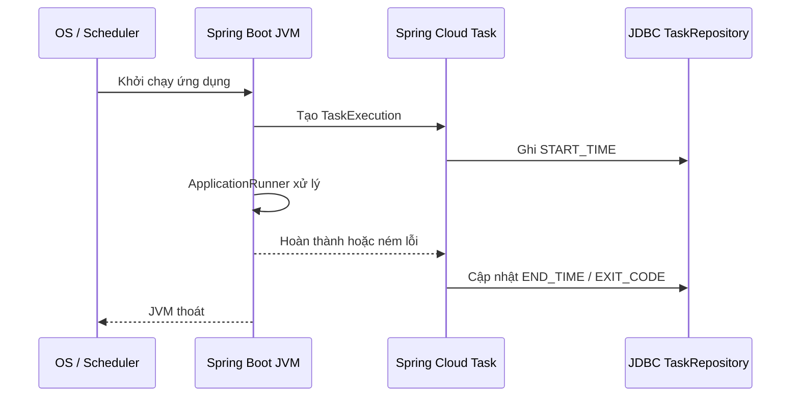
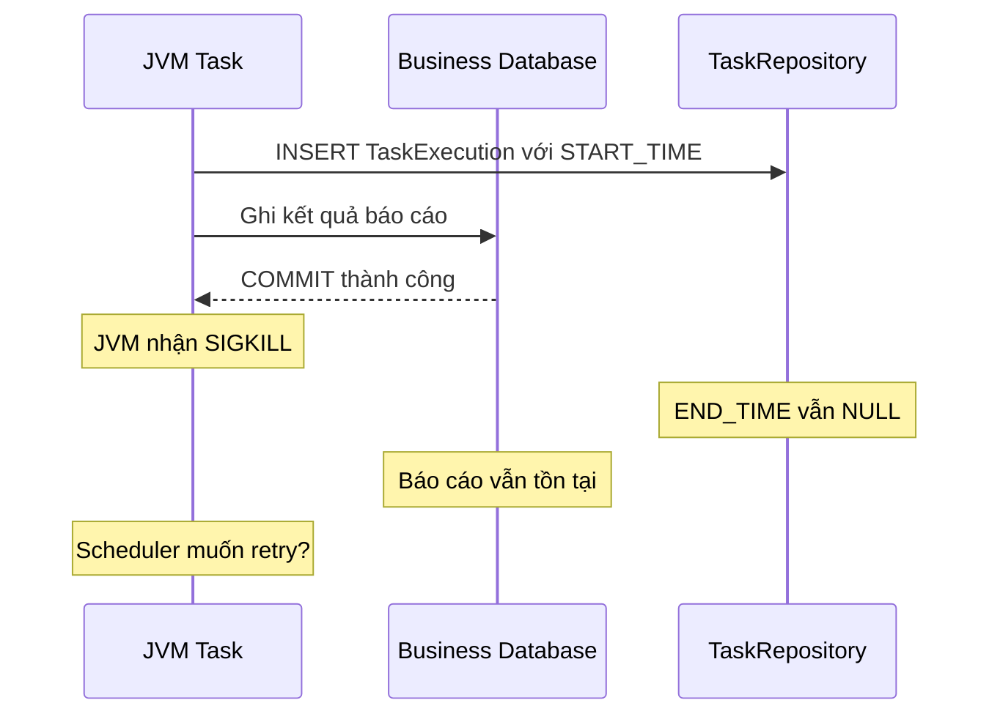
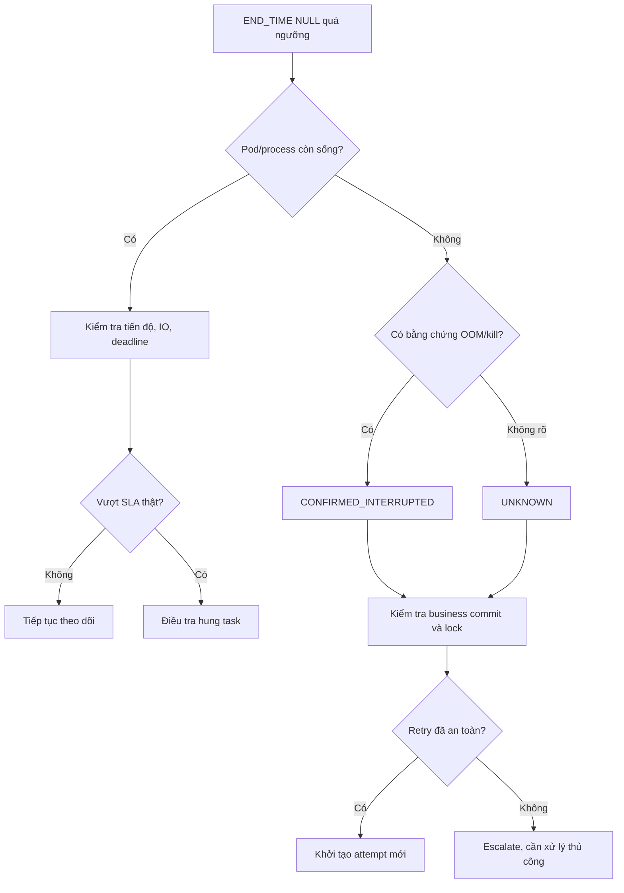

# TaskExecution thiếu endTime sau khi JVM bị ngắt

## 1. Bài toán chẩn đoán

**Spring Cloud Task** xây dựng các ứng dụng Spring Boot chạy công việc hữu hạn rồi kết thúc: nhập dữ liệu, đồng bộ, lập báo cáo hoặc chạy Spring Batch Job. Mỗi lần khởi chạy được ghi vào **TaskRepository** dưới dạng `TaskExecution` để lưu thời điểm bắt đầu, thời điểm kết thúc, tham số và trạng thái lỗi.

Một sự cố thường gặp là task đã kết thúc ở cấp hệ điều hành hoặc Kubernetes, nhưng bảng `TASK_EXECUTION` vẫn ghi:

```text
TASK_EXECUTION_ID = 1842
TASK_NAME         = daily-reconciliation
START_TIME        = 2026-11-24 08:00:01
END_TIME          = NULL
ERROR_MESSAGE     = NULL
```

**`END_TIME IS NULL` không chứng minh task còn chạy.** JVM có thể đã bị `SIGKILL`, OOM kill, crash hoặc mất kết nối database trước khi hoàn tất cập nhật metadata. Ngược lại, cũng có thể task còn chạy bình thường hoặc đang treo.

Sau bài học thuộc chương **Chẩn đoán** của `SPRING_CLOUD_TASK`, bạn có thể:

- Hiểu trình tự ghi `START_TIME` và `END_TIME` của Spring Cloud Task.
- Phân biệt dừng có kiểm soát (`SIGTERM`), dừng cưỡng bức (`SIGKILL`), lỗi ứng dụng và lỗi database.
- Dùng SQL đọc các TaskExecution còn mở mà không sửa nhầm lịch sử.
- Tái hiện hiện tượng với một ứng dụng Java và PostgreSQL bền vững.
- Đối chiếu `TaskRepository`, log, PID, Pod/Job và dữ liệu nghiệp vụ trước khi retry.
- Phân biệt sự cố metadata với trạng thái Spring Batch hoặc khóa single-instance.
- Thiết kế quy trình reconciliation và cảnh báo an toàn.

## 2. Vì sao START_TIME có mà END_TIME không?

Thông tin bắt đầu và kết thúc **không được ghi trong cùng một transaction kéo dài bằng toàn bộ thời gian xử lý**. Spring Cloud Task mở một lần thực thi và ghi metadata bắt đầu, sau đó runner xử lý. Khi đi qua đường kết thúc thích hợp, framework cập nhật `END_TIME`, mã thoát và các thông tin liên quan.



Nếu JVM biến mất **giữa hai thao tác repository**, bản ghi bắt đầu đã commit vẫn còn, còn thao tác cập nhật kết thúc không diễn ra.

| Thời điểm bị gián đoạn | Metadata có thể quan sát | Ý nghĩa |
| --- | --- | --- |
| Trước khi TaskRepository ghi thành công | Không có hàng `TASK_EXECUTION` | Lỗi startup rất sớm; không thể chẩn đoán chỉ bằng SQL Task. |
| Sau khi ghi START_TIME, trong runner | Có bản ghi nhưng `END_TIME NULL` | Chưa ghi được trạng thái cuối; có thể task đã bị dừng. |
| Sau khi dữ liệu nghiệp vụ commit, trước khi Task cập nhật | `END_TIME NULL` nhưng dữ liệu nghiệp vụ **đã có** | Retry cần idempotency để tránh ghi trùng. |
| Sau khi hoàn tất callback và update repository | Có `END_TIME` và kết quả cuối | Metadata mô tả một lần thực thi đã kết thúc. |

### 2.1. Các cột cần hiểu

| Cột `TASK_EXECUTION` | Mục đích | Giới hạn khi JVM bị kill |
| --- | --- | --- |
| `TASK_EXECUTION_ID` | ID của một lần chạy | ID tồn tại nếu bản ghi đầu đã được commit. |
| `TASK_NAME` | Tên logic task | Nhiều attempt có thể có cùng tên. |
| `START_TIME` | Thời điểm framework ghi nhận bắt đầu | Không phải heartbeat cho biết task còn sống. |
| `END_TIME` | Thời điểm framework ghi nhận kết thúc | Có thể `NULL` nếu không còn đường thực thi cập nhật. |
| `EXIT_CODE` | Mã kết quả mà Task ghi được | **Không suy diễn thành công** chỉ từ giá trị này nếu `END_TIME NULL`. |
| `ERROR_MESSAGE`, `EXIT_MESSAGE` | Lỗi/thông điệp do framework ghi được | Có thể trống nếu JVM bị ngắt đột ngột. |
| `LAST_UPDATED` | Mốc cập nhật metadata, ở các schema có hỗ trợ | Không nhất thiết được cập nhật liên tục khi runner chạy. |
| `EXTERNAL_EXECUTION_ID` | Định danh hệ điều phối nếu được điền | Có thể giúp liên hệ tới process/Pod. |

Cần xem **schema đúng phiên bản Spring Cloud Task**. `TaskRepository` khác với `JobRepository` của Spring Batch; một `BATCH_JOB_EXECUTION` đã hoàn tất không tự đảm bảo `TASK_EXECUTION.END_TIME` đã được ghi.

### 2.2. Đừng dùng EXIT_CODE hoặc ERROR_MESSAGE trống để kết luận

Nếu `END_TIME` vẫn `NULL`, kết quả cuối ở cấp TaskRepository **chưa được xác nhận**. Một `EXIT_CODE` không rỗng có thể chưa phản ánh kết quả sau cùng; `ERROR_MESSAGE` rỗng cũng không cho biết tác vụ thành công. Cần thêm bằng chứng từ scheduler, log và database nghiệp vụ.

## 3. Các nguyên nhân thường gặp

| Nguyên nhân | Dấu hiệu | Cần kiểm tra |
| --- | --- | --- |
| Task vẫn đang chạy | JVM/Pod còn sống và có tiến độ | PID, Pod status, thời lượng so SLA. |
| Task treo khi gọi DB/API | Pod Running nhưng log dừng, thread bị chờ | Thread dump, timeout, deadlock, dependency. |
| `SIGKILL` / `kill -9` | Không có log kết thúc, OS chấm dứt process ngay | Exit status, host/container events. |
| OOM kill | Container reason `OOMKilled`, thường có exit code 137 | Memory limits, `kubectl describe pod`, node events. |
| `SIGTERM` rồi hết grace period | Có dấu hiệu shutdown sau đó bị dừng cưỡng bức | `terminationGracePeriodSeconds` và shutdown logs. |
| Mất node/container runtime | Pod Evicted/Unknown/Node NotReady | Sự kiện từ Kubernetes và platform. |
| Lỗi JDBC khi update kết thúc | Runner in hoàn tất nhưng metadata chưa cập nhật | Connection pool, quyền DB, network, log JDBC. |
| Thoát ngoài framework | `System.exit`, `Runtime.halt`, native crash | Code path, OS logs, thread dump. |
| Khởi động lỗi quá sớm | Không có bản ghi đầu | Startup logs, datasource/schema. |

`SIGTERM` gửi yêu cầu dừng để tiến trình có cơ hội shutdown; nhưng **không bảo đảm** listener cập nhật repository nếu runner đang treo hoặc grace period bị vượt. `SIGKILL` **không thể bị Java bắt**, nên `@AfterTask`, `@FailedTask` và shutdown hooks không được bảo đảm chạy.

Điều này cũng đúng với callback tùy biến: dùng `@AfterTask` để ghi audit không thể làm cho `END_TIME` luôn có giá trị sau khi process bị dừng cưỡng bức.

## 4. Truy vấn SQL chỉ đọc để tìm bản ghi nghi vấn

Ví dụ dưới đây dùng **PostgreSQL**, áp dụng khi schema Spring Cloud Task đã được tạo và tài khoản chẩn đoán có quyền đọc.

### 4.1. Các lần chưa ghi thời điểm kết thúc

```sql
SELECT TASK_EXECUTION_ID,
       TASK_NAME,
       START_TIME,
       END_TIME,
       EXIT_CODE,
       ERROR_MESSAGE
FROM TASK_EXECUTION
WHERE END_TIME IS NULL
ORDER BY START_TIME ASC;
```

Đây là **danh sách cần điều tra**, không phải danh sách chắc chắn bị crash. Với bảng lớn nên giới hạn phạm vi theo tên task/thời gian và dùng pagination.

### 4.2. Tìm những bản ghi quá ngưỡng SLA

```sql
SELECT TASK_EXECUTION_ID,
       TASK_NAME,
       START_TIME,
       CURRENT_TIMESTAMP - START_TIME AS ELAPSED,
       EXIT_CODE,
       ERROR_MESSAGE
FROM TASK_EXECUTION
WHERE END_TIME IS NULL
  AND START_TIME IS NOT NULL
  AND START_TIME < CURRENT_TIMESTAMP - INTERVAL '30 minutes'
ORDER BY START_TIME;
```

Ngưỡng **30 phút chỉ để minh họa**; nếu job bình thường chạy 3 giờ thì không thể dùng chung một ngưỡng. Hãy chọn theo SLA, thời lượng p95/p99, timeout và lịch chạy.

### 4.3. Metadata bổ sung khi schema có các cột tương ứng

```sql
SELECT TASK_EXECUTION_ID,
       TASK_NAME,
       START_TIME,
       LAST_UPDATED,
       EXTERNAL_EXECUTION_ID,
       PARENT_EXECUTION_ID
FROM TASK_EXECUTION
WHERE END_TIME IS NULL;
```

`LAST_UPDATED` **không phải heartbeat chuẩn**; thiếu cập nhật trong lúc runner làm việc không có nghĩa process chết. `EXTERNAL_EXECUTION_ID` có thể không được cấp nếu hệ thống không cấu hình/tích hợp định danh đó. Khi so sánh thời gian, chú ý timezone của database, node và log.

### 4.4. Đối chiếu các lần retry

```sql
SELECT TASK_EXECUTION_ID,
       TASK_NAME,
       START_TIME,
       END_TIME,
       EXIT_CODE
FROM TASK_EXECUTION
WHERE TASK_NAME = 'daily-reconciliation'
ORDER BY TASK_EXECUTION_ID DESC;
```

Mỗi lần scheduler khởi chạy lại thường tạo một `TaskExecution` mới. Một attempt cũ có `END_TIME NULL` và attempt mới hoàn tất không nhất thiết là lỗi kép; phải phân biệt các attempt bằng thời điểm, log và ID thực thi.

## 5. Ứng dụng mẫu để tái hiện hiện tượng

Ví dụ dùng **Java 17**, **Spring Boot 3.4.5**, **Spring Cloud 2024.0.2** và PostgreSQL. Task chạy đủ lâu để người học dừng JVM khi runner đang hoạt động. PostgreSQL nằm ngoài process để lịch sử TaskExecution **không biến mất** sau khi Java bị kill.

```text
task-endtime-lab/
├── pom.xml
└── src/main/
    ├── java/com/example/diagnostics/
    │   ├── EndTimeLabApplication.java
    │   └── SlowRunner.java
    └── resources/application.yml
```

### 5.1. Maven `pom.xml`

```xml
<?xml version="1.0" encoding="UTF-8"?>
<project xmlns="http://maven.apache.org/POM/4.0.0"
         xmlns:xsi="http://www.w3.org/2001/XMLSchema-instance"
         xsi:schemaLocation="http://maven.apache.org/POM/4.0.0 https://maven.apache.org/xsd/maven-4.0.0.xsd">
    <modelVersion>4.0.0</modelVersion>

    <parent>
        <groupId>org.springframework.boot</groupId>
        <artifactId>spring-boot-starter-parent</artifactId>
        <version>3.4.5</version>
        <relativePath/>
    </parent>

    <groupId>com.example</groupId>
    <artifactId>task-endtime-lab</artifactId>
    <version>0.0.1-SNAPSHOT</version>

    <properties>
        <java.version>17</java.version>
    </properties>

    <dependencyManagement>
        <dependencies>
            <dependency>
                <groupId>org.springframework.cloud</groupId>
                <artifactId>spring-cloud-dependencies</artifactId>
                <version>2024.0.2</version>
                <type>pom</type>
                <scope>import</scope>
            </dependency>
        </dependencies>
    </dependencyManagement>

    <dependencies>
        <dependency>
            <groupId>org.springframework.cloud</groupId>
            <artifactId>spring-cloud-starter-task</artifactId>
        </dependency>
        <dependency>
            <groupId>org.springframework.boot</groupId>
            <artifactId>spring-boot-starter-jdbc</artifactId>
        </dependency>
        <dependency>
            <groupId>org.postgresql</groupId>
            <artifactId>postgresql</artifactId>
            <scope>runtime</scope>
        </dependency>
    </dependencies>

    <build>
        <plugins>
            <plugin>
                <groupId>org.springframework.boot</groupId>
                <artifactId>spring-boot-maven-plugin</artifactId>
            </plugin>
        </plugins>
    </build>
</project>
```

`spring-boot-maven-plugin` tạo executable JAR; `spring-cloud-starter-task` cung cấp TaskRepository/vòng đời, còn JDBC driver cho phép lưu metadata vào PostgreSQL. Dùng version qua BOM tương thích với Spring Boot và đúng schema Task, không tự lấy file DDL từ release khác.

### 5.2. Cấu hình `application.yml`

```yaml
spring:
  application:
    name: task-endtime-lab
  main:
    web-application-type: none
  datasource:
    url: ${TASK_DB_URL:jdbc:postgresql://localhost:5432/task_diagnostics}
    username: ${TASK_DB_USER:task_runtime}
    password: ${TASK_DB_PASSWORD:}
  cloud:
    task:
      name: daily-reconciliation
      initialize-enabled: false
      closecontext-enabled: true

logging:
  level:
    org.springframework.cloud.task: DEBUG
```

Các biến môi trường `TASK_DB_URL`, `TASK_DB_USER` và `TASK_DB_PASSWORD` được cấp lúc chạy. Database `task_diagnostics` cùng user runtime phải được tạo trước; áp dụng **DDL Spring Cloud Task đúng phiên bản**, rồi để `initialize-enabled=false`. Không dùng production database để thử dừng process.

`web-application-type: none` tránh web server giữ JVM sống. `closecontext-enabled: true` khuyến khích đóng context khi task hoàn thành, nhưng **không thể làm `SIGKILL` trở thành graceful shutdown**. Đặt logging DEBUG chỉ trong lab/khung thời gian điều tra vì log chi tiết có thể tốn tài nguyên và lộ cấu hình.

### 5.3. Ứng dụng Spring Cloud Task

`EndTimeLabApplication.java`:

```java
package com.example.diagnostics;

import org.springframework.boot.SpringApplication;
import org.springframework.boot.autoconfigure.SpringBootApplication;
import org.springframework.cloud.task.configuration.EnableTask;

@SpringBootApplication
@EnableTask
public class EndTimeLabApplication {

    public static void main(String[] args) {
        SpringApplication.run(EndTimeLabApplication.class, args);
    }
}
```

### 5.4. Runner có mốc quan sát

`SlowRunner.java`:

```java
package com.example.diagnostics;

import java.util.List;

import org.springframework.boot.ApplicationArguments;
import org.springframework.boot.ApplicationRunner;
import org.springframework.stereotype.Component;

@Component
public class SlowRunner implements ApplicationRunner {

    @Override
    public void run(ApplicationArguments args) throws Exception {
        List<String> secondsArg = args.getOptionValues("hold-seconds");
        long seconds = secondsArg == null || secondsArg.isEmpty()
                ? 120L : Long.parseLong(secondsArg.get(0));
        if (seconds < 0 || seconds > 600) {
            throw new IllegalArgumentException(
                    "--hold-seconds phải trong 0..600");
        }

        List<String> labels = args.getOptionValues("run-label");
        String label = labels == null || labels.isEmpty()
                ? "unspecified" : labels.get(0);

        System.out.println("RUNNER_STARTED label=" + label
                + " pid=" + ProcessHandle.current().pid());
        System.out.flush();

        try {
            Thread.sleep(seconds * 1000L);
        } catch (InterruptedException interrupted) {
            Thread.currentThread().interrupt();
            throw interrupted;
        }

        System.out.println("RUNNER_FINISHED label=" + label);
        System.out.flush();
    }
}
```

`Thread.sleep` chỉ mô phỏng một công việc dài. `RUNNER_STARTED` là mốc để biết ứng dụng đã vào runner trước khi thử ngắt. Trong nghiệp vụ thật, cần log có định danh yêu cầu, trạng thái checkpoint và kết quả; không dựa vào sleep làm giải pháp đồng bộ.

## 6. Tái hiện bằng hai lần chạy: bình thường và SIGKILL

**Chỉ thực hành trên máy hoặc môi trường test có database riêng.** Không dừng cưỡng bức task sản xuất chỉ để kiểm tra `END_TIME`.

### 6.1. Lần chạy bình thường

```bash
mvn clean package
java -jar target/task-endtime-lab-0.0.1-SNAPSHOT.jar \
  --hold-seconds=2 --run-label=normal-001
```

Đợi ứng dụng in:

```text
RUNNER_STARTED label=normal-001 pid=...
RUNNER_FINISHED label=normal-001
```

Truy vấn `TASK_EXECUTION` theo thời điểm/ID. Với đường đi bình thường và DB hoạt động, bản ghi sẽ có `END_TIME`. `run-label` chỉ là tham số runner; nó **không phải một cột** của `TASK_EXECUTION`. Không tự đặt tên cột `RUN_LABEL` khi viết SQL.

### 6.2. Lần chạy bị ngắt bằng SIGKILL

Trên Bash/Linux/macOS, khởi chạy process nền:

```bash
java -jar target/task-endtime-lab-0.0.1-SNAPSHOT.jar \
  --hold-seconds=120 --run-label=kill-001 > task-kill.log 2>&1 &
pid=$!
echo "PID=$pid"

# Đợi runner bắt đầu; không kill trước khi task khởi tạo.
started=false
for i in $(seq 1 100); do
  if grep -q 'RUNNER_STARTED label=kill-001' task-kill.log; then
    started=true
    break
  fi
  if ! kill -0 "$pid" 2>/dev/null; then break; fi
  sleep 0.2
done

if [ "$started" != true ]; then
  echo 'Không thấy RUNNER_STARTED; kiểm tra task-kill.log'
  wait "$pid"
  exit 2
fi

# Chỉ kill đúng PID của tiến trình test vừa khởi tạo.
kill -KILL "$pid"
status=0
wait "$pid" || status=$?
echo "OS exit status=$status"
```

Khi nhận `SIGKILL`, JVM **không có cơ hội chạy shutdown hook**, nên có thể không thực hiện UPDATE metadata kết thúc. Trên nhiều shell Unix, mã thoát do signal 9 thường là `137` (128 + 9); đây là mã ở **hệ điều hành**, không phải mã Spring Cloud Task nhất thiết đã lưu vào `TASK_EXECUTION.EXIT_CODE`.

Sau khi process biến mất, đọc lại:

```sql
SELECT TASK_EXECUTION_ID, TASK_NAME,
       START_TIME, END_TIME, EXIT_CODE, ERROR_MESSAGE
FROM TASK_EXECUTION
WHERE TASK_NAME = 'daily-reconciliation'
ORDER BY TASK_EXECUTION_ID DESC;
```

Kỳ vọng điển hình:

| Dấu hiệu | Lần bình thường | Lần bị kill |
| --- | --- | --- |
| Log `RUNNER_STARTED` | Có | Có |
| Log `RUNNER_FINISHED` | Có | Không |
| OS process còn sống sau lệnh | Không | Không |
| Metadata `START_TIME` | Có | Thường có nếu insert trước đó thành công |
| Metadata `END_TIME` | Có | **Có thể vẫn NULL** |
| `ERROR_MESSAGE` | Không có lỗi | Có thể rỗng, vì JVM không ghi được |

Nếu không có bản ghi bắt đầu do lỗi datasource hoặc process bị dừng quá sớm, đó là **test setup thất bại**, không nên kết luận đã tái hiện được thiếu `END_TIME`. Có thể kiểm tra SQL ngay khi `RUNNER_STARTED` xuất hiện để xác nhận hàng metadata trước khi gửi SIGKILL.

### 6.3. Windows PowerShell

```powershell
$jar = (Resolve-Path ".\target\task-endtime-lab-0.0.1-SNAPSHOT.jar").Path
$p = Start-Process -FilePath "java" -ArgumentList @(
    "-jar", $jar, "--hold-seconds=120", "--run-label=kill-win-001"
) -RedirectStandardOutput ".\task-win-out.log" -RedirectStandardError ".\task-win-err.log" -PassThru -NoNewWindow

# Chờ task-win-out.log xuất hiện RUNNER_STARTED.
# Chỉ dừng khi đã xác nhận đúng process thử nghiệm.
Stop-Process -Id $p.Id -Force
```

`Stop-Process -Force` mô phỏng force-stop, nhưng không hoàn toàn tương đương signal POSIX. Cần kiểm tra log và database thay vì kỳ vọng một mã thoát cố định trên mọi hệ điều hành.

### 6.4. SIGTERM là một bài test **khác**

Trên Unix, `kill -TERM PID` yêu cầu dừng mềm, tạo cơ hội để Spring thực hiện shutdown nếu điều kiện cho phép. Tuy nhiên, khi runner đang treo hoặc container có grace period quá ngắn, OS/orchestrator có thể tiếp tục cưỡng chế bằng SIGKILL.

Vì vậy, hãy thử SIGTERM riêng và quan sát kết quả thực tế. **Không khẳng định SIGTERM luôn đi qua callback cập nhật `END_TIME`**, cũng không dùng kết quả SIGTERM thay cho SIGKILL.

## 7. Chẩn đoán trên Kubernetes Job và CronJob

Trong Kubernetes, `Job` có thể tạo **Pod thử lại** sau khi một Pod thất bại, còn `CronJob` tạo Job theo lịch. Mỗi Pod có thể khởi động một JVM mới và một `TaskExecution` mới. Vì vậy khi phát hiện một hàng `END_TIME NULL`, không nên chỉ xem Pod mới nhất.

### 7.1. Truy vấn platform ở chế độ đọc

```bash
kubectl get jobs -n batch-jobs
kubectl get pods -n batch-jobs -l job-name=daily-reconciliation
kubectl describe job daily-reconciliation -n batch-jobs
kubectl describe pod POD_NAME -n batch-jobs
kubectl logs POD_NAME -n batch-jobs
```

Thay `POD_NAME` bằng tên Pod thật và dùng namespace phù hợp. Đối với container đã restart **trong cùng Pod**, thử:

```bash
kubectl logs POD_NAME -n batch-jobs --previous
```

Khi `restartPolicy: Never`, Job controller thường tạo một **Pod mới** cho lần thử khác; `--previous` không nhất thiết có dữ liệu. Cần xem đủ các Pod attempt và log mà hệ thống thu thập tập trung lưu lại.

| Dấu hiệu từ Kubernetes | Cách diễn giải |
| --- | --- |
| `terminated.reason=OOMKilled` | Có bằng chứng bị dừng do áp lực bộ nhớ; xem limits/events. |
| Exit code `137` | Thường có ý nghĩa bị SIGKILL; phải đối chiếu `reason`/events để biết nguyên nhân. |
| Exit code `143` | Thường liên quan SIGTERM trong một số runtime, không phải quy tắc tuyệt đối. |
| `NodeNotReady`, `Evicted` hoặc `Unknown` | Có thể do node/resource chứ không phải lỗi logic trong runner. |
| `activeDeadlineSeconds` đạt giới hạn | Controller có thể chấm dứt Job chưa xong. |
| `backoffLimit` vượt ngưỡng | Controller đánh giá Job thất bại sau số lần thử. |
| Pod đang `Running` nhưng không có tiến độ | Có thể đang làm việc hoặc treo; cần thêm thread dump và timeout. |

### 7.2. Manifest minh họa thời hạn và shutdown

```yaml
apiVersion: batch/v1
kind: Job
metadata:
  name: daily-reconciliation
spec:
  backoffLimit: 1
  activeDeadlineSeconds: 300
  template:
    spec:
      restartPolicy: Never
      terminationGracePeriodSeconds: 30
      containers:
        - name: task
          image: registry.example.com/tasks/daily-reconciliation:1.0.0
          args:
            - "--hold-seconds=120"
```

Image, namespace, datasource và các thông số là **minh họa**, chưa đủ để chạy thực tế. Cần thêm Secret, resource requests/limits, quyền database và image registry phù hợp.

`terminationGracePeriodSeconds` là thời gian Kubernetes dành cho việc đóng process, **không phải lời hứa rằng listener Task sẽ cập nhật `END_TIME`**. Một container bị OOM kill hoặc node bị ngắt vẫn có thể bỏ lại metadata chưa kết thúc.

### 7.3. Đối chiếu một TaskExecution với đúng Pod

Nên lưu những định danh tương quan:

- `TASK_EXECUTION_ID` của mỗi lần thực thi.
- Tên Task, ngày/giờ khởi động và `requestId` nghiệp vụ nếu có.
- Job name, Pod name/UID, namespace, node, container exit code.
- `EXTERNAL_EXECUTION_ID` nếu nền tảng tích hợp đã điền trường đó.
- `attemptId` riêng cho từng lần retry, phân biệt với request ID **giữ nguyên** cho một lệnh nghiệp vụ.

Đừng mặc định `Pod UID` bằng `TASK_EXECUTION_ID`. Chúng được tạo bởi hai hệ thống khác nhau. Cũng không nên đưa request ID chứa thông tin nhạy cảm vào URL, logs công khai hoặc metric tags có cardinality cao.

## 8. Dữ liệu nghiệp vụ có thể đã commit trước khi JVM chết

Đây là nguyên nhân quan trọng nhất khiến việc tự sửa metadata hoặc retry vội vàng trở nên nguy hiểm.



**`END_TIME NULL` không chứng minh tác động nghiệp vụ chưa xảy ra.** Nếu scheduler retry với một request ID mới, task có thể tạo báo cáo/đơn hàng/thanh toán lần hai.

### 8.1. Đối chiếu dữ liệu nghiệp vụ

Giả sử ứng dụng có một bảng `report_output` do **nghiệp vụ tự định nghĩa**, không phải bảng Spring Cloud Task:

```sql
SELECT request_id, report_day, status, created_at
FROM report_output
WHERE request_id = 'report-20261124';
```

Nếu báo cáo đã tồn tại và được commit, việc cần làm có thể là đánh dấu yêu cầu đã hoàn thành ở hệ điều phối hoặc chạy một bước bù trừ cụ thể, **không** tạo lại toàn bộ báo cáo.

Nếu kết quả chưa có, vẫn phải kiểm tra xem một transaction còn chưa xác định kết quả do kết nối bị ngắt không. Không suy luận rằng một ngoại lệ JDBC đồng nghĩa server chưa commit.

### 8.2. Mẫu idempotency với khóa duy nhất

Một thiết kế cơ bản:

```sql
CREATE TABLE report_request (
    request_id VARCHAR(100) PRIMARY KEY,
    report_day DATE NOT NULL,
    status VARCHAR(20) NOT NULL,
    created_at TIMESTAMPTZ NOT NULL DEFAULT CURRENT_TIMESTAMP
);
```

Ứng dụng cần giữ `request_id` **ổn định qua mọi retry** của cùng lệnh, kiểm tra payload khi gặp ID đã tồn tại, và thực hiện các thay đổi SQL trong transaction thích hợp. Unique constraint tránh hai transaction ghi kết quả cùng ID.

Ví dụ một thao tác PostgreSQL có tính nguyên tử:

```sql
INSERT INTO report_request (request_id, report_day, status)
VALUES ('report-20261124', DATE '2026-11-24', 'PROCESSING')
ON CONFLICT (request_id) DO NOTHING;
```

Kết quả từ lệnh INSERT chỉ là **marker**; để bảo đảm chính xác còn cần thiết kế trạng thái `PROCESSING`, `COMPLETED`, rollback, retry của marker bị kẹt và việc commit hiệu ứng nghiệp vụ. Không để trạng thái `PROCESSING` trở thành bằng chứng vĩnh viễn task còn hoạt động.

Nếu task gọi email, thanh toán, Kafka hoặc API ngoài database, một SQL transaction không thể rollback side effect ở hệ thống khác. Khi ấy cần idempotency key phía đích, transactional outbox hoặc quy trình reconcile riêng.

### 8.3. Đối chiếu với Spring Batch

Khi task chạy Spring Batch, TaskRepository lưu **TaskExecution** còn Batch `JobRepository` lưu **JobExecution/StepExecution**. Nếu cấu hình `spring-cloud-task-batch` với listener thích hợp, bảng `TASK_TASK_BATCH` có thể liên kết hai ID.

```sql
SELECT t.TASK_EXECUTION_ID,
       t.TASK_NAME,
       t.END_TIME AS TASK_END_TIME,
       e.JOB_EXECUTION_ID,
       e.STATUS AS BATCH_STATUS,
       e.END_TIME AS BATCH_END_TIME
FROM TASK_TASK_BATCH x
JOIN TASK_EXECUTION t
  ON t.TASK_EXECUTION_ID = x.TASK_EXECUTION_ID
JOIN BATCH_JOB_EXECUTION e
  ON e.JOB_EXECUTION_ID = x.JOB_EXECUTION_ID
WHERE t.END_TIME IS NULL
ORDER BY t.TASK_EXECUTION_ID DESC;
```

**Điều kiện:** Các bảng Task/Batch phải cùng database có thể JOIN, và tích hợp `TASK_TASK_BATCH` đã được kích hoạt. Nếu repository nằm ở hai hệ quản trị, truy vấn riêng rồi ghép thông tin ở ứng dụng.

Một `TaskExecution` thiếu `END_TIME` vẫn có thể liên kết Batch Job đã `COMPLETED` hoặc Batch Job chưa hoàn tất. Khi quyết định restart, cần kiểm tra `BATCH_JOB_INSTANCE`, `BATCH_JOB_EXECUTION`, `BATCH_STEP_EXECUTION`, JobParameters và checkpoint. Đừng tự sửa trạng thái JobRepository để qua lỗi restart nếu chưa hiểu các Step đã commit.

## 9. Không nhầm `END_TIME NULL` với khóa single-instance

Nếu đã bật:

```yaml
spring:
  cloud:
    task:
      single-instance-enabled: true
```

Spring Cloud Task dùng hạ tầng khóa JDBC của Spring Integration để tránh nhiều lần chạy **cùng tên task** chồng nhau. Cơ chế này liên quan bảng `TASK_LOCK` theo schema Task, **không phải trực tiếp giá trị `TASK_EXECUTION.END_TIME`**.

Hệ quả:

- Một bản ghi `TaskExecution` còn mở sau crash **không tự chứng minh** khóa vẫn được giữ.
- Một khóa có TTL có thể hết hiệu lực trong khi process cũ còn sống, tạo rủi ro overlap.
- Một retry bị từ chối cần xem **log khóa, process thực tế, Task name, datasource và TTL**, không chỉ xét `END_TIME`.
- **Không xóa thủ công dòng `TASK_LOCK`** khi chưa chứng minh chủ sở hữu đã dừng; có thể tạo hai tiến trình cùng làm việc.

`single-instance-enabled` tránh overlap theo tên task, nhưng không bảo vệ chống duplicate **tuần tự** sau khi khóa nhả. Cần idempotency nghiệp vụ riêng.

## 10. Reconciliation: điều tra trước, đừng sửa lịch sử tùy tiện

Khi có hàng `END_TIME NULL` vượt SLA, nên tạo một quy trình **đối soát** dựa trên nhiều nguồn:



`UNKNOWN` và `CONFIRMED_INTERRUPTED` là **phân loại do hệ thống vận hành tự định nghĩa**, **không phải status chính thức tự sinh** trong bảng `TASK_EXECUTION`.

### 10.1. Ghi bằng chứng ở bảng audit riêng

Ví dụ:

```sql
CREATE TABLE task_execution_investigation (
    task_execution_id BIGINT PRIMARY KEY,
    observed_at TIMESTAMPTZ NOT NULL DEFAULT CURRENT_TIMESTAMP,
    observed_status VARCHAR(40) NOT NULL,
    evidence_summary TEXT NOT NULL,
    decision VARCHAR(60)
);
```

Ghi một kết luận có bằng chứng:

```sql
INSERT INTO task_execution_investigation (
    task_execution_id,
    observed_status,
    evidence_summary,
    decision
) VALUES (
    1842,
    'CONFIRMED_INTERRUPTED',
    'Pod OOMKilled; END_TIME NULL; no process alive',
    'CHECK_BUSINESS_STATE_BEFORE_RETRY'
);
```

Đây là **bảng riêng do ứng dụng vận hành tạo**, không thuộc schema Spring Cloud Task. Lưu audit tách biệt giúp giữ nguyên dữ liệu gốc và giải thích vì sao hệ thống cho phép/chưa cho phép retry.

### 10.2. Có nên tự cập nhật END_TIME và EXIT_CODE?

**Không tự động thực hiện** thao tác như:

```sql
-- Ví dụ điều KHÔNG nên tự động chạy để che lỗi:
-- UPDATE TASK_EXECUTION
-- SET END_TIME = CURRENT_TIMESTAMP, EXIT_CODE = 0
-- WHERE END_TIME IS NULL;
```

Lý do:

1. Một task vẫn sống có thể bị gắn nhãn hoàn tất và sau đó tự ghi metadata.
2. Thời điểm đối soát **không phải** thời điểm JVM thật sự kết thúc.
3. `EXIT_CODE=0` sẽ tạo thông tin **thành công giả** nếu process bị kill hoặc nghiệp vụ lỗi.
4. Báo cáo SLA, audit và quyết định retry trở nên sai lệch.

Nếu một tình huống bắt buộc phải sửa metadata framework, đó phải là **quy trình khôi phục được phê duyệt**: xác minh process đã chết, biết rõ execution ID, sao lưu, có khóa/transaction thích hợp, ghi lại before/after và kiểm tra các hệ thống liên quan. Không xây bot tự sửa mọi hàng `END_TIME NULL`.

## 11. Phòng ngừa và giảm tác động khi JVM bị ngắt

Không có đoạn mã Java nào có thể bảo đảm callback của Spring chạy sau **SIGKILL** hoặc mất điện. Vì vậy mục tiêu vận hành là **giảm xác suất mất thông tin kết thúc, lưu bằng chứng ở nguồn khác và làm retry an toàn**.

### 11.1. Đóng JVM và timeout có chủ đích

- Không mở web server không cần thiết cho task; ứng dụng hữu hạn thường dùng `spring.main.web-application-type=none`.
- Sử dụng cơ chế đóng context bình thường của Spring Cloud Task khi hoàn tất, nhưng không hiểu nó là bảo vệ trước SIGKILL.
- Bảo đảm runner chờ mọi `CompletableFuture`/thread/Job bắt buộc hoàn tất trước khi trả về.
- Thiết lập connect/read timeout cho JDBC, HTTP, queue và external API, tránh tình huống runner treo vô thời hạn.
- Khi xử lý `InterruptedException`, dừng nghiệp vụ an toàn, khôi phục interrupt flag nếu phù hợp và để framework nhận biết lỗi.
- Thiết kế shutdown trước `terminationGracePeriodSeconds`; không phụ thuộc vào grace period dài vô hạn.
- Tránh gọi `Runtime.halt` hoặc chấm dứt process trực tiếp trong giữa xử lý khi không thật sự cần thiết.

### 11.2. Thiết kế dữ liệu có thể retry

- Mỗi yêu cầu nghiệp vụ có **idempotency key ổn định** qua các lần retry.
- Sử dụng unique constraint/upsert và transaction cho các kết quả cần tránh trùng.
- Với tác vụ dài, lưu checkpoint theo nhóm công việc để biết đã commit đến đâu.
- Với API ngoài hoặc message broker, kết hợp outbox hoặc idempotency tại dịch vụ đích.
- Với Spring Batch, kiểm tra tính restartable của reader, writer, JobParameters, Step checkpoint.
- Khi mất kết nối DB và không biết transaction có commit hay không, **đối chiếu dữ liệu** trước khi áp dụng lại tác động.

### 11.3. Tín hiệu giám sát bổ sung

| Tín hiệu | Điều nó phát hiện tốt | Giới hạn |
| --- | --- | --- |
| `TASK_EXECUTION.END_TIME IS NULL` quá SLA | Lần chạy chưa ghi kết quả cuối | Không chứng minh process đã chết. |
| Kubernetes/OS exit status | SIGKILL, OOM, crash, timeout ở tầng runtime | Không chứng minh dữ liệu nghiệp vụ đã rollback. |
| Log ứng dụng có correlation ID | Bước cuối được nhìn thấy | Log cuối có thể không được flush trước khi kill. |
| Micrometer Observation/metrics | Thời lượng, lỗi, dấu hiệu chậm | Exporter của task ngắn có thể chưa gửi dữ liệu trước khi chết. |
| Spring Cloud Stream task events | Thông báo bắt đầu/kết thúc nếu được phát | Event kết thúc cũng có thể thiếu khi JVM biến mất. |
| Bảng nghiệp vụ/idempotency | Thao tác đã commit | Không thay thế TaskRepository để lưu toàn bộ lịch sử thực thi. |
| Scheduler run history | Phát hiện task chưa được khởi chạy đủ xa để ghi TaskExecution | Cần tương quan chính xác giữa attempt và Task ID. |

**Chỉ nhìn timer hoặc event “start” mà không có “end”** cũng mới là dấu hiệu cần điều tra. Khi process bị kill, cả metadata cuối, metric cuối và event cuối đều có thể không xuất hiện.

## 12. Những tình huống thực tế dễ chẩn đoán sai

### Tình huống A — OOMKilled sau khi tạo hóa đơn

Kubernetes Job đã ghi hóa đơn vào database nghiệp vụ rồi bị `OOMKilled` khi tạo PDF. `TASK_EXECUTION.END_TIME NULL`, nhưng bảng invoice đã có kết quả.

**Phương án:** xem số hóa đơn có unique key, kiểm tra artifact PDF còn thiếu và lập quy trình xử lý tiếp những phần chưa hoàn thành. Không tự chạy lại toàn bộ bước tạo hóa đơn với ID mới.

### Tình huống B — SIGTERM rồi bị SIGKILL sau 10 giây

Pod nhận SIGTERM do rollout/timeout. Runner đang chờ HTTP client, grace period chỉ 10 giây nên controller cưỡng chế dừng.

**Phương án:** đối chiếu logs và thời điểm signal, kiểm tra timeout HTTP, khả năng hủy công việc, checkpoint; điều chỉnh grace period nếu hợp lý, nhưng không coi việc tăng thời gian này bảo đảm mọi lần đều lưu `END_TIME`.

### Tình huống C — Runner đã xong, metadata DB không truy cập được

Ứng dụng đã commit báo cáo vào database nghiệp vụ và in log hoàn tất. Kết nối tới TaskRepository bị lỗi ngay khi cần cập nhật kết thúc.

**Phương án:** xem JDBC exception, DB/network logs và bảng nghiệp vụ. Trước retry, xác minh kết quả đã được commit. Một bản ghi `END_TIME NULL` không đủ để quyết định chạy lại.

### Tình huống D — JVM chưa chết, chỉ treo

Một execution có `START_TIME` từ hai giờ trước, Pod vẫn Running nhưng task không có log tiến độ; thread bị chặn ở socket.

**Phương án:** thu thread dump, kiểm tra dependency/timeout và trạng thái giao dịch. Không khởi chạy bản sao khác khi tiến trình cũ vẫn có thể ghi dữ liệu, trừ khi có cơ chế fencing/idempotency đủ mạnh.

## 13. Bảng tra cứu xử lý sự cố

| Hiện tượng | Giả thuyết ưu tiên | Cách kiểm chứng |
| --- | --- | --- |
| `END_TIME NULL`, Pod Running | Task đang làm việc hoặc treo | PID/Pod liveness, tiến độ, thread dump và SLA. |
| `END_TIME NULL`, Pod OOMKilled | JVM bị dừng cưỡng bức | Pod reason, memory metrics, OS exit code. |
| `END_TIME NULL`, runner log “done” | Metadata update lỗi hoặc JVM chết sau nghiệp vụ | JDBC errors, DB connectivity, platform events. |
| `END_TIME NULL`, process đã SIGKILL | Không chạy đường kết thúc framework | Exit status OS, log cuối và bản ghi START_TIME. |
| Không có hàng TaskExecution | Startup lỗi rất sớm hoặc đọc sai schema/DB | Logs, URL JDBC, profile, quyền metadata. |
| Nhiều hàng cùng task name | Các lần chạy khác nhau hoặc retry | So ID, thời gian, request ID và Pod attempt. |
| Retry bị chặn sau khi Pod cũ chết | Khóa single-instance chưa nhả/TTL chưa hết hoặc process khác còn chạy | Xem `TASK_LOCK`, owner, TTL và scheduler. |
| `ERROR_MESSAGE NULL` | Framework chưa có cơ hội ghi lỗi | Dùng OS/Pod/log, không coi là thành công. |
| Bản ghi quá hạn nhưng task còn sống | SLA thấp hoặc task thật sự bị treo | So workload, CPU/IO, thread dump, giới hạn timeout. |
| Spring Batch COMPLETED, Task chưa có END_TIME | Lỗi sau Batch, trước Task metadata update | Xem `TASK_TASK_BATCH`, JobRepository, Task logs và database. |

Quy trình nhanh: **SQL nghi vấn → tìm đúng Pod/PID → kiểm tra signal/exit code → xem JDBC lỗi kết thúc → kiểm tra business commit → quyết định retry có idempotency → ghi bằng chứng đối soát**.

## 14. Checklist vận hành production

1. Xác nhận phiên bản Spring Cloud Task và schema TaskRepository phù hợp.
2. Dùng truy vấn **chỉ đọc** tìm `END_TIME NULL` theo ngưỡng SLA của từng task.
3. Xác định đúng `TASK_EXECUTION_ID`, Pod, Job, namespace hoặc PID.
4. Kiểm tra process còn sống, treo, bị kill hay bị OOM.
5. Thu log, container exit code, sự kiện OS/Kubernetes, thời gian và request ID.
6. Kiểm tra quyền/kết nối database metadata trong khoảng thời gian task kết thúc.
7. Kiểm tra các tác động nghiệp vụ đã commit **trước khi retry**.
8. Đối chiếu Batch `JobExecution`/`StepExecution` nếu task chạy Spring Batch.
9. Kiểm tra bảng `TASK_LOCK`, TTL và liveness nếu dùng single-instance.
10. Không xóa khóa hoặc cập nhật `END_TIME` tùy tiện khi task có thể vẫn chạy.
11. Ghi trạng thái điều tra `UNKNOWN`/`CONFIRMED_INTERRUPTED` vào audit riêng.
12. Giữ idempotency key ổn định; phân biệt request ID với attempt ID.
13. Có alert cho **task không xuất hiện đúng lịch**, vì lỗi startup sớm có thể chưa tạo TaskExecution.
14. Chỉ thử SIGKILL, timeout và OOM injection trong staging/test cô lập.

## 15. Bài tập thực hành

### Bài tập 1 — So sánh chạy bình thường và SIGKILL

1. Tạo dự án ví dụ và PostgreSQL test với schema Spring Cloud Task chính thức.
2. Chạy `--hold-seconds=2`, xác nhận `END_TIME` được lưu.
3. Chạy `--hold-seconds=120`, đợi `RUNNER_STARTED` rồi cưỡng chế dừng JVM test.
4. So log, OS exit status, `TASK_EXECUTION.START_TIME` và `END_TIME`.
5. Giải thích vì sao `ERROR_MESSAGE` có thể vẫn trống.

### Bài tập 2 — Hai execution đều END_TIME NULL

Execution A có Pod đang Running và log vẫn cập nhật; execution B có Pod `OOMKilled`. Hãy thiết kế cách phân loại A/B, các bằng chứng cần lưu và bước xử lý tiếp theo mà không sửa metadata gốc.

### Bài tập 3 — Retry khi dữ liệu đã commit

Một task bị kill ngay sau khi đã ghi báo cáo. Đề xuất unique key, transaction và SQL kiểm tra để tránh tạo lại báo cáo khi scheduler retry.

### Bài tập 4 — Spring Batch trên Kubernetes Job

Một ứng dụng Task chạy Spring Batch Job ba Step. JVM bị kill ở Step thứ ba và Task thiếu `END_TIME`. Hãy nêu các bảng cần đối chiếu, cách xác minh checkpoint và lúc nào có thể restart thay vì tạo JobInstance mới.

### Câu hỏi tự kiểm tra

1. Vì sao `START_TIME` đã ghi nhưng `END_TIME` vẫn có thể `NULL`?
2. `END_TIME IS NULL` có chứng minh JVM đang chạy không?
3. Vì sao `SIGKILL` không cho framework chạy shutdown callback?
4. `SIGTERM` có bảo đảm `@AfterTask` được gọi không?
5. Tại sao `ERROR_MESSAGE NULL` không có nghĩa task thành công?
6. Làm sao phát hiện một Pod `OOMKilled`?
7. `TASK_LOCK` và `TASK_EXECUTION.END_TIME` có cùng vai trò không?
8. Vì sao không được tự động điền `END_TIME=NOW()` và `EXIT_CODE=0`?
9. Khi một lần chạy bị kill sau commit, retry thế nào để tránh trùng dữ liệu?
10. Khi task chạy Spring Batch, cần kiểm tra thêm metadata nào?

**Ghi nhớ:** `TaskExecution.END_TIME IS NULL` là **thiếu xác nhận kết thúc trong metadata**, không phải bằng chứng task còn chạy hoặc chưa tạo tác động nghiệp vụ. JVM bị `SIGKILL`, OOM kill, dừng cưỡng bức hoặc lỗi cập nhật TaskRepository đều có thể gây ra hiện tượng này. Chẩn đoán phải đối chiếu **TaskRepository, OS/Pod/scheduler, logs, trạng thái khóa và dữ liệu nghiệp vụ**; retry an toàn dựa vào idempotency, và kết luận điều tra nên được lưu riêng thay vì sửa lịch sử tùy tiện.

## Tài liệu tham khảo

- [Spring Cloud Task 3.2 — Features](https://docs.spring.io/spring-cloud-task/reference/3.2/features.html): vòng đời TaskExecution, TaskRepository và quản lý application context.
- [Spring Cloud Task 3.2 — Task Repository Schema](https://docs.spring.io/spring-cloud-task/reference/3.2/appendix-task-repository-schema.html): các cột `TASK_EXECUTION` và bảng metadata liên quan.
- [Spring Cloud Task 3.2 — Observability](https://docs.spring.io/spring-cloud-task/reference/3.2/observability.html): metrics và traces cho vòng đời Task.
- [Kubernetes — Pod Lifecycle](https://kubernetes.io/docs/concepts/workloads/pods/pod-lifecycle/): trạng thái container và hành vi dừng.
- [Kubernetes — Job](https://kubernetes.io/docs/concepts/workloads/controllers/job/): retry, Pod attempts và deadline.
- [Spring Batch — Configuring a Job](https://docs.spring.io/spring-batch/reference/job/configuring-job.html): JobRepository, JobInstance, JobExecution và restart.
